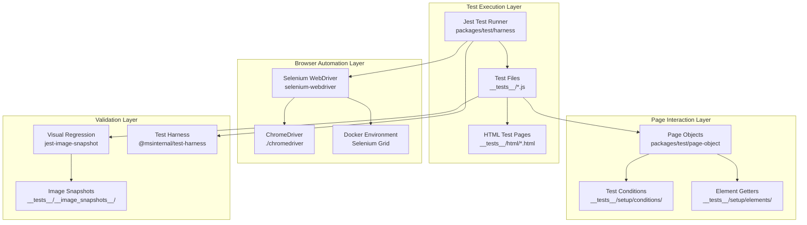
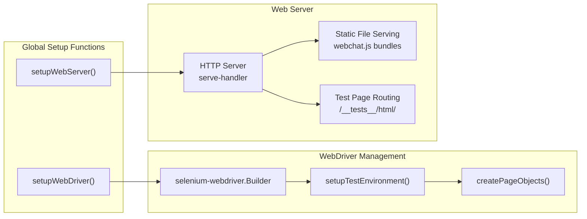
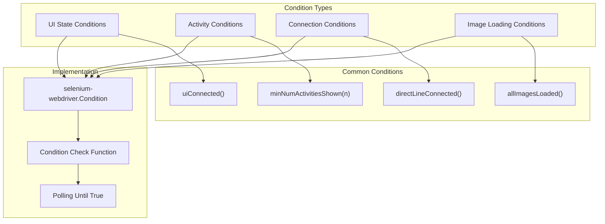
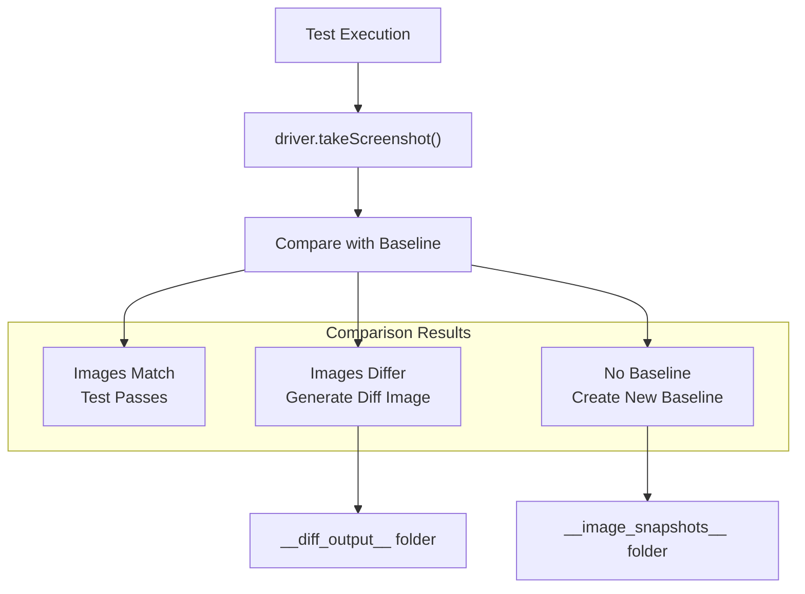
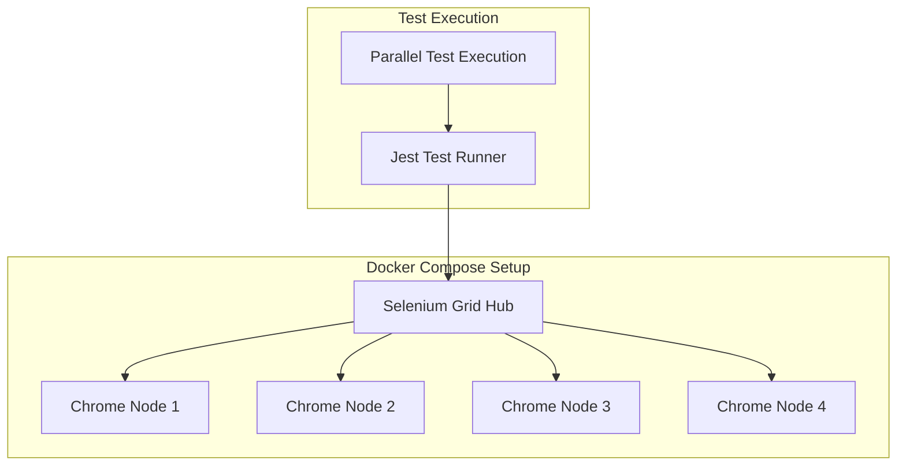

<!-- source: DeepWiki mcp.deepwiki.com · repo microsoft/BotFramework-WebChat · page 6.2 Testing Infrastructure · fetched 2026-10-26 -->

# Testing Infrastructure

<details>
<summary>Relevant source files</summary>

The following files were used as context for generating this wiki page:

- [.github/CONTRIBUTING.md](.github/CONTRIBUTING.md)
- [.github/PULL_REQUEST_TEMPLATE.md](.github/PULL_REQUEST_TEMPLATE.md)
- [__tests__/README.md](__tests__/README.md)
- [__tests__/__image_snapshots__/chrome-docker/username-js-send-username-in-activity-1-snap.png](__tests__/__image_snapshots__/chrome-docker/username-js-send-username-in-activity-1-snap.png)
- [__tests__/__image_snapshots__/html/accessibility-live-region-activity-status-send-failed-contrast-js-live-region-should-render-send-failed-retry-correctly-in-high-contrast-mode-1-snap.png](__tests__/__image_snapshots__/html/accessibility-live-region-activity-status-send-failed-contrast-js-live-region-should-render-send-failed-retry-correctly-in-high-contrast-mode-1-snap.png)
- [__tests__/basic.js](__tests__/basic.js)
- [__tests__/carousel.js](__tests__/carousel.js)
- [__tests__/constants.json](__tests__/constants.json)
- [__tests__/html/accessibility.liveRegion.activityStatus.sendFailed.contrast.html](__tests__/html/accessibility.liveRegion.activityStatus.sendFailed.contrast.html)
- [__tests__/html/accessibility.liveRegion.activityStatus.sendFailed.contrast.js](__tests__/html/accessibility.liveRegion.activityStatus.sendFailed.contrast.js)
- [__tests__/setup/conditions/directLineConnected.js](__tests__/setup/conditions/directLineConnected.js)
- [__tests__/setup/conditions/minNumActivitiesShown.js](__tests__/setup/conditions/minNumActivitiesShown.js)
- [__tests__/setup/conditions/typingActivityReceived.js](__tests__/setup/conditions/typingActivityReceived.js)
- [__tests__/setup/setupTestFramework.js](__tests__/setup/setupTestFramework.js)
- [__tests__/stacked.js](__tests__/stacked.js)
- [__tests__/suggestedActions.js](__tests__/suggestedActions.js)
- [__tests__/username.js](__tests__/username.js)
- [docs/media/running-test.png](docs/media/running-test.png)
- [packages/component/src/Utils/InlineMarkdown.js](packages/component/src/Utils/InlineMarkdown.js)
- [packages/component/src/Utils/createCustomEvent.js](packages/component/src/Utils/createCustomEvent.js)
- [packages/support/cldr-data-downloader/package.json](packages/support/cldr-data-downloader/package.json)
- [packages/support/cldr-data/package.json](packages/support/cldr-data/package.json)
- [packages/test/dev-server/package.json](packages/test/dev-server/package.json)
- [packages/test/harness/package.json](packages/test/harness/package.json)
- [packages/test/harness/src/browser/globals/run.js](packages/test/harness/src/browser/globals/run.js)
- [packages/test/harness/src/host/dev/index.js](packages/test/harness/src/host/dev/index.js)
- [packages/test/harness/src/host/jest/runHTML.js](packages/test/harness/src/host/jest/runHTML.js)
- [packages/test/page-object/package.json](packages/test/page-object/package.json)

</details>


## Purpose and Scope

The testing infrastructure in BotFramework-WebChat provides comprehensive end-to-end testing capabilities using visual regression testing, browser automation, and a sophisticated page object model. This document covers the Jest-based test framework, Selenium WebDriver integration, visual snapshot testing, and the supporting test harness infrastructure.

For information about the build system that compiles test code, see [Build System](#6.1). For sample applications used in testing scenarios, see [Sample Applications](#6.3).

## Core Testing Architecture

The testing infrastructure is built around several key packages and systems that work together to provide reliable browser-based testing.

### Testing Infrastructure Components



**Sources:** [packages/test/harness/package.json:54-83](), [__tests__/setup/setupTestFramework.js:1-13](), [__tests__/constants.json:1-19]()

### Test Framework Setup

The main test framework setup is handled by the `setupTestFramework.js` file, which provides global functions for WebDriver and web server management.



**Sources:** [__tests__/setup/setupTestFramework.js:27-87](), [__tests__/setup/setupTestFramework.js:89-130]()

## Test Execution Flow

### Manual Test Execution

For development and debugging, tests can be run manually using ChromeDriver:

1. **Start Development Server**: Run `npm start` to serve WebChat bundles
2. **Launch Browser**: Run `npm run browser` to open test pages at `http://localhost:5001/__tests__/html/`
3. **Navigate to Test**: Browse to specific test HTML files
4. **Visual Feedback**: Tests display a green check mark on success

**Sources:** [.github/CONTRIBUTING.md:118-135]()

### Automated Test Execution

For CI/CD and comprehensive testing, the infrastructure uses Docker and Selenium Grid:

```mermaid
sequenceParticram
    participant Jest
    participant Docker as "Docker Compose<br/>Selenium Grid"
    participant WebDriver as "Selenium WebDriver"
    participant TestHarness as "Test Harness"
    participant Browser as "Chrome Nodes"
    
    Jest->>Docker: Start Grid with 4 Chrome nodes
    Jest->>WebDriver: Allocate WebDriver session
    WebDriver->>TestHarness: Load test page
    TestHarness->>Browser: Execute test code
    Browser->>TestHarness: Return results
    TestHarness->>WebDriver: Screenshot for comparison
    WebDriver->>Jest: Visual regression result
```

**Sources:** [.github/CONTRIBUTING.md:138-145](), [packages/test/harness/src/host/jest/runHTML.js:44-113]()

## Page Object Model

The page object model provides a structured way to interact with WebChat UI elements and encapsulates common testing patterns.

### Page Object Structure

| Component | Purpose | Location |
|-----------|---------|----------|
| `pageObjects` | Main interaction interface | `packages/test/page-object` |
| `pageConditions` | Waiting conditions | `__tests__/setup/conditions/` |
| `pageElements` | Element selectors | `__tests__/setup/elements/` |

### Common Page Object Methods

The page objects provide methods for interacting with WebChat functionality:

- `sendMessageViaSendBox(message, options)` - Send messages through the send box
- `pingBot()` - Establish connection with the bot
- Element getters for activities, buttons, and other UI components

**Sources:** [__tests__/basic.js:14-24](), [__tests__/suggestedActions.js:17-27]()

### Test Conditions System

The conditions system provides reliable waiting mechanisms for asynchronous operations:



**Sources:** [__tests__/setup/conditions/minNumActivitiesShown.js:1-25](), [__tests__/setup/conditions/directLineConnected.js:1-11]()

## Visual Regression Testing

Visual regression testing uses `jest-image-snapshot` to detect visual changes by comparing screenshots.

### Visual Testing Configuration

The visual regression system is configured through constants and uses `pixelmatch` for image comparison:

```javascript
// From __tests__/constants.json
{
  "imageSnapshotOptions": {
    "customDiffConfig": {
      "threshold": 0.14
    },
    "noColors": true
  }
}
```

### Screenshot Comparison Process



**Sources:** [__tests__/constants.json:3-8](), [__tests__/basic.js:21-24](), [.github/CONTRIBUTING.md:116-117]()

## Test Environment Setup

### Development Environment Requirements

The testing infrastructure requires several tools and configurations:

| Tool | Purpose | Installation |
|------|---------|--------------|
| Node.js LTS | Runtime environment | Download from nodejs.org |
| ChromeDriver | Browser automation | Extract to project root |
| Docker Desktop | Test isolation | Download Docker Desktop |
| WSL2 (Windows) | Linux compatibility | Windows Subsystem for Linux |

### Docker Configuration

For automated testing, Docker provides isolated browser environments:



**Sources:** [.github/CONTRIBUTING.md:24-34](), [.github/CONTRIBUTING.md:138-144]()

## Test Configuration and Constants

### Timeout Configuration

The testing system uses various timeouts for different operations:

```javascript
// From __tests__/constants.json
{
  "timeouts": {
    "directLine": 15000,
    "fetch": 2500,
    "fetchImage": 5000,
    "navigation": 10000,
    "postActivity": 30000,
    "scrollToBottom": 4000,
    "test": 50000,
    "ui": 1000
  }
}
```

### Test Harness Package

The test harness provides browser-specific testing utilities and includes dependencies for:

- **Core Testing**: `expect`, `lolex` for fake timers, `math-random` for deterministic randomization
- **Accessibility**: `axe-core` for accessibility testing
- **Browser Compatibility**: `core-js` for polyfills, `event-target-shim` for event handling
- **Development Tools**: `jest-image-snapshot`, `selenium-webdriver`, `express` for test servers

**Sources:** [__tests__/constants.json:9-18](), [packages/test/harness/package.json:54-62]()

## Test Organization Patterns

### Test File Structure

Test files follow consistent patterns for setup, execution, and validation:

```javascript
// Common test pattern from __tests__/basic.js
jest.setTimeout(timeouts.test);

test('test description', async () => {
  const { driver, pageObjects } = await setupWebDriver();
  
  await driver.wait(uiConnected(), timeouts.directLine);
  await pageObjects.sendMessageViaSendBox('message', { waitForSend: true });
  
  await driver.wait(minNumActivitiesShown(2), timeouts.directLine);
  await driver.wait(allImagesLoaded(), timeouts.fetchImage);
  
  const base64PNG = await driver.takeScreenshot();
  expect(base64PNG).toMatchImageSnapshot(imageSnapshotOptions);
});
```

### HTML Test Pages

Test pages provide controlled environments for specific testing scenarios and include:

- **WebChat Integration**: Load WebChat bundles and initialize with test configuration
- **Test Execution**: Use the `run()` function from test harness to execute test logic
- **Error Handling**: Capture and report errors with context
- **Accessibility Testing**: Support for high-contrast mode and other accessibility features

**Sources:** [__tests__/basic.js:12-24](), [__tests__/html/accessibility.liveRegion.activityStatus.sendFailed.contrast.html:12-51]()

---

