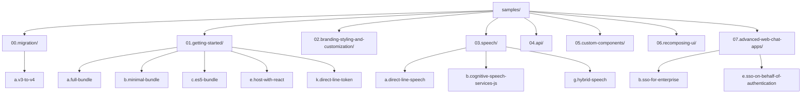
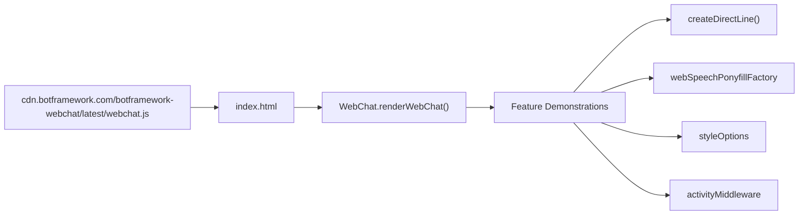
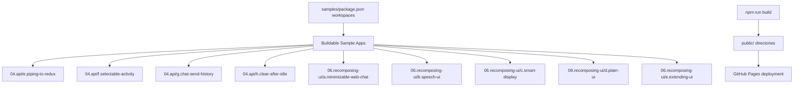
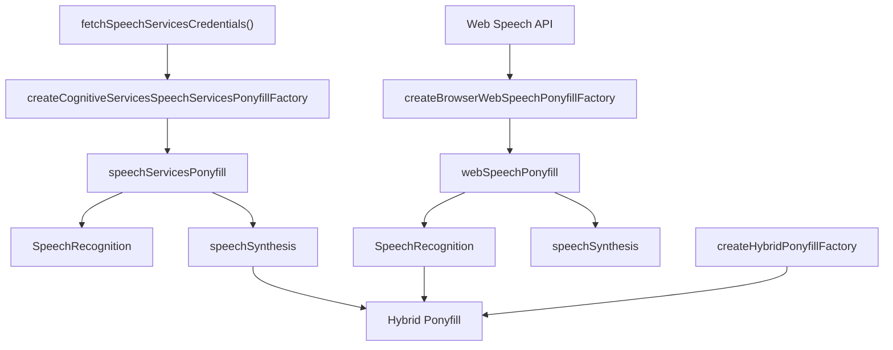
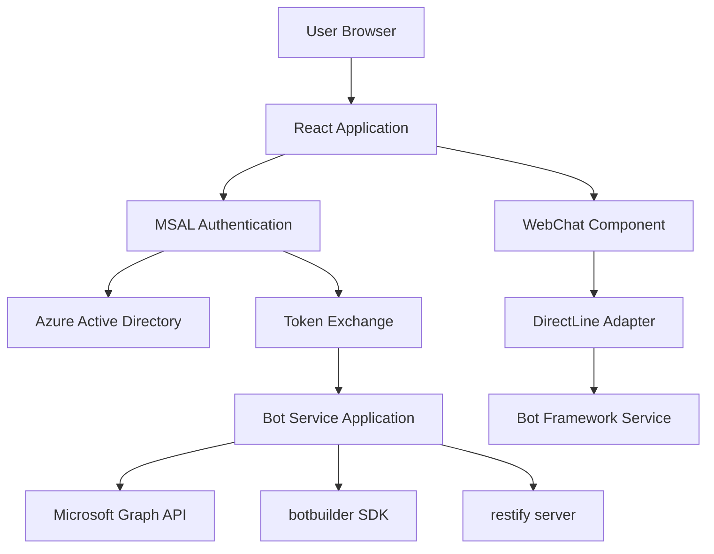
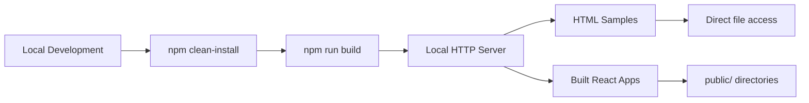
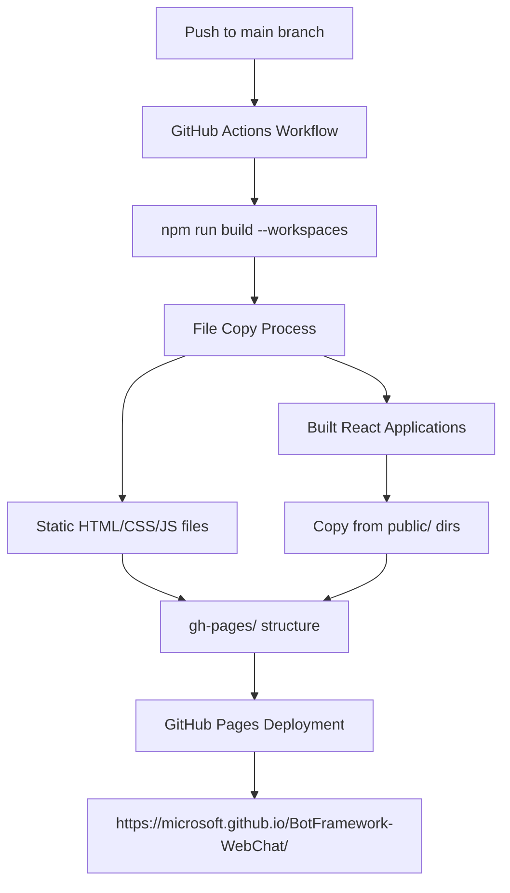
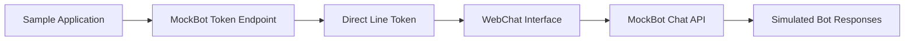

<!-- source: DeepWiki mcp.deepwiki.com · repo microsoft/BotFramework-WebChat · page 6.3 Sample Applications · fetched 2026-10-26 -->

# Sample Applications

Relevant source files

The following files were used as context for generating this wiki page:

- [.github/workflows/publish-github-pages.yaml](.github/workflows/publish-github-pages.yaml)
- [packages/bundle/src/createCognitiveServicesSpeechServicesPonyfillFactory.spec.js](packages/bundle/src/createCognitiveServicesSpeechServicesPonyfillFactory.spec.js)
- [packages/bundle/src/createCognitiveServicesSpeechServicesPonyfillFactory.ts](packages/bundle/src/createCognitiveServicesSpeechServicesPonyfillFactory.ts)
- [samples/.gitignore](samples/.gitignore)
- [samples/01.getting-started/g.hybrid-react-npm/README.md](samples/01.getting-started/g.hybrid-react-npm/README.md)
- [samples/01.getting-started/k.direct-line-token/javascript/bot/package-lock.json](samples/01.getting-started/k.direct-line-token/javascript/bot/package-lock.json)
- [samples/03.speech/b.cognitive-speech-services-js/index.html](samples/03.speech/b.cognitive-speech-services-js/index.html)
- [samples/03.speech/c.cognitive-speech-services-with-lexical-result/index.html](samples/03.speech/c.cognitive-speech-services-with-lexical-result/index.html)
- [samples/03.speech/d.cognitive-speech-services-speech-recognition-only/index.html](samples/03.speech/d.cognitive-speech-services-speech-recognition-only/index.html)
- [samples/03.speech/e.select-voice/index.html](samples/03.speech/e.select-voice/index.html)
- [samples/03.speech/g.hybrid-speech/index.html](samples/03.speech/g.hybrid-speech/index.html)
- [samples/07.advanced-web-chat-apps/b.sso-for-enterprise/app/package-lock.json](samples/07.advanced-web-chat-apps/b.sso-for-enterprise/app/package-lock.json)
- [samples/07.advanced-web-chat-apps/e.sso-on-behalf-of-authentication/app/package-lock.json](samples/07.advanced-web-chat-apps/e.sso-on-behalf-of-authentication/app/package-lock.json)
- [samples/07.advanced-web-chat-apps/e.sso-on-behalf-of-authentication/bot/package-lock.json](samples/07.advanced-web-chat-apps/e.sso-on-behalf-of-authentication/bot/package-lock.json)
- [samples/README.md](samples/README.md)
- [samples/package-lock.json](samples/package-lock.json)
- [samples/package.json](samples/package.json)

This document covers the comprehensive collection of sample applications demonstrating BotFramework-WebChat features and integration patterns. The samples provide practical examples for developers implementing chat interfaces, ranging from basic integration to advanced scenarios like Single Sign-On (SSO) and custom component development.

For information about the build system used to create these samples, see [Build System](#6.1). For details about the testing infrastructure that validates these samples, see [Testing Infrastructure](#6.2).

## Sample Organization and Categories

The sample applications are organized into eight main categories, each focusing on specific aspects of WebChat implementation. Each sample includes working code, documentation, and live demonstration links.

### Sample Directory Structure

Sources: [samples/README.md:7-111]()

### Sample Categories

| Category | Purpose | Sample Types |
|----------|---------|--------------|
| **Migration** | Upgrading from v3 to v4 | HTML demonstrations |
| **Getting Started** | Basic integration patterns | HTML, React, Angular |
| **Branding & Styling** | Customization and theming | HTML with style overrides |
| **Speech** | Voice integration scenarios | HTML with speech ponyfills |
| **API** | Advanced programmatic control | HTML and built React apps |
| **Custom Components** | Component replacement patterns | HTML with custom renderers |
| **Recomposing UI** | Complete UI reconstruction | Built React applications |
| **Advanced Apps** | Enterprise scenarios (SSO) | Full-stack applications |

Sources: [samples/README.md:9-111]()

## Sample Implementation Types

The samples are implemented using two primary approaches, each serving different demonstration purposes and complexity levels.

### HTML-Based Samples

Most samples use standalone HTML files that load WebChat via CDN and demonstrate specific features through inline JavaScript.

Sources: [samples/03.speech/b.cognitive-speech-services-js/index.html:11](), [samples/03.speech/g.hybrid-speech/index.html:11]()

### Built React Applications

Complex samples use build systems with `package.json` workspaces, enabling advanced development patterns and component composition.

Sources: [samples/package.json:4-14](), [.github/workflows/publish-github-pages.yaml:69-105]()

## Speech Integration Samples

The speech samples demonstrate various approaches to integrating voice capabilities with WebChat, showcasing different speech engines and hybrid configurations.

### Speech Ponyfill Factory Patterns

Sources: [samples/03.speech/b.cognitive-speech-services-js/index.html:80-84](), [samples/03.speech/g.hybrid-speech/index.html:91-105](), [packages/bundle/src/createCognitiveServicesSpeechServicesPonyfillFactory.ts:59-82]()

## SSO Sample Applications

The advanced samples include comprehensive Single Sign-On implementations demonstrating enterprise authentication patterns with Microsoft Azure services.

### SSO Architecture Overview

Sources: [samples/07.advanced-web-chat-apps/e.sso-on-behalf-of-authentication/app/package-lock.json:12-18](), [samples/07.advanced-web-chat-apps/e.sso-on-behalf-of-authentication/bot/package-lock.json:11-16]()

### SSO Sample Components

| Component | Technology Stack | Purpose |
|-----------|-----------------|---------|
| **Client App** | React 16.14, MSAL 1.4.18, WebChat 4.17.0 | User interface with authentication |
| **Bot Service** | Node.js, BotBuilder 4.22.2, Microsoft Graph Client | Backend bot logic and API integration |
| **Authentication** | MSAL, Azure AD, JWT tokens | Identity and access management |
| **Communication** | Direct Line, Bot Framework | Chat protocol and message exchange |

Sources: [samples/07.advanced-web-chat-apps/e.sso-on-behalf-of-authentication/app/package-lock.json:10-18](), [samples/07.advanced-web-chat-apps/e.sso-on-behalf-of-authentication/bot/package-lock.json:11-26]()

## Development and Testing Workflow

The samples support both local development and automated deployment through a structured build and release process.

### Local Development Process

Sources: [samples/package.json:15-17](), [.github/workflows/publish-github-pages.yaml:33-40]()

### GitHub Pages Deployment

The samples are automatically deployed to GitHub Pages through a comprehensive build and copy process that handles both simple HTML files and built applications.

Sources: [.github/workflows/publish-github-pages.yaml:42-110](), [.github/workflows/publish-github-pages.yaml:6-9]()

## Running Sample Applications

### Prerequisites and Setup

To run samples locally, developers need a basic development environment with Node.js and npm. The samples connect to MockBot for demonstration purposes, eliminating the need for bot deployment during development.

### MockBot Integration

All samples connect to a hosted MockBot service that provides realistic chat interactions without requiring backend setup.

Sources: [samples/03.speech/b.cognitive-speech-services-js/index.html:73-77](), [samples/README.md:5]()

### Testing Speech Features

Speech-enabled samples require additional credentials for Azure Cognitive Services, obtained through the same MockBot infrastructure that provides speech tokens alongside DirectLine tokens.

Sources: [samples/03.speech/b.cognitive-speech-services-js/index.html:31-65](), [packages/bundle/src/createCognitiveServicesSpeechServicesPonyfillFactory.spec.js:70-83]()

---

