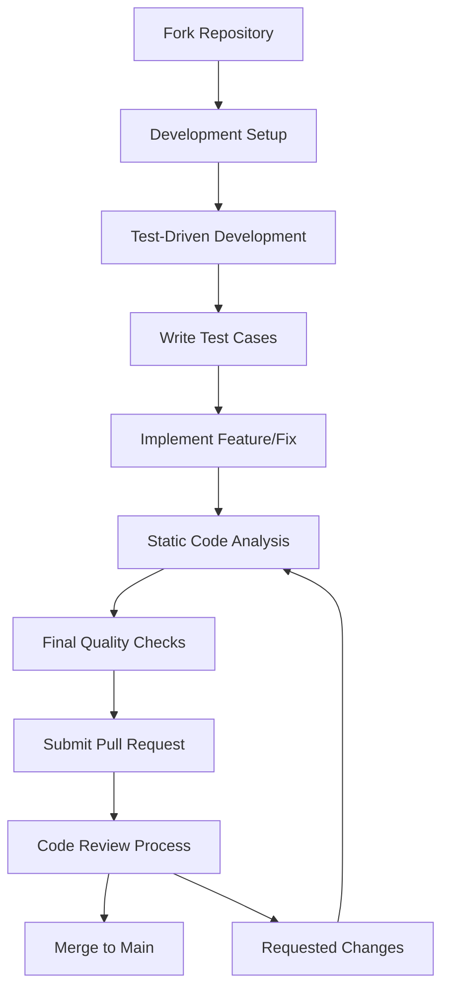
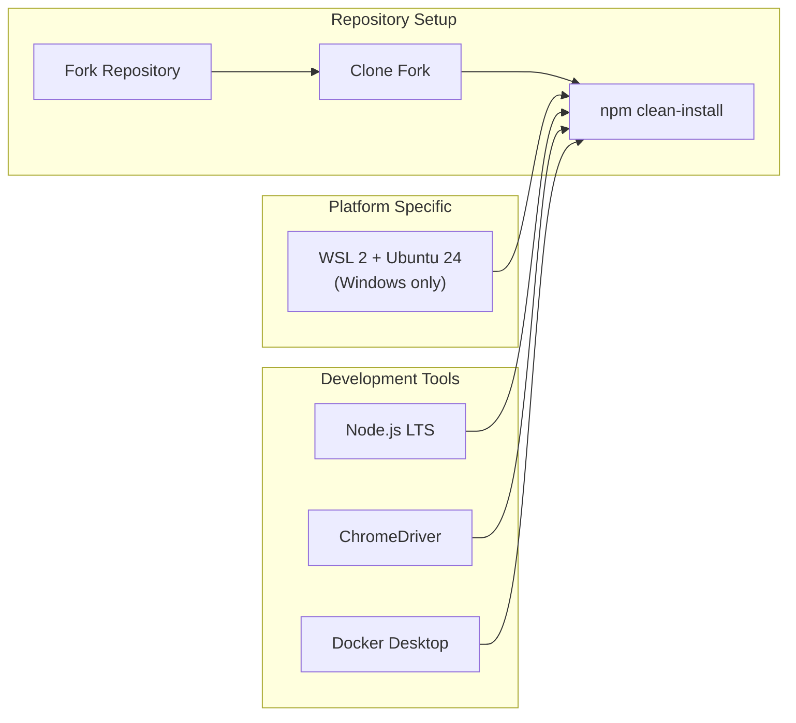
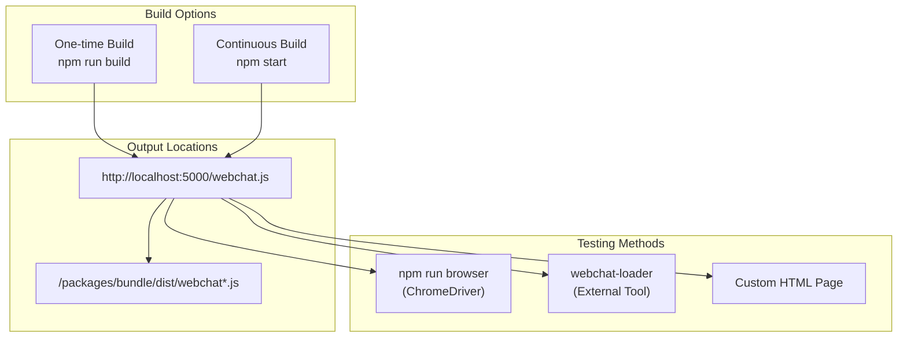
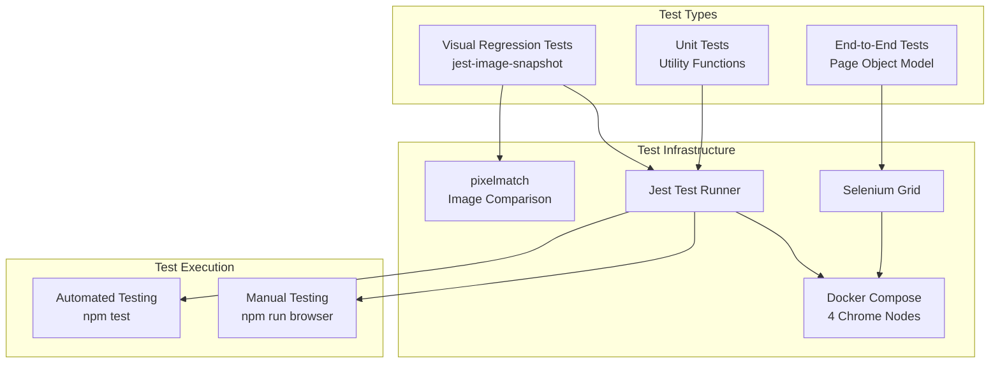
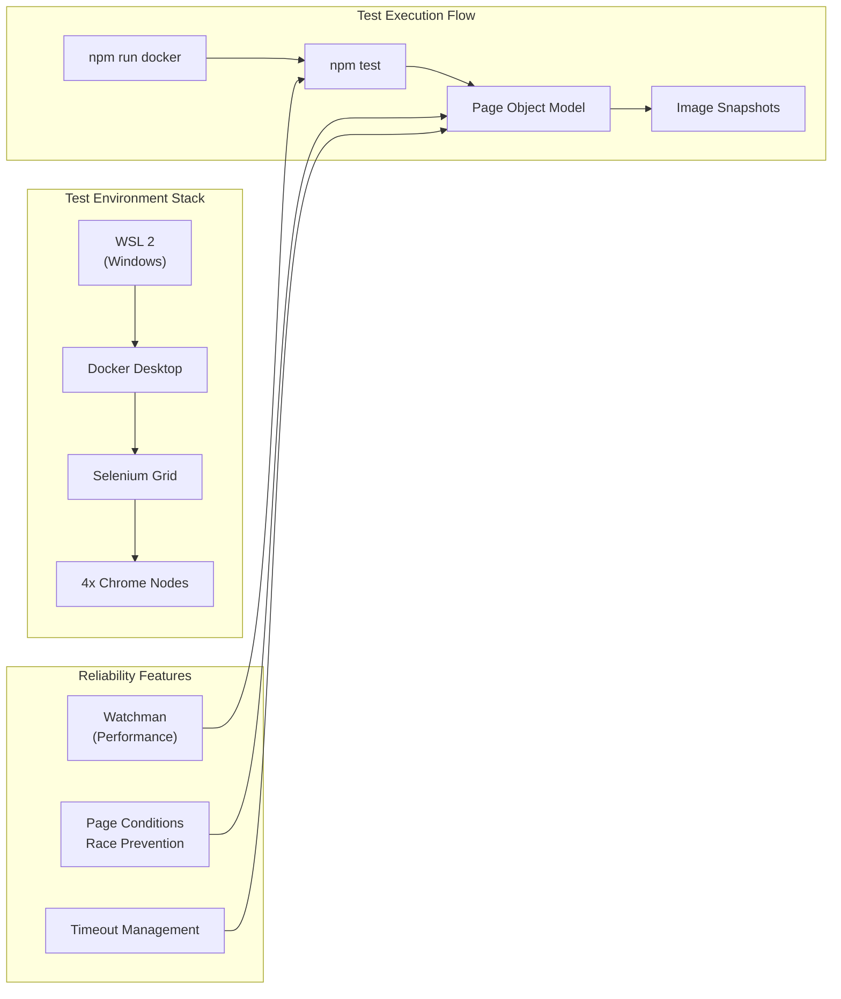
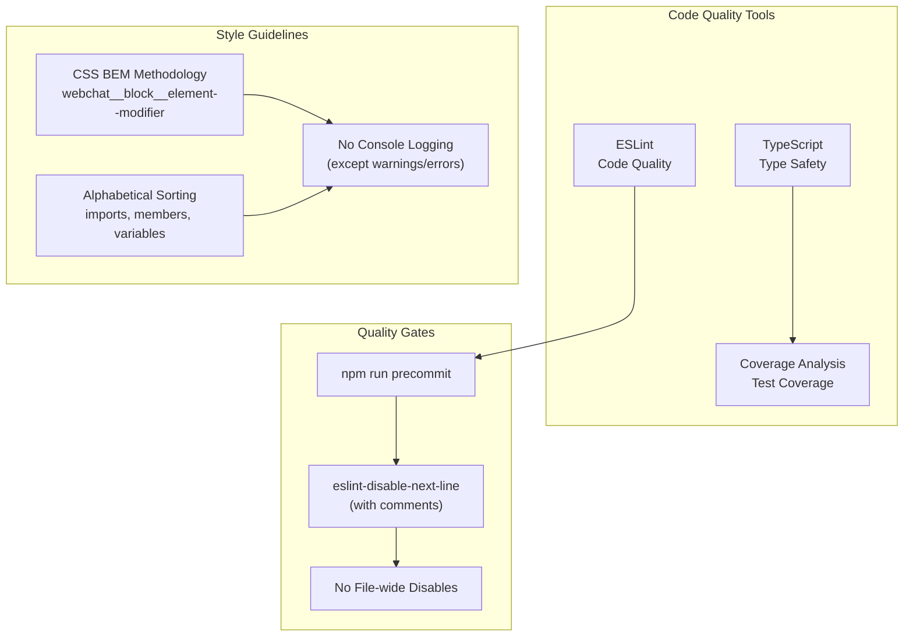
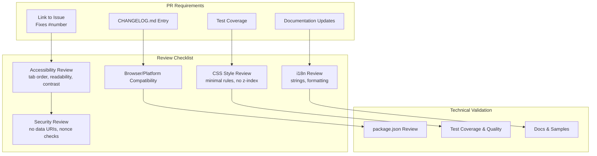
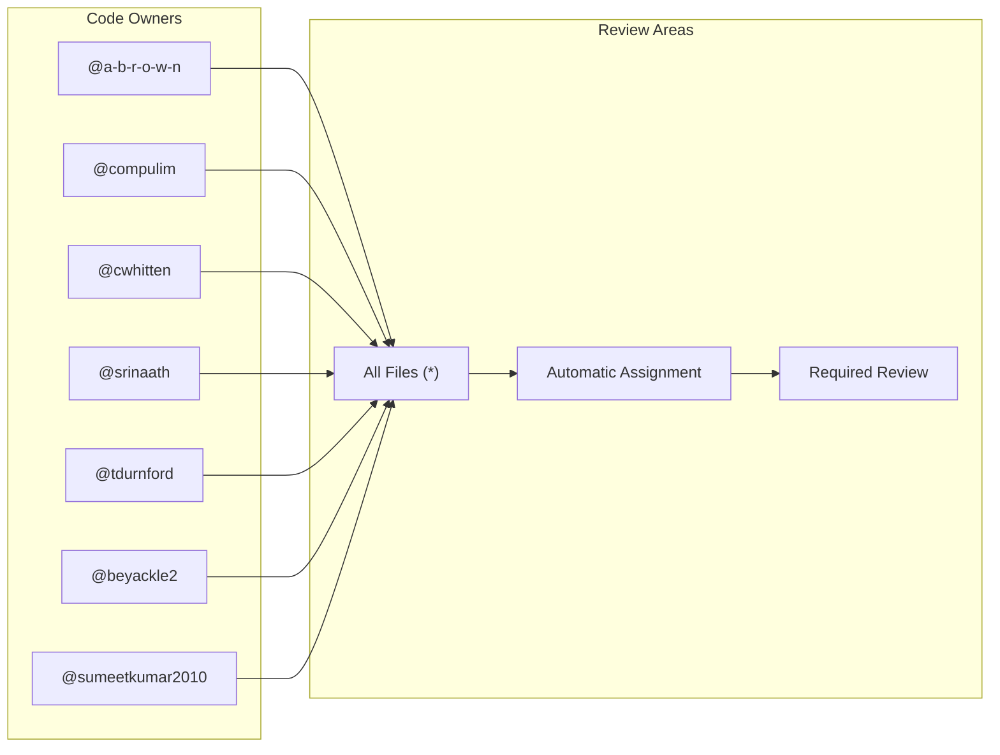
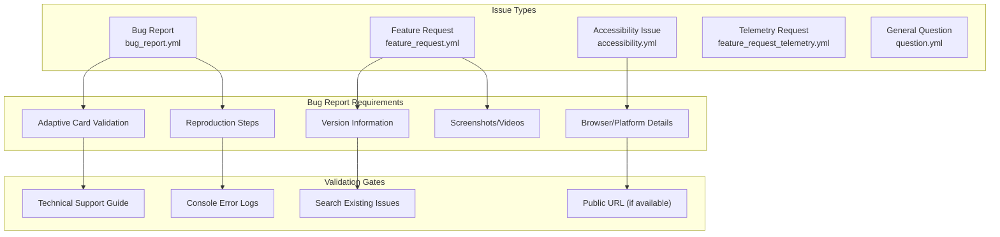

<!-- source: DeepWiki mcp.deepwiki.com · repo microsoft/BotFramework-WebChat · page 6.4 Contributing Guidelines · fetched 2026-10-26 -->

# Contributing Guidelines

Relevant source files

The following files were used as context for generating this wiki page:

- [.github/CODEOWNERS](.github/CODEOWNERS)
- [.github/CODE_OF_CONDUCT.md](.github/CODE_OF_CONDUCT.md)
- [.github/CONTRIBUTING.md](.github/CONTRIBUTING.md)
- [.github/ISSUE_TEMPLATE/accessibility.yml](.github/ISSUE_TEMPLATE/accessibility.yml)
- [.github/ISSUE_TEMPLATE/bug_report.yml](.github/ISSUE_TEMPLATE/bug_report.yml)
- [.github/ISSUE_TEMPLATE/feature_request.yml](.github/ISSUE_TEMPLATE/feature_request.yml)
- [.github/ISSUE_TEMPLATE/feature_request_telemetry.yml](.github/ISSUE_TEMPLATE/feature_request_telemetry.yml)
- [.github/ISSUE_TEMPLATE/question.yml](.github/ISSUE_TEMPLATE/question.yml)
- [.github/PULL_REQUEST_TEMPLATE.md](.github/PULL_REQUEST_TEMPLATE.md)
- [.gitignore](.gitignore)
- [__tests__/README.md](__tests__/README.md)
- [__tests__/__image_snapshots__/html/accessibility-live-region-activity-status-send-failed-contrast-js-live-region-should-render-send-failed-retry-correctly-in-high-contrast-mode-1-snap.png](__tests__/__image_snapshots__/html/accessibility-live-region-activity-status-send-failed-contrast-js-live-region-should-render-send-failed-retry-correctly-in-high-contrast-mode-1-snap.png)
- [__tests__/html/accessibility.liveRegion.activityStatus.sendFailed.contrast.html](__tests__/html/accessibility.liveRegion.activityStatus.sendFailed.contrast.html)
- [__tests__/html/accessibility.liveRegion.activityStatus.sendFailed.contrast.js](__tests__/html/accessibility.liveRegion.activityStatus.sendFailed.contrast.js)
- [docs/TECHNICAL_SUPPORT_GUIDE.md](docs/TECHNICAL_SUPPORT_GUIDE.md)
- [docs/media/running-test.png](docs/media/running-test.png)
- [packages/component/src/Utils/InlineMarkdown.js](packages/component/src/Utils/InlineMarkdown.js)
- [packages/component/src/Utils/createCustomEvent.js](packages/component/src/Utils/createCustomEvent.js)
- [packages/test/harness/src/browser/globals/run.js](packages/test/harness/src/browser/globals/run.js)
- [packages/test/harness/src/host/dev/index.js](packages/test/harness/src/host/dev/index.js)
- [packages/test/harness/src/host/jest/runHTML.js](packages/test/harness/src/host/jest/runHTML.js)

This document covers the code contribution process, development setup requirements, testing methodology, and quality standards for the BotFramework-WebChat repository. It provides the essential workflow and guidelines for submitting pull requests, reporting issues, and maintaining code quality.

For information about the build system and package management, see [Build System](#6.1). For details about the testing infrastructure itself, see [Testing Infrastructure](#6.2).

## Contribution Process Overview

The BotFramework-WebChat project follows a structured contribution process that emphasizes test-driven development, code quality, and thorough review. All contributions must be made through forks of the main repository and follow Microsoft's open source guidelines.

Sources: [.github/CONTRIBUTING.md:1-321]()

## Development Environment Requirements

### Required Tools and Setup

The development environment requires specific tools and configurations to ensure consistency across contributors:

| Tool | Purpose | Platform Notes |
|------|---------|----------------|
| Node.js LTS | JavaScript runtime | Required for all platforms |
| ChromeDriver | Browser automation | Extract to project root |
| Docker Desktop | Test environment | For automated testing |
| WSL 2 + Ubuntu 24 | Linux environment | Windows 11 only |

The project maintains a clean main repository by requiring all changes to be made in forks. The initial setup involves:

1. Installing required tools for the development platform
2. Forking the main repository to maintain separation
3. Running `npm clean-install` to establish consistent dependencies

Sources: [.github/CONTRIBUTING.md:24-41]()

### Build and Development Workflow

The build system supports both one-time and continuous development workflows:

Sources: [.github/CONTRIBUTING.md:43-96]()

## Test-Driven Development Methodology

### Testing Philosophy and Requirements

The project enforces strict test-driven development with a focus on visual regression testing and end-to-end verification. The testing approach prioritizes quality and regression prevention over development speed.

### Test Development Process

The test development follows a specific pattern based on the type of contribution:

**For Bug Fixes:**
1. Create test page reproducing the bug using `__tests__/html/simple.html` template
2. Verify test fails demonstrating the bug
3. Implement fix
4. Confirm test passes after fix

**For New Features:**
1. Create comprehensive test scenarios covering happy and unhappy paths
2. Include tests for different rendering contexts (carousel vs. stacked layouts)
3. Write user story documentation through test pages
4. Verify feature completeness through test coverage

Sources: [.github/CONTRIBUTING.md:104-145](), [__tests__/html/simple.html](), [packages/test/harness/src/browser/globals/run.js:1-67]()

### Test Environment and Reliability

The testing system uses Docker for environment convergence and includes reliability measures:

Sources: [.github/CONTRIBUTING.md:137-187](), [packages/test/harness/src/host/jest/runHTML.js:1-114]()

## Code Quality Standards

### Static Analysis and Linting

The project enforces comprehensive code quality through automated analysis:

### Code Style and Hygiene Requirements

The project maintains strict style guidelines covering multiple aspects:

**CSS Guidelines:**
- Use BEM methodology with `webchat__` namespace
- Remove unneeded CSS styles
- Minimize `z-index` usage with new stacking contexts when required
- Avoid global pollution (taborder, z-index conflicts)

**JavaScript Guidelines:**
- Sort imports, members, and variables alphabetically
- Prefer JavaScript shorthands and shorter code
- Avoid one-off variables
- No global pollution or side effects

**Security Requirements:**
- Use only local assets (no external URLs)
- Follow secure-by-default principles
- No data URIs without proper validation

Sources: [.github/CONTRIBUTING.md:188-268]()

## Pull Request Workflow

### Pull Request Template and Requirements

The pull request process follows a structured template ensuring comprehensive review:

### Code Ownership and Review Process

The repository uses a code ownership system to ensure appropriate review:

Sources: [.github/PULL_REQUEST_TEMPLATE.md:1-43](), [.github/CODEOWNERS:1-4]()

## Issue Reporting System

### Issue Template Structure

The project provides structured issue templates to ensure comprehensive problem reporting:

### Issue Classification and Routing

The issue system includes comprehensive classification to route problems appropriately:

**Bug Report Categories:**
- Adaptive Card issues (with validation against AC Designer)
- Browser/platform compatibility problems
- Accessibility concerns
- Integration-specific issues (React, CDN, iframe)

**Feature Request Types:**
- Core functionality enhancements
- Telemetry data point additions
- Accessibility improvements
- Developer experience improvements

Sources: [.github/ISSUE_TEMPLATE/bug_report.yml:1-200](), [.github/ISSUE_TEMPLATE/feature_request.yml:1-35](), [.github/ISSUE_TEMPLATE/accessibility.yml:1-173]()

## Quality Assurance Requirements

### Cross-Platform Compatibility Standards

The project maintains strict compatibility requirements across multiple platforms and browsers:

| Platform | Browser | Special Requirements |
|----------|---------|---------------------|
| Windows 10 | Chrome, Edge Chromium, Firefox, IE11 | IE11 excludes speech features |
| macOS | Safari | Full compatibility required |
| iOS/iPadOS | Safari | Mobile-specific testing |
| Android | Chrome | Touch interaction validation |

### Performance and Security Standards

**Performance Requirements:**
- Bundle size must not increase significantly
- Performance should not drop significantly
- Code coverage must not decrease
- Backward compatibility maintained for 2 years

**Security Requirements:**
- Secure by default implementation
- No external asset dependencies
- Proper sanitization of user inputs
- Nonce leak prevention

**Accessibility Standards:**
- Tab order maintenance
- Content readability compliance
- Assistive technology compatibility (NVDA, JAWS, Narrator, VoiceOver, TalkBack)
- Color contrast validation
- Screen reader support verification

Sources: [.github/CONTRIBUTING.md:241-266]()

---

