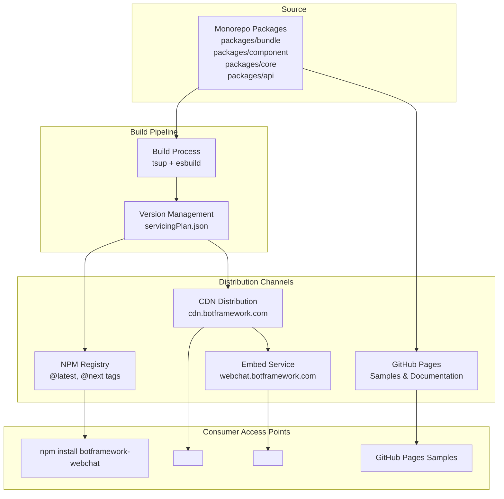
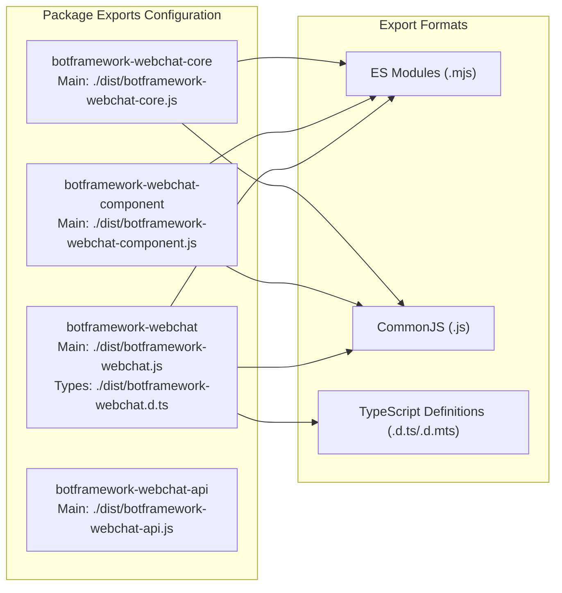
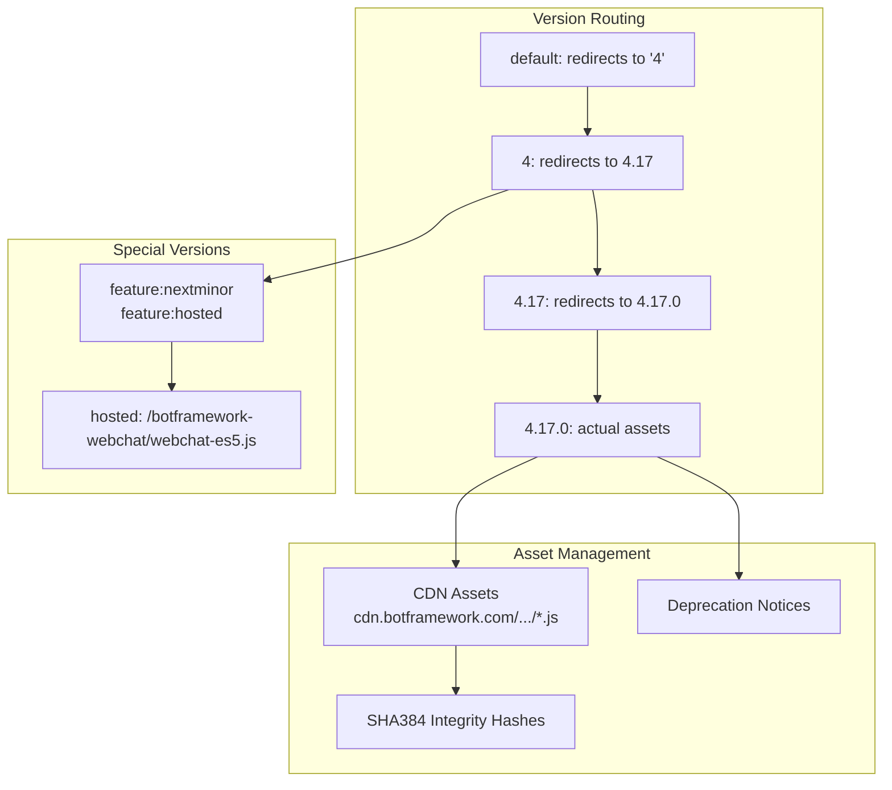
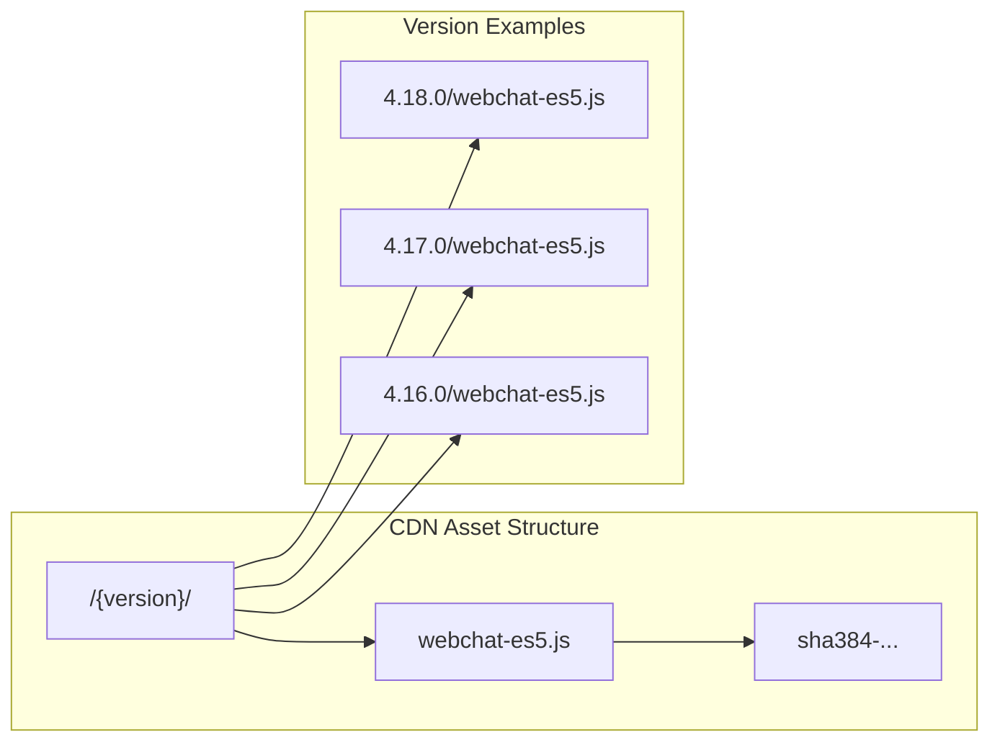
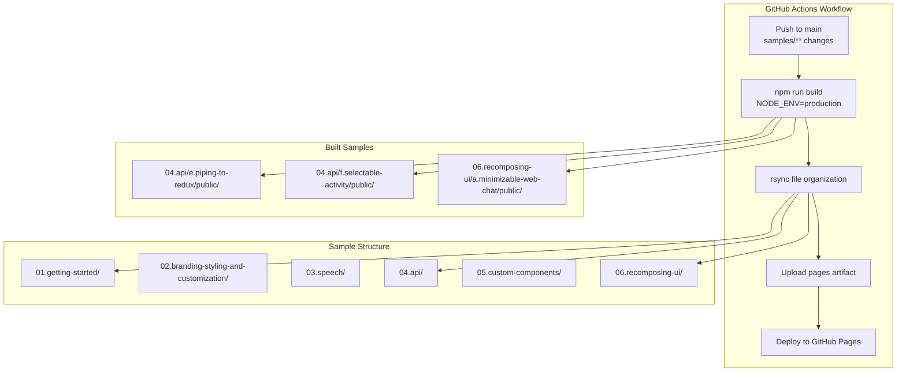
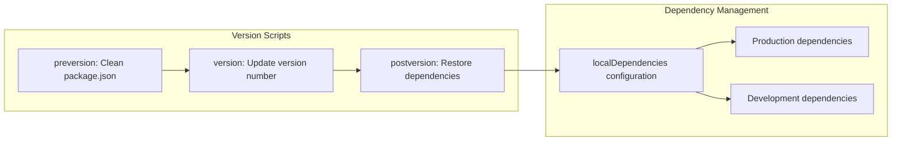

<!-- source: DeepWiki mcp.deepwiki.com · repo microsoft/BotFramework-WebChat · page 7 Deployment and Distribution · fetched 2026-10-26 -->

# Deployment and Distribution

<details>
<summary>Relevant source files</summary>

The following files were used as context for generating this wiki page:

- [.github/workflows/publish-github-pages.yaml](.github/workflows/publish-github-pages.yaml)
- [CHANGELOG.md](CHANGELOG.md)
- [package-lock.json](package-lock.json)
- [package.json](package.json)
- [packages/api/package.json](packages/api/package.json)
- [packages/bundle/package.json](packages/bundle/package.json)
- [packages/component/package.json](packages/component/package.json)
- [packages/core/package.json](packages/core/package.json)
- [packages/directlinespeech/package.json](packages/directlinespeech/package.json)
- [packages/embed/servicingPlan.json](packages/embed/servicingPlan.json)
- [packages/playground/package.json](packages/playground/package.json)
- [samples/.gitignore](samples/.gitignore)
- [samples/01.getting-started/g.hybrid-react-npm/README.md](samples/01.getting-started/g.hybrid-react-npm/README.md)
- [samples/package-lock.json](samples/package-lock.json)
- [samples/package.json](samples/package.json)
- [scripts/PushBitsToGithub.ps1](scripts/PushBitsToGithub.ps1)

</details>


This document covers the deployment and distribution infrastructure for BotFramework-WebChat, including package publishing to NPM, CDN distribution, version management, and automated deployment processes. For information about the build system configuration, see [Build System](#6.1).

## Distribution Architecture

BotFramework-WebChat employs a multi-channel distribution strategy to serve different integration scenarios and developer preferences.



**Sources:** [packages/bundle/package.json:19-21](), [packages/embed/servicingPlan.json:1-634](), [.github/workflows/publish-github-pages.yaml:1-128]()

## Package Publishing Strategy

### NPM Distribution

The project publishes multiple packages to NPM registry with different scopes and access levels:

| Package | Scope | Access | Purpose |
|---------|-------|--------|---------|
| `botframework-webchat` | Public | Public | Main distribution bundle |
| `botframework-webchat-component` | Public | Public | React components |
| `botframework-webchat-core` | Public | Public | Core state management |
| `botframework-webchat-api` | Public | Public | Hooks and context providers |
| `botframework-directlinespeech-sdk` | Public | Public | Speech integration |



Each package supports multiple module formats through the `exports` field configuration, enabling compatibility with various bundlers and environments.

**Sources:** [packages/bundle/package.json:7-18](), [packages/component/package.json:7-38](), [packages/core/package.json:7-28](), [packages/api/package.json:7-38]()

### Version Management and Servicing

The project implements a sophisticated version management system through `servicingPlan.json`:



The servicing plan supports:
- **Version Redirection**: Routes generic version requests to specific versions
- **Asset Integrity**: SHA384 hashes for all CDN assets  
- **Deprecation Management**: Automatic upgrade notices with target dates
- **Feature Flags**: Special routing for hosted and experimental versions

**Sources:** [packages/embed/servicingPlan.json:2-25](), [packages/embed/servicingPlan.json:540-586]()

## CDN Distribution

### Asset Hosting Structure

CDN assets are hosted at `cdn.botframework.com` with version-specific paths:

```
https://cdn.botframework.com/botframework-webchat/{version}/webchat-es5.js
```

Each asset includes integrity verification:



**Sources:** [packages/embed/servicingPlan.json:568-577](), [packages/embed/servicingPlan.json:522-531]()

### Deprecation and Lifecycle Management

The system implements automated deprecation with upgrade paths:

- **Deprecation Notices**: User-facing messages with upgrade timelines
- **Automatic Upgrades**: Scheduled redirects to newer versions  
- **Grace Periods**: Advance notice before automatic upgrades

Example deprecation configuration:
- Version 4.15.6: "deprecated, upgrade by 2025-02-15"
- Version 4.14.2: "deprecated, upgrade by 2024-09-07"

**Sources:** [packages/embed/servicingPlan.json:458-482](), [packages/embed/servicingPlan.json:394-398]()

## GitHub Pages Publishing

### Automated Sample Deployment

The project automatically publishes sample applications to GitHub Pages through a workflow that:

1. **Triggers**: On pushes to `main` branch affecting samples
2. **Builds**: Compiles sample applications using esbuild
3. **Organizes**: Structures samples by category and functionality
4. **Deploys**: Publishes to GitHub Pages environment



**Sources:** [.github/workflows/publish-github-pages.yaml:3-11](), [.github/workflows/publish-github-pages.yaml:42-105](), [samples/package.json:4-17]()

### Legacy PowerShell Deployment

The repository includes a PowerShell script for GitHub Pages deployment used in build systems:

Key operations in `PushBitsToGithub.ps1`:
- **Branch Management**: Switches to `gh-pages` branch
- **Content Replacement**: Removes old files and copies new artifacts  
- **Git Operations**: Commits and pushes changes with build metadata
- **Error Handling**: Validates git repository state and change detection

**Sources:** [scripts/PushBitsToGithub.ps1:1-59]()

## Build and Release Integration

### Package Versioning Workflow

Each package includes automated versioning scripts that:

1. **Pre-version**: Removes local dependencies for clean publishing
2. **Post-version**: Restores local dependencies with updated versions
3. **Version Synchronization**: Updates dependent packages to match versions



**Sources:** [packages/bundle/package.json:54-58](), [packages/component/package.json:64-68]()

### Build Tool Configuration

The project uses `tsup` for consistent building across packages:

- **Multiple Formats**: ESM, CommonJS, and IIFE outputs
- **TypeScript Support**: Declaration file generation
- **Watch Mode**: Development-time rebuilding
- **Environment Variables**: Build-time configuration injection

**Sources:** [packages/bundle/package.json:48-49](), [packages/component/package.json:58-59](), [packages/core/package.json:59-60]()