# Page: Overview

# Overview

<details>
<summary>Relevant source files</summary>

The following files were used as context for generating this wiki page:

- [CHANGELOG.md](CHANGELOG.md)
- [README.md](README.md)
- [package-lock.json](package-lock.json)
- [package.json](package.json)
- [packages/api/package.json](packages/api/package.json)
- [packages/bundle/package.json](packages/bundle/package.json)
- [packages/component/package.json](packages/component/package.json)
- [packages/core/package.json](packages/core/package.json)
- [packages/directlinespeech/package.json](packages/directlinespeech/package.json)
- [packages/embed/servicingPlan.json](packages/embed/servicingPlan.json)
- [packages/playground/package.json](packages/playground/package.json)
- [samples/index.html](samples/index.html)

</details>


## Purpose and Scope

BotFramework-WebChat is a highly-customizable web-based chat client for the Microsoft Bot Framework v4 SDK. This system enables developers to embed conversational AI experiences into web applications through multiple integration methods, from simple CDN inclusion to full React component customization.

This document covers the overall architecture, package structure, and core systems of the Web Chat codebase. For specific integration patterns, see [Integration Guide](#5). For detailed feature documentation, see [Key Features](#4). For development workflows, see [Development](#6).

## High-Level Architecture

The Web Chat system is architected as a modular monorepo with distinct layers handling different concerns:

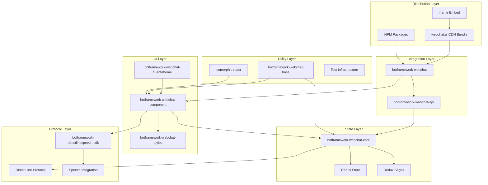

Sources: [package.json:17-34](), [README.md:1-391](), [packages/bundle/package.json:61-68](), [packages/component/package.json:71-75]()

## Package Structure

The monorepo is organized using npm workspaces with packages serving distinct architectural roles:

| Package | Purpose | Key Dependencies |
|---------|---------|------------------|
| `botframework-webchat` | Main distribution bundle | component, core, api |
| `botframework-webchat-api` | Public API surface | core |
| `botframework-webchat-component` | React UI components | api, core, styles |
| `botframework-webchat-core` | State management | Redux, redux-saga |
| `botframework-webchat-styles` | CSS framework | - |
| `botframework-directlinespeech-sdk` | Speech channel | microsoft-cognitiveservices-speech-sdk |
| `botframework-webchat-fluent-theme` | Fluent UI theme pack | component |

The dependency hierarchy follows a strict layering where higher-level packages depend on lower-level ones but not vice versa.

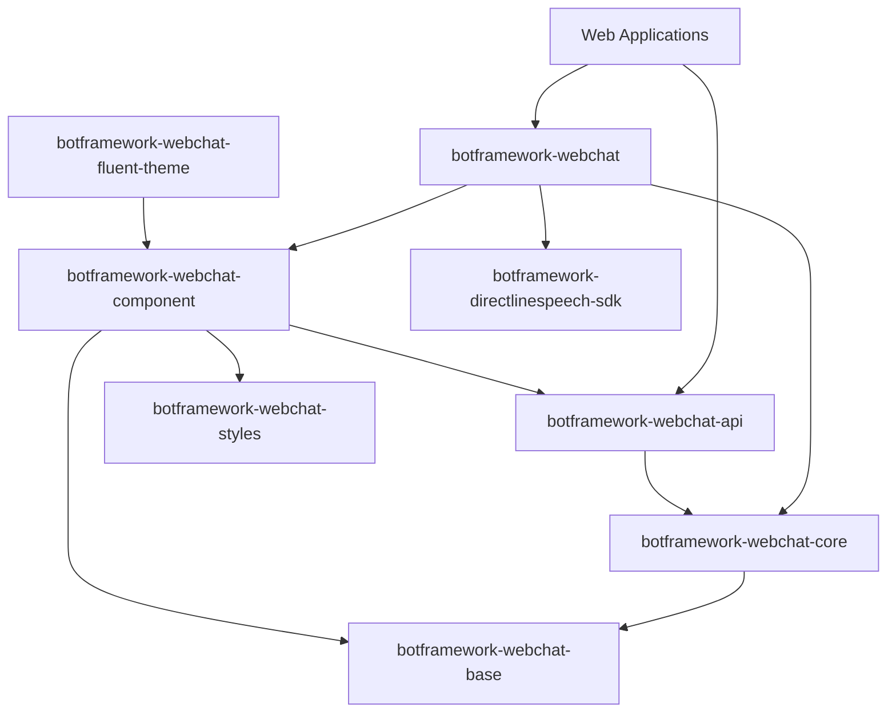

Sources: [package.json:17-34](), [packages/bundle/package.json:116-143](), [packages/component/package.json:141-168](), [packages/core/package.json:110-119]()

## Core Systems

### State Management Architecture

Web Chat uses Redux with redux-saga for state management, providing a unidirectional data flow:

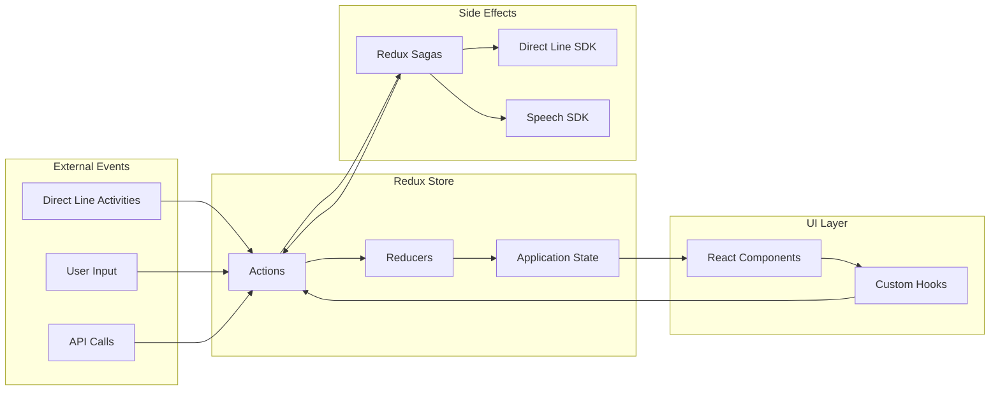

Sources: [packages/core/package.json:110-119](), [CHANGELOG.md:261-288]()

### Component Architecture

The UI is built with React components following a provider pattern for context and hooks for state access:

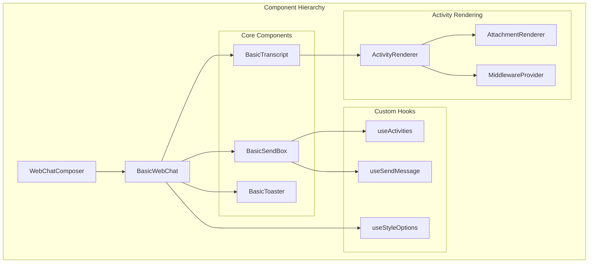

Sources: [packages/component/package.json:141-168](), [CHANGELOG.md:246-250]()

## Integration Methods

Web Chat supports three primary integration patterns:

### CDN Integration

Direct inclusion via script tag with global `WebChat` object:

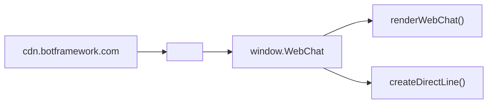

### React Integration

Import as ES modules or CommonJS for full customization:

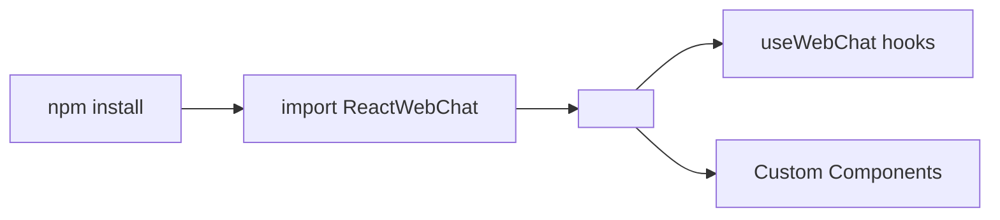

### iframe Embed

Hosted solution with minimal configuration:

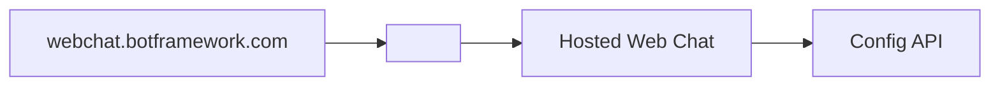

Sources: [README.md:152-289](), [packages/embed/hostDevServer.mjs:1-38](), [packages/embed/servicingPlan.json:1-600]()

## Key Feature Systems

### Speech Integration

Web Chat provides multiple speech engines through a ponyfill architecture:

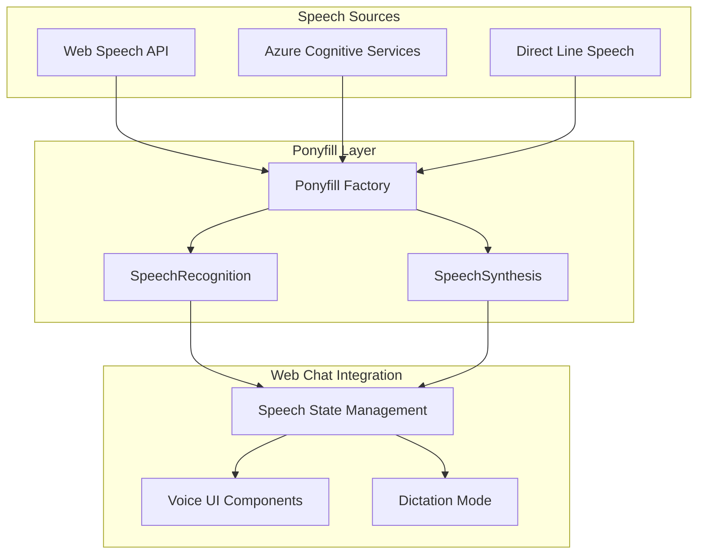

Sources: [packages/directlinespeech/package.json:112-123](), [CHANGELOG.md:358-372](), [README.md:356-372]()

### Theming and Customization

The styling system supports multiple customization levels:

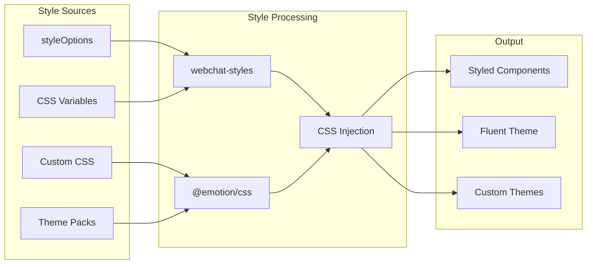

Sources: [CHANGELOG.md:49-78](), [packages/component/package.json:141-168](), [README.md:290-306]()

---

# Page: Getting Started

# Getting Started

<details>
<summary>Relevant source files</summary>

The following files were used as context for generating this wiki page:

- [CHANGELOG.md](CHANGELOG.md)
- [README.md](README.md)
- [package-lock.json](package-lock.json)
- [package.json](package.json)
- [packages/api/package.json](packages/api/package.json)
- [packages/bundle/package.json](packages/bundle/package.json)
- [packages/component/package.json](packages/component/package.json)
- [packages/core/package.json](packages/core/package.json)
- [packages/directlinespeech/package.json](packages/directlinespeech/package.json)
- [packages/embed/servicingPlan.json](packages/embed/servicingPlan.json)
- [packages/playground/package.json](packages/playground/package.json)
- [samples/index.html](samples/index.html)

</details>


This document covers the basic setup and integration methods for BotFramework-WebChat, a highly-customizable web-based chat client for Azure Bot Services. It explains the three primary integration approaches and fundamental configuration requirements.

For detailed API documentation and advanced customization options, see [Integration Guide](#5). For information about theming and styling customization, see [Theming and Styling](#4.3).

## Integration Methods Overview

BotFramework-WebChat provides three distinct integration approaches to accommodate different development environments and technical requirements. Each method offers varying levels of customization and complexity.

### Integration Architecture

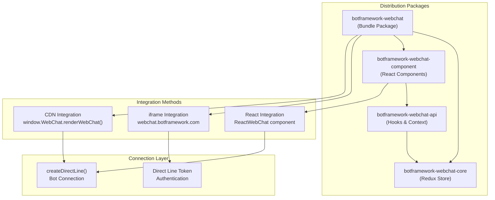

Sources: [README.md:172-224](), [packages/bundle/package.json:1-157](), [packages/component/package.json:1-156]()

### Package Dependency Structure

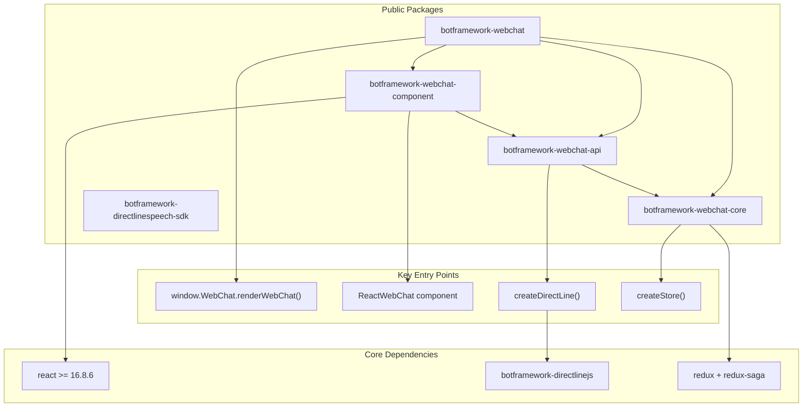

Sources: [packages/bundle/package.json:97-126](), [packages/component/package.json:123-151](), [packages/core/package.json:101-111]()

## Method 1: JavaScript/CDN Integration

The CDN integration method provides the simplest setup for adding Web Chat to existing web pages without build tools or React dependencies.

### Basic CDN Setup

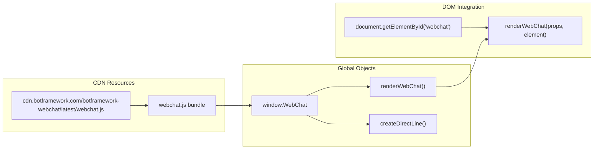

**Required Configuration:**
- Direct Line token or secret
- Target DOM element
- Basic HTML structure

**Key Functions:**
- `window.WebChat.renderWebChat(props, element)` - Main rendering function
- `window.WebChat.createDirectLine({ token })` - Connection factory

Sources: [README.md:180-223](), [packages/bundle/package.json:5-6]()

## Method 2: React Integration

React integration offers full component customization and programmatic control through hooks and context providers.

### React Component Architecture

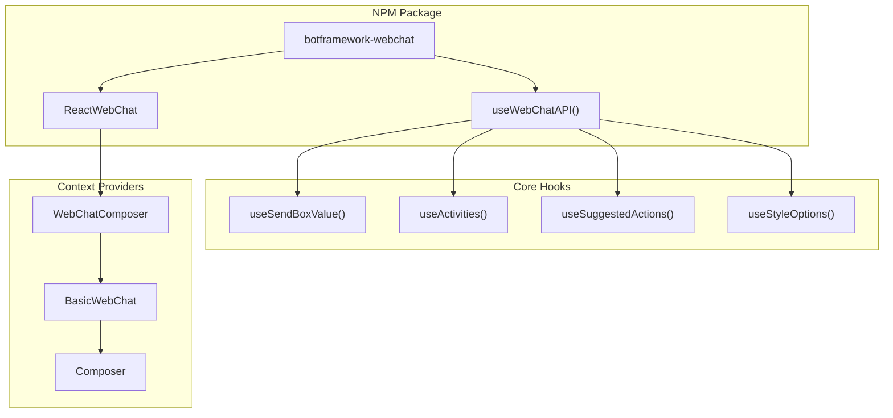

**Required Props:**
- `directLine` - Created via `createDirectLine()`
- `userID` - Unique user identifier
- Optional: `styleOptions`, `store`, `locale`

**Key Components:**
- `ReactWebChat` - Main component export
- `WebChatComposer` - Context provider wrapper
- `BasicWebChat` - Core chat interface

Sources: [README.md:242-251](), [packages/component/package.json:1-156](), [packages/api/package.json:1-132]()

## Method 3: iframe Integration

The iframe method provides the simplest integration with minimal configuration through URL parameters.

### iframe Service Architecture

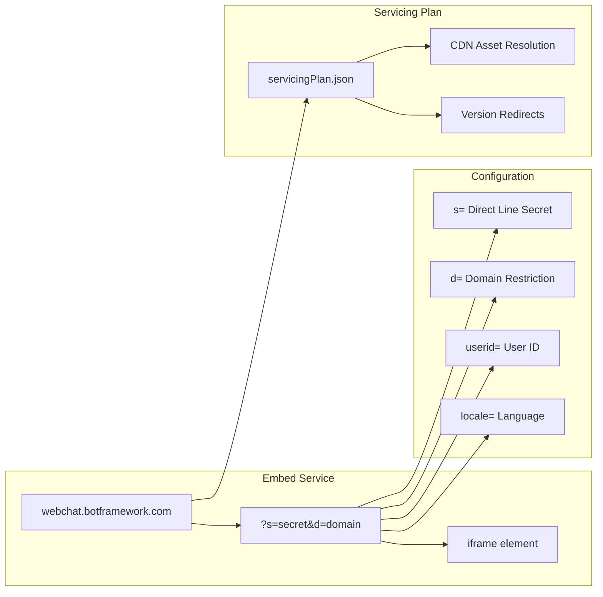

**URL Parameters:**
- `s` - Direct Line secret (required)
- `d` - Domain restriction
- `userid` - User identifier
- `locale` - Language code

**Version Management:**
- Controlled via [servicingPlan.json](packages/embed/servicingPlan.json:1-600)()
- Automatic CDN asset resolution
- Version deprecation handling

Sources: [packages/embed/servicingPlan.json:1-600](), [README.md:157-160]()

## Prerequisites and Requirements

### Authentication Requirements

All integration methods require authentication through Azure Bot Service Direct Line channel:

| Requirement | Description | Security Level |
|-------------|-------------|----------------|
| Direct Line Secret | Bot channel secret from Azure Portal | High Risk - Server Only |
| Direct Line Token | Generated from secret via REST API | Recommended - Client Safe |
| User ID | Unique identifier per user session | Required for state management |

**Token Generation Process:**
1. Obtain Direct Line secret from Azure Bot Service
2. Call Direct Line API to generate token
3. Pass token to Web Chat via `createDirectLine({ token })`

### Browser Compatibility

- **Modern Browsers:** Latest 2 versions of Chrome, Edge, Firefox
- **Legacy Support:** Internet Explorer 11 (limited, deprecated as of 4.16.0)
- **Required Features:** ES5 support, WebSocket support, fetch API

### Network Requirements

- **CDN Access:** `cdn.botframework.com` for script resources
- **Bot Communication:** Direct Line endpoint connectivity
- **Optional:** Cognitive Services endpoints for speech features

Sources: [README.md:153-165](), [README.md:322-333](), [CHANGELOG.md:84-86]()

## Basic Configuration

### Minimum Required Props

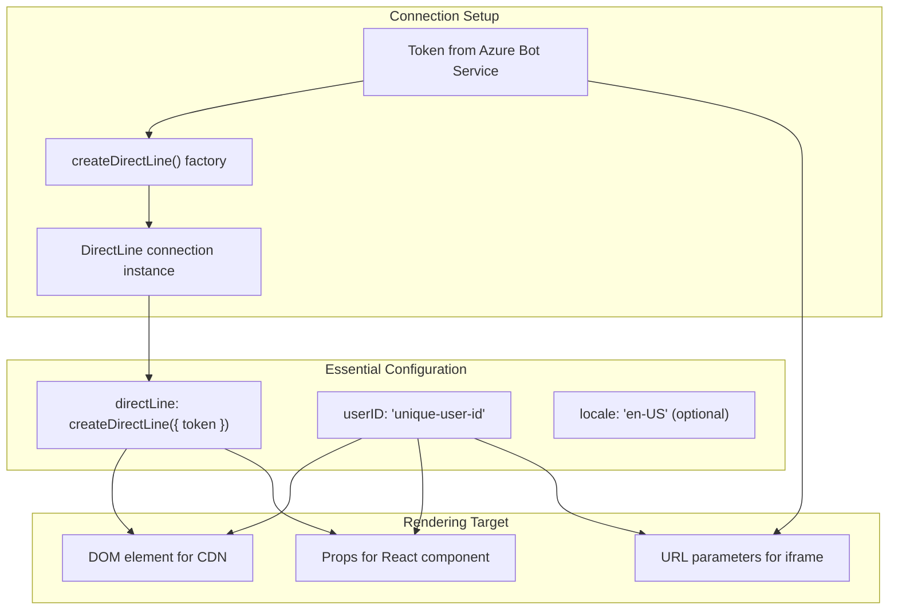

### Style Options Structure

Web Chat supports extensive customization through the `styleOptions` object:

| Category | Key Options | Purpose |
|----------|-------------|---------|
| Colors | `accent`, `primaryFont`, `backgroundColor` | Visual theming |
| Layout | `bubbleMaxWidth`, `avatarSize`, `transcriptOverlayButtonBackground` | Sizing and spacing |
| Features | `hideUploadButton`, `sendTypingIndicator` | Functionality toggles |
| Speech | `speechRecognitionContinuous`, `voiceSelector` | Speech integration |

Sources: [README.md:208-225](), [README.md:290-305](), [CHANGELOG.md:42-43]()

---

# Page: Core Architecture

# Core Architecture

<details>
<summary>Relevant source files</summary>

The following files were used as context for generating this wiki page:

- [CHANGELOG.md](CHANGELOG.md)
- [package-lock.json](package-lock.json)
- [package.json](package.json)
- [packages/api/package.json](packages/api/package.json)
- [packages/bundle/package.json](packages/bundle/package.json)
- [packages/component/package.json](packages/component/package.json)
- [packages/core/package.json](packages/core/package.json)
- [packages/directlinespeech/package.json](packages/directlinespeech/package.json)
- [packages/embed/servicingPlan.json](packages/embed/servicingPlan.json)
- [packages/playground/package.json](packages/playground/package.json)

</details>


This document provides a comprehensive overview of the internal architecture of BotFramework-WebChat, including package dependencies, state management patterns, component hierarchies, and core design principles. It covers the monorepo structure, Redux-based state management, React component composition, and the public API surface.

For integration approaches and usage patterns, see [Integration Guide](#5). For specific feature implementations, see [Key Features](#4). For build system details, see [Build System](#6.1).

## Monorepo Package Structure

BotFramework-WebChat is organized as a monorepo with multiple interdependent packages that form distinct architectural layers.

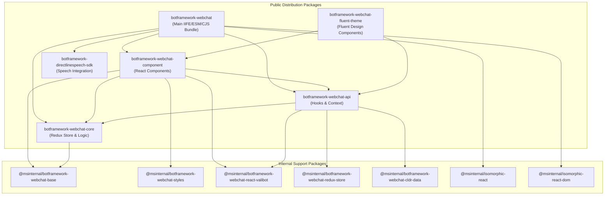

**Sources:** [package.json:17-36](), [packages/bundle/package.json:61-70](), [packages/component/package.json:71-77](), [packages/core/package.json:75-77](), [packages/api/package.json:72-77]()

### Package Responsibilities

| Package | Primary Responsibility | Key Exports |
|---------|----------------------|-------------|
| `botframework-webchat-core` | Redux store, sagas, actions, reducers | `createStore`, actions, selectors |
| `botframework-webchat-api` | React hooks, context providers, localization | `useWebChatUIContext`, `Composer` |
| `botframework-webchat-component` | React components, UI rendering | `BasicWebChat`, `Composer` |
| `botframework-webchat` | Distribution bundle, public API | `renderWebChat`, `createDirectLine` |
| `botframework-directlinespeech-sdk` | Speech recognition/synthesis | `createDirectLineSpeechAdapter` |

## Core State Management Architecture

The state management layer is built on Redux with Redux-Saga for side effects, providing a predictable state container for the entire WebChat application.

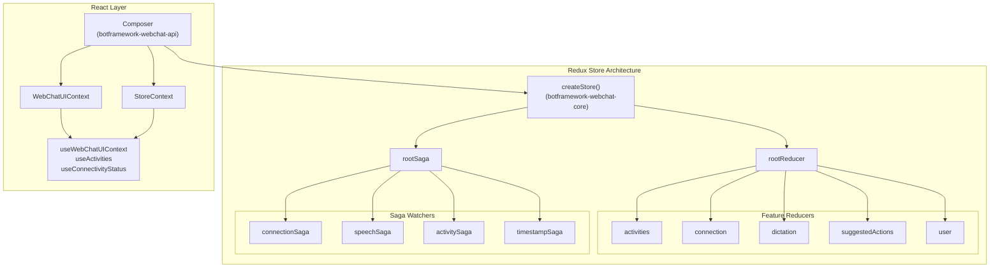

**Sources:** [packages/core/package.json:101-111](), [CHANGELOG.md:238](), [CHANGELOG.md:99-102]()

### State Architecture Patterns

The core implements several key architectural patterns:

- **Redux Store**: Central state container using `redux@5.0.1` and `redux-saga@1.3.0`
- **Saga-based Side Effects**: Asynchronous operations handled through generator-based sagas
- **Feature-based Organization**: State sliced by domain (activities, connection, dictation, etc.)
- **Immutable Updates**: State updates using `simple-update-in@2.2.0` for immutable operations
- **Hooks Integration**: Modern React patterns with hooks backend introduced in recent versions

## Component System Architecture

The component layer provides a hierarchical React component structure with composition patterns and middleware support.

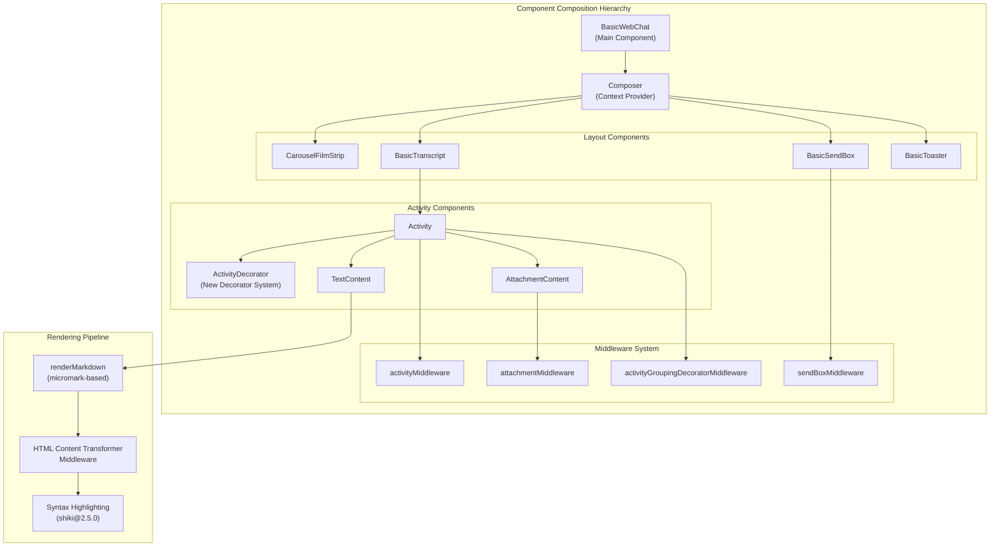

**Sources:** [packages/component/package.json:123-151](), [CHANGELOG.md:31-34](), [CHANGELOG.md:78-81](), [CHANGELOG.md:85](), [CHANGELOG.md:37-41]()

### Component Design Patterns

Key architectural patterns in the component system:

- **Chain of Responsibility**: Middleware pattern using `react-chain-of-responsibility@0.3.0`
- **Decorator Pattern**: Enhanced styling through `ActivityDecorator` and decorator middleware
- **Composition over Inheritance**: Component composition with configurable middleware
- **Markdown Processing**: Migration from `markdown-it` to `micromark@4.0.2` with extension support
- **Syntax Highlighting**: Integrated code highlighting with `shiki@2.5.0`

## Public API Surface

The API layer exposes React hooks, context providers, and utility functions as the primary interface for consuming applications.

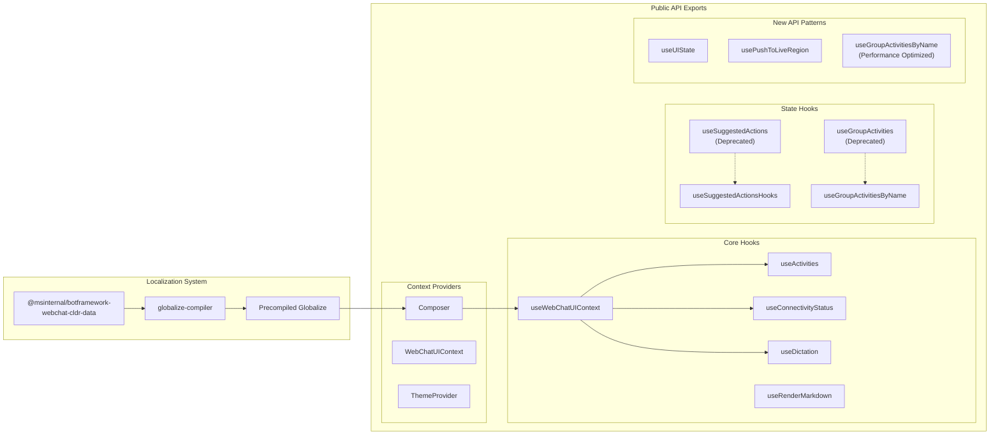

**Sources:** [packages/api/package.json:115-127](), [CHANGELOG.md:35-36](), [CHANGELOG.md:280-282](), [CHANGELOG.md:99-102](), [CHANGELOG.md:57](), [CHANGELOG.md:62]()

### API Evolution Patterns

The API layer demonstrates several evolutionary patterns:

- **Hook Migration**: Transition from Redux-direct access to React hooks backend
- **Deprecation Strategy**: Gradual deprecation with clear migration paths and timeline
- **Performance Optimization**: New hooks like `useGroupActivitiesByName` for improved performance
- **Accessibility Focus**: New `usePushToLiveRegion` for centralized screen reader announcements
- **State Abstraction**: New `useUIState` replacing specific state hooks like `useDisabled`

## Build and Distribution Architecture

The build system uses modern tooling to produce multiple output formats for different consumption patterns.

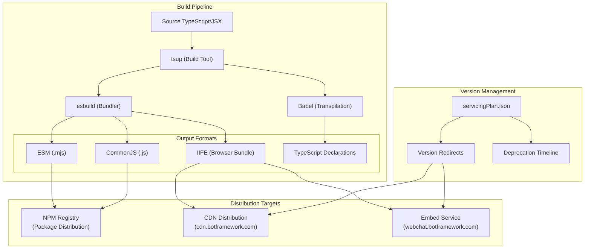

**Sources:** [packages/bundle/package.json:48-49](), [packages/embed/servicingPlan.json:1-634](), [CHANGELOG.md:121](), [package.json:17-36]()

### Build System Characteristics

- **Modern Toolchain**: Uses `tsup@8.5.0` with `esbuild@0.25.8` for fast builds
- **Multi-format Output**: Produces ESM, CommonJS, and IIFE bundles simultaneously  
- **Workspace Management**: Migrated from Lerna to npm workspaces for simplified dependency management
- **Version Servicing**: Sophisticated version management with automatic deprecation timelines
- **CDN Integration**: Direct integration with Azure CDN for global distribution

## Integration Patterns

The architecture supports three primary integration approaches, each with distinct characteristics and use cases.

```mermaid
graph TB
    subgraph "Integration Approaches"
        subgraph "React Integration"
            ReactPackage["botframework-webchat-component"]
            ReactHooks["API Hooks"]
            ReactComposer["<Composer>"]
        end
        
        subgraph "JavaScript Integration"
            CDNBundle["CDN Bundle (IIFE)"]
            WindowWebChat["window.WebChat"]
            RenderWebChat["renderWebChat()"]
        end
        
        subgraph "iframe Integration"
            EmbedService["Embed Service"]
            URLParams["URL Parameters"]
            IFrameAPI["PostMessage API"]
        end
    end
    
    subgraph "Common Core"
        CoreStore["botframework-webchat-core"]
        DirectLineJS["botframework-directlinejs"]
        AzureBotService["Azure Bot Service"]
    end
    
    ReactPackage --> CoreStore
    ReactHooks --> CoreStore
    ReactComposer --> CoreStore
    
    CDNBundle --> CoreStore
    WindowWebChat --> RenderWebChat
    RenderWebChat --> CoreStore
    
    EmbedService --> CoreStore
    URLParams --> EmbedService
    IFrameAPI --> EmbedService
    
    CoreStore --> DirectLineJS
    DirectLineJS --> AzureBotService
```

**Sources:** [packages/bundle/package.json:5-17](), [packages/component/package.json:5-17](), [packages/embed/servicingPlan.json:578-586]()

This architecture enables WebChat to serve diverse integration scenarios while maintaining a consistent core implementation and state management system across all deployment methods.

---

# Page: Package Structure

# Package Structure

<details>
<summary>Relevant source files</summary>

The following files were used as context for generating this wiki page:

- [CHANGELOG.md](CHANGELOG.md)
- [package-lock.json](package-lock.json)
- [package.json](package.json)
- [packages/api/package.json](packages/api/package.json)
- [packages/bundle/package.json](packages/bundle/package.json)
- [packages/component/package.json](packages/component/package.json)
- [packages/core/package.json](packages/core/package.json)
- [packages/directlinespeech/package.json](packages/directlinespeech/package.json)
- [packages/embed/package.json](packages/embed/package.json)
- [packages/embed/servicingPlan.json](packages/embed/servicingPlan.json)
- [packages/isomorphic-react-dom/package.json](packages/isomorphic-react-dom/package.json)
- [packages/isomorphic-react/package.json](packages/isomorphic-react/package.json)
- [packages/playground/package.json](packages/playground/package.json)

</details>


This document provides a detailed breakdown of the monorepo package organization, dependencies, and how the various packages work together to create the final WebChat distributions. This covers the internal architecture and build relationships between packages.

For information about integrating WebChat into applications, see [Integration Guide](#5). For details about the build system and tooling, see [Build System](#6.1).

## Overview

BotFramework-WebChat is organized as a monorepo using npm workspaces with a clear separation between **public packages** (published to npm) and **internal packages** (prefixed with `@msinternal`, used only for development and build processes). The architecture follows a layered dependency model where higher-level packages depend on lower-level ones.

```mermaid
graph TB
    subgraph "Public Packages"
        Bundle["botframework-webchat"]
        Component["botframework-webchat-component"] 
        API["botframework-webchat-api"]
        Core["botframework-webchat-core"]
        DLS["botframework-directlinespeech-sdk"]
        FluentTheme["botframework-webchat-fluent-theme"]
    end
    
    subgraph "Internal Packages (@msinternal)"
        Base["@msinternal/botframework-webchat-base"]
        Styles["@msinternal/botframework-webchat-styles"]
        ReactValibot["@msinternal/botframework-webchat-react-valibot"]
        ReduxStore["@msinternal/botframework-webchat-redux-store"]
        CLDRData["@msinternal/botframework-webchat-cldr-data"]
        IsomorphicReact["@msinternal/isomorphic-react"]
        IsomorphicReactDOM["@msinternal/isomorphic-react-dom"]
        TestHarness["@msinternal/test-harness"]
        PageObject["@msinternal/page-object"]
    end
    
    subgraph "Support Packages"
        CLDRDownloader["@msinternal/cldr-data-downloader"]
        DevServer["@msinternal/dev-server"]
        WebServer["@msinternal/web-server"]
        Embed["@msinternal/embed"]
    end
```

Sources: [package.json:17-35](), [packages/bundle/package.json:61-70](), [packages/component/package.json:71-77](), [packages/api/package.json:72-77]()

## Public Package Hierarchy

The public packages form a clear dependency hierarchy where each layer builds upon the previous one:

```mermaid
graph TD
    Bundle["botframework-webchat<br/>📦 Main Distribution Bundle"]
    Component["botframework-webchat-component<br/>📦 React Components"]
    API["botframework-webchat-api<br/>📦 Hooks & Context Providers"]
    Core["botframework-webchat-core<br/>📦 Redux Store & Sagas"]
    DLS["botframework-directlinespeech-sdk<br/>📦 Speech Integration"]
    FluentTheme["botframework-webchat-fluent-theme<br/>📦 Fluent Design Components"]
    
    Bundle --> Component
    Bundle --> API
    Bundle --> Core
    Bundle --> DLS
    Component --> API
    Component --> Core
    API --> Core
    FluentTheme --> Component
    FluentTheme --> API
```

Sources: [packages/bundle/package.json:61-70](), [packages/component/package.json:71-77](), [packages/api/package.json:72-77]()

### Core Package Layer

| Package | Purpose | Key Exports |
|---------|---------|-------------|
| `botframework-webchat-core` | Redux store, sagas, and state management logic | Store creation, actions, selectors, middleware |
| `botframework-directlinespeech-sdk` | Direct Line Speech protocol implementation | Speech adapters, cognitive services integration |

The `core` package provides the foundational state management using Redux and Redux-Saga. It exports `createStore`, various action creators, and selectors for managing conversation state, dictation, and Direct Line connections.

Sources: [packages/core/package.json:1-112](), [packages/directlinespeech/package.json:1-115]()

### API Package Layer

The `botframework-webchat-api` package sits above core and provides React-specific interfaces:

- **Hooks**: `useActivities`, `useDictation`, `useStyleOptions`, etc.
- **Context Providers**: `WebChatAPIContext`, `StyleOptionsContext`
- **Localization**: CLDR data integration and `Localize` component
- **Type Definitions**: TypeScript interfaces for all public APIs

```mermaid
graph LR
    Hooks["React Hooks<br/>useActivities()<br/>useDictation()<br/>useStyleOptions()"]
    Context["Context Providers<br/>WebChatAPIContext<br/>StyleOptionsContext"]
    Localization["Localization<br/>Localize component<br/>CLDR data"]
    Types["TypeScript Types<br/>StyleOptions<br/>Activity interfaces"]
    
    Hooks --> Context
    Context --> CoreStore["Redux Store from Core"]
    Localization --> CLDRData["@msinternal/botframework-webchat-cldr-data"]
```

Sources: [packages/api/package.json:72-77](), [packages/api/package.json:115-127]()

### Component Package Layer

The `botframework-webchat-component` package contains all React UI components and depends on both `api` and `core`:

**Key Component Categories:**
- **Activity Renderers**: `BasicActivity`, `ActivityComposer`, `CarouselFilmStrip`
- **Input Components**: `BasicSendBox`, `BasicSendBoxToolbar`, `DictationButton`
- **Layout Components**: `BasicTranscript`, `BasicWebChat`, `Composer`
- **Middleware System**: Activity, attachment, and grouping middleware

Sources: [packages/component/package.json:71-77](), [packages/component/package.json:123-151]()

### Bundle Package Layer

The `botframework-webchat` package is the main distribution that combines all lower layers and provides multiple output formats:

**Export Formats:**
- **IIFE**: `webchat-es5.js` for CDN/script tag usage
- **ES Modules**: `botframework-webchat.mjs` for modern bundlers
- **CommonJS**: `botframework-webchat.js` for Node.js/older bundlers

**Key Bundle Exports:**
- `renderWebChat()` - Main rendering function
- `createDirectLine()` - Connection factory
- `createStore()` - Store factory with defaults
- React components for direct usage

Sources: [packages/bundle/package.json:7-17](), [packages/bundle/package.json:97-126]()

## Internal Package Architecture

Internal packages support the build process and provide shared utilities:

```mermaid
graph TD
    subgraph "Development Utilities"
        Base["@msinternal/botframework-webchat-base<br/>🔧 Common utilities & types"]
        ReactValibot["@msinternal/botframework-webchat-react-valibot<br/>🔧 Props validation"]
        Styles["@msinternal/botframework-webchat-styles<br/>🔧 CSS utilities"]
    end
    
    subgraph "Build Utilities"
        IsomorphicReact["@msinternal/isomorphic-react<br/>🔧 React isomorphic wrapper"]
        IsomorphicReactDOM["@msinternal/isomorphic-react-dom<br/>🔧 ReactDOM isomorphic wrapper"]
    end
    
    subgraph "Data & Store"
        CLDRData["@msinternal/botframework-webchat-cldr-data<br/>🔧 Localization data"]
        ReduxStore["@msinternal/botframework-webchat-redux-store<br/>🔧 Store utilities"]
    end
    
    subgraph "Testing Infrastructure"
        TestHarness["@msinternal/test-harness<br/>🔧 Browser test runner"]
        PageObject["@msinternal/page-object<br/>🔧 Test page objects"]
        DevServer["@msinternal/dev-server<br/>🔧 Development server"]
    end
    
    Component --> Base
    Component --> ReactValibot
    Component --> Styles
    Bundle --> IsomorphicReact
    Bundle --> IsomorphicReactDOM
    API --> CLDRData
    API --> ReduxStore
```

### Key Internal Packages

| Package | Purpose | Used By |
|---------|---------|---------|
| `@msinternal/botframework-webchat-base` | Common TypeScript types and utilities | component, bundle |
| `@msinternal/botframework-webchat-styles` | CSS processing and style utilities | component |
| `@msinternal/isomorphic-react` | Provides React from window or require | bundle |
| `@msinternal/botframework-webchat-cldr-data` | Precompiled CLDR localization data | api |
| `@msinternal/test-harness` | Selenium-based browser testing | Testing only |

Sources: [packages/component/package.json:71-77](), [packages/bundle/package.json:61-70](), [packages/api/package.json:72-77]()

## Package Build Outputs and Distribution

Each package produces specific outputs for different consumption patterns:

```mermaid
graph LR
    subgraph "Source"
        CoreSrc["core/src/"]
        APISrc["api/src/"]
        ComponentSrc["component/src/"]
        BundleSrc["bundle/src/"]
    end
    
    subgraph "Build Outputs"
        CoreDist["core/dist/<br/>CJS + ESM + Types"]
        APIDist["api/dist/<br/>CJS + ESM + Types"]
        ComponentDist["component/dist/<br/>CJS + ESM + Types"]
        BundleDist["bundle/dist/<br/>IIFE + CJS + ESM + Types"]
    end
    
    subgraph "Distribution"
        NPM["📦 NPM Registry<br/>Individual packages"]
        CDN["🌐 CDN<br/>cdn.botframework.com"]
        Embed["🖼️ Embed Service<br/>webchat.botframework.com"]
    end
    
    CoreSrc --> CoreDist
    APISrc --> APIDist
    ComponentSrc --> ComponentDist
    BundleSrc --> BundleDist
    
    CoreDist --> NPM
    APIDist --> NPM
    ComponentDist --> NPM
    BundleDist --> NPM
    BundleDist --> CDN
    BundleDist --> Embed
```

### Build Tool Configuration

All packages use `tsup` for building with TypeScript support:

- **TypeScript Compilation**: `.d.ts` files for both CJS and ESM
- **Multiple Formats**: CommonJS, ES Modules, and IIFE where applicable
- **Tree Shaking**: ES Module exports support dead code elimination
- **Source Maps**: Generated for debugging

The bundle package additionally includes specialized webpack configuration for the IIFE build that will be hosted on CDN.

Sources: [packages/bundle/package.json:47-59](), [packages/component/package.json:57-69](), [packages/core/package.json:58-70](), [packages/api/package.json:57-70]()

## Dependency Management Strategy

The monorepo uses a sophisticated dependency management system with local dependencies:

### Local Dependencies

Local dependencies are managed through the `localDependencies` field in each `package.json` and are automatically updated during the version bump process:

```json
"localDependencies": {
  "botframework-webchat-core": "production",
  "@msinternal/botframework-webchat-base": "development"
}
```

- **`"production"`**: Package is included in the published dependencies
- **`"development"`**: Package is included in devDependencies only

### Pinned Dependencies

Critical external dependencies are pinned to specific versions to ensure compatibility:

```json
"pinDependencies": {
  "react": ["16.8.6", "using react@16.8.6 to make sure this is the minimum supported version"],
  "typescript": ["~5.8.3", "@typescript-eslint/parser@8.38.0 does not support typescript@5.9.2 yet"]
}
```

This approach ensures that breaking changes in external dependencies don't unexpectedly break the build.

Sources: [packages/bundle/package.json:61-96](), [packages/component/package.json:71-101](), [packages/api/package.json:72-91](), [package.json:95-144]()

---

# Page: Component System

# Component System

<details>
<summary>Relevant source files</summary>

The following files were used as context for generating this wiki page:

- [__tests__/__image_snapshots__/chrome-docker/disabled-ui-js-tests-the-ui-of-disabled-web-chat-change-default-disabled-button-color-1-snap.png](__tests__/__image_snapshots__/chrome-docker/disabled-ui-js-tests-the-ui-of-disabled-web-chat-change-default-disabled-button-color-1-snap.png)
- [packages/component/src/Activity/CarouselFilmStrip.js](packages/component/src/Activity/CarouselFilmStrip.js)
- [packages/component/src/Dictation.js](packages/component/src/Dictation.js)
- [packages/core/src/reducers/sendTypingIndicator.js](packages/core/src/reducers/sendTypingIndicator.js)
- [packages/core/src/reducers/shouldSpeakIncomingActivity.js](packages/core/src/reducers/shouldSpeakIncomingActivity.js)
- [packages/core/src/sagas/speakActivityAndStartDictateOnIncomingActivityFromOthersSaga.js](packages/core/src/sagas/speakActivityAndStartDictateOnIncomingActivityFromOthersSaga.js)
- [packages/core/src/sagas/startDictateOnSpeakCompleteSaga.js](packages/core/src/sagas/startDictateOnSpeakCompleteSaga.js)
- [packages/core/src/sagas/submitSendBoxSaga.js](packages/core/src/sagas/submitSendBoxSaga.js)

</details>


This document covers the React component architecture within BotFramework-WebChat, including the composition patterns, hook-based API integration, and key UI components. The component system sits at the interface layer between the state management core and the rendered user interface.

For information about the Redux state management that powers these components, see [State Management](#3.3). For details about the public hooks and context providers, see [Public APIs](#3.4).

## Component Architecture Overview

The WebChat component system follows a functional React architecture built around hooks and composition. Components are organized into logical groupings and use a consistent pattern of accessing state and functionality through hooks provided by the API package.

**Component Architecture Pattern**
```mermaid
graph TB
    subgraph "Component Package"
        CarouselFilmStrip["CarouselFilmStrip"]
        Dictation["Dictation"]
        Bubble["Bubble"]
        ScreenReaderText["ScreenReaderText"]
        CarouselFilmStripAttachment["CarouselFilmStripAttachment"]
    end
    
    subgraph "API Package Hooks"
        useStyleOptions["useStyleOptions"]
        useLocalizer["useLocalizer"]
        useDirection["useDirection"]
        useDictateState["useDictateState"]
        useAvatarForBot["useAvatarForBot"]
        useAvatarForUser["useAvatarForUser"]
        useWebSpeechPonyfill["useWebSpeechPonyfill"]
    end
    
    subgraph "Core State Management"
        Redux["Redux Store"]
        Sagas["Redux Sagas"]
        Selectors["State Selectors"]
    end
    
    subgraph "External Libraries"
        ReactFilm["react-film"]
        ReactDictateButton["react-dictate-button"]
        Emotion["@emotion/react"]
    end
    
    CarouselFilmStrip --> useStyleOptions
    CarouselFilmStrip --> useLocalizer
    CarouselFilmStrip --> useDirection
    CarouselFilmStrip --> useAvatarForBot
    CarouselFilmStrip --> useAvatarForUser
    CarouselFilmStrip --> ReactFilm
    CarouselFilmStrip --> Emotion
    
    Dictation --> useDictateState
    Dictation --> useWebSpeechPonyfill
    Dictation --> ReactDictateButton
    
    useStyleOptions --> Selectors
    useDictateState --> Redux
    useLocalizer --> Selectors
    
    Redux --> Sagas
```

Sources: [packages/component/src/Activity/CarouselFilmStrip.js:1-267](), [packages/component/src/Dictation.js:1-121]()

## Key Components

### CarouselFilmStrip

The `CarouselFilmStrip` component is responsible for rendering chat activities with attachment carousels. It handles complex layout logic including avatar positioning, speech bubbles, and horizontal scrolling for multiple attachments.

**CarouselFilmStrip Component Structure**
```mermaid
graph TB
    CarouselFilmStrip["CarouselFilmStrip"]
    
    subgraph "Layout Elements"
        AvatarGutter["avatar-gutter"]
        Content["content"]
        AlignmentPad["alignment-pad"]
        Main["main"]
        Complimentary["complimentary"]
    end
    
    subgraph "Message Components"
        Bubble["Bubble"]
        ScreenReaderText["ScreenReaderText"]
        AttachmentsList["attachments list"]
        ActivityStatus["activity status"]
    end
    
    subgraph "Attachment Components"
        CarouselFilmStripAttachment["CarouselFilmStripAttachment"]
    end
    
    subgraph "Hooks Used"
        useStyleOptions["useStyleOptions"]
        useStyleSet["useStyleSet"]
        useAvatarForBot["useAvatarForBot"]
        useDirection["useDirection"]
        useLocalizer["useLocalizer"]
    end
    
    CarouselFilmStrip --> Main
    Main --> AvatarGutter
    Main --> Content
    Main --> AlignmentPad
    
    Content --> Bubble
    Content --> Complimentary
    
    Bubble --> ScreenReaderText
    Complimentary --> AttachmentsList
    AttachmentsList --> CarouselFilmStripAttachment
    
    CarouselFilmStrip --> useStyleOptions
    CarouselFilmStrip --> useStyleSet
    CarouselFilmStrip --> useAvatarForBot
    CarouselFilmStrip --> useDirection
    CarouselFilmStrip --> useLocalizer
```

The component handles several key responsibilities:
- **Avatar Management**: Uses `useAvatarForBot` and `useAvatarForUser` hooks to determine avatar display
- **RTL Support**: Adapts layout based on `useDirection` hook
- **Accessibility**: Includes screen reader text and ARIA roles
- **Responsive Layout**: Adjusts bubble positioning and nub alignment based on style options

Sources: [packages/component/src/Activity/CarouselFilmStrip.js:98-234]()

### Dictation Component

The `Dictation` component manages speech recognition functionality and integrates with the WebChat state system to handle voice input.

**Dictation State Flow**
```mermaid
stateDiagram-v2
    [*] --> IDLE
    IDLE --> STARTING : startDictate()
    STARTING --> DICTATING : onProgress
    DICTATING --> IDLE : onEnd/onError
    STARTING --> IDLE : onEnd/onError
    
    note right of DICTATING : useDictateState hook
    note right of STARTING : useSetDictateState
    note right of IDLE : stopDictate hook
```

Key integration points:
- **State Management**: Uses `useDictateState` and `useSetDictateState` for Redux integration
- **Speech Recognition**: Wraps `react-dictate-button` with WebChat-specific logic
- **Typing Indicators**: Emits typing indicators during dictation via `useEmitTypingIndicator`
- **Send Box Integration**: Updates send box value via `useSendBoxValue` hook

Sources: [packages/component/src/Dictation.js:31-111]()

## Hook-based API Pattern

Components in WebChat follow a consistent pattern of accessing functionality through hooks rather than prop drilling or direct Redux connections. This creates a clean separation between component concerns and state management.

**Hook Categories and Usage**
| Hook Category | Examples | Purpose |
|---------------|----------|---------|
| State Access | `useDictateState`, `useSendBoxValue` | Read/write Redux state |
| Configuration | `useStyleOptions`, `useDirection` | Access configuration values |
| Localization | `useLocalizer`, `useLanguage` | Internationalization support |
| UI State | `useUIState`, `useAvatarForBot` | UI-specific state management |
| Actions | `useStopDictate`, `useSubmitSendBox` | Trigger state changes |

**Hook Integration Pattern**
```mermaid
sequenceDiagram
    participant Component
    participant Hook
    participant Selector
    participant Redux
    
    Component->>Hook: Call hook (e.g., useDictateState)
    Hook->>Selector: Select state slice
    Selector->>Redux: Read from store
    Redux-->>Selector: Return state
    Selector-->>Hook: Return selected data
    Hook-->>Component: Return state + actions
    
    Component->>Hook: Call action (e.g., setDictateState)
    Hook->>Redux: Dispatch action
    Redux-->>Hook: Acknowledge
    Hook-->>Component: Complete
```

Sources: [packages/component/src/Dictation.js:13-25](), [packages/component/src/Activity/CarouselFilmStrip.js:17]()

## Component Composition Patterns

### Render Props Pattern

WebChat components use render props extensively to allow customization while maintaining core functionality. The `CarouselFilmStrip` demonstrates this pattern:

```javascript
// From CarouselFilmStrip props
renderAttachment: PropTypes.func.isRequired,
renderAvatar: PropTypes.oneOfType([PropTypes.oneOf([false]), PropTypes.func]),
renderActivityStatus: PropTypes.oneOfType([PropTypes.oneOf([false]), PropTypes.func])
```

### Conditional Rendering Logic

Components implement sophisticated conditional rendering based on configuration and state:

**CarouselFilmStrip Conditional Rendering**
```mermaid
flowchart TD
    Start["CarouselFilmStrip Render"]
    
    CheckAvatar["hasAvatar && renderAvatar?"]
    CheckNub["hasNub && showCallout?"]
    CheckMessage["activityDisplayText exists?"]
    CheckStatus["renderActivityStatus function?"]
    
    RenderAvatar["Render Avatar"]
    RenderNub["Show Nub"]
    RenderMessage["Render Message Bubble"]
    RenderStatus["Render Activity Status"]
    
    SkipAvatar["Skip Avatar"]
    HideNub["Hide Nub"]
    SkipMessage["Skip Message"]
    SkipStatus["Skip Status"]
    
    Start --> CheckAvatar
    CheckAvatar -->|Yes| RenderAvatar
    CheckAvatar -->|No| SkipAvatar
    
    Start --> CheckNub
    CheckNub -->|Yes| RenderNub
    CheckNub -->|No| HideNub
    
    Start --> CheckMessage
    CheckMessage -->|Yes| RenderMessage
    CheckMessage -->|No| SkipMessage
    
    Start --> CheckStatus
    CheckStatus -->|Yes| RenderStatus
    CheckStatus -->|No| SkipStatus
```

Sources: [packages/component/src/Activity/CarouselFilmStrip.js:140-151](), [packages/component/src/Activity/CarouselFilmStrip.js:175-231]()

### Style Integration Pattern

Components use the `useStyleToEmotionObject` hook to integrate with the theming system while maintaining CSS-in-JS patterns:

**Style System Integration**
```mermaid
graph LR
    ROOT_STYLE["ROOT_STYLE object"]
    useStyleToEmotionObject["useStyleToEmotionObject()"]
    EmotionClass["Emotion CSS class"]
    StyleSet["useStyleSet()"]
    CustomStyles["Custom StyleSet"]
    
    ROOT_STYLE --> useStyleToEmotionObject
    useStyleToEmotionObject --> EmotionClass
    StyleSet --> CustomStyles
    EmotionClass --> FinalClassName["Final className"]
    CustomStyles --> FinalClassName
```

Sources: [packages/component/src/Activity/CarouselFilmStrip.js:19-96](), [packages/component/src/Activity/CarouselFilmStrip.js:113]()

## State Integration

Components integrate with the Redux-based state management system through carefully designed hooks that abstract away the complexity of direct Redux usage.

**Dictation State Integration Example**
```mermaid
graph TB
    subgraph "Component Layer"
        DictationComponent["Dictation Component"]
    end
    
    subgraph "Hook Layer"
        useDictateState["useDictateState"]
        useSetDictateState["useSetDictateState"]
        useDictateInterims["useDictateInterims"]
        useStopDictate["useStopDictate"]
    end
    
    subgraph "Redux Layer"
        DictateStateReducer["dictateState reducer"]
        DictateStateSaga["dictate sagas"]
        SET_DICTATE_STATE["SET_DICTATE_STATE action"]
        STOP_DICTATE["STOP_DICTATE action"]
    end
    
    DictationComponent --> useDictateState
    DictationComponent --> useSetDictateState
    DictationComponent --> useDictateInterims
    DictationComponent --> useStopDictate
    
    useDictateState --> DictateStateReducer
    useSetDictateState --> SET_DICTATE_STATE
    useStopDictate --> STOP_DICTATE
    
    SET_DICTATE_STATE --> DictateStateReducer
    STOP_DICTATE --> DictateStateSaga
```

This pattern allows components to remain focused on rendering while accessing complex state management functionality through a clean, typed interface.

Sources: [packages/component/src/Dictation.js:31-46](), [packages/core/src/sagas/speakActivityAndStartDictateOnIncomingActivityFromOthersSaga.js:1-49](), [packages/core/src/sagas/startDictateOnSpeakCompleteSaga.js:1-23]()

---

# Page: State Management

# State Management

<details>
<summary>Relevant source files</summary>

The following files were used as context for generating this wiki page:

- [CHANGELOG.md](CHANGELOG.md)
- [__tests__/__image_snapshots__/chrome-docker/disabled-ui-js-tests-the-ui-of-disabled-web-chat-change-default-disabled-button-color-1-snap.png](__tests__/__image_snapshots__/chrome-docker/disabled-ui-js-tests-the-ui-of-disabled-web-chat-change-default-disabled-button-color-1-snap.png)
- [package-lock.json](package-lock.json)
- [package.json](package.json)
- [packages/api/package.json](packages/api/package.json)
- [packages/bundle/package.json](packages/bundle/package.json)
- [packages/component/package.json](packages/component/package.json)
- [packages/component/src/Dictation.js](packages/component/src/Dictation.js)
- [packages/core/package.json](packages/core/package.json)
- [packages/core/src/reducers/sendTypingIndicator.js](packages/core/src/reducers/sendTypingIndicator.js)
- [packages/core/src/reducers/shouldSpeakIncomingActivity.js](packages/core/src/reducers/shouldSpeakIncomingActivity.js)
- [packages/core/src/sagas/speakActivityAndStartDictateOnIncomingActivityFromOthersSaga.js](packages/core/src/sagas/speakActivityAndStartDictateOnIncomingActivityFromOthersSaga.js)
- [packages/core/src/sagas/startDictateOnSpeakCompleteSaga.js](packages/core/src/sagas/startDictateOnSpeakCompleteSaga.js)
- [packages/core/src/sagas/submitSendBoxSaga.js](packages/core/src/sagas/submitSendBoxSaga.js)
- [packages/directlinespeech/package.json](packages/directlinespeech/package.json)
- [packages/embed/servicingPlan.json](packages/embed/servicingPlan.json)
- [packages/playground/package.json](packages/playground/package.json)

</details>


## Purpose and Scope

This document covers the Redux-based state management architecture of BotFramework-WebChat, including the store structure, action/reducer patterns, saga-based side effects, and specialized state management for dictation and speech features. The state management system coordinates user interactions, bot communications, and UI state across the entire chat interface.

For component-level state and React context providers, see [Public APIs](#3.4). For overall architectural patterns, see [Core Architecture](#3).

## Redux Store Architecture

The state management system is built around a centralized Redux store located in the `botframework-webchat-core` package. The store manages application state through a traditional Redux pattern with actions, reducers, and sagas for side effects.

### Store Structure

```mermaid
graph TB
    subgraph "Redux Store Architecture"
        Store["Redux Store<br/>(createStore)"]
        
        subgraph "State Slices"
            Activities["activities<br/>(messages, typing)"]
            SendBox["sendBox<br/>(value, attachments)"]
            Connection["connection<br/>(status, directLine)"]
            Dictation["dictation<br/>(state, interims)"]
            Speech["speech<br/>(synthesis, recognition)"]
            UI["ui<br/>(disabled, theme)"]
        end
        
        subgraph "Actions"
            IncomingActivity["INCOMING_ACTIVITY"]
            SubmitSendBox["SUBMIT_SEND_BOX"] 
            SetDictateState["SET_DICTATE_STATE"]
            SendMessage["SEND_MESSAGE"]
            MarkActivity["MARK_ACTIVITY"]
        end
        
        subgraph "Reducers"
            ActivityReducer["activities reducer"]
            DictationReducer["dictateState reducer"]
            SendBoxReducer["sendBox reducer"]
            SpeechReducer["shouldSpeakIncomingActivity reducer"]
        end
        
        Store --> Activities
        Store --> SendBox
        Store --> Connection
        Store --> Dictation
        Store --> Speech
        Store --> UI
        
        IncomingActivity --> ActivityReducer
        SetDictateState --> DictationReducer
        SubmitSendBox --> SendBoxReducer
        MarkActivity --> SpeechReducer
    end
```

Sources: [packages/core/package.json:101-111](), [packages/core/src/reducers/sendTypingIndicator.js:1-16](), [packages/core/src/reducers/shouldSpeakIncomingActivity.js:1-19]()

### Core State Types

The Redux store manages several key state domains:

| State Domain | Purpose | Key Reducers |
|--------------|---------|--------------|
| `activities` | Chat messages, typing indicators, activity status | `activities`, `activityStatuses` |
| `sendBox` | Send box content and attachments | `sendBoxValue`, `sendBoxAttachments` |
| `dictateState` | Speech recognition state | `dictateState`, `dictateInterims` |
| `connection` | DirectLine connection status | `connectionState`, `directLine` |
| `speech` | Speech synthesis settings | `shouldSpeakIncomingActivity` |
| `ui` | UI state and configuration | `disabled`, `uiState` |

Sources: [packages/core/src/sagas/submitSendBoxSaga.js:7-8](), [packages/core/src/reducers/shouldSpeakIncomingActivity.js:4-18]()

## State Flow and Actions

### Action Dispatch Flow

```mermaid
sequenceDiagram
    participant UI as "React Components"
    participant Hooks as "API Hooks"
    participant Store as "Redux Store"
    participant Sagas as "Redux Sagas"
    participant DL as "DirectLine"
    
    UI->>Hooks: "User interaction"
    Hooks->>Store: "dispatch(action)"
    Store->>Store: "reducer updates state"
    Store->>Sagas: "saga intercepts action"
    Sagas->>DL: "External side effect"
    DL->>Sagas: "Response/Event"
    Sagas->>Store: "dispatch(resultAction)"
    Store->>Hooks: "state change"
    Hooks->>UI: "re-render"
```

Sources: [packages/component/src/Dictation.js:31-121](), [packages/core/src/sagas/submitSendBoxSaga.js:11-30]()

### Key Action Types

The state management system uses typed actions for all state mutations:

```mermaid
graph LR
    subgraph "User Actions"
        SubmitSend["SUBMIT_SEND_BOX<br/>(from useSendBox)"]
        StartDictate["START_DICTATE<br/>(from useDictate)"]
        SetSendBox["SET_SEND_BOX<br/>(from useSendBoxValue)"]
    end
    
    subgraph "System Actions"
        IncomingAct["INCOMING_ACTIVITY<br/>(from DirectLine)"]
        SetDictState["SET_DICTATE_STATE<br/>(from sagas)"]
        MarkAct["MARK_ACTIVITY<br/>(from speech sagas)"]
    end
    
    subgraph "Side Effect Actions"
        SendMsg["SEND_MESSAGE<br/>(to DirectLine)"]
        StartSpeak["START_SPEAKING_ACTIVITY<br/>(to synthesis)"]
        StopSpeak["STOP_SPEAKING_ACTIVITY<br/>(from synthesis)"]
    end
    
    SubmitSend --> SendMsg
    IncomingAct --> SetDictState
    IncomingAct --> MarkAct
    StartDictate --> SetDictState
```

Sources: [packages/core/src/sagas/speakActivityAndStartDictateOnIncomingActivityFromOthersSaga.js:3-6](), [packages/core/src/sagas/submitSendBoxSaga.js:3-6]()

## Dictation and Speech State Management

### Dictation State Machine

The dictation system implements a finite state machine with specific transitions:

```mermaid
stateDiagram-v2
    [*] --> IDLE
    IDLE --> STARTING: "startDictate()"
    STARTING --> DICTATING: "onProgress (from react-dictate-button)"
    DICTATING --> IDLE: "onEnd / onError"
    IDLE --> WILL_START: "inputHint='expectingInput'"
    WILL_START --> STARTING: "speech synthesis complete"
    WILL_START --> IDLE: "inputHint='ignoringInput'"
    
    note right of IDLE
        Default state
        User can manually start
    end note
    
    note right of WILL_START
        Auto-start pending
        Waits for speech to finish
    end note
    
    note right of DICTATING
        Active speech recognition
        Interim results flowing
    end note
```

Sources: [packages/component/src/Dictation.js:28-29](), [packages/core/src/sagas/speakActivityAndStartDictateOnIncomingActivityFromOthersSaga.js:34-42](), [packages/core/src/sagas/startDictateOnSpeakCompleteSaga.js:11-17]()

### Speech Recognition Integration

The dictation system integrates with Web Speech API through several key components:

| Component | Purpose | File Location |
|-----------|---------|---------------|
| `Dictation` | Main dictation orchestrator | `packages/component/src/Dictation.js` |
| `useDictateState` | State access hook | `botframework-webchat-api` |
| `useSetDictateState` | State mutation hook | `botframework-webchat-api/internal` |
| `DictateComposer` | Speech recognition wrapper | `react-dictate-button` |

Sources: [packages/component/src/Dictation.js:1-11](), [packages/component/src/Dictation.js:98-110]()

## Saga-based Side Effects

### Saga Architecture

Redux-Saga handles all asynchronous operations and complex state orchestration:

```mermaid
graph TB
    subgraph "Saga Categories"
        ActivitySagas["Activity Sagas<br/>(incoming messages)"]
        DictationSagas["Dictation Sagas<br/>(speech recognition)"] 
        SpeechSagas["Speech Sagas<br/>(synthesis & recognition)"]
        ConnectionSagas["Connection Sagas<br/>(DirectLine management)"]
        SendBoxSagas["SendBox Sagas<br/>(message sending)"]
    end
    
    subgraph "Key Saga Files"
        SpeakAndDictate["speakActivityAndStartDictateOnIncomingActivityFromOthersSaga.js"]
        SubmitSendBox["submitSendBoxSaga.js"]
        StartDictateComplete["startDictateOnSpeakCompleteSaga.js"]
    end
    
    ActivitySagas --> SpeakAndDictate
    SendBoxSagas --> SubmitSendBox
    DictationSagas --> StartDictateComplete
    
    SpeakAndDictate --> DictationSagas
    SpeakAndDictate --> SpeechSagas
```

Sources: [packages/core/src/sagas/speakActivityAndStartDictateOnIncomingActivityFromOthersSaga.js:1-49](), [packages/core/src/sagas/submitSendBoxSaga.js:1-31](), [packages/core/src/sagas/startDictateOnSpeakCompleteSaga.js:1-24]()

### Critical Saga Workflows

#### Message Submission Flow

The `submitSendBoxSaga` handles user message sending:

```mermaid
sequenceDiagram
    participant User as "User Input"
    participant Saga as "submitSendBoxSaga" 
    participant Store as "Redux Store"
    participant DL as "DirectLine"
    
    User->>Saga: "SUBMIT_SEND_BOX action"
    Saga->>Store: "select sendBoxValue"
    Saga->>Store: "select attachments"
    alt "has content"
        Saga->>Store: "put(sendMessage(...))"
        Saga->>Store: "put(setSendBox(''))"
        Saga->>Store: "put(setSendBoxAttachments([]))"
        Store->>DL: "Send message to bot"
    end
```

Sources: [packages/core/src/sagas/submitSendBoxSaga.js:11-25]()

#### Speech-Triggered Dictation

The `speakActivityAndStartDictateOnIncomingActivityFromOthersSaga` coordinates speech and dictation:

```mermaid
sequenceDiagram
    participant Bot as "Bot Message"
    participant Saga as "speakActivityAndStartDictateOnIncomingActivityFromOthersSaga"
    participant Store as "Redux Store"
    participant Speech as "Speech Synthesis"
    
    Bot->>Saga: "INCOMING_ACTIVITY"
    Saga->>Saga: "check if speakable & from bot"
    alt "should speak"
        Saga->>Store: "put(markActivity(speak: true))"
        Speech->>Speech: "synthesis starts"
    end
    alt "inputHint='expectingInput'"
        Saga->>Store: "put(setDictateState(WILL_START))"
        Note over Speech,Store: "Auto-dictate after speech"
    end
    alt "inputHint='ignoringInput'"
        Saga->>Store: "put(stopDictate())"
    end
```

Sources: [packages/core/src/sagas/speakActivityAndStartDictateOnIncomingActivityFromOthersSaga.js:13-44]()

## State Selectors and React Integration

### Selector Pattern

The state management system provides typed selectors for accessing store state:

| Selector Category | Examples | Usage |
|------------------|----------|--------|
| Activity Selectors | `activitiesOf()`, `dictateStateSelector` | Filter and access activities |
| SendBox Selectors | `sendBoxValueSelector`, `sendBoxAttachmentsSelector` | Access send box state |
| Speech Selectors | `shouldSpeakIncomingActivitySelector` | Control speech behavior |
| Connection Selectors | `connectionStateSelector` | Monitor DirectLine status |

### Hook Integration Bridge

React hooks bridge Redux state to components through the API layer:

```mermaid
graph LR
    subgraph "React Components"
        Dictation["Dictation.js"]
        SendBox["SendBox components"]
        Activities["Activity components"]
    end
    
    subgraph "API Hooks"
        UseDictateState["useDictateState()"]
        UseSendBoxValue["useSendBoxValue()"]
        UseActivities["useActivities()"]
    end
    
    subgraph "Redux Store"
        DictateSlice["dictateState slice"]
        SendBoxSlice["sendBox slice"] 
        ActivitiesSlice["activities slice"]
    end
    
    Dictation --> UseDictateState
    SendBox --> UseSendBoxValue
    Activities --> UseActivities
    
    UseDictateState --> DictateSlice
    UseSendBoxValue --> SendBoxSlice
    UseActivities --> ActivitiesSlice
```

Sources: [packages/component/src/Dictation.js:13-25](), [packages/component/src/Dictation.js:38-46]()

The state management system provides a robust foundation for coordinating complex interactions between user input, bot responses, speech recognition, synthesis, and UI updates while maintaining predictable state transitions and side effect handling.

---

# Page: Public APIs

# Public APIs

<details>
<summary>Relevant source files</summary>

The following files were used as context for generating this wiki page:

- [README.md](README.md)
- [__tests__/__image_snapshots__/html/citation-show-modal-width-desktop-js-citation-modal-dialog-should-show-60-on-desktop-2-snap.png](__tests__/__image_snapshots__/html/citation-show-modal-width-desktop-js-citation-modal-dialog-should-show-60-on-desktop-2-snap.png)
- [__tests__/__image_snapshots__/html/default-citation-modal-js-markdown-render-html-when-unset-should-render-sanitized-html-in-citation-modal-1-snap.png](__tests__/__image_snapshots__/html/default-citation-modal-js-markdown-render-html-when-unset-should-render-sanitized-html-in-citation-modal-1-snap.png)
- [__tests__/html2/activity/behavior.copyCode.html](__tests__/html2/activity/behavior.copyCode.html)
- [__tests__/html2/activity/viewCodeButton.html](__tests__/html2/activity/viewCodeButton.html)
- [__tests__/html2/activity/viewCodeButton.html.snap-1.png](__tests__/html2/activity/viewCodeButton.html.snap-1.png)
- [__tests__/html2/activity/viewCodeButton.html.snap-2.png](__tests__/html2/activity/viewCodeButton.html.snap-2.png)
- [__tests__/html2/activity/viewCodeButton.html.snap-3.png](__tests__/html2/activity/viewCodeButton.html.snap-3.png)
- [__tests__/html2/markdown/codeBlockCopyButton/behavior.html](__tests__/html2/markdown/codeBlockCopyButton/behavior.html)
- [packages/api/src/localization/en-US.json](packages/api/src/localization/en-US.json)
- [packages/component/src/Attachment/Text/private/ActivityViewCodeButton.tsx](packages/component/src/Attachment/Text/private/ActivityViewCodeButton.tsx)
- [packages/component/src/Attachment/Text/private/CodeContent.tsx](packages/component/src/Attachment/Text/private/CodeContent.tsx)
- [packages/component/src/Attachment/Text/private/MarkdownTextContent.tsx](packages/component/src/Attachment/Text/private/MarkdownTextContent.tsx)
- [packages/component/src/Styles/StyleSet/ModalDialog.ts](packages/component/src/Styles/StyleSet/ModalDialog.ts)
- [packages/component/src/Styles/StyleSet/TextContent.ts](packages/component/src/Styles/StyleSet/TextContent.ts)
- [packages/component/src/Styles/StyleSet/ViewCodeDialog.ts](packages/component/src/Styles/StyleSet/ViewCodeDialog.ts)
- [packages/component/src/Styles/createStyleSet.ts](packages/component/src/Styles/createStyleSet.ts)
- [packages/component/src/providers/CustomElements/CustomElementsComposer.tsx](packages/component/src/providers/CustomElements/CustomElementsComposer.tsx)
- [packages/component/src/providers/ModalDialog/private/Popover.tsx](packages/component/src/providers/ModalDialog/private/Popover.tsx)
- [packages/component/src/testIds.ts](packages/component/src/testIds.ts)
- [samples/index.html](samples/index.html)

</details>


This document covers the public APIs exposed by BotFramework-WebChat for state management, customization, and extension. These APIs provide the primary integration points for developers to access WebChat's functionality through React hooks, context providers, and configuration interfaces.

For information about integrating Web Chat into applications, see [Integration Guide](#5). For details about the internal component architecture, see [Component System](#3.2).

## API Architecture Overview

The public API system provides multiple layers of interaction with WebChat's functionality:

```mermaid
graph TB
    subgraph "Public API Layers"
        ReactHooks["React Hooks API"]
        ContextProviders["Context Providers"]
        StyleOptions["StyleOptions Interface"]
        LocalizationAPI["Localization API"]
        ModalAPI["Modal/Dialog API"]
        CustomElementsAPI["Custom Elements API"]
        TestingAPI["Testing API"]
    end
    
    subgraph "Core Packages"
        APIPackage["botframework-webchat-api"]
        ComponentPackage["botframework-webchat-component"]
    end
    
    ReactHooks --> APIPackage
    ContextProviders --> ComponentPackage
    StyleOptions --> APIPackage
    LocalizationAPI --> APIPackage
    ModalAPI --> ComponentPackage
    CustomElementsAPI --> ComponentPackage
    TestingAPI --> ComponentPackage
```

Sources: [packages/api/src/localization/en-US.json:1-194](), [packages/component/src/Styles/createStyleSet.ts:1-120](), [packages/component/src/testIds.ts:1-17]()

## Style System API

The style system transforms `StyleOptions` configuration into CSS-in-JS style objects through the `createStyleSet` function. This provides type-safe styling with computed values.

#### Style System Data Flow

```mermaid
graph LR
    StyleOptions["StyleOptions"] --> normalizeStyleOptions["normalizeStyleOptions"]
    normalizeStyleOptions --> StrictStyleOptions["StrictStyleOptions"]
    StrictStyleOptions --> createStyleSet["createStyleSet"]
    createStyleSet --> StyleSet["StyleSet"]
    
    subgraph "Component Styles"
        StyleSet --> basicTranscript["basicTranscript"]
        StyleSet --> sendBox["sendBox"]
        StyleSet --> bubble["bubble"]
        StyleSet --> modalDialog["modalDialog"]
        StyleSet --> textContent["textContent"]
        StyleSet --> codeBlock["codeBlock"]
        StyleSet --> viewCodeDialog["viewCodeDialog"]
    end
```

### StyleSet Components

The `createStyleSet` function generates styles for major UI components:

| Style Object | Component Target | CSS Classes |
|--------------|------------------|-------------|
| `basicTranscript` | Chat history container | `webchat__basic-transcript` |
| `sendBox` | Message input area | `webchat__send-box` |
| `bubble` | Message bubbles | `webchat__bubble` |
| `modalDialog` | Modal dialogs | `webchat__modal-dialog` |
| `textContent` | Text message content | `webchat__text-content` |
| `viewCodeDialog` | Code viewing modal | `webchat__view-code-dialog` |

### StyleOptions Configuration

Key configuration categories available through `StyleOptions`:

| Category | Example Properties | Purpose |
|----------|-------------------|---------|
| Layout | `rootHeight`, `rootWidth` | Container dimensions |
| Typography | `primaryFont`, `monospaceFont` | Font configuration |
| Colors | `accent`, `backgroundColor`, `subtle` | Color theme |
| Spacing | `paddingRegular`, `bubbleMaxWidth` | Layout spacing |
| Features | `markdownRenderHTML`, `feedbackActionsPlacement` | Feature toggles |

Sources: [packages/component/src/Styles/createStyleSet.ts:59-119](), [packages/component/src/Styles/StyleSet/ModalDialog.ts:1-136](), [packages/component/src/Styles/StyleSet/ViewCodeDialog.ts:1-71](), [packages/component/src/Styles/StyleSet/TextContent.ts:1-45]()

## Hooks API

WebChat provides React hooks for accessing state, triggering actions, and customizing behavior. The hooks are organized around specific functional areas:

#### Core WebChat Hooks System

```mermaid
graph TB
    subgraph "Hooks API"
        useLocalizer["useLocalizer"]
        useStyleOptions["useStyleOptions"]
        useStyleSet["useStyleSet"]
        useShowModal["useShowModal"]
        useRenderMarkdownAsHTML["useRenderMarkdownAsHTML"]
    end
    
    subgraph "Custom Elements Hooks"
        useCodeBlockTag["useCodeBlockTag"]
        useCodeBlockCopyButtonTag["useCodeBlockCopyButtonTag"]
    end
    
    subgraph "Context Sources"
        LocalizerContext["LocalizerContext"]
        StyleSetContext["StyleSetContext"]
        ModalDialogContext["ModalDialogContext"]
        CustomElementsContext["CustomElementsContext"]
    end
    
    useLocalizer --> LocalizerContext
    useStyleOptions --> StyleSetContext
    useStyleSet --> StyleSetContext
    useShowModal --> ModalDialogContext
    useCodeBlockTag --> CustomElementsContext
```

### Primary Hooks

| Hook | Usage | Return Type |
|------|-------|-------------|
| `useLocalizer` | Access localized strings | `(key: string, ...args: string[]) => string` |
| `useStyleOptions` | Access style configuration | `[StyleOptions]` |
| `useStyleSet` | Access computed CSS styles | `[StyleSet]` |
| `useShowModal` | Display modal dialogs | `(render: () => ReactNode, options: ModalOptions) => void` |
| `useRenderMarkdownAsHTML` | Render markdown to HTML | `(purpose: string) => (markdown: string) => string` |

### Custom Elements Hooks

| Hook | Purpose | Return Type |
|------|---------|-------------|
| `useCodeBlockTag` | Get code block custom element tag | `[string, React.ComponentType]` |
| `useCodeBlockCopyButtonTag` | Get copy button custom element tag | `string` |

Sources: [packages/component/src/Attachment/Text/private/MarkdownTextContent.tsx:31-32](), [packages/component/src/providers/CustomElements/useCodeBlockTagName.tsx:1-10](), [packages/component/src/providers/ModalDialog/useShowModal.tsx:1-20]()

## Localization API

The localization system provides multi-language support through JSON-based language files accessed via the `useLocalizer` hook. It supports parameter interpolation for dynamic content.

#### Localization String Categories

```mermaid
graph TB
    subgraph "Localization Keys"
        ActivityLabels["ACTIVITY_*"]
        UILabels["TEXT_INPUT_*"]
        AccessibilityLabels["*_ALT"]
        ButtonLabels["*_BUTTON_*"]
        ToastLabels["TOAST_*"]
        ConnectivityLabels["CONNECTIVITY_STATUS_*"]
        CodeLabels["ACTIVITY_CODE_*"]
    end
    
    subgraph "Localization Features"
        ParameterInterpolation["Parameter Interpolation ($1, $2)"]
        PluralRules["Plural Rules (ONE, FEW, MANY, OTHER)"]
        ScreenReaderSupport["Screen Reader Support"]
    end
    
    ActivityLabels --> ParameterInterpolation
    UILabels --> ScreenReaderSupport
    ToastLabels --> PluralRules
```

### Key Localization Categories

| Category | Example Keys | Usage Context |
|----------|--------------|---------------|
| Activities | `ACTIVITY_BOT_SAID_ALT`, `ACTIVITY_YOU_SAID_ALT` | Screen reader activity announcements |
| Code Features | `ACTIVITY_CODE_ALT`, `ACTIVITY_CODE_CAUTION`, `VIEW_CODE_BUTTON_TEXT` | Code block interactions |
| Copy Features | `COPY_BUTTON_TEXT`, `COPY_BUTTON_COPIED_TEXT` | Copy button states |
| Buttons | `CLOSE_BUTTON_ALT`, `TEXT_INPUT_SEND_BUTTON_ALT` | Button accessibility labels |
| File Attachments | `ATTACHMENT_AUDIO`, `FILE_CONTENT_DOWNLOADABLE_ALT` | File type descriptions |
| Connectivity | `CONNECTIVITY_STATUS_ALT_CONNECTED`, `CONNECTIVITY_STATUS_ALT_FATAL` | Connection status messages |

### Parameter Interpolation

The `useLocalizer` hook supports parameter substitution:

```typescript
// Example usage from localization strings
localize('ACTIVITY_CODE_ALT', title) // "Code sample: {title}"
localize('SEND_BOX_ATTACHMENT_BAR_DELETE_BUTTON_ALT', filename) // "Delete attachment {filename}"
```

Sources: [packages/api/src/localization/en-US.json:13-14](), [packages/api/src/localization/en-US.json:76-77](), [packages/api/src/localization/en-US.json:186](), [packages/component/src/Attachment/Text/private/ActivityViewCodeButton.tsx:48]()

## Modal and Dialog API

WebChat provides a modal system for displaying custom content using the `useShowModal` hook and modal dialog components.

#### Modal System Architecture

```mermaid
graph TB
    subgraph "Modal API Components"
        useShowModal["useShowModal"]
        ModalDialog["ModalDialog Component"]
        CitationModalDialog["CitationModalContent"]
        ViewCodeDialog["CodeContent Component"]
    end
    
    subgraph "Modal Dialog Features"
        CloseButton["Close Button"]
        AriaLabeling["Aria Labeling"]
        FocusManagement["Focus Management"]
        KeyboardHandling["Keyboard Handling"]
    end
    
    useShowModal --> ModalDialog
    ModalDialog --> CloseButton
    ModalDialog --> AriaLabeling
    CitationModalDialog --> ModalDialog
    ViewCodeDialog --> ModalDialog
```

### Modal API Usage

The `useShowModal` hook provides a way to display custom content in modal dialogs:

| Parameter | Type | Purpose |
|-----------|------|---------|
| `render` | `() => ReactNode` | Function returning modal content |
| `options` | `ModalOptions` | Configuration object |
| `options.className` | `string` | CSS class for styling |
| `options['aria-label']` | `string` | Accessibility label |

### Built-in Modal Types

| Modal Type | Trigger | Content Component |
|------------|---------|-------------------|
| Citation Modal | Citation link click | `CitationModalContent` |
| View Code Modal | "Code" button click | `CodeContent` |
| Custom Modal | `useShowModal` call | User-provided component |

### Modal Dialog Components

The modal system includes several reusable components:

- **ModalDialog**: Base dialog wrapper with close button and ARIA support
- **CitationModalContent**: Displays citation information with markdown rendering
- **CodeContent**: Displays code with syntax highlighting and copy functionality

Sources: [packages/component/src/providers/ModalDialog/useShowModal.tsx:1-20](), [packages/component/src/providers/ModalDialog/private/Popover.tsx:19-61](), [packages/component/src/Attachment/Text/private/CodeContent.tsx:21-37](), [packages/component/src/Attachment/Text/private/ActivityViewCodeButton.tsx:35-51]()

## Custom Elements API

WebChat uses custom HTML elements for advanced functionality like code blocks with copy buttons. The custom elements system provides extensible components.

#### Custom Elements System

```mermaid
graph TB
    subgraph "Custom Elements Registration"
        CustomElementsComposer["CustomElementsComposer"]
        registerCustomElement["registerCustomElement"]
        CustomElementsContext["CustomElementsContext"]
    end
    
    subgraph "Element Types"
        CodeBlockElement["Code Block Element"]
        CodeBlockCopyButtonElement["CodeBlockCopyButtonElement"]
    end
    
    subgraph "React Integration"
        useCodeBlockTag["useCodeBlockTag"]
        useReactCodeBlockClass["useReactCodeBlockClass"]
    end
    
    CustomElementsComposer --> registerCustomElement
    registerCustomElement --> CodeBlockElement
    registerCustomElement --> CodeBlockCopyButtonElement
    CustomElementsContext --> useCodeBlockTag
    useReactCodeBlockClass --> CodeBlockElement
```

### Custom Element Components

| Element | Tag Name Pattern | Purpose |
|---------|------------------|---------|
| Code Block | `webchat-{hash}--code-block` | Syntax-highlighted code display |
| Copy Button | `webchat-{hash}--code-block-copy-button` | Copy code functionality |

### Custom Elements Registration

The `CustomElementsComposer` automatically registers custom elements with unique namespaced tag names:

- **Hash-based namespacing**: Each instance gets unique tag names like `webchat-a1b2c--code-block`
- **Attribute observation**: Custom elements observe attributes for reactive updates
- **React integration**: Custom elements are accessible through React hooks

### Code Block Integration

The code block system demonstrates custom element usage:

1. **Registration**: `CustomElementsComposer` registers `CodeBlockCopyButtonElement`
2. **React wrapper**: `useReactCodeBlockClass` creates React component wrapper
3. **Hook access**: `useCodeBlockTag` provides access to registered tag names
4. **Usage**: Components use custom elements for enhanced functionality

Sources: [packages/component/src/providers/CustomElements/CustomElementsComposer.tsx:12-48](), [packages/component/src/providers/CustomElements/customElements/CodeBlockCopyButton.tsx:1-10](), [packages/component/src/providers/CustomElements/useCodeBlockTagName.tsx:1-10]()

## Configuration and Defaults

Web Chat provides comprehensive default configuration through the `DEFAULT_OPTIONS` object:

### Default Value Categories

| Category | Key Defaults | Rationale |
|----------|--------------|-----------|
| Colors | `accent: '#0063B1'`, `subtle: '#767676'` | Microsoft brand colors, WCAG compliance |
| Typography | `primaryFont: ['Calibri', 'Helvetica Neue', 'Arial']` | Cross-platform font stack |
| Layout | `avatarSize: 40`, `bubbleMaxWidth: 480` | Optimal readability on mobile/desktop |
| Timeouts | `sendTimeout: 20000`, `slowConnectionAfter: 15000` | Network resilience |
| Accessibility | `internalLiveRegionFadeAfter: 1000` | Screen reader optimization |

**Sources:** [packages/api/src/defaultStyleOptions.ts:8-319]()

## Testing Integration

The API package provides test identifiers through the `testIds` object for automated testing:

```typescript
const testIds = {
  sendBoxTextBox: 'send box text area',
  sendBoxAttachmentBar: 'send box attachment bar',
  typingIndicator: 'typing indicator',
  feedbackButton: 'feedback button'
}
```

These identifiers enable reliable element selection in end-to-end tests and are used throughout the test suite.

**Sources:** [packages/component/src/testIds.ts:1-15]()

---

# Page: Key Features

# Key Features

<details>
<summary>Relevant source files</summary>

The following files were used as context for generating this wiki page:

- [README.md](README.md)
- [samples/index.html](samples/index.html)

</details>


This document provides an overview of the major features and capabilities of Bot Framework WebChat. It covers the core functionality that makes WebChat a comprehensive, enterprise-ready chat client for Bot Framework applications.

For detailed implementation guides on specific integration approaches, see [Integration Guide](#5). For deep technical architecture details, see [Core Architecture](#3).

## Overview

Bot Framework WebChat is a highly customizable web-based client that provides rich conversational experiences through multiple integration methods. The system supports enterprise requirements including accessibility, internationalization, security, and extensive customization capabilities.

### Feature-to-Package Mapping

```mermaid
graph TB
    subgraph "Core Features"
        SpeechFeatures["Speech Recognition & Synthesis"]
        MarkdownRendering["Markdown & HTML Rendering"]
        ThemingSystem["Theming & Styling"]
        Localization["Internationalization"]
        AccessibilityFeatures["Accessibility Support"]
        AdaptiveCards["Adaptive Cards"]
        Security["Content Security Policy"]
        LiveStreaming["Live Streaming Responses"]
    end
    
    subgraph "Package Implementation"
        CorePackage["botframework-webchat-core<br/>Redux store, actions, sagas"]
        ComponentPackage["botframework-webchat-component<br/>React UI components"]
        APIPackage["botframework-webchat-api<br/>Hooks and context"]
        SpeechPackage["botframework-directlinespeech-sdk<br/>Speech integration"]
        FluentPackage["botframework-webchat-fluent-theme<br/>Fluent UI components"]
        StylesPackage["@msinternal/botframework-webchat-styles<br/>CSS and styling"]
        CLDRPackage["@msinternal/botframework-webchat-cldr-data<br/>Locale data"]
    end
    
    SpeechFeatures --> SpeechPackage
    SpeechFeatures --> CorePackage
    MarkdownRendering --> ComponentPackage
    ThemingSystem --> StylesPackage
    ThemingSystem --> FluentPackage
    Localization --> CLDRPackage
    Localization --> APIPackage
    AccessibilityFeatures --> ComponentPackage
    AdaptiveCards --> ComponentPackage
    Security --> ComponentPackage
    LiveStreaming --> CorePackage
```

Sources: [README.md:1-391]()

## Integration Methods

WebChat supports three primary integration approaches, each offering different levels of customization and complexity:

### Integration Capabilities Matrix

| Feature | CDN Bundle | React Package | iframe Embed |
|---------|:----------:|:-------------:|:------------:|
| Change colors | ✓ | ✓ | Limited |
| Change sizes | ✓ | ✓ | Limited |
| Update/replace CSS styles | ✓ | ✓ | ✗ |
| Listen to events | ✓ | ✓ | Limited |
| Interact with hosting webpage | ✓ | ✓ | Limited |
| Custom render activities | ✗ | ✓ | ✗ |
| Custom render attachments | ✗ | ✓ | ✗ |
| Add new UI components | ✗ | ✓ | ✗ |
| Recompose the whole UI | ✗ | ✓ | ✗ |

Sources: [README.md:294-305]()

### Integration Architecture

```mermaid
graph LR
    subgraph "JavaScript Integration"
        CDNBundle["cdn.botframework.com/webchat.js"]
        WindowWebChat["window.WebChat"]
        RenderWebChat["renderWebChat()"]
    end
    
    subgraph "React Integration"
        NPMPackage["botframework-webchat"]
        ReactWebChat["ReactWebChat component"]
        CreateDirectLine["createDirectLine()"]
        HooksAPI["useConnectivityStatus(), useDictateState()"]
    end
    
    subgraph "iframe Integration"
        EmbedService["webchat.botframework.com"]
        EmbedHTML["iframe src with parameters"]
    end
    
    CDNBundle --> WindowWebChat
    WindowWebChat --> RenderWebChat
    NPMPackage --> ReactWebChat
    NPMPackage --> CreateDirectLine
    NPMPackage --> HooksAPI
    EmbedService --> EmbedHTML
```

Sources: [README.md:172-289]()

## Speech Capabilities

WebChat provides comprehensive speech functionality through multiple engines and integration methods. For detailed implementation, see [Speech Integration](#4.1).

### Speech Engine Support

- **Direct Line Speech**: Preferred integration with Azure Bot Service speech channel
- **Cognitive Services Speech Services**: Direct integration with Azure Cognitive Services
- **Web Speech API**: Browser-native speech recognition and synthesis
- **Custom Speech Engines**: Support for W3C Web Speech API compliant engines

```mermaid
graph TB
    subgraph "Speech Engines"
        DLS["Direct Line Speech<br/>WebRTC connection"]
        CognitiveServices["Cognitive Services<br/>Speech SDK"]
        WebSpeechAPI["Web Speech API<br/>Browser native"]
        CustomEngine["Custom Speech Engine<br/>W3C compliant"]
    end
    
    subgraph "WebChat Speech Integration"
        SpeechSDK["botframework-directlinespeech-sdk"]
        SpeechMiddleware["Speech middleware"]
        DictateState["Dictation state management"]
        SpeechSynthesis["Speech synthesis"]
    end
    
    subgraph "Core Components"
        MicrophoneButton["MicrophoneButton component"]
        SpeechStatusDisplay["Speech status indicators"]
        AudioManager["Audio playback management"]
    end
    
    DLS --> SpeechSDK
    CognitiveServices --> SpeechSDK
    WebSpeechAPI --> SpeechMiddleware
    CustomEngine --> SpeechMiddleware
    
    SpeechSDK --> DictateState
    SpeechMiddleware --> DictateState
    DictateState --> MicrophoneButton
    DictateState --> SpeechStatusDisplay
    SpeechSynthesis --> AudioManager
```

Sources: [README.md:356-373]()

## Content Rendering

### Markdown and HTML Support

WebChat includes a sophisticated content rendering system that handles markdown, HTML-in-markdown, and various attachment types. For detailed information, see [Markdown Rendering](#4.2).

Key features:
- **Micromark-based parsing**: Standards-compliant markdown processing
- **HTML-in-Markdown**: Secure HTML rendering within markdown content
- **Content sanitization**: Security-focused HTML sanitization
- **Accessibility enhancement**: Automatic accessibility improvements

### Adaptive Cards Integration

- **Schema support**: Up to Adaptive Cards 1.6 schema
- **Configurable parser**: `adaptiveCardsParserMaxVersion` style option
- **Custom styling**: Integration with WebChat theming system
- **Action handling**: Bot Framework-specific action processing

Sources: [README.md:73-108]()

## Theming and Customization

WebChat provides extensive theming capabilities through multiple approaches. For comprehensive theming documentation, see [Theming and Styling](#4.3).

### Theme Pack System

- **Default theme**: Built-in styling system
- **Fluent UI theme pack**: `botframework-webchat-fluent-theme` package
- **Custom theme packs**: Extensible theme packaging system
- **Style options**: Programmatic styling configuration

### Fluent Theme Integration

```mermaid
graph LR
    subgraph "Theme Providers"
        FluentThemeProvider["FluentThemeProvider"]
        DefaultThemeProvider["Default theme system"]
        CustomThemeProvider["Custom theme packs"]
    end
    
    subgraph "Style Components"
        StyleOptions["styleOptions configuration"]
        CSSVariables["CSS custom properties"]
        FluentComponents["Fluent UI components"]
    end
    
    subgraph "Rendered UI"
        WebChatComponent["ReactWebChat component"]
        ActivityComponents["Activity renderers"]
        UIComponents["UI components"]
    end
    
    FluentThemeProvider --> FluentComponents
    DefaultThemeProvider --> StyleOptions
    CustomThemeProvider --> CSSVariables
    
    FluentComponents --> WebChatComponent
    StyleOptions --> WebChatComponent
    CSSVariables --> WebChatComponent
    
    WebChatComponent --> ActivityComponents
    WebChatComponent --> UIComponents
```

Sources: [README.md:48-78]()

## Internationalization

WebChat supports comprehensive internationalization through CLDR data and localization strings. For implementation details, see [Localization](#4.4).

### Localization Features

- **40+ languages**: Pre-built localization strings
- **CLDR data integration**: Standardized locale formatting
- **RTL support**: Right-to-left language support
- **Dynamic locale switching**: Runtime locale changes

## Accessibility

WebChat implements comprehensive accessibility features to ensure inclusive user experiences. For detailed accessibility information, see [Accessibility](#4.5).

### Accessibility Features

- **ARIA compliance**: Comprehensive ARIA labeling and roles
- **Keyboard navigation**: Full keyboard accessibility
- **Screen reader support**: Optimized screen reader experience
- **Visual indicators**: Keyboard focus indicators and high contrast support
- **Semantic markup**: Proper HTML semantics throughout

```mermaid
graph TB
    subgraph "Accessibility Features"
        ARIALabels["ARIA labels and roles"]
        KeyboardNav["Keyboard navigation"]
        ScreenReader["Screen reader support"]
        VisualIndicators["Visual focus indicators"]
        SemanticHTML["Semantic HTML structure"]
    end
    
    subgraph "Implementation"
        AccessibilityMiddleware["Accessibility middleware"]
        FocusManagement["Focus management"]
        LiveRegions["ARIA live regions"]
        KeyboardHandlers["Keyboard event handlers"]
    end
    
    ARIALabels --> AccessibilityMiddleware
    KeyboardNav --> KeyboardHandlers
    ScreenReader --> LiveRegions
    VisualIndicators --> FocusManagement
    SemanticHTML --> AccessibilityMiddleware
```

Sources: [README.md:109-125](), [README.md:334-336]()

## Security Features

### Content Security Policy

WebChat supports Content Security Policy (CSP) to enhance security and protect conversations:

- **CSP compliance**: Compatible with strict CSP configurations
- **Script security**: Secure script loading and execution
- **Content sanitization**: HTML and markdown content sanitization
- **Token-based authentication**: Secure Direct Line token handling

Sources: [README.md:14]()

## Advanced Features

### Live Streaming Responses

Recent addition supporting real-time streaming of bot responses:

- **Real-time updates**: Live streaming of bot response content
- **Informative messages**: Support for informative message types in live streams
- **Progressive rendering**: Incremental content display during streaming

### File Upload Experience

Enhanced file upload capabilities:

- **Message confirmation**: Users can add messages before uploading files
- **Upload preview**: File preview before sending
- **Configurable behavior**: `sendAttachmentOn` style option controls upload timing

### Redux DevTools Integration

Development support for debugging and inspection:

- **Store inspection**: View WebChat's internal Redux state
- **Action monitoring**: Track dispatched actions and state changes
- **Development builds**: Available in NPM development builds

Sources: [README.md:26-47](), [README.md:258-289]()

## Module Exports and Distribution

### ES Modules Support

WebChat provides modern module support:

- **Named exports**: ES Module named export support
- **CommonJS compatibility**: Backward compatibility with CommonJS
- **Multiple formats**: IIFE, ESM, and CJS bundle formats

### Package Distribution

- **CDN availability**: Global CDN distribution via `cdn.botframework.com`
- **NPM packages**: Published to NPM registry with versioning
- **Daily builds**: Development builds available from GitHub releases

Sources: [README.md:40-43](), [README.md:376-381]()

---

# Page: Speech Integration

# Speech Integration

<details>
<summary>Relevant source files</summary>

The following files were used as context for generating this wiki page:

- [__tests__/__image_snapshots__/chrome-docker/disabled-ui-js-tests-the-ui-of-disabled-web-chat-change-default-disabled-button-color-1-snap.png](__tests__/__image_snapshots__/chrome-docker/disabled-ui-js-tests-the-ui-of-disabled-web-chat-change-default-disabled-button-color-1-snap.png)
- [packages/bundle/src/createCognitiveServicesSpeechServicesPonyfillFactory.spec.js](packages/bundle/src/createCognitiveServicesSpeechServicesPonyfillFactory.spec.js)
- [packages/bundle/src/createCognitiveServicesSpeechServicesPonyfillFactory.ts](packages/bundle/src/createCognitiveServicesSpeechServicesPonyfillFactory.ts)
- [packages/component/src/Dictation.js](packages/component/src/Dictation.js)
- [packages/core/src/reducers/sendTypingIndicator.js](packages/core/src/reducers/sendTypingIndicator.js)
- [packages/core/src/reducers/shouldSpeakIncomingActivity.js](packages/core/src/reducers/shouldSpeakIncomingActivity.js)
- [packages/core/src/sagas/speakActivityAndStartDictateOnIncomingActivityFromOthersSaga.js](packages/core/src/sagas/speakActivityAndStartDictateOnIncomingActivityFromOthersSaga.js)
- [packages/core/src/sagas/startDictateOnSpeakCompleteSaga.js](packages/core/src/sagas/startDictateOnSpeakCompleteSaga.js)
- [packages/core/src/sagas/submitSendBoxSaga.js](packages/core/src/sagas/submitSendBoxSaga.js)
- [packages/embed/README.md](packages/embed/README.md)
- [samples/03.speech/b.cognitive-speech-services-js/index.html](samples/03.speech/b.cognitive-speech-services-js/index.html)
- [samples/03.speech/c.cognitive-speech-services-with-lexical-result/index.html](samples/03.speech/c.cognitive-speech-services-with-lexical-result/index.html)
- [samples/03.speech/d.cognitive-speech-services-speech-recognition-only/index.html](samples/03.speech/d.cognitive-speech-services-speech-recognition-only/index.html)
- [samples/03.speech/e.select-voice/index.html](samples/03.speech/e.select-voice/index.html)
- [samples/03.speech/g.hybrid-speech/index.html](samples/03.speech/g.hybrid-speech/index.html)
- [samples/README.md](samples/README.md)

</details>


This document covers WebChat's comprehensive speech capabilities, including speech recognition (speech-to-text), text-to-speech synthesis, and integration with Azure Cognitive Services and Direct Line Speech. The speech system enables voice-based interactions through multiple speech engines and provides extensive customization options for audio input/output.

For information about general API integration patterns, see [Public APIs](#3.4). For styling speech UI components, see [Theming and Styling](#4.3).

## Architecture Overview

WebChat's speech integration follows a ponyfill-based architecture that abstracts different speech engines behind the W3C Web Speech API standard. This allows seamless switching between browser-native speech, Azure Cognitive Services, and hybrid implementations.

### Speech System Architecture

```mermaid
graph TB
    subgraph "Application Layer"
        WebChat["WebChat Component"]
        Dictation["Dictation Component"]
        SpeechButton["Speech Button"]
    end
    
    subgraph "Speech Abstraction Layer"
        WebSpeechPonyfillFactory["webSpeechPonyfillFactory"]
        SpeechRecognition["SpeechRecognition Interface"]
        SpeechSynthesis["speechSynthesis Interface"]
    end
    
    subgraph "Speech Engine Implementations"
        BrowserSpeech["Browser Web Speech API"]
        CognitiveServices["Azure Cognitive Services"]
        DirectLineSpeech["Direct Line Speech"]
        HybridEngine["Hybrid Speech Engine"]
    end
    
    subgraph "Core State Management"
        DictateState["dictateState Redux State"]
        SpeechSagas["Speech Redux Sagas"]
        ActivityMarker["Activity Speech Markers"]
    end
    
    WebChat --> WebSpeechPonyfillFactory
    Dictation --> WebSpeechPonyfillFactory
    SpeechButton --> WebSpeechPonyfillFactory
    
    WebSpeechPonyfillFactory --> SpeechRecognition
    WebSpeechPonyfillFactory --> SpeechSynthesis
    
    SpeechRecognition --> BrowserSpeech
    SpeechRecognition --> CognitiveServices
    SpeechRecognition --> DirectLineSpeech
    
    SpeechSynthesis --> BrowserSpeech
    SpeechSynthesis --> CognitiveServices
    SpeechSynthesis --> DirectLineSpeech
    
    HybridEngine --> BrowserSpeech
    HybridEngine --> CognitiveServices
    
    Dictation --> DictateState
    SpeechSagas --> DictateState
    SpeechSagas --> ActivityMarker
```

Sources: [packages/component/src/Dictation.js:1-122](), [packages/bundle/src/createCognitiveServicesSpeechServicesPonyfillFactory.ts:1-83](), [samples/03.speech/g.hybrid-speech/index.html:1-124]()

### Speech Component Integration Flow

```mermaid
graph TB
    subgraph "React Components"
        DictationComponent["Dictation.js"]
        DictateComposer["DictateComposer from react-dictate-button"]
        SendBox["Send Box Component"]
    end
    
    subgraph "Redux State & Actions"
        DictateStateReducer["dictateState reducer"]
        SetDictateState["setDictateState action"]
        SubmitSendBox["submitSendBox action"]
        MarkActivity["markActivity action"]
    end
    
    subgraph "Redux Sagas"
        SpeakActivitySaga["speakActivityAndStartDictateOnIncomingActivityFromOthersSaga"]
        StartDictateSaga["startDictateOnSpeakCompleteSaga"] 
        SubmitSendBoxSaga["submitSendBoxSaga"]
    end
    
    subgraph "External Dependencies"
        WebSpeechAPI["Web Speech API Ponyfill"]
        CognitiveServicesSDK["microsoft-cognitiveservices-speech-sdk"]
        ReactDictateButton["react-dictate-button"]
    end
    
    DictationComponent --> DictateComposer
    DictationComponent --> DictateStateReducer
    DictationComponent --> SetDictateState
    
    DictateComposer --> ReactDictateButton
    DictateComposer --> WebSpeechAPI
    
    SendBox --> SubmitSendBox
    SubmitSendBox --> SubmitSendBoxSaga
    
    SpeakActivitySaga --> SetDictateState
    SpeakActivitySaga --> MarkActivity
    StartDictateSaga --> DictateStateReducer
    
    WebSpeechAPI --> CognitiveServicesSDK
```

Sources: [packages/component/src/Dictation.js:7-111](), [packages/core/src/sagas/speakActivityAndStartDictateOnIncomingActivityFromOthersSaga.js:1-50](), [packages/core/src/sagas/startDictateOnSpeakCompleteSaga.js:1-24]()

## Speech Recognition (Dictation)

Speech recognition in WebChat is implemented through the `Dictation` component, which provides continuous speech-to-text conversion with interim results and automatic submission.

### Core Dictation Component

The main dictation functionality is handled by the `Dictation` component at [packages/component/src/Dictation.js:31-122](). This component:

- Manages dictation state transitions (`IDLE`, `STARTING`, `DICTATING`)
- Handles interim speech results and final transcription
- Integrates with typing indicators
- Supports continuous speech recognition
- Provides error handling and cleanup

Key hooks and state management:
- `useDictateState()` - Current dictation state
- `useDictateInterims()` - Interim speech recognition results  
- `useSetDictateState()` - State transitions
- `useWebSpeechPonyfill()` - Speech engine abstraction

### Speech Recognition Flow

| State | Description | Triggers |
|-------|-------------|----------|
| `IDLE` | No speech recognition active | Default state, after errors, manual stop |
| `STARTING` | Initializing speech recognition | User clicks microphone, `inputHint: 'expectingInput'` |
| `DICTATING` | Active speech recognition with audio input | Audio detected, interim results available |

### Speech Recognition Configuration

The dictation system supports several configuration options through style options:

```javascript
// Speech recognition settings
const styleOptions = {
  speechRecognitionContinuous: true,  // Continuous vs single-shot recognition
  speechLanguage: 'en-US'            // Recognition language
};
```

Sources: [packages/component/src/Dictation.js:37-46](), [packages/core/src/constants/DictateState.js]()

## Text-to-Speech Synthesis

WebChat automatically speaks bot responses when speech is enabled. The synthesis system supports voice selection, SSML processing, and activity-based speech control.

### Activity Speech Processing

Speech synthesis is triggered by incoming bot activities through the `speakActivityAndStartDictateOnIncomingActivityFromOthersSaga` at [packages/core/src/sagas/speakActivityAndStartDictateOnIncomingActivityFromOthersSaga.js:13-49]():

1. **Activity Filtering**: Only bot activities (not user activities) are considered for speech
2. **Speech Content Detection**: Activities with `speak`, `text`, or attachment `speak` properties
3. **Input Hint Processing**: 
   - `expectingInput`: Starts dictation after speech completes
   - `ignoringInput`: Stops any active dictation
4. **Activity Marking**: Eligible activities are marked with `speak: true`

### Voice Selection

Voice selection is configurable through the `selectVoice` option:

```javascript
const selectVoice = (voices, activity) => {
  // Select voice based on activity locale
  if (activity.locale === 'zh-HK') {
    return voices.find(({ name }) => /TracyRUS/iu.test(name));
  }
  return voices.find(({ name }) => /JessaNeural/iu.test(name)) ||
         voices.find(({ name }) => /Jessa/iu.test(name));
};
```

Sources: [packages/core/src/sagas/speakActivityAndStartDictateOnIncomingActivityFromOthersSaga.js:20-44](), [samples/03.speech/e.select-voice/index.html:89-95]()

## Azure Cognitive Services Integration

WebChat provides first-class integration with Azure Cognitive Services Speech Services through the `createCognitiveServicesSpeechServicesPonyfillFactory`.

### Cognitive Services Factory

The factory at [packages/bundle/src/createCognitiveServicesSpeechServicesPonyfillFactory.ts:10-82]() provides:

- **Authentication**: Token-based or subscription key authentication
- **Audio Configuration**: Custom audio input devices and configurations  
- **Regional Endpoints**: Support for different Azure regions
- **Advanced Features**: LUIS grammar support, custom endpoints, telemetry

### Factory Configuration Options

| Option | Type | Description |
|--------|------|-------------|
| `credentials` | `CognitiveServicesCredentials` | Authentication (token/key + region) |
| `audioInputDeviceId` | `string` | Specific microphone device ID |
| `audioConfig` | `AudioConfig` | Custom audio configuration |
| `speechRecognitionEndpointId` | `string` | Custom speech recognition endpoint |
| `speechSynthesisDeploymentId` | `string` | Custom neural voice deployment |
| `textNormalization` | `'lexical' \| 'display'` | Text normalization mode |
| `enableTelemetry` | `boolean` | Enable usage telemetry |

### Credentials Management

The factory supports dynamic credential refresh for long-running sessions:

```javascript
// Token refresh function
const fetchSpeechServicesCredentials = () => {
  return fetch('/api/token/speech', { method: 'POST' })
    .then(res => res.json())
    .then(({ region, token }) => ({ 
      authorizationToken: `Bearer ${token}`, 
      region 
    }));
};

const webSpeechPonyfillFactory = await createCognitiveServicesSpeechServicesPonyfillFactory({
  credentials: fetchSpeechServicesCredentials
});
```

Sources: [packages/bundle/src/createCognitiveServicesSpeechServicesPonyfillFactory.ts:21-32](), [samples/03.speech/b.cognitive-speech-services-js/index.html:33-84]()

## Direct Line Speech

Direct Line Speech provides a streamlined speech channel that combines Azure Bot Service with Speech Services for optimized voice interactions.

### Direct Line Speech Features

- **Optimized Audio Pipeline**: Direct audio streaming to bot without client-side processing
- **Custom Wake Words**: Support for custom activation phrases
- **Lower Latency**: Reduced audio processing latency compared to standard Direct Line
- **Integrated Recognition**: Built-in speech recognition without separate Speech Services setup

### Integration Example

Direct Line Speech is typically integrated through the embed service or specialized samples:

```javascript
// Direct Line Speech connection (conceptual)
const directLineSpeech = createDirectLineSpeech({
  subscriptionKey: 'your-speech-subscription-key',
  region: 'westus2',
  botId: 'your-bot-id'
});
```

Sources: [samples/01.getting-started/d.es5-direct-line-speech/](), [samples/03.speech/a.direct-line-speech/]()

## Hybrid Speech Implementations

WebChat supports hybrid speech configurations that combine different engines for recognition and synthesis.

### Hybrid Configuration Example

```javascript
async function createHybridPonyfillFactory({ credentials }) {
  const speechServicesPonyfillFactory = 
    await createCognitiveServicesSpeechServicesPonyfillFactory({
      credentials
    });
    
  const webSpeechPonyfillFactory = 
    await createBrowserWebSpeechPonyfillFactory();
    
  return options => {
    const speechServicesPonyfill = speechServicesPonyfillFactory(options);
    const webSpeechPonyfill = webSpeechPonyfillFactory(options);
    
    // Browser speech for recognition, Cognitive Services for synthesis
    return {
      SpeechGrammarList: webSpeechPonyfill.SpeechGrammarList,
      SpeechRecognition: webSpeechPonyfill.SpeechRecognition,
      speechSynthesis: speechServicesPonyfill.speechSynthesis,
      SpeechSynthesisUtterance: speechServicesPonyfill.SpeechSynthesisUtterance
    };
  };
}
```

This approach allows leveraging browser-native speech recognition (lower latency, offline capable) while using high-quality cloud synthesis.

Sources: [samples/03.speech/g.hybrid-speech/index.html:80-106]()

## Speech State Management

### Redux State Structure

The speech system maintains several pieces of state in Redux:

- **`dictateState`**: Current dictation state (`IDLE`, `STARTING`, `DICTATING`)
- **`dictateInterims`**: Array of interim speech recognition results
- **`shouldSpeakIncomingActivity`**: Boolean flag controlling TTS for bot responses
- **`sendTypingIndicator`**: Controls typing indicator during speech input

### State Transitions

```mermaid
stateDiagram-v2
    [*] --> IDLE
    IDLE --> STARTING: startDictate()
    STARTING --> DICTATING: Audio detected
    STARTING --> IDLE: Error/Timeout
    DICTATING --> IDLE: Final result
    DICTATING --> IDLE: stopDictate()
    DICTATING --> IDLE: Error
    IDLE --> WILL_START: inputHint expectingInput
    WILL_START --> STARTING: Speech synthesis complete
```

### Key Redux Actions

| Action | Purpose | Payload |
|--------|---------|---------|
| `setDictateState` | Update dictation state | `{ state: DictateState }` |
| `startDictate` | Begin speech recognition | None |
| `stopDictate` | End speech recognition | None |
| `markActivity` | Mark activity for speech | `{ activity, key, value }` |
| `submitSendBox` | Submit transcribed text | `{ channelData, method }` |

Sources: [packages/core/src/reducers/dictateState.js](), [packages/core/src/actions/setDictateState.js](), [packages/core/src/sagas/startDictateOnSpeakCompleteSaga.js:11-18]()

## Audio Device Management

WebChat supports selecting specific audio input devices for speech recognition when using Cognitive Services.

### Device Selection

```javascript
const webSpeechPonyfillFactory = await createCognitiveServicesSpeechServicesPonyfillFactory({
  audioInputDeviceId: 'specific-microphone-device-id',
  credentials: fetchCredentials
});
```

The factory validates device availability and falls back gracefully when devices are unavailable. Device selection requires HTTPS or localhost for security.

### Environment Requirements

| Requirement | Reason |
|-------------|--------|
| HTTPS or localhost | Required for `navigator.mediaDevices.getUserMedia()` |
| Microphone permissions | Required for audio input access |
| Modern browser | Web Audio API support |

Sources: [packages/bundle/src/createCognitiveServicesSpeechServicesPonyfillFactory.ts:33-39](), [packages/bundle/src/createCognitiveServicesSpeechServicesPonyfillFactory.spec.js:100-124]()

## Sample Implementations

WebChat provides extensive speech samples demonstrating various configurations:

### Available Speech Samples

| Sample | Description | Key Features |
|--------|-------------|--------------|
| `03.speech/a.direct-line-speech` | Direct Line Speech integration | Optimized speech channel |
| `03.speech/b.cognitive-speech-services-js` | Full Cognitive Services integration | Recognition + synthesis |
| `03.speech/c.cognitive-speech-services-with-lexical-result` | Lexical text normalization | Raw recognition results |
| `03.speech/d.cognitive-speech-services-speech-recognition-only` | Recognition-only setup | No synthesis |
| `03.speech/e.select-voice` | Custom voice selection | Locale-based voices |
| `03.speech/f.web-browser-speech` | Browser-native speech | No cloud dependencies |
| `03.speech/g.hybrid-speech` | Mixed speech engines | Browser + cloud hybrid |
| `03.speech/h.select-audio-input-device` | Audio device selection | Microphone management |
| `03.speech/i.initial-silence-timeout` | Timeout configuration | Recognition timing |

Each sample provides complete working examples with authentication, configuration, and integration patterns.

Sources: [samples/README.md:37-46]()

---

# Page: Markdown Rendering

# Markdown Rendering

<details>
<summary>Relevant source files</summary>

The following files were used as context for generating this wiki page:

- [__tests__/__image_snapshots__/html/citation-show-modal-width-desktop-js-citation-modal-dialog-should-show-60-on-desktop-2-snap.png](__tests__/__image_snapshots__/html/citation-show-modal-width-desktop-js-citation-modal-dialog-should-show-60-on-desktop-2-snap.png)
- [__tests__/__image_snapshots__/html/default-citation-modal-js-markdown-render-html-when-unset-should-render-sanitized-html-in-citation-modal-1-snap.png](__tests__/__image_snapshots__/html/default-citation-modal-js-markdown-render-html-when-unset-should-render-sanitized-html-in-citation-modal-1-snap.png)
- [__tests__/__image_snapshots__/html/markdown-rel-js-markdown-must-have-rel-noopener-noreferrer-1-snap.png](__tests__/__image_snapshots__/html/markdown-rel-js-markdown-must-have-rel-noopener-noreferrer-1-snap.png)
- [__tests__/hooks/useRenderMarkdownAsHTML.js](__tests__/hooks/useRenderMarkdownAsHTML.js)
- [__tests__/html2/activity/behavior.copyCode.html](__tests__/html2/activity/behavior.copyCode.html)
- [__tests__/html2/activity/viewCodeButton.html](__tests__/html2/activity/viewCodeButton.html)
- [__tests__/html2/activity/viewCodeButton.html.snap-1.png](__tests__/html2/activity/viewCodeButton.html.snap-1.png)
- [__tests__/html2/activity/viewCodeButton.html.snap-2.png](__tests__/html2/activity/viewCodeButton.html.snap-2.png)
- [__tests__/html2/activity/viewCodeButton.html.snap-3.png](__tests__/html2/activity/viewCodeButton.html.snap-3.png)
- [__tests__/html2/markdown/codeBlockCopyButton/behavior.html](__tests__/html2/markdown/codeBlockCopyButton/behavior.html)
- [packages/api/src/localization/en-US.json](packages/api/src/localization/en-US.json)
- [packages/bundle/src/__tests__/renderMarkdown.spec.js](packages/bundle/src/__tests__/renderMarkdown.spec.js)
- [packages/component/src/Attachment/Text/private/ActivityViewCodeButton.tsx](packages/component/src/Attachment/Text/private/ActivityViewCodeButton.tsx)
- [packages/component/src/Attachment/Text/private/CodeContent.tsx](packages/component/src/Attachment/Text/private/CodeContent.tsx)
- [packages/component/src/Attachment/Text/private/MarkdownTextContent.tsx](packages/component/src/Attachment/Text/private/MarkdownTextContent.tsx)
- [packages/component/src/Styles/StyleSet/ModalDialog.ts](packages/component/src/Styles/StyleSet/ModalDialog.ts)
- [packages/component/src/Styles/StyleSet/TextContent.ts](packages/component/src/Styles/StyleSet/TextContent.ts)
- [packages/component/src/Styles/StyleSet/ViewCodeDialog.ts](packages/component/src/Styles/StyleSet/ViewCodeDialog.ts)
- [packages/component/src/Styles/createStyleSet.ts](packages/component/src/Styles/createStyleSet.ts)
- [packages/component/src/providers/CustomElements/CustomElementsComposer.tsx](packages/component/src/providers/CustomElements/CustomElementsComposer.tsx)
- [packages/component/src/providers/ModalDialog/private/Popover.tsx](packages/component/src/providers/ModalDialog/private/Popover.tsx)
- [packages/component/src/testIds.ts](packages/component/src/testIds.ts)

</details>


This document covers how WebChat processes and renders markdown content in chat messages, including text formatting, code blocks, citations, and HTML sanitization. For information about theming and styling the rendered markdown, see [Theming and Styling](#4.3).

## Overview

WebChat's markdown rendering system converts markdown text into sanitized HTML with enhanced features including code block copy functionality, citation modals, and accessibility improvements for external links. The system is built around a core rendering function that can be customized via props, with specialized handling for interactive elements.

## Core Rendering Pipeline

The markdown rendering process flows through several key components that transform markdown text into interactive HTML elements.

### Rendering Flow

```mermaid
flowchart TD
    MarkdownText["Markdown Text Input"] --> useRenderMarkdownAsHTML["useRenderMarkdownAsHTML Hook"]
    useRenderMarkdownAsHTML --> renderMarkdown["renderMarkdown Function"]
    renderMarkdown --> StyleOptions["Style Options Processing"]
    StyleOptions --> HTMLOutput["Sanitized HTML Output"]
    HTMLOutput --> MarkdownTextContent["MarkdownTextContent Component"]
    MarkdownTextContent --> Citations["Citation Processing"]
    MarkdownTextContent --> CodeBlocks["Code Block Enhancement"]
    MarkdownTextContent --> ExternalLinks["External Link Processing"]
    Citations --> CitationModal["Citation Modal Dialog"]
    CodeBlocks --> CustomElements["Custom Elements"]
    ExternalLinks --> AccessibilityFeatures["Accessibility Features"]
```

Sources: [packages/component/src/Attachment/Text/private/MarkdownTextContent.tsx:70-85](), [packages/bundle/src/__tests__/renderMarkdown.spec.js:16-20]()

### Core Components

| Component | Purpose | Key Features |
|-----------|---------|--------------|
| `MarkdownTextContent` | Main markdown rendering component | Citations, code view, activity actions |
| `useRenderMarkdownAsHTML` | Hook for accessing render function | Configurable via props, returns HTML string |
| `renderMarkdown` | Core rendering function | Style options, HTML sanitization, accessibility |

The `MarkdownTextContent` component serves as the primary entry point for markdown rendering within activities. It receives markdown text and uses the `useRenderMarkdownAsHTML` hook to convert it to HTML, then processes special elements like citations and code blocks.

Sources: [packages/component/src/Attachment/Text/private/MarkdownTextContent.tsx:57-86]()

## Code Block Processing

WebChat enhances code blocks with interactive features through a custom elements system that provides copy functionality and language-specific styling.

### Code Block Architecture

```mermaid
flowchart TD
    MarkdownCodeBlock["Markdown Code Block"] --> CodeBlockElement["Code Block Custom Element"]
    CodeBlockElement --> CopyButton["Code Block Copy Button"]
    CodeBlockElement --> LanguageHighlighting["Language Highlighting"]
    CopyButton --> ClipboardAPI["Clipboard API"]
    CustomElementsComposer["CustomElementsComposer"] --> RegisterElements["Register Custom Elements"]
    RegisterElements --> CodeBlockTagName["webchat-{hash}--code-block"]
    RegisterElements --> CopyButtonTagName["webchat-{hash}--code-block-copy-button"]
    CodeBlockTagName --> CodeBlockClass["CodeBlockClass"]
    CopyButtonTagName --> CodeBlockCopyButtonElement["CodeBlockCopyButtonElement"]
```

Sources: [packages/component/src/providers/CustomElements/CustomElementsComposer.tsx:37-48](), [packages/component/src/testIds.ts:2]()

### Custom Elements Registration

The system uses dynamically generated tag names to avoid conflicts:

```mermaid
flowchart LR
    Hash["Random Hash Generation"] --> TagName["webchat-{hash}--code-block"]
    TagName --> ElementRegistration["customElements.define()"]
    ElementRegistration --> ReactComponent["React Component Wrapper"]
    ReactComponent --> CodeBlockFeatures["Copy Button + Syntax Highlighting"]
```

Each WebChat instance generates a unique hash to ensure custom element tag names don't collide between multiple instances on the same page.

Sources: [packages/component/src/providers/CustomElements/CustomElementsComposer.tsx:13-36]()

## Citation System

WebChat supports interactive citations that can display additional information in modal dialogs when clicked.

### Citation Processing Flow

```mermaid
flowchart TD
    MarkdownDefinitions["Markdown Link Definitions"] --> ParseClaim["parseClaim()"]
    ParseClaim --> MessageCitation["Message Citation Entity"]
    MessageCitation --> CitationModal["Citation Modal Dialog"]
    CitationModal --> CitationModalContent["CitationModalContent Component"]
    
    GraphEntities["activity.entities"] --> dereferenceBlankNodes["dereferenceBlankNodes()"]
    dereferenceBlankNodes --> OrgSchemaMessage["getOrgSchemaMessage()"]
    OrgSchemaMessage --> CitationClaims["Citation Claims"]
    CitationClaims --> LinkDefinitions["LinkDefinitions Component"]
```

Sources: [packages/component/src/Attachment/Text/private/MarkdownTextContent.tsx:87-157]()

### Citation Data Structure

Citations are processed through several data transformations:

| Stage | Data Type | Purpose |
|-------|-----------|---------|
| `markdownDefinitions` | `Definition[]` | Raw markdown link definitions |
| `entries` | `Entry[]` | Processed citation entries with claims |
| `messageThing` | `OrgSchemaMessage` | Structured message metadata |
| `graph` | Dereferenced entities | JSON-LD entity graph |

The system supports both inline citations (with `cite:` protocol URLs) and structured citations with metadata from the activity's entities.

Sources: [packages/component/src/Attachment/Text/private/MarkdownTextContent.tsx:34-40](), [packages/component/src/Attachment/Text/private/MarkdownTextContent.tsx:102-157]()

## Link Processing and Accessibility

External links in markdown receive enhanced accessibility features and visual indicators.

### External Link Enhancement

```mermaid
flowchart TD
    MarkdownLink["[text](url)"] --> LinkAnalysis["URL Protocol Analysis"]
    LinkAnalysis --> ExternalLink{Is External?}
    ExternalLink -->|Yes| AccessibilityEnhancement["Add Accessibility Features"]
    ExternalLink -->|No| StandardLink["Standard Link"]
    AccessibilityEnhancement --> AriaLabel["aria-label with context"]
    AccessibilityEnhancement --> TargetBlank["target='_blank'"]
    AccessibilityEnhancement --> RelAttributes["rel='noopener noreferrer'"]
    AccessibilityEnhancement --> ExternalIcon["External Link Icon"]
```

Sources: [packages/bundle/src/__tests__/renderMarkdown.spec.js:71-86](), [__tests__/hooks/useRenderMarkdownAsHTML.js:50-62]()

### Supported Link Protocols

The system handles various link protocols with appropriate processing:

| Protocol | Treatment | Security Features |
|----------|-----------|-------------------|
| `https://` | External link with icon | `target="_blank"`, `rel="noopener noreferrer"` |
| `http://` | External link with icon | `target="_blank"`, `rel="noopener noreferrer"` |
| `sip:` | Direct link | `target="_blank"` |
| `tel:` | Direct link | `target="_blank"` |
| `cite:` | Citation modal trigger | No navigation |

Sources: [packages/bundle/src/__tests__/renderMarkdown.spec.js:88-102]()

## HTML Sanitization

The markdown rendering process includes HTML sanitization to prevent XSS attacks while preserving safe formatting.

### Sanitization Features

```mermaid
flowchart TD
    RawMarkdown["Raw Markdown Input"] --> MarkdownParser["Markdown Parser"]
    MarkdownParser --> HTMLGeneration["HTML Generation"]
    HTMLGeneration --> Sanitizer["HTML Sanitizer"]
    Sanitizer --> SafeHTML["Safe HTML Output"]
    Sanitizer --> RemoveUnsafeTags["Remove Unsafe Tags"]
    Sanitizer --> SanitizeAttributes["Sanitize Attributes"]
    Sanitizer --> PreserveSafeFormatting["Preserve Safe Formatting"]
```

The sanitization process ensures that only safe HTML elements and attributes are included in the final output, while preserving the intended formatting and functionality.

Sources: [packages/bundle/src/__tests__/renderMarkdown.spec.js:56-69]()

## Configuration and Customization

Markdown rendering behavior can be customized through style options and render options.

### Style Options

| Option | Purpose | Default |
|--------|---------|---------|
| `markdownRespectCRLF` | Handle CRLF line endings | `true` |

### Render Options

| Option | Purpose | Usage |
|--------|---------|-------|
| `codeBlockCopyButtonAltCopied` | Copy button "copied" state text | Accessibility |
| `codeBlockCopyButtonAltCopy` | Copy button default text | Accessibility |
| `externalLinkAlt` | External link accessibility text | Screen readers |

Sources: [packages/bundle/src/__tests__/renderMarkdown.spec.js:7-14](), [packages/api/src/localization/en-US.json:76-89]()

## Activity Actions Integration

Markdown content can trigger various activity-level actions based on message metadata and content type.

### Activity Action Flow

```mermaid
flowchart TD
    MessageMetadata["Message Metadata"] --> ActionDecision{Action Type?}
    ActionDecision -->|Code Content| ViewCodeButton["ActivityViewCodeButton"]
    ActionDecision -->|Copyable Content| CopyButton["ActivityCopyButton"]
    ActionDecision -->|Feedback Enabled| FeedbackButton["ActivityFeedback"]
    ViewCodeButton --> CodeModal["View Code Modal"]
    CopyButton --> ClipboardCopy["Copy to Clipboard"]
    FeedbackButton --> FeedbackForm["Feedback Form"]
```

Activity actions are determined by analyzing the message's schema.org entities and keywords, enabling features like code viewing for software source code content and copy functionality for approved content.

Sources: [packages/component/src/Attachment/Text/private/MarkdownTextContent.tsx:245-264]()

---

# Page: Theming and Styling

# Theming and Styling

<details>
<summary>Relevant source files</summary>

The following files were used as context for generating this wiki page:

- [__tests__/__image_snapshots__/chrome-docker/input-js-text-area-input-background-color-1-snap.png](__tests__/__image_snapshots__/chrome-docker/input-js-text-area-input-background-color-1-snap.png)
- [__tests__/__image_snapshots__/chrome-docker/input-js-text-box-input-background-color-1-snap.png](__tests__/__image_snapshots__/chrome-docker/input-js-text-box-input-background-color-1-snap.png)
- [__tests__/__image_snapshots__/chrome-docker/input-js-textarea-input-multiple-lines-1-snap.png](__tests__/__image_snapshots__/chrome-docker/input-js-textarea-input-multiple-lines-1-snap.png)
- [__tests__/__image_snapshots__/chrome-docker/input-js-textarea-input-resize-after-delete-1-snap.png](__tests__/__image_snapshots__/chrome-docker/input-js-textarea-input-resize-after-delete-1-snap.png)
- [__tests__/__image_snapshots__/chrome-docker/input-js-textarea-input-scroll-1-snap.png](__tests__/__image_snapshots__/chrome-docker/input-js-textarea-input-scroll-1-snap.png)
- [__tests__/__image_snapshots__/chrome-docker/input-js-textarea-input-shift-enter-1-snap.png](__tests__/__image_snapshots__/chrome-docker/input-js-textarea-input-shift-enter-1-snap.png)
- [__tests__/__image_snapshots__/chrome-docker/input-js-textarea-input-with-whitespace-1-snap.png](__tests__/__image_snapshots__/chrome-docker/input-js-textarea-input-with-whitespace-1-snap.png)
- [__tests__/__image_snapshots__/chrome-docker/input-js-textarea-long-text-1-snap.png](__tests__/__image_snapshots__/chrome-docker/input-js-textarea-long-text-1-snap.png)
- [__tests__/__image_snapshots__/chrome-docker/input-js-textarea-send-on-enter-1-snap.png](__tests__/__image_snapshots__/chrome-docker/input-js-textarea-send-on-enter-1-snap.png)
- [__tests__/__image_snapshots__/html/transcript-navigation-page-up-down-js-fluent-theme-applied-performs-transcript-navigation-7-snap.png](__tests__/__image_snapshots__/html/transcript-navigation-page-up-down-js-fluent-theme-applied-performs-transcript-navigation-7-snap.png)
- [__tests__/__image_snapshots__/html/with-builtin-decorator-js-fluent-theme-applied-with-decorators-1-snap.png](__tests__/__image_snapshots__/html/with-builtin-decorator-js-fluent-theme-applied-with-decorators-1-snap.png)
- [__tests__/html/chatAdapter.directLineAppServiceExtension.js](__tests__/html/chatAdapter.directLineAppServiceExtension.js)
- [__tests__/html/fluentTheme/transcript.navigation.pageUpDown.html](__tests__/html/fluentTheme/transcript.navigation.pageUpDown.html)
- [__tests__/html/suggestedActions.layout.html](__tests__/html/suggestedActions.layout.html)
- [__tests__/html2/fluentTheme/completion.html](__tests__/html2/fluentTheme/completion.html)
- [__tests__/html2/fluentTheme/completion.html.snap-1.png](__tests__/html2/fluentTheme/completion.html.snap-1.png)
- [__tests__/html2/fluentTheme/completion.html.snap-2.png](__tests__/html2/fluentTheme/completion.html.snap-2.png)
- [__tests__/html2/fluentTheme/completion.html.snap-3.png](__tests__/html2/fluentTheme/completion.html.snap-3.png)
- [__tests__/html2/fluentTheme/completion.html.snap-4.png](__tests__/html2/fluentTheme/completion.html.snap-4.png)
- [__tests__/input.js](__tests__/input.js)
- [packages/component/src/ActivityStatus/OthersActivityStatus.tsx](packages/component/src/ActivityStatus/OthersActivityStatus.tsx)
- [packages/component/src/Styles/StyleSet/ActivityCopyButton.ts](packages/component/src/Styles/StyleSet/ActivityCopyButton.ts)
- [packages/component/src/Styles/StyleSet/SendStatus.ts](packages/component/src/Styles/StyleSet/SendStatus.ts)
- [packages/component/src/Styles/StyleSet/ThumbButton.ts](packages/component/src/Styles/StyleSet/ThumbButton.ts)
- [packages/component/src/decorator/private/BorderFlair.module.css](packages/component/src/decorator/private/BorderFlair.module.css)
- [packages/component/src/decorator/private/BorderLoader.module.css](packages/component/src/decorator/private/BorderLoader.module.css)
- [packages/component/src/decorator/private/BorderLoader.tsx](packages/component/src/decorator/private/BorderLoader.tsx)
- [packages/core/src/types/external/OrgSchema/CreativeWork.ts](packages/core/src/types/external/OrgSchema/CreativeWork.ts)
- [packages/fluent-theme/src/bundle.ts](packages/fluent-theme/src/bundle.ts)
- [packages/fluent-theme/src/components/activity/ActivityDecorator.module.css](packages/fluent-theme/src/components/activity/ActivityDecorator.module.css)
- [packages/fluent-theme/src/components/activity/ActivityLoader.module.css](packages/fluent-theme/src/components/activity/ActivityLoader.module.css)
- [packages/fluent-theme/src/components/activity/ActivityLoader.tsx](packages/fluent-theme/src/components/activity/ActivityLoader.tsx)
- [packages/fluent-theme/src/components/preChatActivity/PreChatMessageActivity.tsx](packages/fluent-theme/src/components/preChatActivity/PreChatMessageActivity.tsx)
- [packages/fluent-theme/src/components/preChatActivity/StarterPromptsCardAction.tsx](packages/fluent-theme/src/components/preChatActivity/StarterPromptsCardAction.tsx)
- [packages/fluent-theme/src/components/sendBox/SendBox.module.css](packages/fluent-theme/src/components/sendBox/SendBox.module.css)
- [packages/fluent-theme/src/components/sendBox/SendBox.tsx](packages/fluent-theme/src/components/sendBox/SendBox.tsx)
- [packages/fluent-theme/src/components/theme/Theme.module.css](packages/fluent-theme/src/components/theme/Theme.module.css)
- [packages/fluent-theme/src/index.ts](packages/fluent-theme/src/index.ts)

</details>


This document covers the theming and styling system in BotFramework-WebChat, including the built-in style options, the Fluent Design System integration, CSS architecture, and customization approaches. For information about component composition and rendering, see [Component System](#3.2).

WebChat provides multiple approaches to styling and theming:
- **Style Options**: Programmatic styling through configuration objects
- **Fluent Theme**: Microsoft Fluent Design System integration package
- **CSS Custom Properties**: Direct CSS variable overrides
- **Custom Components**: Complete component replacement

## Architecture Overview

The styling system is built on a modular architecture that separates styling concerns across packages and supports multiple theming approaches.

```mermaid
graph TB
    subgraph "Styling Layers"
        StyleOptions["Style Options API"]
        FluentTheme["Fluent Theme Package"]
        CSSModules["CSS Modules"]
        CustomProperties["CSS Custom Properties"]
    end
    
    subgraph "Core Packages"
        Component["botframework-webchat-component"]
        Bundle["botframework-webchat"]
        FluentPkg["botframework-webchat-fluent-theme"]
    end
    
    subgraph "Styling Implementation"
        ThemeProvider["FluentThemeProvider"]
        ActivityDecorator["ActivityDecorator"]
        SendBox["SendBox"]
        BorderAnimations["Border Animations"]
    end
    
    StyleOptions --> Component
    Component --> Bundle
    FluentTheme --> FluentPkg
    FluentPkg --> ThemeProvider
    
    ThemeProvider --> ActivityDecorator
    ThemeProvider --> SendBox
    ThemeProvider --> BorderAnimations
    
    CSSModules --> ActivityDecorator
    CSSModules --> SendBox
    CustomProperties --> CSSModules
```

**Sources**: [packages/fluent-theme/src/index.ts:1-19](), [packages/fluent-theme/src/components/theme/Theme.module.css:1-733]()

## Style Options System

Style options provide a programmatic API for customizing WebChat's appearance without writing CSS. The system uses CSS custom properties internally to apply styling.

```mermaid
graph LR
    subgraph "Style Options Flow"
        Config["styleOptions Object"]
        Parser["Style Parser"]
        CSSVars["CSS Custom Properties"]
        Components["Styled Components"]
    end
    
    Config --> Parser
    Parser --> CSSVars
    CSSVars --> Components
    
    subgraph "Example Properties"
        SendBoxBg["sendBoxBackground"]
        BubbleMax["bubbleMaxWidth"] 
        AccentColor["accent"]
    end
    
    SendBoxBg --> Config
    BubbleMax --> Config
    AccentColor --> Config
```

### Key Style Options

| Category | Properties | CSS Variables |
|----------|------------|---------------|
| Colors | `accent`, `subtle`, `timestamp` | `--webchat__color--accent` |
| Typography | `fontFamily`, `fontSize` | `--webchat__font--primary` |
| Layout | `bubbleMaxWidth`, `paddingRegular` | `--webchat__max-width--bubble` |
| SendBox | `sendBoxBackground`, `sendBoxTextColor` | `--webchat__sendbox--padding` |

**Sources**: [packages/fluent-theme/src/components/theme/Theme.module.css:192-216]()

## Fluent Theme Package

The `botframework-webchat-fluent-theme` package provides integration with Microsoft's Fluent Design System, offering modern styling with consistent design tokens.

### FluentThemeProvider

The `FluentThemeProvider` component wraps WebChat to apply Fluent Design styling:

```mermaid
graph TB
    subgraph "Fluent Theme Architecture"
        Provider["FluentThemeProvider"]
        Variants["Theme Variants"]
        Tokens["Design Tokens"]
        Components["Styled Components"]
    end
    
    subgraph "Variants"
        Default["Default Variant"]
        Copilot["Copilot Variant"]
        Blueprint["Blueprint State"]
    end
    
    subgraph "Components"
        ActivityDec["ActivityDecorator"]
        FluentSendBox["FluentSendBox"]
        Animations["Border Animations"]
    end
    
    Provider --> Variants
    Provider --> Tokens
    Tokens --> Components
    
    Default --> ActivityDec
    Copilot --> ActivityDec
    Blueprint --> ActivityDec
    
    Variants --> FluentSendBox
    Variants --> Animations
```

### Design Tokens

Fluent theme uses comprehensive design tokens for consistent styling:

**Color Tokens**:
- `--webchat-colorNeutralForeground1`: Primary text color
- `--webchat-colorBrandBackground`: Brand accent color
- `--webchat-colorNeutralBackground1`: Surface background

**Typography Tokens**:
- `--webchat-fontFamilyBase`: Primary font family
- `--webchat-fontSizeBase300`: Medium font size (14px)
- `--webchat-lineHeightBase300`: Corresponding line height

**Spacing Tokens**:
- `--webchat-spacingHorizontalM`: Medium horizontal spacing (12px)
- `--webchat-spacingVerticalS`: Small vertical spacing (8px)

**Sources**: [packages/fluent-theme/src/components/theme/Theme.module.css:4-182]()

## CSS Module Architecture

WebChat uses CSS Modules for component styling, providing scoped CSS classes and preventing style conflicts.

```mermaid
graph LR
    subgraph "CSS Module System"
        CSSFile["Component.module.css"]
        ClassNames["Generated Class Names"]
        UseStyles["useStyles() Hook"]
        Component["React Component"]
    end
    
    subgraph "Examples"
        ActivityCSS["ActivityDecorator.module.css"]
        SendBoxCSS["SendBox.module.css"]
        ThemeCSS["Theme.module.css"]
    end
    
    CSSFile --> ClassNames
    ClassNames --> UseStyles
    UseStyles --> Component
    
    ActivityCSS --> CSSFile
    SendBoxCSS --> CSSFile
    ThemeCSS --> CSSFile
```

### Component Styling Pattern

Each component follows a consistent CSS Module pattern:

1. **CSS Module File**: `Component.module.css` with scoped styles
2. **React Hook**: `useStyles(styles)` to access class names
3. **Variant Support**: `useVariantClassName()` for theme variants
4. **Global Selectors**: `:global()` for targeting child components

**Sources**: [packages/fluent-theme/src/components/sendBox/SendBox.tsx:57-58](), [packages/fluent-theme/src/components/sendBox/SendBox.module.css:1-181]()

## Theme Variants

WebChat supports multiple visual variants to match different UI contexts:

### Variant Types

```mermaid
graph TB
    subgraph "Theme Variants"
        Default["Default Variant"]
        Fluent["Fluent Variant"]  
        Copilot["Copilot Variant"]
    end
    
    subgraph "Variant Features"
        Layout["Layout Adjustments"]
        Colors["Color Schemes"]
        Spacing["Spacing Changes"]
        Components["Component Styling"]
    end
    
    Default --> Layout
    Fluent --> Colors
    Copilot --> Spacing
    
    Layout --> Components
    Colors --> Components  
    Spacing --> Components
```

### Copilot Variant

The Copilot variant provides specialized styling for Microsoft Copilot integration:

- **Modified Layout**: Reduced padding and adjusted margins
- **Hidden Elements**: Text counters hidden unless error state
- **Bot Messages**: Full-width layout with custom styling
- **Color Scheme**: Copilot-specific color palette

**Sources**: [packages/fluent-theme/src/components/activity/ActivityDecorator.module.css:36-104](), [packages/fluent-theme/src/components/sendBox/SendBox.module.css:13-18]()

## Animation System

WebChat includes sophisticated animation systems for visual feedback and loading states.

### Border Animations

The border animation system provides dynamic visual feedback:

```mermaid
graph LR
    subgraph "Border Animation Components"
        BorderFlair["BorderFlair"]
        BorderLoader["BorderLoader"]
        Keyframes["CSS Keyframes"]
        Properties["CSS Properties"]
    end
    
    subgraph "Animation Types"
        Position["Position Animation"]
        Color["Color Animation"] 
        Angle["Angle Animation"]
    end
    
    BorderFlair --> Position
    BorderFlair --> Color
    BorderFlair --> Angle
    
    BorderLoader --> Keyframes
    Keyframes --> Properties
```

### Animation Implementation

**Border Flair**: Uses CSS custom properties for animated gradients
- `--webchat-decorator-borderFlair-animated-angle`: Rotating gradient angle
- `--webchat-decorator-borderFlair-animated-color1/2/3`: Color transitions
- Multiple keyframe animations for complex effects

**Border Loader**: Simple position-based animation
- `borderAnimation-position`: Sliding loader effect
- Linear gradient background with animated positioning

**Sources**: [packages/component/src/decorator/private/BorderFlair.module.css:1-565](), [packages/component/src/decorator/private/BorderLoader.module.css:1-45]()

## Activity Styling

Activity components use a sophisticated styling system that supports multiple layout modes and content types.

### Activity Decorator

The `ActivityDecorator` component provides the main styling container for activities:

```mermaid
graph TB
    subgraph "Activity Styling Structure"
        Decorator["ActivityDecorator"]
        StackedLayout["Stacked Layout"]
        Bubble["Message Bubble"]
        Content["Content Areas"]
    end
    
    subgraph "Content Types"
        TextContent["Text Content"]
        Attachments["Attachments"]
        CodeBlocks["Code Blocks"]
        Citations["Citations"]
    end
    
    subgraph "Styling Features"
        Shadows["Box Shadows"]
        BorderRadius["Border Radius"]
        Spacing["Internal Spacing"]
        Typography["Typography"]
    end
    
    Decorator --> StackedLayout
    StackedLayout --> Bubble
    Bubble --> Content
    
    Content --> TextContent
    Content --> Attachments
    Content --> CodeBlocks
    Content --> Citations
    
    Bubble --> Shadows
    Bubble --> BorderRadius
    Bubble --> Spacing
    Bubble --> Typography
```

### Message Bubble Styling

Message bubbles use CSS custom properties for flexible theming:

- `--webchat__bubble--background-color`: Dynamic background color
- `--webchat__bubble--border-radius`: Configurable border radius
- `--webchat__bubble--max-width`: Maximum bubble width
- `--webchat__bubble--min-height`: Minimum bubble height
- `--webchat__bubble--box-shadow`: Elevation shadow

**Sources**: [packages/fluent-theme/src/components/activity/ActivityDecorator.module.css:1-500]()

## SendBox Styling

The SendBox component demonstrates advanced CSS Grid layout and state-based styling.

### SendBox Layout

```mermaid
graph TB
    subgraph "SendBox Grid Layout"
        Container["SendBox Container"]
        TextArea["Text Area"]
        Controls["Controls Area"]
        Attachments["Attachment Bar"]
        Keypad["Telephone Keypad"]
    end
    
    subgraph "Grid Areas"
        TextGrid["text-area"]
        ControlGrid["controls"]
        AttachGrid["attachment-bar"]
        KeypadGrid["telephone-keypad"]
    end
    
    Container --> TextArea
    Container --> Controls
    Container --> Attachments
    Container --> Keypad
    
    TextArea --> TextGrid
    Controls --> ControlGrid
    Attachments --> AttachGrid
    Keypad --> KeypadGrid
```

### Focus and Animation States

The SendBox includes sophisticated focus and animation states:

- **Focus Border**: Animated bottom border on focus
- **Attachment State**: Dynamic grid template adjustment
- **Error States**: Visual feedback for validation errors
- **Character Counter**: Optional character limit display

**Sources**: [packages/fluent-theme/src/components/sendBox/SendBox.module.css:20-181](), [packages/fluent-theme/src/components/sendBox/SendBox.tsx:190-257]()

## Customization Approaches

WebChat provides multiple levels of customization to meet different styling requirements.

### Customization Hierarchy

```mermaid
graph TD
    subgraph "Customization Levels"
        Level1["Style Options"]
        Level2["CSS Custom Properties"]
        Level3["CSS Module Override"]
        Level4["Component Replacement"]
    end
    
    subgraph "Complexity vs Control"
        Simple["Simple Theming"]
        Advanced["Advanced Styling"]
        Complete["Complete Control"]
    end
    
    Level1 --> Simple
    Level2 --> Simple
    Level3 --> Advanced
    Level4 --> Complete
    
    subgraph "Implementation Methods"
        API["Programmatic API"]
        CSS["CSS Variables"]
        Modules["CSS Modules"]
        React["React Components"]
    end
    
    Level1 --> API
    Level2 --> CSS
    Level3 --> Modules
    Level4 --> React
```

### CSS Custom Property Override

Direct CSS custom property override provides fine-grained control:

```css
.webchat__css-custom-properties {
  --webchat__color--accent: #0078d4;
  --webchat__font--primary: 'Segoe UI', sans-serif;
  --webchat__max-width--bubble: 70%;
}
```

### Fluent Theme Integration

The Fluent theme package demonstrates complete styling integration:

1. **Theme Provider**: Wraps WebChat with theme context
2. **Design Tokens**: Comprehensive token system
3. **Component Variants**: Multiple visual modes
4. **Animation Support**: Built-in animations and transitions

**Sources**: [packages/fluent-theme/src/index.ts:1-19](), [packages/fluent-theme/src/bundle.ts:1-13]()

---

# Page: Localization

# Localization

<details>
<summary>Relevant source files</summary>

The following files were used as context for generating this wiki page:

- [LOCALIZATION.md](LOCALIZATION.md)
- [__tests__/__image_snapshots__/html/citation-show-modal-width-desktop-js-citation-modal-dialog-should-show-60-on-desktop-2-snap.png](__tests__/__image_snapshots__/html/citation-show-modal-width-desktop-js-citation-modal-dialog-should-show-60-on-desktop-2-snap.png)
- [__tests__/__image_snapshots__/html/default-citation-modal-js-markdown-render-html-when-unset-should-render-sanitized-html-in-citation-modal-1-snap.png](__tests__/__image_snapshots__/html/default-citation-modal-js-markdown-render-html-when-unset-should-render-sanitized-html-in-citation-modal-1-snap.png)
- [__tests__/html2/activity/behavior.copyCode.html](__tests__/html2/activity/behavior.copyCode.html)
- [__tests__/html2/activity/viewCodeButton.html](__tests__/html2/activity/viewCodeButton.html)
- [__tests__/html2/activity/viewCodeButton.html.snap-1.png](__tests__/html2/activity/viewCodeButton.html.snap-1.png)
- [__tests__/html2/activity/viewCodeButton.html.snap-2.png](__tests__/html2/activity/viewCodeButton.html.snap-2.png)
- [__tests__/html2/activity/viewCodeButton.html.snap-3.png](__tests__/html2/activity/viewCodeButton.html.snap-3.png)
- [__tests__/html2/markdown/codeBlockCopyButton/behavior.html](__tests__/html2/markdown/codeBlockCopyButton/behavior.html)
- [packages/api/src/localization/en-US.json](packages/api/src/localization/en-US.json)
- [packages/component/src/Attachment/Text/private/ActivityViewCodeButton.tsx](packages/component/src/Attachment/Text/private/ActivityViewCodeButton.tsx)
- [packages/component/src/Attachment/Text/private/CodeContent.tsx](packages/component/src/Attachment/Text/private/CodeContent.tsx)
- [packages/component/src/Attachment/Text/private/MarkdownTextContent.tsx](packages/component/src/Attachment/Text/private/MarkdownTextContent.tsx)
- [packages/component/src/Styles/StyleSet/ModalDialog.ts](packages/component/src/Styles/StyleSet/ModalDialog.ts)
- [packages/component/src/Styles/StyleSet/TextContent.ts](packages/component/src/Styles/StyleSet/TextContent.ts)
- [packages/component/src/Styles/StyleSet/ViewCodeDialog.ts](packages/component/src/Styles/StyleSet/ViewCodeDialog.ts)
- [packages/component/src/Styles/createStyleSet.ts](packages/component/src/Styles/createStyleSet.ts)
- [packages/component/src/providers/CustomElements/CustomElementsComposer.tsx](packages/component/src/providers/CustomElements/CustomElementsComposer.tsx)
- [packages/component/src/providers/ModalDialog/private/Popover.tsx](packages/component/src/providers/ModalDialog/private/Popover.tsx)
- [packages/component/src/testIds.ts](packages/component/src/testIds.ts)
- [packages/embed/hostDevServer.mjs](packages/embed/hostDevServer.mjs)
- [packages/embed/src/index.js](packages/embed/src/index.js)
- [packages/embed/src/locale.js](packages/embed/src/locale.js)
- [packages/embed/src/locale.spec.js](packages/embed/src/locale.spec.js)
- [packages/embed/webpack.config.js](packages/embed/webpack.config.js)
- [packages/playground/src/App.js](packages/playground/src/App.js)

</details>


This document covers the internationalization and localization system in BotFramework-WebChat, including string management, locale handling, CLDR data integration, and multi-language support. The system supports 40+ languages with proper pluralization rules, right-to-left (RTL) text support, and Azure Bot Framework locale compatibility.

For information about theming and visual styling, see [Theming and Styling](#4.3). For accessibility features including screen reader support, see [Accessibility](#4.5).

## Localization Architecture

The WebChat localization system follows a structured approach with JSON-based string files, locale normalization, and runtime string resolution through React hooks.

```mermaid
graph TD
    subgraph "String Sources"
        EN["en-US.json<br/>Base Strings"]
        LANG["Other Language Files<br/>(40+ languages)"]
        CONTRIB["Community Contributions<br/>LOCALIZATION.md"]
    end
    
    subgraph "Locale Processing"
        NORM["normalize()<br/>locale.js"]
        AZURE["toAzureLocale()<br/>Azure Mapping"]
        CLDR["@msinternal/botframework-webchat-cldr-data<br/>Pluralization Rules"]
    end
    
    subgraph "Runtime System"
        HOOK["useLocalizer()<br/>botframework-webchat-api"]
        CONTEXT["LocalizationContext<br/>String Resolution"]
        PLURAL["Pluralization Logic<br/>CLDR Rules"]
    end
    
    subgraph "UI Components"
        COMP["React Components<br/>Localized Strings"]
        MODAL["Modal Dialogs<br/>Accessibility Labels"]
        BUTTONS["Buttons & Controls<br/>Action Text"]
    end
    
    EN --> CONTEXT
    LANG --> CONTEXT
    CONTRIB --> LANG
    
    NORM --> CONTEXT
    AZURE --> NORM
    CLDR --> PLURAL
    
    CONTEXT --> HOOK
    PLURAL --> HOOK
    HOOK --> COMP
    HOOK --> MODAL
    HOOK --> BUTTONS
```

**Sources:** [packages/api/src/localization/en-US.json:1-193](), [packages/embed/src/locale.js:1-113](), [LOCALIZATION.md:1-36]()

## String Management System

WebChat uses a structured JSON format for managing localization strings with unique identifiers, contextual comments, and pluralization support.

### String File Structure

The base English localization file defines the canonical set of string identifiers used throughout the application:

```mermaid
graph LR
    subgraph "String Categories"
        ACCESS["ACCESS_KEY_*<br/>Keyboard Shortcuts"]
        ACTIVITY["ACTIVITY_*<br/>Message Content"]
        BUTTON["*_BUTTON_*<br/>Interactive Elements"]
        STATUS["*_STATUS_*<br/>Connection States"]
        MODAL["*_MODAL_*<br/>Dialog Content"]
    end
    
    subgraph "Metadata"
        COMMENTS["_*.comment<br/>Translation Context"]
        PLURAL["*_ONE, *_FEW, *_MANY<br/>CLDR Plural Rules"]
        PARAMS["$1, $2, $3<br/>Parameter Substitution"]
    end
    
    ACCESS --> COMMENTS
    ACTIVITY --> PLURAL
    BUTTON --> PARAMS
    STATUS --> COMMENTS
    MODAL --> PARAMS
```

**Example String Definitions:**
- `ACTIVITY_BOT_SAID_ALT`: Screen reader text with parameter substitution
- `TEXT_INPUT_ATTACHMENTS_ONE` through `TEXT_INPUT_ATTACHMENTS_OTHER`: Pluralization variants
- `CONNECTIVITY_STATUS_ALT_CONNECTING`: Connection state descriptions

**Sources:** [packages/api/src/localization/en-US.json:7-193]()

### String ID Conventions

| Prefix | Purpose | Example |
|--------|---------|---------|
| `ACCESS_KEY_` | Keyboard shortcuts and access keys | `ACCESS_KEY_ALT` |
| `ACTIVITY_` | Message and activity content | `ACTIVITY_BOT_SAID_ALT` |
| `*_BUTTON_*` | Button labels and tooltips | `TEXT_INPUT_SEND_BUTTON_ALT` |
| `CONNECTIVITY_STATUS_` | Connection state indicators | `CONNECTIVITY_STATUS_ALT_CONNECTED` |
| `TOAST_` | Notification messages | `TOAST_ALT_ERROR` |
| `TRANSCRIPT_` | Chat history and accessibility | `TRANSCRIPT_ARIA_LABEL_ALT` |

**Sources:** [packages/api/src/localization/en-US.json:3-193]()

## Locale Handling and Normalization

The locale system handles various input formats and normalizes them to standard BCP 47 language tags with fallback logic.

```mermaid
graph TD
    subgraph "Input Sources"
        NAV["navigator.language<br/>Browser Default"]
        PARAM["URL Parameter<br/>?l=locale"]
        PROP["locale Prop<br/>ReactWebChat"]
        AZURE["Azure Locale<br/>xx.xx-xx Format"]
    end
    
    subgraph "Normalization Pipeline"
        DETECT["Input Detection<br/>parseParams()"]
        NORMALIZE["normalize()<br/>Locale Standardization"]
        VALIDATE["Validation<br/>Fallback to en-US"]
        AZURE_CONV["toAzureLocale()<br/>Azure Compatibility"]
    end
    
    subgraph "Output Formats"
        BCP47["BCP 47 Standard<br/>en-US, zh-Hant-HK"]
        AZURE_OUT["Azure Format<br/>en.en-us"]
        HTML_LANG["HTML lang Attribute<br/>Document Language"]
    end
    
    NAV --> DETECT
    PARAM --> DETECT
    PROP --> DETECT
    AZURE --> DETECT
    
    DETECT --> NORMALIZE
    NORMALIZE --> VALIDATE
    VALIDATE --> AZURE_CONV
    
    NORMALIZE --> BCP47
    AZURE_CONV --> AZURE_OUT
    BCP47 --> HTML_LANG
```

**Sources:** [packages/embed/src/locale.js:52-69](), [packages/embed/src/index.js:106-107](), [packages/playground/src/App.js:69-71]()

### Locale Normalization Logic

The `normalize()` function handles various input formats and converts them to standard language codes:

| Input Format | Output | Notes |
|-------------|--------|-------|
| `en` | `en-US` | Default region assignment |
| `zh-hans.zh-cn` | `zh-Hans` | Azure format conversion |
| `zh-hant.zh-hk` | `zh-Hant-HK` | Regional variant preservation |
| `*` | `en-US` | Fallback for invalid input |

**Sources:** [packages/embed/src/locale.js:32-68](), [packages/embed/src/locale.spec.js:91-101]()

### Azure Locale Compatibility

WebChat maintains compatibility with Azure Bot Framework locale formats through bidirectional conversion:

```mermaid
graph LR
    subgraph "JavaScript Standard"
        JS_EN["en-US"]
        JS_ZH["zh-Hant-HK"]
        JS_PT["pt-BR"]
    end
    
    subgraph "Azure Format"
        AZ_EN["en.en-us"]
        AZ_ZH["zh-hant.zh-hk"]
        AZ_PT["pt-br.pt-br"]
    end
    
    subgraph "Conversion Functions"
        TO_AZURE["toAzureLocale()"]
        FROM_AZURE["normalize()"]
    end
    
    JS_EN --> TO_AZURE --> AZ_EN
    JS_ZH --> TO_AZURE --> AZ_ZH
    JS_PT --> TO_AZURE --> AZ_PT
    
    AZ_EN --> FROM_AZURE --> JS_EN
    AZ_ZH --> FROM_AZURE --> JS_ZH
    AZ_PT --> FROM_AZURE --> JS_PT
```

**Sources:** [packages/embed/src/locale.js:71-111](), [packages/embed/src/locale.spec.js:103-171]()

## Pluralization and CLDR Integration

WebChat integrates with Unicode CLDR (Common Locale Data Repository) data to handle complex pluralization rules across different languages.

### CLDR Pluralization Categories

The system supports all CLDR plural categories with language-specific rules:

| Category | Usage | Example Languages |
|----------|-------|-------------------|
| `ONE` | Singular form | Most languages for count = 1 |
| `TWO` | Dual form | Arabic, Hebrew |
| `FEW` | Small quantities | Polish (2-4), Russian (2-4) |
| `MANY` | Large quantities | Polish (5+), Russian (5+) |
| `OTHER` | Default/fallback | All other cases |

**Example Pluralization Implementation:**
```mermaid
graph TD
    subgraph "String Lookup"
        COUNT["Attachment Count<br/>Input: 3"]
        LOCALE["Current Locale<br/>pl-PL (Polish)"]
        BASE_ID["Base String ID<br/>TEXT_INPUT_ATTACHMENTS"]
    end
    
    subgraph "CLDR Processing"
        RULES["Polish CLDR Rules<br/>2-4 = FEW, 5+ = MANY"]
        CATEGORY["Determine Category<br/>3 → FEW"]
        LOOKUP["String Lookup<br/>TEXT_INPUT_ATTACHMENTS_FEW"]
    end
    
    subgraph "Result"
        TEMPLATE["Template String<br/>$1 attachments"]
        SUBSTITUTION["Parameter Substitution<br/>3 attachments"]
        OUTPUT["Final Output<br/>3 attachments"]
    end
    
    COUNT --> RULES
    LOCALE --> RULES
    BASE_ID --> CATEGORY
    RULES --> CATEGORY
    CATEGORY --> LOOKUP
    LOOKUP --> TEMPLATE
    TEMPLATE --> SUBSTITUTION
    COUNT --> SUBSTITUTION
    SUBSTITUTION --> OUTPUT
```

**Sources:** [packages/api/src/localization/en-US.json:135-144](), [packages/component/src/Attachment/Text/private/MarkdownTextContent.tsx:1-270]()

### CLDR Data Package

The `@msinternal/botframework-webchat-cldr-data` package provides:

- Unicode CLDR pluralization rules for all supported languages
- Date and number formatting data
- Language-specific formatting preferences
- Regional variations and cultural adaptations

**Sources:** [packages/api/src/localization/en-US.json:1-2]()

## Usage in Components

Components access localized strings through the `useLocalizer` hook, which provides string lookup with parameter substitution and pluralization.

### String Resolution Flow

```mermaid
graph TD
    subgraph "Component Layer"
        COMP["React Component<br/>MarkdownTextContent"]
        HOOK["useLocalizer()<br/>Hook Usage"]
        CALL["localize('CITATION_MODEL_DIALOG_ALT')"]
    end
    
    subgraph "Localization Context"
        CONTEXT["LocalizationContext<br/>Current Locale State"]
        RESOLVER["String Resolver<br/>ID → Localized String"]
        PARAMS["Parameter Substitution<br/>$1, $2 Replacement"]
    end
    
    subgraph "String Storage"
        CURRENT["Current Locale Strings<br/>e.g., pl-PL.json"]
        FALLBACK["Fallback Strings<br/>en-US.json"]
        CLDR_DATA["CLDR Data<br/>Pluralization Rules"]
    end
    
    COMP --> HOOK
    HOOK --> CALL
    CALL --> CONTEXT
    CONTEXT --> RESOLVER
    RESOLVER --> PARAMS
    
    RESOLVER --> CURRENT
    CURRENT --> FALLBACK
    PARAMS --> CLDR_DATA
```

**Example Component Usage:**
```typescript
// Citation modal dialog
const localize = useLocalizer();
const dialogLabel = localize('CITATION_MODEL_DIALOG_ALT');

// Button with parameter substitution  
const deleteButtonLabel = localize('SEND_BOX_ATTACHMENT_BAR_DELETE_BUTTON_ALT', fileName);

// Pluralized attachment count
const attachmentText = localize('TEXT_INPUT_ATTACHMENTS', count);
```

**Sources:** [packages/component/src/Attachment/Text/private/MarkdownTextContent.tsx:69-76](), [packages/component/src/Attachment/Text/private/ActivityViewCodeButton.tsx:33-48]()

### Common Localization Patterns

| Pattern | Use Case | Example |
|---------|----------|---------|
| Simple lookup | Static labels | `localize('CLOSE_BUTTON_ALT')` |
| Parameter substitution | Dynamic content | `localize('ACTIVITY_BOT_SAID_ALT', botInitials)` |
| Conditional localization | Context-dependent | `altText \|\| title \|\| citationModalDialogLabel` |
| Accessibility labels | Screen readers | `aria-label={localize('TRANSCRIPT_ARIA_LABEL_ALT')}` |

**Sources:** [packages/component/src/Attachment/Text/private/MarkdownTextContent.tsx:94-96](), [packages/component/src/providers/ModalDialog/private/Popover.tsx:20-25]()

## Contributing Translations

The project welcomes community contributions for translations through a structured process documented in `LOCALIZATION.md`.

### Language Maintainers

Each supported language has designated maintainers who review and approve translation changes:

| Language Code | Maintainers | Status |
|---------------|-------------|--------|
| `es-es` | @SantiEspada, @ckgrafico, @renrous | Active |
| `fr-fr` | @meulta, @tao1 | Active |
| `ja-jp` | @bigplants, @corinagum | Active |
| `zh-hans` | @Antimoney | Active |
| `hu-hu` | (none listed) | Needs maintainer |
| `lv-lv` | (none listed) | Needs maintainer |

**Sources:** [LOCALIZATION.md:7-35]()

### Translation Workflow

```mermaid
graph LR
    subgraph "Contribution Process"
        FORK["Fork Repository<br/>Create Branch"]
        TRANSLATE["Update Language Files<br/>JSON String Translation"]
        VALIDATE["Validation<br/>Parameter Preservation"]
        PR["Pull Request<br/>Community Review"]
    end
    
    subgraph "Quality Assurance"
        MAINTAINER["Language Maintainer<br/>Review Translation"]
        TESTING["Integration Testing<br/>UI Validation"]
        MERGE["Merge to Main<br/>Release Pipeline"]
    end
    
    FORK --> TRANSLATE
    TRANSLATE --> VALIDATE
    VALIDATE --> PR
    PR --> MAINTAINER
    MAINTAINER --> TESTING
    TESTING --> MERGE
```

**Translation Guidelines:**
- Preserve parameter placeholders (`$1`, `$2`, `$3`)
- Maintain contextual meaning from comment fields
- Follow CLDR pluralization rules for target language
- Test UI integration with translated strings
- Ensure accessibility compliance for screen readers

**Sources:** [LOCALIZATION.md:1-5]()

## RTL (Right-to-Left) Language Support

WebChat includes built-in support for RTL languages with automatic text direction detection and layout adjustments.

### RTL Integration Points

| Component | RTL Consideration | Implementation |
|-----------|-------------------|----------------|
| Carousel navigation | Button direction reversal | Directional flipper logic |
| Chat bubbles | Message alignment | CSS logical properties |
| Suggested actions | Button order | Flex direction adjustment |
| Text input | Cursor and text flow | Native browser RTL support |

**Supported RTL Languages:**
- Arabic (`ar-EG`, `ar-JO`)
- Hebrew (`he-IL`)

**Sources:** [packages/api/src/localization/en-US.json:62-64](), [packages/api/src/localization/en-US.json:119-122]()

## Playground Locale Testing

The playground application provides comprehensive locale testing capabilities for development and validation.

### Locale Selection Interface

The playground includes a dropdown for testing different locales with real-time language switching:

```mermaid
graph TD
    subgraph "Playground Controls"
        DROPDOWN["Locale Dropdown<br/>localeOptions"]
        HANDLER["handleLocaleChange()<br/>Event Handler"]
        STORAGE["sessionStorage<br/>PLAYGROUND_LANGUAGE"]
    end
    
    subgraph "WebChat Integration"
        PROP["locale Prop<br/>ReactWebChat"]
        HTML_ATTR["HTML lang Attribute<br/>document.querySelector('html')"]
        RENDERING["Component Re-render<br/>String Updates"]
    end
    
    DROPDOWN --> HANDLER
    HANDLER --> STORAGE
    HANDLER --> PROP
    HANDLER --> HTML_ATTR
    PROP --> RENDERING
    HTML_ATTR --> RENDERING
```

**Sources:** [packages/playground/src/App.js:234-241](), [packages/playground/src/App.js:437]()

---

# Page: Accessibility

# Accessibility

<details>
<summary>Relevant source files</summary>

The following files were used as context for generating this wiki page:

- [__tests__/__image_snapshots__/html/citation-show-modal-width-desktop-js-citation-modal-dialog-should-show-60-on-desktop-2-snap.png](__tests__/__image_snapshots__/html/citation-show-modal-width-desktop-js-citation-modal-dialog-should-show-60-on-desktop-2-snap.png)
- [__tests__/__image_snapshots__/html/default-citation-modal-js-markdown-render-html-when-unset-should-render-sanitized-html-in-citation-modal-1-snap.png](__tests__/__image_snapshots__/html/default-citation-modal-js-markdown-render-html-when-unset-should-render-sanitized-html-in-citation-modal-1-snap.png)
- [__tests__/__image_snapshots__/html/with-builtin-decorator-js-fluent-theme-applied-with-decorators-1-snap.png](__tests__/__image_snapshots__/html/with-builtin-decorator-js-fluent-theme-applied-with-decorators-1-snap.png)
- [__tests__/html/chatAdapter.directLineAppServiceExtension.js](__tests__/html/chatAdapter.directLineAppServiceExtension.js)
- [__tests__/html2/activity/behavior.copyCode.html](__tests__/html2/activity/behavior.copyCode.html)
- [__tests__/html2/activity/viewCodeButton.html](__tests__/html2/activity/viewCodeButton.html)
- [__tests__/html2/activity/viewCodeButton.html.snap-1.png](__tests__/html2/activity/viewCodeButton.html.snap-1.png)
- [__tests__/html2/activity/viewCodeButton.html.snap-2.png](__tests__/html2/activity/viewCodeButton.html.snap-2.png)
- [__tests__/html2/activity/viewCodeButton.html.snap-3.png](__tests__/html2/activity/viewCodeButton.html.snap-3.png)
- [__tests__/html2/markdown/codeBlockCopyButton/behavior.html](__tests__/html2/markdown/codeBlockCopyButton/behavior.html)
- [packages/api/src/localization/en-US.json](packages/api/src/localization/en-US.json)
- [packages/component/src/Attachment/Text/private/ActivityViewCodeButton.tsx](packages/component/src/Attachment/Text/private/ActivityViewCodeButton.tsx)
- [packages/component/src/Attachment/Text/private/CodeContent.tsx](packages/component/src/Attachment/Text/private/CodeContent.tsx)
- [packages/component/src/Attachment/Text/private/MarkdownTextContent.tsx](packages/component/src/Attachment/Text/private/MarkdownTextContent.tsx)
- [packages/component/src/Styles/StyleSet/ModalDialog.ts](packages/component/src/Styles/StyleSet/ModalDialog.ts)
- [packages/component/src/Styles/StyleSet/TextContent.ts](packages/component/src/Styles/StyleSet/TextContent.ts)
- [packages/component/src/Styles/StyleSet/ViewCodeDialog.ts](packages/component/src/Styles/StyleSet/ViewCodeDialog.ts)
- [packages/component/src/Styles/createStyleSet.ts](packages/component/src/Styles/createStyleSet.ts)
- [packages/component/src/decorator/private/BorderFlair.module.css](packages/component/src/decorator/private/BorderFlair.module.css)
- [packages/component/src/decorator/private/BorderLoader.module.css](packages/component/src/decorator/private/BorderLoader.module.css)
- [packages/component/src/decorator/private/BorderLoader.tsx](packages/component/src/decorator/private/BorderLoader.tsx)
- [packages/component/src/providers/CustomElements/CustomElementsComposer.tsx](packages/component/src/providers/CustomElements/CustomElementsComposer.tsx)
- [packages/component/src/providers/ModalDialog/private/Popover.tsx](packages/component/src/providers/ModalDialog/private/Popover.tsx)
- [packages/component/src/testIds.ts](packages/component/src/testIds.ts)
- [packages/core/src/types/external/OrgSchema/CreativeWork.ts](packages/core/src/types/external/OrgSchema/CreativeWork.ts)
- [packages/fluent-theme/src/components/activity/ActivityDecorator.module.css](packages/fluent-theme/src/components/activity/ActivityDecorator.module.css)
- [packages/fluent-theme/src/components/activity/ActivityLoader.module.css](packages/fluent-theme/src/components/activity/ActivityLoader.module.css)
- [packages/fluent-theme/src/components/activity/ActivityLoader.tsx](packages/fluent-theme/src/components/activity/ActivityLoader.tsx)
- [packages/fluent-theme/src/components/preChatActivity/PreChatMessageActivity.tsx](packages/fluent-theme/src/components/preChatActivity/PreChatMessageActivity.tsx)
- [packages/fluent-theme/src/components/preChatActivity/StarterPromptsCardAction.tsx](packages/fluent-theme/src/components/preChatActivity/StarterPromptsCardAction.tsx)

</details>


This document covers the accessibility features and implementation patterns in BotFramework-WebChat, including screen reader support, keyboard navigation, ARIA labeling, and compliance guidelines. The system implements comprehensive accessibility features to ensure compatibility with assistive technologies and adherence to web accessibility standards.

For information about internationalization and language support, see [Localization](#4.4). For theming and visual customization that affects accessibility, see [Theming and Styling](#4.3).

## Screen Reader Support

WebChat provides extensive screen reader support through structured ARIA labels, live regions, and descriptive text for all interactive elements.

### Activity Narration

The system provides detailed narration patterns for chat activities, distinguishing between user and bot messages with contextual information.

```mermaid
graph TD
    subgraph "Activity Narration System"
        ActivityRenderer["ActivityRenderer"] --> ARIALabels["ARIA Label Generation"]
        ARIALabels --> BotMessages["Bot Messages"]
        ARIALabels --> UserMessages["User Messages"]
        ARIALabels --> AttachmentDescriptions["Attachment Descriptions"]
        
        BotMessages --> BotSaidPattern["ACTIVITY_BOT_SAID_ALT"]
        UserMessages --> YouSaidPattern["ACTIVITY_YOU_SAID_ALT"]
        AttachmentDescriptions --> AttachmentPatterns["ACTIVITY_*_ATTACHED_ALT"]
        
        LiveRegion["Live Region Updates"] --> TranscriptUpdates["TRANSCRIPT_LIVE_REGION_*"]
        LiveRegion --> InteractiveAnnouncements["Interactive Content Alerts"]
        LiveRegion --> SuggestedActions["Suggested Actions Announcements"]
    end
```

**Sources**: [packages/api/src/localization/en-US.json:7-27]()

### Live Region Management

WebChat implements live regions to announce new messages and interactive content to screen readers without requiring focus changes.

| Live Region Type | Localization Key | Purpose |
|------------------|------------------|---------|
| New Messages | `TRANSCRIPT_LIVE_REGION_*` | Announces incoming messages and their interactive status |
| Interactive Content | `TRANSCRIPT_LIVE_REGION_INTERACTIVE_*` | Alerts users to interactive elements and links |
| Suggested Actions | `TRANSCRIPT_LIVE_REGION_SUGGESTED_ACTIONS_*` | Announces available suggested actions with access keys |
| Send Failures | `TRANSCRIPT_LIVE_REGION_SEND_FAILED_ALT` | Notifies users of message send failures |

**Sources**: [packages/api/src/localization/en-US.json:164-177]()

## Keyboard Navigation

The chat interface supports comprehensive keyboard navigation with standardized access patterns and focus management.

### Access Key System

WebChat implements platform-specific access key patterns to provide consistent keyboard shortcuts across different operating systems.

```mermaid
graph LR
    subgraph "Access Key Implementation"
        PlatformDetection["Platform Detection"] --> WindowsLinux["Windows/Linux"]
        PlatformDetection --> macOS["macOS"]
        
        WindowsLinux --> AltShift["Alt + Shift + Key"]
        macOS --> ControlOption["Control + Option + Key"]
        
        AltShift --> AccessKeyAlt["ACCESS_KEY_ALT"]
        ControlOption --> AccessKeyMac["ACCESS_KEY_FOR_MAC_ALT"]
        
        AccessKeyAlt --> SuggestedActions["Suggested Actions Navigation"]
        AccessKeyMac --> SuggestedActions
        SuggestedActions --> NewMessages["New Messages Focus"]
    end
```

**Sources**: [packages/api/src/localization/en-US.json:3-6](), [packages/api/src/localization/en-US.json:173-174]()

### Focus Management Patterns

| Component | Focus Pattern | Test ID |
|-----------|---------------|---------|
| Send Box | `TEXT_INPUT_ALT` | `sendBoxTextBox` |
| Copy Buttons | `COPY_BUTTON_TEXT` | `codeBlockCopyButton` |
| View Code Buttons | `VIEW_CODE_BUTTON_TEXT` | `viewCodeButton` |
| Suggested Actions | `SUGGESTED_ACTIONS_LABEL_ALT` | `suggestedActionButton` |
| Upload Button | `TEXT_INPUT_UPLOAD_BUTTON_ALT` | N/A |

**Sources**: [packages/api/src/localization/en-US.json:125-131](), [packages/component/src/testIds.ts:1-16]()

## ARIA Labels and Roles

WebChat implements comprehensive ARIA labeling for all interactive elements and structural components.

### Transcript and Chat History

The main chat transcript uses specific ARIA roles and labels to provide context for screen reader navigation.

```mermaid
graph TD
    subgraph "Transcript ARIA Structure"
        ChatHistory["Chat History Container"] --> AriaLabel["aria-label: TRANSCRIPT_ARIA_LABEL_ALT"]
        ChatHistory --> AriaRole["aria-roledescription: TRANSCRIPT_ARIA_ROLE_ALT"]
        
        AriaLabel --> NavigationHint["'Chat history, press arrow keys to navigate'"]
        AriaRole --> RoleDescription["'chat history'"]
        
        ActivityElements["Activity Elements"] --> InteractiveFootnote["ACTIVITY_INTERACTIVE_FOOTNOTE_ALT"]
        ActivityElements --> InteractiveReasons["ACTIVITY_INTERACTIVE_REASON_*"]
        
        InteractiveFootnote --> ClickHint["'Click to interact'"]
        InteractiveReasons --> LinkReason["Links in message"]
        InteractiveReasons --> InteractiveReason["Interactive content"]
        InteractiveReasons --> SendFailedReason["Send failed"]
    end
```

**Sources**: [packages/api/src/localization/en-US.json:164-167](), [packages/api/src/localization/en-US.json:18-25]()

### Modal Dialogs and Overlays

Modal dialogs implement proper ARIA attributes for accessibility compliance.

```mermaid
graph LR
    subgraph "Modal Dialog Accessibility"
        ModalDialog["ModalDialog Component"] --> AriaLabel["aria-label"]
        ModalDialog --> AriaLabelledBy["aria-labelledby"]
        ModalDialog --> Role["role='dialog'"]
        
        CitationModal["Citation Modal"] --> CitationLabel["CITATION_MODEL_DIALOG_ALT"]
        ViewCodeModal["View Code Modal"] --> CodeLabel["ACTIVITY_CODE_ALT"]
        
        CloseButton["Close Button"] --> CloseAlt["CLOSE_BUTTON_ALT"]
        FocusManagement["Focus Management"] --> InitialFocus["Initial Focus on Close Button"]
        FocusManagement --> FocusTrap["Focus Trapping Within Modal"]
    end
```

**Sources**: [packages/api/src/localization/en-US.json:65-67](), [packages/component/src/providers/ModalDialog/private/Popover.tsx:32-41]()

## Visual Accessibility Features

WebChat includes comprehensive visual accessibility features including high contrast support and focus indicators.

### High Contrast Mode Support

The Fluent theme provides explicit support for Windows High Contrast mode through CSS media queries.

```mermaid
graph TD
    subgraph "High Contrast Implementation"
        CSSSelectors["CSS Media Queries"] --> ForcedColors["@media (forced-colors: active)"]
        CSSSelectors --> NotForcedColors["@media (forced-colors: none)"]
        
        ForcedColors --> SystemColors["System Color Keywords"]
        NotForcedColors --> CustomColors["Custom Color Schemes"]
        
        SystemColors --> ButtonBorder["ButtonBorder"]
        SystemColors --> ButtonText["ButtonText"]
        SystemColors --> HighlightText["HighlightText"]
        
        FocusIndicators["Focus Indicators"] --> OutlineStyle["outline: solid"]
        FocusIndicators --> OutlineColor["System Color Outline"]
        FocusIndicators --> OutlineWidth["Consistent Width"]
    end
```

**Sources**: [packages/fluent-theme/src/components/activity/ActivityDecorator.module.css:233-398](), [packages/component/src/Styles/StyleSet/ModalDialog.ts:58-63]()

### Focus Visible Styles

Focus indicators are implemented consistently across all interactive elements using the `:focus-visible` pseudo-class.

| Element Type | Focus Style Pattern | Example Location |
|--------------|-------------------|------------------|
| Buttons | `outline: var(--webchat-strokeWidthThick) solid var(--webchat-colorStrokeFocus2)` | Citation buttons |
| Links | `text-decoration: underline 1px double var(--webchat-colorStrokeFocus2)` | Markdown links |
| Modal Close | `borderColor: 'black'` in light theme | Modal dialog close button |
| Code Blocks | `border-radius: var(--webchat-borderRadiusSmall)` | Collapsible content summary |

**Sources**: [packages/fluent-theme/src/components/activity/ActivityDecorator.module.css:233-237](), [packages/fluent-theme/src/components/activity/ActivityDecorator.module.css:308-311]()

## Input and Interaction Accessibility

All input methods and interactive elements include proper accessibility attributes and feedback mechanisms.

### Send Box Accessibility

```mermaid
graph LR
    subgraph "Send Box Accessibility Features"
        TextInput["Text Input"] --> InputLabel["TEXT_INPUT_ALT"]
        TextInput --> Placeholder["TEXT_INPUT_PLACEHOLDER"]
        TextInput --> LengthValidation["TEXT_INPUT_LENGTH_EXCEEDED_ALT"]
        
        SendButton["Send Button"] --> SendLabel["TEXT_INPUT_SEND_BUTTON_ALT"]
        SendButton --> EmptyState["SEND_BOX_IS_EMPTY_TOOLTIP_ALT"]
        
        SpeechButton["Speech Button"] --> SpeechOpen["SPEECH_INPUT_MICROPHONE_BUTTON_OPEN_ALT"]
        SpeechButton --> SpeechClose["SPEECH_INPUT_MICROPHONE_BUTTON_CLOSE_ALT"]
        
        UploadButton["Upload Button"] --> UploadLabel["TEXT_INPUT_UPLOAD_BUTTON_ALT"]
        AttachmentBar["Attachment Bar"] --> AttachmentLabels["Attachment Descriptions"]
    end
```

**Sources**: [packages/api/src/localization/en-US.json:125-144](), [packages/api/src/localization/en-US.json:103-111]()

### Speech Input Accessibility

Speech input features include state announcements and proper labeling for screen readers.

| Speech State | Localization Key | Screen Reader Announcement |
|--------------|------------------|---------------------------|
| Starting | `SPEECH_INPUT_STARTING` | "Starting…" |
| Listening | `SPEECH_INPUT_LISTENING` | "Listening…" |
| Microphone On | `SPEECH_INPUT_MICROPHONE_BUTTON_OPEN_ALT` | "Microphone on" |
| Microphone Off | `SPEECH_INPUT_MICROPHONE_BUTTON_CLOSE_ALT` | "Microphone off" |

**Sources**: [packages/api/src/localization/en-US.json:113-118]()

## Testing Infrastructure

WebChat includes comprehensive accessibility testing infrastructure with test IDs and automated testing capabilities.

### Test ID System

The system provides consistent test IDs for automated accessibility testing and quality assurance.

```mermaid
graph TD
    subgraph "Test ID Architecture"
        TestIds["testIds Object"] --> CoreElements["Core Interactive Elements"]
        TestIds --> SpecializedElements["Specialized Components"]
        
        CoreElements --> SendBox["sendBoxTextBox"]
        CoreElements --> CopyButton["copyButton"]
        CoreElements --> FeedbackButton["feedbackButton"]
        
        SpecializedElements --> CodeBlock["codeBlockCopyButton"]
        SpecializedElements --> ViewCode["viewCodeButton"]
        SpecializedElements --> SuggestedAction["suggestedActionButton"]
        SpecializedElements --> TypingIndicator["typingIndicator"]
        
        TestingFramework["Testing Framework"] --> VisualRegression["Visual Regression Tests"]
        TestingFramework --> KeyboardNavigation["Keyboard Navigation Tests"]
        TestingFramework --> ScreenReaderTests["Screen Reader Simulation"]
    end
```

**Sources**: [packages/component/src/testIds.ts:1-16](), [__tests__/html2/activity/viewCodeButton.html:118-123]()

### Accessibility Test Patterns

The codebase includes specific test patterns for validating accessibility features:

| Test Type | Example | Purpose |
|-----------|---------|---------|
| Focus Management | View Code Button Focus | Validates proper focus handling in modal dialogs |
| Copy Functionality | Code Block Copy Tests | Ensures clipboard operations work with assistive technology |
| Keyboard Navigation | Shift+Tab Navigation | Validates proper tab order and keyboard shortcuts |
| ARIA Announcements | Live Region Tests | Confirms screen reader announcements work correctly |

**Sources**: [__tests__/html2/activity/viewCodeButton.html:117-136](), [__tests__/html2/markdown/codeBlockCopyButton/behavior.html:75-84]()

## Compliance and Standards

WebChat implements accessibility features designed to meet WCAG guidelines and assistive technology compatibility requirements. The system provides comprehensive keyboard navigation, screen reader support, and visual accessibility features that enable users with disabilities to fully interact with chat interfaces.

The accessibility implementation spans across multiple architectural layers, from low-level ARIA attribute management to high-level interaction patterns, ensuring that accessibility is built into the core design rather than added as an afterthought.

**Sources**: [packages/api/src/localization/en-US.json:1-193](), [packages/fluent-theme/src/components/activity/ActivityDecorator.module.css:233-500](), [packages/component/src/Styles/StyleSet/ModalDialog.ts:58-128]()

---

# Page: Integration Guide

# Integration Guide

<details>
<summary>Relevant source files</summary>

The following files were used as context for generating this wiki page:

- [README.md](README.md)
- [samples/index.html](samples/index.html)

</details>


This document provides an overview of the three primary methods for integrating Bot Framework Web Chat into applications: JavaScript/CDN integration, React component integration, and iframe embedding. Each method offers different levels of customization and is suited for different technical requirements and use cases.

For detailed implementation guides for each method, see [React Integration](#5.1), [JavaScript/CDN Integration](#5.2), and [iframe Embed](#5.3). For information about customizing the Web Chat UI after integration, see [Key Features](#4).

## Integration Methods Overview

Bot Framework Web Chat supports three distinct integration approaches, each targeting different development scenarios and providing varying levels of customization capability.

### Integration Methods Comparison

| Integration Method | Package Source | Customization Level | Use Case |
|-------------------|----------------|-------------------|----------|
| JavaScript/CDN | `https://cdn.botframework.com/botframework-webchat/latest/webchat.js` | Moderate | Static websites, quick integration |
| React Components | `npm install botframework-webchat` | Full | React applications, custom components |
| iframe Embed | `webchat.botframework.com` | Limited | Third-party websites, sandboxed deployment |

### Integration Architecture

```mermaid
graph TB
    subgraph "Integration Methods"
        CDNMethod["JavaScript/CDN Integration"]
        ReactMethod["React Integration"]
        iFrameMethod["iframe Integration"]
    end
    
    subgraph "Distribution Sources"
        CDNSource["CDN Distribution<br/>cdn.botframework.com"]
        NPMSource["NPM Registry<br/>botframework-webchat"]
        EmbedService["Embed Service<br/>webchat.botframework.com"]
    end
    
    subgraph "Core APIs"
        RenderAPI["window.WebChat.renderWebChat()"]
        ReactComponent["ReactWebChat component"]
        URLParams["URL Parameters"]
    end
    
    subgraph "Authentication"
        DirectLineAPI["Direct Line API"]
        TokenGen["Token Generation"]
        SecretAuth["Secret Authentication"]
    end
    
    subgraph "Bot Services"
        BotFramework["Azure Bot Framework"]
        DirectLineChannel["Direct Line Channel"]
    end
    
    CDNMethod --> CDNSource
    ReactMethod --> NPMSource
    iFrameMethod --> EmbedService
    
    CDNSource --> RenderAPI
    NPMSource --> ReactComponent
    EmbedService --> URLParams
    
    RenderAPI --> DirectLineAPI
    ReactComponent --> DirectLineAPI
    URLParams --> DirectLineAPI
    
    DirectLineAPI --> TokenGen
    DirectLineAPI --> SecretAuth
    DirectLineAPI --> DirectLineChannel
    DirectLineChannel --> BotFramework
```

Sources: [README.md:152-257]()

### Code Entity Mapping

```mermaid
graph TB
    subgraph "JavaScript/CDN APIs"
        WindowWebChat["window.WebChat"]
        RenderWebChat["renderWebChat()"]
        CreateDirectLine["createDirectLine()"]
        WebChatJS["webchat.js bundle"]
    end
    
    subgraph "React APIs"
        ReactWebChatComp["ReactWebChat"]
        CreateDirectLineReact["createDirectLine"]
        BotframeworkWebchat["botframework-webchat package"]
        CreateStore["createStore()"]
        CreateStoreDevTools["createStoreWithDevTools()"]
    end
    
    subgraph "iframe APIs"
        EmbedURL["webchat.botframework.com"]
        URLParameters["URL query parameters"]
        PostMessage["postMessage API"]
    end
    
    subgraph "Common Interfaces"
        DirectLineConfig["DirectLine configuration"]
        StyleOptions["styleOptions"]
        UserConfig["userID, username, locale"]
    end
    
    WindowWebChat --> RenderWebChat
    WindowWebChat --> CreateDirectLine
    RenderWebChat --> DirectLineConfig
    RenderWebChat --> StyleOptions
    RenderWebChat --> UserConfig
    
    ReactWebChatComp --> DirectLineConfig
    ReactWebChatComp --> StyleOptions
    ReactWebChatComp --> UserConfig
    CreateDirectLineReact --> DirectLineConfig
    CreateStore --> ReactWebChatComp
    
    EmbedURL --> URLParameters
    URLParameters --> DirectLineConfig
    URLParameters --> StyleOptions
    PostMessage --> ReactWebChatComp
```

Sources: [README.md:208-218](), [README.md:243-251]()

## Authentication Flow

All integration methods require authentication with the Direct Line channel through either a secret or token-based approach. The recommended approach is token-based authentication for security reasons.

```mermaid
sequenceDiagram
    participant Client as "Client Application"
    participant TokenService as "Token Service"
    participant WebChat as "Web Chat"
    participant DirectLine as "Direct Line API"
    participant Bot as "Azure Bot Service"
    
    Client->>TokenService: Request token with secret
    TokenService->>DirectLine: Exchange secret for token
    DirectLine->>TokenService: Return token
    TokenService->>Client: Return token
    Client->>WebChat: Initialize with token
    WebChat->>DirectLine: Connect with token
    DirectLine->>Bot: Establish conversation
    Bot->>DirectLine: Send activities
    DirectLine->>WebChat: Deliver activities
```

Sources: [README.md:154-170]()

## Quick Start Examples

### JavaScript/CDN Integration

The JavaScript integration method uses a global `window.WebChat` object provided by the CDN bundle:

```html
<script crossorigin="anonymous" 
        src="https://cdn.botframework.com/botframework-webchat/latest/webchat.js">
</script>
<script>
  window.WebChat.renderWebChat({
    directLine: window.WebChat.createDirectLine({
      token: 'YOUR_DIRECT_LINE_TOKEN'
    }),
    userID: 'YOUR_USER_ID'
  }, document.getElementById('webchat'));
</script>
```

### React Integration

The React integration method uses NPM packages and provides full component customization:

```jsx
import ReactWebChat, { createDirectLine } from 'botframework-webchat';

const directLine = createDirectLine({ token: 'YOUR_DIRECT_LINE_TOKEN' });
return <ReactWebChat directLine={directLine} userID="YOUR_USER_ID" />;
```

### iframe Integration

The iframe integration method embeds Web Chat through a hosted service with URL parameters for configuration.

Sources: [README.md:172-257]()

## Common Configuration Options

All integration methods support core configuration options for authentication, user identification, and basic styling:

| Configuration | Description | JavaScript | React | iframe |
|--------------|-------------|------------|-------|--------|
| `directLine` | DirectLine connection object | ✓ | ✓ | via URL params |
| `userID` | User identifier | ✓ | ✓ | via URL params |
| `username` | Display name | ✓ | ✓ | via URL params |
| `locale` | Localization setting | ✓ | ✓ | via URL params |
| `styleOptions` | Styling configuration | ✓ | ✓ | limited |
| `store` | Redux store | ✓ | ✓ | ✗ |

Sources: [README.md:225-228]()

## Security Considerations

The Bot Framework Web Chat supports Content Security Policy (CSP) and follows security best practices. Token-based authentication is strongly recommended over direct secret usage in client applications.

Key security recommendations:
- Use token-based authentication instead of embedding secrets
- Implement proper token refresh mechanisms
- Enable CSP headers for additional security
- Validate user inputs and sanitize content

For detailed security information, see the Content Security Policy documentation referenced in the repository.

Sources: [README.md:14](), [README.md:164]()

---

# Page: React Integration

# React Integration

<details>
<summary>Relevant source files</summary>

The following files were used as context for generating this wiki page:

- [CHANGELOG.md](CHANGELOG.md)
- [README.md](README.md)
- [package-lock.json](package-lock.json)
- [package.json](package.json)
- [packages/api/package.json](packages/api/package.json)
- [packages/bundle/package.json](packages/bundle/package.json)
- [packages/component/package.json](packages/component/package.json)
- [packages/core/package.json](packages/core/package.json)
- [packages/directlinespeech/package.json](packages/directlinespeech/package.json)
- [packages/embed/servicingPlan.json](packages/embed/servicingPlan.json)
- [packages/playground/package.json](packages/playground/package.json)
- [samples/index.html](samples/index.html)

</details>


This document covers how to integrate BotFramework-WebChat into React applications using the `botframework-webchat` NPM package. It details the React-specific APIs, component architecture, and integration patterns.

For vanilla JavaScript integration using CDN bundles, see [JavaScript/CDN Integration](#5.2). For iframe embedding, see [iframe Embed](#5.3).

## Package Architecture

React integration centers around the `botframework-webchat` bundle package, which aggregates core packages and provides both ES Module and CommonJS exports. The architecture follows a layered dependency structure where each package has specific responsibilities.

#### Package Dependency Graph

```mermaid
graph TD
    ReactApp["React Application"]
    
    subgraph "Main Bundle"
        BundlePackage["botframework-webchat"]
        BundleMain["./dist/botframework-webchat.js"]
        BundleTypes["./dist/botframework-webchat.d.ts"]
        BundleESM["./dist/botframework-webchat.mjs"]
    end
    
    subgraph "Component Layer"
        ComponentPackage["botframework-webchat-component"]
        ComponentMain["./dist/botframework-webchat-component.js"]
        ComponentInternal["./internal export"]
        ComponentDecorator["./decorator export"]
    end
    
    subgraph "API Layer" 
        APIPackage["botframework-webchat-api"]
        APIMain["./dist/botframework-webchat-api.js"]
        APIInternal["./internal export"]
        APIDecorator["./decorator export"]
    end
    
    subgraph "Core Layer"
        CorePackage["botframework-webchat-core"]
        CoreMain["./dist/botframework-webchat-core.js"]
        CoreInternal["./internal export"]
    end
    
    ReactApp --> BundlePackage
    BundlePackage --> BundleMain
    BundlePackage --> BundleTypes
    BundlePackage --> BundleESM
    
    BundlePackage --> ComponentPackage
    BundlePackage --> APIPackage
    BundlePackage --> CorePackage
    
    ComponentPackage --> ComponentMain
    ComponentPackage --> ComponentInternal
    ComponentPackage --> ComponentDecorator
    
    APIPackage --> APIMain
    APIPackage --> APIInternal
    APIPackage --> APIDecorator
    
    CorePackage --> CoreMain
    CorePackage --> CoreInternal
    
    ComponentPackage --> APIPackage
    APIPackage --> CorePackage
```

#### Export Structure and Entry Points

| Package | Main Export | Type Definitions | ES Module | Internal | Decorator |
|---------|-------------|------------------|-----------|----------|-----------|
| `botframework-webchat` | `./dist/botframework-webchat.js` | `./dist/botframework-webchat.d.ts` | `./dist/botframework-webchat.mjs` | ❌ | ❌ |
| `botframework-webchat-component` | `./dist/botframework-webchat-component.js` | `./dist/botframework-webchat-component.d.ts` | `./dist/botframework-webchat-component.mjs` | ✅ | ✅ |
| `botframework-webchat-api` | `./dist/botframework-webchat-api.js` | `./dist/botframework-webchat-api.d.ts` | `./dist/botframework-webchat-api.mjs` | ✅ | ✅ |
| `botframework-webchat-core` | `./dist/botframework-webchat-core.js` | `./dist/botframework-webchat-core.d.ts` | `./dist/botframework-webchat-core.mjs` | ✅ | ❌ |

**Sources:** [packages/bundle/package.json:5-18](), [packages/component/package.json:5-37](), [packages/api/package.json:5-37](), [packages/core/package.json:5-27]()

## Installation and Setup

### NPM Installation

Install the main bundle package which includes all dependencies:

```bash
npm install botframework-webchat
```

The package provides multiple export formats and requires React as a peer dependency:

```json
{
  "peerDependencies": {
    "react": ">= 16.8.6",
    "react-dom": ">= 16.8.6"
  }
}
```

Version selection follows semantic versioning. Use tilde range (`~`) for minor updates and caret range (`^`) for major updates:

```bash
# Minor updates (recommended)
npm install botframework-webchat@~4.18.0

# Major updates (may contain breaking changes)  
npm install botframework-webchat@^4.18.0
```

**Sources:** [README.md:239-240](), [packages/bundle/package.json:153-156](), [CHANGELOG.md:23-24]()

### Basic React Component

The main integration uses the default export `ReactWebChat` component from the bundle package:

```jsx
import ReactWebChat, { createDirectLine } from 'botframework-webchat';
import React, { useMemo } from 'react';

export default function ChatBot() {
  const directLine = useMemo(() => 
    createDirectLine({ token: 'YOUR_DIRECT_LINE_TOKEN' }), []
  );

  return (
    <ReactWebChat 
      directLine={directLine} 
      userID="YOUR_USER_ID"
      username="Web Chat User"
      locale="en-US"
    />
  );
}
```

The `ReactWebChat` component accepts these core props:

| Prop | Type | Required | Description |
|------|------|----------|-------------|
| `directLine` | `DirectLine` | ✅ | Connection to Bot Framework Direct Line |
| `userID` | `string` | ❌ | User identifier (should be unique per user) |
| `username` | `string` | ❌ | Display name for the user |
| `locale` | `string` | ❌ | Localization locale code |

**Sources:** [README.md:242-251](), [README.md:225-227]()

### Module Exports and Import Patterns

The bundle package provides both default and named exports for different integration patterns:

#### Bundle Package Exports

```mermaid
graph TD
    BundlePackage["botframework-webchat"]
    
    subgraph "Default Export"
        ReactWebChatDefault["ReactWebChat<br/>(default)"]
    end
    
    subgraph "Named Exports"
        createDirectLine["createDirectLine"]
        createStore["createStore"] 
        createStoreWithDevTools["createStoreWithDevTools"]
        Composer["Composer"]
        BasicWebChat["BasicWebChat"]
        Hooks["Hook functions"]
    end
    
    subgraph "Re-exported from Core"
        Constants["Constants"]
        ActionTypes["Action types"]
    end
    
    BundlePackage --> ReactWebChatDefault
    BundlePackage --> createDirectLine
    BundlePackage --> createStore
    BundlePackage --> createStoreWithDevTools
    BundlePackage --> Composer
    BundlePackage --> BasicWebChat
    BundlePackage --> Hooks
    BundlePackage --> Constants
    BundlePackage --> ActionTypes
```

#### Component Package Sub-exports

```mermaid
graph TD
    ComponentPackage["botframework-webchat-component"]
    
    subgraph "Main Export (.)"
        ComponentMain["React components<br/>BasicWebChat, BasicTranscript, etc."]
    end
    
    subgraph "Internal Export (./internal)"
        ComponentInternal["Internal components<br/>Implementation details"]
    end
    
    subgraph "Decorator Export (./decorator)"
        ComponentDecorator["Activity decorators<br/>WebChatDecorator, etc."]
    end
    
    ComponentPackage --> ComponentMain
    ComponentPackage --> ComponentInternal
    ComponentPackage --> ComponentDecorator
```

**Sources:** [packages/bundle/package.json:7-18](), [packages/component/package.json:7-37](), [packages/api/package.json:7-37]()

## React Component Architecture

### Component Hierarchy and Context Flow

Web Chat follows a composer pattern where the `Composer` component provides context and the `BasicWebChat` component renders the UI. This separation allows for flexible customization and testing.

#### Core Component Structure

```mermaid
graph TD
    ReactWebChat["ReactWebChat<br/>packages/bundle"]
    
    subgraph "Composer Layer"
        Composer["Composer<br/>packages/component"]
        BasicWebChat["BasicWebChat<br/>packages/component"]
    end
    
    subgraph "Context Providers"
        WebChatUIContext["WebChatUIContext"]
        DirectLineContext["DirectLineContext"]
        StoreContext["StoreContext"]
        StyleOptionsContext["StyleOptionsContext"]
        LocalizationContext["LocalizationContext"]
    end
    
    subgraph "UI Components"
        BasicTranscript["BasicTranscript"]
        BasicSendBox["BasicSendBox"]
        BasicSendBoxToolbar["BasicSendBoxToolbar"]
        BasicConnectivityStatus["BasicConnectivityStatus"]
        BasicToaster["BasicToaster"]
    end
    
    subgraph "Hooks API Layer"
        useActivities["useActivities"]
        useSendMessage["useSendMessage"]
        useStyleOptions["useStyleOptions"]
        useLocalizer["useLocalizer"]
        useWebChatContext["useWebChatContext"]
    end
    
    ReactWebChat --> Composer
    Composer --> BasicWebChat
    
    Composer --> WebChatUIContext
    Composer --> DirectLineContext
    Composer --> StoreContext
    Composer --> StyleOptionsContext
    Composer --> LocalizationContext
    
    BasicWebChat --> BasicTranscript
    BasicWebChat --> BasicSendBox
    BasicWebChat --> BasicSendBoxToolbar
    BasicWebChat --> BasicConnectivityStatus
    BasicWebChat --> BasicToaster
    
    BasicTranscript --> useActivities
    BasicSendBox --> useSendMessage
    BasicWebChat --> useStyleOptions
    BasicWebChat --> useLocalizer
    BasicWebChat --> useWebChatContext
```

#### React Component Dependencies

The component package dependencies show the relationship between UI components and core functionality:

| Dependency | Version | Purpose |
|------------|---------|---------|
| `botframework-webchat-api` | `0.0.0-0` | Hooks and context providers |
| `botframework-webchat-core` | `0.0.0-0` | Redux store and state management |
| `react-redux` | `7.2.9` | Redux-React integration |
| `react-scroll-to-bottom` | `4.2.1-main.53844f5` | Transcript scrolling |
| `react-film` | `4.0.0` | Carousel components |

**Sources:** [packages/component/package.json:123-151](), [packages/api/package.json:115-127]()

### Props and Configuration

The `ReactWebChat` component accepts props that configure both connection and UI behavior. Props are passed through the `Composer` to appropriate context providers.

#### Core Props

| Prop | Type | Required | Default | Description |
|------|------|----------|---------|-------------|
| `directLine` | `DirectLine` | ✅ | - | Bot Framework Direct Line connection |
| `store` | `Store` | ❌ | Auto-created | Redux store instance |
| `styleOptions` | `StyleOptions` | ❌ | `{}` | UI styling configuration |
| `userID` | `string` | ❌ | Random | Unique user identifier |
| `username` | `string` | ❌ | `'Web Chat User'` | Display name for user |
| `locale` | `string` | ❌ | `'en-US'` | Localization locale |

#### Advanced Props

| Prop | Type | Description |
|------|------|-------------|
| `activityMiddleware` | `ActivityMiddleware[]` | Custom activity renderers |
| `attachmentMiddleware` | `AttachmentMiddleware[]` | Custom attachment renderers |
| `activityStatusMiddleware` | `ActivityStatusMiddleware[]` | Custom status indicators |
| `sendBoxMiddleware` | `SendBoxMiddleware[]` | Send box customizations |
| `toastMiddleware` | `ToastMiddleware[]` | Notification customizations |

#### Experimental Props

| Prop | Type | Description |
|------|------|-------------|
| `uiState` | `UIState` | UI state control (replaces deprecated `disabled`) |
| `feedbackActionsPlacement` | `'activity-actions' \| 'activity-status'` | Feedback button placement |

**Sources:** [README.md:225-227](), [CHANGELOG.md:62-63](), [CHANGELOG.md:86-89]()

## Advanced Integration Patterns

### Custom Store Configuration

For advanced scenarios, create a custom Redux store to add middleware or initial state. The `createStore` function creates a pre-configured store with Web Chat's reducers and sagas.

```jsx
import ReactWebChat, { createStore, createDirectLine } from 'botframework-webchat';
import React, { useMemo } from 'react';

export default function AdvancedChatBot() {
  const directLine = useMemo(() => createDirectLine({ token: 'TOKEN' }), []);
  
  // Create store with custom initial state
  const store = useMemo(() => createStore({}, ({ dispatch }) => next => action => {
    // Add custom middleware logic
    console.log('Action:', action);
    return next(action);
  }), []);

  return (
    <ReactWebChat
      directLine={directLine}
      store={store}
      userID="user-123"
    />
  );
}
```

The store creation follows this pattern in the core package:

```mermaid
graph TD
    createStore["createStore()"]
    
    subgraph "Store Configuration"
        Reducers["Web Chat reducers"]
        Sagas["redux-saga middleware"]
        DevTools["Redux DevTools (optional)"]
        CustomMiddleware["Custom middleware"]
    end
    
    subgraph "State Structure"
        ActivitiesState["activities"]
        ConnectionState["connection"]
        DictationState["dictation"]
        FocusState["focus"]
        LanguageState["language"]
        SendBoxState["sendBox"]
    end
    
    createStore --> Reducers
    createStore --> Sagas
    createStore --> DevTools
    createStore --> CustomMiddleware
    
    Reducers --> ActivitiesState
    Reducers --> ConnectionState
    Reducers --> DictationState
    Reducers --> FocusState
    Reducers --> LanguageState
    Reducers --> SendBoxState
```

**Sources:** [packages/core/package.json:101-111](), [packages/bundle/package.json:97-125]()

### Redux DevTools Integration

Web Chat includes experimental Redux DevTools support via `createStoreWithDevTools`. This enables state inspection and time-travel debugging in development.

```jsx
import ReactWebChat, { createDirectLine, createStoreWithDevTools } from 'botframework-webchat';
import React, { useMemo } from 'react';

export default function DebugChatBot() {
  const directLine = useMemo(() => createDirectLine({ token: 'TOKEN' }), []);
  const store = useMemo(() => createStoreWithDevTools(), []);

  return <ReactWebChat directLine={directLine} store={store} userID="debug-user" />;
}
```

#### Redux DevTools Dependencies

The core package includes Redux DevTools extension support:

| Package | Version | Purpose |
|---------|---------|---------|
| `@redux-devtools/extension` | `3.3.0` | DevTools browser extension integration |
| `redux` | `5.0.1` | Core Redux library |
| `redux-saga` | `1.3.0` | Side effect management |

#### DevTools Limitations

- **Time-traveling**: May break UI state since many states are in React context
- **Action dispatching**: Not officially supported; use hooks API instead  
- **State coverage**: Only Redux state is visible, not React component state
- **Real-time UIs**: Time-sensitive components ignore time-travel

**Sources:** [README.md:264-281](), [README.md:282-288](), [packages/core/package.json:103](), [CHANGELOG.md:117]()

### Component Customization Patterns

Web Chat provides three main customization approaches: style options, middleware functions, and complete component replacement. Each approach offers different levels of control and complexity.

#### Customization Architecture

```mermaid
graph TD
    subgraph "Customization Approaches"
        StyleOptions["styleOptions prop<br/>CSS variables and colors"]
        Middleware["Middleware props<br/>activityMiddleware, attachmentMiddleware"]
        ComponentReplacement["Custom Components<br/>Composer + custom UI"]
    end
    
    subgraph "Hooks API"
        useStyleOptions["useStyleOptions"]
        useRenderActivity["useRenderActivity"]
        useRenderAttachment["useRenderAttachment"]
        useSendMessage["useSendMessage"]
        useActivities["useActivities"]
    end
    
    subgraph "Context Access"
        useWebChatContext["useWebChatContext"]
        useDirectLine["useDirectLine"]
        useStore["useStore"]
        useLocalizer["useLocalizer"]
    end
    
    subgraph "Middleware Types"
        ActivityMiddleware["ActivityMiddleware[]"]
        AttachmentMiddleware["AttachmentMiddleware[]"]
        SendBoxMiddleware["SendBoxMiddleware[]"]
        ToastMiddleware["ToastMiddleware[]"]
    end
    
    StyleOptions --> useStyleOptions
    Middleware --> useRenderActivity
    Middleware --> useRenderAttachment
    ComponentReplacement --> useSendMessage
    ComponentReplacement --> useActivities
    
    useStyleOptions --> useWebChatContext
    useRenderActivity --> useDirectLine
    useSendMessage --> useStore
    useActivities --> useLocalizer
    
    Middleware --> ActivityMiddleware
    Middleware --> AttachmentMiddleware
    Middleware --> SendBoxMiddleware
    Middleware --> ToastMiddleware
```

#### Style Options Configuration

Style options provide CSS variable control without component replacement:

| Category | Properties | Example |
|----------|------------|---------|
| Colors | `accent`, `subtle`, `primaryFont` | Brand colors |
| Layout | `bubbleMaxWidth`, `bubbleMinHeight` | Message sizing |
| Typography | `primaryFont`, `monospaceFont` | Font families |
| Features | `hideUploadButton`, `speechRecognitionContinuous` | Feature toggles |

#### Middleware Function Signatures

Middleware functions follow a chain-of-responsibility pattern:

```typescript
type ActivityMiddleware = () => (next: Function) => (args: ActivityMiddlewareArgs) => React.ReactNode;
type AttachmentMiddleware = () => (next: Function) => (args: AttachmentMiddlewareArgs) => React.ReactNode;
```

**Sources:** [packages/component/package.json:123-151](), [packages/api/package.json:115-127](), [CHANGELOG.md:37-41]()

## TypeScript Support

Web Chat provides comprehensive TypeScript definitions with dual module format support (CommonJS and ES Modules). Each package exports both `.d.ts` and `.d.mts` files for maximum compatibility.

### Type Definition Structure

```mermaid
graph TD
    subgraph "Type Definition Files"
        BundleTypes["./dist/botframework-webchat.d.ts"]
        BundleTypesESM["./dist/botframework-webchat.d.mts"]
        ComponentTypes["./dist/botframework-webchat-component.d.ts"]
        ComponentTypesESM["./dist/botframework-webchat-component.d.mts"]
        APITypes["./dist/botframework-webchat-api.d.ts"]
        APITypesESM["./dist/botframework-webchat-api.d.mts"]
        CoreTypes["./dist/botframework-webchat-core.d.ts"]
        CoreTypesESM["./dist/botframework-webchat-core.d.mts"]
    end
    
    subgraph "Sub-module Types"
        ComponentInternal["./dist/botframework-webchat-component.internal.d.ts"]
        ComponentDecorator["./dist/botframework-webchat-component.decorator.d.ts"]
        APIInternal["./dist/botframework-webchat-api.internal.d.ts"]
        APIDecorator["./dist/botframework-webchat-api.decorator.d.ts"]
        CoreInternal["./dist/botframework-webchat-core.internal.d.ts"]
    end
    
    subgraph "Export Resolution"
        RequireTypes["require() → .d.ts"]
        ImportTypes["import → .d.mts"]
    end
    
    BundleTypes --> RequireTypes
    BundleTypesESM --> ImportTypes
    ComponentTypes --> ComponentInternal
    ComponentTypes --> ComponentDecorator
    APITypes --> APIInternal
    APITypes --> APIDecorator
    CoreTypes --> CoreInternal
```

### TypeScript Configuration

Web Chat packages use relaxed TypeScript configuration for maximum compatibility:

| Option | Value | Purpose |
|--------|--------|---------|
| `allowSyntheticDefaultImports` | `true` | Enable default imports from CJS modules |
| `jsx` | `react` | JSX compilation target |
| `skipLibCheck` | `true` | Skip type checking of external `.d.ts` files |
| `strict` | `false` | Relaxed strictness for broad compatibility |
| `resolveJsonModule` | `true` | Import JSON files with types |

### TypeScript Version Compatibility

The packages pin TypeScript to a specific version to ensure consistent compilation:

```json
{
  "pinDependencies": {
    "typescript": [
      "~5.8.3",
      "@typescript-eslint/parser@8.38.0 does not support typescript@5.9.2 yet"
    ]
  }
}
```

**Sources:** [packages/bundle/package.json:6-18](), [packages/component/package.json:6-37](), [packages/api/package.json:6-37](), [packages/bundle/package.json:37-45](), [packages/bundle/package.json:88-91]()

### TypeScript Configuration

The packages support TypeScript with the following compiler options:

| Option | Value | Purpose |
|--------|--------|---------|
| `allowSyntheticDefaultImports` | `true` | Enable default imports from modules without default export |
| `jsx` | `react` | JSX compilation target |
| `skipLibCheck` | `true` | Skip type checking of declaration files |
| `strict` | `false` | Relaxed strictness for compatibility |

**Sources:** [packages/bundle/package.json:37-45](), [packages/core/package.json:37-45]()

## React Version Compatibility

Web Chat requires React 16.8.6 minimum for hooks support. The monorepo development uses React 16.8.6 as the baseline to ensure compatibility across all supported versions.

### Version Requirements

| Component | Minimum Version | Reason |
|-----------|----------------|---------|
| React | `16.8.6` | Hooks API support |
| React DOM | `16.8.6` | Consistent with React version |
| Node.js | `>= 12.0.0` | Core package requirement |

### Peer Dependencies

All packages declare React as a peer dependency to avoid version conflicts:

```json
{
  "peerDependencies": {
    "react": ">= 16.8.6",
    "react-dom": ">= 16.8.6"
  }
}
```

### Development Dependencies

The monorepo pins React to 16.8.6 for development to test against the minimum supported version:

```json
{
  "pinDependencies": {
    "react": [
      "16.8.6",
      "using react@16.8.6 to make sure this is the minimum supported version"
    ],
    "react-dom": [
      "16.8.6", 
      "using react-dom@16.8.6 to make sure this is the minimum supported version"
    ]
  }
}
```

### Upgrade Path

For applications that cannot upgrade React immediately:

1. Use Web Chat 4.5.x (class component-based)
2. Consider the hybrid React sample for dual-hosting scenarios
3. Plan React upgrade to unlock latest Web Chat features

**Sources:** [README.md:136-140](), [packages/bundle/package.json:153-156](), [package.json:128-135](), [packages/core/package.json:72-74]()

## Performance Considerations

### Bundle Size and Code Splitting

Web Chat provides different bundle formats and package granularity for optimization:

#### Bundle Formats Available

| Format | File | Size Optimization | Use Case |
|--------|------|------------------|----------|
| ES Module | `./dist/botframework-webchat.mjs` | Tree-shaking support | Modern bundlers |
| CommonJS | `./dist/botframework-webchat.js` | Traditional module format | Node.js, older bundlers |
| IIFE | CDN bundle | Minified for direct browser use | Script tag integration |

#### Package Granularity

```mermaid
graph TD
    subgraph "Bundle Size Strategy"
        FullBundle["botframework-webchat<br/>Complete feature set"]
        ComponentOnly["botframework-webchat-component<br/>React components only"]
        APIOnly["botframework-webchat-api<br/>Hooks and context only"]
        CoreOnly["botframework-webchat-core<br/>State management only"]
    end
    
    subgraph "Dependencies"
        SpeechSDK["microsoft-cognitiveservices-speech-sdk"]
        AdaptiveCards["adaptivecards"]
        Markdown["micromark + extensions"]
        UI["react-scroll-to-bottom, react-film"]
    end
    
    FullBundle --> SpeechSDK
    FullBundle --> AdaptiveCards
    FullBundle --> Markdown
    FullBundle --> UI
    
    ComponentOnly --> UI
    ComponentOnly --> Markdown
    APIOnly --> CoreOnly
    ComponentOnly --> APIOnly
```

### Memory Management

React integration includes automatic resource cleanup:

#### Automatic Cleanup

- **Redux subscriptions**: Unsubscribed on component unmount
- **DirectLine connections**: Closed when component unmounts  
- **Event listeners**: Removed during cleanup phase
- **Timers and intervals**: Cleared on unmount
- **Speech recognition**: Stopped and cleaned up

#### Performance Optimizations

- **Memoization**: Uses `memoize-one` for expensive computations
- **Virtual scrolling**: Via `react-scroll-to-bottom` for large transcripts
- **Component lazy loading**: Activity renderers loaded on demand
- **Redux DevTools**: Only enabled in development builds

**Sources:** [packages/bundle/package.json:97-125](), [packages/component/package.json:124-150](), [CHANGELOG.md:32-33](), [CHANGELOG.md:517-518]()

## Troubleshooting

### Common Integration Issues

| Issue | Cause | Solution |
|-------|--------|----------|
| `TypeError: Cannot read property 'hooks' of null` | React version mismatch | Upgrade to React 16.8.6+ |
| `Module not found: botframework-webchat` | Missing installation | Run `npm install botframework-webchat` |
| `Warning: Multiple versions of React` | Dependency conflicts | Use `npm ls react` to identify conflicts |

### Redux DevTools Limitations

When using Redux DevTools, note these limitations:
- Time-traveling may break UI state
- Many UI states are stored in React context, not Redux
- Dispatching actions directly is not officially supported

**Sources:** [README.md:282-288]()

---

# Page: JavaScript/CDN Integration

# JavaScript/CDN Integration

<details>
<summary>Relevant source files</summary>

The following files were used as context for generating this wiki page:

- [CHANGELOG.md](CHANGELOG.md)
- [README.md](README.md)
- [package-lock.json](package-lock.json)
- [package.json](package.json)
- [packages/api/package.json](packages/api/package.json)
- [packages/bundle/package.json](packages/bundle/package.json)
- [packages/component/package.json](packages/component/package.json)
- [packages/core/package.json](packages/core/package.json)
- [packages/directlinespeech/package.json](packages/directlinespeech/package.json)
- [packages/embed/servicingPlan.json](packages/embed/servicingPlan.json)
- [packages/playground/package.json](packages/playground/package.json)
- [samples/index.html](samples/index.html)

</details>


This document covers how to integrate Web Chat using vanilla JavaScript and CDN-hosted bundles. This integration method provides a simple way to add Web Chat to existing websites without requiring a build process or React dependencies.

For React-based integration, see [React Integration](#5.1). For the simplest embed option using iframe, see [iframe Embed](#5.3).

## Bundle Architecture

Web Chat provides pre-built JavaScript bundles that can be loaded directly from a CDN. These bundles are created by the bundle package, which consolidates all necessary dependencies into standalone files.

```mermaid
graph TB
    subgraph "Bundle Package"
        BundleEntry["./src/bundle/index.ts"]
        ES5Entry["./src/bundle/index-es5.ts"]
        MinimalEntry["./src/bundle/index-minimal.ts"]
        ModuleEntry["./src/module/exports.ts"]
    end
    
    subgraph "Build Process"
        TsupConfig["tsup.config.ts"]
        BaseConfig["tsup.base.config.ts"]
        EsbuildPlugins["esbuild plugins"]
    end
    
    subgraph "Output Bundles"
        WebchatJS["webchat.js"]
        WebchatES5["webchat-es5.js"]
        WebchatMinimal["webchat-minimal.js"]
        NPMPackage["botframework-webchat NPM"]
    end
    
    subgraph "CDN Distribution"
        CDN["cdn.botframework.com"]
        Versions["Version Management"]
        ServicePlan["servicingPlan.json"]
    end
    
    BundleEntry --> WebchatJS
    ES5Entry --> WebchatES5
    MinimalEntry --> WebchatMinimal
    ModuleEntry --> NPMPackage
    
    TsupConfig --> EsbuildPlugins
    BaseConfig --> EsbuildPlugins
    
    WebchatJS --> CDN
    WebchatES5 --> CDN
    WebchatMinimal --> CDN
    
    CDN --> Versions
    Versions --> ServicePlan
```

Sources: [packages/bundle/tsup.config.ts:1-88](), [packages/bundle/package.json:1-174](), [tsup.base.config.ts:1-99]()

## Bundle Variants

Web Chat provides three main bundle variants, each optimized for different use cases:

| Bundle | File | Target Audience | Features |
|--------|------|----------------|----------|
| Full Bundle | `webchat.js` | Modern browsers | Complete feature set including speech, adaptive cards |
| ES5 Bundle | `webchat-es5.js` | Legacy browsers (IE11+) | ES5-compatible, reduced feature set |
| Minimal Bundle | `webchat-minimal.js` | Size-conscious applications | Core messaging features only |

The build process creates both IIFE (Immediately Invoked Function Expression) bundles for CDN usage and module formats for NPM distribution:

```mermaid
graph LR
    subgraph "Source Entries"
        IndexTS["index.ts"]
        IndexES5["index-es5.ts"]
        IndexMinimal["index-minimal.ts"]
    end
    
    subgraph "Build Targets"
        IIFE["IIFE Bundles<br/>(CDN Usage)"]
        ESM["ES Modules<br/>(NPM)"]
        CJS["CommonJS<br/>(NPM)"]
    end
    
    subgraph "Bundle Processing"
        ResolveCognitive["resolveCognitiveServicesToES2015"]
        ResolveReact["resolveReact"]
        NoExternal["noExternal dependencies"]
    end
    
    IndexTS --> IIFE
    IndexES5 --> IIFE
    IndexMinimal --> IIFE
    IndexTS --> ESM
    IndexTS --> CJS
    
    IIFE --> ResolveCognitive
    IIFE --> ResolveReact
    ESM --> NoExternal
    CJS --> NoExternal
```

Sources: [packages/bundle/tsup.config.ts:57-88](), [packages/bundle/tsup.config.ts:26-55]()

## CDN Integration Process

### Basic Integration

The simplest way to integrate Web Chat is by including the CDN script and calling the render function:

```javascript
// Load from CDN
window.WebChat.renderWebChat({
  directLine: window.WebChat.createDirectLine({ token: 'YOUR_TOKEN' }),
  userID: 'YOUR_USER_ID'
}, document.getElementById('webchat'));
```

### Global API Surface

When loaded via CDN, Web Chat exposes a global `WebChat` object with the following key functions:

```mermaid
graph TB
    subgraph "Global WebChat API"
        RenderWebChat["renderWebChat()"]
        CreateDirectLine["createDirectLine()"]
        CreateStore["createStore()"]
        CreateStoreWithDevTools["createStoreWithDevTools()"]
    end
    
    subgraph "Core Dependencies"
        APIPackage["botframework-webchat-api"]
        ComponentPackage["botframework-webchat-component"]
        CorePackage["botframework-webchat-core"]
        DirectLineJS["botframework-directlinejs"]
    end
    
    subgraph "Speech Integration"
        SpeechSDK["microsoft-cognitiveservices-speech-sdk"]
        WebSpeechCognitive["web-speech-cognitive-services"]
        DirectLineSpeech["botframework-directlinespeech-sdk"]
    end
    
    RenderWebChat --> ComponentPackage
    CreateDirectLine --> DirectLineJS
    CreateStore --> CorePackage
    CreateStoreWithDevTools --> CorePackage
    
    ComponentPackage --> APIPackage
    ComponentPackage --> SpeechSDK
    ComponentPackage --> WebSpeechCognitive
    ComponentPackage --> DirectLineSpeech
```

Sources: [packages/bundle/src/bundle/index.ts](), [packages/bundle/package.json:116-144]()

## Version Management and CDN Distribution

Web Chat uses a sophisticated version management system for CDN distribution:

```mermaid
graph TD
    subgraph "Version Resolution"
        UserRequest["User requests<br/>latest/4/4.17"]
        ServicePlan["servicingPlan.json"]
        VersionRedirects["Version Redirects"]
    end
    
    subgraph "CDN Assets"
        LatestAssets["Latest Assets"]
        VersionedAssets["Versioned Assets<br/>(4.1.0, 4.17.0, etc.)"]
        DeprecatedAssets["Deprecated Assets"]
    end
    
    subgraph "Asset Types"
        WebchatJS["webchat.js"]
        WebchatES5JS["webchat-es5.js"]
        IntegrityHashes["SHA384 Hashes"]
    end
    
    UserRequest --> ServicePlan
    ServicePlan --> VersionRedirects
    VersionRedirects --> LatestAssets
    VersionRedirects --> VersionedAssets
    VersionRedirects --> DeprecatedAssets
    
    LatestAssets --> WebchatJS
    LatestAssets --> WebchatES5JS
    VersionedAssets --> IntegrityHashes
```

The service plan defines version mappings and deprecation schedules:

| Version Pattern | Redirect Target | Status |
|----------------|----------------|---------|
| `*` | `4` | Active |
| `4` | `4.17` | Current |
| `4.17` | `4.17.0` | Stable |
| `4.15.x` | Deprecated | Auto-upgrade scheduled |

Sources: [packages/embed/servicingPlan.json:1-580]()

## Browser Compatibility and Build Targets

The build system targets different browser capabilities through esbuild configuration:

```mermaid
graph LR
    subgraph "Target Browsers"
        Modern["Modern Browsers<br/>Chrome 100+<br/>Firefox 100+<br/>Safari 15+"]
        Legacy["Legacy Browsers<br/>IE11+<br/>ES5 Support"]
    end
    
    subgraph "Build Configuration"
        BaseTarget["chrome100, firefox100, safari15"]
        ES5Target["es2019 + polyfills"]
        PlatformBrowser["platform: browser"]
    end
    
    subgraph "Compatibility Features"
        AMDDisable["AMD glue code removal"]
        Polyfills["Core-js polyfills"]
        ES5Transform["ES5 transpilation"]
    end
    
    Modern --> BaseTarget
    Legacy --> ES5Target
    
    BaseTarget --> PlatformBrowser
    ES5Target --> ES5Transform
    ES5Target --> Polyfills
    PlatformBrowser --> AMDDisable
```

The build process specifically handles AMD compatibility issues by removing AMD glue code to prevent conflicts with RequireJS environments:

Sources: [tsup.base.config.ts:45-57](), [packages/bundle/tsup.config.ts:76-77]()

## Dependency Resolution and Bundling

Web Chat's bundle includes numerous dependencies that are resolved and inlined during the build process:

```mermaid
graph TB
    subgraph "External Dependencies"
        ReactCore["React/ReactDOM<br/>(isomorphic packages)"]
        SpeechDeps["Speech Dependencies<br/>(Cognitive Services SDK)"]
        UtilityDeps["Utility Dependencies<br/>(classnames, memoize-one)"]
    end
    
    subgraph "Resolution Strategy"
        NoExternalList["noExternal array"]
        IsomorphicResolve["Isomorphic React resolution"]
        CognitiveResolve["Cognitive Services ES2015 resolution"]
    end
    
    subgraph "Bundle Optimization"
        TreeShaking["Tree shaking"]
        Minification["Minification"]
        SourceMaps["Source map generation"]
    end
    
    ReactCore --> IsomorphicResolve
    SpeechDeps --> CognitiveResolve
    UtilityDeps --> NoExternalList
    
    IsomorphicResolve --> TreeShaking
    CognitiveResolve --> TreeShaking
    NoExternalList --> TreeShaking
    
    TreeShaking --> Minification
    Minification --> SourceMaps
```

Specific dependency handling includes redirecting `microsoft-cognitiveservices-speech-sdk` imports to ES2015 distributions and ensuring React dependencies are properly resolved through isomorphic packages.

Sources: [packages/bundle/tsup.config.ts:5-25](), [packages/bundle/tsup.config.ts:42-54]()

---

# Page: iframe Embed

# iframe Embed

<details>
<summary>Relevant source files</summary>

The following files were used as context for generating this wiki page:

- [packages/embed/README.md](packages/embed/README.md)
- [packages/embed/package.json](packages/embed/package.json)
- [packages/isomorphic-react-dom/package.json](packages/isomorphic-react-dom/package.json)
- [packages/isomorphic-react/package.json](packages/isomorphic-react/package.json)

</details>


## Purpose and Scope

This document covers the iframe embed system in BotFramework-WebChat, which provides the simplest integration method for connecting websites to Azure Bot Services through an `<iframe>` element. The iframe embed is hosted at `https://webchat.botframework.com/` and offers automated configuration, version management, and a consistent experience matching the Azure Portal's "Test in Web Chat" functionality.

For information about other integration approaches, see [React Integration](#5.1) and [JavaScript/CDN Integration](#5.2). For details about the underlying build and deployment infrastructure, see [Build System](#6.1) and [Deployment and Distribution](#7).

## System Overview

The iframe embed system consists of a standalone web application that automatically configures and serves WebChat instances based on URL parameters. It eliminates the need for developers to manage WebChat versions, configurations, or Direct Line tokens manually.

### Key Features

- **Zero Configuration**: Automatically reads bot configurations from Azure Bot Services
- **Version Management**: Serves the latest compatible WebChat version based on specified major/minor versions
- **Security**: Supports both secret-based and token-based authentication
- **Consistency**: Provides the same experience as Azure Portal's "Test in Web Chat" blade
- **Simplicity**: Requires only an iframe element with appropriate URL parameters

## Architecture

### iframe Embed Architecture

```mermaid
graph TB
    subgraph "Consumer Website"
        iframe["iframe[src='webchat.botframework.com/embed/botId?params']"]
    end
    
    subgraph "webchat.botframework.com"
        EmbedPage["index.html<br/>Embed Page"]
        EmbedServer["Express Server<br/>hostDevServer.mjs"]
        ServicingPlan["servicingPlan.json<br/>Version Configuration"]
    end
    
    subgraph "CDN Resources"
        WebChatJS["webchat.js<br/>WebChat Bundle"]
        WebChatCSS["webchat.css<br/>WebChat Styles"]
    end
    
    subgraph "Azure Services"
        DirectLineAPI["Direct Line API<br/>Bot Communication"]
        BotFramework["Azure Bot Service<br/>Bot Configuration"]
    end
    
    iframe --> EmbedPage
    EmbedPage --> ServicingPlan
    ServicingPlan --> WebChatJS
    ServicingPlan --> WebChatCSS
    EmbedPage --> DirectLineAPI
    DirectLineAPI --> BotFramework
    
    EmbedServer --> EmbedPage
```

Sources: [packages/embed/README.md:1-187](), [packages/embed/package.json:18-32]()

### Package Structure and Build Process

```mermaid
graph TB
    subgraph "@msinternal/embed Package"
        SrcFiles["src/<br/>Source Files"]
        PackageJson["package.json<br/>Build Configuration"]
        HostDevServer["hostDevServer.mjs<br/>Development Server"]
    end
    
    subgraph "Build Tools"
        BabelBuild["@babel/cli<br/>Transpilation"]
        WebpackBuild["webpack-cli<br/>Bundling"]
        HtmlWebpackPlugin["html-webpack-plugin<br/>HTML Generation"]
        PugLoader["pug-loader<br/>Template Processing"]
    end
    
    subgraph "Build Outputs"
        LibDir["lib/<br/>Transpiled JS"]
        DistDir["dist/<br/>Final Bundle"]
        IndexHtml["dist/index.html<br/>Embed Page"]
    end
    
    subgraph "Development Dependencies"
        Express["express<br/>Dev Server"]
        HttpProxy["http-proxy-middleware<br/>API Proxying"]
        NodeDev["node-dev<br/>Auto Restart"]
    end
    
    SrcFiles --> BabelBuild
    SrcFiles --> WebpackBuild
    PackageJson --> BabelBuild
    PackageJson --> WebpackBuild
    
    BabelBuild --> LibDir
    WebpackBuild --> IndexHtml
    HtmlWebpackPlugin --> IndexHtml
    PugLoader --> IndexHtml
    
    HostDevServer --> Express
    HostDevServer --> HttpProxy
    HostDevServer --> NodeDev
```

Sources: [packages/embed/package.json:1-60](), [packages/embed/README.md:44-52]()

## URL Parameters and Configuration

The iframe embed system supports comprehensive configuration through URL parameters, enabling flexible bot integration without code changes.

### Supported URL Parameters

| Parameter | Purpose | Example | Notes |
|-----------|---------|---------|-------|
| `b` | Bot ID | `?b=your-bot-id` | Identifies the target bot |
| `s` | Site Secret | `?s=your-site-secret` | Authentication via secret (not recommended for production) |
| `t` | Site Token | `?t=your-site-token` | Authentication via token (recommended) |
| `v` | Version | `?v=4.3` | Specifies WebChat version (major, minor, or patch) |
| `l` | Language | `?l=ja.ja-jp` or `?l=zh-HK` | Sets localization and internationalization |
| `userid` | User ID | `?userid=dl_12345` | Custom user identifier for activities |
| `username` | Username | `?username=WW` | Display name (v3 compatibility only) |

### Configuration Flow

```mermaid
graph LR
    subgraph "URL Parameters"
        BotId["b=bot-id"]
        Token["t=token"]
        Version["v=4.3"]
        Language["l=en-US"]
    end
    
    subgraph "servicingPlan.json Processing"
        VersionResolution["Version Resolution<br/>default->4->4.3->4.3.0"]
        AssetMapping["Asset URL Mapping<br/>CDN + SRI Hashes"]
        ConfigMerging["Configuration Merging<br/>URL params + defaults"]
    end
    
    subgraph "WebChat Initialization"
        DirectLineSetup["DirectLine Setup<br/>Token/Secret Auth"]
        WebChatRender["WebChat.renderWebChat()<br/>Component Rendering"]
        LocaleSetup["Locale Configuration<br/>Language + Region"]
    end
    
    BotId --> VersionResolution
    Token --> DirectLineSetup
    Version --> VersionResolution
    Language --> LocaleSetup
    
    VersionResolution --> AssetMapping
    AssetMapping --> WebChatRender
    ConfigMerging --> WebChatRender
    DirectLineSetup --> WebChatRender
    LocaleSetup --> WebChatRender
```

Sources: [packages/embed/README.md:163-174](), [packages/embed/README.md:54-58]()

## Development Workflow

### Build System

The embed package uses a dual-build system combining Babel for transpilation and Webpack for bundling.

#### Build Scripts

| Script | Purpose | Implementation |
|--------|---------|---------------|
| `build:babel` | Transpile source files | `babel src --out-dir lib --verbose` |
| `build:webpack` | Bundle application | `webpack-cli` |
| `start:server` | Development server | `node-dev hostDevServer.mjs` |
| `start:babel` | Watch mode transpilation | `babel --watch` |
| `start:webpack` | Watch mode bundling | `webpack --watch` |

### Development Server Architecture

```mermaid
graph TB
    subgraph "Development Environment"
        NodeDev["node-dev<br/>Auto-restart Process"]
        HostDevServer["hostDevServer.mjs<br/>Express Server"]
        Concurrently["concurrently<br/>Multi-process Manager"]
    end
    
    subgraph "Build Watchers"
        BabelWatch["babel --watch<br/>Source Transpilation"]
        WebpackWatch["webpack --watch<br/>Bundle Generation"]
    end
    
    subgraph "Server Middleware"
        ExpressStatic["express.static<br/>File Serving"]
        HttpProxyMiddleware["http-proxy-middleware<br/>API Proxying"]
        PugEngine["pug<br/>Template Engine"]
    end
    
    subgraph "Local Testing"
        LocalEmbed["localhost:3978/embed<br/>Local Embed Page"]
        FiddlerIntercept["Fiddler Script<br/>Traffic Interception"]
    end
    
    Concurrently --> BabelWatch
    Concurrently --> WebpackWatch
    Concurrently --> NodeDev
    
    NodeDev --> HostDevServer
    HostDevServer --> ExpressStatic
    HostDevServer --> HttpProxyMiddleware
    HostDevServer --> PugEngine
    
    HostDevServer --> LocalEmbed
    LocalEmbed --> FiddlerIntercept
```

Sources: [packages/embed/package.json:27-32](), [packages/embed/README.md:72-116]()

## Versioning and Servicing

### Version Resolution System

The iframe embed implements a sophisticated version resolution system that automatically serves the most appropriate WebChat version based on user preferences and security requirements.

#### Version Selection Logic

```mermaid
graph TD
    VersionParam["URL Parameter: v=?"]
    
    subgraph "Version Resolution Flow"
        DefaultCheck{"v parameter<br/>specified?"}
        DefaultVersion["default"]
        MajorVersion["4"]
        MinorVersion["4.3"]
        PatchVersion["4.3.0"]
    end
    
    subgraph "servicingPlan.json Lookup"
        ServicingPlan["servicingPlan.json<br/>Version Mapping"]
        AssetURLs["CDN Asset URLs<br/>+ SRI Hashes"]
        LatestPatch["Latest Patch<br/>Security Fixes"]
    end
    
    subgraph "Asset Loading"
        SubresourceIntegrity["SRI Validation<br/>Security Check"]
        CDNFetch["CDN Asset Fetch<br/>webchat.js + css"]
        WebChatInit["WebChat Initialization"]
    end
    
    VersionParam --> DefaultCheck
    DefaultCheck -->|No| DefaultVersion
    DefaultCheck -->|Yes| MajorVersion
    DefaultVersion --> MajorVersion
    MajorVersion --> MinorVersion
    MinorVersion --> PatchVersion
    
    PatchVersion --> ServicingPlan
    ServicingPlan --> AssetURLs
    AssetURLs --> LatestPatch
    
    LatestPatch --> SubresourceIntegrity
    SubresourceIntegrity --> CDNFetch
    CDNFetch --> WebChatInit
```

Sources: [packages/embed/README.md:127-154](), [packages/embed/README.md:54-70]()

### Supported Version Patterns

| Version Pattern | Resolution | Example | Security Updates |
|-----------------|------------|---------|------------------|
| `default` | Latest stable major | `4.3.0` | Automatic |
| `4` | Latest minor in v4 | `4.3.0` | Automatic |
| `4.3` | Latest patch in v4.3 | `4.3.0` | Automatic |
| `4.3.0` | Not supported | N/A | Manual upgrade required |

### Subresource Integrity

The system uses SHA384 hashes for all CDN assets to ensure integrity and prevent tampering.

```bash
# Generate SRI hash for assets
curl https://cdn.botframework.com/botframework-webchat/4.3.0/webchat.js | openssl dgst -sha384 -binary | openssl base64 -A
```

Sources: [packages/embed/README.md:60-70]()

## Local Testing and Development

### Fiddler Integration

The embed system provides detailed instructions for local testing using Fiddler to intercept production traffic and serve local development builds.

#### Embed Page Testing

```javascript
// FiddlerScript OnBeforeRequest function
if (oSession.uriContains('https://webchat.botframework.com/embed/your-bot-id/')) {
  oSession['x-replywithfile'] = 
    'C:\\Users\\JohnDoe\\Source\\Repos\\BotFramework-WebChat\\packages\\embed\\dist\\index.html';
  oSession['ui-backcolor'] = 'Yellow';
}
```

#### Azure Portal Integration Testing

```javascript
// FiddlerScript OnPeekAtResponseHeaders function
if (oSession.uriContains('https://webchat.botframework.com/embed/your-bot-id?features=webchatpreview&t=')) {
  oSession['ui-backcolor'] = 'Yellow';
  oSession.oResponse.headers.HTTPResponseCode = 302;
  oSession.oResponse.headers.HTTPResponseStatus = '302 Moved';
  oSession.oResponse.headers.Add(
    'location',
    oSession.PathAndQuery.replace('your-bot-id?', 'your-bot-id/?b=your-bot-id&v=4.3&')
  );
}
```

Sources: [packages/embed/README.md:79-116]()

## Security Considerations

### Authentication Methods

The iframe embed supports two authentication approaches with different security implications:

| Method | Parameter | Security Level | Recommended Use |
|--------|-----------|----------------|-----------------|
| Site Secret | `?s=secret` | Lower | Development only |
| Site Token | `?t=token` | Higher | Production |

### Production Security Requirements

- **Token-based authentication**: Strongly recommended over secrets
- **Subresource Integrity**: All CDN assets include SHA384 hashes
- **HTTPS enforcement**: All communications use TLS
- **Cross-origin isolation**: iframe provides security boundary

Sources: [packages/embed/README.md:30-40]()

---

# Page: Development

# Development

<details>
<summary>Relevant source files</summary>

The following files were used as context for generating this wiki page:

- [.github/CONTRIBUTING.md](.github/CONTRIBUTING.md)
- [.github/PULL_REQUEST_TEMPLATE.md](.github/PULL_REQUEST_TEMPLATE.md)
- [__tests__/README.md](__tests__/README.md)
- [__tests__/__image_snapshots__/html/accessibility-live-region-activity-status-send-failed-contrast-js-live-region-should-render-send-failed-retry-correctly-in-high-contrast-mode-1-snap.png](__tests__/__image_snapshots__/html/accessibility-live-region-activity-status-send-failed-contrast-js-live-region-should-render-send-failed-retry-correctly-in-high-contrast-mode-1-snap.png)
- [__tests__/html/accessibility.liveRegion.activityStatus.sendFailed.contrast.html](__tests__/html/accessibility.liveRegion.activityStatus.sendFailed.contrast.html)
- [__tests__/html/accessibility.liveRegion.activityStatus.sendFailed.contrast.js](__tests__/html/accessibility.liveRegion.activityStatus.sendFailed.contrast.js)
- [docs/media/running-test.png](docs/media/running-test.png)
- [packages/component/src/Utils/InlineMarkdown.js](packages/component/src/Utils/InlineMarkdown.js)
- [packages/component/src/Utils/createCustomEvent.js](packages/component/src/Utils/createCustomEvent.js)
- [packages/test/harness/src/browser/globals/run.js](packages/test/harness/src/browser/globals/run.js)
- [packages/test/harness/src/host/dev/index.js](packages/test/harness/src/host/dev/index.js)
- [packages/test/harness/src/host/jest/runHTML.js](packages/test/harness/src/host/jest/runHTML.js)

</details>


This document provides an overview of the development workflows, tooling, and contribution processes for the BotFramework-WebChat monorepo. It covers the essential information needed to set up a development environment, understand the development lifecycle, and contribute to the project.

For detailed information about specific development topics:
- Build system configuration and package building: see [Build System](#6.1)
- Testing infrastructure and test execution: see [Testing Infrastructure](#6.2) 
- Sample applications and examples: see [Sample Applications](#6.3)
- Contribution guidelines and code standards: see [Contributing Guidelines](#6.4)

## Development Environment Setup

The development environment requires specific tools and follows a particular setup process to ensure consistency across all contributors.

### Required Tools

Based on the contributing guide, developers need:
- Node.js LTS
- ChromeDriver (extracted to project root)
- Docker Desktop  
- Windows Subsystem for Linux 2 (for Windows users)

### Setup Process

```mermaid
flowchart TD
    A["Install Required Tools"] --> B["Fork Repository"]
    B --> C["npm clean-install"]
    C --> D["Extract ChromeDriver to root"]
    D --> E["Development Environment Ready"]
    
    A1["Node.js LTS"] --> A
    A2["ChromeDriver"] --> A
    A3["Docker Desktop"] --> A
    A4["WSL2 (Windows)"] --> A
```

Sources: [.github/CONTRIBUTING.md:20-41]()

## Development Workflow

The development workflow centers around continuous building and testing, with support for both one-off and continuous builds.

### Build and Development Flow

```mermaid
flowchart TD
    Start["Start Development"] --> Build["npm run build"]
    Build --> ContinuousBuild{"Continuous Development?"}
    
    ContinuousBuild -->|Yes| StartWatch["npm start"]
    ContinuousBuild -->|No| TestLocal["Local Testing"]
    
    StartWatch --> LocalServer["Local Server at :5000"]
    LocalServer --> TestMethods["Choose Test Method"]
    
    TestMethods --> ChromeDriver["npm run browser"]
    TestMethods --> WebchatLoader["webchat-loader"]
    TestMethods --> CustomHTML["Custom HTML Page"]
    
    ChromeDriver --> ManualTest["Manual Testing"]
    WebchatLoader --> ManualTest
    CustomHTML --> ManualTest
    
    ManualTest --> CodeChanges["Make Code Changes"]
    CodeChanges --> AutoReload["Auto-reload in Browser"]
    AutoReload --> ManualTest
    
    TestLocal --> AutomatedTests["npm test"]
    AutomatedTests --> DockerSetup["npm run docker"]
    DockerSetup --> JestRunner["Jest Test Execution"]
```

Sources: [.github/CONTRIBUTING.md:44-95]()

### Development Server Endpoints

When running `npm start`, the development server provides these endpoints:

| Endpoint | Description | File Location |
|----------|-------------|---------------|
| `http://localhost:5000/webchat.js` | Main bundle | `/packages/bundle/dist/webchat.js` |
| `http://localhost:5000/webchat-es5.js` | ES5 compatible bundle | `/packages/bundle/dist/webchat-es5.js` |
| `http://localhost:5000/webchat-minimal.js` | Minimal bundle | `/packages/bundle/dist/webchat-minimal.js` |

Sources: [.github/CONTRIBUTING.md:54-57]()

## Key Development Tools and Systems

The development infrastructure uses several key tools and systems that developers need to understand.

### Build System Architecture

```mermaid
flowchart LR
    SourceCode["Source Code"] --> tsup["tsup Build Tool"]
    tsup --> esbuild["esbuild Bundler"]
    esbuild --> Babel["Babel Transpiler"]
    
    tsup --> OutputBundles["Output Bundles"]
    OutputBundles --> WebchatJS["webchat.js"]
    OutputBundles --> WebchatES5["webchat-es5.js"]
    OutputBundles --> WebchatMinimal["webchat-minimal.js"]
    
    SourceCode --> LernaMonorepo["Lerna Monorepo"]
    LernaMonorepo --> PackageCore["/packages/core"]
    LernaMonorepo --> PackageAPI["/packages/api"]
    LernaMonorepo --> PackageComponent["/packages/component"]
    LernaMonorepo --> PackageBundle["/packages/bundle"]
```

Sources: [.github/CONTRIBUTING.md:44-57]()

### Test Infrastructure Components

```mermaid
flowchart TD
    TestHarness["Test Harness"] --> JestRunner["Jest Test Runner"]
    TestHarness --> SeleniumGrid["Selenium Grid"]
    
    JestRunner --> VisualRegression["Visual Regression Tests"]
    JestRunner --> UnitTests["Unit Tests"]
    
    SeleniumGrid --> ChromeNodes["Chrome Browser Nodes"]
    ChromeNodes --> TestExecution["Test Page Execution"]
    
    TestExecution --> PageObjects["Page Object Model"]
    PageObjects --> TestConditions["pageConditions"]
    PageObjects --> TestElements["pageElements"]
    
    VisualRegression --> ImageSnapshots["jest-image-snapshot"]
    ImageSnapshots --> SnapshotStorage["__tests__/__image_snapshots__/"]
    
    TestPages["Test HTML Pages"] --> TestTemplate["__tests__/html/simple.html"]
    TestTemplate --> CustomTests["Custom Test Pages"]
    
    TestHarness --> DevMode["Development Mode"]
    TestHarness --> CIMode["CI/Docker Mode"]
    
    DevMode --> LocalChrome["Local ChromeDriver"]
    CIMode --> DockerCompose["Docker Compose"]
```

Sources: [.github/CONTRIBUTING.md:112-144](), [packages/test/harness/src/host/dev/index.js:1-97](), [packages/test/harness/src/host/jest/runHTML.js:1-113]()

## Testing Approach

The project uses a comprehensive testing strategy that emphasizes visual regression testing and end-to-end scenarios.

### Test Development Workflow

The testing approach follows a test-driven development model:

```mermaid
flowchart TD
    BugReport["Bug Report"] --> WriteTest["Write Test to Reproduce Bug"]
    FeatureRequest["Feature Request"] --> WriteTestCases["Write Test Cases for Feature"]
    
    WriteTest --> TestTemplate["Copy from __tests__/html/simple.html"]
    WriteTestCases --> TestTemplate
    
    TestTemplate --> CustomTestPage["Create Custom Test Page"]
    CustomTestPage --> RunManual["npm run browser"]
    
    RunManual --> TestFails["Verify Test Fails"]
    TestFails --> ImplementFix["Implement Fix/Feature"]
    
    ImplementFix --> TestPasses["Verify Test Passes"]
    TestPasses --> RunAllTests["npm test"]
    
    RunAllTests --> StaticAnalysis["npm run precommit"]
    StaticAnalysis --> FinalChecks["Final Checks"]
    FinalChecks --> SubmitPR["Submit Pull Request"]
```

Sources: [.github/CONTRIBUTING.md:104-136](), [.github/CONTRIBUTING.md:272-307]()

### Test Execution Environment

The test system supports both local development and CI environments:

#### Development Testing

```mermaid
flowchart LR
    Developer["Developer"] --> LocalChrome["Local ChromeDriver"]
    LocalChrome --> TestPages["http://localhost:5001/**tests**/html/"]
    TestPages --> ManualVerification["Manual Verification"]
    ManualVerification --> GreenCheck["Green Check = Success"]
```

Sources: [.github/CONTRIBUTING.md:118-134]()

#### CI/Automated Testing

```mermaid
flowchart LR
    CICD["CI/CD Pipeline"] --> DockerCompose["Docker Compose"]
    DockerCompose --> SeleniumGrid["Selenium Grid"]
    SeleniumGrid --> ChromeNodes["4 Chrome Nodes"]
    ChromeNodes --> JestExecution["Jest Test Execution"]
    JestExecution --> Screenshots["Screenshot Generation"]
    Screenshots --> ImageComparison["Visual Regression Comparison"]
```

Sources: [.github/CONTRIBUTING.md:138-144]()

## Test Harness Architecture

The test infrastructure is built around a sophisticated test harness that supports both development and CI environments.

### Test Harness Components

```mermaid
graph TD
    TestHarness["packages/test/harness/"] --> BrowserGlobals["src/browser/globals/"]
    TestHarness --> HostDev["src/host/dev/"]
    TestHarness --> HostJest["src/host/jest/"]
    TestHarness --> HostCommon["src/host/common/"]
    
    BrowserGlobals --> RunFunction["run.js"]
    RunFunction --> HostInterface["Host Interface"]
    
    HostDev --> DevProxies["createDevProxies"]
    HostDev --> ChromeService["ChromeServiceBuilder"]
    HostDev --> WebDriver["WebDriver Instance"]
    
    HostJest --> AllocateWebDriver["allocateWebDriver"]
    HostJest --> RunHTML["runHTML function"]
    HostJest --> MergeCoverage["mergeCoverageMap"]
    
    HostCommon --> CreateProxies["createProxies"]
    HostCommon --> RegisterProxies["registerProxies"]
    HostCommon --> DumpLogs["dumpLogs"]
```

Sources: [packages/test/harness/src/browser/globals/run.js:1-67](), [packages/test/harness/src/host/dev/index.js:1-97](), [packages/test/harness/src/host/jest/runHTML.js:1-113]()

### Test Page Execution Flow

```mermaid
sequenceDiagram
    participant TestFile as "Test HTML File"
    participant TestHarness as "Test Harness"
    participant WebDriver as "WebDriver"
    participant Browser as "Browser"
    
    TestFile->>TestHarness: runHTML(url)
    TestHarness->>WebDriver: allocateWebDriver()
    WebDriver->>Browser: navigate to test URL
    Browser->>TestHarness: load test page
    TestHarness->>Browser: inject test proxies
    Browser->>TestHarness: host.ready()
    TestHarness->>Browser: execute test function
    Browser->>TestHarness: host.done() or host.error()
    TestHarness->>WebDriver: retrieve coverage data
    WebDriver->>TestHarness: return results
```

Sources: [packages/test/harness/src/host/jest/runHTML.js:44-113](), [packages/test/harness/src/browser/globals/run.js:30-66]()

## Contributing Process

The contribution process is designed to maintain code quality and consistency across the project.

### Pull Request Workflow

```mermaid
flowchart TD
    Fork["Fork Repository"] --> Clone["Clone Fork Locally"]
    Clone --> SetupEnv["Setup Development Environment"]
    SetupEnv --> CreateBranch["Create Feature Branch"]
    
    CreateBranch --> WriteTests["Write Tests (TDD)"]
    WriteTests --> Implement["Implement Changes"]
    Implement --> LocalTesting["Run Tests Locally"]
    
    LocalTesting --> StaticAnalysis["npm run precommit"]
    StaticAnalysis --> FinalChecks["Final Checks"]
    
    FinalChecks --> Accessibility["Accessibility Review"]
    FinalChecks --> Internationalization["i18n Review"]
    FinalChecks --> Security["Security Review"]
    FinalChecks --> Performance["Performance Review"]
    
    Accessibility --> SubmitPR["Submit Pull Request"]
    Internationalization --> SubmitPR
    Security --> SubmitPR
    Performance --> SubmitPR
    
    SubmitPR --> PRTemplate["Fill PR Template"]
    PRTemplate --> Automation["Automated Checks"]
    Automation --> Review["Code Review"]
    Review --> Merge["Merge to Main"]
```

Sources: [.github/CONTRIBUTING.md:97-307](), [.github/PULL_REQUEST_TEMPLATE.md:1-43]()

### Code Quality Gates

The project enforces several quality gates that must pass before code can be merged:

| Quality Gate | Tool/Process | Requirements |
|--------------|--------------|--------------|
| Static Analysis | ESLint | Zero linting errors |
| Type Safety | TypeScript | Type checking passes |
| Test Coverage | Jest | Maintain coverage levels |
| Visual Regression | jest-image-snapshot | No visual changes without approval |
| Accessibility | Manual review | WCAG compliance maintained |
| Internationalization | Manual review | All strings localized |
| Security | Manual review | No security vulnerabilities |
| Performance | Manual review | No significant performance degradation |

Sources: [.github/CONTRIBUTING.md:188-252](), [.github/PULL_REQUEST_TEMPLATE.md:32-42]()

## Development Best Practices

The project follows specific development practices to ensure consistency and quality.

### Test-Driven Development

The project strongly emphasizes test-driven development:

1. **Bug Fixes**: Write a test that reproduces the bug before fixing it
2. **New Features**: Write comprehensive test cases covering happy and unhappy paths  
3. **Visual Components**: Use visual regression tests for pixel-perfect verification
4. **Utilities**: Write unit tests for utility functions

Sources: [.github/CONTRIBUTING.md:104-117]()

### Code Organization

```mermaid
graph TD
    MonorepoRoot["/"] --> Packages["packages/"]
    MonorepoRoot --> Tests["__tests__/"]
    MonorepoRoot --> Docs["docs/"]
    MonorepoRoot --> Samples["samples/"]
    
    Packages --> Core["core/"]
    Packages --> API["api/"]
    Packages --> Component["component/"]
    Packages --> Bundle["bundle/"]
    Packages --> TestHarness["test/harness/"]
    
    Tests --> HTMLTests["html/"]
    Tests --> ImageSnapshots["__image_snapshots__/"]
    
    HTMLTests --> TestPages["*.html test files"]
    HTMLTests --> TestScripts["*.js test files"]
    
    Core --> ReduxStore["Redux Store & Sagas"]
    API --> HooksAPI["Hooks & Context"]
    Component --> ReactComponents["React Components"]
    Bundle --> DistributionBundles["Distribution Bundles"]
```

Sources: [.github/CONTRIBUTING.md:90-95]()

### Static Analysis and Code Standards

The project uses several tools to maintain code quality:

- **ESLint**: Code quality and style enforcement with `eslint-disable-next-line` for exceptions
- **TypeScript**: Type safety and better IDE support
- **CSS BEM Methodology**: Consistent CSS naming with `webchat__` namespace
- **Security Practices**: No external URLs, secure by default approach

Key code standards include:
- Alphabetical sorting of imports, members, and variables
- CSS BEM methodology with `webchat__` namespace prefix
- No console logging except for deprecation notes, warnings, and errors
- Minimal `z-index` usage within new stacking contexts
- No global pollution (taborder, excessive z-index usage)

Sources: [.github/CONTRIBUTING.md:188-252](), [packages/component/src/Utils/InlineMarkdown.js:72-77]()

This development documentation provides the foundation for working with the BotFramework-WebChat codebase. For detailed information about specific aspects of development, refer to the dedicated pages for build systems, testing infrastructure, sample applications, and contributing guidelines.

---

# Page: Build System

# Build System

<details>
<summary>Relevant source files</summary>

The following files were used as context for generating this wiki page:

- [CHANGELOG.md](CHANGELOG.md)
- [__tests__/html/sendAttachmentOn/speech.js](__tests__/html/sendAttachmentOn/speech.js)
- [package-lock.json](package-lock.json)
- [package.json](package.json)
- [packages/api/decorator.js](packages/api/decorator.js)
- [packages/api/internal.js](packages/api/internal.js)
- [packages/api/package.json](packages/api/package.json)
- [packages/api/tsup.config.ts](packages/api/tsup.config.ts)
- [packages/base/tsup.config.ts](packages/base/tsup.config.ts)
- [packages/base/utils.js](packages/base/utils.js)
- [packages/bundle/package.json](packages/bundle/package.json)
- [packages/bundle/tsup.config.ts](packages/bundle/tsup.config.ts)
- [packages/component/decorator.js](packages/component/decorator.js)
- [packages/component/internal.js](packages/component/internal.js)
- [packages/component/package.json](packages/component/package.json)
- [packages/component/tsup.config.ts](packages/component/tsup.config.ts)
- [packages/core/package.json](packages/core/package.json)
- [packages/core/tsup.config.ts](packages/core/tsup.config.ts)
- [packages/directlinespeech/package.json](packages/directlinespeech/package.json)
- [packages/directlinespeech/tsup.config.ts](packages/directlinespeech/tsup.config.ts)
- [packages/embed/servicingPlan.json](packages/embed/servicingPlan.json)
- [packages/fluent-theme/tsup.config.ts](packages/fluent-theme/tsup.config.ts)
- [packages/playground/package.json](packages/playground/package.json)
- [packages/styles/tsup.config.ts](packages/styles/tsup.config.ts)
- [tsup.base.config.ts](tsup.base.config.ts)

</details>


## Purpose and Scope

This document covers the build system architecture of BotFramework-WebChat, including the tooling, configuration, and build processes used to compile and bundle the monorepo packages. It focuses on the `tsup` build configuration, package compilation workflows, and output format generation.

For information about development workflows and testing, see [Testing Infrastructure](#6.2). For deployment and distribution processes, see [Deployment and Distribution](#7).

## Build Tool Architecture

BotFramework-WebChat uses `tsup` as its primary build tool, which provides TypeScript compilation and bundling via `esbuild`. The build system follows a hierarchical configuration pattern with a shared base configuration extended by individual packages.

### Core Build Configuration

```mermaid
graph TD
    Base["tsup.base.config.ts<br/>Base Configuration"] --> Bundle["packages/bundle/tsup.config.ts<br/>Main Distribution Bundle"]
    Base --> Component["packages/component/tsup.config.ts<br/>React Components"]
    Base --> API["packages/api/tsup.config.ts<br/>Hooks & Context"]
    Base --> Core["packages/core/tsup.config.ts<br/>Redux Logic"]
    Base --> DirectLine["packages/directlinespeech/tsup.config.ts<br/>Speech SDK"]
    Base --> FluentTheme["packages/fluent-theme/tsup.config.ts<br/>Fluent Theme Pack"]
    Base --> Styles["packages/styles/tsup.config.ts<br/>Style System"]
    
    Base --> Plugins["esbuildPlugins[]<br/>- lightningCssPlugin<br/>- babelPlugin<br/>- istanbulPredicate"]
    Base --> Targets["Build Targets<br/>- chrome100<br/>- firefox100<br/>- safari15"]
```

Sources: [tsup.base.config.ts:1-106](), [packages/bundle/tsup.config.ts:1-92](), [packages/component/tsup.config.ts:1-34]()

### Build Configuration Hierarchy

The build system uses a base configuration that defines common settings, which individual packages extend with specific requirements:

| Configuration | Purpose | Output Formats |
|---------------|---------|----------------|
| `tsup.base.config.ts` | Shared build settings, plugins, target browsers | ESM, CJS |
| `packages/bundle/tsup.config.ts` | Main distribution bundle with IIFE format | IIFE, ESM, CJS |
| `packages/component/tsup.config.ts` | React components with CSS injection | ESM, CJS |
| `packages/api/tsup.config.ts` | API hooks with globalize bundling | ESM, CJS |
| `packages/fluent-theme/tsup.config.ts` | Theme package with UMD resolution | CJS, ESM, IIFE |

Sources: [tsup.base.config.ts:35-106](), [packages/bundle/tsup.config.ts:30-91](), [packages/fluent-theme/tsup.config.ts:49-103]()

## Package Build Workflows

### Monorepo Build Orchestration

The build system uses npm workspaces to manage the monorepo structure and coordinate builds across packages:

```mermaid
graph LR
    Root["Root package.json<br/>npm workspaces"] --> Scripts["Build Scripts<br/>npm run build --workspaces"]
    Scripts --> Bundle["botframework-webchat<br/>Main Bundle"]
    Scripts --> Component["botframework-webchat-component<br/>React Components"]
    Scripts --> API["botframework-webchat-api<br/>Hooks & Context"]
    Scripts --> Core["botframework-webchat-core<br/>Redux Store"]
    Scripts --> DirectLine["botframework-directlinespeech-sdk<br/>Speech Integration"]
    Scripts --> FluentTheme["botframework-webchat-fluent-theme<br/>Theme Package"]
    
    Component --> ComponentDist["dist/<br/>- botframework-webchat-component.js<br/>- botframework-webchat-component.mjs<br/>- botframework-webchat-component.d.ts"]
    Bundle --> BundleDist["dist/<br/>- webchat.js (IIFE)<br/>- botframework-webchat.js (CJS)<br/>- botframework-webchat.mjs (ESM)"]
```

Sources: [package.json:17-36](), [package.json:41](), [packages/component/package.json:7-37](), [packages/bundle/package.json:7-17]()

### Entry Point Configuration

Each package defines multiple entry points to support different import patterns and use cases:

```mermaid
graph TD
    BundleEntry["Bundle Entry Points"] --> FullExport["./src/boot/exports/full.ts<br/>Complete WebChat"]
    BundleEntry --> MinimalExport["./src/boot/exports/minimal.ts<br/>Minimal Build"]
    BundleEntry --> ES5Export["./src/boot/exports/full-es5.ts<br/>ES5 Compatible"]
    
    ComponentEntry["Component Entry Points"] --> MainComponent["./src/index.ts<br/>Public Components"]
    ComponentEntry --> InternalComponent["./src/internal.ts<br/>Internal APIs"]
    ComponentEntry --> DecoratorComponent["./src/decorator/index.ts<br/>Decorator System"]
    
    APIEntry["API Entry Points"] --> MainAPI["./src/index.ts<br/>Public Hooks"]
    APIEntry --> InternalAPI["./src/internal.ts<br/>Internal APIs"]
    APIEntry --> DecoratorAPI["./src/decorator.ts<br/>Decorator APIs"]
```

Sources: [packages/bundle/tsup.config.ts:32-36](), [packages/component/tsup.config.ts:9-13](), [packages/api/tsup.config.ts:6-11]()

## Output Format Generation

### Multi-Format Build Strategy

The build system generates multiple output formats to support different integration methods and environments:

```mermaid
graph TD
    SourceCode["TypeScript Source"] --> ESBuild["esbuild via tsup"]
    ESBuild --> Formats["Output Formats"]
    
    Formats --> IIFE["IIFE (Immediately Invoked Function Expression)<br/>- webchat.js<br/>- For CDN/script tag usage"]
    Formats --> ESM["ES Modules<br/>- *.mjs files<br/>- For modern bundlers"]
    Formats --> CJS["CommonJS<br/>- *.js files<br/>- For Node.js/legacy bundlers"]
    
    IIFE --> CDN["CDN Distribution<br/>cdn.botframework.com"]
    ESM --> NPM["NPM Registry<br/>Modern React Apps"]
    CJS --> Legacy["Legacy Bundlers<br/>Webpack 4, etc."]
```

Sources: [packages/bundle/tsup.config.ts:61-91](), [tsup.base.config.ts:96](), [packages/component/tsup.config.ts:21-33]()

### Build Target Configuration

The base configuration defines browser support targets and build optimizations:

| Setting | Value | Purpose |
|---------|-------|---------|
| `target` | `['chrome100', 'firefox100', 'safari15']` | Modern browser support |
| `minify` | `env === 'production' \|\| env === 'test'` | Code optimization |
| `sourcemap` | `true` | Debug support |
| `splitting` | `true` | Code splitting for ESM |
| `platform` | `'browser'` | Browser-targeted builds |

Sources: [tsup.base.config.ts:99-104](), [tsup.base.config.ts:35-45]()

## Specialized Build Configurations

### Bundle Package Build Pipeline

The main bundle package uses a complex build configuration to support multiple integration methods:

```mermaid
graph TD
    BundleConfig["Bundle tsup.config.ts"] --> IIFEBuild["IIFE Build<br/>Browser Global"]
    BundleConfig --> ESMBuild["ESM Build<br/>Module Import"]
    BundleConfig --> CJSBuild["CJS Build<br/>CommonJS Require"]
    
    IIFEBuild --> Plugins["Custom Plugins<br/>- resolveCognitiveServicesToES2015<br/>- resolveReact"]
    IIFEBuild --> GlobalEntry["Entry Points<br/>- webchat<br/>- webchat-es5<br/>- webchat-minimal"]
    
    ESMBuild --> ESMEntry["Entry Points<br/>- botframework-webchat<br/>- botframework-webchat.minimal"]
    CJSBuild --> CJSEntry["Entry Points<br/>- botframework-webchat<br/>- botframework-webchat.minimal"]
    
    Plugins --> CognitiveServices["Microsoft Cognitive Services<br/>ES2015 Distribution"]
    Plugins --> IsomorphicReact["Isomorphic React<br/>SSR Support"]
```

Sources: [packages/bundle/tsup.config.ts:5-28](), [packages/bundle/tsup.config.ts:61-91](), [packages/bundle/tsup.config.ts:45]()

### CSS and Asset Processing

The build system includes specialized handling for CSS modules and static assets:

```mermaid
graph TD
    CSSProcessing["CSS Processing Pipeline"] --> LightningCSS["lightningCssPlugin<br/>CSS Module Processing"]
    CSSProcessing --> CSSInjection["injectCSSPlugin<br/>Style Injection"]
    
    LightningCSS --> CSSModules["CSS Modules<br/>- Pattern: w[hash]_[local]<br/>- Pure: true<br/>- Animation: false"]
    
    CSSInjection --> ComponentStyles["Component Styles<br/>componentStyleContentPlaceholder"]
    CSSInjection --> DecoratorStyles["Decorator Styles<br/>decoratorStyleContentPlaceholder"]
    CSSInjection --> FluentStyles["Fluent Styles<br/>fluentStyleContentPlaceholder"]
    
    ComponentStyles --> ComponentBuild["Component Package Build"]
    FluentStyles --> FluentBuild["Fluent Theme Package Build"]
```

Sources: [tsup.base.config.ts:22-33](), [packages/component/tsup.config.ts:14-18](), [packages/fluent-theme/tsup.config.ts:54-57]()

### Development and Production Environments

The build system adapts its behavior based on the environment:

| Environment | Babel Plugin | Minification | Source Maps | CSS Plugin |
|-------------|--------------|--------------|-------------|------------|
| `development` | None | No | Yes | lightningCss only |
| `production` | None | Yes | Yes | lightningCss only |
| `test` | Istanbul coverage | Yes | Yes | lightningCss + babel |

Sources: [tsup.base.config.ts:7-9](), [tsup.base.config.ts:58-95](), [tsup.base.config.ts:99]()

## Dependency Resolution and Bundling

### External Dependency Handling

The build system uses selective bundling strategies to handle different types of dependencies:

```mermaid
graph TD
    Dependencies["Dependency Types"] --> External["External Dependencies<br/>Excluded from Bundle"]
    Dependencies --> NoExternal["noExternal<br/>Included in Bundle"]
    Dependencies --> PeerDeps["Peer Dependencies<br/>Provided by Consumer"]
    
    NoExternal --> CognitiveSDK["microsoft-cognitiveservices-speech-sdk<br/>Speech Services"]
    NoExternal --> Shiki["shiki<br/>Syntax Highlighting"]
    NoExternal --> UUID["uuid<br/>ID Generation"]
    NoExternal --> Babel["@babel/runtime<br/>Runtime Helpers"]
    
    External --> React["react/react-dom<br/>Peer Dependencies"]
    External --> Redux["redux<br/>State Management"]
    
    PeerDeps --> ReactPeer["react >= 16.8.6"]
    PeerDeps --> ReactDOMPeer["react-dom >= 16.8.6"]
```

Sources: [packages/bundle/tsup.config.ts:46-58](), [packages/component/package.json:152-156](), [packages/api/package.json:128-131]()

### Local Package Dependencies

The monorepo uses a `localDependencies` system to manage internal package references:

| Package | Local Dependencies | Type |
|---------|-------------------|------|
| `bundle` | `botframework-webchat-api`, `botframework-webchat-component`, `botframework-webchat-core` | production |
| `component` | `botframework-webchat-api`, `botframework-webchat-core` | production |
| `api` | `botframework-webchat-core` | production |
| `component` | `@msinternal/botframework-webchat-styles` | development |

Sources: [packages/bundle/package.json:61-70](), [packages/component/package.json:71-77](), [packages/api/package.json:72-77]()

---

# Page: Testing Infrastructure

# Testing Infrastructure

<details>
<summary>Relevant source files</summary>

The following files were used as context for generating this wiki page:

- [.github/CONTRIBUTING.md](.github/CONTRIBUTING.md)
- [.github/PULL_REQUEST_TEMPLATE.md](.github/PULL_REQUEST_TEMPLATE.md)
- [__tests__/README.md](__tests__/README.md)
- [__tests__/__image_snapshots__/chrome-docker/username-js-send-username-in-activity-1-snap.png](__tests__/__image_snapshots__/chrome-docker/username-js-send-username-in-activity-1-snap.png)
- [__tests__/__image_snapshots__/html/accessibility-live-region-activity-status-send-failed-contrast-js-live-region-should-render-send-failed-retry-correctly-in-high-contrast-mode-1-snap.png](__tests__/__image_snapshots__/html/accessibility-live-region-activity-status-send-failed-contrast-js-live-region-should-render-send-failed-retry-correctly-in-high-contrast-mode-1-snap.png)
- [__tests__/basic.js](__tests__/basic.js)
- [__tests__/carousel.js](__tests__/carousel.js)
- [__tests__/constants.json](__tests__/constants.json)
- [__tests__/html/accessibility.liveRegion.activityStatus.sendFailed.contrast.html](__tests__/html/accessibility.liveRegion.activityStatus.sendFailed.contrast.html)
- [__tests__/html/accessibility.liveRegion.activityStatus.sendFailed.contrast.js](__tests__/html/accessibility.liveRegion.activityStatus.sendFailed.contrast.js)
- [__tests__/setup/conditions/directLineConnected.js](__tests__/setup/conditions/directLineConnected.js)
- [__tests__/setup/conditions/minNumActivitiesShown.js](__tests__/setup/conditions/minNumActivitiesShown.js)
- [__tests__/setup/conditions/typingActivityReceived.js](__tests__/setup/conditions/typingActivityReceived.js)
- [__tests__/setup/setupTestFramework.js](__tests__/setup/setupTestFramework.js)
- [__tests__/stacked.js](__tests__/stacked.js)
- [__tests__/suggestedActions.js](__tests__/suggestedActions.js)
- [__tests__/username.js](__tests__/username.js)
- [docs/media/running-test.png](docs/media/running-test.png)
- [packages/component/src/Utils/InlineMarkdown.js](packages/component/src/Utils/InlineMarkdown.js)
- [packages/component/src/Utils/createCustomEvent.js](packages/component/src/Utils/createCustomEvent.js)
- [packages/support/cldr-data-downloader/package.json](packages/support/cldr-data-downloader/package.json)
- [packages/support/cldr-data/package.json](packages/support/cldr-data/package.json)
- [packages/test/dev-server/package.json](packages/test/dev-server/package.json)
- [packages/test/harness/package.json](packages/test/harness/package.json)
- [packages/test/harness/src/browser/globals/run.js](packages/test/harness/src/browser/globals/run.js)
- [packages/test/harness/src/host/dev/index.js](packages/test/harness/src/host/dev/index.js)
- [packages/test/harness/src/host/jest/runHTML.js](packages/test/harness/src/host/jest/runHTML.js)
- [packages/test/page-object/package.json](packages/test/page-object/package.json)

</details>


## Purpose and Scope

The testing infrastructure in BotFramework-WebChat provides comprehensive end-to-end testing capabilities using visual regression testing, browser automation, and a sophisticated page object model. This document covers the Jest-based test framework, Selenium WebDriver integration, visual snapshot testing, and the supporting test harness infrastructure.

For information about the build system that compiles test code, see [Build System](#6.1). For sample applications used in testing scenarios, see [Sample Applications](#6.3).

## Core Testing Architecture

The testing infrastructure is built around several key packages and systems that work together to provide reliable browser-based testing.

### Testing Infrastructure Components

```mermaid
graph TB
    subgraph "Test Execution Layer"
        Jest["Jest Test Runner<br/>packages/test/harness"]
        TestFiles["Test Files<br/>__tests__/*.js"]
        HTMLPages["HTML Test Pages<br/>__tests__/html/*.html"]
    end
    
    subgraph "Browser Automation Layer"
        WebDriver["Selenium WebDriver<br/>selenium-webdriver"]
        ChromeDriver["ChromeDriver<br/>./chromedriver"]
        Docker["Docker Environment<br/>Selenium Grid"]
    end
    
    subgraph "Page Interaction Layer"
        PageObjects["Page Objects<br/>packages/test/page-object"]
        Conditions["Test Conditions<br/>__tests__/setup/conditions/"]
        Elements["Element Getters<br/>__tests__/setup/elements/"]
    end
    
    subgraph "Validation Layer"
        VisualRegression["Visual Regression<br/>jest-image-snapshot"]
        ImageSnapshots["Image Snapshots<br/>__tests__/__image_snapshots__/"]
        TestHarness["Test Harness<br/>@msinternal/test-harness"]
    end
    
    Jest --> TestFiles
    TestFiles --> HTMLPages
    Jest --> WebDriver
    WebDriver --> ChromeDriver
    WebDriver --> Docker
    TestFiles --> PageObjects
    PageObjects --> Conditions
    PageObjects --> Elements
    TestFiles --> VisualRegression
    VisualRegression --> ImageSnapshots
    Jest --> TestHarness
```

**Sources:** [packages/test/harness/package.json:54-83](), [__tests__/setup/setupTestFramework.js:1-13](), [__tests__/constants.json:1-19]()

### Test Framework Setup

The main test framework setup is handled by the `setupTestFramework.js` file, which provides global functions for WebDriver and web server management.

```mermaid
graph LR
    subgraph "Global Setup Functions"
        setupWebDriver["setupWebDriver()"]
        setupWebServer["setupWebServer()"]
    end
    
    subgraph "WebDriver Management"
        Builder["selenium-webdriver.Builder"]
        TestEnvironment["setupTestEnvironment()"]
        PageObjectCreation["createPageObjects()"]
    end
    
    subgraph "Web Server"
        HTTPServer["HTTP Server<br/>serve-handler"]
        StaticFiles["Static File Serving<br/>webchat.js bundles"]
        TestPages["Test Page Routing<br/>/__tests__/html/"]
    end
    
    setupWebDriver --> Builder
    Builder --> TestEnvironment
    TestEnvironment --> PageObjectCreation
    setupWebServer --> HTTPServer
    HTTPServer --> StaticFiles
    HTTPServer --> TestPages
```

**Sources:** [__tests__/setup/setupTestFramework.js:27-87](), [__tests__/setup/setupTestFramework.js:89-130]()

## Test Execution Flow

### Manual Test Execution

For development and debugging, tests can be run manually using ChromeDriver:

1. **Start Development Server**: Run `npm start` to serve WebChat bundles
2. **Launch Browser**: Run `npm run browser` to open test pages at `http://localhost:5001/__tests__/html/`
3. **Navigate to Test**: Browse to specific test HTML files
4. **Visual Feedback**: Tests display a green check mark on success

**Sources:** [.github/CONTRIBUTING.md:118-135]()

### Automated Test Execution

For CI/CD and comprehensive testing, the infrastructure uses Docker and Selenium Grid:

```mermaid
sequenceParticram
    participant Jest
    participant Docker as "Docker Compose<br/>Selenium Grid"
    participant WebDriver as "Selenium WebDriver"
    participant TestHarness as "Test Harness"
    participant Browser as "Chrome Nodes"
    
    Jest->>Docker: Start Grid with 4 Chrome nodes
    Jest->>WebDriver: Allocate WebDriver session
    WebDriver->>TestHarness: Load test page
    TestHarness->>Browser: Execute test code
    Browser->>TestHarness: Return results
    TestHarness->>WebDriver: Screenshot for comparison
    WebDriver->>Jest: Visual regression result
```

**Sources:** [.github/CONTRIBUTING.md:138-145](), [packages/test/harness/src/host/jest/runHTML.js:44-113]()

## Page Object Model

The page object model provides a structured way to interact with WebChat UI elements and encapsulates common testing patterns.

### Page Object Structure

| Component | Purpose | Location |
|-----------|---------|----------|
| `pageObjects` | Main interaction interface | `packages/test/page-object` |
| `pageConditions` | Waiting conditions | `__tests__/setup/conditions/` |
| `pageElements` | Element selectors | `__tests__/setup/elements/` |

### Common Page Object Methods

The page objects provide methods for interacting with WebChat functionality:

- `sendMessageViaSendBox(message, options)` - Send messages through the send box
- `pingBot()` - Establish connection with the bot
- Element getters for activities, buttons, and other UI components

**Sources:** [__tests__/basic.js:14-24](), [__tests__/suggestedActions.js:17-27]()

### Test Conditions System

The conditions system provides reliable waiting mechanisms for asynchronous operations:

```mermaid
graph TD
    subgraph "Condition Types"
        UIConditions["UI State Conditions"]
        ActivityConditions["Activity Conditions"] 
        ConnectionConditions["Connection Conditions"]
        ImageConditions["Image Loading Conditions"]
    end
    
    subgraph "Implementation"
        SeleniumCondition["selenium-webdriver.Condition"]
        ConditionCheck["Condition Check Function"]
        PollingMechanism["Polling Until True"]
    end
    
    subgraph "Common Conditions"
        uiConnected["uiConnected()"]
        minNumActivitiesShown["minNumActivitiesShown(n)"]
        allImagesLoaded["allImagesLoaded()"]
        directLineConnected["directLineConnected()"]
    end
    
    UIConditions --> SeleniumCondition
    ActivityConditions --> SeleniumCondition
    ConnectionConditions --> SeleniumCondition
    ImageConditions --> SeleniumCondition
    
    SeleniumCondition --> ConditionCheck
    ConditionCheck --> PollingMechanism
    
    UIConditions --> uiConnected
    ActivityConditions --> minNumActivitiesShown
    ImageConditions --> allImagesLoaded
    ConnectionConditions --> directLineConnected
```

**Sources:** [__tests__/setup/conditions/minNumActivitiesShown.js:1-25](), [__tests__/setup/conditions/directLineConnected.js:1-11]()

## Visual Regression Testing

Visual regression testing uses `jest-image-snapshot` to detect visual changes by comparing screenshots.

### Visual Testing Configuration

The visual regression system is configured through constants and uses `pixelmatch` for image comparison:

```javascript
// From __tests__/constants.json
{
  "imageSnapshotOptions": {
    "customDiffConfig": {
      "threshold": 0.14
    },
    "noColors": true
  }
}
```

### Screenshot Comparison Process

```mermaid
flowchart TD
    TestExecution["Test Execution"]
    TakeScreenshot["driver.takeScreenshot()"]
    CompareWithBaseline["Compare with Baseline"]
    
    subgraph "Comparison Results"
        Match["Images Match<br/>Test Passes"]
        Diff["Images Differ<br/>Generate Diff Image"]
        NewBaseline["No Baseline<br/>Create New Baseline"]
    end
    
    TestExecution --> TakeScreenshot
    TakeScreenshot --> CompareWithBaseline
    CompareWithBaseline --> Match
    CompareWithBaseline --> Diff
    CompareWithBaseline --> NewBaseline
    
    Diff --> DiffOutput["__diff_output__ folder"]
    NewBaseline --> SnapshotFolder["__image_snapshots__ folder"]
```

**Sources:** [__tests__/constants.json:3-8](), [__tests__/basic.js:21-24](), [.github/CONTRIBUTING.md:116-117]()

## Test Environment Setup

### Development Environment Requirements

The testing infrastructure requires several tools and configurations:

| Tool | Purpose | Installation |
|------|---------|--------------|
| Node.js LTS | Runtime environment | Download from nodejs.org |
| ChromeDriver | Browser automation | Extract to project root |
| Docker Desktop | Test isolation | Download Docker Desktop |
| WSL2 (Windows) | Linux compatibility | Windows Subsystem for Linux |

### Docker Configuration

For automated testing, Docker provides isolated browser environments:

```mermaid
graph TB
    subgraph "Docker Compose Setup"
        SeleniumGrid["Selenium Grid Hub"]
        ChromeNode1["Chrome Node 1"]
        ChromeNode2["Chrome Node 2"] 
        ChromeNode3["Chrome Node 3"]
        ChromeNode4["Chrome Node 4"]
    end
    
    subgraph "Test Execution"
        JestRunner["Jest Test Runner"]
        ParallelTests["Parallel Test Execution"]
    end
    
    JestRunner --> SeleniumGrid
    SeleniumGrid --> ChromeNode1
    SeleniumGrid --> ChromeNode2
    SeleniumGrid --> ChromeNode3
    SeleniumGrid --> ChromeNode4
    
    ParallelTests --> JestRunner
```

**Sources:** [.github/CONTRIBUTING.md:24-34](), [.github/CONTRIBUTING.md:138-144]()

## Test Configuration and Constants

### Timeout Configuration

The testing system uses various timeouts for different operations:

```javascript
// From __tests__/constants.json
{
  "timeouts": {
    "directLine": 15000,
    "fetch": 2500,
    "fetchImage": 5000,
    "navigation": 10000,
    "postActivity": 30000,
    "scrollToBottom": 4000,
    "test": 50000,
    "ui": 1000
  }
}
```

### Test Harness Package

The test harness provides browser-specific testing utilities and includes dependencies for:

- **Core Testing**: `expect`, `lolex` for fake timers, `math-random` for deterministic randomization
- **Accessibility**: `axe-core` for accessibility testing
- **Browser Compatibility**: `core-js` for polyfills, `event-target-shim` for event handling
- **Development Tools**: `jest-image-snapshot`, `selenium-webdriver`, `express` for test servers

**Sources:** [__tests__/constants.json:9-18](), [packages/test/harness/package.json:54-62]()

## Test Organization Patterns

### Test File Structure

Test files follow consistent patterns for setup, execution, and validation:

```javascript
// Common test pattern from __tests__/basic.js
jest.setTimeout(timeouts.test);

test('test description', async () => {
  const { driver, pageObjects } = await setupWebDriver();
  
  await driver.wait(uiConnected(), timeouts.directLine);
  await pageObjects.sendMessageViaSendBox('message', { waitForSend: true });
  
  await driver.wait(minNumActivitiesShown(2), timeouts.directLine);
  await driver.wait(allImagesLoaded(), timeouts.fetchImage);
  
  const base64PNG = await driver.takeScreenshot();
  expect(base64PNG).toMatchImageSnapshot(imageSnapshotOptions);
});
```

### HTML Test Pages

Test pages provide controlled environments for specific testing scenarios and include:

- **WebChat Integration**: Load WebChat bundles and initialize with test configuration
- **Test Execution**: Use the `run()` function from test harness to execute test logic
- **Error Handling**: Capture and report errors with context
- **Accessibility Testing**: Support for high-contrast mode and other accessibility features

**Sources:** [__tests__/basic.js:12-24](), [__tests__/html/accessibility.liveRegion.activityStatus.sendFailed.contrast.html:12-51]()

---

# Page: Sample Applications

# Sample Applications

<details>
<summary>Relevant source files</summary>

The following files were used as context for generating this wiki page:

- [.github/workflows/publish-github-pages.yaml](.github/workflows/publish-github-pages.yaml)
- [packages/bundle/src/createCognitiveServicesSpeechServicesPonyfillFactory.spec.js](packages/bundle/src/createCognitiveServicesSpeechServicesPonyfillFactory.spec.js)
- [packages/bundle/src/createCognitiveServicesSpeechServicesPonyfillFactory.ts](packages/bundle/src/createCognitiveServicesSpeechServicesPonyfillFactory.ts)
- [samples/.gitignore](samples/.gitignore)
- [samples/01.getting-started/g.hybrid-react-npm/README.md](samples/01.getting-started/g.hybrid-react-npm/README.md)
- [samples/01.getting-started/k.direct-line-token/javascript/bot/package-lock.json](samples/01.getting-started/k.direct-line-token/javascript/bot/package-lock.json)
- [samples/03.speech/b.cognitive-speech-services-js/index.html](samples/03.speech/b.cognitive-speech-services-js/index.html)
- [samples/03.speech/c.cognitive-speech-services-with-lexical-result/index.html](samples/03.speech/c.cognitive-speech-services-with-lexical-result/index.html)
- [samples/03.speech/d.cognitive-speech-services-speech-recognition-only/index.html](samples/03.speech/d.cognitive-speech-services-speech-recognition-only/index.html)
- [samples/03.speech/e.select-voice/index.html](samples/03.speech/e.select-voice/index.html)
- [samples/03.speech/g.hybrid-speech/index.html](samples/03.speech/g.hybrid-speech/index.html)
- [samples/07.advanced-web-chat-apps/b.sso-for-enterprise/app/package-lock.json](samples/07.advanced-web-chat-apps/b.sso-for-enterprise/app/package-lock.json)
- [samples/07.advanced-web-chat-apps/e.sso-on-behalf-of-authentication/app/package-lock.json](samples/07.advanced-web-chat-apps/e.sso-on-behalf-of-authentication/app/package-lock.json)
- [samples/07.advanced-web-chat-apps/e.sso-on-behalf-of-authentication/bot/package-lock.json](samples/07.advanced-web-chat-apps/e.sso-on-behalf-of-authentication/bot/package-lock.json)
- [samples/README.md](samples/README.md)
- [samples/package-lock.json](samples/package-lock.json)
- [samples/package.json](samples/package.json)

</details>


This document covers the comprehensive collection of sample applications demonstrating BotFramework-WebChat features and integration patterns. The samples provide practical examples for developers implementing chat interfaces, ranging from basic integration to advanced scenarios like Single Sign-On (SSO) and custom component development.

For information about the build system used to create these samples, see [Build System](#6.1). For details about the testing infrastructure that validates these samples, see [Testing Infrastructure](#6.2).

## Sample Organization and Categories

The sample applications are organized into eight main categories, each focusing on specific aspects of WebChat implementation. Each sample includes working code, documentation, and live demonstration links.

### Sample Directory Structure

```mermaid
graph TD
    SamplesRoot["samples/"] --> Migration["00.migration/"]
    SamplesRoot --> GettingStarted["01.getting-started/"]
    SamplesRoot --> BrandingCustomization["02.branding-styling-and-customization/"]
    SamplesRoot --> Speech["03.speech/"]
    SamplesRoot --> API["04.api/"]
    SamplesRoot --> CustomComponents["05.custom-components/"]
    SamplesRoot --> RecomposingUI["06.recomposing-ui/"]
    SamplesRoot --> AdvancedApps["07.advanced-web-chat-apps/"]
    
    Migration --> V3ToV4["a.v3-to-v4"]
    
    GettingStarted --> FullBundle["a.full-bundle"]
    GettingStarted --> MinimalBundle["b.minimal-bundle"]
    GettingStarted --> ES5Bundle["c.es5-bundle"]
    GettingStarted --> HostReact["e.host-with-react"]
    GettingStarted --> DirectLineToken["k.direct-line-token"]
    
    Speech --> DirectLineSpeech["a.direct-line-speech"]
    Speech --> CognitiveSpeech["b.cognitive-speech-services-js"]
    Speech --> HybridSpeech["g.hybrid-speech"]
    
    AdvancedApps --> SSOEnterprise["b.sso-for-enterprise"]
    AdvancedApps --> SSOOnBehalf["e.sso-on-behalf-of-authentication"]
```

Sources: [samples/README.md:7-111]()

### Sample Categories

| Category | Purpose | Sample Types |
|----------|---------|--------------|
| **Migration** | Upgrading from v3 to v4 | HTML demonstrations |
| **Getting Started** | Basic integration patterns | HTML, React, Angular |
| **Branding & Styling** | Customization and theming | HTML with style overrides |
| **Speech** | Voice integration scenarios | HTML with speech ponyfills |
| **API** | Advanced programmatic control | HTML and built React apps |
| **Custom Components** | Component replacement patterns | HTML with custom renderers |
| **Recomposing UI** | Complete UI reconstruction | Built React applications |
| **Advanced Apps** | Enterprise scenarios (SSO) | Full-stack applications |

Sources: [samples/README.md:9-111]()

## Sample Implementation Types

The samples are implemented using two primary approaches, each serving different demonstration purposes and complexity levels.

### HTML-Based Samples

Most samples use standalone HTML files that load WebChat via CDN and demonstrate specific features through inline JavaScript.

```mermaid
graph LR
    CDN["cdn.botframework.com/botframework-webchat/latest/webchat.js"] --> HTMLFile["index.html"]
    HTMLFile --> WebChatRender["WebChat.renderWebChat()"]
    WebChatRender --> Features["Feature Demonstrations"]
    
    Features --> DirectLine["createDirectLine()"]
    Features --> SpeechPonyfill["webSpeechPonyfillFactory"]
    Features --> StyleOptions["styleOptions"]
    Features --> CustomComponents["activityMiddleware"]
```

Sources: [samples/03.speech/b.cognitive-speech-services-js/index.html:11](), [samples/03.speech/g.hybrid-speech/index.html:11]()

### Built React Applications

Complex samples use build systems with `package.json` workspaces, enabling advanced development patterns and component composition.

```mermaid
graph TD
    Workspace["samples/package.json workspaces"] --> BuildableApps["Buildable Sample Apps"]
    
    BuildableApps --> PipingRedux["04.api/e.piping-to-redux"]
    BuildableApps --> SelectableActivity["04.api/f.selectable-activity"] 
    BuildableApps --> ChatHistory["04.api/g.chat-send-history"]
    BuildableApps --> ClearIdle["04.api/h.clear-after-idle"]
    BuildableApps --> MinimizableChat["06.recomposing-ui/a.minimizable-web-chat"]
    BuildableApps --> SpeechUI["06.recomposing-ui/b.speech-ui"]
    BuildableApps --> SmartDisplay["06.recomposing-ui/c.smart-display"]
    BuildableApps --> PlainUI["06.recomposing-ui/d.plain-ui"]
    BuildableApps --> ExtendingUI["06.recomposing-ui/e.extending-ui"]
    
    BuildProcess["npm run build"] --> PublicDir["public/ directories"]
    PublicDir --> GHPages["GitHub Pages deployment"]
```

Sources: [samples/package.json:4-14](), [.github/workflows/publish-github-pages.yaml:69-105]()

## Speech Integration Samples

The speech samples demonstrate various approaches to integrating voice capabilities with WebChat, showcasing different speech engines and hybrid configurations.

### Speech Ponyfill Factory Patterns

```mermaid
graph TD
    SpeechCredentials["fetchSpeechServicesCredentials()"] --> CognitiveFactory["createCognitiveServicesSpeechServicesPonyfillFactory"]
    BrowserAPI["Web Speech API"] --> BrowserFactory["createBrowserWebSpeechPonyfillFactory"]
    
    CognitiveFactory --> CognitivePonyfill["speechServicesPonyfill"]
    BrowserFactory --> BrowserPonyfill["webSpeechPonyfill"]
    
    CognitivePonyfill --> Recognition1["SpeechRecognition"]
    CognitivePonyfill --> Synthesis1["speechSynthesis"]
    
    BrowserPonyfill --> Recognition2["SpeechRecognition"]
    BrowserPonyfill --> Synthesis2["speechSynthesis"]
    
    HybridFactory["createHybridPonyfillFactory"] --> MergedPonyfill["Hybrid Ponyfill"]
    Recognition2 --> MergedPonyfill
    Synthesis1 --> MergedPonyfill
```

Sources: [samples/03.speech/b.cognitive-speech-services-js/index.html:80-84](), [samples/03.speech/g.hybrid-speech/index.html:91-105](), [packages/bundle/src/createCognitiveServicesSpeechServicesPonyfillFactory.ts:59-82]()

## SSO Sample Applications

The advanced samples include comprehensive Single Sign-On implementations demonstrating enterprise authentication patterns with Microsoft Azure services.

### SSO Architecture Overview

```mermaid
graph TD
    UserBrowser["User Browser"] --> ReactApp["React Application"]
    ReactApp --> MSALAuth["MSAL Authentication"]
    MSALAuth --> AzureAD["Azure Active Directory"]
    
    ReactApp --> WebChatComponent["WebChat Component"]
    WebChatComponent --> DirectLineAdapter["DirectLine Adapter"]
    DirectLineAdapter --> BotFramework["Bot Framework Service"]
    
    BotService["Bot Service Application"] --> MSGraph["Microsoft Graph API"]
    BotService --> BotBuilder["botbuilder SDK"]
    BotService --> RestifyServer["restify server"]
    
    MSALAuth --> TokenExchange["Token Exchange"]
    TokenExchange --> BotService
```

Sources: [samples/07.advanced-web-chat-apps/e.sso-on-behalf-of-authentication/app/package-lock.json:12-18](), [samples/07.advanced-web-chat-apps/e.sso-on-behalf-of-authentication/bot/package-lock.json:11-16]()

### SSO Sample Components

| Component | Technology Stack | Purpose |
|-----------|-----------------|---------|
| **Client App** | React 16.14, MSAL 1.4.18, WebChat 4.17.0 | User interface with authentication |
| **Bot Service** | Node.js, BotBuilder 4.22.2, Microsoft Graph Client | Backend bot logic and API integration |
| **Authentication** | MSAL, Azure AD, JWT tokens | Identity and access management |
| **Communication** | Direct Line, Bot Framework | Chat protocol and message exchange |

Sources: [samples/07.advanced-web-chat-apps/e.sso-on-behalf-of-authentication/app/package-lock.json:10-18](), [samples/07.advanced-web-chat-apps/e.sso-on-behalf-of-authentication/bot/package-lock.json:11-26]()

## Development and Testing Workflow

The samples support both local development and automated deployment through a structured build and release process.

### Local Development Process

```mermaid
graph LR
    LocalDev["Local Development"] --> NPMInstall["npm clean-install"]
    NPMInstall --> BuildStep["npm run build"]
    BuildStep --> LocalServe["Local HTTP Server"]
    
    LocalServe --> HTMLSamples["HTML Samples"]
    LocalServe --> BuiltSamples["Built React Apps"]
    
    BuiltSamples --> PublicDirs["public/ directories"]
    HTMLSamples --> DirectAccess["Direct file access"]
```

Sources: [samples/package.json:15-17](), [.github/workflows/publish-github-pages.yaml:33-40]()

### GitHub Pages Deployment

The samples are automatically deployed to GitHub Pages through a comprehensive build and copy process that handles both simple HTML files and built applications.

```mermaid
graph TD
    GitHubPush["Push to main branch"] --> WorkflowTrigger["GitHub Actions Workflow"]
    WorkflowTrigger --> BuildWorkspaces["npm run build --workspaces"]
    
    BuildWorkspaces --> CopyFiles["File Copy Process"]
    CopyFiles --> StaticFiles["Static HTML/CSS/JS files"]
    CopyFiles --> BuiltApps["Built React Applications"]
    
    StaticFiles --> GHPagesStruct["gh-pages/ structure"]
    BuiltApps --> PublicDirCopy["Copy from public/ dirs"]
    PublicDirCopy --> GHPagesStruct
    
    GHPagesStruct --> Deployment["GitHub Pages Deployment"]
    Deployment --> LiveSamples["https://microsoft.github.io/BotFramework-WebChat/"]
```

Sources: [.github/workflows/publish-github-pages.yaml:42-110](), [.github/workflows/publish-github-pages.yaml:6-9]()

## Running Sample Applications

### Prerequisites and Setup

To run samples locally, developers need a basic development environment with Node.js and npm. The samples connect to MockBot for demonstration purposes, eliminating the need for bot deployment during development.

### MockBot Integration

All samples connect to a hosted MockBot service that provides realistic chat interactions without requiring backend setup.

```mermaid
graph LR
    SampleApp["Sample Application"] --> TokenEndpoint["MockBot Token Endpoint"]
    TokenEndpoint --> DirectLineToken["Direct Line Token"]
    DirectLineToken --> ChatInterface["WebChat Interface"]
    
    ChatInterface --> MockBotAPI["MockBot Chat API"]
    MockBotAPI --> BotResponses["Simulated Bot Responses"]
```

Sources: [samples/03.speech/b.cognitive-speech-services-js/index.html:73-77](), [samples/README.md:5]()

### Testing Speech Features

Speech-enabled samples require additional credentials for Azure Cognitive Services, obtained through the same MockBot infrastructure that provides speech tokens alongside DirectLine tokens.

Sources: [samples/03.speech/b.cognitive-speech-services-js/index.html:31-65](), [packages/bundle/src/createCognitiveServicesSpeechServicesPonyfillFactory.spec.js:70-83]()

---

# Page: Contributing Guidelines

# Contributing Guidelines

<details>
<summary>Relevant source files</summary>

The following files were used as context for generating this wiki page:

- [.github/CODEOWNERS](.github/CODEOWNERS)
- [.github/CODE_OF_CONDUCT.md](.github/CODE_OF_CONDUCT.md)
- [.github/CONTRIBUTING.md](.github/CONTRIBUTING.md)
- [.github/ISSUE_TEMPLATE/accessibility.yml](.github/ISSUE_TEMPLATE/accessibility.yml)
- [.github/ISSUE_TEMPLATE/bug_report.yml](.github/ISSUE_TEMPLATE/bug_report.yml)
- [.github/ISSUE_TEMPLATE/feature_request.yml](.github/ISSUE_TEMPLATE/feature_request.yml)
- [.github/ISSUE_TEMPLATE/feature_request_telemetry.yml](.github/ISSUE_TEMPLATE/feature_request_telemetry.yml)
- [.github/ISSUE_TEMPLATE/question.yml](.github/ISSUE_TEMPLATE/question.yml)
- [.github/PULL_REQUEST_TEMPLATE.md](.github/PULL_REQUEST_TEMPLATE.md)
- [.gitignore](.gitignore)
- [__tests__/README.md](__tests__/README.md)
- [__tests__/__image_snapshots__/html/accessibility-live-region-activity-status-send-failed-contrast-js-live-region-should-render-send-failed-retry-correctly-in-high-contrast-mode-1-snap.png](__tests__/__image_snapshots__/html/accessibility-live-region-activity-status-send-failed-contrast-js-live-region-should-render-send-failed-retry-correctly-in-high-contrast-mode-1-snap.png)
- [__tests__/html/accessibility.liveRegion.activityStatus.sendFailed.contrast.html](__tests__/html/accessibility.liveRegion.activityStatus.sendFailed.contrast.html)
- [__tests__/html/accessibility.liveRegion.activityStatus.sendFailed.contrast.js](__tests__/html/accessibility.liveRegion.activityStatus.sendFailed.contrast.js)
- [docs/TECHNICAL_SUPPORT_GUIDE.md](docs/TECHNICAL_SUPPORT_GUIDE.md)
- [docs/media/running-test.png](docs/media/running-test.png)
- [packages/component/src/Utils/InlineMarkdown.js](packages/component/src/Utils/InlineMarkdown.js)
- [packages/component/src/Utils/createCustomEvent.js](packages/component/src/Utils/createCustomEvent.js)
- [packages/test/harness/src/browser/globals/run.js](packages/test/harness/src/browser/globals/run.js)
- [packages/test/harness/src/host/dev/index.js](packages/test/harness/src/host/dev/index.js)
- [packages/test/harness/src/host/jest/runHTML.js](packages/test/harness/src/host/jest/runHTML.js)

</details>


This document covers the code contribution process, development setup requirements, testing methodology, and quality standards for the BotFramework-WebChat repository. It provides the essential workflow and guidelines for submitting pull requests, reporting issues, and maintaining code quality.

For information about the build system and package management, see [Build System](#6.1). For details about the testing infrastructure itself, see [Testing Infrastructure](#6.2).

## Contribution Process Overview

The BotFramework-WebChat project follows a structured contribution process that emphasizes test-driven development, code quality, and thorough review. All contributions must be made through forks of the main repository and follow Microsoft's open source guidelines.

```mermaid
flowchart TD
    Fork["Fork Repository"] --> Setup["Development Setup"]
    Setup --> TDD["Test-Driven Development"]
    TDD --> WriteTest["Write Test Cases"]
    WriteTest --> Implement["Implement Feature/Fix"]
    Implement --> CodeAnalysis["Static Code Analysis"]
    CodeAnalysis --> FinalChecks["Final Quality Checks"]
    FinalChecks --> PR["Submit Pull Request"]
    PR --> Review["Code Review Process"]
    Review --> Merge["Merge to Main"]
    
    Review --> Changes["Requested Changes"]
    Changes --> CodeAnalysis
```

Sources: [.github/CONTRIBUTING.md:1-321]()

## Development Environment Requirements

### Required Tools and Setup

The development environment requires specific tools and configurations to ensure consistency across contributors:

| Tool | Purpose | Platform Notes |
|------|---------|----------------|
| Node.js LTS | JavaScript runtime | Required for all platforms |
| ChromeDriver | Browser automation | Extract to project root |
| Docker Desktop | Test environment | For automated testing |
| WSL 2 + Ubuntu 24 | Linux environment | Windows 11 only |

```mermaid
flowchart LR
    subgraph "Development Tools"
        NodeJS["Node.js LTS"]
        Chrome["ChromeDriver"]
        Docker["Docker Desktop"]
    end
    
    subgraph "Platform Specific"
        WSL["WSL 2 + Ubuntu 24<br/>(Windows only)"]
    end
    
    subgraph "Repository Setup"
        Fork["Fork Repository"]
        Clone["Clone Fork"]
        Install["npm clean-install"]
    end
    
    NodeJS --> Install
    Chrome --> Install
    Docker --> Install
    WSL --> Install
    Fork --> Clone
    Clone --> Install
```

The project maintains a clean main repository by requiring all changes to be made in forks. The initial setup involves:

1. Installing required tools for the development platform
2. Forking the main repository to maintain separation
3. Running `npm clean-install` to establish consistent dependencies

Sources: [.github/CONTRIBUTING.md:24-41]()

### Build and Development Workflow

The build system supports both one-time and continuous development workflows:

```mermaid
flowchart TD
    subgraph "Build Options"
        OneTime["One-time Build<br/>npm run build"]
        Continuous["Continuous Build<br/>npm start"]
    end
    
    subgraph "Output Locations"
        Local["http://localhost:5000/webchat.js"]
        Dist["/packages/bundle/dist/webchat*.js"]
    end
    
    subgraph "Testing Methods"
        Browser["npm run browser<br/>(ChromeDriver)"]
        Loader["webchat-loader<br/>(External Tool)"]
        Custom["Custom HTML Page"]
    end
    
    OneTime --> Local
    Continuous --> Local
    Local --> Dist
    Local --> Browser
    Local --> Loader
    Local --> Custom
```

Sources: [.github/CONTRIBUTING.md:43-96]()

## Test-Driven Development Methodology

### Testing Philosophy and Requirements

The project enforces strict test-driven development with a focus on visual regression testing and end-to-end verification. The testing approach prioritizes quality and regression prevention over development speed.

```mermaid
flowchart TD
    subgraph "Test Types"
        VRT["Visual Regression Tests<br/>jest-image-snapshot"]
        Unit["Unit Tests<br/>Utility Functions"]
        E2E["End-to-End Tests<br/>Page Object Model"]
    end
    
    subgraph "Test Infrastructure"
        Jest["Jest Test Runner"]
        Selenium["Selenium Grid"]
        Docker["Docker Compose<br/>4 Chrome Nodes"]
        Pixelmatch["pixelmatch<br/>Image Comparison"]
    end
    
    subgraph "Test Execution"
        Manual["Manual Testing<br/>npm run browser"]
        Automated["Automated Testing<br/>npm test"]
    end
    
    VRT --> Jest
    Unit --> Jest
    E2E --> Selenium
    Jest --> Docker
    Selenium --> Docker
    VRT --> Pixelmatch
    Jest --> Manual
    Jest --> Automated
```

### Test Development Process

The test development follows a specific pattern based on the type of contribution:

**For Bug Fixes:**
1. Create test page reproducing the bug using `__tests__/html/simple.html` template
2. Verify test fails demonstrating the bug
3. Implement fix
4. Confirm test passes after fix

**For New Features:**
1. Create comprehensive test scenarios covering happy and unhappy paths
2. Include tests for different rendering contexts (carousel vs. stacked layouts)
3. Write user story documentation through test pages
4. Verify feature completeness through test coverage

Sources: [.github/CONTRIBUTING.md:104-145](), [__tests__/html/simple.html](), [packages/test/harness/src/browser/globals/run.js:1-67]()

### Test Environment and Reliability

The testing system uses Docker for environment convergence and includes reliability measures:

```mermaid
flowchart LR
    subgraph "Test Environment Stack"
        WSL["WSL 2<br/>(Windows)"]
        Docker["Docker Desktop"]
        Selenium["Selenium Grid"]
        ChromeNodes["4x Chrome Nodes"]
    end
    
    subgraph "Test Execution Flow"
        NPMDocker["npm run docker"]
        NPMTest["npm test"]
        PageObjects["Page Object Model"]
        Screenshots["Image Snapshots"]
    end
    
    subgraph "Reliability Features"
        Watchman["Watchman<br/>(Performance)"]
        Conditions["Page Conditions<br/>Race Prevention"]
        Timeouts["Timeout Management"]
    end
    
    WSL --> Docker
    Docker --> Selenium
    Selenium --> ChromeNodes
    NPMDocker --> NPMTest
    NPMTest --> PageObjects
    PageObjects --> Screenshots
    Watchman --> NPMTest
    Conditions --> PageObjects
    Timeouts --> PageObjects
```

Sources: [.github/CONTRIBUTING.md:137-187](), [packages/test/harness/src/host/jest/runHTML.js:1-114]()

## Code Quality Standards

### Static Analysis and Linting

The project enforces comprehensive code quality through automated analysis:

```mermaid
flowchart TD
    subgraph "Code Quality Tools"
        ESLint["ESLint<br/>Code Quality"]
        TypeScript["TypeScript<br/>Type Safety"]
        Coverage["Coverage Analysis<br/>Test Coverage"]
    end
    
    subgraph "Quality Gates"
        Precommit["npm run precommit"]
        DisableComments["eslint-disable-next-line<br/>(with comments)"]
        NoGlobalRules["No File-wide Disables"]
    end
    
    subgraph "Style Guidelines"
        BEM["CSS BEM Methodology<br/>webchat__block__element--modifier"]
        Alphabetical["Alphabetical Sorting<br/>imports, members, variables"]
        NoConsole["No Console Logging<br/>(except warnings/errors)"]
    end
    
    ESLint --> Precommit
    TypeScript --> Coverage
    Precommit --> DisableComments
    DisableComments --> NoGlobalRules
    BEM --> NoConsole
    Alphabetical --> NoConsole
```

### Code Style and Hygiene Requirements

The project maintains strict style guidelines covering multiple aspects:

**CSS Guidelines:**
- Use BEM methodology with `webchat__` namespace
- Remove unneeded CSS styles
- Minimize `z-index` usage with new stacking contexts when required
- Avoid global pollution (taborder, z-index conflicts)

**JavaScript Guidelines:**
- Sort imports, members, and variables alphabetically
- Prefer JavaScript shorthands and shorter code
- Avoid one-off variables
- No global pollution or side effects

**Security Requirements:**
- Use only local assets (no external URLs)
- Follow secure-by-default principles
- No data URIs without proper validation

Sources: [.github/CONTRIBUTING.md:188-268]()

## Pull Request Workflow

### Pull Request Template and Requirements

The pull request process follows a structured template ensuring comprehensive review:

```mermaid
flowchart TD
    subgraph "PR Requirements"
        Issue["Link to Issue<br/>Fixes #number"]
        Changelog["CHANGELOG.md Entry"]
        Tests["Test Coverage"]
        Docs["Documentation Updates"]
    end
    
    subgraph "Review Checklist"
        Accessibility["Accessibility Review<br/>tab order, readability, contrast"]
        Compatibility["Browser/Platform Compatibility"]
        CSS["CSS Style Review<br/>minimal rules, no z-index"]
        Internationalization["i18n Review<br/>strings, formatting"]
        Security["Security Review<br/>no data URIs, nonce checks"]
    end
    
    subgraph "Technical Validation"
        PackageJSON["package.json Review"]
        TestLegitimacy["Test Coverage & Quality"]
        Documentation["Docs & Samples"]
    end
    
    Issue --> Accessibility
    Changelog --> Compatibility
    Tests --> CSS
    Docs --> Internationalization
    Accessibility --> Security
    Compatibility --> PackageJSON
    CSS --> TestLegitimacy
    Internationalization --> Documentation
```

### Code Ownership and Review Process

The repository uses a code ownership system to ensure appropriate review:

```mermaid
flowchart LR
    subgraph "Code Owners"
        Primary["@a-b-r-o-w-n"]
        Compulim["@compulim"]
        Cwhitten["@cwhitten"]
        Srinaath["@srinaath"]
        Tdurnford["@tdurnford"]
        Beyackle["@beyackle2"]
        Sumeet["@sumeetkumar2010"]
    end
    
    subgraph "Review Areas"
        AllFiles["All Files (*)"]
        AutoAssign["Automatic Assignment"]
        RequiredReview["Required Review"]
    end
    
    Primary --> AllFiles
    Compulim --> AllFiles
    Cwhitten --> AllFiles
    Srinaath --> AllFiles
    Tdurnford --> AllFiles
    Beyackle --> AllFiles
    Sumeet --> AllFiles
    AllFiles --> AutoAssign
    AutoAssign --> RequiredReview
```

Sources: [.github/PULL_REQUEST_TEMPLATE.md:1-43](), [.github/CODEOWNERS:1-4]()

## Issue Reporting System

### Issue Template Structure

The project provides structured issue templates to ensure comprehensive problem reporting:

```mermaid
flowchart TD
    subgraph "Issue Types"
        Bug["Bug Report<br/>bug_report.yml"]
        Feature["Feature Request<br/>feature_request.yml"]
        A11y["Accessibility Issue<br/>accessibility.yml"]
        Telemetry["Telemetry Request<br/>feature_request_telemetry.yml"]
        Question["General Question<br/>question.yml"]
    end
    
    subgraph "Bug Report Requirements"
        AdaptiveCard["Adaptive Card Validation"]
        Version["Version Information"]
        Browser["Browser/Platform Details"]
        Repro["Reproduction Steps"]
        Screenshots["Screenshots/Videos"]
    end
    
    subgraph "Validation Gates"
        TechSupport["Technical Support Guide"]
        ExistingIssues["Search Existing Issues"]
        PublicURL["Public URL (if available)"]
        ConsoleErrors["Console Error Logs"]
    end
    
    Bug --> AdaptiveCard
    Feature --> Version
    A11y --> Browser
    Bug --> Repro
    Feature --> Screenshots
    AdaptiveCard --> TechSupport
    Version --> ExistingIssues
    Browser --> PublicURL
    Repro --> ConsoleErrors
```

### Issue Classification and Routing

The issue system includes comprehensive classification to route problems appropriately:

**Bug Report Categories:**
- Adaptive Card issues (with validation against AC Designer)
- Browser/platform compatibility problems
- Accessibility concerns
- Integration-specific issues (React, CDN, iframe)

**Feature Request Types:**
- Core functionality enhancements
- Telemetry data point additions
- Accessibility improvements
- Developer experience improvements

Sources: [.github/ISSUE_TEMPLATE/bug_report.yml:1-200](), [.github/ISSUE_TEMPLATE/feature_request.yml:1-35](), [.github/ISSUE_TEMPLATE/accessibility.yml:1-173]()

## Quality Assurance Requirements

### Cross-Platform Compatibility Standards

The project maintains strict compatibility requirements across multiple platforms and browsers:

| Platform | Browser | Special Requirements |
|----------|---------|---------------------|
| Windows 10 | Chrome, Edge Chromium, Firefox, IE11 | IE11 excludes speech features |
| macOS | Safari | Full compatibility required |
| iOS/iPadOS | Safari | Mobile-specific testing |
| Android | Chrome | Touch interaction validation |

### Performance and Security Standards

**Performance Requirements:**
- Bundle size must not increase significantly
- Performance should not drop significantly
- Code coverage must not decrease
- Backward compatibility maintained for 2 years

**Security Requirements:**
- Secure by default implementation
- No external asset dependencies
- Proper sanitization of user inputs
- Nonce leak prevention

**Accessibility Standards:**
- Tab order maintenance
- Content readability compliance
- Assistive technology compatibility (NVDA, JAWS, Narrator, VoiceOver, TalkBack)
- Color contrast validation
- Screen reader support verification

Sources: [.github/CONTRIBUTING.md:241-266]()

---

# Page: Deployment and Distribution

# Deployment and Distribution

<details>
<summary>Relevant source files</summary>

The following files were used as context for generating this wiki page:

- [.github/workflows/publish-github-pages.yaml](.github/workflows/publish-github-pages.yaml)
- [CHANGELOG.md](CHANGELOG.md)
- [package-lock.json](package-lock.json)
- [package.json](package.json)
- [packages/api/package.json](packages/api/package.json)
- [packages/bundle/package.json](packages/bundle/package.json)
- [packages/component/package.json](packages/component/package.json)
- [packages/core/package.json](packages/core/package.json)
- [packages/directlinespeech/package.json](packages/directlinespeech/package.json)
- [packages/embed/servicingPlan.json](packages/embed/servicingPlan.json)
- [packages/playground/package.json](packages/playground/package.json)
- [samples/.gitignore](samples/.gitignore)
- [samples/01.getting-started/g.hybrid-react-npm/README.md](samples/01.getting-started/g.hybrid-react-npm/README.md)
- [samples/package-lock.json](samples/package-lock.json)
- [samples/package.json](samples/package.json)
- [scripts/PushBitsToGithub.ps1](scripts/PushBitsToGithub.ps1)

</details>


This document covers the deployment and distribution infrastructure for BotFramework-WebChat, including package publishing to NPM, CDN distribution, version management, and automated deployment processes. For information about the build system configuration, see [Build System](#6.1).

## Distribution Architecture

BotFramework-WebChat employs a multi-channel distribution strategy to serve different integration scenarios and developer preferences.

```mermaid
graph TB
    subgraph "Source"
        MonorepoPackages["Monorepo Packages<br/>packages/bundle<br/>packages/component<br/>packages/core<br/>packages/api"]
    end
    
    subgraph "Build Pipeline"
        BuildProcess["Build Process<br/>tsup + esbuild"]
        VersionManagement["Version Management<br/>servicingPlan.json"]
    end
    
    subgraph "Distribution Channels"
        NPMRegistry["NPM Registry<br/>@latest, @next tags"]
        CDNDistribution["CDN Distribution<br/>cdn.botframework.com"]
        GitHubPages["GitHub Pages<br/>Samples & Documentation"]
        EmbedService["Embed Service<br/>webchat.botframework.com"]
    end
    
    subgraph "Consumer Access Points"
        NPMInstall["npm install botframework-webchat"]
        CDNScript["<script src='cdn.botframework.com/...'></script>"]
        GitHubSamples["GitHub Pages Samples"]
        iFrameEmbed["<iframe src='webchat.botframework.com'></iframe>"]
    end
    
    MonorepoPackages --> BuildProcess
    BuildProcess --> VersionManagement
    VersionManagement --> NPMRegistry
    VersionManagement --> CDNDistribution
    MonorepoPackages --> GitHubPages
    
    NPMRegistry --> NPMInstall
    CDNDistribution --> CDNScript
    CDNDistribution --> EmbedService
    GitHubPages --> GitHubSamples
    EmbedService --> iFrameEmbed
```

**Sources:** [packages/bundle/package.json:19-21](), [packages/embed/servicingPlan.json:1-634](), [.github/workflows/publish-github-pages.yaml:1-128]()

## Package Publishing Strategy

### NPM Distribution

The project publishes multiple packages to NPM registry with different scopes and access levels:

| Package | Scope | Access | Purpose |
|---------|-------|--------|---------|
| `botframework-webchat` | Public | Public | Main distribution bundle |
| `botframework-webchat-component` | Public | Public | React components |
| `botframework-webchat-core` | Public | Public | Core state management |
| `botframework-webchat-api` | Public | Public | Hooks and context providers |
| `botframework-directlinespeech-sdk` | Public | Public | Speech integration |

```mermaid
graph LR
    subgraph "Package Exports Configuration"
        BundlePackage["botframework-webchat<br/>Main: ./dist/botframework-webchat.js<br/>Types: ./dist/botframework-webchat.d.ts"]
        ComponentPackage["botframework-webchat-component<br/>Main: ./dist/botframework-webchat-component.js"]
        CorePackage["botframework-webchat-core<br/>Main: ./dist/botframework-webchat-core.js"]
        APIPackage["botframework-webchat-api<br/>Main: ./dist/botframework-webchat-api.js"]
    end
    
    subgraph "Export Formats"
        ESM["ES Modules (.mjs)"]
        CJS["CommonJS (.js)"]
        TypeDefs["TypeScript Definitions (.d.ts/.d.mts)"]
    end
    
    BundlePackage --> ESM
    BundlePackage --> CJS
    BundlePackage --> TypeDefs
    ComponentPackage --> ESM
    ComponentPackage --> CJS
    CorePackage --> ESM
    CorePackage --> CJS
```

Each package supports multiple module formats through the `exports` field configuration, enabling compatibility with various bundlers and environments.

**Sources:** [packages/bundle/package.json:7-18](), [packages/component/package.json:7-38](), [packages/core/package.json:7-28](), [packages/api/package.json:7-38]()

### Version Management and Servicing

The project implements a sophisticated version management system through `servicingPlan.json`:

```mermaid
graph TD
    subgraph "Version Routing"
        DefaultVersion["default: redirects to '4'"]
        Version4["4: redirects to 4.17"]
        SpecificVersion["4.17: redirects to 4.17.0"]
        ConcreteVersion["4.17.0: actual assets"]
    end
    
    subgraph "Asset Management"
        CDNAssets["CDN Assets<br/>cdn.botframework.com/.../*.js"]
        IntegrityHashes["SHA384 Integrity Hashes"]
        DeprecationNotices["Deprecation Notices"]
    end
    
    subgraph "Special Versions"
        HostedVersion["hosted: /botframework-webchat/webchat-es5.js"]
        FeatureFlags["feature:nextminor<br/>feature:hosted"]
    end
    
    DefaultVersion --> Version4
    Version4 --> SpecificVersion
    SpecificVersion --> ConcreteVersion
    
    ConcreteVersion --> CDNAssets
    CDNAssets --> IntegrityHashes
    ConcreteVersion --> DeprecationNotices
    
    Version4 --> FeatureFlags
    FeatureFlags --> HostedVersion
```

The servicing plan supports:
- **Version Redirection**: Routes generic version requests to specific versions
- **Asset Integrity**: SHA384 hashes for all CDN assets  
- **Deprecation Management**: Automatic upgrade notices with target dates
- **Feature Flags**: Special routing for hosted and experimental versions

**Sources:** [packages/embed/servicingPlan.json:2-25](), [packages/embed/servicingPlan.json:540-586]()

## CDN Distribution

### Asset Hosting Structure

CDN assets are hosted at `cdn.botframework.com` with version-specific paths:

```
https://cdn.botframework.com/botframework-webchat/{version}/webchat-es5.js
```

Each asset includes integrity verification:

```mermaid
graph LR
    subgraph "CDN Asset Structure"
        VersionPath["/{version}/"]
        MainBundle["webchat-es5.js"]
        IntegrityHash["sha384-..."]
    end
    
    subgraph "Version Examples"
        V4180["4.18.0/webchat-es5.js"]
        V4170["4.17.0/webchat-es5.js"] 
        V4161["4.16.0/webchat-es5.js"]
    end
    
    VersionPath --> MainBundle
    MainBundle --> IntegrityHash
    
    VersionPath --> V4180
    VersionPath --> V4170
    VersionPath --> V4161
```

**Sources:** [packages/embed/servicingPlan.json:568-577](), [packages/embed/servicingPlan.json:522-531]()

### Deprecation and Lifecycle Management

The system implements automated deprecation with upgrade paths:

- **Deprecation Notices**: User-facing messages with upgrade timelines
- **Automatic Upgrades**: Scheduled redirects to newer versions  
- **Grace Periods**: Advance notice before automatic upgrades

Example deprecation configuration:
- Version 4.15.6: "deprecated, upgrade by 2025-02-15"
- Version 4.14.2: "deprecated, upgrade by 2024-09-07"

**Sources:** [packages/embed/servicingPlan.json:458-482](), [packages/embed/servicingPlan.json:394-398]()

## GitHub Pages Publishing

### Automated Sample Deployment

The project automatically publishes sample applications to GitHub Pages through a workflow that:

1. **Triggers**: On pushes to `main` branch affecting samples
2. **Builds**: Compiles sample applications using esbuild
3. **Organizes**: Structures samples by category and functionality
4. **Deploys**: Publishes to GitHub Pages environment

```mermaid
graph TD
    subgraph "GitHub Actions Workflow"
        Trigger["Push to main<br/>samples/** changes"]
        BuildStep["npm run build<br/>NODE_ENV=production"]
        CopyFiles["rsync file organization"]
        UploadArtifact["Upload pages artifact"]
        Deploy["Deploy to GitHub Pages"]
    end
    
    subgraph "Sample Structure"
        GettingStarted["01.getting-started/"]
        BrandingCustomization["02.branding-styling-and-customization/"]
        Speech["03.speech/"]
        API["04.api/"]
        CustomComponents["05.custom-components/"]
        RecomposingUI["06.recomposing-ui/"]
    end
    
    subgraph "Built Samples"
        PipingToRedux["04.api/e.piping-to-redux/public/"]
        SelectableActivity["04.api/f.selectable-activity/public/"]
        MinimizableWebChat["06.recomposing-ui/a.minimizable-web-chat/public/"]
    end
    
    Trigger --> BuildStep
    BuildStep --> CopyFiles
    CopyFiles --> UploadArtifact
    UploadArtifact --> Deploy
    
    CopyFiles --> GettingStarted
    CopyFiles --> API
    CopyFiles --> RecomposingUI
    
    BuildStep --> PipingToRedux
    BuildStep --> SelectableActivity
    BuildStep --> MinimizableWebChat
```

**Sources:** [.github/workflows/publish-github-pages.yaml:3-11](), [.github/workflows/publish-github-pages.yaml:42-105](), [samples/package.json:4-17]()

### Legacy PowerShell Deployment

The repository includes a PowerShell script for GitHub Pages deployment used in build systems:

Key operations in `PushBitsToGithub.ps1`:
- **Branch Management**: Switches to `gh-pages` branch
- **Content Replacement**: Removes old files and copies new artifacts  
- **Git Operations**: Commits and pushes changes with build metadata
- **Error Handling**: Validates git repository state and change detection

**Sources:** [scripts/PushBitsToGithub.ps1:1-59]()

## Build and Release Integration

### Package Versioning Workflow

Each package includes automated versioning scripts that:

1. **Pre-version**: Removes local dependencies for clean publishing
2. **Post-version**: Restores local dependencies with updated versions
3. **Version Synchronization**: Updates dependent packages to match versions

```mermaid
graph LR
    subgraph "Version Scripts"
        PreVersion["preversion: Clean package.json"]
        VersionUpdate["version: Update version number"]
        PostVersion["postversion: Restore dependencies"]
    end
    
    subgraph "Dependency Management"
        LocalDeps["localDependencies configuration"]
        ProdDeps["Production dependencies"]
        DevDeps["Development dependencies"]
    end
    
    PreVersion --> VersionUpdate
    VersionUpdate --> PostVersion
    
    LocalDeps --> ProdDeps
    LocalDeps --> DevDeps
    PostVersion --> LocalDeps
```

**Sources:** [packages/bundle/package.json:54-58](), [packages/component/package.json:64-68]()

### Build Tool Configuration

The project uses `tsup` for consistent building across packages:

- **Multiple Formats**: ESM, CommonJS, and IIFE outputs
- **TypeScript Support**: Declaration file generation
- **Watch Mode**: Development-time rebuilding
- **Environment Variables**: Build-time configuration injection

**Sources:** [packages/bundle/package.json:48-49](), [packages/component/package.json:58-59](), [packages/core/package.json:59-60]()