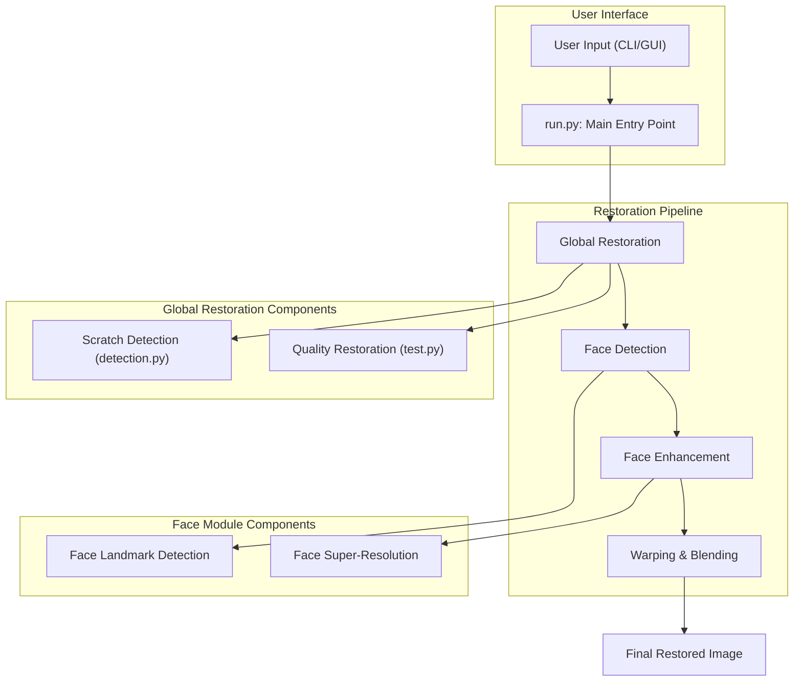
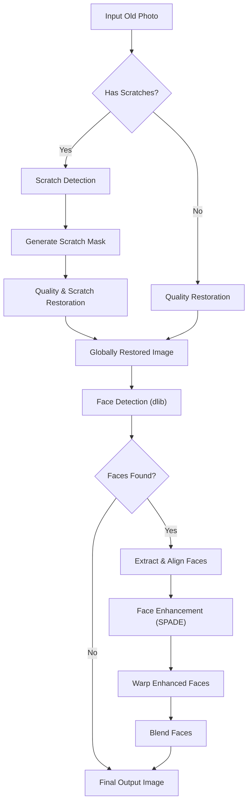
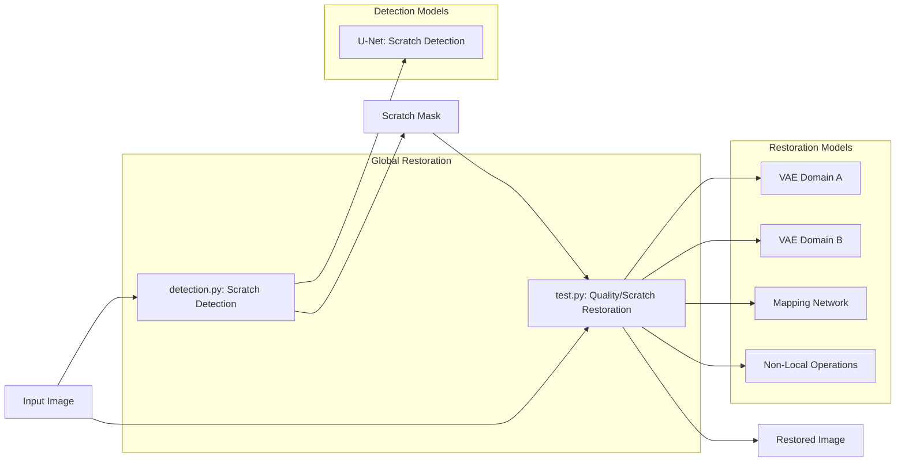
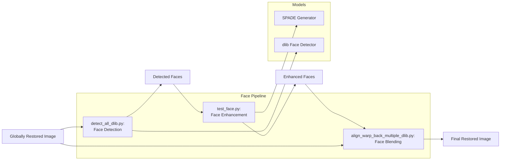
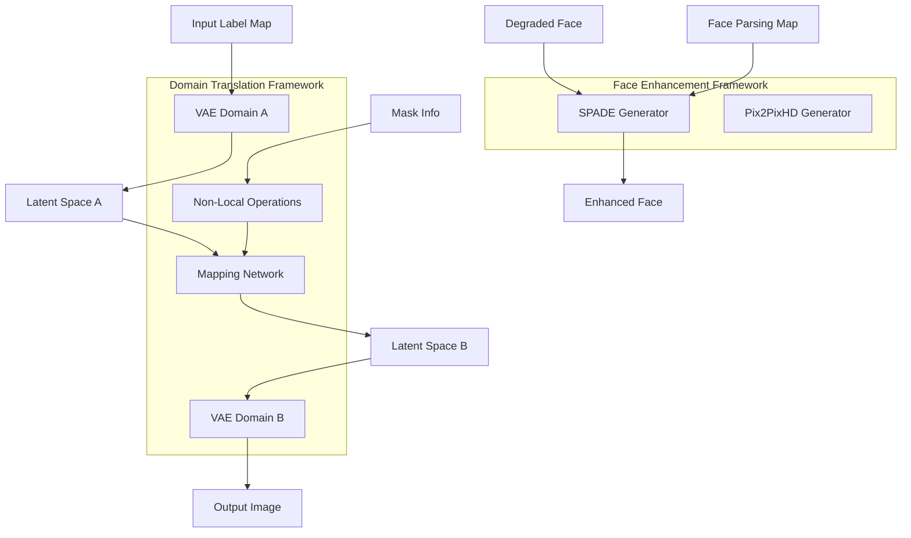

<!-- source: DeepWiki mcp.deepwiki.com · repo microsoft/Bringing-Old-Photos-Back-to-Life · page 1 Overview · fetched 2026-10-26 -->

# Overview

<details>
<summary>Relevant source files</summary>

The following files were used as context for generating this wiki page:

- [README.md](README.md)
- [cog.yaml](cog.yaml)
- [download-weights](download-weights)
- [imgs/HOF_2_007_007_my_concat.gif](imgs/HOF_2_007_007_my_concat.gif)
- [imgs/gui.PNG](imgs/gui.PNG)
- [predict.py](predict.py)
- [run.py](run.py)

</details>


The "Bringing Old Photos Back to Life" system is a specialized image restoration framework designed to restore aged and damaged photographs using deep learning techniques. This repository implements the methodology described in the CVPR 2020 paper "Bringing Old Photos Back to Life" and the TPAMI 2022 paper "Old Photo Restoration via Deep Latent Space Translation". For information about setting up and installing the system, see [Installation and Setup](#1.1).

## System Purpose and Capabilities

This system addresses multiple degradation issues found in old photographs:

- Overall quality degradation (fading, discoloration)
- Structural defects (scratches, stains, tears)
- Face-specific deterioration (blurriness, lack of detail)

The restoration process happens through a four-stage pipeline that handles each aspect separately and then combines the results seamlessly.

## Architecture Overview

The restoration process follows a sequential pipeline architecture with specialized modules for each restoration aspect.



Sources: [run.py:45-105](), [README.md:83-106](), [README.md:166-168]()

## Data Flow

The system processes images through a sequence of transformations, with different paths depending on the image's condition.



Sources: [run.py:45-202](), [predict.py:59-202]()

## Code Organization

The codebase is organized into several key directories, each handling a specific aspect of the restoration process:

| Directory | Purpose | Key Components |
|-----------|---------|----------------|
| `Global/` | Overall image restoration | Scratch detection, quality improvement |
| `Face_Detection/` | Face detection and alignment | dlib-based face detection, alignment utilities |
| `Face_Enhancement/` | Face-specific restoration | SPADE-based face enhancement models |
| Root | Main entry points | `run.py`, `predict.py` |

Sources: [README.md:38-75](), [run.py:47-173]()

## Key Components

### Main Entry Points

The system provides several ways to use the restoration functionality:

1. **Command-line interface** (`run.py`): Primary way to process images through the full pipeline
2. **Prediction API** (`predict.py`): Provides programmatic access to the restoration pipeline
3. **GUI Interface**: Visual interface for easier usage

### Global Restoration Module

This module handles the overall image quality improvement and scratch removal:



Sources: [run.py:46-96](), [README.md:127-153]()

### Face Enhancement Module

This module handles face-specific restoration, using specialized models to enhance facial details:



Sources: [run.py:109-199](), [README.md:157-165]()

## High-Level Execution Flow

When running the restoration pipeline through `run.py`, the system executes the following steps:

1. **Input Processing**: Parse command-line arguments and prepare input/output directories
2. **Global Restoration**:
   - If image has scratches (with_scratch=True): Run scratch detection followed by combined quality and scratch restoration
   - Otherwise: Run quality restoration only
3. **Face Detection**: Detect and extract faces from the globally restored image
4. **Face Enhancement**: Apply specialized face enhancement to each detected face
5. **Face Blending**: Warp and blend the enhanced faces back into the globally restored image

The system also supports high-resolution processing through an HR mode (activated with the `--HR` flag).

Sources: [run.py:17-202](), [README.md:108-116]()

## Model Architecture

The system employs several deep learning models, primarily based on GANs and VAEs:

1. **Scratch Detection**: U-Net based architecture for identifying scratches
2. **Global Restoration**: Domain translation framework using VAEs and mapping networks 
3. **Face Enhancement**: SPADE-based generator for improving facial details



Sources: [README.md:127-153](), [README.md:157-165]()

## Using the System

Basic usage involves running the system through the command-line interface:

For images without scratches:
```
python run.py --input_folder [test_image_folder_path] --output_folder [output_path] --GPU 0
```

For scratched images:
```
python run.py --input_folder [test_image_folder_path] --output_folder [output_path] --GPU 0 --with_scratch
```

For high-resolution images:
```
python run.py --input_folder [test_image_folder_path] --output_folder [output_path] --GPU 0 --with_scratch --HR
```

For more details on usage options and advanced configuration, see [Usage Guide](#6).

Sources: [README.md:83-116](), [run.py:17-34]()

---

