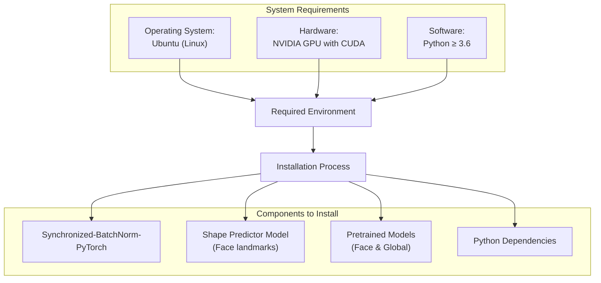
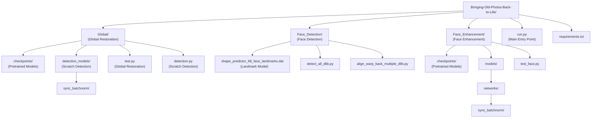
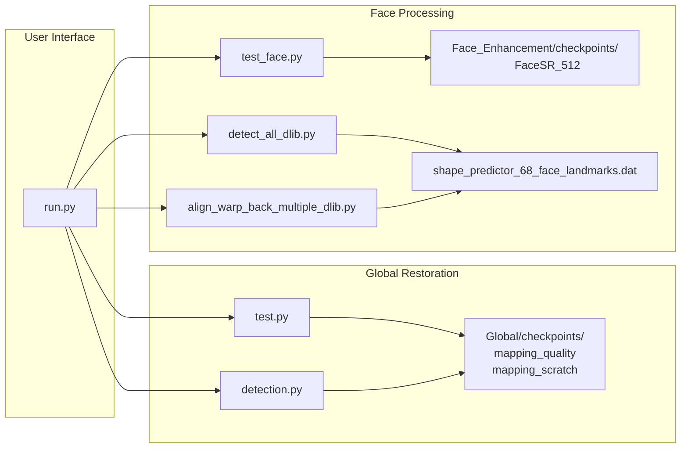

<!-- source: DeepWiki mcp.deepwiki.com · repo microsoft/Bringing-Old-Photos-Back-to-Life · page 1.1 Installation and Setup · fetched 2026-10-26 -->

# Installation and Setup

<details>
<summary>Relevant source files</summary>

The following files were used as context for generating this wiki page:

- [README.md](README.md)
- [cog.yaml](cog.yaml)
- [download-weights](download-weights)
- [imgs/HOF_2_007_007_my_concat.gif](imgs/HOF_2_007_007_my_concat.gif)
- [imgs/gui.PNG](imgs/gui.PNG)
- [predict.py](predict.py)

</details>


This page provides detailed instructions for installing and setting up the "Bringing Old Photos Back to Life" system. This guide focuses on preparing your environment and installing all necessary dependencies to run the old photo restoration pipeline. For information about using the system after installation, see [Usage Guide](#6).

## System Requirements

The photo restoration system has the following requirements:

- **Operating System**: Ubuntu (Linux)
- **GPU**: NVIDIA GPU with CUDA support
- **Python**: Version 3.6 or higher (3.8 recommended)



Sources: [README.md:34-36](), [cog.yaml:1-26]()

## Installation Steps

### 1. Clone the Repository

First, clone the repository and navigate to the project directory:

```bash
git clone https://github.com/microsoft/Bringing-Old-Photos-Back-to-Life.git
cd Bringing-Old-Photos-Back-to-Life
```

### 2. Set Up Synchronized BatchNorm

The system requires Synchronized BatchNorm PyTorch for both face enhancement and global restoration modules:

```bash
cd Face_Enhancement/models/networks/
git clone https://github.com/vacancy/Synchronized-BatchNorm-PyTorch
cp -rf Synchronized-BatchNorm-PyTorch/sync_batchnorm .
cd ../../../

cd Global/detection_models
git clone https://github.com/vacancy/Synchronized-BatchNorm-PyTorch
cp -rf Synchronized-BatchNorm-PyTorch/sync_batchnorm .
cd ../../
```

Sources: [README.md:39-53](), [download-weights:1-11]()

### 3. Download Face Landmark Detection Model

The face enhancement module requires a pre-trained facial landmark detection model:

```bash
cd Face_Detection/
wget http://dlib.net/files/shape_predictor_68_face_landmarks.dat.bz2
bzip2 -d shape_predictor_68_face_landmarks.dat.bz2
cd ../
```

Sources: [README.md:55-62](), [download-weights:13-17]()

### 4. Download Pretrained Restoration Models

The system uses pretrained models for both face enhancement and global restoration:

```bash
cd Face_Enhancement/
wget https://github.com/microsoft/Bringing-Old-Photos-Back-to-Life/releases/download/v1.0/face_checkpoints.zip
unzip face_checkpoints.zip
cd ../

cd Global/
wget https://github.com/microsoft/Bringing-Old-Photos-Back-to-Life/releases/download/v1.0/global_checkpoints.zip
unzip global_checkpoints.zip
cd ../
```

Sources: [README.md:64-75](), [download-weights:19-28]()

### 5. Install Python Dependencies

Install all required Python packages:

```bash
pip install -r requirements.txt
```

Sources: [README.md:77-81]()

## Directory Structure After Installation

After completing the installation steps, your project structure should look like this:



Sources: [README.md:39-75](), [download-weights:1-28]()

## Required Python Packages

The following Python packages are required for the system to function properly:

| Package | Version | Purpose |
|---------|---------|---------|
| torch | 1.8.0 | Deep learning framework |
| torchvision | 0.9.0 | Computer vision extensions for PyTorch |
| numpy | 1.19.4 | Numerical operations |
| opencv-python | 4.4.0.46 | Computer vision operations |
| scipy | 1.5.3 | Scientific computing |
| tensorboardX | 2.4 | Logging and visualization |
| dominate | 2.6.0 | HTML generation |
| easydict | 1.9 | Dictionary operations |
| PyYAML | 5.3.1 | YAML file parsing |
| scikit-image | 0.18.3 | Image processing |
| dlib | latest | Face detection and landmarks |

Sources: [cog.yaml:7-23]()

## System Component Relationship

The installation process sets up all components needed for the restoration pipeline. Here's how they interact:



Sources: [predict.py:60-196](), [README.md:83-117]()

## Verification

To verify your installation, run a test on a sample image:

```bash
python run.py --input_folder test_images/old_without_scratch --output_folder output --GPU 0
```

For images with scratches:

```bash
python run.py --input_folder test_images/old_w_scratch --output_folder output --GPU 0 --with_scratch
```

The results will be saved in the `output/final_output/` directory.

Sources: [README.md:90-105]()

## Troubleshooting

### Common Installation Issues

1. **CUDA Compatibility Issues**: Ensure your NVIDIA drivers and CUDA version are compatible with the PyTorch version specified (1.8.0).

2. **Missing Libraries**: If you encounter errors about missing libraries while running the program, install the required system packages:
   ```bash
   apt-get install libgl1-mesa-glx libglib2.0-0
   ```

3. **Dlib Installation Failures**: If you encounter issues installing dlib, try installing build dependencies first:
   ```bash
   apt-get install cmake build-essential
   pip install dlib
   ```

4. **Out of Memory Errors**: If you encounter CUDA out of memory errors when processing large images, try:
   - Using the `--HR` flag for high-resolution images
   - Reducing batch size if modifying the code
   - Processing images on a GPU with more memory

Sources: [cog.yaml:4-6](), [cog.yaml:24-25](), [README.md:20-21](), [README.md:107-116]()

## Environment Variables

The system uses the following environment variables:

| Variable | Purpose |
|----------|---------|
| `CUDA_VISIBLE_DEVICES` | Controls which GPUs are used (alternative to `--GPU` flag) |

You can set these variables before running the script:

```bash
export CUDA_VISIBLE_DEVICES=0,1
python run.py --input_folder test_images --output_folder output
```

Sources: [README.md:85]()

## Next Steps

After successfully installing the system, refer to [Usage Guide](#6) for detailed instructions on how to use the restoration pipeline effectively.

---

