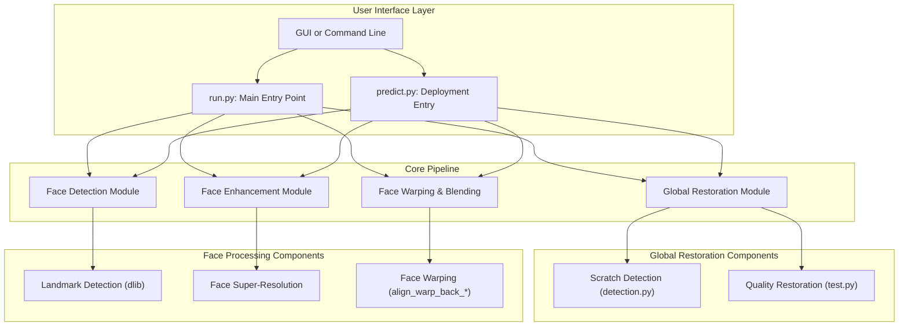
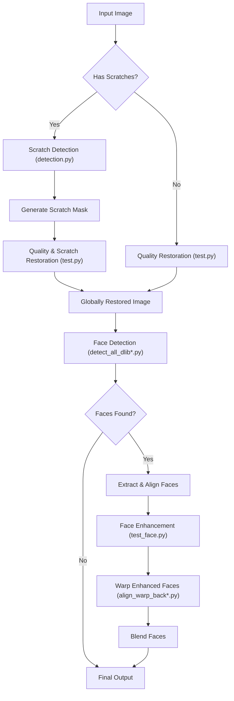
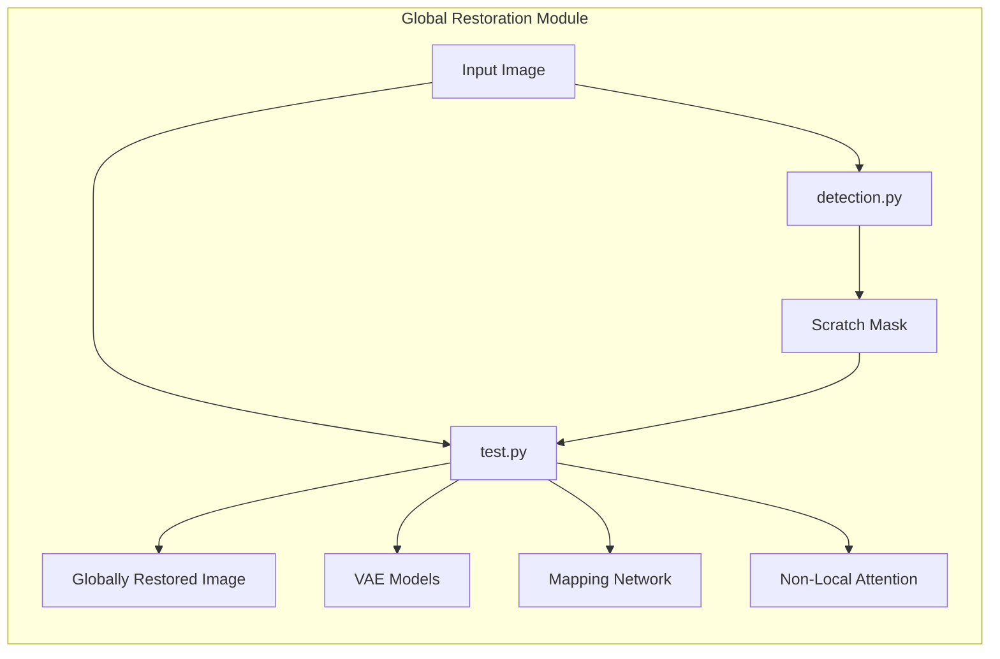
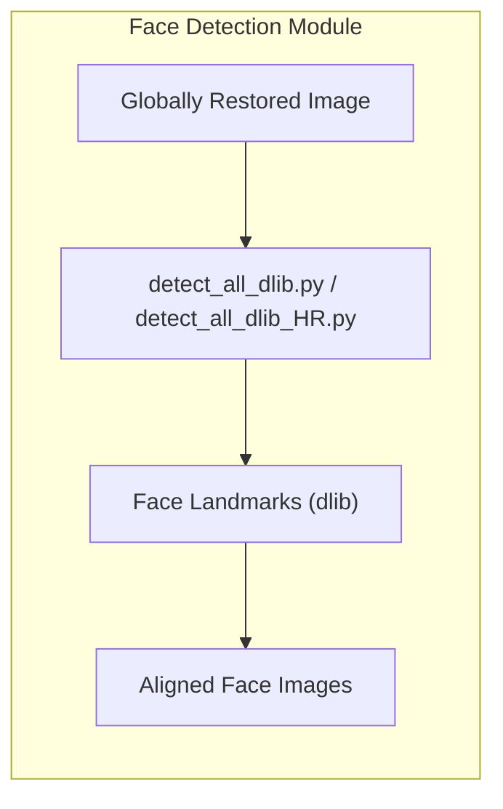
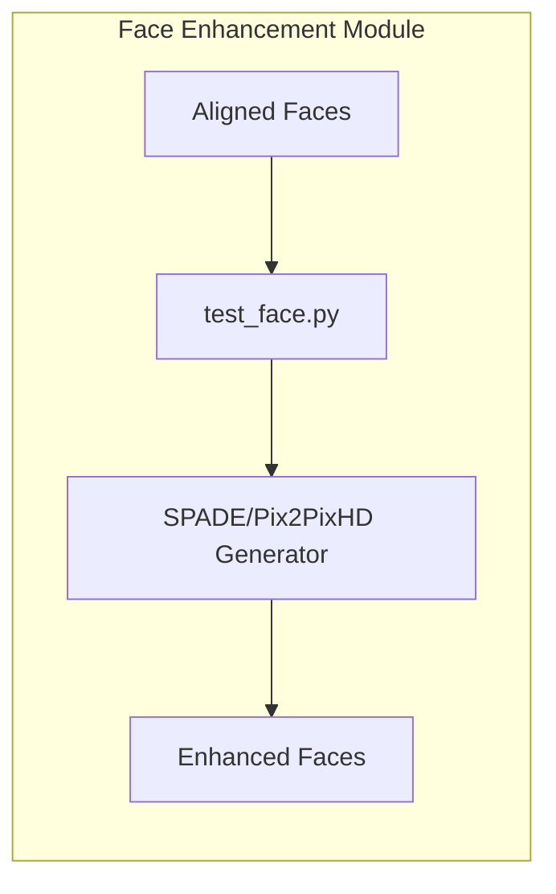
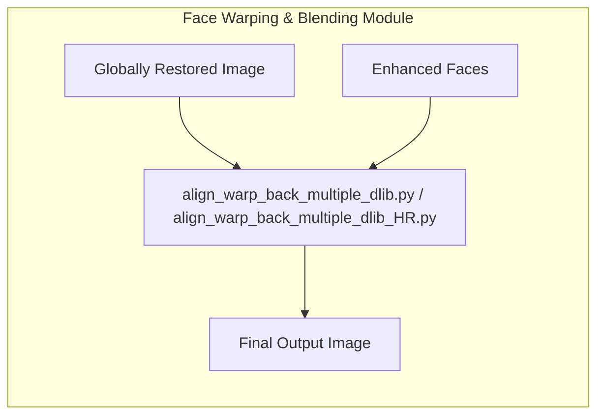
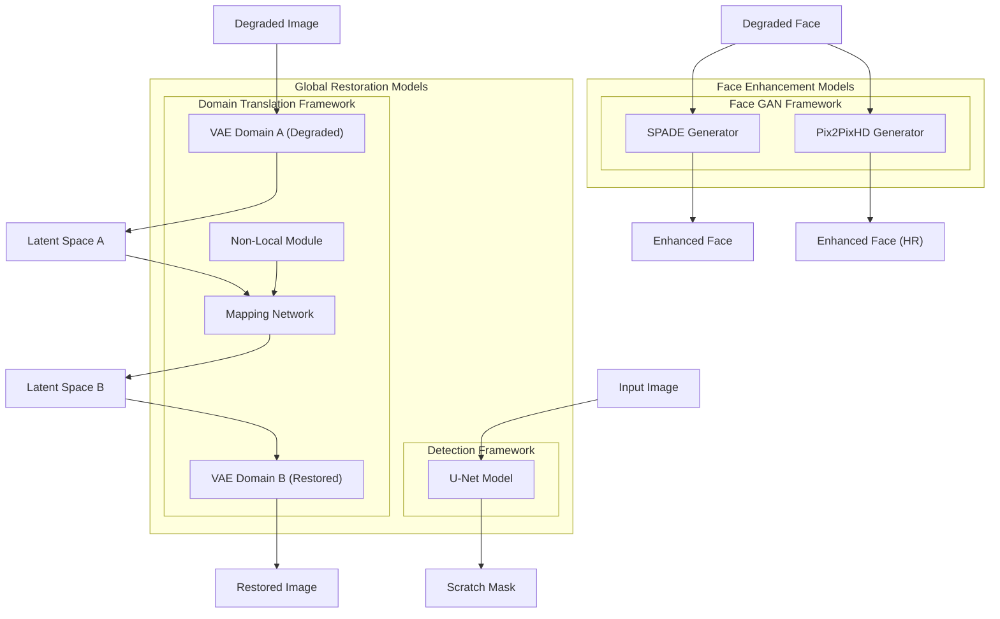
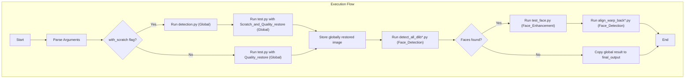

<!-- source: DeepWiki mcp.deepwiki.com · repo microsoft/Bringing-Old-Photos-Back-to-Life · page 1.2 System Architecture · fetched 2026-10-26 -->

# System Architecture

Relevant source files

The following files were used as context for generating this wiki page:

- [Global/models/__init__.py](Global/models/__init__.py)
- [Global/models/base_model.py](Global/models/base_model.py)
- [README.md](README.md)
- [cog.yaml](cog.yaml)
- [download-weights](download-weights)
- [imgs/HOF_2_007_007_my_concat.gif](imgs/HOF_2_007_007_my_concat.gif)
- [imgs/gui.PNG](imgs/gui.PNG)
- [predict.py](predict.py)
- [run.py](run.py)

This document describes the system architecture of the "Bringing Old Photos Back to Life" project, focusing on how various components work together to restore old photos. This page covers the overall system organization, data flow, and interaction between modules that make up the complete photo restoration pipeline.

For information about installation and setup, please refer to [Installation and Setup](#1.1).

## High-Level Architecture Overview

The photo restoration system is organized into a multi-stage pipeline with several specialized modules that work together to restore degraded photographs.

Sources: [run.py](), [predict.py](), [README.md]()

The system consists of four main modules:

1. **Global Restoration Module**: Processes the entire image to improve overall quality and remove scratches
2. **Face Detection Module**: Identifies and extracts faces from the restored image
3. **Face Enhancement Module**: Applies specialized restoration to facial regions
4. **Face Warping & Blending Module**: Integrates enhanced faces back into the globally restored image

## Pipeline Data Flow

The system processes images through a sequential pipeline where each stage handles specific aspects of photo restoration:

Sources: [run.py](), [Global/detection.py](), [Global/test.py](), [Face_Detection/detect_all_dlib.py](), [Face_Enhancement/test_face.py](), [Face_Detection/align_warp_back_multiple_dlib.py]()

This flow illustrates how an input image moves through the system:

1. The system determines if the image contains scratches
2. If scratches are present, the image undergoes scratch detection to generate a mask
3. The image is then processed for quality restoration (with or without scratch handling)
4. Faces are detected in the restored image
5. If faces are found, they are extracted, enhanced, and then warped back into the image
6. The final result is created by blending the enhanced faces with the globally restored image

## Core Components and Their Functionality

### Entry Points

The system has two main entry points:

| Entry Point | File | Description |
|-------------|------|-------------|
| Main Pipeline | `run.py` | Processes images through the complete restoration pipeline |
| Deployment | `predict.py` | Structured for model deployment scenarios |

Sources: [run.py](), [predict.py]()

### Global Restoration Module

The Global Restoration Module consists of two primary components:

Sources: [Global/detection.py](), [Global/test.py]()

#### Module Components:

1. **Scratch Detection (detection.py)**:
   - Uses a U-Net model to identify scratches in the input image
   - Outputs a binary mask indicating scratch locations

2. **Quality Restoration (test.py)**:
   - Handles overall quality improvement
   - Can process with or without scratch masks
   - Implements a domain translation framework with:
     - Variational Autoencoders (VAEs) for domain encoding
     - Mapping network for latent space translation
     - Non-local attention mechanism for handling large-scale defects

### Face Detection Module

The Face Detection Module is responsible for identifying and extracting faces for further enhancement:

Sources: [Face_Detection/detect_all_dlib.py](), [Face_Detection/detect_all_dlib_HR.py]()

#### Module Components:

1. **Face Detection**:
   - Uses dlib's face detection and landmark detection
   - Has standard and high-resolution (HR) processing paths
   - Extracts and aligns faces for enhancement

### Face Enhancement Module

The Face Enhancement Module applies specialized restoration techniques to facial regions:

Sources: [Face_Enhancement/test_face.py]()

#### Module Components:

1. **Face Enhancement (test_face.py)**:
   - Applies GAN-based enhancement to facial regions
   - Uses specialized models trained for facial details
   - Supports both standard and high-resolution processing

### Face Warping and Blending Module

The Face Warping and Blending Module reintegrates enhanced faces back into the globally restored image:

Sources: [Face_Detection/align_warp_back_multiple_dlib.py](), [Face_Detection/align_warp_back_multiple_dlib_HR.py]()

#### Module Components:

1. **Face Warping and Blending**:
   - Warps enhanced faces back to their original positions
   - Blends face boundaries for seamless integration
   - Supports both standard and high-resolution processing

## Model Architecture

The system employs multiple neural network architectures for different restoration tasks:

Sources: [Global/models/base_model.py](), [README.md]()

### Key Model Components:

1. **Domain Translation Framework**:
   - VAE for degraded domain (Domain A): Encodes degraded images into latent space
   - VAE for restored domain (Domain B): Decodes from latent space to restored images
   - Mapping Network: Translates between latent spaces of the two domains
   - Non-Local Module: Handles large-scale structural defects using patch attention

2. **Face Enhancement Framework**:
   - SPADE Generator: Conditional GAN for face enhancement
   - Pix2PixHD Generator: High-resolution face enhancement

3. **Detection Framework**:
   - U-Net Model: Identifies scratches and generates binary masks

## Module Interactions and Execution Flow

The execution flow of the system is orchestrated by the main entry point (`run.py`), which coordinates the interaction between modules:

Sources: [run.py:45-201]()

### Module Interaction Details:

1. **Initialization Phase**:
   - Parse command-line arguments (`--input_folder`, `--output_folder`, `--with_scratch`, `--HR`)
   - Set up directories for input and output

2. **Global Restoration Phase**:
   - If `with_scratch` flag is set:
     - Run `detection.py` to generate scratch masks
     - Run `test.py` with `Scratch_and_Quality_restore` option
   - Otherwise:
     - Run `test.py` with `Quality_restore` option
   - Store globally restored images

3. **Face Processing Phase**:
   - Run face detection (`detect_all_dlib.py` or `detect_all_dlib_HR.py` for high-resolution)
   - If faces are found:
     - Run face enhancement (`test_face.py`)
     - Run face warping and blending (`align_warp_back_multiple_dlib.py` or `align_warp_back_multiple_dlib_HR.py`)
   - If no faces are found:
     - Use the globally restored image as the final output

4. **Finalization Phase**:
   - Save final output to the specified output directory

## Configuration and Options Management

The system uses command-line arguments to configure the restoration process:

| Option | Description | Default |
|--------|-------------|---------|
| `--input_folder` | Path to input images | "./test_images/old" |
| `--output_folder` | Path for output results | "./output" |
| `--GPU` | GPU indices to use | "6,7" |
| `--with_scratch` | Enable scratch handling | False |
| `--HR` | Enable high-resolution processing | False |
| `--checkpoint_name` | Model checkpoint to use | "Setting_9_epoch_100" |

Sources: [run.py:18-32](), [predict.py:14-31]()

## Summary

The "Bringing Old Photos Back to Life" system employs a modular architecture with specialized components for different aspects of photo restoration. The system processes images through a sequential pipeline, starting with global restoration, followed by face detection, face enhancement, and finally face warping and blending.

This modular design allows for flexibility and independent improvement of individual components. The system handles both standard and high-resolution processing paths, as well as specialized handling for images with scratches.

The architecture balances global image quality restoration with detailed face enhancement, providing comprehensive restoration for old photographs with various forms of degradation.

Sources: [README.md](), [run.py](), [predict.py]()

---

