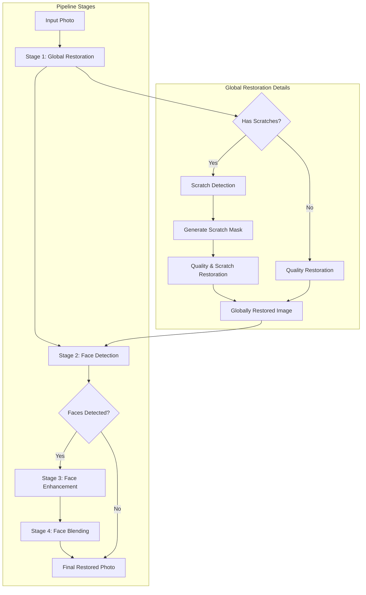
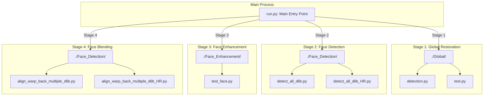
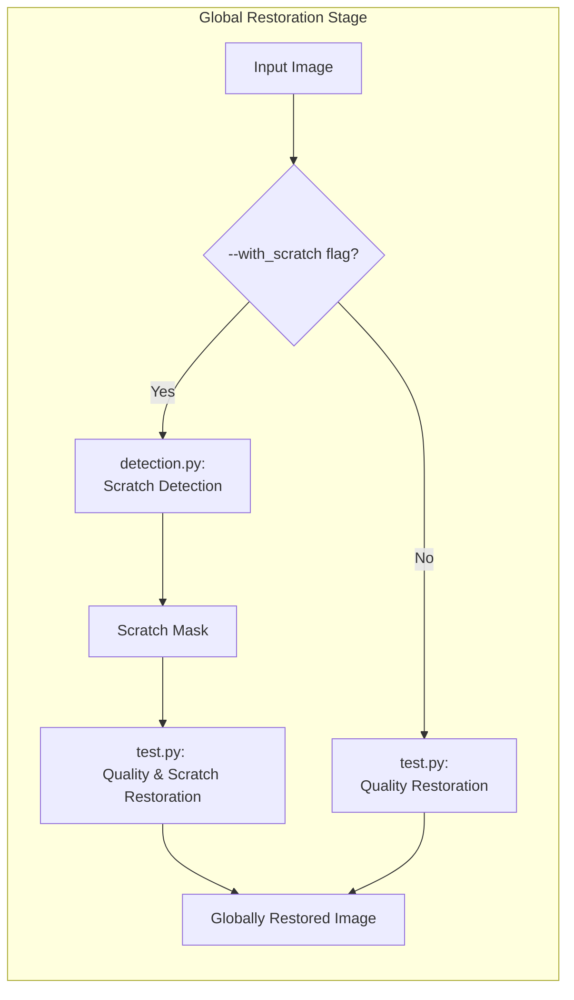
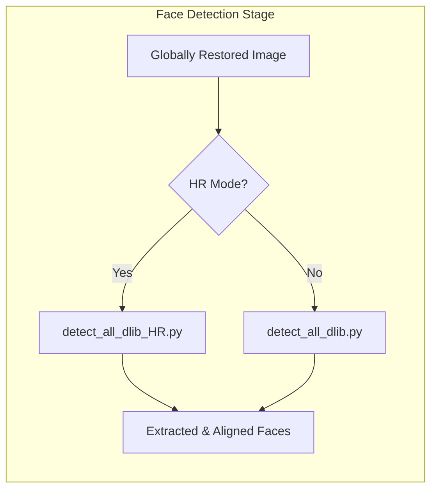
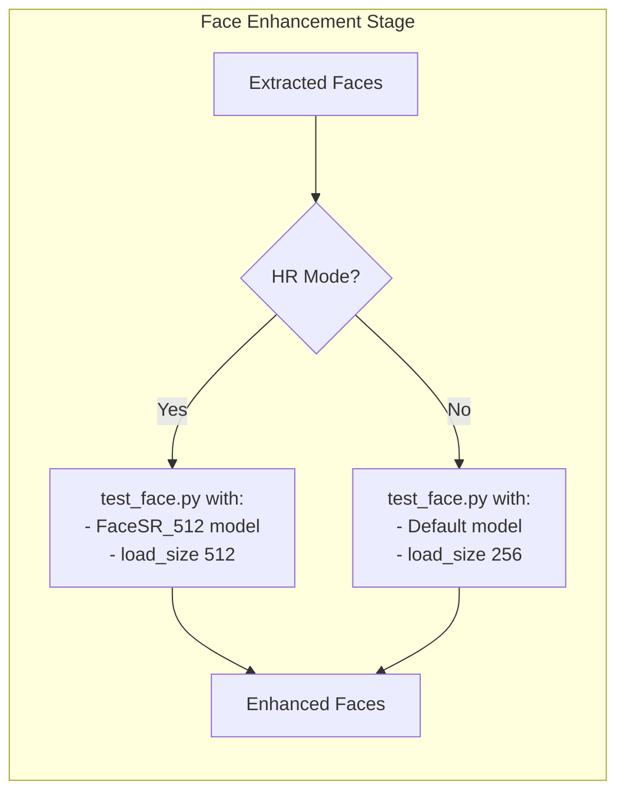
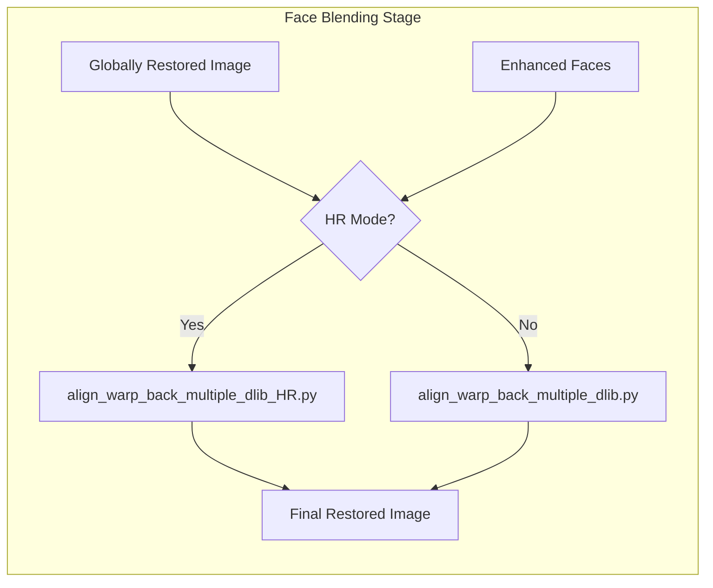

<!-- source: DeepWiki mcp.deepwiki.com · repo microsoft/Bringing-Old-Photos-Back-to-Life · page 2 Restoration Pipeline · fetched 2026-10-26 -->

# Restoration Pipeline

<details>
<summary>Relevant source files</summary>

The following files were used as context for generating this wiki page:

- [README.md](README.md)
- [cog.yaml](cog.yaml)
- [download-weights](download-weights)
- [imgs/HOF_2_007_007_my_concat.gif](imgs/HOF_2_007_007_my_concat.gif)
- [imgs/gui.PNG](imgs/gui.PNG)
- [predict.py](predict.py)
- [run.py](run.py)

</details>


## Purpose and Scope

This document provides a comprehensive technical overview of the complete restoration pipeline used in the "Bringing Old Photos Back to Life" system. It covers the four main stages of the restoration process: Global Restoration, Face Detection, Face Enhancement, and Face Blending. For information about the specific model architectures used in the system, see [Model Architecture](#3).

## Pipeline Overview

The restoration pipeline processes old, degraded photographs through a series of specialized modules, each addressing different aspects of photo degradation. The pipeline is orchestrated by the main `run.py` script, which executes each stage sequentially and manages the flow of data between stages.



Sources: [run.py:45-106](), [README.md:83-106]()

## Pipeline Execution Flow

The restoration pipeline is implemented with a modular design, where each stage is executed in a specific directory containing the specialized models and scripts for that particular task.



Sources: [run.py](), [predict.py]()

## Stage 1: Global Restoration

The Global Restoration stage addresses overall image quality issues and removes scratches or defects from the input image. This stage involves two main steps:

1. **Scratch Detection** (if needed): Identifies scratches in the input image and generates a mask.
2. **Quality Restoration**: Improves the overall image quality, with or without scratch handling.

### Process Flow



Sources: [run.py:45-106](), [predict.py:59-124]()

### Implementation Details

The Global Restoration stage is implemented in the `./Global/` directory and is executed as follows:

1. **Initialization**: The input folder path is passed to the Global module.
2. **Scratch Handling** (conditional):
   - If the `--with_scratch` flag is set, the system first runs `detection.py` to generate a scratch mask.
   - The mask and input are then passed to `test.py` with the `--Scratch_and_Quality_restore` flag.
3. **Quality Restoration** (always):
   - If no scratches are detected/specified, `test.py` is run with only the `--Quality_restore` flag.
4. **Output**: The restored images are saved to the specified output directory.

For high-resolution images, the `--HR` flag can be specified to enable specialized processing for higher resolution inputs.

#### Key Command-Line Options

| Option | Description |
|--------|-------------|
| `--input_folder` | Path to the folder containing input images |
| `--output_folder` | Path where restored images will be saved |
| `--with_scratch` | Flag to enable scratch detection and removal |
| `--HR` | Flag to enable high-resolution processing |
| `--GPU` | GPU IDs to use for processing (e.g., "0,1") |

Sources: [run.py:19-33](), [predict.py:12-36]()

## Stage 2: Face Detection

The Face Detection stage identifies and extracts faces from the globally restored image. It uses dlib's face detection and landmark localization to identify faces and their key features.

### Process Flow



Sources: [run.py:109-127](), [predict.py:126-145]()

### Implementation Details

The Face Detection stage is implemented in the `./Face_Detection/` directory and involves:

1. **Face Detection**: Using dlib's face detector to identify faces in the image.
2. **Landmark Detection**: Using the 68-point landmark detector from dlib to identify facial features.
3. **Face Extraction**: Extracting the detected faces and aligning them based on the landmarks.
4. **Output**: Saving the extracted faces to the specified output directory.

Different scripts are used based on the resolution:
- `detect_all_dlib.py` for standard resolution
- `detect_all_dlib_HR.py` for high resolution

The face detection model (`shape_predictor_68_face_landmarks.dat`) must be downloaded and placed in the Face_Detection directory as part of the setup process.

Sources: [download-weights:13-17]()

## Stage 3: Face Enhancement

The Face Enhancement stage applies specialized restoration techniques to the detected faces, significantly improving their quality and details.

### Process Flow



Sources: [run.py:129-169](), [predict.py:147-176]()

### Implementation Details

The Face Enhancement stage is implemented in the `./Face_Enhancement/` directory and involves:

1. **Model Selection**: Loading the appropriate pre-trained face enhancement model.
2. **Face Processing**: Applying the model to enhance the detected faces.
3. **Output**: Saving the enhanced faces to the specified output directory.

The face enhancement uses different configurations based on resolution:
- For high-resolution (`--HR` flag):
  - Uses `FaceSR_512` checkpoint
  - Sets `load_size` to 512
  - Uses batch size 1 for processing
- For standard resolution:
  - Uses default checkpoint
  - Sets `load_size` to 256
  - Uses batch size 4 for faster processing

The face enhancement model is based on pix2pixHD architecture with specialized components for face restoration.

Sources: [run.py:138-166](), [predict.py:158-170]()

## Stage 4: Face Blending

The Face Blending stage warps the enhanced faces back to their original positions in the image and blends them seamlessly with the surrounding content.

### Process Flow



Sources: [run.py:171-199](), [predict.py:177-196]()

### Implementation Details

The Face Blending stage is implemented in the `./Face_Detection/` directory and involves:

1. **Alignment**: Using the face landmarks to calculate the transformation needed to warp the enhanced face back.
2. **Warping**: Applying the transformation to place the enhanced face back in its original position.
3. **Blending**: Seamlessly blending the enhanced face with the surrounding image content.
4. **Output**: Saving the final restored image to the specified output directory.

Different scripts are used based on the resolution:
- `align_warp_back_multiple_dlib.py` for standard resolution
- `align_warp_back_multiple_dlib_HR.py` for high resolution

The blending process ensures that the enhanced faces integrate naturally with the rest of the image, avoiding visible seams or discontinuities.

Sources: [run.py:179-196](), [predict.py:185-192]()

## Restoration Pipeline Usage

The complete restoration pipeline can be executed through the command-line interface provided by `run.py`. Here are the typical usage patterns:

### Basic Usage for Images Without Scratches

```bash
python run.py --input_folder [test_image_folder_path] \
              --output_folder [output_path] \
              --GPU 0
```

### For Images With Scratches

```bash
python run.py --input_folder [test_image_folder_path] \
              --output_folder [output_path] \
              --GPU 0 \
              --with_scratch
```

### For High-Resolution Images With Scratches

```bash
python run.py --input_folder [test_image_folder_path] \
              --output_folder [output_path] \
              --GPU 0 \
              --with_scratch \
              --HR
```

The final results will be saved in `[output_path]/final_output/`. Intermediate results from each stage are also saved in their respective subdirectories within the output folder.

Sources: [README.md:89-118](), [run.py:17-202]()

## Output Directory Structure

When running the restoration pipeline, the following directory structure is created in the specified output folder:

```
[output_folder]/
├── stage_1_restore_output/      # Global restoration results
│   ├── masks/                   # Scratch masks (if --with_scratch)
│   └── restored_image/          # Globally restored images
├── stage_2_detection_output/    # Face detection results
├── stage_3_face_output/         # Face enhancement results
│   └── each_img/                # Enhanced faces
└── final_output/                # Final restored images
```

Sources: [run.py:49-176](), [predict.py:62-183]()

## Error Handling

The pipeline includes basic error handling to manage failures at each stage:

1. **No Faces Detected**: If no faces are detected in the image, the pipeline will still produce a globally restored output.
2. **Process Interruption**: Keyboard interrupts are caught and handled gracefully.
3. **Resource Cleanup**: For web-based deployments (using the `predict.py` script), temporary folders are cleaned up after processing.

Sources: [run.py:10-15](), [predict.py:213-222]()

## Integration with Other Components

The restoration pipeline integrates with other components of the system:

- **Model Architecture**: Uses complex neural network models for various restoration tasks. See [Model Architecture](#3) for details.
- **Training System**: The models used in the pipeline are trained using specialized training scripts. See [Training](#4) for details on training methodology.
- **Configuration**: Uses various configuration options to control pipeline behavior. See [Configuration](#5) for details on available options.

---

