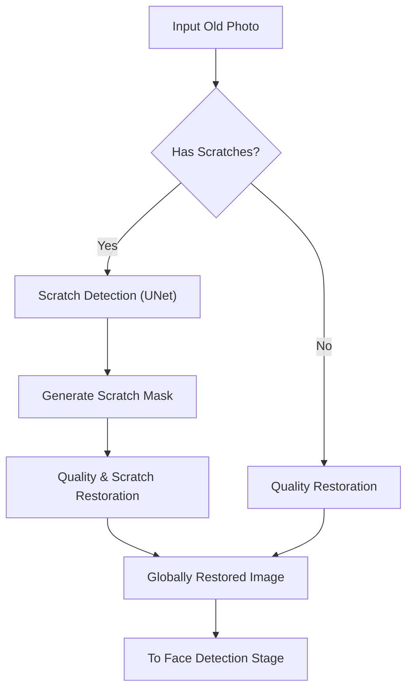
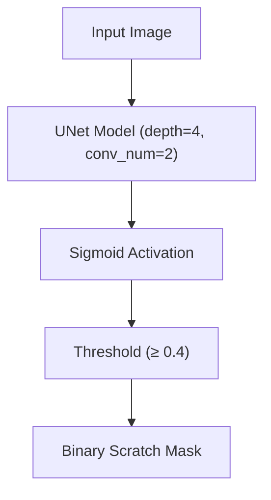
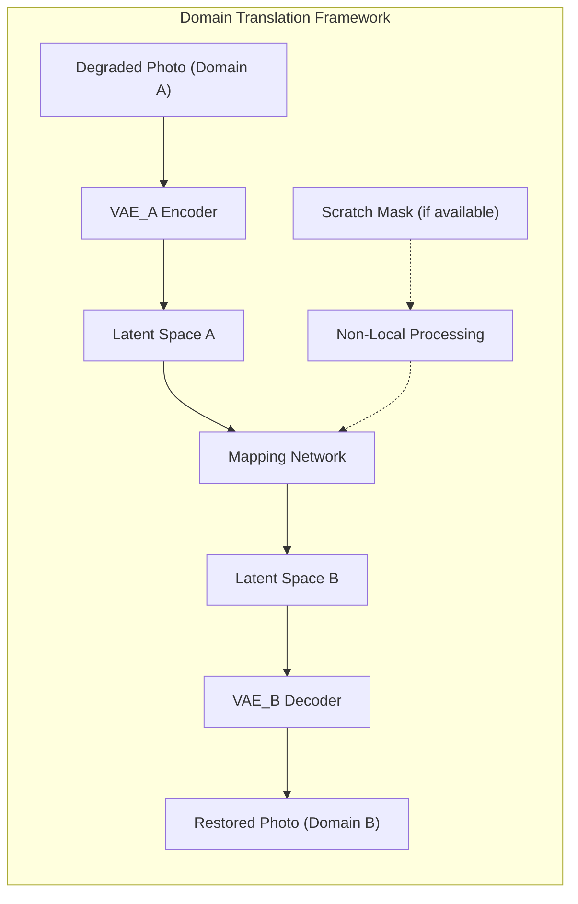
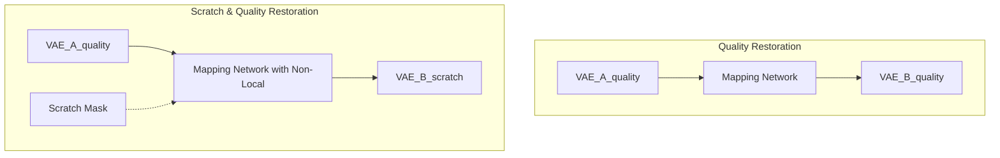
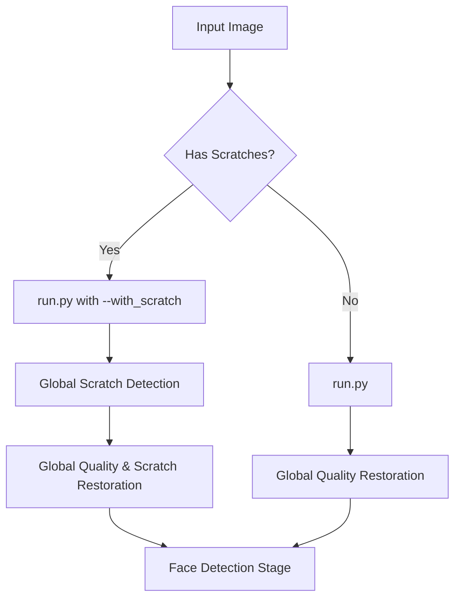

<!-- source: DeepWiki mcp.deepwiki.com · repo microsoft/Bringing-Old-Photos-Back-to-Life · page 2.1 Global Restoration · fetched 2026-10-26 -->

# Global Restoration

<details>
<summary>Relevant source files</summary>

The following files were used as context for generating this wiki page:

- [Global/detection.py](Global/detection.py)
- [Global/test.py](Global/test.py)
- [README.md](README.md)
- [imgs/HOF_2_007_007_my_concat.gif](imgs/HOF_2_007_007_my_concat.gif)
- [imgs/gui.PNG](imgs/gui.PNG)

</details>


## Overview

Global Restoration is the first major component in the old photo restoration pipeline, responsible for enhancing the overall quality and removing structural degradations such as scratches from historical photographs. This module processes the entire image globally before any face-specific enhancements are applied in later stages of the pipeline.

The Global Restoration module addresses two primary types of degradation in old photos:

1. **Quality degradation** - Issues such as fading, yellowing, color shifts, and texture deterioration
2. **Structural degradation** - Physical damage like scratches, spots, creases, and tears

For face-specific restoration, see [Face Enhancement](#2.3).

## System Architecture

The Global Restoration module consists of two main components that work together to restore the overall image quality:



Sources: [Global/test.py:94-103](), [Global/detection.py:73-166](), [README.md:132-151]()

### Scratch Detection

The scratch detection component uses a UNet-based neural network to identify scratches in old photos and generate a binary mask. This mask indicates damaged areas that require special attention during restoration.



Sources: [Global/detection.py:73-88](), [Global/detection.py:148-158]()

### Quality Restoration

The quality restoration component uses a domain translation approach based on a triplet framework:



Sources: [Global/test.py:59-94](), [README.md:133-139]()

## Model Architecture Details

### Scratch Detection Model

The scratch detection module uses a UNet architecture with the following specifications:

```
- Input channels: 1 (grayscale image)
- Output channels: 1 (binary mask)
- Depth: 4 (levels of down/upsampling)
- Convolutions per level: 2
- Width factor: 6
- Batch normalization: Enabled
- Antialiasing: Enabled
```

The UNet model is defined in [Global/detection.py:76-88]() and loaded from a pretrained checkpoint located at "checkpoints/detection/FT_Epoch_latest.pt".

Sources: [Global/detection.py:76-93]()

### Domain Translation Framework

The domain translation framework consists of three key components:

1. **VAE Domain A (Degraded Domain)**: Encodes damaged photos into a latent representation
2. **Mapping Network**: Translates between Domain A and Domain B latent spaces
3. **VAE Domain B (Restored Domain)**: Decodes the mapped latent representation to produce restored photos

Different VAE models are used depending on the restoration task:



Sources: [Global/test.py:74-92]()

### High-Resolution Processing

For high-resolution images with scratches, additional techniques are employed:

- **Multi-Scale Patch Attention**: Processes the image in smaller patches with attention mechanism
- **Inference Optimization**: Optimizes memory usage during processing
- **Mask Dilation**: Expands the detected scratch regions to ensure complete coverage

Sources: [Global/test.py:88-92](), [README.md:108-116]()

## Parameter Configuration

The Global Restoration module's behavior is controlled by several key parameters:

| Parameter | Quality Restoration | Scratch & Quality Restoration | HR Scratch & Quality |
|-----------|---------------------|------------------------------|----------------------|
| Model Name | "mapping_quality" | "mapping_scratch" | "mapping_Patch_Attention" |
| VAE Models | A_quality, B_quality | A_quality, B_scratch | A_quality, B_scratch |
| Non-Local | Disabled | Enabled | Enabled |
| Spectral Norm | Disabled | Enabled | Enabled |
| Mask Dilation | 0 | 0 | 3 |
| Mapping Exp | 0 | 0 | 1 |
| Inference Optimize | Disabled | Disabled | Enabled |

Sources: [Global/test.py:59-94]()

## Usage

### Scratch Detection

To run only the scratch detection component:

```
cd Global/
python detection.py --test_path [test_image_folder_path] \
                    --output_dir [output_path] \
                    --input_size [resize_256|full_size|scale_256]
```

Sources: [Global/detection.py:168-178](), [README.md:124-129]()

### Quality Restoration Only

For images without scratches:

```
cd Global/
python test.py --Quality_restore \
               --test_input [test_image_folder_path] \
               --outputs_dir [output_path]
```

Sources: [Global/test.py:95-103](), [README.md:148-151]()

### Combined Scratch and Quality Restoration

For images with scratches:

```
cd Global/
python test.py --Scratch_and_Quality_restore \
               --test_input [test_image_folder_path] \
               --test_mask [corresponding_mask_folder] \
               --outputs_dir [output_path]
```

Sources: [Global/test.py:95-103](), [README.md:142-147]()

## Integration with Overall Pipeline

The Global Restoration module is typically called from the main `run.py` script, which orchestrates the entire restoration process. After global restoration is completed, the image is passed to the Face Detection stage.



Sources: [README.md:89-118]()

## Technical Implementation

The core of the global restoration process occurs in the `test.py` file, which:

1. Sets up the appropriate parameters based on the restoration mode
2. Initializes the Pix2PixHDModel_Mapping model
3. Loads the input image and mask (if applicable)
4. Processes the image through the model
5. Saves the restored result

The inference is performed by the `model.inference()` method, which takes the input image and mask as parameters and returns the restored image.

Sources: [Global/test.py:95-192]()

---

