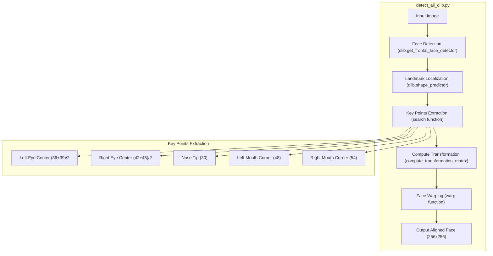
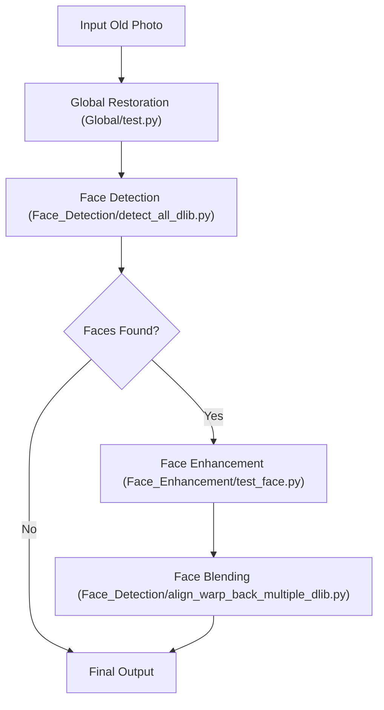

<!-- source: DeepWiki mcp.deepwiki.com · repo microsoft/Bringing-Old-Photos-Back-to-Life · page 2.2 Face Detection · fetched 2026-10-26 -->

# Face Detection

<details>
<summary>Relevant source files</summary>

The following files were used as context for generating this wiki page:

- [Face_Detection/align_warp_back_multiple_dlib.py](Face_Detection/align_warp_back_multiple_dlib.py)
- [Face_Detection/detect_all_dlib.py](Face_Detection/detect_all_dlib.py)
- [Face_Enhancement/data/__init__.py](Face_Enhancement/data/__init__.py)
- [README.md](README.md)
- [imgs/HOF_2_007_007_my_concat.gif](imgs/HOF_2_007_007_my_concat.gif)
- [imgs/gui.PNG](imgs/gui.PNG)

</details>


## Purpose and Scope
The Face Detection component identifies and extracts faces from old photographs for targeted enhancement. It serves as a critical bridge between the [Global Restoration](#2.1) phase, which addresses overall image quality, and the [Face Enhancement](#2.3) phase, which applies specialized restoration techniques to facial regions. For information about how the enhanced faces are reintegrated into the final image, see [Face Blending](#2.4).

## Process Overview
Face Detection employs the dlib library to detect faces and extract facial landmarks. These landmarks guide the alignment of each face to a standard position, enabling consistent face enhancement regardless of the face's original position, size, or orientation in the input image.

## Face Detection and Landmark Localization

The system uses dlib's frontal face detector to identify faces within images and a pre-trained shape predictor to locate 68 facial landmarks on each detected face:

```python
face_detector = dlib.get_frontal_face_detector()
landmark_locator = dlib.shape_predictor("shape_predictor_68_face_landmarks.dat")
faces = face_detector(image)
face_landmarks = landmark_locator(image, current_face)
```

From the 68 landmarks, five key points are extracted to guide face alignment:

| Key Point | Description | Source Landmarks |
|-----------|-------------|------------------|
| Left Eye Center | Center point of left eye | Average of landmarks 36 and 39 |
| Right Eye Center | Center point of right eye | Average of landmarks 42 and 45 |
| Nose Tip | Tip of the nose | Landmark 30 |
| Left Mouth Corner | Left corner of mouth | Landmark 48 |
| Right Mouth Corner | Right corner of mouth | Landmark 54 |

These five points provide sufficient information to compute a similarity transformation that aligns the face to a standard template.

## Face Detection Process Diagram



Sources: [Face_Detection/detect_all_dlib.py:27-78]()

## Face Alignment and Standardization

The system defines a standard face template with predefined positions for the five key points:

```python
def _standard_face_pts():
    pts = (
        np.array([196.0, 226.0, 316.0, 226.0, 256.0, 286.0, 220.0, 360.4, 292.0, 360.4], np.float32) / 256.0
        - 1.0
    )
    return np.reshape(pts, (5, 2))
```

A similarity transformation matrix is computed to align the extracted face landmarks to this standard template:

```python
affine = compute_transformation_matrix(image, current_fl, False, target_face_scale=1.3)
aligned_face = warp(image, affine, output_shape=(256, 256, 3))
```

The transformation preserves the proportions of the face while adjusting scale, rotation, and position. The `target_face_scale` parameter (1.3) ensures that the face is slightly zoomed out to include context around the face.

Sources: [Face_Detection/detect_all_dlib.py:80-98](), [Face_Detection/detect_all_dlib.py:175-176]()

## Integration with Overall Pipeline

The Face Detection component fits into the overall restoration pipeline as follows:



Sources: [Face_Detection/detect_all_dlib.py](), [Face_Detection/align_warp_back_multiple_dlib.py]()

## Handling Multiple Faces

The system processes each detected face independently, allowing for the enhancement of multiple faces in a single image:

```python
for face_id in range(len(faces)):
    current_face = faces[face_id]
    face_landmarks = landmark_locator(image, current_face)
    current_fl = search(face_landmarks)
    
    affine = compute_transformation_matrix(image, current_fl, False, target_face_scale=1.3)
    aligned_face = warp(image, affine, output_shape=(256, 256, 3))
    img_name = x[:-4] + "_" + str(face_id + 1)
    io.imsave(os.path.join(save_url, img_name + ".png"), img_as_ubyte(aligned_face))
```

This approach ensures that all faces in an old photograph receive appropriate enhancement, regardless of their number or position.

Sources: [Face_Detection/detect_all_dlib.py:170-178]()

## Error Handling

If no faces are detected in an image, the system bypasses the face enhancement stage:

```python
if len(faces) == 0:
    print("Warning: There is no face in %s" % (x))
    continue
```

In such cases, the image retains only the global restoration improvements and proceeds directly to the final output.

Sources: [Face_Detection/detect_all_dlib.py:163-165]()

## Warping Back Process

After face enhancement, the improved faces are warped back to their original positions in the image using the inverse of the transformation matrix that was used for alignment:


This warping-back process ensures that the enhanced faces are seamlessly integrated into the overall restored image.

Sources: [Face_Detection/align_warp_back_multiple_dlib.py:383-428]()

---

