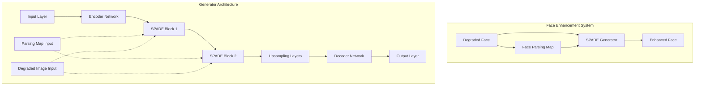
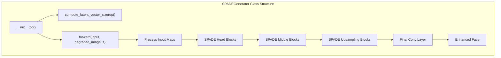
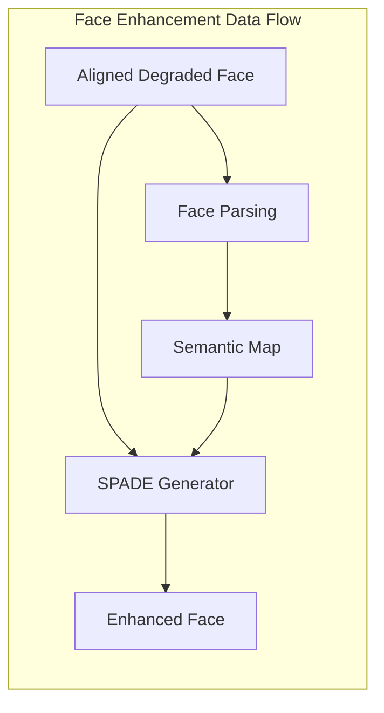
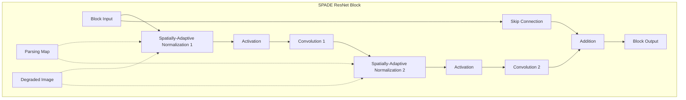
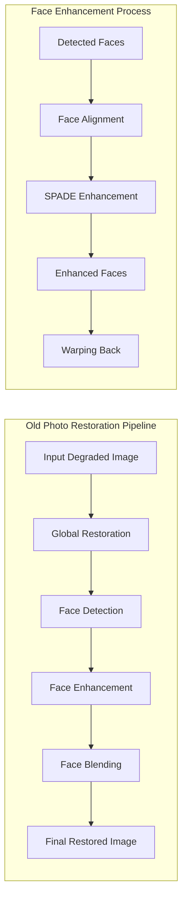

<!-- source: DeepWiki mcp.deepwiki.com · repo microsoft/Bringing-Old-Photos-Back-to-Life · page 2.3 Face Enhancement · fetched 2026-10-26 -->

# Face Enhancement

<details>
<summary>Relevant source files</summary>

The following files were used as context for generating this wiki page:

- [Face_Enhancement/models/networks/generator.py](Face_Enhancement/models/networks/generator.py)
- [Face_Enhancement/models/pix2pix_model.py](Face_Enhancement/models/pix2pix_model.py)
- [Face_Enhancement/options/base_options.py](Face_Enhancement/options/base_options.py)
- [README.md](README.md)
- [imgs/HOF_2_007_007_my_concat.gif](imgs/HOF_2_007_007_my_concat.gif)
- [imgs/gui.PNG](imgs/gui.PNG)

</details>


## Purpose and Scope

This document details the Face Enhancement subsystem of the Old Photo Restoration pipeline. The Face Enhancement module is responsible for improving the visual quality of detected faces in degraded old photographs. It applies specialized restoration techniques specifically optimized for facial features, significantly enhancing the overall quality of restored portraits.

This page focuses specifically on the face enhancement component. For information about detecting and aligning faces, see [Face Detection](#2.2). For the process of reintegrating enhanced faces into the restored image, see [Face Blending](#2.4).

## System Overview

The Face Enhancement module uses a specialized GAN (Generative Adversarial Network) architecture to transform degraded face images into high-quality restored versions. The system employs a SPADE (Spatially-Adaptive Normalization) generator that can leverage both degraded face inputs and facial parsing maps to generate realistic outputs.



Sources:
- Face_Enhancement/models/networks/generator.py
- Face_Enhancement/models/pix2pix_model.py
- README.md

## Key Components

### SPADE Generator

The core of the Face Enhancement system is the SPADE Generator, which uses spatially-adaptive normalization to incorporate facial structure information into the restoration process. The generator takes a degraded face image and optionally a face parsing map as input and produces an enhanced face as output.

Key features of the SPADE Generator:

1. **Conditional Input**: Can operate with or without facial parsing maps
2. **Injection Layer Control**: Allows conditioning to be injected at different network depths
3. **Progressive Architecture**: Uses a series of SPADE ResNet blocks with upsampling layers
4. **Adaptive Normalization**: Applies spatial normalization conditioned on input semantic map



Sources:
- Face_Enhancement/models/networks/generator.py:14-148

### Pix2Pix Model

The `Pix2PixModel` class serves as the high-level interface for the face enhancement system, coordinating the generator, discriminator, and encoder networks. It handles the forward and backward passes during training and provides inference functionality.

Key responsibilities:

1. **Network Initialization**: Creates and initializes the G, D, and E networks
2. **Loss Calculation**: Computes GAN loss, feature matching loss, VGG loss, and KLD loss
3. **Optimization**: Creates and manages optimizers for G and D networks
4. **Inference**: Generates enhanced faces from degraded inputs

Sources:
- Face_Enhancement/models/pix2pix_model.py:9-99

## Data Flow

The face enhancement process follows these steps:



1. **Input Preparation**: The system takes a degraded face image that has been detected and aligned.
2. **Face Parsing** (optional): A semantic parsing map is generated to identify facial regions.
3. **Enhancement**: The SPADE generator processes the degraded face, conditioned on the parsing map.
4. **Output**: A high-quality enhanced face is produced, maintaining identity and adding realistic details.

Sources:
- Face_Enhancement/models/pix2pix_model.py:101-126
- README.md:156-166

## Network Architecture Details

### Generator Architecture

The SPADEGenerator uses a progressive architecture with multiple resolution stages:


The network can be configured with different numbers of upsampling layers through the `num_upsampling_layers` option:
- "normal": 5 upsampling layers
- "more": 6 upsampling layers
- "most": 7 upsampling layers, with an additional block (`up_4`)

The key feature is the SPADE blocks, which allow the network to incorporate spatial information from the parsing map at different resolutions.

Sources:
- Face_Enhancement/models/networks/generator.py:27-148

### SPADE Block

Each SPADE block applies spatially-adaptive normalization based on the input parsing map and degraded image:



The SPADE block modulates the normalization parameters based on the input semantic map, allowing the network to preserve spatial information that would otherwise be lost in traditional normalization layers.

Sources:
- Face_Enhancement/models/networks/architecture.py

## Configuration Options

The face enhancement module provides numerous configuration options through the BaseOptions class:

| Option | Description | Default |
|--------|-------------|---------|
| `netG` | Generator architecture (spade or pix2pixhd) | "spade" |
| `ngf` | Number of generator filters | 64 |
| `norm_G` | Normalization method | "spectralinstance" |
| `no_parsing_map` | Disable use of parsing map | False |
| `injection_layer` | Where to inject conditioning ("all" or specific layers) | "all" |
| `crop_size` | Face crop size | 512 |
| `aspect_ratio` | Width/height ratio | 1.0 |
| `label_nc` | Number of label classes | 182 |

Sources:
- Face_Enhancement/options/base_options.py:14-294

## Integration with Overall System

The Face Enhancement module is part of a larger restoration pipeline:



The face enhancement component operates on detected and aligned facial regions from the globally restored image. After enhancement, the faces are warped back to their original position and blended with the background.

Sources:
- README.md:82-106
- README.md:156-166

## Usage

The face enhancement module can be used as part of the full restoration pipeline or as a standalone component:

### As Part of Full Pipeline

```
python run.py --input_folder [test_image_folder_path] \
              --output_folder [output_path] \
              --GPU 0
```

### For High-Resolution Images

```
python run.py --input_folder [test_image_folder_path] \
              --output_folder [output_path] \
              --GPU 0 \
              --HR
```

Sources:
- README.md:82-118

## Implementation Details

### Forward Pass

The core enhancement process occurs in the generator's forward method, which handles:

1. Preprocessing input images and parsing maps
2. Passing data through the network's SPADE blocks
3. Progressive upsampling to reach the final resolution
4. Final convolution and activation to produce the enhanced output

The network's behavior can be modified through the `injection_layer` parameter, which controls where the parsing map information is injected.

Sources:
- Face_Enhancement/models/networks/generator.py:105-148
- Face_Enhancement/models/pix2pix_model.py:36-52

## Performance Considerations

When processing high-resolution images, the face enhancement module may require significant GPU memory. The system is optimized for faces at 512×512 resolution, as training was primarily conducted on this size.

Sources:
- README.md:166-170

---

