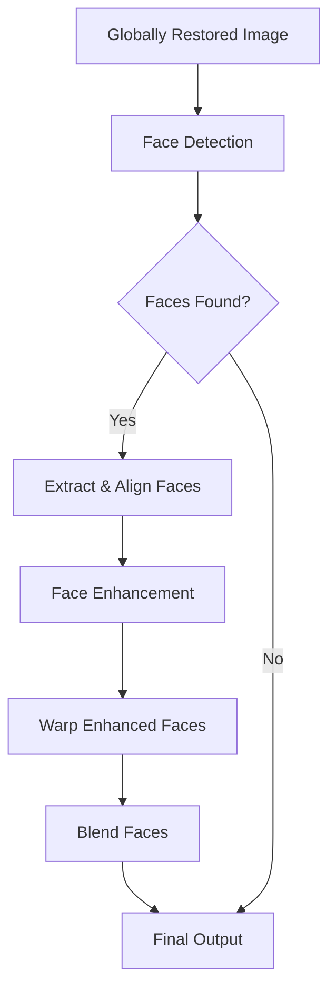
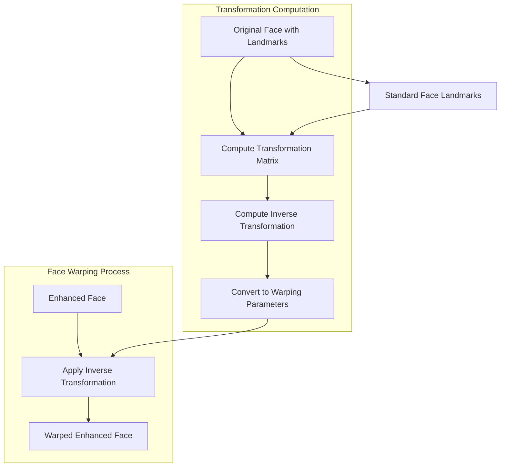
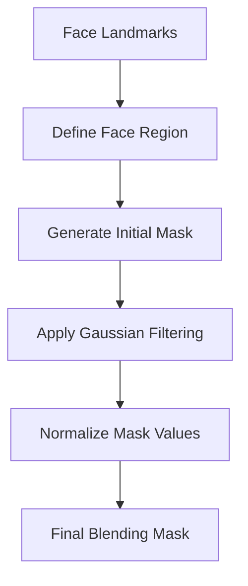
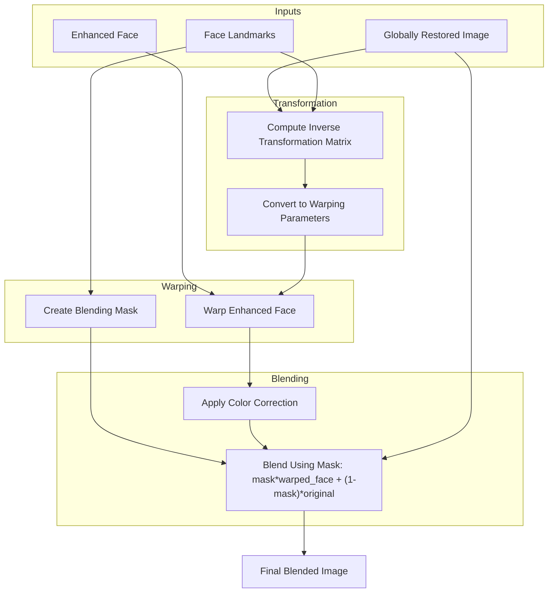
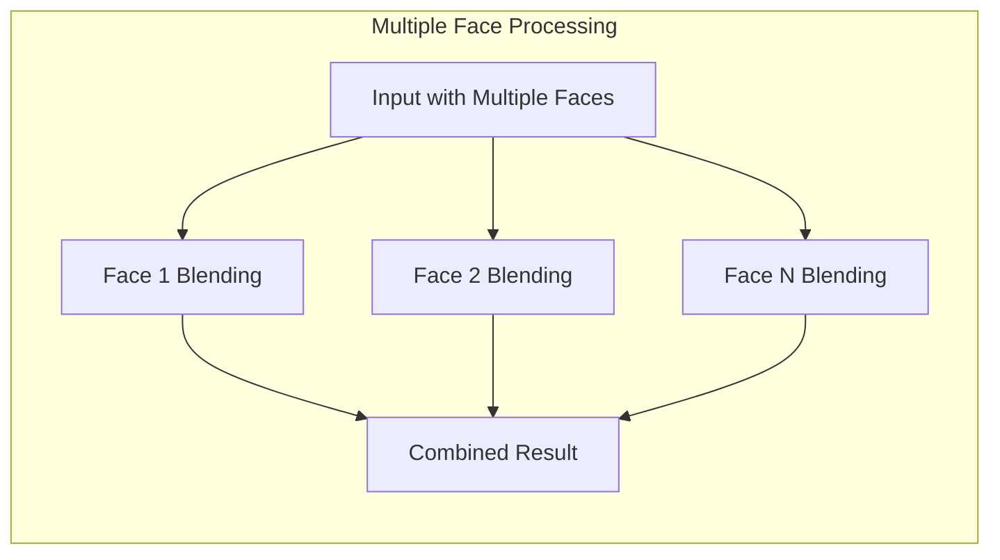
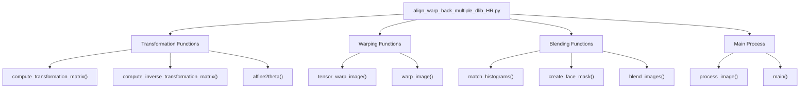

<!-- source: DeepWiki mcp.deepwiki.com · repo microsoft/Bringing-Old-Photos-Back-to-Life · page 2.4 Face Blending · fetched 2026-10-26 -->

# Face Blending

<details>
<summary>Relevant source files</summary>

The following files were used as context for generating this wiki page:

- [Face_Detection/align_warp_back_multiple_dlib_HR.py](Face_Detection/align_warp_back_multiple_dlib_HR.py)
- [Face_Detection/detect_all_dlib_HR.py](Face_Detection/detect_all_dlib_HR.py)
- [README.md](README.md)
- [imgs/HOF_2_007_007_my_concat.gif](imgs/HOF_2_007_007_my_concat.gif)
- [imgs/gui.PNG](imgs/gui.PNG)

</details>


Face blending is the final critical step in the old photo restoration pipeline. After detecting and enhancing faces, this component warps the enhanced faces back to their original positions and seamlessly integrates them with the globally restored image, ensuring a natural appearance without visible seams or artifacts.

## Purpose and Scope

This document covers the face blending component of the restoration pipeline, which serves as the bridge between enhanced face regions and the final restored image. For information about face enhancement itself, see [Face Enhancement](#2.3).

## Position in the Restoration Pipeline

Face blending operates as the final step in the facial processing workflow:



Sources: [README.md:102-116]()

## Technical Components

### Face Landmarks and Transformation

The face blending process relies on facial landmarks (specific points on facial features) detected during the face detection stage. These landmarks are essential for:

1. Computing the transformation matrices needed to warp the enhanced faces back to their original positions
2. Creating appropriate blending masks for seamless integration



Sources: [Face_Detection/align_warp_back_multiple_dlib_HR.py:112-166]()

### Standard Face Points

The system defines a set of standard face points that represent a normalized face position. These points serve as reference for computing transformations:

```python
def _standard_face_pts():
    pts = (
        np.array([196.0, 226.0, 316.0, 226.0, 256.0, 286.0, 220.0, 360.4, 292.0, 360.4], np.float32) / 256.0
        - 1.0
    )
    return np.reshape(pts, (5, 2))
```

These five points correspond to the eyes, nose, and mouth corners in a standardized face.

Sources: [Face_Detection/align_warp_back_multiple_dlib_HR.py:112-124]()

### Transformation Computation

Two key transformations are calculated:

1. **Forward transformation**: Maps the original face to a standardized position (used during face extraction and enhancement)
2. **Inverse transformation**: Maps the enhanced face back to its original position (used during blending)

The system uses the `SimilarityTransform` from skimage, which preserves proportions while allowing for scaling, rotation, and translation.

Sources: [Face_Detection/align_warp_back_multiple_dlib_HR.py:127-166]()

### Face Warping Techniques

The system implements two warping approaches:

1. **PyTorch-based warping** (for GPU acceleration):
   - Converts the affine transformation matrix to theta parameters
   - Uses `F.grid_sample` for efficient GPU-accelerated warping

2. **skimage-based warping** (for CPU processing):
   - Uses `skimage.transform.warp` with the computed transformation matrix

This dual approach allows for efficient processing on different hardware configurations.

Sources: [Face_Detection/align_warp_back_multiple_dlib_HR.py:185-262]()

### Blending Mask Generation

To create natural transitions between enhanced faces and the original image, blending masks are generated:



The mask has higher values in the face center and gradually decreases towards the edges, ensuring smooth transitions.

Sources: [Face_Detection/align_warp_back_multiple_dlib_HR.py:347-400]()

### Color Consistency

To maintain color consistency between enhanced faces and the surrounding image, the system may apply:

1. **Histogram matching**: Matches the color distribution of the enhanced face to the original face region
2. **Color correction**: Adjusts the enhanced face to match the global image's color profile

Sources: [Face_Detection/align_warp_back_multiple_dlib_HR.py:26-109]()

## Blending Process

The complete face blending process combines all these components:



Sources: [Face_Detection/align_warp_back_multiple_dlib_HR.py:410-540]()

## Implementation Details

### Key Functions

The face blending implementation contains these key functions:

| Function | Purpose |
|----------|---------|
| `compute_transformation_matrix()` | Calculates transformation from original face to standardized position |
| `compute_inverse_transformation_matrix()` | Calculates transformation to warp enhanced face back to original position |
| `affine2theta()` | Converts affine transformation to theta parameter for PyTorch |
| `tensor_warp_image()` | Warps image using PyTorch's grid sampling |
| `warp_image()` | Warps image using skimage's warp function |
| `match_histograms()` | Performs histogram matching for color consistency |
| `blend_images()` | Combines warped face and original image using blending mask |

Sources: [Face_Detection/align_warp_back_multiple_dlib_HR.py:127-540]()

### High Resolution Support

The system includes a specialized implementation for high-resolution images:
- `align_warp_back_multiple_dlib_HR.py`: Handles high-resolution images efficiently
- `align_warp_back_multiple_dlib.py`: Standard resolution implementation

The high-resolution implementation includes optimizations such as:
- GPU-accelerated warping when available
- Efficient mask generation for large images
- Memory-optimized processing

Sources: [README.md:108-116]()

## Technical Challenges and Solutions

### Multiple Face Handling

When multiple faces are detected in an image, the system:
1. Processes each face separately
2. Warps and blends each enhanced face
3. Handles potential overlaps between face regions by processing faces sequentially



Sources: [Face_Detection/align_warp_back_multiple_dlib_HR.py:410-540]()

### Seamless Integration

To achieve seamless integration, the system:
1. Uses carefully designed blending masks with smooth gradients
2. Applies color correction to maintain consistency with surrounding areas
3. May apply histogram matching between the enhanced and original face regions

Sources: [Face_Detection/align_warp_back_multiple_dlib_HR.py:26-109](), [Face_Detection/align_warp_back_multiple_dlib_HR.py:347-400]()

## Code Implementation Mapping

The following diagram maps the face blending process to the actual code implementation:



Sources: [Face_Detection/align_warp_back_multiple_dlib_HR.py:1-540]()

## Summary

Face blending is the final and crucial step that seamlessly integrates enhanced face regions into the globally restored image. By using precise transformation calculations, efficient warping techniques, and carefully designed blending masks, the system produces natural-looking results where the enhanced faces appear coherent with the rest of the image.

---

