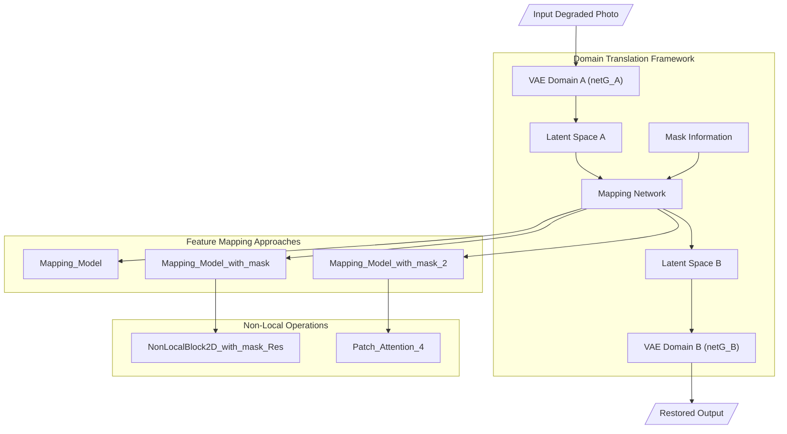
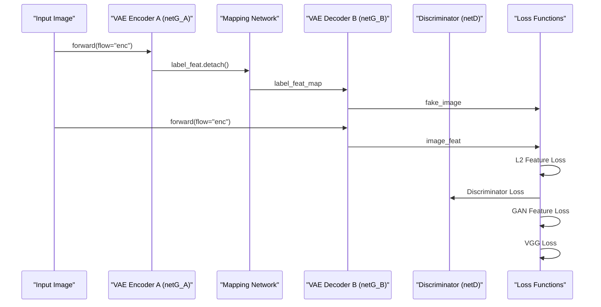
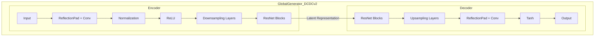
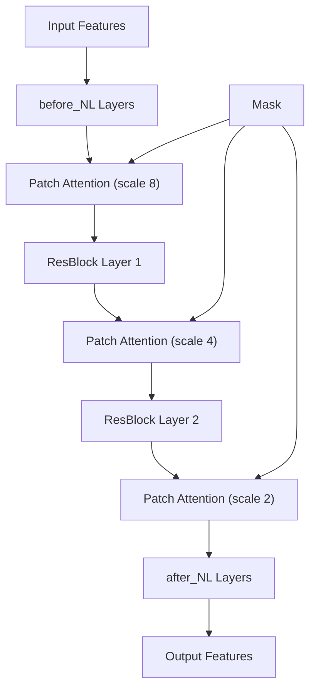
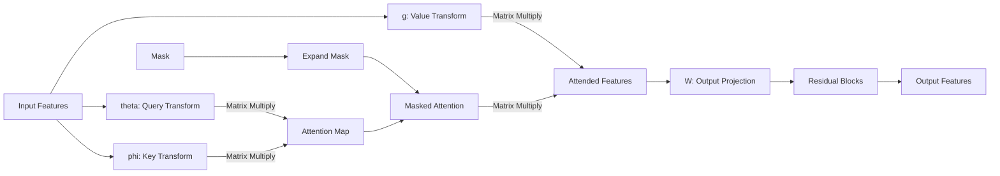
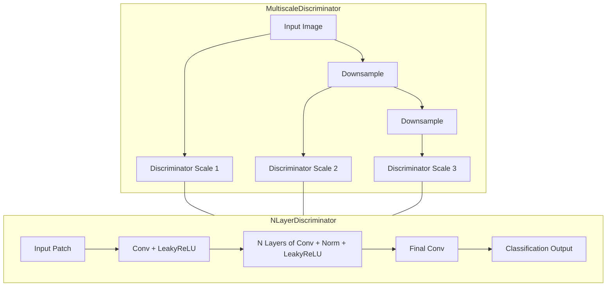

<!-- source: DeepWiki mcp.deepwiki.com · repo microsoft/Bringing-Old-Photos-Back-to-Life · page 3 Model Architecture · fetched 2026-10-26 -->

# Model Architecture

Relevant source files

The following files were used as context for generating this wiki page:

- [Global/models/NonLocal_feature_mapping_model.py](Global/models/NonLocal_feature_mapping_model.py)
- [Global/models/mapping_model.py](Global/models/mapping_model.py)
- [Global/models/networks.py](Global/models/networks.py)

This document describes the neural network architecture used in the "Bringing Old Photos Back to Life" system. It covers the core models that form the old photo restoration pipeline, with a focus on the domain translation framework, feature mapping networks, and non-local attention mechanisms. For information about the complete restoration pipeline, see [Restoration Pipeline](#2), and for specific details about training these models, see [Training](#4).

## Core Architecture Overview

The old photo restoration system employs an advanced domain translation framework with separate specialized components for handling global image restoration and face enhancement. The core architecture is built around Variational Autoencoders (VAEs) for different domains and a mapping network that bridges them.

Sources: [Global/models/mapping_model.py:60-153](). [Global/models/NonLocal_feature_mapping_model.py:17-185]().

## Pix2PixHDModel_Mapping

The `Pix2PixHDModel_Mapping` class serves as the central architecture of the system, orchestrating the entire domain translation process. This model is responsible for:

1. Encoding input images into a latent space using VAE Domain A
2. Mapping features from Domain A to Domain B 
3. Decoding the mapped features back to image space using VAE Domain B
4. Managing the adversarial training process with discriminators and loss functions

The model initializes two VAE networks (`netG_A` and `netG_B`) for domain translation and a mapping network (selected from three different types based on configuration). During training, it calculates multiple loss components:

- Feature L2 loss: Ensures feature-level similarity
- GAN loss: Adversarial loss for realistic outputs
- GAN feature matching loss: Matches intermediate discriminator activations
- VGG loss: Perceptual loss based on VGG19 features

Sources: [Global/models/mapping_model.py:60-352](). [Global/models/networks.py:777-875]().

## Global Generator

The `GlobalGenerator_DCDCv2` class implements the VAE architecture used for both Domain A and Domain B networks. It consists of:

1. An encoder that progressively downsamples the input while increasing feature channels
2. A decoder that upsamples the latent representation back to image resolution

The generator handles three flow modes:
- `"enc"`: Runs only the encoder part
- `"dec"`: Runs only the decoder part
- `"enc_dec"`: Runs both encoder and decoder (full image translation)

This architecture is crucial for both the old photo domain (Domain A) and the restored photo domain (Domain B).

Sources: [Global/models/networks.py:82-291](). [Global/models/mapping_model.py:87-105]().

## Mapping Networks

The system implements three different mapping network architectures for translating features between domains:

### 1. Basic Mapping Model

The simplest implementation, used when no global restoration or mask handling is required. It consists of:
- Initial convolutional layers for downsampling
- Multiple ResNet blocks for feature transformation
- Convolutional layers for upsampling to the target feature dimension

### 2. Mapping Model with Mask

Enhances the basic mapping model by incorporating mask information to handle specific regions (like scratches) differently from the rest of the image. It uses:
- A non-local block with mask (`NonLocalBlock2D_with_mask_Res`)
- The mask is used to guide the feature mapping process with attention to non-masked regions

### 3. Multi-Scale Patch Attention Mapping Model

The most advanced mapping network that implements multiple levels of patch attention at different scales:
- Uses three consecutive patch attention modules with different patch sizes (8, 4, 2)
- Each patch attention module is followed by residual blocks
- Handles the interaction between masked and non-masked regions through explicit patch matching

Sources: [Global/models/mapping_model.py:18-57](). [Global/models/NonLocal_feature_mapping_model.py:17-81](). [Global/models/NonLocal_feature_mapping_model.py:81-202]().

## Non-Local Operations

### Non-Local Block with Mask

The `NonLocalBlock2D_with_mask_Res` implements a non-local attention mechanism that allows distant image regions to interact, with specific handling for masked regions:

1. Computes feature transformation for query, key, and value branches
2. Calculates attention weights between all spatial locations
3. Uses mask information to prioritize attention to non-masked regions
4. Applies residual blocks to the attended features

Sources: [Global/models/networks.py:401-523]().

### Patch Attention

The `Patch_Attention_4` implements a patch-based attention mechanism:

1. Divides the input feature map into patches
2. Identifies masked and non-masked patches
3. Computes similarity between masked and non-masked patches
4. Replaces content in masked patches with content from the most similar non-masked patch
5. Combines the original and attention-transformed features

This approach is particularly effective for transferring texture details from non-damaged regions to damaged regions.

Sources: [Global/models/networks.py:621-774]().

## Discriminator Networks

The architecture uses a multi-scale discriminator approach for adversarial training:

- `MultiscaleDiscriminator`: Contains multiple discriminators operating at different image scales
- `NLayerDiscriminator`: PatchGAN-style discriminator that classifies if overlapping image patches are real or fake

The discriminator's role is to distinguish between real and generated images, helping the generator produce more realistic results through adversarial training.

Sources: [Global/models/networks.py:526-616]().

## Loss Functions

The system uses multiple loss functions to train the models effectively:

1. **GAN Loss**: Standard adversarial loss that trains the discriminator to distinguish real from fake images and the generator to fool the discriminator.

2. **Feature Matching Loss**: Compares intermediate activations in the discriminator between real and generated images, encouraging the generator to produce features similar to real images.

3. **VGG Loss**: Perceptual loss calculated using a pre-trained VGG19 network, comparing feature representations at multiple levels to ensure perceptual similarity between generated and target images.

4. **L1/Smooth L1 Loss**: Direct pixel-wise comparison between generated and target images, encouraging output fidelity.

These complementary loss functions work together to ensure that the generated images have high fidelity, perceptual similarity to real images, and realistic details.

Sources: [Global/models/mapping_model.py:157-193](). [Global/models/networks.py:777-875]().

## Integration with Overall System

The model architecture described here forms the core of the old photo restoration system. During inference:

1. Input images are first processed by the global restoration model (`netG_A` encoder + mapping network + `netG_B` decoder)
2. Faces are detected and processed separately using specialized face enhancement models
3. Enhanced faces are blended back into the globally restored image

This modular design allows the system to leverage specialized models for different aspects of photo restoration while maintaining coherence in the final result.

Sources: [Global/models/mapping_model.py:324-347]().

---

