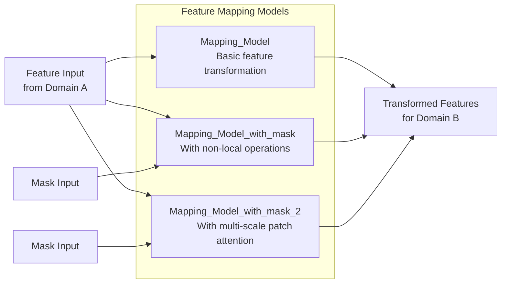
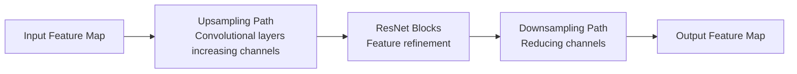
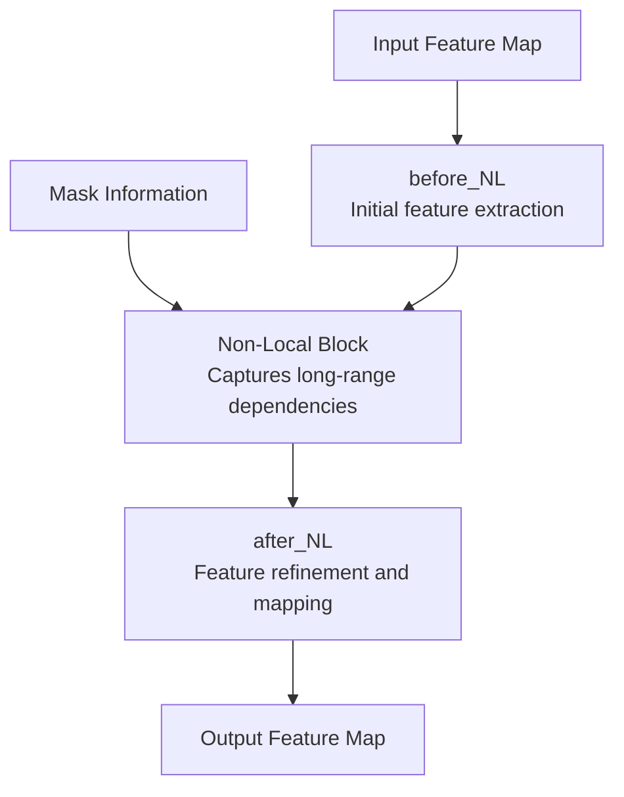
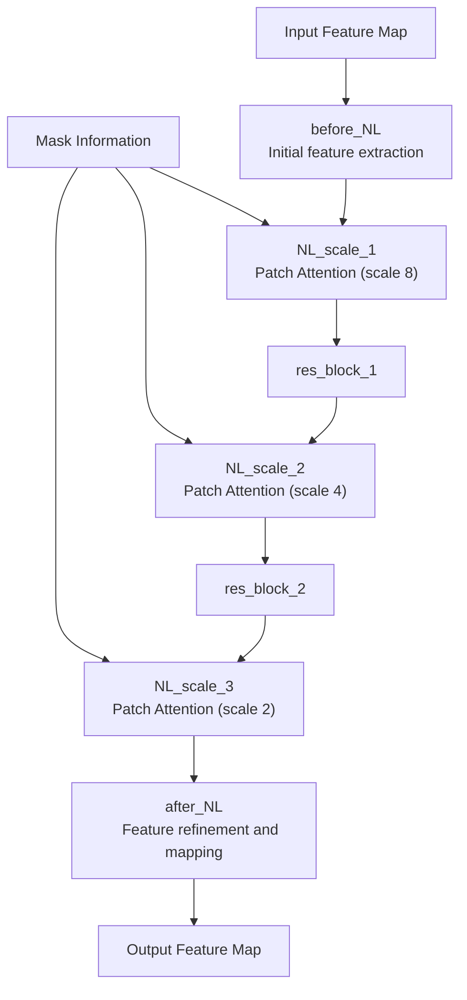
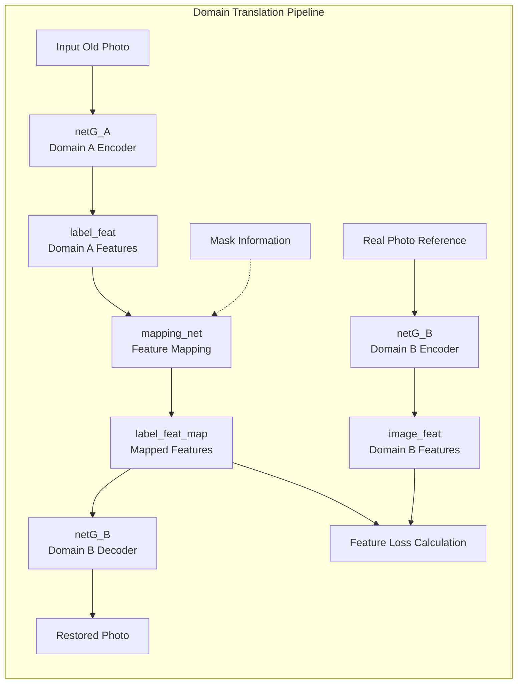
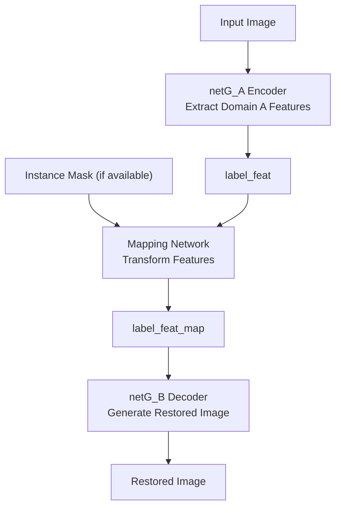

<!-- source: DeepWiki mcp.deepwiki.com · repo microsoft/Bringing-Old-Photos-Back-to-Life · page 3.1 Feature Mapping Models · fetched 2026-10-26 -->

# Feature Mapping Models

Relevant source files

The following files were used as context for generating this wiki page:

- [Global/models/NonLocal_feature_mapping_model.py](Global/models/NonLocal_feature_mapping_model.py)
- [Global/models/mapping_model.py](Global/models/mapping_model.py)
- [Global/models/pix2pixHD_model.py](Global/models/pix2pixHD_model.py)

## Introduction

Feature Mapping Models are a critical component in the photo restoration pipeline, responsible for translating feature representations between different domains. They serve as the bridge between the degraded photo domain (Domain A) and the restored photo domain (Domain B), enabling the system to transform old, damaged images into restored versions while preserving content structure.

The Feature Mapping Models operate in a latent feature space, positioned between the encoder and decoder parts of the VAE (Variational Autoencoder) networks. For information about the VAE models themselves, see [Model Architecture](#3).

Sources: [Global/models/mapping_model.py:17-57](), [Global/models/NonLocal_feature_mapping_model.py:17-80]()

## Model Variants

The system implements three main variants of feature mapping models:

Sources: [Global/models/mapping_model.py:17-57](), [Global/models/NonLocal_feature_mapping_model.py:17-80](), [Global/models/NonLocal_feature_mapping_model.py:81-186]()

### Basic Mapping Model

The basic `Mapping_Model` is a straightforward convolutional neural network designed to transform features from one domain to another without additional spatial context modeling.

Its architecture consists of:
- An upsampling path with convolutional layers that increase feature channels
- Multiple ResNet blocks for feature refinement
- A downsampling path that reduces feature channels back to the desired dimension

Sources: [Global/models/mapping_model.py:18-57]()

### Mapping Model with Mask

The `Mapping_Model_with_mask` extends the basic mapping model by incorporating non-local operations, which can capture long-range dependencies in the feature space. This is particularly useful for handling structural damage in old photos.

Key components include:
- A `before_NL` module for initial feature extraction
- A non-local block (`NL`) that incorporates mask information for guided feature attention
- An `after_NL` module for further refinement and mapping to the target domain

Sources: [Global/models/NonLocal_feature_mapping_model.py:17-80]()

### Multi-Scale Patch Attention Model

The most sophisticated variant, `Mapping_Model_with_mask_2`, implements multi-scale patch attention mechanisms to better handle feature transformations at different spatial scales.

This model processes features through:
- An initial feature extraction path
- Three scales of patch attention (scales 8, 4, and 2) that incorporate mask information
- ResNet blocks interspersed between attention layers for feature refinement
- A final mapping path to transform features to the target domain

Sources: [Global/models/NonLocal_feature_mapping_model.py:81-186]()

## Integration with Domain Translation Framework

The Feature Mapping Models are integrated into the overall domain translation pipeline through the `Pix2PixHDModel_Mapping` class, which orchestrates the interaction between the encoder/decoder networks and the mapping network.

Key integration points include:
1. Feature extraction from input images using Domain A encoder (`netG_A`)
2. Feature transformation via the mapping network
3. Image generation using Domain B decoder (`netG_B`) 
4. Feature-level supervision using features from real images

Sources: [Global/models/mapping_model.py:60-347]()

## Training Process

The Feature Mapping Models are trained within a GAN framework, with specific loss functions to ensure proper domain translation:

| Loss Component | Description | Implementation |
|----------------|-------------|----------------|
| Feature L2 Loss | Ensures feature-space alignment between mapped features and target domain features | `criterionFeat_feat` |
| GAN Loss | Adversarial loss to make mapped features indistinguishable from real features | `criterionGAN` |
| GAN Feature Matching | Matches intermediate features from the discriminator | `criterionFeat` |
| VGG Loss | Perceptual loss using VGG features to ensure visual similarity | `criterionVGG` |
| Smooth L1 Loss | Optional pixel-space loss for image reconstruction | `criterionImage` |

The training process alternates between:
1. Updating the discriminator to better distinguish between real and mapped features
2. Updating the mapping network to improve feature translation quality

Sources: [Global/models/mapping_model.py:164-216](), [Global/models/mapping_model.py:248-322]()

## Inference Process

During inference, the Feature Mapping Models process input images through a streamlined pipeline:

For models with mask support, the mask provides spatial guidance for the feature transformation process. The inference path includes specialized optimizations to improve performance for high-resolution images.

Sources: [Global/models/mapping_model.py:325-346](), [Global/models/NonLocal_feature_mapping_model.py:187-202]()

## Technical Specifications

### Network Configurations

The Feature Mapping Models can be configured with various parameters:

| Parameter | Description | Default |
|-----------|-------------|---------|
| `mc` | Maximum number of channels in the network | 64 |
| `n_blocks` | Number of ResNet blocks | 3 |
| `norm` | Normalization type | "instance" |
| `padding_type` | Type of padding for convolutions | "reflect" |
| `NL_res` | Whether to use residual connections in non-local blocks | Configurable |
| `mapping_net_dilation` | Dilation rate for convolutions in ResNet blocks | Configurable |
| `feat_dim` | Output feature dimension | Configurable |

Sources: [Global/models/mapping_model.py:18-20](), [Global/models/NonLocal_feature_mapping_model.py:18-19]()

### Non-Local Operations

The non-local operations in the mapping models implement a form of self-attention that allows each position in the feature map to attend to all other positions. This is particularly valuable for handling structural damage in old photos, as it can propagate information from undamaged regions to damaged regions.

For models with multi-scale patch attention, different scales allow the network to capture contextual information at varying levels of granularity:
- Scale 8: Captures broader contextual information
- Scale 4: Mid-level context
- Scale 2: Fine-grained local context

Sources: [Global/models/NonLocal_feature_mapping_model.py:35-45](), [Global/models/NonLocal_feature_mapping_model.py:114-150]()

---

