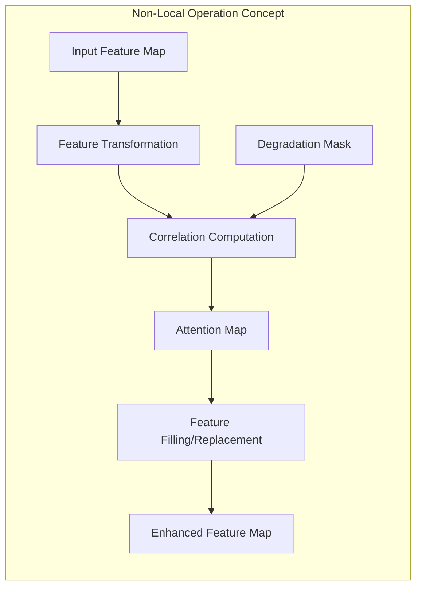
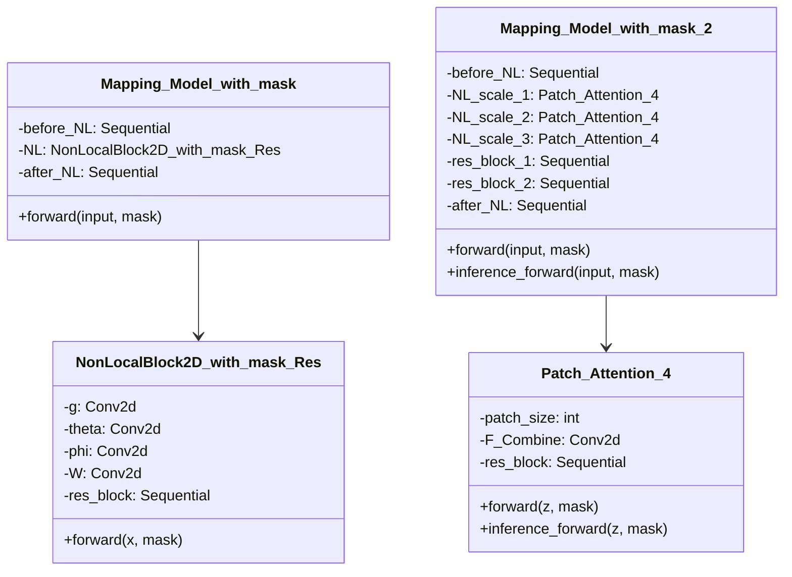
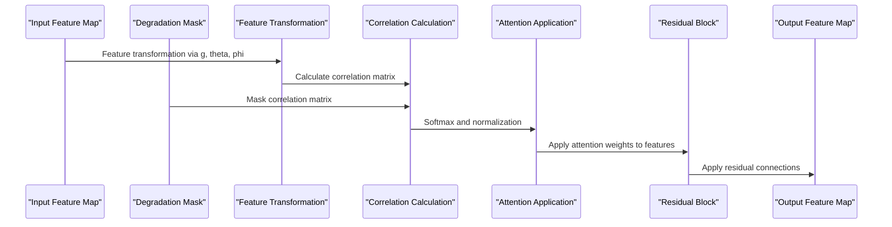
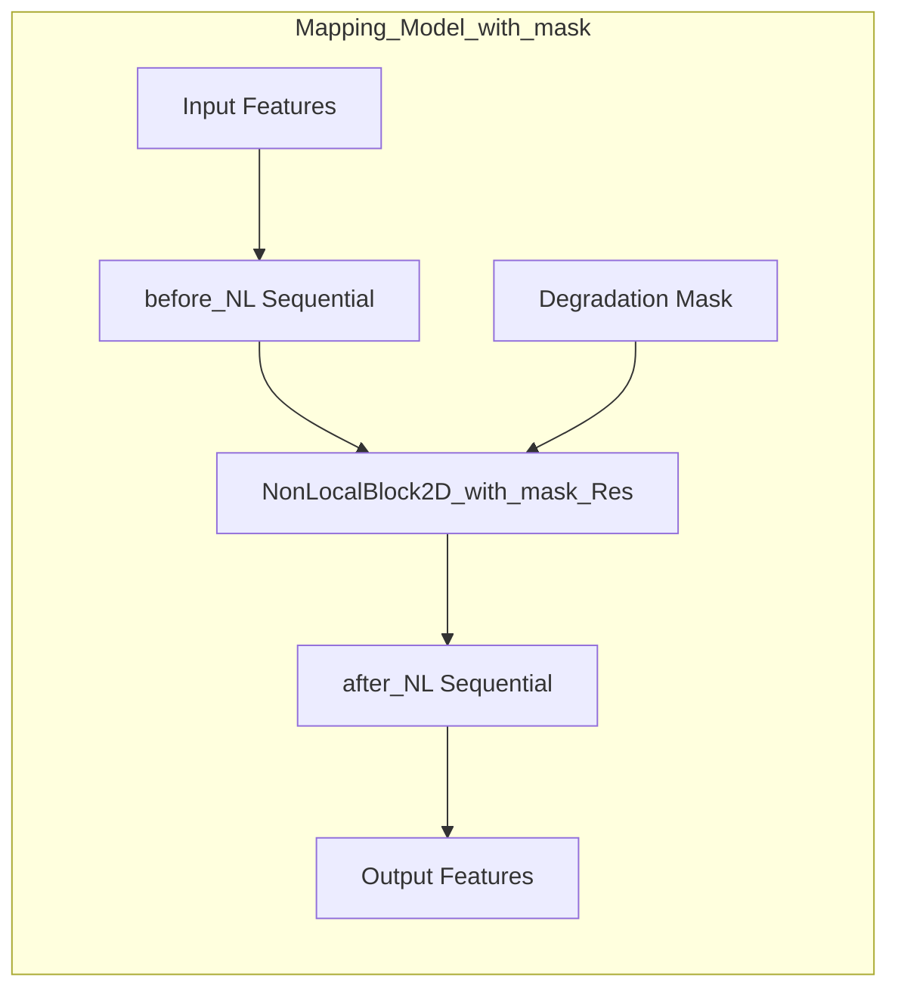
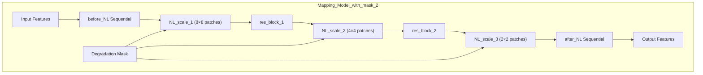
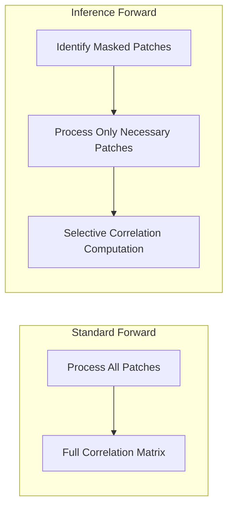

```mermaid
flowchart TD
    subgraph "Multi-Scale Patch Attention"
        Input["Input Feature Map"] --> ResBlock["Residual Block"]
        ResBlock --> Unfold["Unfold into Patches"]
        Mask["Degradation Mask"] --> MaskUnfold["Unfold Mask into Patches"]
        MaskUnfold --> NonMaskRegion["Identify Non-Masked Regions"]
        Unfold --> Normalize["Normalize Features"]
        Normalize --> Correlation["Compute Correlation Matrix"]
        NonMaskRegion --> Correlation
        Correlation --> Softmax["Apply Softmax"]
        Softmax --> MaxAttn["Find Max Correlation"]
        MaxAttn --> Compose["Compose Features"]
        Compose --> Fold["Fold Back to Feature Map"]
        Fold --> Concat["Concatenate with Original"]
        Concat --> Conv["Convolution Fusion"]
        Conv --> Output["Enhanced Feature Map"]
    end
```

<!-- source: DeepWiki mcp.deepwiki.com · repo microsoft/Bringing-Old-Photos-Back-to-Life · page 3.2 Non-Local Operations · fetched 2026-10-26 -->

# Non-Local Operations

<details>
<summary>Relevant source files</summary>

The following files were used as context for generating this wiki page:

- [Global/models/NonLocal_feature_mapping_model.py](Global/models/NonLocal_feature_mapping_model.py)
- [Global/models/networks.py](Global/models/networks.py)

</details>


## Overview

This document describes the non-local operations implemented in the old photo restoration system. Non-local operations are a critical component that enables the system to leverage information from undamaged regions of the image to restore damaged or degraded areas. For information about the overall feature mapping architecture, see [Feature Mapping Models](#3.1).

## Key Concepts

Non-local operations in image restoration work by establishing relationships between different spatial regions of an image, unlike traditional convolutional operations that only focus on local neighborhoods. This allows the model to:

1. Find similar patches across the image 
2. Use information from undamaged areas to restore damaged regions
3. Handle complex degradation patterns that cannot be addressed with local operations alone



Sources: [Global/models/networks.py:401-523](), [Global/models/NonLocal_feature_mapping_model.py:17-80]()

## Implementation Architecture

The system implements two main types of non-local operations:

1. **NonLocalBlock with Residual Connection**: A general non-local operation with mask input
2. **Multi-Scale Patch Attention**: An advanced implementation that performs patch-wise attention at different scales



Sources: [Global/models/networks.py:401-523](), [Global/models/networks.py:621-776](), [Global/models/NonLocal_feature_mapping_model.py:17-80](), [Global/models/NonLocal_feature_mapping_model.py:81-202]()

## Non-Local Block with Residual Connection

The `NonLocalBlock2D_with_mask_Res` class implements a non-local operation with mask input and residual connections. This allows the network to establish long-range dependencies between features.

### Operation Flow



### Key Components

- **Feature Transformation**: Transforms input features through convolution operations
- **Correlation Computation**: Calculates correlation between spatial locations
- **Masked Softmax**: Applies softmax after masking invalid regions
- **Residual Connection**: Adds residual blocks to enhance feature processing

Sources: [Global/models/networks.py:401-523]()

## Multi-Scale Patch Attention

The `Patch_Attention_4` class implements a more sophisticated form of non-local operation that works at the patch level and across multiple scales.

### Operation Flow



### Key Components

- **Patch-wise Processing**: Divides feature maps into patches for processing
- **Multi-scale Operation**: Applies attention at different patch sizes (2×2, 4×4, 8×8)
- **Masked Correlation**: Computes correlation only between valid patches
- **Feature Composition**: Fills masked regions with features from similar unmasked regions

Sources: [Global/models/networks.py:621-776]()

## Integration in Mapping Models

The non-local operations are integrated into the feature mapping models as follows:

### Single-Scale Non-Local Mapping

The `Mapping_Model_with_mask` class integrates a single non-local block in its feature mapping pipeline:



Key processing steps:
1. Initial feature extraction and upsampling
2. Non-local block operation with mask
3. Residual blocks and downsampling

Sources: [Global/models/NonLocal_feature_mapping_model.py:17-80]()

### Multi-Scale Non-Local Mapping

The `Mapping_Model_with_mask_2` class implements a cascade of patch attention modules at different scales:



Key processing steps:
1. Initial feature extraction
2. Large-scale patch attention (8×8)
3. Intermediate residual processing
4. Medium-scale patch attention (4×4)
5. Further residual processing
6. Fine-scale patch attention (2×2)
7. Final feature transformation

Sources: [Global/models/NonLocal_feature_mapping_model.py:81-202]()

## Technical Implementation Details

### Correlation Computation

In the non-local operations, correlation between features is computed using matrix multiplication after normalization:

```
theta_x = self.theta(x).view(batch_size, self.inter_channels, -1)
theta_x = theta_x.permute(0, 2, 1)
phi_x = self.phi(x).view(batch_size, self.inter_channels, -1)

if self.cosin:
    theta_x = F.normalize(theta_x, dim=2)
    phi_x = F.normalize(phi_x, dim=1)

f = torch.matmul(theta_x, phi_x)
```

Sources: [Global/models/networks.py:467-477]()

### Masked Attention

The mask is used to exclude certain regions from the attention computation:

```
mask_expand = mask.view(batch_size, 1, -1)
mask_expand = mask_expand.repeat(1, x.size(2) * x.size(3), 1)

if self.use_self:
    mask_expand[:, range(x.size(2) * x.size(3)), range(x.size(2) * x.size(3))] = 1.0

f_div_C = mask_expand * f_div_C
```

Sources: [Global/models/networks.py:491-505]()

### Patch-wise Processing

In the patch attention module, features are processed as patches using unfold and fold operations:

```
mask_unfold = F.unfold(mask, kernel_size=(self.patch_size,self.patch_size), padding=0, stride=self.patch_size)
x_unfold = F.unfold(x, kernel_size=(self.patch_size,self.patch_size), padding=0, stride=self.patch_size)
```

And after processing, they are folded back:

```
composed_fold = F.fold(composed_unfold, output_size=(h,w), kernel_size=(self.patch_size,self.patch_size), padding=0, stride=self.patch_size)
```

Sources: [Global/models/networks.py:695-700](), [Global/models/networks.py:713-714]()

## Optimizations

### Memory-Efficient Inference

The patch attention module provides an optimized `inference_forward` method that reduces memory usage during inference:



Key optimizations:
1. Only processes masked patches that need attention
2. Computes correlation only between necessary patch pairs
3. Selective feature composition

Sources: [Global/models/networks.py:722-776](), [Global/models/NonLocal_feature_mapping_model.py:187-202]()

## Performance Considerations

When using non-local operations, note these performance characteristics:

| Operation Type | Memory Usage | Computation Time | Quality Impact |
|----------------|--------------|------------------|----------------|
| NonLocalBlock  | Moderate     | Moderate         | Good for general degradation |
| Patch Attention| Higher       | Higher           | Better for structured damage |
| Multi-Scale    | Highest      | Highest          | Best quality for complex degradation |

Sources: [Global/models/networks.py:401-523](), [Global/models/networks.py:621-776](), [Global/models/NonLocal_feature_mapping_model.py:17-202]()

---

