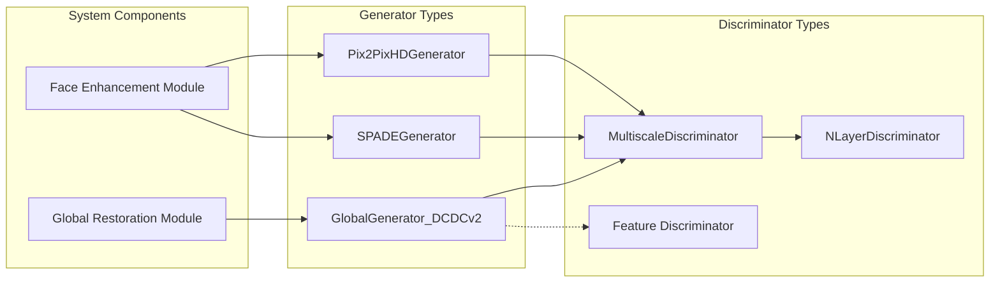
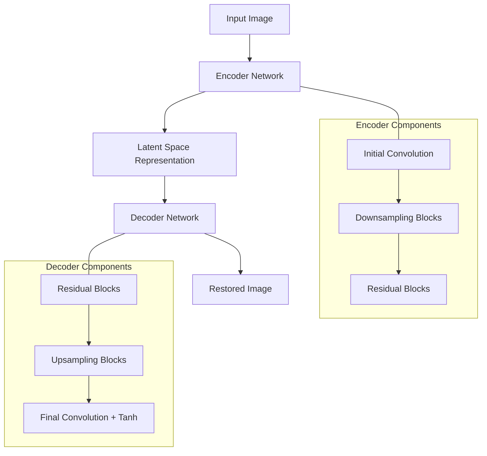
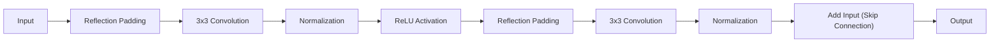
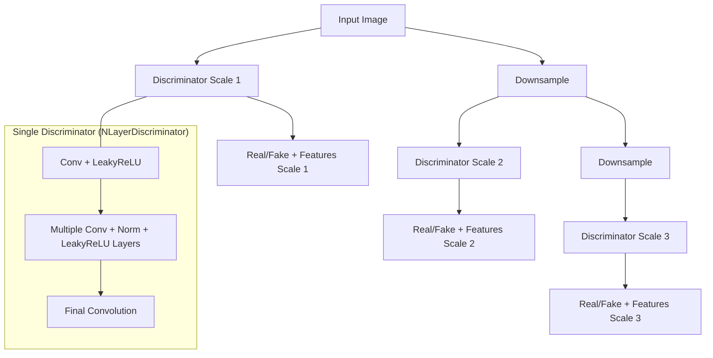
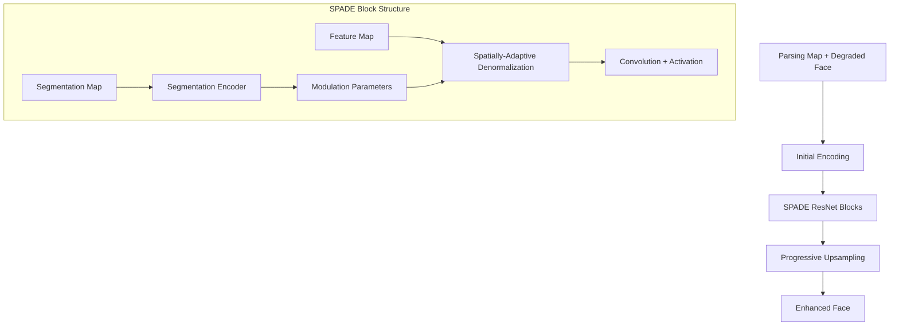
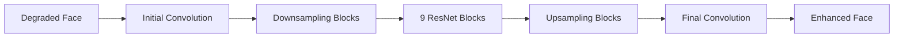
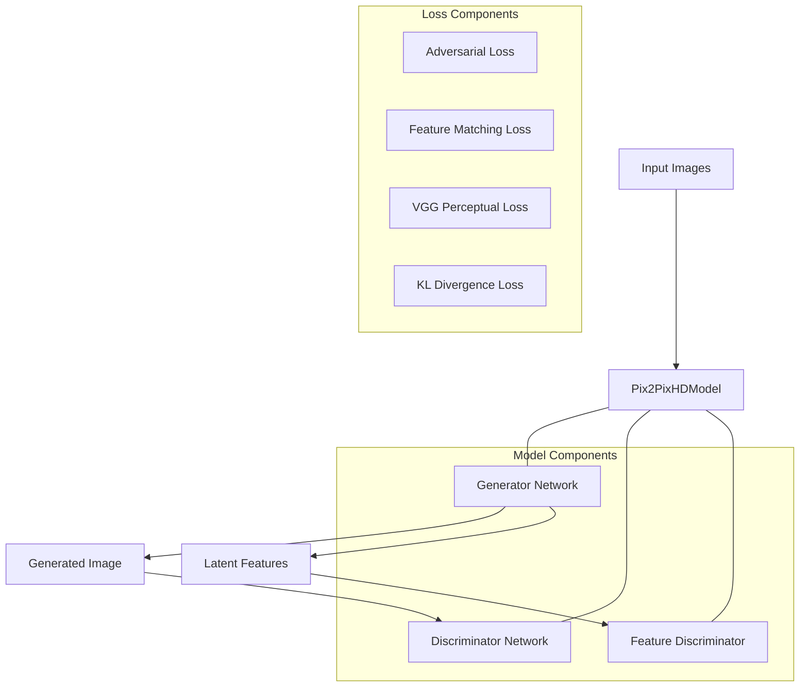
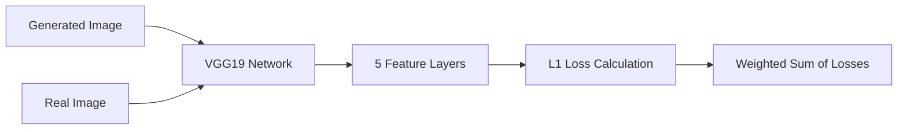

<!-- source: DeepWiki mcp.deepwiki.com · repo microsoft/Bringing-Old-Photos-Back-to-Life · page 3.3 Generator and Discriminator Networks · fetched 2026-10-26 -->

# Generator and Discriminator Networks

<details>
<summary>Relevant source files</summary>

The following files were used as context for generating this wiki page:

- [Face_Enhancement/models/networks/generator.py](Face_Enhancement/models/networks/generator.py)
- [Global/models/networks.py](Global/models/networks.py)
- [Global/models/pix2pixHD_model.py](Global/models/pix2pixHD_model.py)
- [Global/models/pix2pixHD_model_DA.py](Global/models/pix2pixHD_model_DA.py)

</details>


This page documents the Generative Adversarial Network (GAN) architectures used in the old photo restoration system, focusing specifically on the generator and discriminator networks that form the backbone of the image restoration capability. For information about feature mapping models, see [Feature Mapping Models](#3.1), and for details on non-local operations used in the network, see [Non-Local Operations](#3.2).

## Overview of Network Architecture

The restoration system uses multiple specialized GANs for different parts of the restoration pipeline. Each GAN consists of generator networks that create restored images and discriminator networks that evaluate their quality.



Sources: [Global/models/networks.py:50-67](), [Global/models/networks.py:70-78](), [Face_Enhancement/models/networks/generator.py:14-148](), [Face_Enhancement/models/networks/generator.py:151-232]()

## Global Restoration Generator

The global restoration module uses a specialized encoder-decoder architecture called `GlobalGenerator_DCDCv2`. This network is designed to handle both quality degradation and structural defects in old photos.

### GlobalGenerator_DCDCv2 Architecture



The `GlobalGenerator_DCDCv2` consists of:

1. **Encoder**:
   - Initial reflection padding and convolution layers
   - Multiple downsampling blocks with strided convolutions
   - Residual blocks for feature processing

2. **Decoder**:
   - Residual blocks for feature processing
   - Transposed convolution layers for upsampling
   - Final convolution with tanh activation

The generator can operate in three modes controlled by the `flow` parameter:
- `enc`: Only encode the input image
- `dec`: Only decode a latent representation
- `enc_dec`: Full encoding and decoding process

Sources: [Global/models/networks.py:82-291]()

### ResNet Blocks

The backbone of both generator and discriminator networks consists of ResNet blocks, which help maintain feature information throughout the network while allowing very deep architectures.



Sources: [Global/models/networks.py:294-339]()

## Discriminator Networks

The system uses a multi-scale discriminator architecture to evaluate the quality of generated images at different scales.

### MultiscaleDiscriminator Architecture



The discriminator architecture has these key features:

1. **Multi-scale processing**: Uses multiple discriminators at different image scales to capture both fine details and global structure
2. **PatchGAN approach**: Classifies whether image patches are real or fake rather than the entire image
3. **Feature extraction**: Provides intermediate features for feature matching loss

Sources: [Global/models/networks.py:526-565](), [Global/models/networks.py:568-617]()

## Face Enhancement Generators

The face enhancement module employs two types of generators:

### SPADEGenerator

The `SPADEGenerator` uses Spatially-Adaptive Denormalization for controlling the generation process with semantic segmentation maps of faces.



Key features of `SPADEGenerator`:
- Uses semantic parsing maps to guide the face restoration process
- Incorporates conditional normalization based on input face structure
- Progressive upsampling to generate high-resolution enhanced faces
- Flexible injection layers for better control of feature flow

Sources: [Face_Enhancement/models/networks/generator.py:14-148]()

### Pix2PixHDGenerator

A more straightforward generator used for face enhancement in cases where parsing maps aren't needed:



The `Pix2PixHDGenerator` follows a more traditional encoder-decoder architecture with:
- Initial reflection padding and convolution
- Multiple downsampling convolutional layers
- A series of ResNet blocks for transformation
- Transposed convolution for upsampling
- Final output convolution with tanh activation

Sources: [Face_Enhancement/models/networks/generator.py:151-232]()

## Model Integration and Training

The generator and discriminator networks are integrated through the `Pix2PixHDModel` class, which handles:

1. Network initialization
2. Forward and backward passes
3. Loss calculation
4. Optimization



Sources: [Global/models/pix2pixHD_model.py:12-334](), [Global/models/pix2pixHD_model_DA.py:13-373]()

## Loss Functions

Multiple loss functions work together to train the networks effectively:

### GANLoss

The adversarial loss function that drives the competition between generator and discriminator:

```python
# For generator: encourage generator to fool discriminator
loss_G_GAN = criterionGAN(pred_fake, True)

# For discriminator: reward correctly identifying real and fake
loss_D_real = criterionGAN(pred_real, True)
loss_D_fake = criterionGAN(pred_fake_pool, False)
```

Sources: [Global/models/networks.py:781-823]()

### Feature Matching Loss

Uses intermediate features from the discriminator to help the generator create more realistic image structures:

```python
loss_G_GAN_Feat = D_weights * feat_weights * criterionFeat(pred_fake[i][j], pred_real[i][j].detach())
```

Sources: [Global/models/pix2pixHD_model.py:202-209]()

### VGG Perceptual Loss

Uses a pretrained VGG19 network to compare high-level features between generated and real images:



Sources: [Global/models/networks.py:831-875]()

### KL Divergence Loss

Encourages the latent space representation to follow a normal distribution for variational aspects:

```python
loss_G_kl = torch.mean(torch.pow(hiddens, 2)) * opt.kl
```

Sources: [Global/models/pix2pixHD_model.py:199](), [Global/models/pix2pixHD_model_DA.py:234]()

## Network Initialization and Configuration

The network components are configured and instantiated through helper functions that provide flexibility in choosing architecture parameters:

```python
# Generator initialization
netG = networks.define_G(netG_input_nc, opt.output_nc, opt.ngf, opt.netG, opt.k_size, 
                         opt.n_downsample_global, opt.n_blocks_global, opt.n_local_enhancers, 
                         opt.n_blocks_local, opt.norm, gpu_ids=self.gpu_ids, opt=opt)

# Discriminator initialization
netD = networks.define_D(netD_input_nc, opt.ndf, opt.n_layers_D, opt, opt.norm, use_sigmoid,
                         opt.num_D, not opt.no_ganFeat_loss, gpu_ids=self.gpu_ids)
```

Sources: [Global/models/pix2pixHD_model.py:38-49](), [Global/models/networks.py:50-78]()

## Summary

The generator and discriminator networks form the core of the old photo restoration system's ability to transform degraded images into high-quality outputs. The key components include:

1. The `GlobalGenerator_DCDCv2` for overall image quality restoration
2. The `SPADEGenerator` and `Pix2PixHDGenerator` for specialized face enhancement
3. Multi-scale discriminators for quality assessment at different resolutions
4. A comprehensive loss function system including adversarial, feature matching, perceptual, and KL divergence losses

This architecture enables the system to handle both global image quality issues and face-specific enhancements in a unified framework.

---

