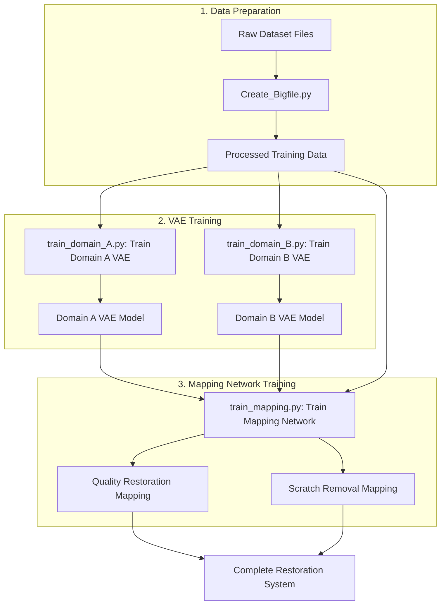
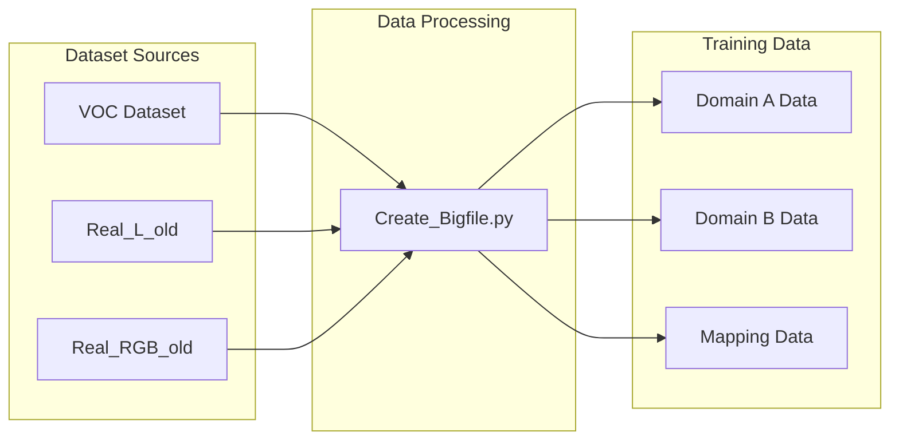
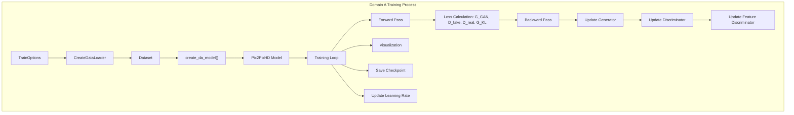
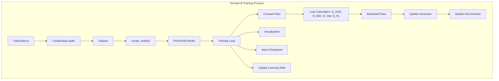
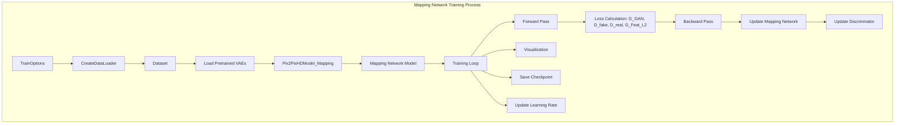
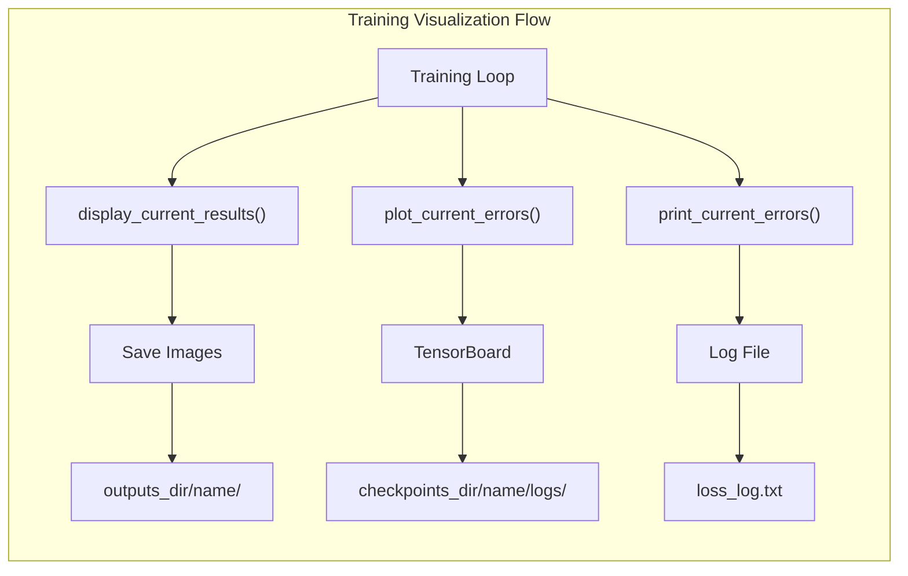

<!-- source: DeepWiki mcp.deepwiki.com · repo microsoft/Bringing-Old-Photos-Back-to-Life · page 4 Training · fetched 2026-10-26 -->

# Training

<details>
<summary>Relevant source files</summary>

The following files were used as context for generating this wiki page:

- [Global/train_domain_A.py](Global/train_domain_A.py)
- [Global/train_domain_B.py](Global/train_domain_B.py)
- [Global/train_mapping.py](Global/train_mapping.py)
- [Global/util/visualizer.py](Global/util/visualizer.py)
- [README.md](README.md)
- [imgs/HOF_2_007_007_my_concat.gif](imgs/HOF_2_007_007_my_concat.gif)
- [imgs/gui.PNG](imgs/gui.PNG)

</details>


This page provides a comprehensive guide to the training process for the "Bringing Old Photos Back to Life" system. The training pipeline consists of three main components that need to be trained sequentially: Domain A VAE (for degraded photos), Domain B VAE (for clean photos), and the Mapping Network (for translating between domains). For information about using the pre-trained models for inference, see [Usage Guide](#6).

## 1. Training Overview

The restoration system uses a domain translation approach based on Variational Autoencoders (VAEs) and mapping networks. The training process involves three main phases:



Sources: [Global/train_domain_A.py](), [Global/train_domain_B.py](), [Global/train_mapping.py](), [README.md:188-195]()

## 2. Dataset Preparation

Before training, you need to prepare your dataset by organizing it properly and creating the necessary data files.

### 2.1 Dataset Organization

The dataset should include:
- VOC dataset (for background textures)
- Real_L_old (real old photos with luminance channel only)
- Real_RGB_old (real old photos in RGB)

### 2.2 Creating the Training File

To prepare the dataset for training:

```
cd Global/data/
python Create_Bigfile.py
```

This script combines the different dataset folders into a unified format suitable for training. Make sure to modify the script's paths according to your environment.



Sources: [README.md:187-194]()

## 3. Training Domain A VAE

Domain A represents the degraded photo domain. The VAE for Domain A learns to encode degraded photos into a latent space and reconstruct them.

### 3.1 Training Command

```
python train_domain_A.py --use_v2_degradation --continue_train --training_dataset domain_A \
                          --name domainA_SR_old_photos --label_nc 0 --loadSize 256 --fineSize 256 \
                          --dataroot [your_data_folder] --no_instance --resize_or_crop crop_only \
                          --batchSize 100 --no_html --gpu_ids 0,1,2,3 --self_gen --nThreads 4 \
                          --n_downsample_global 3 --k_size 4 --use_v2 --mc 64 --start_r 1 --kl 1 \
                          --no_cgan --outputs_dir [your_output_folder] --checkpoints_dir [your_ckpt_folder]
```

### 3.2 Domain A Training Flow



Sources: [Global/train_domain_A.py:17-44](), [Global/train_domain_A.py:57-146]()

## 4. Training Domain B VAE

Domain B represents the clean photo domain. Its VAE learns to encode clean photos into a latent space and reconstruct them.

### 4.1 Training Command

```
python train_domain_B.py --continue_train --training_dataset domain_B \
                          --name domainB_old_photos --label_nc 0 --loadSize 256 --fineSize 256 \
                          --dataroot [your_data_folder] --no_instance --resize_or_crop crop_only \
                          --batchSize 120 --no_html --gpu_ids 0,1,2,3 --self_gen --nThreads 4 \
                          --n_downsample_global 3 --k_size 4 --use_v2 --mc 64 --start_r 1 --kl 1 \
                          --no_cgan --outputs_dir [your_output_folder] --checkpoints_dir [your_ckpt_folder]
```

### 4.2 Domain B Training Flow



Sources: [Global/train_domain_B.py:19-52](), [Global/train_domain_B.py:60-144]()

## 5. Training the Mapping Network

The mapping network is trained to translate between the latent spaces of Domain A and Domain B. Different versions of the mapping network can be trained depending on the restoration needs.

### 5.1 Quality Restoration Mapping

For training a mapping network that focuses on overall quality restoration without specific handling of scratches:

```
python train_mapping.py --use_v2_degradation --training_dataset mapping \
                         --use_vae_which_epoch 200 --continue_train --name mapping_quality \
                         --label_nc 0 --loadSize 256 --fineSize 256 --dataroot [your_data_folder] \
                         --no_instance --resize_or_crop crop_only --batchSize 80 --no_html \
                         --gpu_ids 0,1,2,3 --nThreads 8 \
                         --load_pretrainA [ckpt_of_domainA_SR_old_photos] \
                         --load_pretrainB [ckpt_of_domainB_old_photos] \
                         --l2_feat 60 --n_downsample_global 3 --mc 64 --k_size 4 --start_r 1 \
                         --mapping_n_block 6 --map_mc 512 --use_l1_feat --niter 150 --niter_decay 100 \
                         --outputs_dir [your_output_folder] --checkpoints_dir [your_ckpt_folder]
```

### 5.2 Scratch Removal Mapping

For training a mapping network that handles scratches (requires an irregular mask file):

```
python train_mapping.py --no_TTUR --NL_res --random_hole --use_SN --correlation_renormalize \
                         --training_dataset mapping --NL_use_mask --NL_fusion_method combine \
                         --non_local Setting_42 --use_v2_degradation --use_vae_which_epoch 200 \
                         --continue_train --name mapping_scratch --label_nc 0 --loadSize 256 \
                         --fineSize 256 --dataroot [your_data_folder] --no_instance \
                         --resize_or_crop crop_only --batchSize 36 --no_html --gpu_ids 0,1,2,3 \
                         --nThreads 8 --load_pretrainA [ckpt_of_domainA_SR_old_photos] \
                         --load_pretrainB [ckpt_of_domainB_old_photos] \
                         --l2_feat 60 --n_downsample_global 3 --mc 64 --k_size 4 --start_r 1 \
                         --mapping_n_block 6 --map_mc 512 --use_l1_feat --niter 150 --niter_decay 100 \
                         --outputs_dir [your_output_folder] --checkpoints_dir [your_ckpt_folder] \
                         --irregular_mask [absolute_path_of_mask_file]
```

### 5.3 High-Resolution Patch Attention Mapping

For training a mapping network with multi-scale patch attention for high-resolution inputs:

```
python train_mapping.py --no_TTUR --NL_res --random_hole --use_SN --correlation_renormalize \
                         --training_dataset mapping --NL_use_mask --NL_fusion_method combine \
                         --non_local Setting_42 --use_v2_degradation --use_vae_which_epoch 200 \
                         --continue_train --name mapping_Patch_Attention --label_nc 0 --loadSize 256 \
                         --fineSize 256 --dataroot [your_data_folder] --no_instance \
                         --resize_or_crop crop_only --batchSize 36 --no_html --gpu_ids 0,1,2,3 \
                         --nThreads 8 --load_pretrainA [ckpt_of_domainA_SR_old_photos] \
                         --load_pretrainB [ckpt_of_domainB_old_photos] \
                         --l2_feat 60 --n_downsample_global 3 --mc 64 --k_size 4 --start_r 1 \
                         --mapping_n_block 6 --map_mc 512 --use_l1_feat --niter 150 --niter_decay 100 \
                         --outputs_dir [your_output_folder] --checkpoints_dir [your_ckpt_folder] \
                         --irregular_mask [absolute_path_of_mask_file] --mapping_exp 1
```

### 5.4 Mapping Network Training Flow



Sources: [Global/train_mapping.py:21-47](), [Global/train_mapping.py:72-162]()

## 6. Training Visualization and Monitoring

The training process includes visualization and monitoring capabilities to help track progress and ensure successful training.

### 6.1 Visualizing Training Progress

During training, output images and loss values are saved periodically:

- Output images are saved to `[outputs_dir]/[name]/epoch_iteration.png`
- Loss logs are saved to `[checkpoints_dir]/[name]/loss_log.txt`
- TensorBoard logs can be enabled for visualizing trends

The `Visualizer` class handles displaying output images, plotting errors, and saving logs.



Sources: [Global/util/visualizer.py:40-105](), [Global/train_mapping.py:118-139](), [Global/train_domain_A.py:108-122](), [Global/train_domain_B.py:108-121]()

### 6.2 Model Checkpoints

Models are saved at regular intervals during training:

- Latest model is saved as `latest.pth`
- Epoch-specific models are saved as `[epoch_number].pth`
- Training state (epoch, iteration) is saved to `iter.txt`

This allows for training to be resumed from any saved checkpoint using the `--continue_train` and `--which_epoch` options.

## 7. Key Training Parameters

The following table summarizes important training parameters used across all training scripts:

| Parameter | Description | Default |
|-----------|-------------|---------|
| `--name` | Name of the experiment | required |
| `--dataroot` | Path to the training dataset | required |
| `--checkpoints_dir` | Directory to save checkpoints | ./checkpoints |
| `--outputs_dir` | Directory to save output images | ./outputs |
| `--batchSize` | Input batch size | 1 |
| `--loadSize` | Scale images to this size | 286 |
| `--fineSize` | Crop to this size | 256 |
| `--label_nc` | Number of input label channels | 0 |
| `--gpu_ids` | GPU IDs to use (e.g., 0,1,2) | 0 |
| `--niter` | Number of epochs with constant learning rate | 100 |
| `--niter_decay` | Number of epochs with decaying learning rate | 100 |
| `--use_v2_degradation` | Use v2 degradation model | False |
| `--continue_train` | Continue training from saved checkpoint | False |
| `--which_epoch` | Which epoch to load for continued training | latest |

For Domain A/B VAE training:
| Parameter | Description | Default |
|-----------|-------------|---------|
| `--kl` | Weight for KL divergence loss | 0.01 |
| `--n_downsample_global` | Number of downsampling layers in global generator | 4 |
| `--mc` | Channels for middle layers | 512 |
| `--k_size` | Kernel size for generator | 4 |

For Mapping Network training:
| Parameter | Description | Default |
|-----------|-------------|---------|
| `--load_pretrainA` | Path to pretrained Domain A model | required |
| `--load_pretrainB` | Path to pretrained Domain B model | required |
| `--use_vae_which_epoch` | Which epoch to load from VAEs | latest |
| `--mapping_n_block` | Number of blocks in mapping network | 6 |
| `--map_mc` | Channel number for mapping network | 512 |
| `--l2_feat` | Weight for L2 feature loss | 10 |
| `--NL_use_mask` | Use mask for non-local blocks (for scratch removal) | False |
| `--irregular_mask` | Path to irregular mask file | None |

Sources: [Global/train_domain_A.py:33-46](), [Global/train_domain_B.py:33-46](), [Global/train_mapping.py:21-47]()

## 8. Training Workflow Summary

The complete training workflow can be summarized as follows:

1. **Prepare Dataset**: Organize dataset folders and run `Create_Bigfile.py`
2. **Train Domain A VAE**: Run `train_domain_A.py` to train the VAE for degraded photos
3. **Train Domain B VAE**: Run `train_domain_B.py` to train the VAE for clean photos
4. **Train Mapping Network**: Run `train_mapping.py` to train the mapping network between domains
   - For quality restoration, use basic mapping training
   - For scratch removal, add mask-related options
   - For high-resolution processing, enable patch attention with `--mapping_exp 1`

The entire training process takes significant time and computational resources. Each VAE typically requires 200-300 epochs, and the mapping network requires 150-250 epochs depending on the complexity of the task.

```mermaid
gantt
    title "Training Timeline (Approximate)"
    dateFormat X
    axisFormat %d
    
    section Dataset Prep
    Create BigFile                    :a1, 0, 1d
    
    section Domain A VAE
    Train Domain A                    :a2, after a1, 14d
    
    section Domain B VAE
    Train Domain B                    :a3, after a1, 14d
    
    section Mapping
    Train Quality Mapping             :a4, after a2, 10d
    Train Scratch Mapping             :a5, after a2, 10d
```



After completing the training process, the resulting models can be used for inference with the `run.py` script as described in the [Usage Guide](#6).

---

