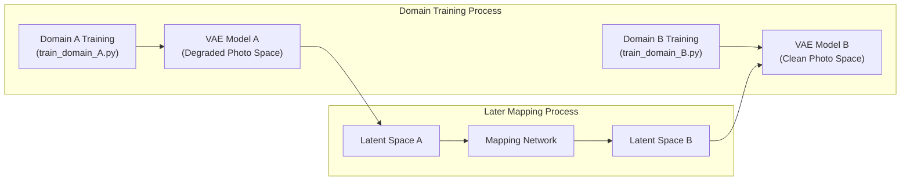
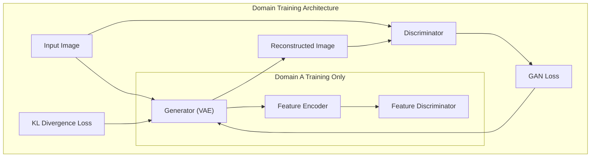
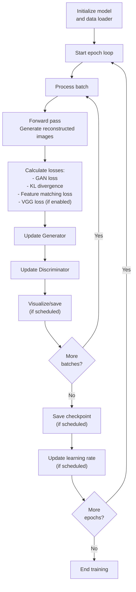
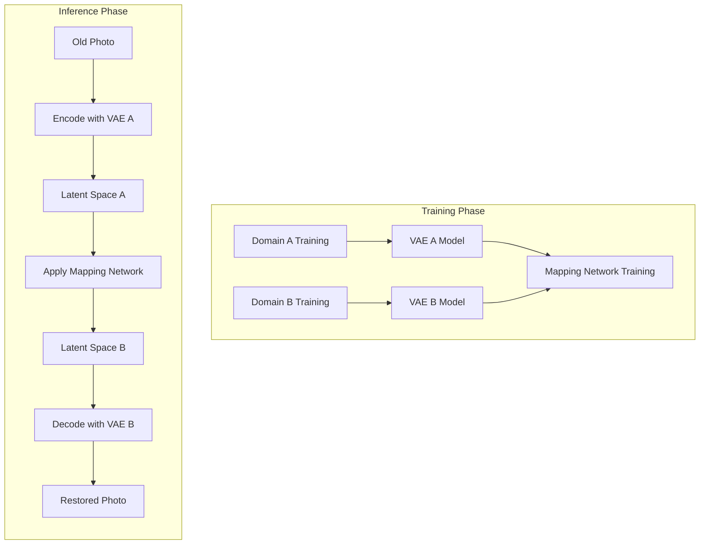

<!-- source: DeepWiki mcp.deepwiki.com · repo microsoft/Bringing-Old-Photos-Back-to-Life · page 4.1 Domain Training · fetched 2026-10-26 -->

# Domain Training

<details>
<summary>Relevant source files</summary>

The following files were used as context for generating this wiki page:

- [Global/options/train_options.py](Global/options/train_options.py)
- [Global/train_domain_A.py](Global/train_domain_A.py)
- [Global/train_domain_B.py](Global/train_domain_B.py)
- [Global/train_mapping.py](Global/train_mapping.py)
- [Global/util/visualizer.py](Global/util/visualizer.py)

</details>


## Purpose and Scope

This document covers the domain training component of the Old Photo Restoration system, focusing on how the system trains the domain-specific VAE (Variational Autoencoder) models that are essential for photo restoration. Domain training establishes the foundations for translating between the degraded old photo domain and the clean photo domain. For information on how the trained domain models are used in the mapping network, see [Mapping Network Training](#4.2).

## Overview of Domain Training

In the Old Photo Restoration system, "domain training" refers to the process of training two separate VAE models that learn the distribution and characteristics of two distinct image domains:

1. **Domain A**: The degraded old photo domain (photos with quality issues, scratches, etc.)
2. **Domain B**: The clean photo domain (high-quality photos without degradation)

These domain models capture the essential features of each image space, allowing the system to later perform domain translation through a mapping network.



Sources: [Global/train_domain_A.py](), [Global/train_domain_B.py]()

## Domain Training Architecture

Both Domain A and Domain B models use a similar architecture based on VAEs combined with adversarial training (GAN approach). The training process involves:

1. A **Generator (VAE)** that encodes images to a latent space and reconstructs them
2. A **Discriminator** that distinguishes between real and generated images
3. For Domain A, an additional **Feature Discriminator** for improved training



Sources: [Global/train_domain_A.py:69-95](), [Global/train_domain_B.py:73-95]()

## Training Process Details

### Common Training Loop Structure

Both domain training scripts share a similar training loop structure:

1. Load and preprocess the data
2. Forward pass through the model
3. Calculate losses (GAN loss, KL divergence, etc.)
4. Update generator and discriminator weights
5. Periodically save model checkpoints and visualize results



Sources: [Global/train_domain_A.py:57-146](), [Global/train_domain_B.py:60-144]()

### Domain A Specific Training

Domain A training includes an additional feature discriminator component:

```python
# Calculate final loss scalar
loss_D = (loss_dict['D_fake'] + loss_dict['D_real']) * 0.5
loss_featD = (loss_dict['featD_fake'] + loss_dict['featD_real']) * 0.5
loss_G = loss_dict['G_GAN'] + loss_dict.get('G_GAN_Feat', 0) + loss_dict.get('G_VGG', 0) + loss_dict['G_KL'] + loss_dict['G_featD']
```

The feature discriminator helps the Domain A model better capture the degradation characteristics of old photos and is updated separately:

```python
model.module.optimizer_featD.zero_grad()
loss_featD.backward()
model.module.optimizer_featD.step()
```

Sources: [Global/train_domain_A.py:78-95]()

### Domain B Specific Training

Domain B training focuses on clean images and uses a simpler loss structure:

```python
# Calculate final loss scalar
loss_D = (loss_dict['D_fake'] + loss_dict['D_real']) * 0.5
loss_G = loss_dict['G_GAN'] + loss_dict.get('G_GAN_Feat',0) + loss_dict.get('G_VGG',0) + loss_dict['G_KL'] + loss_dict.get('Smooth_L1',0)*opt.L1_weight
```

It includes a potential Smooth L1 loss component weighted by the `L1_weight` parameter.

Sources: [Global/train_domain_B.py:82-83]()

## Training Configuration

Domain training offers numerous configuration options through the `TrainOptions` class. Key parameters include:

| Parameter | Description | Default Value |
|-----------|-------------|---------------|
| `niter` | Number of training iterations at initial learning rate | 100 |
| `niter_decay` | Number of iterations to linearly decay learning rate to zero | 100 |
| `lr` | Initial learning rate | 0.0002 |
| `beta1` | Momentum term for Adam optimizer | 0.5 |
| `save_epoch_freq` | Frequency of saving checkpoints (epochs) | 1 |
| `save_latest_freq` | Frequency of saving latest model (iterations) | 10000 |
| `display_freq` | Frequency of showing training results (iterations) | 100 |
| `print_freq` | Frequency of printing errors (iterations) | 100 |
| `continue_train` | Whether to continue training from a checkpoint | False |
| `which_epoch` | Which epoch to load for continued training | "latest" |
| `lambda_feat` | Weight for feature matching loss | 10.0 |
| `no_lsgan` | Whether to use vanilla GAN instead of least squares GAN | False |
| `no_ganFeat_loss` | Whether to disable discriminator feature matching loss | False |
| `no_vgg_loss` | Whether to disable VGG feature matching loss | False |

Sources: [Global/options/train_options.py:6-60]()

## Training Visualization and Monitoring

The training process includes comprehensive visualization and monitoring capabilities through the `Visualizer` class:

1. **Error Logging**: Tracks and logs various loss metrics during training
2. **TensorBoard Integration**: Optional TensorBoard logging for visualizing training metrics
3. **Image Visualization**: Periodically saves generated images to monitor training progress
4. **HTML Reports**: Creates HTML reports of training progress (when enabled)

Example of how training results are visualized:

```python
if save_fake:
    if not os.path.exists(opt.outputs_dir + opt.name):
        os.makedirs(opt.outputs_dir + opt.name)
    imgs_num = 5
    imgs = torch.cat((data['label'][:imgs_num], generated.data.cpu()[:imgs_num], data['image'][:imgs_num]), 0)
    imgs = (imgs + 1.) / 2.0
    vutils.save_image(imgs, opt.outputs_dir + opt.name + '/' + str(epoch) + '_' + str(total_steps) + '.png',
                      nrow=imgs_num, padding=0, normalize=True)
```

Sources: [Global/train_domain_B.py:107-121](), [Global/util/visualizer.py:16-143]()

## Domain Training in the Overall System

Domain training is a critical first step in the overall photo restoration pipeline. The trained VAE models capture the characteristics of each domain, which are later used by the mapping network to perform the actual restoration.



Sources: [Global/train_domain_A.py](), [Global/train_domain_B.py](), [Global/train_mapping.py]()

## Checkpoint Management

Domain training includes robust checkpoint management to support training continuation and model reuse:

1. **Regular Checkpoints**: Models are saved at specified epoch intervals (`save_epoch_freq`)
2. **Latest Model**: A "latest" model is maintained for easy resumption of training
3. **Training State**: The training iteration state is saved to allow precise resumption

```python
# Save model checkpoint
if epoch % opt.save_epoch_freq == 0:
    print('saving the model at the end of epoch %d, iters %d' % (epoch, total_steps))        
    model.module.save('latest')
    model.module.save(epoch)
    np.savetxt(iter_path, (epoch+1, 0), delimiter=',', fmt='%d')
```

Sources: [Global/train_domain_A.py:133-138](), [Global/train_domain_B.py:132-136]()

## Learning Rate Scheduling

Both domain training scripts implement learning rate scheduling:

1. **Fixed Learning Rate**: Used for the initial `niter` epochs
2. **Linear Decay**: Learning rate linearly decays over `niter_decay` epochs
3. **Fixed Parameters Option**: Optionally, some parameters can be fixed for initial training epochs

```python
# Linearly decay learning rate after certain iterations
if epoch > opt.niter:
    model.module.update_learning_rate()

# Update fixed parameters (if applicable)
if (opt.niter_fix_global != 0) and (epoch == opt.niter_fix_global):
    model.module.update_fixed_params()
```

Sources: [Global/train_domain_A.py:141-146](), [Global/train_domain_B.py:137-144]()

---

