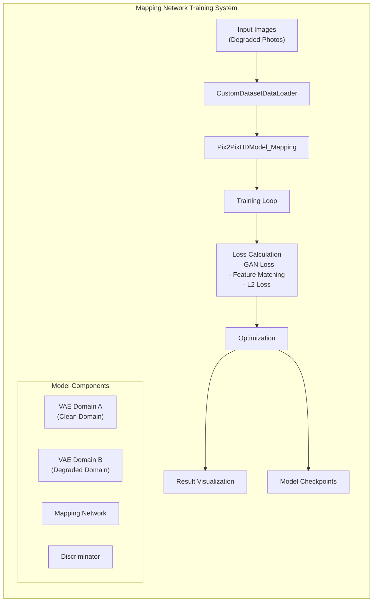
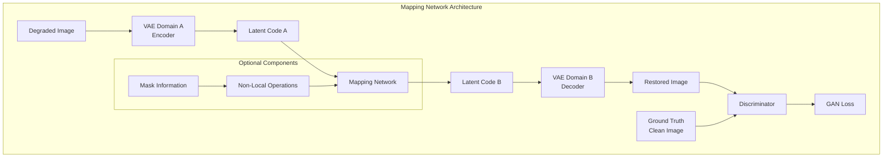
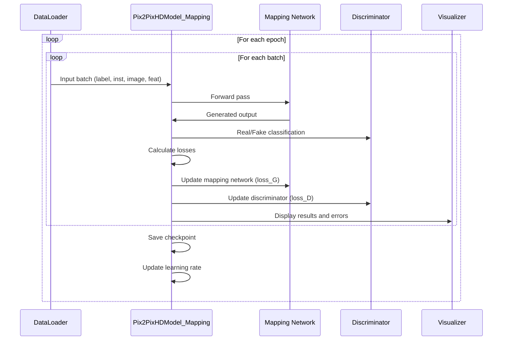
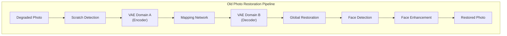

<!-- source: DeepWiki mcp.deepwiki.com · repo microsoft/Bringing-Old-Photos-Back-to-Life · page 4.2 Mapping Network Training · fetched 2026-10-26 -->

# Mapping Network Training

<details>
<summary>Relevant source files</summary>

The following files were used as context for generating this wiki page:

- [Global/options/train_options.py](Global/options/train_options.py)
- [Global/train_domain_A.py](Global/train_domain_A.py)
- [Global/train_domain_B.py](Global/train_domain_B.py)
- [Global/train_mapping.py](Global/train_mapping.py)
- [Global/util/visualizer.py](Global/util/visualizer.py)

</details>


This document explains the training process for the Mapping Network, a critical component in the Old Photo Restoration system. The Mapping Network translates between the latent spaces of Domain A (clean images) and Domain B (degraded images), enabling high-quality image restoration. For information about Domain A and Domain B training, see [Domain Training](#4.1).

## 1. Overview

The Mapping Network operates as a translation mechanism between two latent spaces learned by separate VAE (Variational Autoencoder) networks. It is responsible for transforming the latent code of a degraded image into the corresponding latent code that would generate a clean version of the same image.



Sources:
- [Global/train_mapping.py:18-48]()
- [Global/train_mapping.py:64-70]()

## 2. Architecture and Components

The Mapping Network training integrates several components in a unified training framework:



Sources:
- [Global/train_mapping.py:45-58]()
- [Global/train_mapping.py:87-88]()

### 2.1 Key Components

1. **VAE Networks**: Pre-trained VAE models for both clean (Domain A) and degraded (Domain B) image domains.

2. **Mapping Network**: The network being trained to convert the latent representation of degraded images to clean images.

3. **Discriminator**: Helps the mapping network generate more realistic outputs through adversarial training.

4. **Non-Local Operations**: Optional component that incorporates mask information to handle localized degradations.

Sources:
- [Global/train_mapping.py:45-58]()

## 3. Training Process

The mapping network training follows a GAN-based training approach with additional optimization objectives:

### 3.1 Training Loop



Sources:
- [Global/train_mapping.py:72-162]()

### 3.2 Loss Functions

The mapping network is trained with multiple loss components:

1. **GAN Loss**: Adversarial loss from the discriminator
2. **Feature Matching Loss**: Encourages the generator to match intermediate feature representations 
3. **VGG Loss**: Perceptual loss based on VGG network features
4. **L2 Feature Loss**: Enforces similarity in feature space
5. **Smooth L1 Loss**: For direct image reconstruction comparison

The final generator loss is a weighted combination of these components:

```
loss_G = G_GAN + G_GAN_Feat + G_VGG + G_Feat_L2 + Smooth_L1 + G_Feat_L2_Stage_1
```

Sources:
- [Global/train_mapping.py:95-97]()
- [Global/train_mapping.py:100-103]()

## 4. Configuration Options

The mapping network training can be customized with several key parameters:

| Parameter | Description | Default |
|-----------|-------------|---------|
| `lr` | Initial learning rate | 0.0002 |
| `beta1` | Momentum term for Adam optimizer | 0.5 |
| `niter` | Number of iterations at initial learning rate | 100 |
| `niter_decay` | Number of iterations to linearly decay learning rate | 100 |
| `no_degradation` | Disable degradation to clean images during training | False |
| `no_load_VAE` | Randomly initialize encoder and decoder | False |
| `use_v2_degradation` | Use 4 kinds of degradations for corruption | False |
| `use_vae_which_epoch` | Epoch to use for VAE | 200 |
| `l2_feat` | Weight for feature mapping loss | - |
| `use_l1_feat` | Use L1 for feature mapping | False |
| `NL_use_mask` | Whether to use masks for non-local operations | - |

Sources:
- [Global/options/train_options.py:10-60]()
- [Global/train_mapping.py:21-37]()

## 5. Training Execution

### 5.1 Initialization

The training process begins with initialization of options, data loaders, and the mapping model:

```python
opt = TrainOptions().parse()
data_loader = CreateDataLoader(opt)
dataset = data_loader.load_data()
model = Pix2PixHDModel_Mapping()
model.initialize(opt)
```

Sources:
- [Global/train_mapping.py:21-47]()

### 5.2 Optimization Process

The mapping network and discriminator are updated in alternating steps:

1. **Mapping Network Update**:
   ```python
   model.optimizer_mapping.zero_grad()
   loss_G.backward()
   model.optimizer_mapping.step()
   ```

2. **Discriminator Update**:
   ```python
   model.optimizer_D.zero_grad()
   loss_D.backward()
   model.optimizer_D.step()
   ```

Sources:
- [Global/train_mapping.py:100-108]()

### 5.3 Visualization and Checkpoints

Training progress is visualized through:
- Error logging and plotting
- Sample image generation
- TensorBoard integration (if enabled)

Model checkpoints are saved:
- At regular intervals (`save_latest_freq`)
- At the end of each epoch (`save_epoch_freq`)

Sources:
- [Global/train_mapping.py:110-137]()
- [Global/train_mapping.py:149-154]()
- [Global/util/visualizer.py:16-144]()

## 6. Integration with Full Pipeline

The Mapping Network is a crucial part of the restoration pipeline, connecting the clean and degraded image domains:



Sources:
- System architecture diagrams provided

## 7. Practical Considerations

### 7.1 Learning Rate Decay

After the specified number of iterations (`niter`), the learning rate linearly decays for `niter_decay` iterations:

```python
if epoch > opt.niter:
    model.update_learning_rate()
```

Sources:
- [Global/train_mapping.py:161-162]()
- [Global/options/train_options.py:22-25]()

### 7.2 Fixed Parameters Option

The system supports a two-stage training paradigm where certain parameters can be fixed for a number of iterations:

```python
if (opt.niter_fix_global != 0) and (epoch == opt.niter_fix_global):
    model.update_fixed_params()
```

Sources:
- [Global/train_mapping.py:157-158]()

## 8. Conclusion

The Mapping Network is trained to bridge the gap between the latent spaces of degraded and clean image domains. Through a combination of adversarial training and various loss functions, it learns to transform degraded image features into their clean counterparts, enabling high-quality photo restoration. This component is essential for the global restoration module within the Old Photo Restoration system.

---

