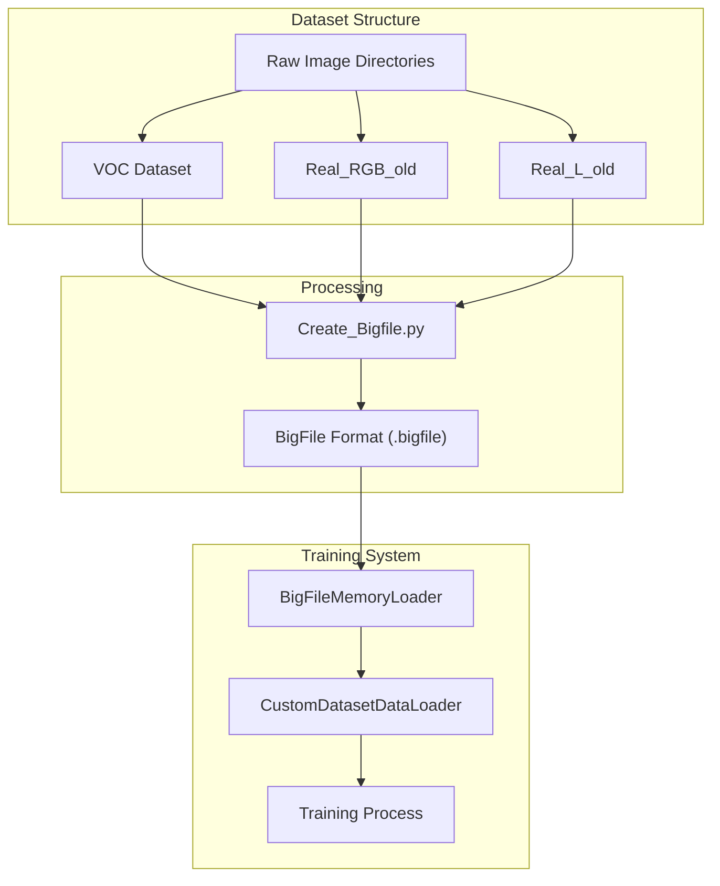
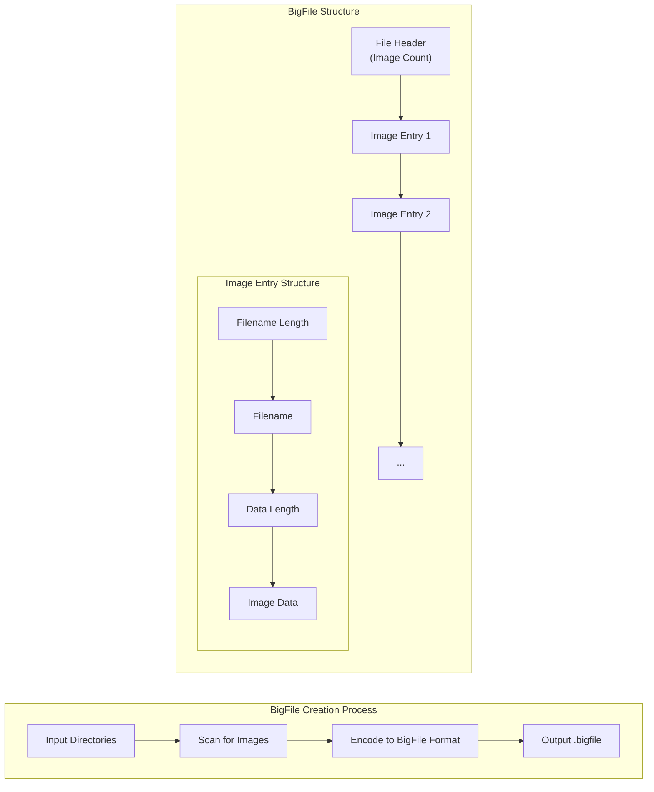
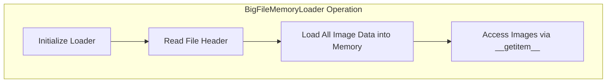
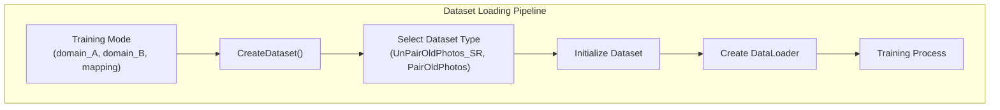
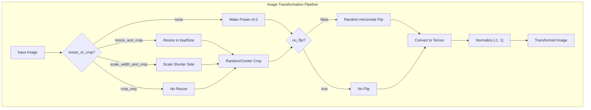

<!-- source: DeepWiki mcp.deepwiki.com · repo microsoft/Bringing-Old-Photos-Back-to-Life · page 4.3 Dataset Preparation · fetched 2026-10-26 -->

# Dataset Preparation

<details>
<summary>Relevant source files</summary>

The following files were used as context for generating this wiki page:

- [Global/data/Create_Bigfile.py](Global/data/Create_Bigfile.py)
- [Global/data/Load_Bigfile.py](Global/data/Load_Bigfile.py)
- [Global/data/base_data_loader.py](Global/data/base_data_loader.py)
- [Global/data/base_dataset.py](Global/data/base_dataset.py)
- [Global/data/custom_dataset_data_loader.py](Global/data/custom_dataset_data_loader.py)
- [Global/data/data_loader.py](Global/data/data_loader.py)
- [Global/data/image_folder.py](Global/data/image_folder.py)

</details>


This document explains how data is prepared, processed, and loaded for training the old photo restoration models. The system uses a specialized approach to efficiently handle large image datasets during the training process. For information about the actual training procedures, see [Domain Training](#4.1) and [Mapping Network Training](#4.2).

## 1. Dataset Overview

The training system requires different types of datasets depending on the training mode. These datasets are organized in specific directories and processed into efficient binary formats to optimize loading during training.



Sources: [Global/data/Create_Bigfile.py](), [Global/data/custom_dataset_data_loader.py]()

## 2. BigFile Creation

The system uses a custom binary file format called "BigFile" to package multiple image files from different directories into a single large file. This approach improves data loading efficiency during training.

### 2.1 Creation Process

The `Create_Bigfile.py` script handles the conversion of image directories into BigFile format:

1. The script scans specified directories for image files (with extensions like .jpg, .png, etc.)
2. Each image is read and encoded into the BigFile format
3. The resulting BigFile contains:
   - Total number of images (4-byte integer)
   - For each image:
     - Length of filename (4-byte integer)
     - Filename (UTF-8 encoded string)
     - Length of image data (4-byte integer)
     - Raw image data (binary)



Sources: [Global/data/Create_Bigfile.py:31-63]()

### 2.2 Configuration

To create BigFiles, the script requires configuration of three main parameters:

```
indir="/path/to/input/directory"
target_folders=['VOC','Real_L_old','Real_RGB_old']
out_dir ="/path/to/output/directory"
```

The script will create a separate BigFile for each specified folder (e.g., `VOC.bigfile`, `Real_L_old.bigfile`, and `Real_RGB_old.bigfile`).

Sources: [Global/data/Create_Bigfile.py:31-34]()

## 3. Dataset Loading

Once the BigFiles are created, the system provides efficient mechanisms to load and process this data during training.

### 3.1 BigFile Loading

The `BigFileMemoryLoader` class handles loading BigFiles into memory:

1. The loader reads the BigFile header to determine the number of images
2. It then loads all image names and binary data into memory
3. When an image is requested, it's converted from binary data to a PIL Image on demand

This approach optimizes memory usage while maintaining fast access to images during training.



Sources: [Global/data/Load_Bigfile.py:9-42]()

### 3.2 Dataset Initialization

The system uses a specialized data loader pipeline to initialize and manage datasets during training:

1. `CreateDataset` function selects the appropriate dataset type based on training mode
2. `CustomDatasetDataLoader` initializes the dataset and creates a PyTorch DataLoader
3. The DataLoader handles batching, shuffling, and multi-threaded loading



Sources: [Global/data/custom_dataset_data_loader.py:10-41](), [Global/data/data_loader.py:4-9]()

## 4. Dataset Types

The system uses different dataset types depending on the training mode:

| Training Mode | Dataset Class | Description |
|---------------|--------------|-------------|
| domain_A | UnPairOldPhotos_SR | Used for training Domain A models |
| domain_B | UnPairOldPhotos_SR | Used for training Domain B models |
| mapping (without holes) | PairOldPhotos | Used for training the mapping network |
| mapping (with holes) | PairOldPhotos_with_hole | Used for training mapping network with random holes |

These dataset classes are defined in the `online_dataset_for_old_photos` module, which handles specific loading and preprocessing for each training scenario.

Sources: [Global/data/custom_dataset_data_loader.py:10-21]()

## 5. Image Transformations

When loading images for training, various transformations are applied to prepare the data:

### 5.1 Basic Transformations

The system applies several standard transformations to the input images:

1. Resizing: Scale images to a consistent size (controlled by `loadSize` parameter)
2. Cropping: Extract random crops during training or center crops during testing
3. Flipping: Random horizontal flipping for data augmentation (disabled with `no_flip` option)
4. Normalization: Normalize pixel values to range [-1, 1]

### 5.2 Transformation Parameters

The transformation pipeline is determined by the `resize_or_crop` option, which can be set to:

- `resize_and_crop`: Resize to `loadSize` then perform random cropping
- `scale_width_and_crop`: Scale the shorter side to `loadSize` then crop
- `crop_only`: Only perform cropping without resizing
- `none`: Maintain power-of-2 dimensions based on downsampling factors



Sources: [Global/data/base_dataset.py:20-114]()

## 6. Integration with Training

The dataset preparation system is tightly integrated with the training pipeline:

1. Training scripts (like `train_domain_A.py`, `train_domain_B.py`, and `train_mapping.py`) create data loaders using `CreateDataLoader`
2. The data loader initializes the appropriate dataset based on the training mode
3. During training, batches of prepared images are fetched from the data loader
4. The transformations ensure that images are properly sized, cropped, and normalized for efficient model training

This integrated approach ensures consistent data handling across different training scenarios while maximizing efficiency.

Sources: [Global/data/data_loader.py:4-9](), [Global/data/custom_dataset_data_loader.py:23-41]()

---

