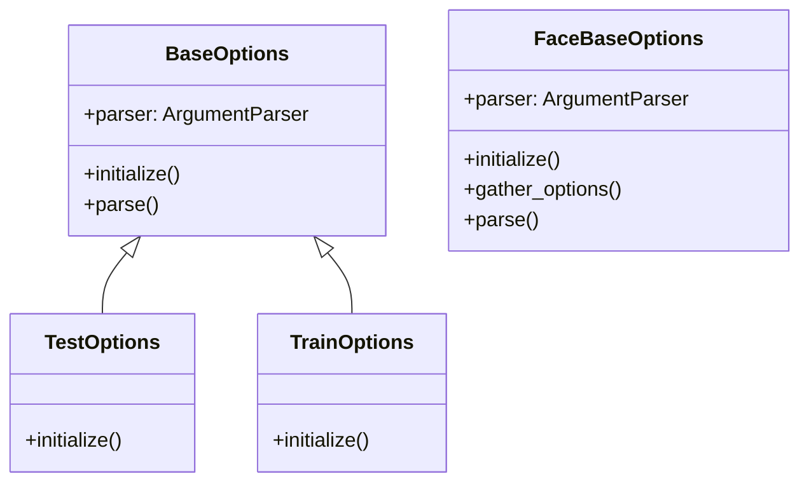
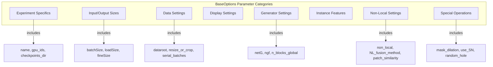
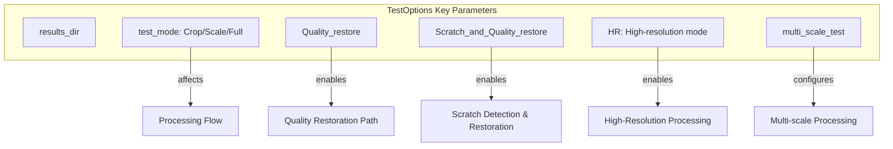
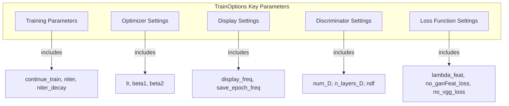
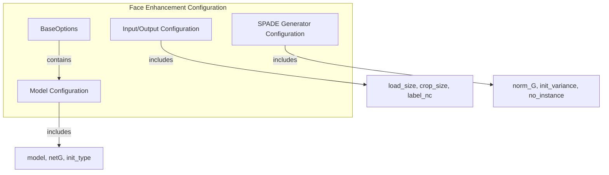
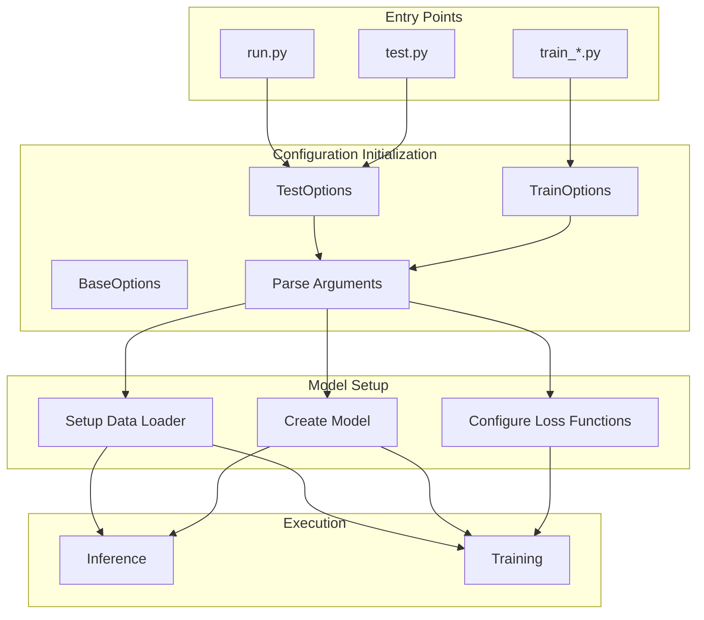
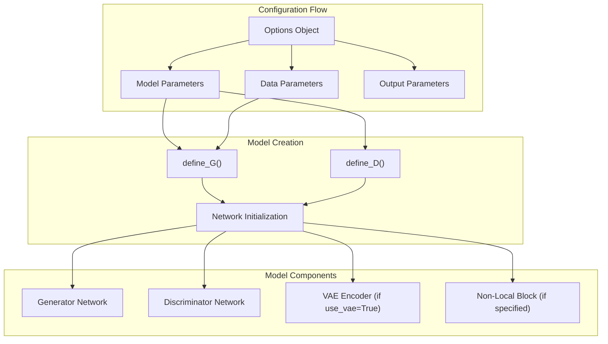

<!-- source: DeepWiki mcp.deepwiki.com · repo microsoft/Bringing-Old-Photos-Back-to-Life · page 5 Configuration · fetched 2026-10-26 -->

# Configuration

<details>
<summary>Relevant source files</summary>

The following files were used as context for generating this wiki page:

- [Face_Enhancement/models/pix2pix_model.py](Face_Enhancement/models/pix2pix_model.py)
- [Face_Enhancement/options/base_options.py](Face_Enhancement/options/base_options.py)
- [Global/options/__init__.py](Global/options/__init__.py)
- [Global/options/base_options.py](Global/options/base_options.py)
- [Global/options/test_options.py](Global/options/test_options.py)
- [Global/options/train_options.py](Global/options/train_options.py)

</details>


The Configuration system in the "Bringing Old Photos Back to Life" project provides a flexible framework for controlling all aspects of the restoration pipeline. This document describes the configuration architecture, available options, and how different components utilize the configuration system throughout the restoration process.

For information about using these configurations in the restoration pipeline, see [Restoration Pipeline](#2) and for detailed training configuration, see [Training](#4).

## Configuration Architecture

The project uses an inheritance-based configuration system built on top of Python's `argparse` library. Configuration options are organized into hierarchical classes that handle different aspects of the system.



Sources: [Global/options/base_options.py:10-336](), [Global/options/test_options.py:7-61](), [Global/options/train_options.py:6-60](), [Face_Enhancement/options/base_options.py:14-294]()

The configuration system handles several core functions:
1. Defining all configurable parameters
2. Setting appropriate defaults
3. Parsing command-line arguments
4. Storing and persisting configurations
5. Providing configurations to various model components

## Global Module Configuration

The Global module defines three main configuration classes:

### BaseOptions

The `BaseOptions` class serves as the foundation for all configuration in the Global restoration module. It defines parameters common to both training and testing.



Sources: [Global/options/base_options.py:15-335]()

Key configuration parameters include:

| Parameter Category | Example Parameters | Purpose |
|-------------------|-------------------|---------|
| Experiment Specifics | `name`, `gpu_ids`, `checkpoints_dir` | Control experiment identification and resource allocation |
| Input/Output | `batchSize`, `loadSize`, `fineSize` | Define the data dimensions and processing |
| Network Architecture | `netG`, `n_blocks_global`, `ngf` | Configure model architecture |
| Non-Local Operations | `non_local`, `NL_fusion_method` | Control patch-based attention mechanisms |
| Special Operations | `mask_dilation`, `random_hole` | Configure specialized processing steps |

### TestOptions

The `TestOptions` class extends `BaseOptions` with parameters specific to the testing/inference phase:



Sources: [Global/options/test_options.py:9-100]()

Important test configurations include:
- `test_mode`: Controls how images are processed (Crop, Scale, or Full)
- `Quality_restore`: Flag to enable quality restoration for RGB images
- `Scratch_and_Quality_restore`: Flag to enable processing of scratched images
- `HR`: Flag for high-resolution processing with scratches

### TrainOptions

The `TrainOptions` class extends `BaseOptions` with training-specific parameters:



Sources: [Global/options/train_options.py:7-59]()

Key training configurations include:
- Learning parameters: `lr`, `niter`, `niter_decay`
- Discriminator settings: `num_D`, `n_layers_D`, `ndf`
- Loss weights and types: `lambda_feat`, `no_ganFeat_loss`
- Display and checkpoint frequencies: `display_freq`, `save_epoch_freq`

## Face Enhancement Configuration

The Face Enhancement module has its own configuration system with similar structure but specialized for face processing.



Sources: [Face_Enhancement/options/base_options.py:18-183]()

Key differences in the Face Enhancement configuration include:
- Face-specific parameters: `old_face_folder`, `old_face_label_folder`
- SPADE generator options: `netG` set to "spade" by default
- Different normalization and initialization strategies
- Face parsing map integration: `no_parsing_map` option

## Configuration Usage Flow

The configuration system is used throughout the restoration pipeline as shown below:



Sources: [Global/options/base_options.py:338-373](), [Face_Enhancement/options/base_options.py:185-294]()

## Important Configuration Options

### Restoration Mode Options

These options control which restoration mode is activated:

| Option | Description | Default | File Reference |
|--------|-------------|---------|---------------|
| `Quality_restore` | Enable quality restoration for RGB images | False | [Global/options/test_options.py:96]() |
| `Scratch_and_Quality_restore` | Enable scratch detection and restoration | False | [Global/options/test_options.py:98]() |
| `HR` | Process high-resolution images with scratches | False | [Global/options/test_options.py:100]() |

### Model Architecture Options

These options control the neural network architectures:

| Option | Description | Default | File Reference |
|--------|-------------|---------|---------------|
| `netG` | Generator architecture type | "global" | [Global/options/base_options.py:90]() |
| `n_blocks_global` | Number of ResNet blocks in global generator | 9 | [Global/options/base_options.py:102]() |
| `non_local` | Non-local block configuration | "" | [Global/options/base_options.py:218]() |
| `mapping_net_dilation` | Dilation size for translation network | 1 | [Global/options/base_options.py:211]() |

### Face Enhancement Options

For face enhancement specific configuration:

| Option | Description | Default | File Reference |
|--------|-------------|---------|---------------|
| `netG` (Face) | Generator type for faces | "spade" | [Face_Enhancement/options/base_options.py:143]() |
| `label_nc` | Number of input label classes | 182 | [Face_Enhancement/options/base_options.py:94]() |
| `no_parsing_map` | Disable use of parsing map during training | False | [Face_Enhancement/options/base_options.py:157]() |

## Configuration Implementation Details

The configuration options are parsed and processed using Python's `argparse` library. The implementation includes:

1. **Option Initialization**: Each options class initializes a set of parameters with default values
   ```python
   self.parser.add_argument("--name", type=str, default="label2city", 
                           help="name of the experiment...")
   ```

2. **Parsing**: The `parse()` method processes command line arguments and sets up GPU configuration
   ```python
   def parse(self, save=True):
       if not self.initialized:
           self.initialize()
       self.opt = self.parser.parse_args()
       self.opt.isTrain = self.isTrain  # train or test
   ```

3. **Option Saving**: Configuration options are saved to disk for reproducibility
   ```python
   file_name = os.path.join(expr_dir, "opt.txt")
   with open(file_name, "wt") as opt_file:
       opt_file.write("------------ Options -------------\n")
       for k, v in sorted(args.items()):
           opt_file.write("%s: %s\n" % (str(k), str(v)))
   ```

Sources: [Global/options/base_options.py:338-373](), [Face_Enhancement/options/base_options.py:215-246]()

## Configuration Examples

### Basic Quality Restoration

To run basic quality restoration (without scratch handling):

```bash
python run.py --input_folder [path] --Quality_restore
```

### Scratch and Quality Restoration

For images with scratches:

```bash
python run.py --input_folder [path] --Scratch_and_Quality_restore
```

### High-Resolution Processing

For high-resolution images with scratches:

```bash
python run.py --input_folder [path] --Scratch_and_Quality_restore --HR
```

### Training Configuration

To train the mapping network:

```bash
python train_mapping.py --name [experiment_name] --netG [architecture] --n_blocks_global 9 --non_local pano --training_dataset [dataset_path]
```

Sources: [Global/options/test_options.py:95-100](), [Global/options/train_options.py:22-26]()

## Integration with Model Architecture

The configuration options directly influence model architecture creation:



Sources: [Face_Enhancement/models/pix2pix_model.py:83-95]()

The configuration is passed to model creation functions that interpret these settings to construct the appropriate neural network architectures, configure loss functions, and set up training parameters.

---

