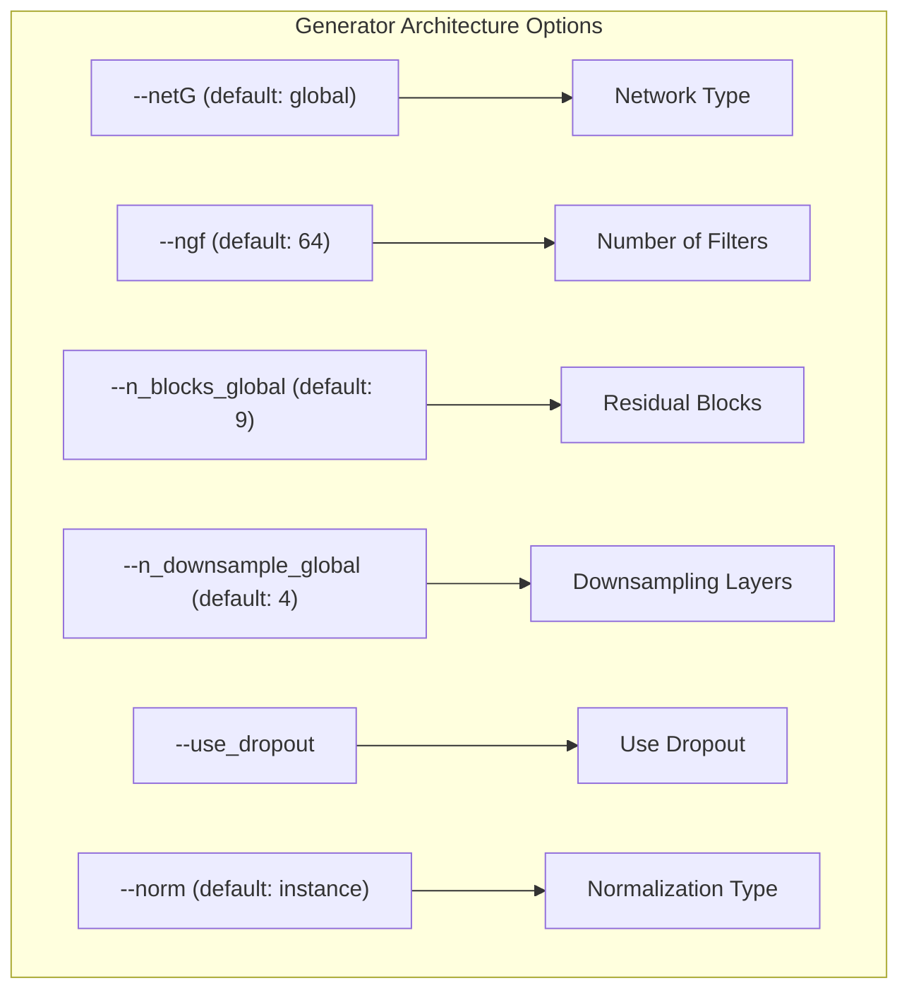
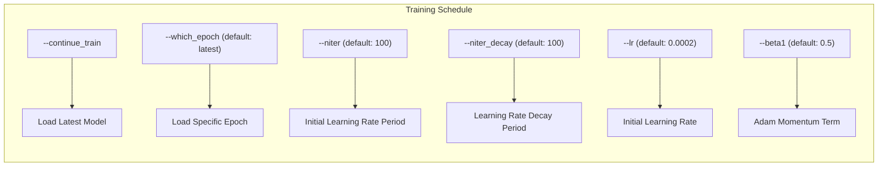
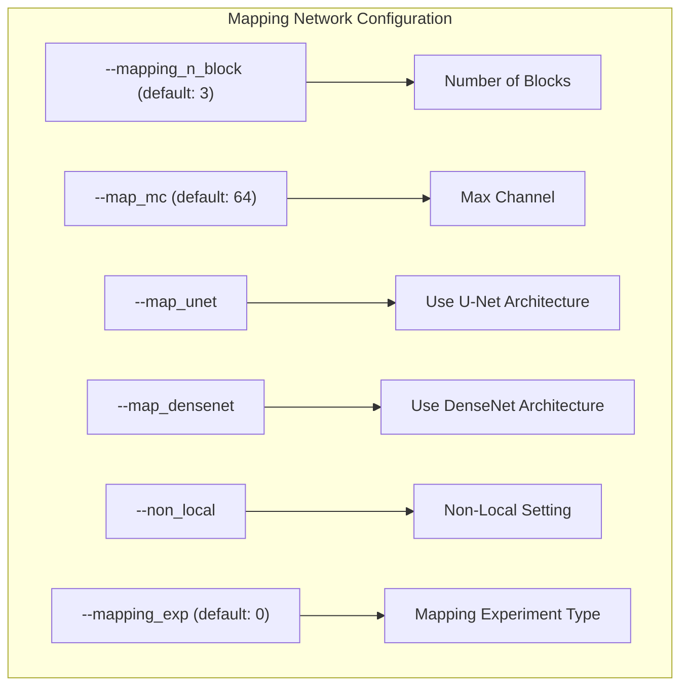
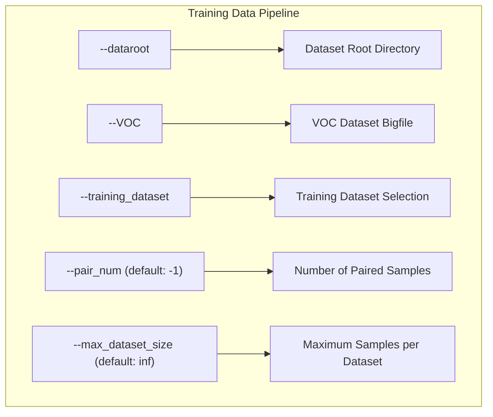

<!-- source: DeepWiki mcp.deepwiki.com · repo microsoft/Bringing-Old-Photos-Back-to-Life · page 5.1 Training Options · fetched 2026-10-26 -->

# Training Options

<details>
<summary>Relevant source files</summary>

The following files were used as context for generating this wiki page:

- [Global/options/__init__.py](Global/options/__init__.py)
- [Global/options/base_options.py](Global/options/base_options.py)
- [Global/options/train_options.py](Global/options/train_options.py)

</details>


This page documents the configuration options specifically related to model training in the Old Photo Restoration system. The training options control parameters such as learning rates, loss functions, training schedules, and various model-specific behaviors. For information about testing and inference options, see [Testing Options](#5.2).

## Overview of the Configuration System

The training options system is implemented using a hierarchical structure where training-specific options extend a base set of common options.

```mermaid
classDiagram
    class "BaseOptions" {
        +initialize()
        +parse()
        -parser: ArgumentParser
        -initialized: bool
    }
    
    class "TrainOptions" {
        +initialize()
        +isTrain: True
    }
    
    BaseOptions <|-- TrainOptions
    
    note for TrainOptions "Adds training-specific options\nSets isTrain flag to True"
```

Sources: [Global/options/base_options.py:10-337](), [Global/options/train_options.py:6-60]()

## Base Configuration Options

The base options provide general configuration settings that are common to both training and testing, including model architecture, data handling, and output settings.

### General Settings

These options control the experiment environment and basic parameters:

| Option | Type | Default | Description |
|--------|------|---------|-------------|
| `--name` | str | "label2city" | Name of the experiment, determines where samples and models are stored |
| `--gpu_ids` | str | "0" | Which GPUs to use (e.g., "0,1,2") |
| `--checkpoints_dir` | str | "./checkpoints" | Directory where models are saved |
| `--outputs_dir` | str | "./outputs" | Directory where outputs are saved |
| `--model` | str | "pix2pixHD" | Which model architecture to use |
| `--dataroot` | str | "./datasets/cityscapes/" | Root directory for the dataset |

Sources: [Global/options/base_options.py:17-32]()

### Model Architecture Options

These options control the neural network architecture:



Sources: [Global/options/base_options.py:90-119]()

### Data Handling Options

Configuration for input data processing:

| Option | Type | Default | Description |
|--------|------|---------|-------------|
| `--batchSize` | int | 1 | Input batch size |
| `--loadSize` | int | 1024 | Scale images to this size |
| `--fineSize` | int | 512 | Crop images to this size |
| `--input_nc` | int | 3 | Number of input image channels |
| `--output_nc` | int | 3 | Number of output image channels |
| `--resize_or_crop` | str | "scale_width" | How to resize and crop images |
| `--no_flip` | flag | - | If set, do not use horizontal flipping for data augmentation |
| `--nThreads` | int | 2 | Number of threads for data loading |

Sources: [Global/options/base_options.py:48-79]()

## Training-Specific Options

These options are specifically for controlling the training process and are defined in the `TrainOptions` class.

### Display and Logging Options

Options for monitoring the training progress:

| Option | Type | Default | Description |
|--------|------|---------|-------------|
| `--display_freq` | int | 100 | Frequency of showing training results on screen |
| `--print_freq` | int | 100 | Frequency of showing training results in console |
| `--save_latest_freq` | int | 10000 | Frequency of saving the latest model |
| `--save_epoch_freq` | int | 1 | Frequency of saving checkpoints at the end of epochs |
| `--no_html` | flag | - | Don't save intermediate training results to web/ folder |
| `--debug` | flag | - | Only do one epoch and display at each iteration |
| `--tf_log` | flag | - | Use TensorBoard for logging (requires TensorFlow) |

Sources: [Global/options/train_options.py:10-16](), [Global/options/base_options.py:83-87]()

### Training Schedule Parameters

Options that control the training schedule and optimization:



Sources: [Global/options/train_options.py:18-25]()

### Discriminator and Loss Function Options

Options for the GAN discriminator and various loss functions:

| Option | Type | Default | Description |
|--------|------|---------|-------------|
| `--num_D` | int | 2 | Number of discriminators to use |
| `--n_layers_D` | int | 3 | Number of layers in discriminator |
| `--ndf` | int | 64 | Number of filters in first discriminator layer |
| `--lambda_feat` | float | 10.0 | Weight for feature matching loss |
| `--no_ganFeat_loss` | flag | - | Don't use discriminator feature matching loss |
| `--no_vgg_loss` | flag | - | Don't use VGG feature matching loss |
| `--no_lsgan` | flag | - | Use vanilla GAN instead of least squares GAN |
| `--gan_type` | str | "lsgan" | Type of GAN loss to use |
| `--norm_D` | str | "spectralinstance" | Normalization for discriminator |

Sources: [Global/options/train_options.py:29-41]()

## Domain-Specific Training Options

The system includes specialized options for old photo restoration tasks.

### Mapping Network Options

Options for the mapping network that translates between domains:



Sources: [Global/options/base_options.py:154-157](), [Global/options/base_options.py:218-232](), [Global/options/base_options.py:332]()

### Degradation and Restoration Options

Options specific to the photo restoration process:

| Option | Type | Default | Description |
|--------|------|---------|-------------|
| `--no_degradation` | flag | - | Don't add degradation to clean images during mapping training |
| `--use_v2_degradation` | flag | - | Use 4 kinds of degradations to synthesize corruption |
| `--contain_scratch_L` | flag | - | Training data contains scratch masks |
| `--mask_dilation` | int | 0 | Dilation applied to masks |
| `--irregular_mask` | str | "" | Root directory for irregular masks |
| `--random_hole` | flag | - | 50% probability to add hole during full model training |
| `--L1_weight` | float | 10.0 | Weight for L1 loss |

Sources: [Global/options/train_options.py:46-48](), [Global/options/base_options.py:199-202](), [Global/options/base_options.py:281-285](), [Global/options/base_options.py:255]()

## Training Data Configuration

Options related to dataset preparation and loading:



Sources: [Global/options/base_options.py:56](), [Global/options/base_options.py:216](), [Global/options/train_options.py:26](), [Global/options/base_options.py:180](), [Global/options/base_options.py:74-79]()

## Example Usage

Here's an example of how training options might be used to start a training session:

```
python train_mapping.py --name mapping_experiment --gpu_ids 0,1 --batchSize 4 --niter 100 --niter_decay 100 --lr 0.0002 --lambda_feat 10 --non_local pnl --mapping_exp 1
```

This command would:
1. Start training the mapping network with name "mapping_experiment"
2. Use GPUs 0 and 1
3. Use a batch size of 4
4. Train for 100 epochs at initial learning rate, then 100 epochs with decaying learning rate
5. Set the initial learning rate to 0.0002
6. Use a weight of 10 for the feature matching loss
7. Use partial non-local for the mapping network
8. Use multi-scale patch attention (mapping experiment type 1)

## Integration with Training Scripts

The training options are used by various training scripts in the system:

1. `train_domain_A.py` - For training the VAE for domain A
2. `train_domain_B.py` - For training the VAE for domain B
3. `train_mapping.py` - For training the mapping network between domains

Each script imports the `TrainOptions` class, initializes it, and parses command-line arguments to configure the training process.

Sources: [Global/options/train_options.py:6-60]()

---

