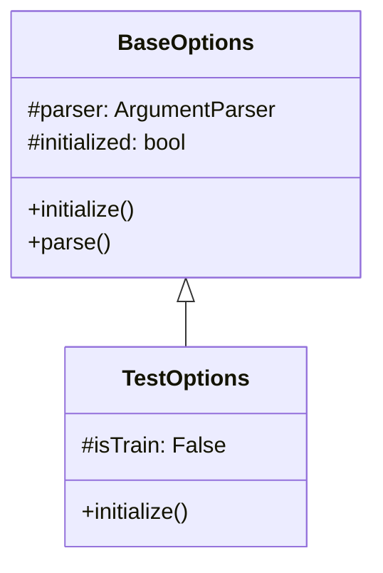
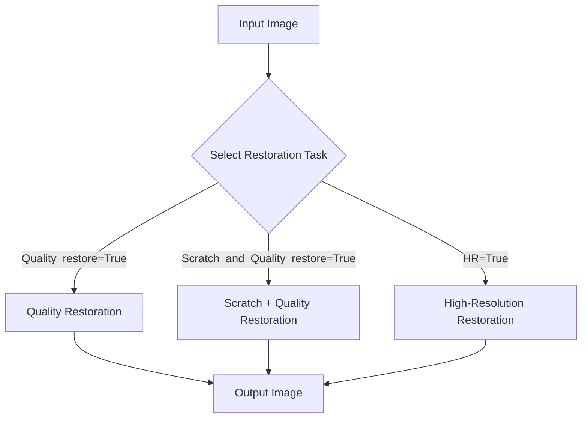
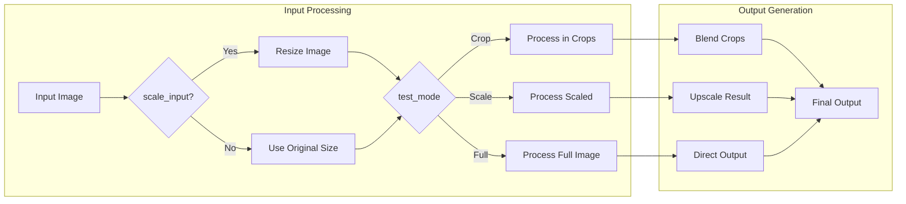
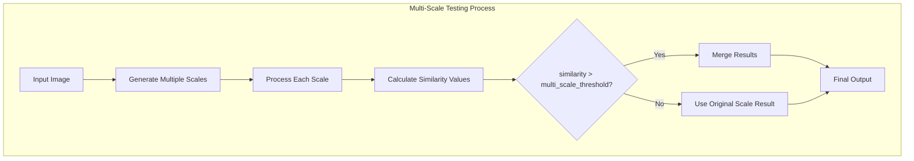
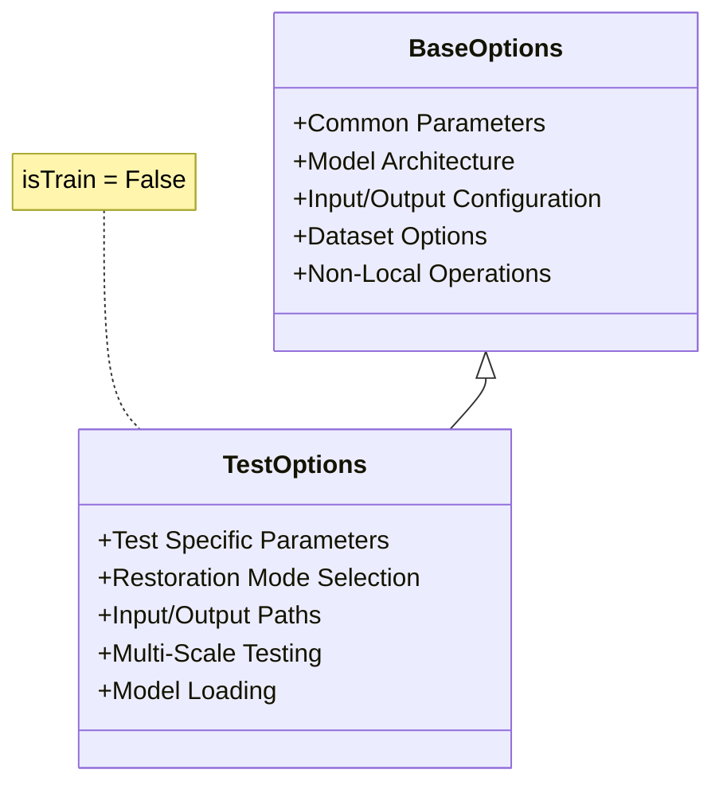
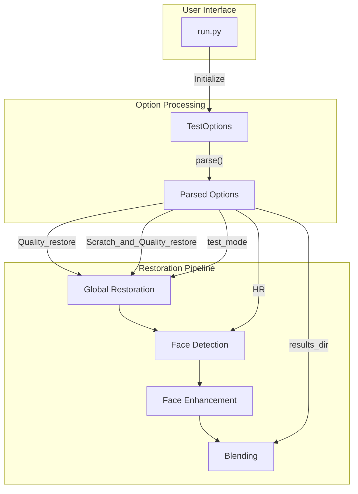

<!-- source: DeepWiki mcp.deepwiki.com · repo microsoft/Bringing-Old-Photos-Back-to-Life · page 5.2 Testing Options · fetched 2026-10-26 -->

# Testing Options

<details>
<summary>Relevant source files</summary>

The following files were used as context for generating this wiki page:

- [Global/options/__init__.py](Global/options/__init__.py)
- [Global/options/base_options.py](Global/options/base_options.py)
- [Global/options/test_options.py](Global/options/test_options.py)

</details>


This page documents the various configuration options available when testing the Old Photo Restoration system. These options control the model behavior, input processing, and output generation during the inference phase. For information about training configuration, see [Training Options](#5.1).

## Overview of Testing Configuration

The testing configuration system is built on a hierarchical structure where `TestOptions` inherits from `BaseOptions`, providing both general parameters and test-specific settings.



Sources: [Global/options/base_options.py:10-373](), [Global/options/test_options.py:7-100]()

## Core Testing Options

These fundamental options control basic aspects of the testing process, such as which model to load and where to save results.

| Option | Type | Default | Description |
|--------|------|---------|-------------|
| `which_epoch` | str | "latest" | Which model checkpoint to load (e.g., "latest", "10", "best") |
| `results_dir` | str | "./results/" | Directory where restored images are saved |
| `how_many` | int | 50 | Maximum number of test images to process |
| `test_mode` | str | "Crop" | Testing mode: "Scale", "Full", or "Crop" |
| `aspect_ratio` | float | 1.0 | Aspect ratio for result images |

Sources: [Global/options/test_options.py:11-22](), [Global/options/test_options.py:95]()

## Restoration Task Selection

The system offers different restoration modes depending on the type of degradation in the input photos.



Sources: [Global/options/test_options.py:96-100]()

The table below describes the task selection options:

| Option | Type | Default | Description |
|--------|------|---------|-------------|
| `Quality_restore` | bool | False | Enables quality restoration for RGB images without scratches |
| `Scratch_and_Quality_restore` | bool | False | Enables restoration for images with both quality issues and scratches |
| `HR` | bool | False | Enables processing for high-resolution images with scratches |

## Input and Output Options

These options control how the system processes input images and generates outputs.



Sources: [Global/options/test_options.py:78-86](), [Global/options/test_options.py:95]()

Key input/output options include:

| Option | Type | Default | Description |
|--------|------|---------|-------------|
| `test_input` | str | "" | Path to test input images or bigfile root |
| `test_mask` | str | "" | Path to test masks (for scratch removal) |
| `test_gt` | str | "" | Path to ground truth images (for evaluation) |
| `scale_input` | bool | False | Whether to scale input images first |
| `multi_scale_test` | float | 0.5 | Scale ratio for multi-scale testing |
| `multi_scale_threshold` | float | 0.5 | Threshold for multi-scale testing |
| `scale_num` | int | 1 | Number of scales to test with |

## Model Loading Options

These options control how models are loaded for testing.

| Option | Type | Default | Description |
|--------|------|---------|-------------|
| `no_load_VAE` | bool | False | Skip loading VAE models, use random initialization |
| `use_vae_which_epoch` | str | "latest" | Which VAE checkpoint to load |
| `load_pretrain` | str | "" | Load pretrained model from specified location |
| `load_pretrainA` | str | "" | Path to pretrained model A |
| `load_pretrainB` | str | "" | Path to pretrained model B |

Sources: [Global/options/test_options.py:51-60](), [Global/options/base_options.py:121-126](), [Global/options/base_options.py:160-170]()

## Advanced Testing Configuration

For advanced users, these options provide fine-grained control over the testing process.

### Multi-Scale Testing



Sources: [Global/options/test_options.py:65-72]()

Multi-scale testing options:

| Option | Type | Default | Description |
|--------|------|---------|-------------|
| `multi_scale_test` | float | 0.5 | Scale ratio for multi-scale testing |
| `multi_scale_threshold` | float | 0.5 | Similarity threshold for merging results |
| `scale_num` | int | 1 | Number of scales to use |

### Non-Local and Feature Mapping Options

The system uses non-local operations and feature mapping networks for improved restoration. These options control their behavior:

| Option | Type | Default | Description |
|--------|------|---------|-------------|
| `non_local` | str | "" | Non-local setting to use |
| `NL_fusion_method` | str | "add" | How to fuse original feature and non-local feature |
| `NL_use_mask` | bool | False | Whether to use mask in non-local mapping |
| `correlation_renormalize` | bool | False | Re-weight correlation matrix after masking |
| `mapping_exp` | int | 0 | Mapping experiment type (0: original PNL, 1: Multi-Scale Patch Attention) |
| `cosin_similarity` | bool | False | Use cosine similarity for non-local operations |

Sources: [Global/options/base_options.py:218-235](), [Global/options/base_options.py:319-334]()

## Hardware and Memory Optimization

These options allow optimization for different hardware configurations:

| Option | Type | Default | Description |
|--------|------|---------|-------------|
| `gpu_ids` | str | "0" | Which GPUs to use (e.g. "0,1,2") |
| `data_type` | int | 32 | Data precision (8, 16, or 32 bit) |
| `inference_optimize` | bool | False | Optimize memory usage during inference |

Sources: [Global/options/base_options.py:23-44](), [Global/options/base_options.py:334]()

## Complete TestOptions Hierarchy

The complete options hierarchy shows how testing options extend the base options:



Sources: [Global/options/base_options.py:10-373](), [Global/options/test_options.py:7-100]()

## Usage Examples

Here are some common usage patterns for testing options:

### Basic Quality Restoration

For restoring old photos with quality issues but no scratches:

```
python run.py --Quality_restore --test_input ./input_folder --test_mode Full --gpu_ids 0
```

### Scratch and Quality Restoration

For photos with both scratches and quality degradation:

```
python run.py --Scratch_and_Quality_restore --test_input ./input_folder --test_mask ./mask_folder --test_mode Crop
```

### High-Resolution Photo Restoration

For processing high-resolution photos with scratches:

```
python run.py --HR --test_input ./input_folder --test_mode Crop --gpu_ids 0,1
```

Sources: [Global/options/test_options.py:96-100]()

## Integration with Restoration Pipeline

The testing options integrate with the overall restoration pipeline as shown below:



Sources: [Global/options/test_options.py:7-100]()

These testing options provide comprehensive control over the restoration process, allowing users to customize the system's behavior according to their specific needs and the characteristics of the input images.

---

