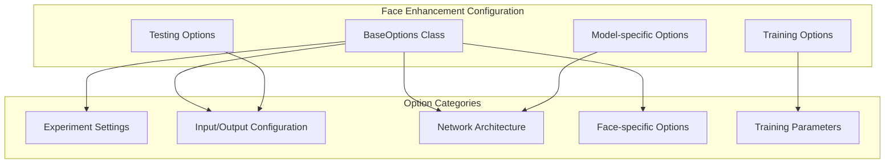
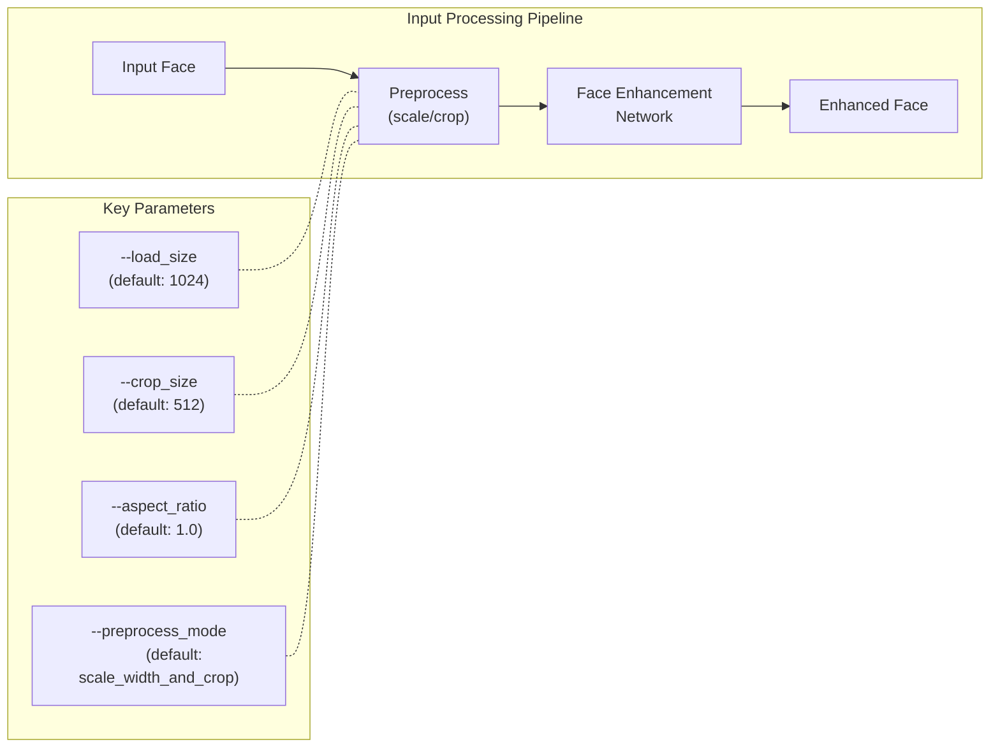
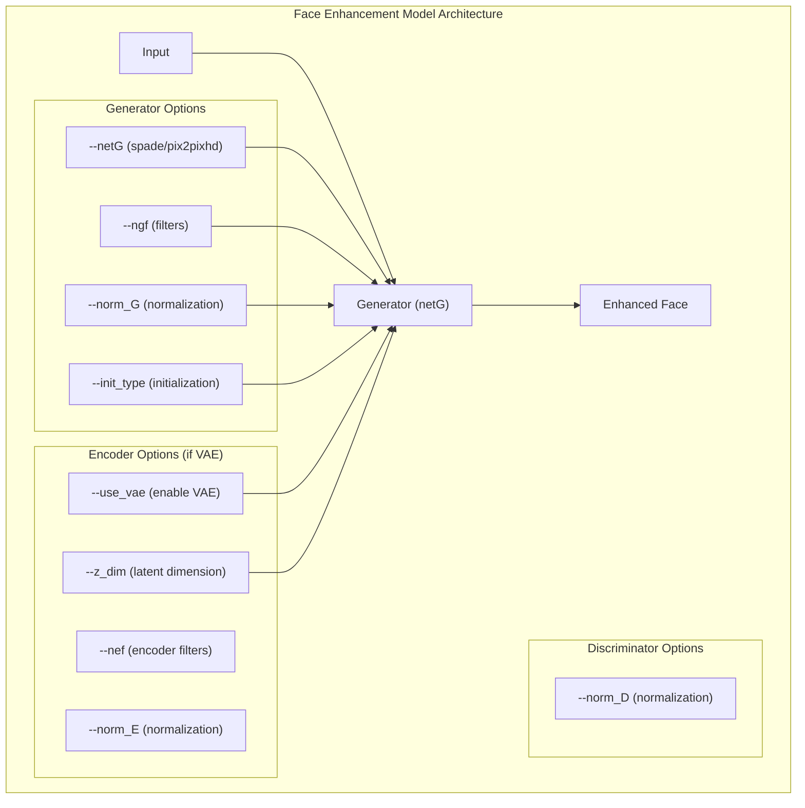
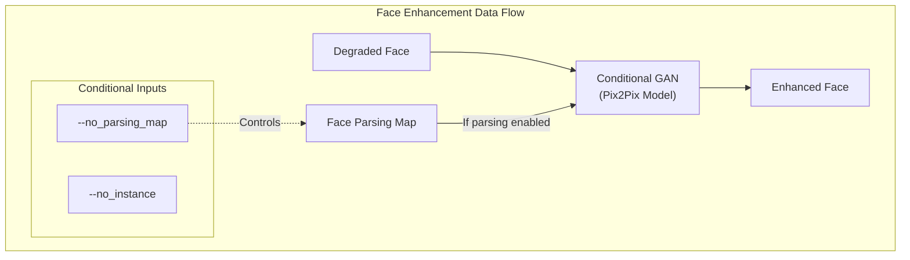

<!-- source: DeepWiki mcp.deepwiki.com · repo microsoft/Bringing-Old-Photos-Back-to-Life · page 5.3 Face Enhancement Options · fetched 2026-10-26 -->

# Face Enhancement Options

<details>
<summary>Relevant source files</summary>

The following files were used as context for generating this wiki page:

- [Face_Enhancement/models/pix2pix_model.py](Face_Enhancement/models/pix2pix_model.py)
- [Face_Enhancement/options/base_options.py](Face_Enhancement/options/base_options.py)

</details>


## Purpose and Scope

This document details the configuration options for the Face Enhancement module in the Old Photo Restoration system. The Face Enhancement component is responsible for improving the quality of detected faces in old photographs by using advanced generative models. This page focuses specifically on the available configuration parameters that control how face enhancement operates.

For information about the overall restoration pipeline, see [Restoration Pipeline](#2), and for details about the face detection process, see [Face Detection](#2.2).

## Configuration Overview



The Face Enhancement module uses an options system defined in the `BaseOptions` class to manage various configuration parameters. These options can be specified via command line arguments or loaded from a previously saved configuration file.

Sources: [Face_Enhancement/options/base_options.py:14-294]()

## Core Configuration Options

### Experiment Configuration

| Option | Type | Default | Description |
|--------|------|---------|-------------|
| `--name` | str | "label2coco" | Name of the experiment. Determines where samples and models are stored |
| `--gpu_ids` | str | "0" | GPU IDs to use (e.g., "0,1,2") |
| `--checkpoints_dir` | str | "./checkpoints" | Directory where models are saved |
| `--model` | str | "pix2pix" | Model architecture to use |
| `--phase` | str | "train" | Phase: "train", "val", or "test" |

Sources: [Face_Enhancement/options/base_options.py:19-52]()

### Input/Output Configuration



| Option | Type | Default | Description |
|--------|------|---------|-------------|
| `--batchSize` | int | 1 | Input batch size |
| `--preprocess_mode` | str | "scale_width_and_crop" | Image processing method during loading |
| `--load_size` | int | 1024 | Scale images to this size |
| `--crop_size` | int | 512 | Crop width after initial scaling |
| `--aspect_ratio` | float | 1.0 | Width/height ratio for final image height |
| `--label_nc` | int | 182 | Number of input label classes |
| `--output_nc` | int | 3 | Number of output image channels |

Sources: [Face_Enhancement/options/base_options.py:55-102]()

### Face-Specific Options

| Option | Type | Default | Description |
|--------|------|---------|-------------|
| `--old_face_folder` | str | "" | Folder containing input old faces |
| `--old_face_label_folder` | str | "" | Folder containing input old face parsing labels |
| `--no_parsing_map` | flag | False | If set, don't use parsing map during enhancement |
| `--injection_layer` | str | "all" | Which layers to inject information into |

Sources: [Face_Enhancement/options/base_options.py:173-180]()

## Network Architecture Options



### Generator Options

| Option | Type | Default | Description |
|--------|------|---------|-------------|
| `--netG` | str | "spade" | Generator architecture ("pix2pixhd" or "spade") |
| `--ngf` | int | 64 | Number of generator filters in first conv layer |
| `--norm_G` | str | "spectralinstance" | Normalization type for generator |
| `--init_type` | str | "xavier" | Network initialization method |
| `--init_variance` | float | 0.02 | Variance of initialization distribution |

Sources: [Face_Enhancement/options/base_options.py:142-155]()

### VAE Options

| Option | Type | Default | Description |
|--------|------|---------|-------------|
| `--use_vae` | flag | False | Enable training with image encoder (VAE) |
| `--z_dim` | int | 256 | Dimension of latent z vector |
| `--nef` | int | 16 | Number of encoder filters in first conv layer |
| `--norm_E` | str | "spectralinstance" | Normalization type for encoder |

Sources: [Face_Enhancement/options/base_options.py:47-51](), [Face_Enhancement/options/base_options.py:155-167]()

## Model Behavior Options



The face enhancement model can be configured to use different conditional inputs:

| Option | Type | Default | Description |
|--------|------|---------|-------------|
| `--no_parsing_map` | flag | False | If set, do not use face parsing map as input |
| `--no_instance` | flag | False | If set, do not add instance map as input |
| `--contain_dontcare_label` | flag | False | If set, the label map contains dontcare label (255) |

These options affect how the model processes input data and how it conditions the generation process:

```python
# If parsing map is disabled:
fake_concat = fake_image
real_concat = real_image
# Otherwise:
fake_concat = torch.cat([input_semantics, fake_image], dim=1)
real_concat = torch.cat([input_semantics, real_image], dim=1)
```

Sources: [Face_Enhancement/options/base_options.py:157-169](), [Face_Enhancement/models/pix2pix_model.py:197-202]()

## Inference Configuration

When running inference (face enhancement only), the following aspects of the configuration are most important:

1. **Model loading**: The system will load a pre-trained model using the specified checkpoint path.
2. **Input processing**: The input face will be processed according to the preprocess mode, load size, and crop size.
3. **Network architecture**: The correct generator architecture must be specified to match the pre-trained model.
4. **Face-specific inputs**: Options regarding parsing maps affect how the input is processed.

The inference process uses the "inference" mode in the model's forward method:

```python
elif mode == "inference":
    with torch.no_grad():
        fake_image, _ = self.generate_fake(input_semantics, degraded_image, real_image)
    return fake_image
```

Sources: [Face_Enhancement/models/pix2pix_model.py:48-51]()

## Common Usage Patterns

For typical face enhancement operations, these are the most commonly adjusted options:

1. **Adjusting output quality**:
   - `--load_size` and `--crop_size`: Controls the resolution of processing
   - `--netG`: Selection of generator architecture

2. **GPU usage**:
   - `--gpu_ids`: Selects which GPUs to use

3. **Model selection**:
   - `--checkpoints_dir` and `--name`: Controls which model is loaded

4. **Face-specific behavior**:
   - `--no_parsing_map`: Whether to use semantic parsing information
   - `--old_face_folder` and `--old_face_label_folder`: Input locations

## Related Configuration Systems

The face enhancement options work alongside other configuration systems in the repository:

1. For global restoration options, see [Global Restoration](#2.1)
2. For training configuration, see [Training Options](#5.1)
3. For testing and inference, see [Testing Options](#5.2)

Sources: [Face_Enhancement/options/base_options.py:14-294]()

---

