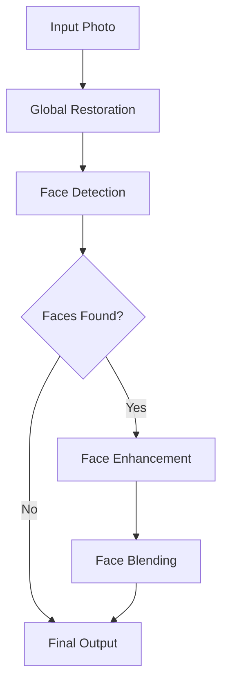
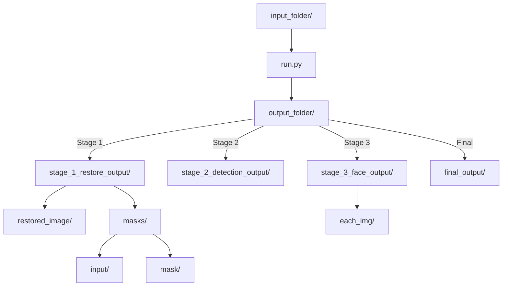
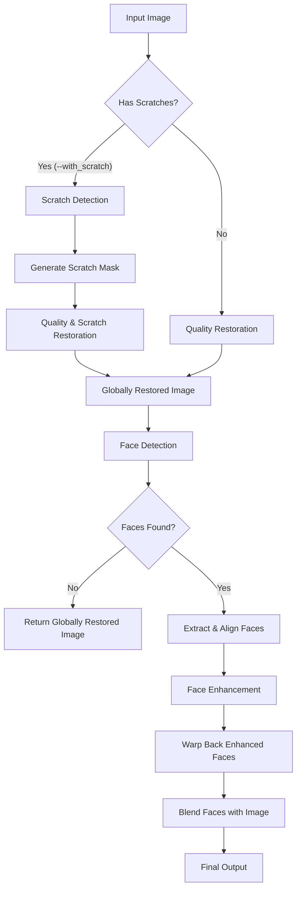

<!-- source: DeepWiki mcp.deepwiki.com · repo microsoft/Bringing-Old-Photos-Back-to-Life · page 6 Usage Guide · fetched 2026-10-26 -->

# Usage Guide

<details>
<summary>Relevant source files</summary>

The following files were used as context for generating this wiki page:

- [README.md](README.md)
- [cog.yaml](cog.yaml)
- [download-weights](download-weights)
- [imgs/HOF_2_007_007_my_concat.gif](imgs/HOF_2_007_007_my_concat.gif)
- [imgs/gui.PNG](imgs/gui.PNG)
- [predict.py](predict.py)
- [run.py](run.py)

</details>


This document provides comprehensive instructions for using the "Bringing Old Photos Back to Life" system to restore old and damaged photographs. It covers both the command-line interface and GUI operation, including special workflows for handling scratched images and high-resolution photographs.

For information about the system architecture and how the components work together, see [System Architecture](#1.2). For details on training your own models, refer to [Training](#4).

## System Workflow Overview

The restoration pipeline consists of four main stages that run sequentially:



Sources: [run.py:45-201](), [README.md:83-118]()

## Running the Full Pipeline

### Basic Usage

To restore old photos without scratches, use the following command:

```
python run.py --input_folder [input_path] --output_folder [output_path] --GPU [gpu_ids]
```

Where:
- `[input_path]` is the folder containing input images
- `[output_path]` is where restored images will be saved
- `[gpu_ids]` specifies which GPUs to use (e.g., "0" or "0,1,2")

The final restored images will be saved in `[output_path]/final_output/`.

Sources: [run.py:17-34](), [README.md:92-96]()

### Processing Scratched Images

For old photos with scratches, add the `--with_scratch` flag:

```
python run.py --input_folder [input_path] --output_folder [output_path] --GPU [gpu_ids] --with_scratch
```

This activates the scratch detection module that identifies damage areas and applies specialized restoration.

Sources: [run.py:53-95](), [README.md:100-106]()

### High-Resolution Image Processing

For high-resolution images, add the `--HR` flag:

```
python run.py --input_folder [input_path] --output_folder [output_path] --GPU [gpu_ids] --with_scratch --HR
```

The `--HR` flag activates special processing paths optimized for high-resolution inputs, including:
- Scale-appropriate face detection
- Enhanced face restoration with higher resolution (512×512 instead of 256×256)
- HR-specific warping and blending algorithms

Sources: [run.py:78-81](), [run.py:117-124](), [run.py:138-152](), [run.py:179-187](), [README.md:108-116]()

## Pipeline Stages and Intermediate Outputs

The full pipeline generates several intermediate outputs that are stored in subdirectories of the specified output folder:



Sources: [run.py:45-201]()

## Running Individual Components

You may want to run specific parts of the pipeline separately for experimentation or custom workflows.

### Scratch Detection

To detect scratches in images:

```
cd Global/
python detection.py --test_path [input_path] --output_dir [output_path] --input_size [resize_256|full_size|scale_256]
```

This generates binary mask images indicating the locations of scratches.

Sources: [README.md:122-129]()

### Global Restoration

#### Quality Restoration Only

For images without scratches:

```
cd Global/
python test.py --Quality_restore --test_input [input_path] --outputs_dir [output_path]
```

#### Scratch and Quality Restoration

For images with scratches (after running detection):

```
cd Global/
python test.py --Scratch_and_Quality_restore --test_input [input_path] --test_mask [mask_path] --outputs_dir [output_path]
```

Sources: [README.md:141-150](), [run.py:53-62](), [run.py:83-92]()

### Face Enhancement

To enhance detected faces:

```
cd Face_Enhancement/
python test_face.py --old_face_folder [faces_path] --old_face_label_folder ./ --name [checkpoint_name] --gpu_ids [gpu_ids] --load_size [size] --results_dir [output_path]
```

Common checkpoint names:
- `Setting_9_epoch_100` (standard)
- `FaceSR_512` (high-resolution)

Sources: [run.py:138-166]()

## Output Directory Structure

When running the full pipeline, the following directory structure is created:

| Directory | Contents |
|-----------|----------|
| `stage_1_restore_output/` | Results from global restoration |
| `stage_1_restore_output/restored_image/` | Globally restored images |
| `stage_1_restore_output/masks/` | Scratch masks (if `--with_scratch` used) |
| `stage_2_detection_output/` | Detected and aligned faces |
| `stage_3_face_output/each_img/` | Enhanced face images |
| `final_output/` | Final restored images with blended faces |

Sources: [run.py:48-49](), [run.py:97-104](), [run.py:113-114](), [run.py:133-134](), [run.py:175-176]()

## Using the GUI

The repository includes a graphical user interface for easier interaction:

```
python GUI.py
```

The GUI provides the following workflow:
1. Click "Browse" to select an input image
2. Click "Modify Photo" to start the restoration process
3. View the result in the GUI window
4. Click "Exit Window" to close the application and save the output

Sources: [README.md:172-184]()

## Configuration and Options

### Command Line Arguments

| Argument | Description | Default |
|----------|-------------|---------|
| `--input_folder` | Path to folder containing input images | `./test_images/old` |
| `--output_folder` | Path for saving output images | `./output` |
| `--GPU` | GPU IDs to use (comma-separated) | `6,7` |
| `--with_scratch` | Enable scratch detection and removal | `False` |
| `--HR` | Enable high-resolution processing | `False` |
| `--checkpoint_name` | Model checkpoint to use | `Setting_9_epoch_100` |

Sources: [run.py:19-32]()

## Processing Flow Details



Sources: [run.py:45-201](), [predict.py:59-198]()

## Common Issues and Troubleshooting

### Out of Memory Errors

If you encounter GPU memory issues:
- Process fewer images at a time
- Use a smaller batch size for face enhancement (modify `--batchSize` in the face enhancement command)
- Disable high-resolution processing
- Use a single GPU if using multiple GPUs causes synchronization overhead

### No Face Detection

If faces aren't being detected properly:
- Ensure the face is sufficiently large in the input image
- Try using the high-resolution mode with `--HR` flag
- Check that dlib's face landmark model is correctly installed

### Scratch Detection Problems

If scratch detection is not working well:
- Try different `--input_size` settings in the detection command
- For very damaged photos, you might need to manually clean up the generated mask

Sources: [README.md:20-21]()

## Example Commands

### Basic Restoration
```
python run.py --input_folder ./test_images/old --output_folder ./output --GPU 0
```

### Restoration with Scratch Removal
```
python run.py --input_folder ./test_images/old_w_scratch --output_folder ./output --GPU 0 --with_scratch
```

### High-Resolution Restoration with Scratch Removal
```
python run.py --input_folder ./test_images/old_w_scratch_HR --output_folder ./output --GPU 0 --with_scratch --HR
```

Sources: [README.md:92-116]()

---

