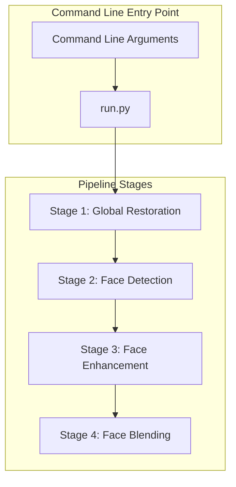
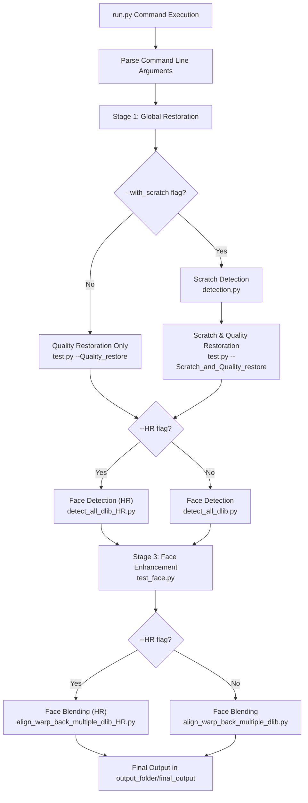
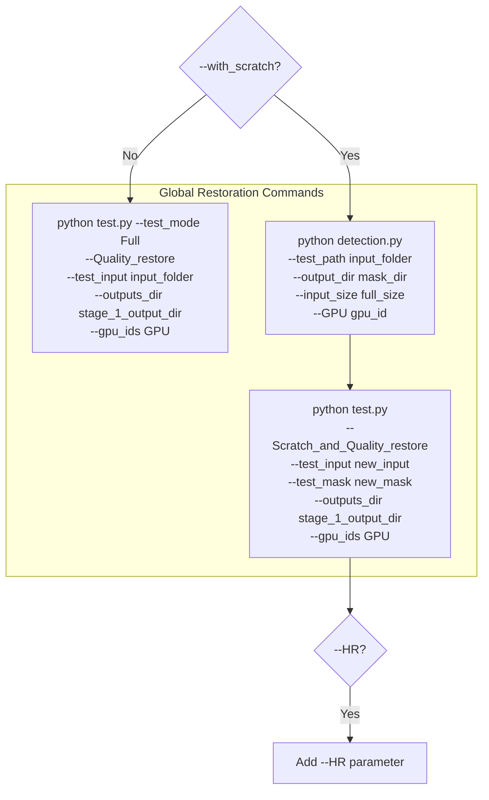
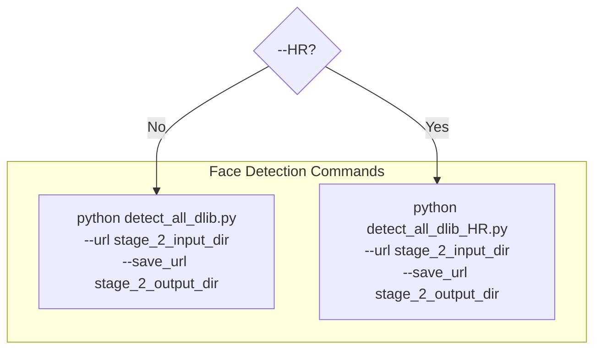
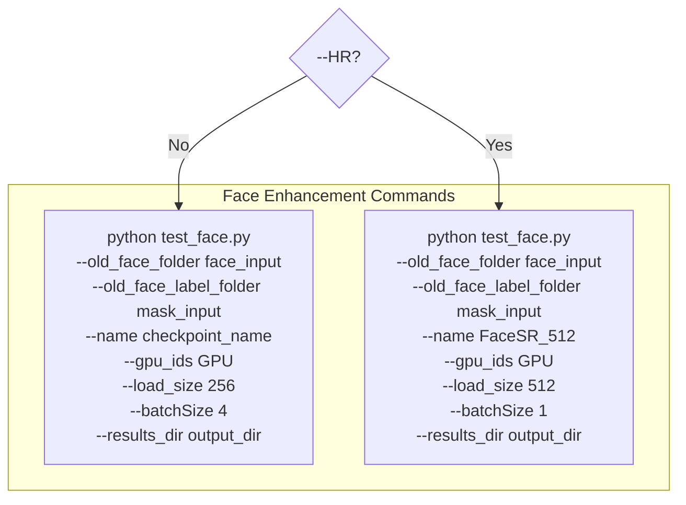
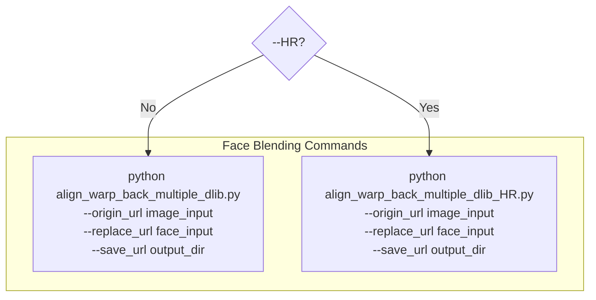
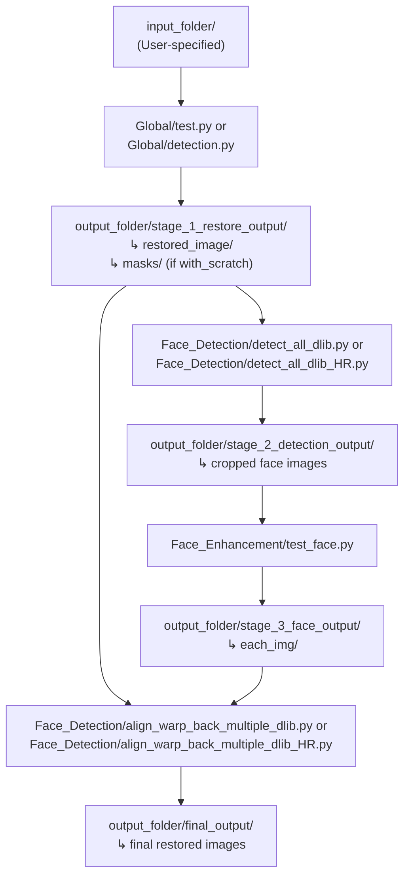

<!-- source: DeepWiki mcp.deepwiki.com · repo microsoft/Bringing-Old-Photos-Back-to-Life · page 6.1 Command Line Interface · fetched 2026-10-26 -->

# Command Line Interface

<details>
<summary>Relevant source files</summary>

The following files were used as context for generating this wiki page:

- [README.md](README.md)
- [imgs/HOF_2_007_007_my_concat.gif](imgs/HOF_2_007_007_my_concat.gif)
- [imgs/gui.PNG](imgs/gui.PNG)
- [run.py](run.py)

</details>


This document provides a technical guide to using the command line interface for the Old Photo Restoration system. It covers the available command options, workflow processes, and execution instructions for running the restoration pipeline via command line. For information about the graphical user interface, see [GUI](#6.5).

## Overview

The Old Photo Restoration system provides a comprehensive command line interface through `run.py`, which serves as the main entry point for executing the complete restoration pipeline. This interface enables users to process old photographs through a series of restoration stages, with options for handling images with scratches and supporting high-resolution processing.



Sources: [run.py:1-202](), [README.md:83-106]()

## Command Line Options

The command line interface provides several options to customize the restoration process:

| Option | Default Value | Description |
|--------|---------------|-------------|
| `--input_folder` | "./test_images/old" | Directory containing input images to be restored |
| `--output_folder` | "./output" | Directory where restored images will be saved |
| `--GPU` | "6,7" | GPU IDs to use for processing (e.g., "0" or "0,1,2") |
| `--checkpoint_name` | "Setting_9_epoch_100" | Model checkpoint name for face enhancement |
| `--with_scratch` | False (flag) | Enable scratch detection and removal |
| `--HR` | False (flag) | Enable high-resolution image processing |

Sources: [run.py:19-33](), [README.md:83-118]()

## Command Line Execution Flow

When executing the restoration process via the command line, the system follows a specific workflow through four distinct stages:



Sources: [run.py:44-202](), [README.md:83-118]()

## Stage Execution Details

### Stage 1: Global Restoration

This stage handles overall image quality improvement and scratch removal if applicable:



Sources: [run.py:45-106]()

### Stage 2: Face Detection

Detects faces in the restored images from Stage 1:



Sources: [run.py:109-128]()

### Stage 3: Face Enhancement

Enhances the detected faces with tailored parameters:



Sources: [run.py:130-169]()

### Stage 4: Face Blending

Blends the enhanced faces back into the globally restored image:



Sources: [run.py:171-199]()

## Directory Structure and Data Flow

The command line interface creates a specific directory structure during processing:



Sources: [run.py:44-199]()

## Usage Examples

### Basic Usage

To restore old photos without scratches:

```bash
python run.py --input_folder ./test_images/old --output_folder ./output --GPU 0
```

Sources: [README.md:91-97]()

### Processing Images with Scratches

To restore old photos with scratches:

```bash
python run.py --input_folder ./test_images/old_w_scratch --output_folder ./output --GPU 0 --with_scratch
```

Sources: [README.md:101-106]()

### Processing High-Resolution Images

To restore high-resolution old photos with scratches:

```bash
python run.py --input_folder ./test_images/old_w_scratch_HR --output_folder ./output --GPU 0 --with_scratch --HR
```

Sources: [README.md:110-116]()

## Important Notes

1. It is recommended to use absolute paths for input and output folders to avoid path resolution issues.
2. Results from each stage are stored in separate subdirectories within the output folder.
3. Final results can be found in `output_folder/final_output/`.
4. If no faces are detected in an image, the system will copy the result from Stage 1 directly to the final output.
5. GPU can be set to "0" for a single GPU, "0,1,2" for multiple GPUs, or "-1" for CPU processing.

Sources: [README.md:87-118](), [run.py:97-104]()

## Technical Implementation

The main entry point `run.py` executes each stage sequentially, passing the output of one stage as input to the next. The script uses the `subprocess.call()` function to execute the Python scripts for each stage.

The command execution is handled by the `run_cmd()` function which provides error handling and allows for process interruption:

```python
def run_cmd(command):
    try:
        call(command, shell=True)
    except KeyboardInterrupt:
        print("Process interrupted")
        sys.exit(1)
```

Sources: [run.py:10-15]()

---

