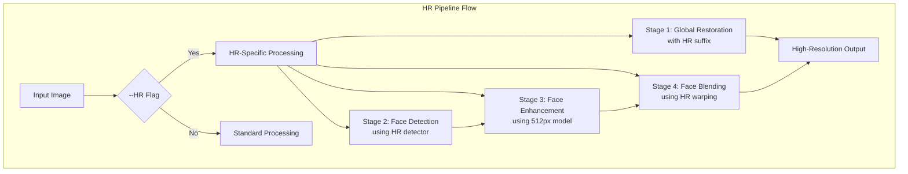
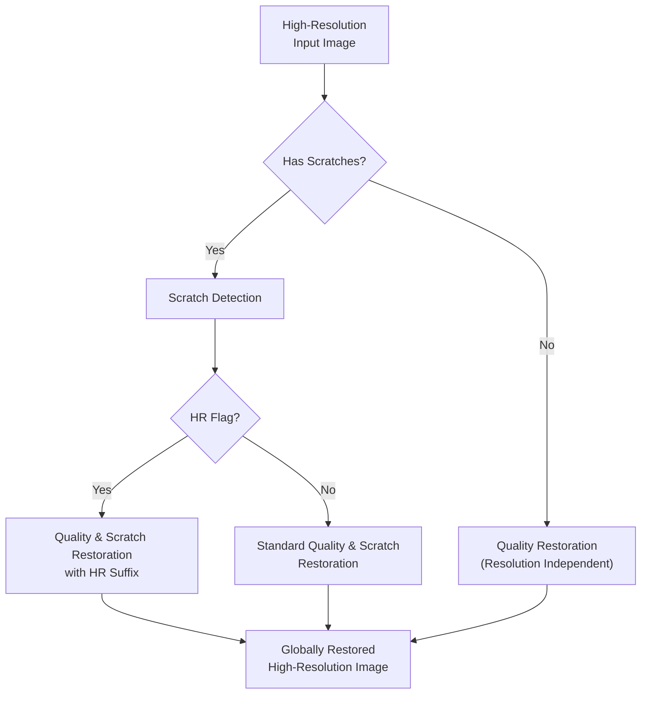
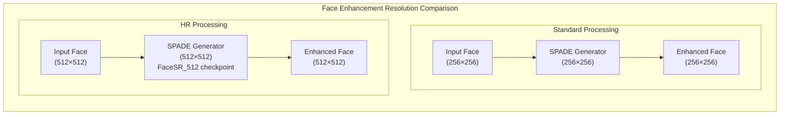
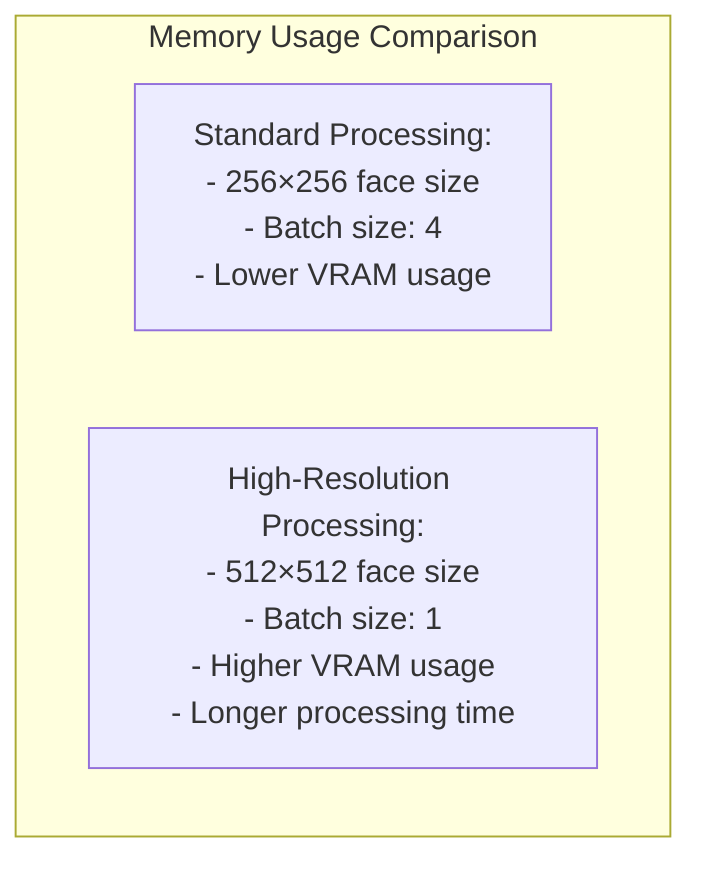

<!-- source: DeepWiki mcp.deepwiki.com · repo microsoft/Bringing-Old-Photos-Back-to-Life · page 6.2 High-Resolution Processing · fetched 2026-10-26 -->

# High-Resolution Processing

<details>
<summary>Relevant source files</summary>

The following files were used as context for generating this wiki page:

- [README.md](README.md)
- [cog.yaml](cog.yaml)
- [download-weights](download-weights)
- [imgs/HOF_2_007_007_my_concat.gif](imgs/HOF_2_007_007_my_concat.gif)
- [imgs/gui.PNG](imgs/gui.PNG)
- [predict.py](predict.py)
- [run.py](run.py)

</details>


## Introduction

This document explains how to effectively process high-resolution images using the Old Photo Restoration system. High-resolution processing is designed for input images with larger dimensions, providing superior quality restoration while maintaining fine details that might be lost in standard resolution processing.

For information about the general restoration pipeline, see [Restoration Pipeline](#2), and for specific face enhancement details, see [Face Enhancement](#2.3).

## Enabling High-Resolution Processing

The system supports high-resolution processing through a dedicated `--HR` flag. This flag activates specialized components throughout the pipeline that are optimized for larger images.

To process high-resolution images, add the `--HR` flag to your command:

```bash
python run.py --input_folder [test_image_folder_path] \
              --output_folder [output_path] \
              --GPU 0 \
              --HR
```

For high-resolution images with scratches, combine both flags:

```bash
python run.py --input_folder [test_image_folder_path] \
              --output_folder [output_path] \
              --GPU 0 \
              --with_scratch \
              --HR
```

Sources: [README.md:108-116](), [run.py:31-32]()

## High-Resolution Pipeline Architecture

The high-resolution processing pipeline modifies several components of the standard pipeline to handle larger images effectively:



The HR pipeline differs from the standard pipeline in each of the four main stages:

| Stage | Standard Processing | High-Resolution Processing |
|-------|--------------------|-----------------------------|
| 1. Global Restoration | Default parameters | Adds HR suffix when scratches are present |
| 2. Face Detection | Uses `detect_all_dlib.py` | Uses `detect_all_dlib_HR.py` |
| 3. Face Enhancement | Uses 256px model, batch size 4 | Uses 512px model ('FaceSR_512'), batch size 1 |
| 4. Face Blending | Uses `align_warp_back_multiple_dlib.py` | Uses `align_warp_back_multiple_dlib_HR.py` |

Sources: [run.py:78-81](), [run.py:117-124](), [run.py:138-166](), [run.py:179-196]()

## Stage-by-Stage HR Processing Details

### Stage 1: Global Restoration with HR Support

For high-resolution images with scratches, the system adds an HR suffix to the command parameters for the Scratch and Quality restoration module. This enables specialized processing for larger images.



Sources: [run.py:78-91](), [predict.py:95-98]()

### Stage 2: Face Detection for High-Resolution Images

The high-resolution pipeline uses a specialized face detection script (`detect_all_dlib_HR.py`) that is optimized for handling larger images while still accurately detecting faces.

Sources: [run.py:117-124]()

### Stage 3: Face Enhancement at Higher Resolution

The most significant change in the HR pipeline is in the face enhancement stage:

1. Uses a specialized model checkpoint `FaceSR_512` trained for 512×512 resolution
2. Sets `load_size` to 512 instead of 256
3. Reduces batch size from 4 to 1 to accommodate larger memory requirements



Sources: [run.py:138-166]()

### Stage 4: HR-Specific Face Blending

The final stage uses a specialized warping and blending algorithm (`align_warp_back_multiple_dlib_HR.py`) designed for high-resolution images. This ensures that enhanced facial regions are properly integrated back into the high-resolution restored image.

Sources: [run.py:179-196]()

## Memory Considerations and Performance

Processing high-resolution images requires significantly more GPU memory and computational resources than standard resolution processing. Some key considerations:

1. **Memory Requirements**: The face enhancement stage reduces batch size from 4 to 1 to accommodate larger image sizes
2. **Processing Time**: Expect longer processing times when working with high-resolution images
3. **GPU VRAM**: Recommend at least 8GB of GPU VRAM for effective high-resolution processing



## Recommended Input Resolutions

The system can handle various input resolutions, but there are practical considerations for optimal results:

| Processing Mode | Recommended Image Size | Maximum Image Size | Notes |
|-----------------|------------------------|-------------------|-------|
| Standard Mode | 1-2 megapixels | ~4 megapixels | Balanced between quality and performance |
| High-Resolution Mode | 4-8 megapixels | ~16 megapixels | Memory limitation may apply |

For extremely large images (>16 megapixels), consider resizing the input image to a more manageable size before processing.

## Practical Example

Here is an example command line for processing a high-resolution old photo with scratches:

```bash
python run.py --input_folder ./test_images/high_res_scratched/ \
              --output_folder ./output/high_res_results/ \
              --GPU 0 \
              --with_scratch \
              --HR
```

The output will be saved in the `./output/high_res_results/final_output/` directory.

Sources: [README.md:108-116](), [run.py:17-201]()

---

