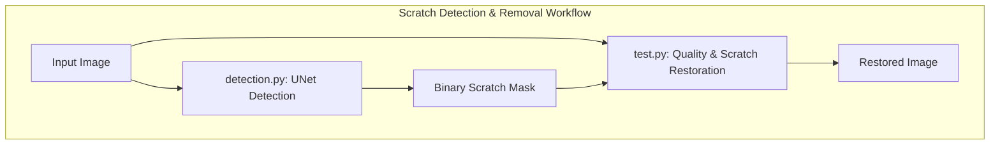
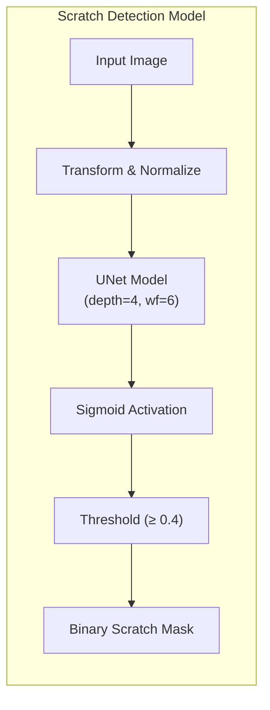
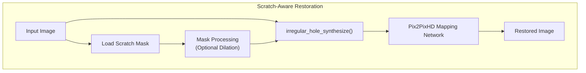
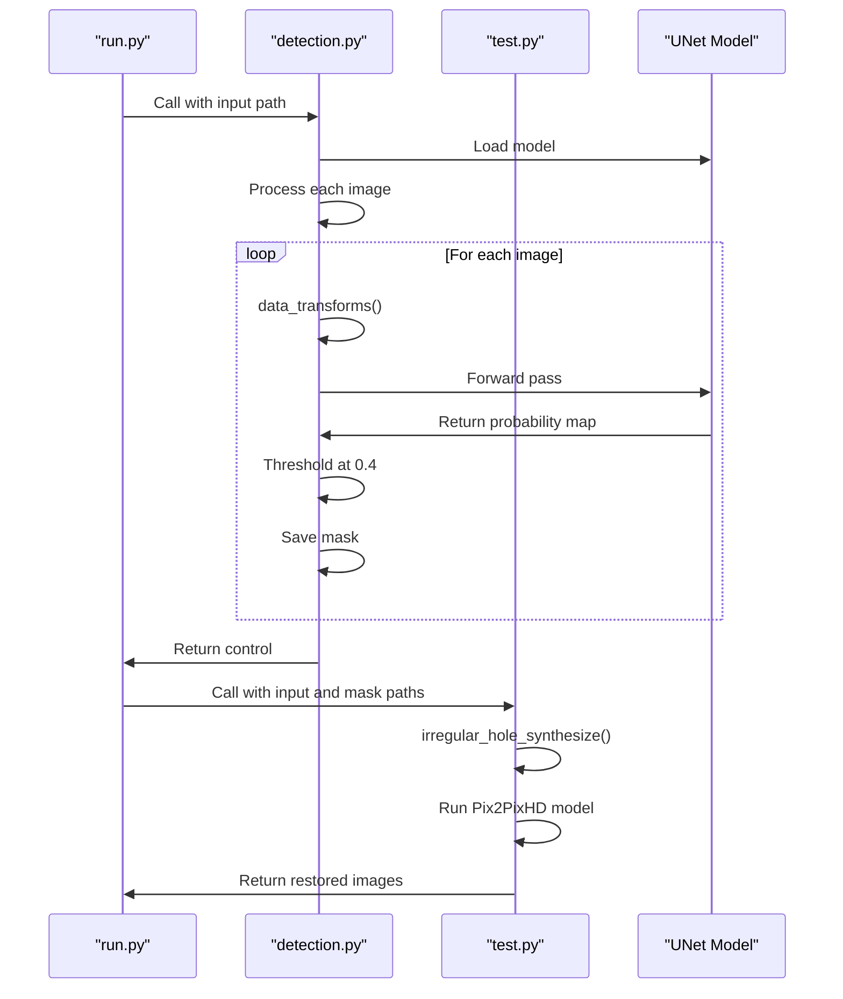

<!-- source: DeepWiki mcp.deepwiki.com · repo microsoft/Bringing-Old-Photos-Back-to-Life · page 6.3 Scratch Detection and Removal · fetched 2026-10-26 -->

# Scratch Detection and Removal

<details>
<summary>Relevant source files</summary>

The following files were used as context for generating this wiki page:

- [Global/detection.py](Global/detection.py)
- [Global/test.py](Global/test.py)
- [README.md](README.md)
- [imgs/HOF_2_007_007_my_concat.gif](imgs/HOF_2_007_007_my_concat.gif)
- [imgs/gui.PNG](imgs/gui.PNG)
- [run.py](run.py)

</details>


## Purpose and Scope

This document details the scratch detection and removal subsystem of the Old Photo Restoration framework. It explains how the system identifies scratches and other physical defects in old photographs and implements specialized restoration techniques to repair these areas. This component is specifically invoked when processing old photos with visible scratches, dust marks, or other physical damage artifacts.

For information about the overall restoration pipeline, see [Restoration Pipeline](#2) or for the global quality restoration without scratch handling, see [Global Restoration](#2.1).

Sources: [README.md:99-105](), [README.md:121-130]()

## System Overview

The scratch detection and removal system consists of two main components that work in sequence:

1. **Scratch Detection**: Utilizes a U-Net based neural network model to identify scratch regions and generate binary masks
2. **Scratch Removal**: Applies specialized restoration techniques using the detected masks to repair damaged areas while preserving image content



Sources: [Global/detection.py:73-166](), [run.py:63-95]()

The scratch handling process is triggered in the main pipeline when the `--with_scratch` flag is passed to the `run.py` script. This adds the scratch detection and removal steps to the standard restoration workflow.

## Scratch Detection Component

The scratch detection subsystem uses a pre-trained U-Net model to identify scratches and other defects in the input image.

### Architecture



Sources: [Global/detection.py:76-88](), [Global/detection.py:147-158]()

### Technical Specifications

The U-Net model used for scratch detection has the following configuration:

| Parameter | Value | Description |
|-----------|-------|-------------|
| in_channels | 1 | Single grayscale input channel |
| out_channels | 1 | Single channel binary mask output |
| depth | 4 | Number of down/up sampling layers |
| conv_num | 2 | Number of convolutions per layer |
| wf | 6 | Base filter count (2^wf) |
| padding | True | Padding to maintain spatial dimensions |
| batch_norm | True | Batch normalization enabled |
| up_mode | "upsample" | Upsampling method |
| with_tanh | False | No tanh activation at output |
| antialiasing | True | Anti-aliasing enabled |

Sources: [Global/detection.py:76-88]()

### Detection Process Flow

1. The detection module loads the pre-trained model from `checkpoints/detection/FT_Epoch_latest.pt`
2. Input images are resized according to the specified input_size parameter (resize_256, full_size, or scale_256)
3. Images are converted to grayscale, normalized, and processed by the model
4. The model output is thresholded at 0.4 to produce a binary mask
5. The mask is saved alongside the input image for the restoration stage

Sources: [Global/detection.py:91-94](), [Global/detection.py:135-163]()

## Scratch Removal Process

The scratch removal process combines quality restoration with scratch-aware processing, using the masks generated in the detection phase.

### Integration with Global Restoration



Sources: [Global/test.py:47-56](), [Global/test.py:139-152]()

### Technical Components

When processing images with scratches, the system:

1. Loads both the input image and its corresponding scratch mask
2. Optionally dilates the mask to ensure complete coverage of damaged areas 
3. Synthesizes a "hole image" by applying the mask to the input
4. Processes the image through a specialized mapping network that has been trained to handle both quality degradation and scratches

Sources: [Global/test.py:78-92](), [Global/test.py:139-152]()

### Model Configuration for Scratch Removal

The scratch removal model uses the following specialized configuration parameters:

| Parameter | Value | Description |
|-----------|-------|-------------|
| NL_res | True | Non-local residual connections |
| use_SN | True | Spectral normalization |
| correlation_renormalize | True | Renormalize correlation maps |
| NL_use_mask | True | Use mask in non-local operations |
| NL_fusion_method | "combine" | Method to fuse non-local features |
| non_local | "Setting_42" | Non-local module configuration |
| load_pretrainA | VAE_A_quality | Quality domain VAE |
| load_pretrainB | VAE_B_scratch | Scratch domain VAE |

For high-resolution images, additional parameters are enabled:
- mapping_exp = 1
- inference_optimize = True
- mask_dilation = 3

Sources: [Global/test.py:78-92]()

## Command-Line Usage

### Basic Usage

To run the complete pipeline with scratch detection and removal:

```bash
python run.py --input_folder [test_image_folder_path] \
              --output_folder [output_path] \
              --GPU 0 \
              --with_scratch
```

For high-resolution images with scratches:

```bash
python run.py --input_folder [test_image_folder_path] \
              --output_folder [output_path] \
              --GPU 0 \
              --with_scratch \
              --HR
```

Sources: [README.md:102-116]()

### Running Scratch Detection Separately

To run only the scratch detection component:

```bash
cd Global/
python detection.py --test_path [test_image_folder_path] \
                   --output_dir [output_path] \
                   --input_size [resize_256|full_size|scale_256]
```

Sources: [README.md:124-128]()

## Implementation Details

### Scratch Detection Pipeline



Sources: [run.py:63-95](), [Global/detection.py:73-166](), [Global/test.py:95-192]()

### Key Functions and Classes

| Component | Function/Class | Description |
|-----------|---------------|-------------|
| Detection | `networks.UNet` | U-Net architecture for scratch detection |
| Detection | `data_transforms()` | Prepares and resizes input images |
| Detection | `scale_tensor()` | Scales input tensors for processing |
| Removal | `irregular_hole_synthesize()` | Creates an image with masked scratches |
| Removal | `parameter_set()` | Configures model parameters |
| Removal | `Pix2PixHDModel_Mapping` | Main restoration model |

Sources: [Global/detection.py:25-63](), [Global/detection.py:76-88](), [Global/test.py:47-56](), [Global/test.py:59-93]()

### Output Directory Structure

When running the full pipeline with scratch handling, the following directory structure is created:

```
output_folder/
├── stage_1_restore_output/
│   ├── masks/
│   │   ├── input/      # Processed input images
│   │   └── mask/       # Generated scratch masks
│   ├── restored_image/ # Images after global restoration
│   └── origin/         # Original images
├── stage_2_detection_output/  # Face detection results
├── stage_3_face_output/       # Face enhancement results
└── final_output/              # Final restored images
```

Sources: [run.py:49-50](), [run.py:65-67](), [run.py:98-104]()

## Best Practices

1. **Input Preparation**: For optimal results, ensure input images are well-scanned and have sufficient resolution
2. **Mask Verification**: If scratch detection quality is inconsistent, consider manually verifying the generated masks
3. **Parameter Tuning**: For heavily scratched images, consider using the HR mode which enables mask dilation and other optimizations
4. **Processing Time**: Scratch detection and removal is more computationally intensive than standard restoration; allow for longer processing times

Sources: [README.md:108-116](), [Global/test.py:142-146]()

---

