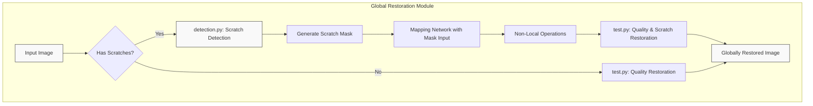
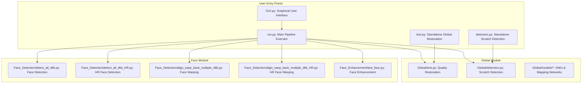

<!-- source: DeepWiki mcp.deepwiki.com · repo microsoft/Bringing-Old-Photos-Back-to-Life · page 6.4 Example Gallery · fetched 2026-10-26 -->

# Example Gallery

<details>
<summary>Relevant source files</summary>

The following files were used as context for generating this wiki page:

- [README.md](README.md)
- [imgs/HOF_2_007_007_my_concat.gif](imgs/HOF_2_007_007_my_concat.gif)
- [imgs/gui.PNG](imgs/gui.PNG)
- [test_images/old/a.png](test_images/old/a.png)
- [test_images/old_w_scratch/d.png](test_images/old_w_scratch/d.png)

</details>


This page presents a collection of example results from the Old Photo Restoration system, providing detailed analysis of the restoration process for different types of photographs. It serves as a visual reference to help users understand the capabilities of the system and the specific transformations applied during the restoration process. For information about the complete usage instructions, see [Command Line Interface](#6.1) and [High-Resolution Processing](#6.2).

## 1. Standard Restoration Examples

This section showcases examples of standard photo restorations, illustrating the system's baseline capabilities for handling typical old photographs with quality degradation.

### 1.1 Simple Quality Restoration

When dealing with old photos that have general degradation issues but no significant scratches, the system focuses on enhancing the overall image quality.


**Command used for this type of restoration:**
```
python run.py --input_folder [test_image_folder_path] --output_folder [output_path] --GPU 0
```

In this process, the system applies quality restoration without scratch handling, focusing primarily on enhancing color, contrast, and overall image quality through the triplet domain translation network in the Global module.

Sources: [README.md:92-97]()

### 1.2 Restoration with Scratch Handling

For photos with visible scratches and defects, the system employs an additional scratch detection and removal phase.


**Command used for this type of restoration:**
```
python run.py --input_folder [test_image_folder_path] --output_folder [output_path] --GPU 0 --with_scratch
```

Here, the restoration pipeline first detects scratches using the detection model, generates a scratch mask, and then performs both quality restoration and scratch removal simultaneously. This process leverages the non-local operations in the mapping network to effectively handle structured degradation.

Sources: [README.md:101-106](), [README.md:121-129]()

## 2. High-Resolution Restoration Examples

This section illustrates the system's capability to process high-resolution images, which requires specialized handling to maintain detail while applying the restoration process.


**Command used for high-resolution restoration:**
```
python run.py --input_folder [test_image_folder_path] --output_folder [output_path] --GPU 0 --with_scratch --HR
```

The high-resolution processing pipeline utilizes specialized components:
- `detect_all_dlib_HR.py` for high-resolution face detection
- `align_warp_back_multiple_dlib_HR.py` for precise face warping
- Multi-Scale Patch Attention techniques for effective handling of high-resolution details

Sources: [README.md:108-116](), [README.md:26-28]()

## 3. Step-by-Step Restoration Analysis

This section provides a detailed breakdown of the restoration process, examining how each component contributes to the final result.

### 3.1 Global Restoration Phase

The Global Restoration module is responsible for overall image quality improvement and scratch handling.



The Global Restoration phase employs:
1. A U-Net model for scratch detection (when `--with_scratch` is specified)
2. A triplet domain translation network with VAEs for domain A and domain B
3. A mapping network to translate between latent spaces
4. Non-local operations for handling structured degradation

In the case of scratches, the system first runs `detection.py` to generate a scratch mask, then uses this mask to guide the restoration process in `test.py` with the `--Scratch_and_Quality_restore` option. Without scratches, it directly uses `test.py` with the `--Quality_restore` option.

Sources: [README.md:132-151](), [README.md:135-139]()

### 3.2 Face Enhancement Phase

After global restoration, the system detects and enhances faces using specialized models designed for facial details.


The Face Enhancement pipeline consists of:
1. Face detection using dlib's shape predictor
2. Face alignment based on detected landmarks
3. Face enhancement using a SPADE generator
4. Warping enhanced faces back to their original positions
5. Blending enhanced faces with the globally restored image

For standard resolution, the system uses `detect_all_dlib.py` and `align_warp_back_multiple_dlib.py`. For high-resolution, it switches to their HR counterparts: `detect_all_dlib_HR.py` and `align_warp_back_multiple_dlib_HR.py`.

Sources: [README.md:157-165]()

## 4. Component-to-File Mapping

This section maps the key conceptual components of the restoration system to their corresponding code files, helping users understand the code structure.



## 5. Before-and-After Examples Table

| Degradation Type | Before Restoration | After Restoration | Key Components Used |
|------------------|-------------------|-------------------|---------------------|
| Quality Degradation Only | Old photo with fading, discoloration | Vibrant, clear image with natural colors | Global/test.py with Quality_restore, Face Enhancement |
| Scratches and Quality Issues | Photo with visible scratches and marks | Clean image with scratches removed and quality improved | Global/detection.py, Global/test.py with Scratch_and_Quality_restore, Face Enhancement |
| Poor Face Details | Photo with blurry, low-quality faces | Clear image with detailed, natural-looking faces | Global Restoration, Face_Enhancement/test_face.py |
| High Resolution with Scratches | High-resolution photo with defects | Detailed high-resolution result with defects removed | HR pipeline with detect_all_dlib_HR.py and align_warp_back_multiple_dlib_HR.py |

Sources: [README.md:132-151](), [README.md:157-165]()

## 6. Example Restoration Analysis

### 6.1 Standard Photo Restoration

When restoring a standard old photo, the system:

1. First determines if scratch handling is needed based on the `--with_scratch` flag
2. For photos with scratches, generates a scratch mask using the detection module
3. Applies global restoration to improve overall quality and remove scratches
4. Detects and extracts faces from the globally restored image
5. Enhances each face using the face enhancement module
6. Warps enhanced faces back to their original positions
7. Blends the enhanced faces with the globally restored image

The final output preserves the overall composition and feel of the original photo while significantly improving image quality and facial details.

```mermaid
flowchart TD
    subgraph "Complete Restoration Pipeline Visualization"
        Input["Input Old Photo"] --> ScratchCheck{"--with_scratch?"}
        
        ScratchCheck -->|"Yes"| Detection["detection.py"]
        Detection --> Mask["Scratch Mask"]
        Mask --> TestWithMask["test.py --Scratch_and_Quality_restore"]
        
        ScratchCheck -->|"No"| TestQuality["test.py --Quality_restore"]
        
        TestWithMask --> GlobalRestored["Globally Restored Image"]
        TestQuality --> GlobalRestored
        
        GlobalRestored --> FaceDetect["detect_all_dlib.py"]
        FaceDetect --> Faces["Extracted Faces"]
        Faces --> FaceEnhance["test_face.py"]
        FaceEnhance --> EnhancedFaces["Enhanced Faces"]
        EnhancedFaces --> WarpBack["align_warp_back_multiple_dlib.py"]
        WarpBack --> Blend["Blend Faces"]
        Blend --> Final["Final Restored Image"]
    end
    
    style Input fill:#f9f9f9,stroke:#333,stroke-width:1px
    style Final fill:#f9f9f9,stroke:#333,stroke-width:1px
```



Sources: [README.md:83-119]()

### 6.2 High-Resolution Photo Restoration

For high-resolution photos, the system follows a similar process but employs specialized components:

1. Uses the HR flag to activate high-resolution processing
2. Employs Multi-Scale Patch Attention techniques for effective detail preservation
3. Uses HR-specific face detection and warping components
4. Maintains resolution throughout the process

This approach allows the system to handle images of significantly higher resolution while still providing high-quality restoration results.


Sources: [README.md:108-116]()

## 7. Best Practices for Optimal Results

Based on the examples analyzed, here are some best practices for achieving optimal restoration results:

1. **Select the appropriate restoration mode**:
   - Use basic mode (`--GPU 0`) for photos with minimal degradation
   - Use scratch mode (`--with_scratch`) for photos with visible scratches or defects
   - Use HR mode (`--with_scratch --HR`) for high-resolution photos with important details

2. **Consider pre-processing for extremely damaged photos**:
   - For photos with severe degradation, consider running the scratch detection standalone first:
     ```
     python detection.py --test_path [path] --output_dir [output_path]
     ```
   - This allows you to verify the detected scratches before full restoration

3. **Face-specific considerations**:
   - The system performs best when faces are reasonably visible in the original
   - If faces are extremely small or degraded, the enhancement may be limited
   - Photos with multiple faces are supported, with each face processed individually

4. **Output interpretation**:
   - Check intermediate results in the output folder to understand each step's contribution
   - The final results are saved in `./output_path/final_output/`
   - Compare original vs. restored to evaluate the specific improvements

Sources: [README.md:118-119](), [README.md:121-129]()

## 8. GUI-Based Restoration

For users who prefer a graphical interface, the system provides a GUI that simplifies the restoration process.


The GUI provides a user-friendly interface for the restoration process, allowing users to:
1. Select an input image through a file browser
2. Initiate the restoration process with a single button click
3. View the results directly in the GUI window
4. Access the restored image in the output folder after exiting

Sources: [README.md:172-184](), [imgs/gui.PNG]()

## 9. Summary

The Old Photo Restoration system demonstrates impressive capabilities for revitalizing aged and damaged photographs. Through the examples presented in this gallery, we can observe how the system effectively addresses various types of degradation:

1. **Quality degradation**: Fading, discoloration, and general loss of clarity
2. **Structural damage**: Scratches, tears, and other physical defects
3. **Face-specific issues**: Blurry or low-quality facial details

The multi-stage pipeline ensures that each type of degradation is addressed by specialized components, resulting in comprehensive restoration that preserves the authenticity of the original photograph while significantly enhancing its visual quality.

By selecting the appropriate restoration mode and following the best practices outlined in this gallery, users can achieve optimal results across a wide range of old photograph types.

Sources: [README.md:3-28]()