# Page: Overview

# Overview

<details>
<summary>Relevant source files</summary>

The following files were used as context for generating this wiki page:

- [README.md](README.md)
- [cog.yaml](cog.yaml)
- [download-weights](download-weights)
- [imgs/HOF_2_007_007_my_concat.gif](imgs/HOF_2_007_007_my_concat.gif)
- [imgs/gui.PNG](imgs/gui.PNG)
- [predict.py](predict.py)
- [run.py](run.py)

</details>


The "Bringing Old Photos Back to Life" system is a specialized image restoration framework designed to restore aged and damaged photographs using deep learning techniques. This repository implements the methodology described in the CVPR 2020 paper "Bringing Old Photos Back to Life" and the TPAMI 2022 paper "Old Photo Restoration via Deep Latent Space Translation". For information about setting up and installing the system, see [Installation and Setup](#1.1).

## System Purpose and Capabilities

This system addresses multiple degradation issues found in old photographs:

- Overall quality degradation (fading, discoloration)
- Structural defects (scratches, stains, tears)
- Face-specific deterioration (blurriness, lack of detail)

The restoration process happens through a four-stage pipeline that handles each aspect separately and then combines the results seamlessly.

## Architecture Overview

The restoration process follows a sequential pipeline architecture with specialized modules for each restoration aspect.

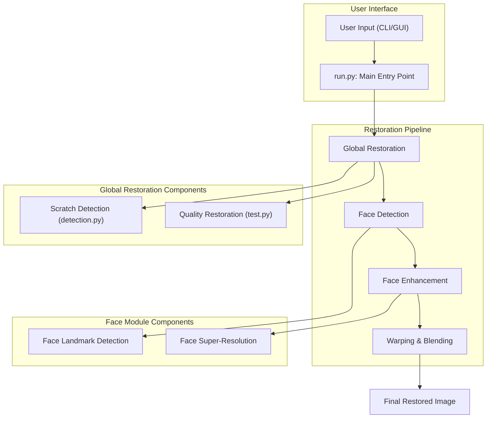

Sources: [run.py:45-105](), [README.md:83-106](), [README.md:166-168]()

## Data Flow

The system processes images through a sequence of transformations, with different paths depending on the image's condition.

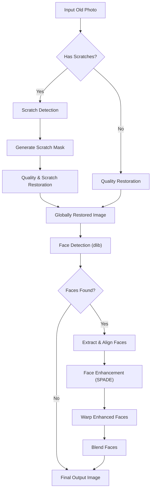

Sources: [run.py:45-202](), [predict.py:59-202]()

## Code Organization

The codebase is organized into several key directories, each handling a specific aspect of the restoration process:

| Directory | Purpose | Key Components |
|-----------|---------|----------------|
| `Global/` | Overall image restoration | Scratch detection, quality improvement |
| `Face_Detection/` | Face detection and alignment | dlib-based face detection, alignment utilities |
| `Face_Enhancement/` | Face-specific restoration | SPADE-based face enhancement models |
| Root | Main entry points | `run.py`, `predict.py` |

Sources: [README.md:38-75](), [run.py:47-173]()

## Key Components

### Main Entry Points

The system provides several ways to use the restoration functionality:

1. **Command-line interface** (`run.py`): Primary way to process images through the full pipeline
2. **Prediction API** (`predict.py`): Provides programmatic access to the restoration pipeline
3. **GUI Interface**: Visual interface for easier usage

### Global Restoration Module

This module handles the overall image quality improvement and scratch removal:

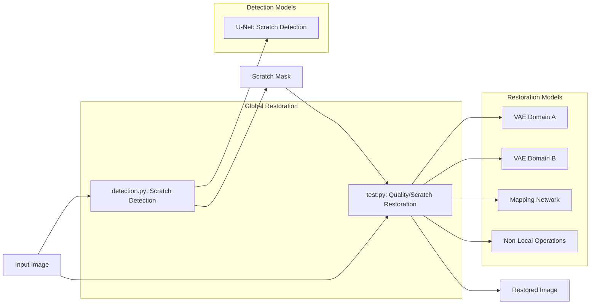

Sources: [run.py:46-96](), [README.md:127-153]()

### Face Enhancement Module

This module handles face-specific restoration, using specialized models to enhance facial details:

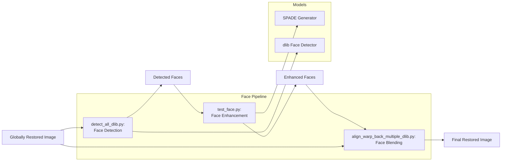

Sources: [run.py:109-199](), [README.md:157-165]()

## High-Level Execution Flow

When running the restoration pipeline through `run.py`, the system executes the following steps:

1. **Input Processing**: Parse command-line arguments and prepare input/output directories
2. **Global Restoration**:
   - If image has scratches (with_scratch=True): Run scratch detection followed by combined quality and scratch restoration
   - Otherwise: Run quality restoration only
3. **Face Detection**: Detect and extract faces from the globally restored image
4. **Face Enhancement**: Apply specialized face enhancement to each detected face
5. **Face Blending**: Warp and blend the enhanced faces back into the globally restored image

The system also supports high-resolution processing through an HR mode (activated with the `--HR` flag).

Sources: [run.py:17-202](), [README.md:108-116]()

## Model Architecture

The system employs several deep learning models, primarily based on GANs and VAEs:

1. **Scratch Detection**: U-Net based architecture for identifying scratches
2. **Global Restoration**: Domain translation framework using VAEs and mapping networks 
3. **Face Enhancement**: SPADE-based generator for improving facial details

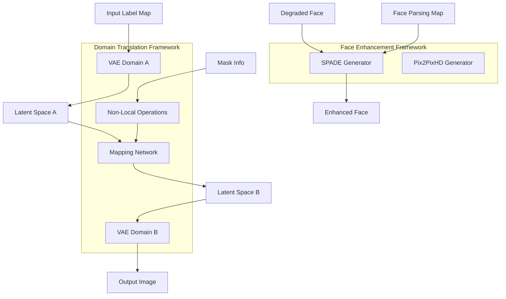

Sources: [README.md:127-153](), [README.md:157-165]()

## Using the System

Basic usage involves running the system through the command-line interface:

For images without scratches:
```
python run.py --input_folder [test_image_folder_path] --output_folder [output_path] --GPU 0
```

For scratched images:
```
python run.py --input_folder [test_image_folder_path] --output_folder [output_path] --GPU 0 --with_scratch
```

For high-resolution images:
```
python run.py --input_folder [test_image_folder_path] --output_folder [output_path] --GPU 0 --with_scratch --HR
```

For more details on usage options and advanced configuration, see [Usage Guide](#6).

Sources: [README.md:83-116](), [run.py:17-34]()

---

# Page: Installation and Setup

# Installation and Setup

<details>
<summary>Relevant source files</summary>

The following files were used as context for generating this wiki page:

- [README.md](README.md)
- [cog.yaml](cog.yaml)
- [download-weights](download-weights)
- [imgs/HOF_2_007_007_my_concat.gif](imgs/HOF_2_007_007_my_concat.gif)
- [imgs/gui.PNG](imgs/gui.PNG)
- [predict.py](predict.py)

</details>


This page provides detailed instructions for installing and setting up the "Bringing Old Photos Back to Life" system. This guide focuses on preparing your environment and installing all necessary dependencies to run the old photo restoration pipeline. For information about using the system after installation, see [Usage Guide](#6).

## System Requirements

The photo restoration system has the following requirements:

- **Operating System**: Ubuntu (Linux)
- **GPU**: NVIDIA GPU with CUDA support
- **Python**: Version 3.6 or higher (3.8 recommended)

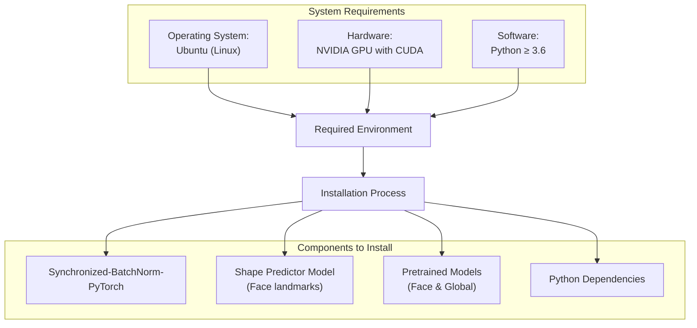

Sources: [README.md:34-36](), [cog.yaml:1-26]()

## Installation Steps

### 1. Clone the Repository

First, clone the repository and navigate to the project directory:

```bash
git clone https://github.com/microsoft/Bringing-Old-Photos-Back-to-Life.git
cd Bringing-Old-Photos-Back-to-Life
```

### 2. Set Up Synchronized BatchNorm

The system requires Synchronized BatchNorm PyTorch for both face enhancement and global restoration modules:

```bash
cd Face_Enhancement/models/networks/
git clone https://github.com/vacancy/Synchronized-BatchNorm-PyTorch
cp -rf Synchronized-BatchNorm-PyTorch/sync_batchnorm .
cd ../../../

cd Global/detection_models
git clone https://github.com/vacancy/Synchronized-BatchNorm-PyTorch
cp -rf Synchronized-BatchNorm-PyTorch/sync_batchnorm .
cd ../../
```

Sources: [README.md:39-53](), [download-weights:1-11]()

### 3. Download Face Landmark Detection Model

The face enhancement module requires a pre-trained facial landmark detection model:

```bash
cd Face_Detection/
wget http://dlib.net/files/shape_predictor_68_face_landmarks.dat.bz2
bzip2 -d shape_predictor_68_face_landmarks.dat.bz2
cd ../
```

Sources: [README.md:55-62](), [download-weights:13-17]()

### 4. Download Pretrained Restoration Models

The system uses pretrained models for both face enhancement and global restoration:

```bash
cd Face_Enhancement/
wget https://github.com/microsoft/Bringing-Old-Photos-Back-to-Life/releases/download/v1.0/face_checkpoints.zip
unzip face_checkpoints.zip
cd ../

cd Global/
wget https://github.com/microsoft/Bringing-Old-Photos-Back-to-Life/releases/download/v1.0/global_checkpoints.zip
unzip global_checkpoints.zip
cd ../
```

Sources: [README.md:64-75](), [download-weights:19-28]()

### 5. Install Python Dependencies

Install all required Python packages:

```bash
pip install -r requirements.txt
```

Sources: [README.md:77-81]()

## Directory Structure After Installation

After completing the installation steps, your project structure should look like this:

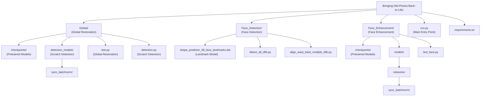

Sources: [README.md:39-75](), [download-weights:1-28]()

## Required Python Packages

The following Python packages are required for the system to function properly:

| Package | Version | Purpose |
|---------|---------|---------|
| torch | 1.8.0 | Deep learning framework |
| torchvision | 0.9.0 | Computer vision extensions for PyTorch |
| numpy | 1.19.4 | Numerical operations |
| opencv-python | 4.4.0.46 | Computer vision operations |
| scipy | 1.5.3 | Scientific computing |
| tensorboardX | 2.4 | Logging and visualization |
| dominate | 2.6.0 | HTML generation |
| easydict | 1.9 | Dictionary operations |
| PyYAML | 5.3.1 | YAML file parsing |
| scikit-image | 0.18.3 | Image processing |
| dlib | latest | Face detection and landmarks |

Sources: [cog.yaml:7-23]()

## System Component Relationship

The installation process sets up all components needed for the restoration pipeline. Here's how they interact:

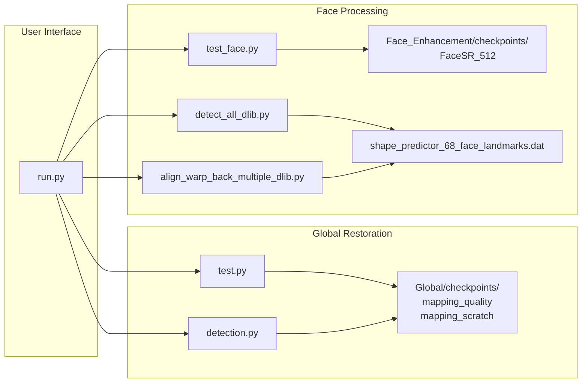

Sources: [predict.py:60-196](), [README.md:83-117]()

## Verification

To verify your installation, run a test on a sample image:

```bash
python run.py --input_folder test_images/old_without_scratch --output_folder output --GPU 0
```

For images with scratches:

```bash
python run.py --input_folder test_images/old_w_scratch --output_folder output --GPU 0 --with_scratch
```

The results will be saved in the `output/final_output/` directory.

Sources: [README.md:90-105]()

## Troubleshooting

### Common Installation Issues

1. **CUDA Compatibility Issues**: Ensure your NVIDIA drivers and CUDA version are compatible with the PyTorch version specified (1.8.0).

2. **Missing Libraries**: If you encounter errors about missing libraries while running the program, install the required system packages:
   ```bash
   apt-get install libgl1-mesa-glx libglib2.0-0
   ```

3. **Dlib Installation Failures**: If you encounter issues installing dlib, try installing build dependencies first:
   ```bash
   apt-get install cmake build-essential
   pip install dlib
   ```

4. **Out of Memory Errors**: If you encounter CUDA out of memory errors when processing large images, try:
   - Using the `--HR` flag for high-resolution images
   - Reducing batch size if modifying the code
   - Processing images on a GPU with more memory

Sources: [cog.yaml:4-6](), [cog.yaml:24-25](), [README.md:20-21](), [README.md:107-116]()

## Environment Variables

The system uses the following environment variables:

| Variable | Purpose |
|----------|---------|
| `CUDA_VISIBLE_DEVICES` | Controls which GPUs are used (alternative to `--GPU` flag) |

You can set these variables before running the script:

```bash
export CUDA_VISIBLE_DEVICES=0,1
python run.py --input_folder test_images --output_folder output
```

Sources: [README.md:85]()

## Next Steps

After successfully installing the system, refer to [Usage Guide](#6) for detailed instructions on how to use the restoration pipeline effectively.

---

# Page: System Architecture

# System Architecture

<details>
<summary>Relevant source files</summary>

The following files were used as context for generating this wiki page:

- [Global/models/__init__.py](Global/models/__init__.py)
- [Global/models/base_model.py](Global/models/base_model.py)
- [README.md](README.md)
- [cog.yaml](cog.yaml)
- [download-weights](download-weights)
- [imgs/HOF_2_007_007_my_concat.gif](imgs/HOF_2_007_007_my_concat.gif)
- [imgs/gui.PNG](imgs/gui.PNG)
- [predict.py](predict.py)
- [run.py](run.py)

</details>


This document describes the system architecture of the "Bringing Old Photos Back to Life" project, focusing on how various components work together to restore old photos. This page covers the overall system organization, data flow, and interaction between modules that make up the complete photo restoration pipeline.

For information about installation and setup, please refer to [Installation and Setup](#1.1).

## High-Level Architecture Overview

The photo restoration system is organized into a multi-stage pipeline with several specialized modules that work together to restore degraded photographs.

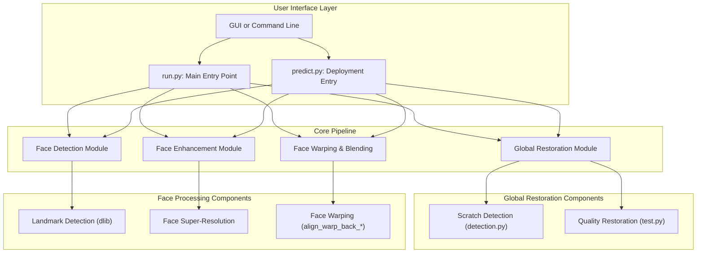

Sources: [run.py](), [predict.py](), [README.md]()

The system consists of four main modules:

1. **Global Restoration Module**: Processes the entire image to improve overall quality and remove scratches
2. **Face Detection Module**: Identifies and extracts faces from the restored image
3. **Face Enhancement Module**: Applies specialized restoration to facial regions
4. **Face Warping & Blending Module**: Integrates enhanced faces back into the globally restored image

## Pipeline Data Flow

The system processes images through a sequential pipeline where each stage handles specific aspects of photo restoration:

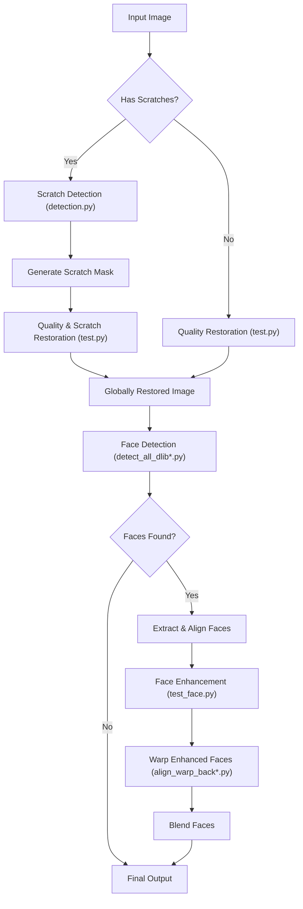

Sources: [run.py](), [Global/detection.py](), [Global/test.py](), [Face_Detection/detect_all_dlib.py](), [Face_Enhancement/test_face.py](), [Face_Detection/align_warp_back_multiple_dlib.py]()

This flow illustrates how an input image moves through the system:

1. The system determines if the image contains scratches
2. If scratches are present, the image undergoes scratch detection to generate a mask
3. The image is then processed for quality restoration (with or without scratch handling)
4. Faces are detected in the restored image
5. If faces are found, they are extracted, enhanced, and then warped back into the image
6. The final result is created by blending the enhanced faces with the globally restored image

## Core Components and Their Functionality

### Entry Points

The system has two main entry points:

| Entry Point | File | Description |
|-------------|------|-------------|
| Main Pipeline | `run.py` | Processes images through the complete restoration pipeline |
| Deployment | `predict.py` | Structured for model deployment scenarios |

Sources: [run.py](), [predict.py]()

### Global Restoration Module

The Global Restoration Module consists of two primary components:

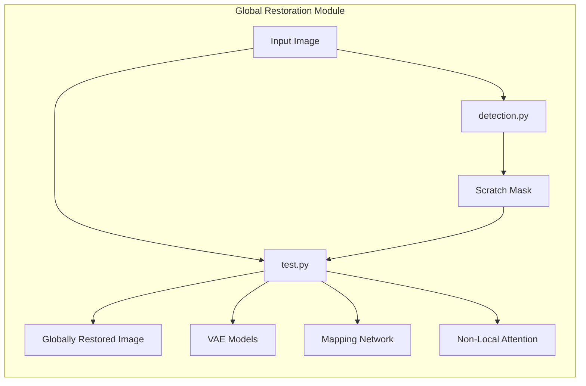

Sources: [Global/detection.py](), [Global/test.py]()

#### Module Components:

1. **Scratch Detection (detection.py)**:
   - Uses a U-Net model to identify scratches in the input image
   - Outputs a binary mask indicating scratch locations

2. **Quality Restoration (test.py)**:
   - Handles overall quality improvement
   - Can process with or without scratch masks
   - Implements a domain translation framework with:
     - Variational Autoencoders (VAEs) for domain encoding
     - Mapping network for latent space translation
     - Non-local attention mechanism for handling large-scale defects

### Face Detection Module

The Face Detection Module is responsible for identifying and extracting faces for further enhancement:

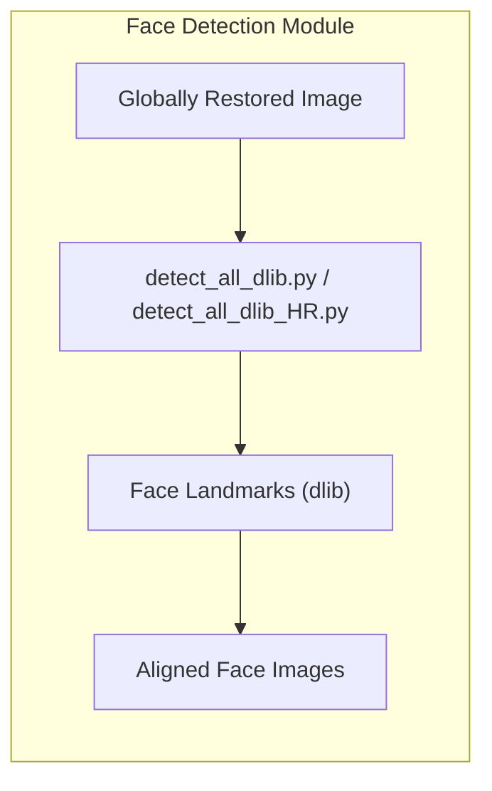

Sources: [Face_Detection/detect_all_dlib.py](), [Face_Detection/detect_all_dlib_HR.py]()

#### Module Components:

1. **Face Detection**:
   - Uses dlib's face detection and landmark detection
   - Has standard and high-resolution (HR) processing paths
   - Extracts and aligns faces for enhancement

### Face Enhancement Module

The Face Enhancement Module applies specialized restoration techniques to facial regions:

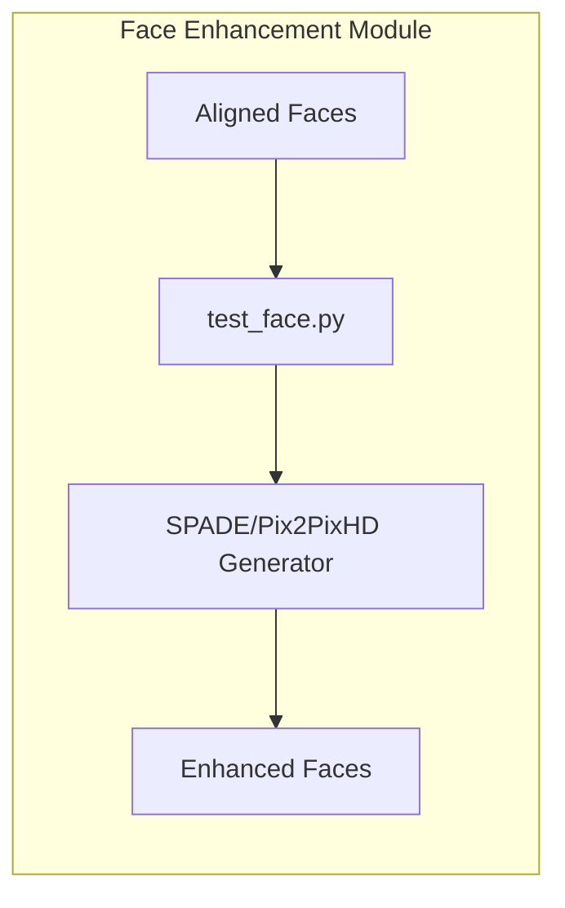

Sources: [Face_Enhancement/test_face.py]()

#### Module Components:

1. **Face Enhancement (test_face.py)**:
   - Applies GAN-based enhancement to facial regions
   - Uses specialized models trained for facial details
   - Supports both standard and high-resolution processing

### Face Warping and Blending Module

The Face Warping and Blending Module reintegrates enhanced faces back into the globally restored image:

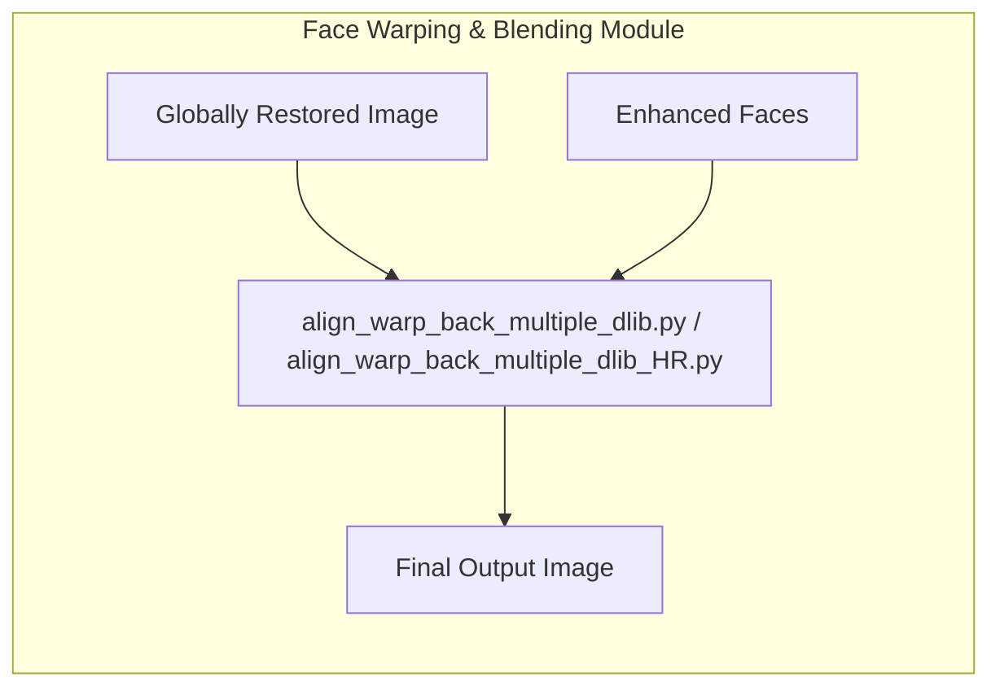

Sources: [Face_Detection/align_warp_back_multiple_dlib.py](), [Face_Detection/align_warp_back_multiple_dlib_HR.py]()

#### Module Components:

1. **Face Warping and Blending**:
   - Warps enhanced faces back to their original positions
   - Blends face boundaries for seamless integration
   - Supports both standard and high-resolution processing

## Model Architecture

The system employs multiple neural network architectures for different restoration tasks:

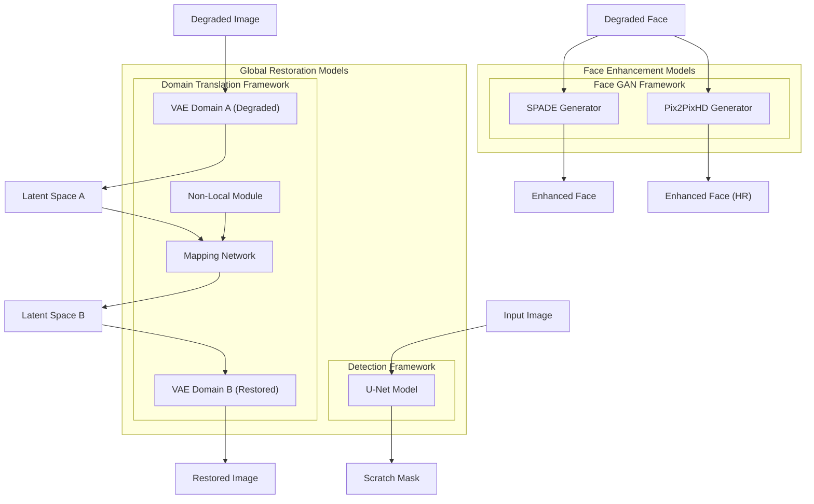

Sources: [Global/models/base_model.py](), [README.md]()

### Key Model Components:

1. **Domain Translation Framework**:
   - VAE for degraded domain (Domain A): Encodes degraded images into latent space
   - VAE for restored domain (Domain B): Decodes from latent space to restored images
   - Mapping Network: Translates between latent spaces of the two domains
   - Non-Local Module: Handles large-scale structural defects using patch attention

2. **Face Enhancement Framework**:
   - SPADE Generator: Conditional GAN for face enhancement
   - Pix2PixHD Generator: High-resolution face enhancement

3. **Detection Framework**:
   - U-Net Model: Identifies scratches and generates binary masks

## Module Interactions and Execution Flow

The execution flow of the system is orchestrated by the main entry point (`run.py`), which coordinates the interaction between modules:

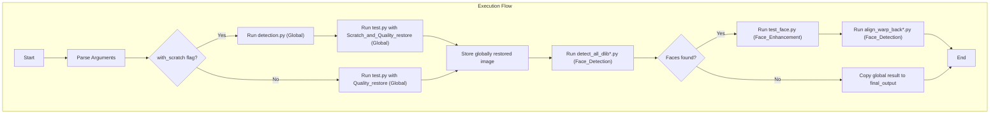

Sources: [run.py:45-201]()

### Module Interaction Details:

1. **Initialization Phase**:
   - Parse command-line arguments (`--input_folder`, `--output_folder`, `--with_scratch`, `--HR`)
   - Set up directories for input and output

2. **Global Restoration Phase**:
   - If `with_scratch` flag is set:
     - Run `detection.py` to generate scratch masks
     - Run `test.py` with `Scratch_and_Quality_restore` option
   - Otherwise:
     - Run `test.py` with `Quality_restore` option
   - Store globally restored images

3. **Face Processing Phase**:
   - Run face detection (`detect_all_dlib.py` or `detect_all_dlib_HR.py` for high-resolution)
   - If faces are found:
     - Run face enhancement (`test_face.py`)
     - Run face warping and blending (`align_warp_back_multiple_dlib.py` or `align_warp_back_multiple_dlib_HR.py`)
   - If no faces are found:
     - Use the globally restored image as the final output

4. **Finalization Phase**:
   - Save final output to the specified output directory

## Configuration and Options Management

The system uses command-line arguments to configure the restoration process:

| Option | Description | Default |
|--------|-------------|---------|
| `--input_folder` | Path to input images | "./test_images/old" |
| `--output_folder` | Path for output results | "./output" |
| `--GPU` | GPU indices to use | "6,7" |
| `--with_scratch` | Enable scratch handling | False |
| `--HR` | Enable high-resolution processing | False |
| `--checkpoint_name` | Model checkpoint to use | "Setting_9_epoch_100" |

Sources: [run.py:18-32](), [predict.py:14-31]()

## Summary

The "Bringing Old Photos Back to Life" system employs a modular architecture with specialized components for different aspects of photo restoration. The system processes images through a sequential pipeline, starting with global restoration, followed by face detection, face enhancement, and finally face warping and blending.

This modular design allows for flexibility and independent improvement of individual components. The system handles both standard and high-resolution processing paths, as well as specialized handling for images with scratches.

The architecture balances global image quality restoration with detailed face enhancement, providing comprehensive restoration for old photographs with various forms of degradation.

Sources: [README.md](), [run.py](), [predict.py]()

---

# Page: Restoration Pipeline

# Restoration Pipeline

<details>
<summary>Relevant source files</summary>

The following files were used as context for generating this wiki page:

- [README.md](README.md)
- [cog.yaml](cog.yaml)
- [download-weights](download-weights)
- [imgs/HOF_2_007_007_my_concat.gif](imgs/HOF_2_007_007_my_concat.gif)
- [imgs/gui.PNG](imgs/gui.PNG)
- [predict.py](predict.py)
- [run.py](run.py)

</details>


## Purpose and Scope

This document provides a comprehensive technical overview of the complete restoration pipeline used in the "Bringing Old Photos Back to Life" system. It covers the four main stages of the restoration process: Global Restoration, Face Detection, Face Enhancement, and Face Blending. For information about the specific model architectures used in the system, see [Model Architecture](#3).

## Pipeline Overview

The restoration pipeline processes old, degraded photographs through a series of specialized modules, each addressing different aspects of photo degradation. The pipeline is orchestrated by the main `run.py` script, which executes each stage sequentially and manages the flow of data between stages.

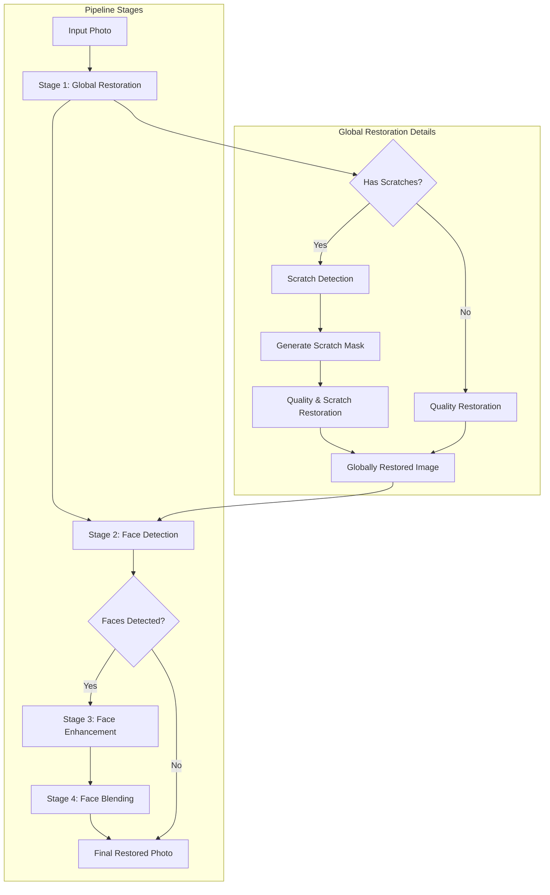

Sources: [run.py:45-106](), [README.md:83-106]()

## Pipeline Execution Flow

The restoration pipeline is implemented with a modular design, where each stage is executed in a specific directory containing the specialized models and scripts for that particular task.

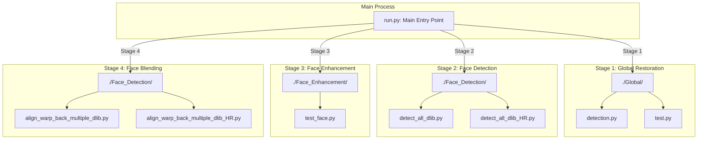

Sources: [run.py](), [predict.py]()

## Stage 1: Global Restoration

The Global Restoration stage addresses overall image quality issues and removes scratches or defects from the input image. This stage involves two main steps:

1. **Scratch Detection** (if needed): Identifies scratches in the input image and generates a mask.
2. **Quality Restoration**: Improves the overall image quality, with or without scratch handling.

### Process Flow

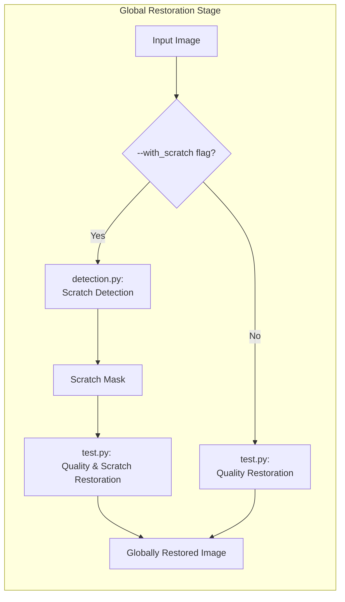

Sources: [run.py:45-106](), [predict.py:59-124]()

### Implementation Details

The Global Restoration stage is implemented in the `./Global/` directory and is executed as follows:

1. **Initialization**: The input folder path is passed to the Global module.
2. **Scratch Handling** (conditional):
   - If the `--with_scratch` flag is set, the system first runs `detection.py` to generate a scratch mask.
   - The mask and input are then passed to `test.py` with the `--Scratch_and_Quality_restore` flag.
3. **Quality Restoration** (always):
   - If no scratches are detected/specified, `test.py` is run with only the `--Quality_restore` flag.
4. **Output**: The restored images are saved to the specified output directory.

For high-resolution images, the `--HR` flag can be specified to enable specialized processing for higher resolution inputs.

#### Key Command-Line Options

| Option | Description |
|--------|-------------|
| `--input_folder` | Path to the folder containing input images |
| `--output_folder` | Path where restored images will be saved |
| `--with_scratch` | Flag to enable scratch detection and removal |
| `--HR` | Flag to enable high-resolution processing |
| `--GPU` | GPU IDs to use for processing (e.g., "0,1") |

Sources: [run.py:19-33](), [predict.py:12-36]()

## Stage 2: Face Detection

The Face Detection stage identifies and extracts faces from the globally restored image. It uses dlib's face detection and landmark localization to identify faces and their key features.

### Process Flow

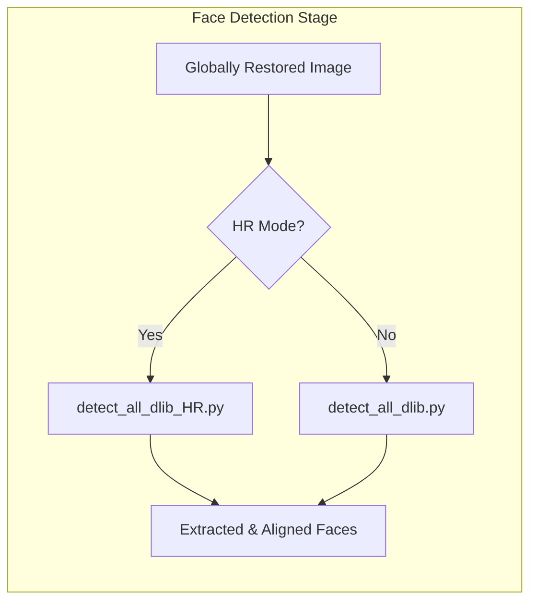

Sources: [run.py:109-127](), [predict.py:126-145]()

### Implementation Details

The Face Detection stage is implemented in the `./Face_Detection/` directory and involves:

1. **Face Detection**: Using dlib's face detector to identify faces in the image.
2. **Landmark Detection**: Using the 68-point landmark detector from dlib to identify facial features.
3. **Face Extraction**: Extracting the detected faces and aligning them based on the landmarks.
4. **Output**: Saving the extracted faces to the specified output directory.

Different scripts are used based on the resolution:
- `detect_all_dlib.py` for standard resolution
- `detect_all_dlib_HR.py` for high resolution

The face detection model (`shape_predictor_68_face_landmarks.dat`) must be downloaded and placed in the Face_Detection directory as part of the setup process.

Sources: [download-weights:13-17]()

## Stage 3: Face Enhancement

The Face Enhancement stage applies specialized restoration techniques to the detected faces, significantly improving their quality and details.

### Process Flow

```mermaid
flowchart LR
    subgraph "Face Enhancement Stage"
        Input["Extracted Faces"] --> HRCheck{"HR Mode?"}
        
        HRCheck -->|"Yes"| EnhanceHR["test_face.py with:\n- FaceSR_512 model\n- load_size 512"]
        HRCheck -->|"No"| Enhance["test_face.py with:\n- Default model\n- load_size 256"]
        
        EnhanceHR --> EnhancedFaces["Enhanced Faces"]
        Enhance --> EnhancedFaces
    end
```

Sources: [run.py:129-169](), [predict.py:147-176]()

### Implementation Details

The Face Enhancement stage is implemented in the `./Face_Enhancement/` directory and involves:

1. **Model Selection**: Loading the appropriate pre-trained face enhancement model.
2. **Face Processing**: Applying the model to enhance the detected faces.
3. **Output**: Saving the enhanced faces to the specified output directory.

The face enhancement uses different configurations based on resolution:
- For high-resolution (`--HR` flag):
  - Uses `FaceSR_512` checkpoint
  - Sets `load_size` to 512
  - Uses batch size 1 for processing
- For standard resolution:
  - Uses default checkpoint
  - Sets `load_size` to 256
  - Uses batch size 4 for faster processing

The face enhancement model is based on pix2pixHD architecture with specialized components for face restoration.

Sources: [run.py:138-166](), [predict.py:158-170]()

## Stage 4: Face Blending

The Face Blending stage warps the enhanced faces back to their original positions in the image and blends them seamlessly with the surrounding content.

### Process Flow

```mermaid
flowchart LR
    subgraph "Face Blending Stage"
        GlobalImage["Globally Restored Image"] --> HRCheck{"HR Mode?"}
        EnhancedFaces["Enhanced Faces"] --> HRCheck
        
        HRCheck -->|"Yes"| WarpHR["align_warp_back_multiple_dlib_HR.py"]
        HRCheck -->|"No"| Warp["align_warp_back_multiple_dlib.py"]
        
        WarpHR --> FinalOutput["Final Restored Image"]
        Warp --> FinalOutput
    end
```

Sources: [run.py:171-199](), [predict.py:177-196]()

### Implementation Details

The Face Blending stage is implemented in the `./Face_Detection/` directory and involves:

1. **Alignment**: Using the face landmarks to calculate the transformation needed to warp the enhanced face back.
2. **Warping**: Applying the transformation to place the enhanced face back in its original position.
3. **Blending**: Seamlessly blending the enhanced face with the surrounding image content.
4. **Output**: Saving the final restored image to the specified output directory.

Different scripts are used based on the resolution:
- `align_warp_back_multiple_dlib.py` for standard resolution
- `align_warp_back_multiple_dlib_HR.py` for high resolution

The blending process ensures that the enhanced faces integrate naturally with the rest of the image, avoiding visible seams or discontinuities.

Sources: [run.py:179-196](), [predict.py:185-192]()

## Restoration Pipeline Usage

The complete restoration pipeline can be executed through the command-line interface provided by `run.py`. Here are the typical usage patterns:

### Basic Usage for Images Without Scratches

```bash
python run.py --input_folder [test_image_folder_path] \
              --output_folder [output_path] \
              --GPU 0
```

### For Images With Scratches

```bash
python run.py --input_folder [test_image_folder_path] \
              --output_folder [output_path] \
              --GPU 0 \
              --with_scratch
```

### For High-Resolution Images With Scratches

```bash
python run.py --input_folder [test_image_folder_path] \
              --output_folder [output_path] \
              --GPU 0 \
              --with_scratch \
              --HR
```

The final results will be saved in `[output_path]/final_output/`. Intermediate results from each stage are also saved in their respective subdirectories within the output folder.

Sources: [README.md:89-118](), [run.py:17-202]()

## Output Directory Structure

When running the restoration pipeline, the following directory structure is created in the specified output folder:

```
[output_folder]/
├── stage_1_restore_output/      # Global restoration results
│   ├── masks/                   # Scratch masks (if --with_scratch)
│   └── restored_image/          # Globally restored images
├── stage_2_detection_output/    # Face detection results
├── stage_3_face_output/         # Face enhancement results
│   └── each_img/                # Enhanced faces
└── final_output/                # Final restored images
```

Sources: [run.py:49-176](), [predict.py:62-183]()

## Error Handling

The pipeline includes basic error handling to manage failures at each stage:

1. **No Faces Detected**: If no faces are detected in the image, the pipeline will still produce a globally restored output.
2. **Process Interruption**: Keyboard interrupts are caught and handled gracefully.
3. **Resource Cleanup**: For web-based deployments (using the `predict.py` script), temporary folders are cleaned up after processing.

Sources: [run.py:10-15](), [predict.py:213-222]()

## Integration with Other Components

The restoration pipeline integrates with other components of the system:

- **Model Architecture**: Uses complex neural network models for various restoration tasks. See [Model Architecture](#3) for details.
- **Training System**: The models used in the pipeline are trained using specialized training scripts. See [Training](#4) for details on training methodology.
- **Configuration**: Uses various configuration options to control pipeline behavior. See [Configuration](#5) for details on available options.

---

# Page: Global Restoration

# Global Restoration

<details>
<summary>Relevant source files</summary>

The following files were used as context for generating this wiki page:

- [Global/detection.py](Global/detection.py)
- [Global/test.py](Global/test.py)
- [README.md](README.md)
- [imgs/HOF_2_007_007_my_concat.gif](imgs/HOF_2_007_007_my_concat.gif)
- [imgs/gui.PNG](imgs/gui.PNG)

</details>


## Overview

Global Restoration is the first major component in the old photo restoration pipeline, responsible for enhancing the overall quality and removing structural degradations such as scratches from historical photographs. This module processes the entire image globally before any face-specific enhancements are applied in later stages of the pipeline.

The Global Restoration module addresses two primary types of degradation in old photos:

1. **Quality degradation** - Issues such as fading, yellowing, color shifts, and texture deterioration
2. **Structural degradation** - Physical damage like scratches, spots, creases, and tears

For face-specific restoration, see [Face Enhancement](#2.3).

## System Architecture

The Global Restoration module consists of two main components that work together to restore the overall image quality:

```mermaid
flowchart TD
    Input["Input Old Photo"] --> ScratchCheck{"Has Scratches?"}
    ScratchCheck -->|Yes| ScratchDetection["Scratch Detection (UNet)"]
    ScratchDetection --> ScratchMask["Generate Scratch Mask"]
    ScratchMask --> CombinedRestoration["Quality & Scratch Restoration"]
    ScratchCheck -->|No| QualityRestoration["Quality Restoration"]
    CombinedRestoration --> RestoredImage["Globally Restored Image"]
    QualityRestoration --> RestoredImage
    RestoredImage --> NextStage["To Face Detection Stage"]
```

Sources: [Global/test.py:94-103](), [Global/detection.py:73-166](), [README.md:132-151]()

### Scratch Detection

The scratch detection component uses a UNet-based neural network to identify scratches in old photos and generate a binary mask. This mask indicates damaged areas that require special attention during restoration.

```mermaid
graph TD
    Input["Input Image"] --> UNet["UNet Model (depth=4, conv_num=2)"]
    UNet --> Sigmoid["Sigmoid Activation"]
    Sigmoid --> Threshold["Threshold (≥ 0.4)"]
    Threshold --> ScratchMask["Binary Scratch Mask"]
```

Sources: [Global/detection.py:73-88](), [Global/detection.py:148-158]()

### Quality Restoration

The quality restoration component uses a domain translation approach based on a triplet framework:

```mermaid
graph LR
    subgraph "Domain Translation Framework"
        InputA["Degraded Photo (Domain A)"] --> EncoderA["VAE_A Encoder"]
        EncoderA --> LatentA["Latent Space A"]
        LatentA --> Mapping["Mapping Network"]
        ScratchMask["Scratch Mask (if available)"] -.-> NonLocal["Non-Local Processing"]
        NonLocal -.-> Mapping
        Mapping --> LatentB["Latent Space B"]
        LatentB --> DecoderB["VAE_B Decoder"]
        DecoderB --> OutputB["Restored Photo (Domain B)"]
    end
```

Sources: [Global/test.py:59-94](), [README.md:133-139]()

## Model Architecture Details

### Scratch Detection Model

The scratch detection module uses a UNet architecture with the following specifications:

```
- Input channels: 1 (grayscale image)
- Output channels: 1 (binary mask)
- Depth: 4 (levels of down/upsampling)
- Convolutions per level: 2
- Width factor: 6
- Batch normalization: Enabled
- Antialiasing: Enabled
```

The UNet model is defined in [Global/detection.py:76-88]() and loaded from a pretrained checkpoint located at "checkpoints/detection/FT_Epoch_latest.pt".

Sources: [Global/detection.py:76-93]()

### Domain Translation Framework

The domain translation framework consists of three key components:

1. **VAE Domain A (Degraded Domain)**: Encodes damaged photos into a latent representation
2. **Mapping Network**: Translates between Domain A and Domain B latent spaces
3. **VAE Domain B (Restored Domain)**: Decodes the mapped latent representation to produce restored photos

Different VAE models are used depending on the restoration task:

```mermaid
graph TD
    subgraph "Quality Restoration"
        A1["VAE_A_quality"] --> M1["Mapping Network"] --> B1["VAE_B_quality"]
    end
    
    subgraph "Scratch & Quality Restoration"
        A2["VAE_A_quality"] --> M2["Mapping Network with Non-Local"] --> B2["VAE_B_scratch"]
        mask["Scratch Mask"] -.-> M2
    end
```

Sources: [Global/test.py:74-92]()

### High-Resolution Processing

For high-resolution images with scratches, additional techniques are employed:

- **Multi-Scale Patch Attention**: Processes the image in smaller patches with attention mechanism
- **Inference Optimization**: Optimizes memory usage during processing
- **Mask Dilation**: Expands the detected scratch regions to ensure complete coverage

Sources: [Global/test.py:88-92](), [README.md:108-116]()

## Parameter Configuration

The Global Restoration module's behavior is controlled by several key parameters:

| Parameter | Quality Restoration | Scratch & Quality Restoration | HR Scratch & Quality |
|-----------|---------------------|------------------------------|----------------------|
| Model Name | "mapping_quality" | "mapping_scratch" | "mapping_Patch_Attention" |
| VAE Models | A_quality, B_quality | A_quality, B_scratch | A_quality, B_scratch |
| Non-Local | Disabled | Enabled | Enabled |
| Spectral Norm | Disabled | Enabled | Enabled |
| Mask Dilation | 0 | 0 | 3 |
| Mapping Exp | 0 | 0 | 1 |
| Inference Optimize | Disabled | Disabled | Enabled |

Sources: [Global/test.py:59-94]()

## Usage

### Scratch Detection

To run only the scratch detection component:

```
cd Global/
python detection.py --test_path [test_image_folder_path] \
                    --output_dir [output_path] \
                    --input_size [resize_256|full_size|scale_256]
```

Sources: [Global/detection.py:168-178](), [README.md:124-129]()

### Quality Restoration Only

For images without scratches:

```
cd Global/
python test.py --Quality_restore \
               --test_input [test_image_folder_path] \
               --outputs_dir [output_path]
```

Sources: [Global/test.py:95-103](), [README.md:148-151]()

### Combined Scratch and Quality Restoration

For images with scratches:

```
cd Global/
python test.py --Scratch_and_Quality_restore \
               --test_input [test_image_folder_path] \
               --test_mask [corresponding_mask_folder] \
               --outputs_dir [output_path]
```

Sources: [Global/test.py:95-103](), [README.md:142-147]()

## Integration with Overall Pipeline

The Global Restoration module is typically called from the main `run.py` script, which orchestrates the entire restoration process. After global restoration is completed, the image is passed to the Face Detection stage.

```mermaid
graph TD
    Input["Input Image"] --> HasScratch{"Has Scratches?"}
    HasScratch -->|Yes| RunWithScratch["run.py with --with_scratch"]
    HasScratch -->|No| RunWithoutScratch["run.py"]
    
    RunWithScratch --> GlobalDetection["Global Scratch Detection"]
    GlobalDetection --> GlobalCombined["Global Quality & Scratch Restoration"]
    RunWithoutScratch --> GlobalQuality["Global Quality Restoration"]
    
    GlobalCombined --> FaceDetection["Face Detection Stage"]
    GlobalQuality --> FaceDetection
```

Sources: [README.md:89-118]()

## Technical Implementation

The core of the global restoration process occurs in the `test.py` file, which:

1. Sets up the appropriate parameters based on the restoration mode
2. Initializes the Pix2PixHDModel_Mapping model
3. Loads the input image and mask (if applicable)
4. Processes the image through the model
5. Saves the restored result

The inference is performed by the `model.inference()` method, which takes the input image and mask as parameters and returns the restored image.

Sources: [Global/test.py:95-192]()

---

# Page: Face Detection

# Face Detection

<details>
<summary>Relevant source files</summary>

The following files were used as context for generating this wiki page:

- [Face_Detection/align_warp_back_multiple_dlib.py](Face_Detection/align_warp_back_multiple_dlib.py)
- [Face_Detection/detect_all_dlib.py](Face_Detection/detect_all_dlib.py)
- [Face_Enhancement/data/__init__.py](Face_Enhancement/data/__init__.py)
- [README.md](README.md)
- [imgs/HOF_2_007_007_my_concat.gif](imgs/HOF_2_007_007_my_concat.gif)
- [imgs/gui.PNG](imgs/gui.PNG)

</details>


## Purpose and Scope
The Face Detection component identifies and extracts faces from old photographs for targeted enhancement. It serves as a critical bridge between the [Global Restoration](#2.1) phase, which addresses overall image quality, and the [Face Enhancement](#2.3) phase, which applies specialized restoration techniques to facial regions. For information about how the enhanced faces are reintegrated into the final image, see [Face Blending](#2.4).

## Process Overview
Face Detection employs the dlib library to detect faces and extract facial landmarks. These landmarks guide the alignment of each face to a standard position, enabling consistent face enhancement regardless of the face's original position, size, or orientation in the input image.

## Face Detection and Landmark Localization

The system uses dlib's frontal face detector to identify faces within images and a pre-trained shape predictor to locate 68 facial landmarks on each detected face:

```python
face_detector = dlib.get_frontal_face_detector()
landmark_locator = dlib.shape_predictor("shape_predictor_68_face_landmarks.dat")
faces = face_detector(image)
face_landmarks = landmark_locator(image, current_face)
```

From the 68 landmarks, five key points are extracted to guide face alignment:

| Key Point | Description | Source Landmarks |
|-----------|-------------|------------------|
| Left Eye Center | Center point of left eye | Average of landmarks 36 and 39 |
| Right Eye Center | Center point of right eye | Average of landmarks 42 and 45 |
| Nose Tip | Tip of the nose | Landmark 30 |
| Left Mouth Corner | Left corner of mouth | Landmark 48 |
| Right Mouth Corner | Right corner of mouth | Landmark 54 |

These five points provide sufficient information to compute a similarity transformation that aligns the face to a standard template.

## Face Detection Process Diagram

```mermaid
graph TD
    subgraph "detect_all_dlib.py"
        A["Input Image"] --> B["Face Detection (dlib.get_frontal_face_detector)"]
        B --> C["Landmark Localization (dlib.shape_predictor)"]
        C --> D["Key Points Extraction (search function)"]
        D --> E["Compute Transformation (compute_transformation_matrix)"]
        E --> F["Face Warping (warp function)"]
        F --> G["Output Aligned Face (256x256)"]
    end
    
    subgraph "Key Points Extraction"
        D --> D1["Left Eye Center (36+39)/2"]
        D --> D2["Right Eye Center (42+45)/2"]
        D --> D3["Nose Tip (30)"]
        D --> D4["Left Mouth Corner (48)"]
        D --> D5["Right Mouth Corner (54)"]
    end
```

Sources: [Face_Detection/detect_all_dlib.py:27-78]()

## Face Alignment and Standardization

The system defines a standard face template with predefined positions for the five key points:

```python
def _standard_face_pts():
    pts = (
        np.array([196.0, 226.0, 316.0, 226.0, 256.0, 286.0, 220.0, 360.4, 292.0, 360.4], np.float32) / 256.0
        - 1.0
    )
    return np.reshape(pts, (5, 2))
```

A similarity transformation matrix is computed to align the extracted face landmarks to this standard template:

```python
affine = compute_transformation_matrix(image, current_fl, False, target_face_scale=1.3)
aligned_face = warp(image, affine, output_shape=(256, 256, 3))
```

The transformation preserves the proportions of the face while adjusting scale, rotation, and position. The `target_face_scale` parameter (1.3) ensures that the face is slightly zoomed out to include context around the face.

Sources: [Face_Detection/detect_all_dlib.py:80-98](), [Face_Detection/detect_all_dlib.py:175-176]()

## Integration with Overall Pipeline

The Face Detection component fits into the overall restoration pipeline as follows:

```mermaid
flowchart TD
    A["Input Old Photo"] --> B["Global Restoration (Global/test.py)"]
    B --> C["Face Detection (Face_Detection/detect_all_dlib.py)"]
    C --> D{"Faces Found?"}
    D -->|"No"| F["Final Output"]
    D -->|"Yes"| E["Face Enhancement (Face_Enhancement/test_face.py)"]
    E --> G["Face Blending (Face_Detection/align_warp_back_multiple_dlib.py)"]
    G --> F
```

Sources: [Face_Detection/detect_all_dlib.py](), [Face_Detection/align_warp_back_multiple_dlib.py]()

## Handling Multiple Faces

The system processes each detected face independently, allowing for the enhancement of multiple faces in a single image:

```python
for face_id in range(len(faces)):
    current_face = faces[face_id]
    face_landmarks = landmark_locator(image, current_face)
    current_fl = search(face_landmarks)
    
    affine = compute_transformation_matrix(image, current_fl, False, target_face_scale=1.3)
    aligned_face = warp(image, affine, output_shape=(256, 256, 3))
    img_name = x[:-4] + "_" + str(face_id + 1)
    io.imsave(os.path.join(save_url, img_name + ".png"), img_as_ubyte(aligned_face))
```

This approach ensures that all faces in an old photograph receive appropriate enhancement, regardless of their number or position.

Sources: [Face_Detection/detect_all_dlib.py:170-178]()

## Error Handling

If no faces are detected in an image, the system bypasses the face enhancement stage:

```python
if len(faces) == 0:
    print("Warning: There is no face in %s" % (x))
    continue
```

In such cases, the image retains only the global restoration improvements and proceeds directly to the final output.

Sources: [Face_Detection/detect_all_dlib.py:163-165]()

## Warping Back Process

After face enhancement, the improved faces are warped back to their original positions in the image using the inverse of the transformation matrix that was used for alignment:

```mermaid
graph TD
    subgraph "align_warp_back_multiple_dlib.py"
        A["Enhanced Face (256x256)"] --> B["Compute Inverse Transformation (affine.inverse)"]
        B --> C["Warp Back to Original Position (warp function)"]
        C --> D["Generate Blend Mask"]
        D --> E["Blend with Original Image (blur_blending_cv2)"]
        E --> F["Final Output Image"]
    end
```

This warping-back process ensures that the enhanced faces are seamlessly integrated into the overall restored image.

Sources: [Face_Detection/align_warp_back_multiple_dlib.py:383-428]()

---

# Page: Face Enhancement

# Face Enhancement

<details>
<summary>Relevant source files</summary>

The following files were used as context for generating this wiki page:

- [Face_Enhancement/models/networks/generator.py](Face_Enhancement/models/networks/generator.py)
- [Face_Enhancement/models/pix2pix_model.py](Face_Enhancement/models/pix2pix_model.py)
- [Face_Enhancement/options/base_options.py](Face_Enhancement/options/base_options.py)
- [README.md](README.md)
- [imgs/HOF_2_007_007_my_concat.gif](imgs/HOF_2_007_007_my_concat.gif)
- [imgs/gui.PNG](imgs/gui.PNG)

</details>


## Purpose and Scope

This document details the Face Enhancement subsystem of the Old Photo Restoration pipeline. The Face Enhancement module is responsible for improving the visual quality of detected faces in degraded old photographs. It applies specialized restoration techniques specifically optimized for facial features, significantly enhancing the overall quality of restored portraits.

This page focuses specifically on the face enhancement component. For information about detecting and aligning faces, see [Face Detection](#2.2). For the process of reintegrating enhanced faces into the restored image, see [Face Blending](#2.4).

## System Overview

The Face Enhancement module uses a specialized GAN (Generative Adversarial Network) architecture to transform degraded face images into high-quality restored versions. The system employs a SPADE (Spatially-Adaptive Normalization) generator that can leverage both degraded face inputs and facial parsing maps to generate realistic outputs.

```mermaid
graph TD
    subgraph "Face Enhancement System"
        Input["Degraded Face"] --> Parsing["Face Parsing Map"]
        Input --> Generator["SPADE Generator"]
        Parsing --> Generator
        Generator --> Output["Enhanced Face"]
    end
    
    subgraph "Generator Architecture"
        InputLayer["Input Layer"] --> Encoder["Encoder Network"]
        Encoder --> SBlock1["SPADE Block 1"] 
        SBlock1 --> SBlock2["SPADE Block 2"]
        SBlock2 --> Upsampling["Upsampling Layers"]
        Upsampling --> Decoder["Decoder Network"]
        Decoder --> OutputLayer["Output Layer"]
        
        ParsingMap["Parsing Map Input"] -..-> SBlock1
        ParsingMap -..-> SBlock2
        DegradedImage["Degraded Image Input"] -..-> SBlock1
        DegradedImage -..-> SBlock2
    end
```

Sources:
- Face_Enhancement/models/networks/generator.py
- Face_Enhancement/models/pix2pix_model.py
- README.md

## Key Components

### SPADE Generator

The core of the Face Enhancement system is the SPADE Generator, which uses spatially-adaptive normalization to incorporate facial structure information into the restoration process. The generator takes a degraded face image and optionally a face parsing map as input and produces an enhanced face as output.

Key features of the SPADE Generator:

1. **Conditional Input**: Can operate with or without facial parsing maps
2. **Injection Layer Control**: Allows conditioning to be injected at different network depths
3. **Progressive Architecture**: Uses a series of SPADE ResNet blocks with upsampling layers
4. **Adaptive Normalization**: Applies spatial normalization conditioned on input semantic map

```mermaid
graph TD
    subgraph "SPADEGenerator Class Structure"
        Init["__init__(opt)"] --> ComputeLatent["compute_latent_vector_size(opt)"]
        Init --> Forward["forward(input, degraded_image, z)"]
        
        Forward --> InputProcess["Process Input Maps"]
        InputProcess --> HeadBlock["SPADE Head Blocks"]
        HeadBlock --> MiddleBlocks["SPADE Middle Blocks"]
        MiddleBlocks --> UpBlocks["SPADE Upsampling Blocks"]
        UpBlocks --> ConvImg["Final Conv Layer"]
        ConvImg --> Output["Enhanced Face"]
    end
```

Sources:
- Face_Enhancement/models/networks/generator.py:14-148

### Pix2Pix Model

The `Pix2PixModel` class serves as the high-level interface for the face enhancement system, coordinating the generator, discriminator, and encoder networks. It handles the forward and backward passes during training and provides inference functionality.

Key responsibilities:

1. **Network Initialization**: Creates and initializes the G, D, and E networks
2. **Loss Calculation**: Computes GAN loss, feature matching loss, VGG loss, and KLD loss
3. **Optimization**: Creates and manages optimizers for G and D networks
4. **Inference**: Generates enhanced faces from degraded inputs

Sources:
- Face_Enhancement/models/pix2pix_model.py:9-99

## Data Flow

The face enhancement process follows these steps:

```mermaid
flowchart LR
    subgraph "Face Enhancement Data Flow"
        A["Aligned Degraded Face"] --> B["Face Parsing"]
        B --> C["Semantic Map"]
        A --> D["SPADE Generator"]
        C --> D
        D --> E["Enhanced Face"]
    end
```

1. **Input Preparation**: The system takes a degraded face image that has been detected and aligned.
2. **Face Parsing** (optional): A semantic parsing map is generated to identify facial regions.
3. **Enhancement**: The SPADE generator processes the degraded face, conditioned on the parsing map.
4. **Output**: A high-quality enhanced face is produced, maintaining identity and adding realistic details.

Sources:
- Face_Enhancement/models/pix2pix_model.py:101-126
- README.md:156-166

## Network Architecture Details

### Generator Architecture

The SPADEGenerator uses a progressive architecture with multiple resolution stages:

```mermaid
graph TD
    subgraph "SPADEGenerator Architecture"
        FC["Initial Conv/FC"] --> Head0["head_0: SPADEResnetBlock"]
        Head0 --> Up1["Upsample"]
        Up1 --> Middle0["G_middle_0: SPADEResnetBlock"]
        Middle0 --> Middle1["G_middle_1: SPADEResnetBlock"]
        Middle1 --> Up2["Upsample"]
        Up2 --> Up0["up_0: SPADEResnetBlock"]
        Up0 --> Up3["Upsample"]
        Up3 --> Up1Block["up_1: SPADEResnetBlock"]
        Up1Block --> Up4["Upsample"]
        Up4 --> Up2Block["up_2: SPADEResnetBlock"]
        Up2Block --> Up5["Upsample"]
        Up5 --> Up3Block["up_3: SPADEResnetBlock"]
        Up3Block --> ConvImg["conv_img: Conv2d"]
        ConvImg --> Tanh["tanh activation"]
    end
```

The network can be configured with different numbers of upsampling layers through the `num_upsampling_layers` option:
- "normal": 5 upsampling layers
- "more": 6 upsampling layers
- "most": 7 upsampling layers, with an additional block (`up_4`)

The key feature is the SPADE blocks, which allow the network to incorporate spatial information from the parsing map at different resolutions.

Sources:
- Face_Enhancement/models/networks/generator.py:27-148

### SPADE Block

Each SPADE block applies spatially-adaptive normalization based on the input parsing map and degraded image:

```mermaid
graph TD
    subgraph "SPADE ResNet Block"
        Input["Block Input"] --> Norm1["Spatially-Adaptive Normalization 1"]
        Norm1 --> Act1["Activation"]
        Act1 --> Conv1["Convolution 1"]
        Conv1 --> Norm2["Spatially-Adaptive Normalization 2"]
        Norm2 --> Act2["Activation"]
        Act2 --> Conv2["Convolution 2"]
        Conv2 --> Add["Addition"]
        Input --> Skip["Skip Connection"]
        Skip --> Add
        Add --> Output["Block Output"]
        
        ParsingMap["Parsing Map"] -..-> Norm1
        ParsingMap -..-> Norm2
        DegradedImage["Degraded Image"] -..-> Norm1
        DegradedImage -..-> Norm2
    end
```

The SPADE block modulates the normalization parameters based on the input semantic map, allowing the network to preserve spatial information that would otherwise be lost in traditional normalization layers.

Sources:
- Face_Enhancement/models/networks/architecture.py

## Configuration Options

The face enhancement module provides numerous configuration options through the BaseOptions class:

| Option | Description | Default |
|--------|-------------|---------|
| `netG` | Generator architecture (spade or pix2pixhd) | "spade" |
| `ngf` | Number of generator filters | 64 |
| `norm_G` | Normalization method | "spectralinstance" |
| `no_parsing_map` | Disable use of parsing map | False |
| `injection_layer` | Where to inject conditioning ("all" or specific layers) | "all" |
| `crop_size` | Face crop size | 512 |
| `aspect_ratio` | Width/height ratio | 1.0 |
| `label_nc` | Number of label classes | 182 |

Sources:
- Face_Enhancement/options/base_options.py:14-294

## Integration with Overall System

The Face Enhancement module is part of a larger restoration pipeline:

```mermaid
graph LR
    subgraph "Old Photo Restoration Pipeline"
        A["Input Degraded Image"] --> B["Global Restoration"]
        B --> C["Face Detection"]
        C --> D["Face Enhancement"]
        D --> E["Face Blending"]
        E --> F["Final Restored Image"]
    end
    
    subgraph "Face Enhancement Process"
        C1["Detected Faces"] --> D1["Face Alignment"]
        D1 --> D2["SPADE Enhancement"]
        D2 --> D3["Enhanced Faces"]
        D3 --> E1["Warping Back"]
    end
```

The face enhancement component operates on detected and aligned facial regions from the globally restored image. After enhancement, the faces are warped back to their original position and blended with the background.

Sources:
- README.md:82-106
- README.md:156-166

## Usage

The face enhancement module can be used as part of the full restoration pipeline or as a standalone component:

### As Part of Full Pipeline

```
python run.py --input_folder [test_image_folder_path] \
              --output_folder [output_path] \
              --GPU 0
```

### For High-Resolution Images

```
python run.py --input_folder [test_image_folder_path] \
              --output_folder [output_path] \
              --GPU 0 \
              --HR
```

Sources:
- README.md:82-118

## Implementation Details

### Forward Pass

The core enhancement process occurs in the generator's forward method, which handles:

1. Preprocessing input images and parsing maps
2. Passing data through the network's SPADE blocks
3. Progressive upsampling to reach the final resolution
4. Final convolution and activation to produce the enhanced output

The network's behavior can be modified through the `injection_layer` parameter, which controls where the parsing map information is injected.

Sources:
- Face_Enhancement/models/networks/generator.py:105-148
- Face_Enhancement/models/pix2pix_model.py:36-52

## Performance Considerations

When processing high-resolution images, the face enhancement module may require significant GPU memory. The system is optimized for faces at 512×512 resolution, as training was primarily conducted on this size.

Sources:
- README.md:166-170

---

# Page: Face Blending

# Face Blending

<details>
<summary>Relevant source files</summary>

The following files were used as context for generating this wiki page:

- [Face_Detection/align_warp_back_multiple_dlib_HR.py](Face_Detection/align_warp_back_multiple_dlib_HR.py)
- [Face_Detection/detect_all_dlib_HR.py](Face_Detection/detect_all_dlib_HR.py)
- [README.md](README.md)
- [imgs/HOF_2_007_007_my_concat.gif](imgs/HOF_2_007_007_my_concat.gif)
- [imgs/gui.PNG](imgs/gui.PNG)

</details>


Face blending is the final critical step in the old photo restoration pipeline. After detecting and enhancing faces, this component warps the enhanced faces back to their original positions and seamlessly integrates them with the globally restored image, ensuring a natural appearance without visible seams or artifacts.

## Purpose and Scope

This document covers the face blending component of the restoration pipeline, which serves as the bridge between enhanced face regions and the final restored image. For information about face enhancement itself, see [Face Enhancement](#2.3).

## Position in the Restoration Pipeline

Face blending operates as the final step in the facial processing workflow:

```mermaid
flowchart TD
    A["Globally Restored Image"] --> C["Face Detection"]
    C --> D{"Faces Found?"}
    D -->|Yes| E["Extract & Align Faces"]
    E --> F["Face Enhancement"]
    F --> G["Warp Enhanced Faces"]
    G --> H["Blend Faces"]
    H --> I["Final Output"]
    D -->|No| I
```

Sources: [README.md:102-116]()

## Technical Components

### Face Landmarks and Transformation

The face blending process relies on facial landmarks (specific points on facial features) detected during the face detection stage. These landmarks are essential for:

1. Computing the transformation matrices needed to warp the enhanced faces back to their original positions
2. Creating appropriate blending masks for seamless integration

```mermaid
graph TD
    subgraph "Transformation Computation"
        A["Original Face with Landmarks"] --> B["Compute Transformation Matrix"]
        B --> C["Compute Inverse Transformation"]
        C --> D["Convert to Warping Parameters"]
    end
    
    subgraph "Face Warping Process"
        E["Enhanced Face"] --> F["Apply Inverse Transformation"]
        D --> F
        F --> G["Warped Enhanced Face"]
    end
    
    A --> H["Standard Face Landmarks"]
    H --> B
```

Sources: [Face_Detection/align_warp_back_multiple_dlib_HR.py:112-166]()

### Standard Face Points

The system defines a set of standard face points that represent a normalized face position. These points serve as reference for computing transformations:

```python
def _standard_face_pts():
    pts = (
        np.array([196.0, 226.0, 316.0, 226.0, 256.0, 286.0, 220.0, 360.4, 292.0, 360.4], np.float32) / 256.0
        - 1.0
    )
    return np.reshape(pts, (5, 2))
```

These five points correspond to the eyes, nose, and mouth corners in a standardized face.

Sources: [Face_Detection/align_warp_back_multiple_dlib_HR.py:112-124]()

### Transformation Computation

Two key transformations are calculated:

1. **Forward transformation**: Maps the original face to a standardized position (used during face extraction and enhancement)
2. **Inverse transformation**: Maps the enhanced face back to its original position (used during blending)

The system uses the `SimilarityTransform` from skimage, which preserves proportions while allowing for scaling, rotation, and translation.

Sources: [Face_Detection/align_warp_back_multiple_dlib_HR.py:127-166]()

### Face Warping Techniques

The system implements two warping approaches:

1. **PyTorch-based warping** (for GPU acceleration):
   - Converts the affine transformation matrix to theta parameters
   - Uses `F.grid_sample` for efficient GPU-accelerated warping

2. **skimage-based warping** (for CPU processing):
   - Uses `skimage.transform.warp` with the computed transformation matrix

This dual approach allows for efficient processing on different hardware configurations.

Sources: [Face_Detection/align_warp_back_multiple_dlib_HR.py:185-262]()

### Blending Mask Generation

To create natural transitions between enhanced faces and the original image, blending masks are generated:

```mermaid
graph TD
    A["Face Landmarks"] --> B["Define Face Region"]
    B --> C["Generate Initial Mask"]
    C --> D["Apply Gaussian Filtering"]
    D --> E["Normalize Mask Values"]
    E --> F["Final Blending Mask"]
```

The mask has higher values in the face center and gradually decreases towards the edges, ensuring smooth transitions.

Sources: [Face_Detection/align_warp_back_multiple_dlib_HR.py:347-400]()

### Color Consistency

To maintain color consistency between enhanced faces and the surrounding image, the system may apply:

1. **Histogram matching**: Matches the color distribution of the enhanced face to the original face region
2. **Color correction**: Adjusts the enhanced face to match the global image's color profile

Sources: [Face_Detection/align_warp_back_multiple_dlib_HR.py:26-109]()

## Blending Process

The complete face blending process combines all these components:

```mermaid
graph TD
    subgraph "Inputs"
        A["Globally Restored Image"]
        B["Enhanced Face"]
        C["Face Landmarks"]
    end
    
    subgraph "Transformation"
        D["Compute Inverse Transformation Matrix"]
        E["Convert to Warping Parameters"]
    end
    
    subgraph "Warping"
        F["Warp Enhanced Face"]
        G["Create Blending Mask"]
    end
    
    subgraph "Blending"
        H["Apply Color Correction"]
        I["Blend Using Mask: mask*warped_face + (1-mask)*original"]
    end
    
    J["Final Blended Image"]
    
    A --> D
    B --> F
    C --> D
    D --> E
    E --> F
    F --> H
    C --> G
    G --> I
    H --> I
    A --> I
    I --> J
```

Sources: [Face_Detection/align_warp_back_multiple_dlib_HR.py:410-540]()

## Implementation Details

### Key Functions

The face blending implementation contains these key functions:

| Function | Purpose |
|----------|---------|
| `compute_transformation_matrix()` | Calculates transformation from original face to standardized position |
| `compute_inverse_transformation_matrix()` | Calculates transformation to warp enhanced face back to original position |
| `affine2theta()` | Converts affine transformation to theta parameter for PyTorch |
| `tensor_warp_image()` | Warps image using PyTorch's grid sampling |
| `warp_image()` | Warps image using skimage's warp function |
| `match_histograms()` | Performs histogram matching for color consistency |
| `blend_images()` | Combines warped face and original image using blending mask |

Sources: [Face_Detection/align_warp_back_multiple_dlib_HR.py:127-540]()

### High Resolution Support

The system includes a specialized implementation for high-resolution images:
- `align_warp_back_multiple_dlib_HR.py`: Handles high-resolution images efficiently
- `align_warp_back_multiple_dlib.py`: Standard resolution implementation

The high-resolution implementation includes optimizations such as:
- GPU-accelerated warping when available
- Efficient mask generation for large images
- Memory-optimized processing

Sources: [README.md:108-116]()

## Technical Challenges and Solutions

### Multiple Face Handling

When multiple faces are detected in an image, the system:
1. Processes each face separately
2. Warps and blends each enhanced face
3. Handles potential overlaps between face regions by processing faces sequentially

```mermaid
graph LR
    subgraph "Multiple Face Processing"
        A["Input with Multiple Faces"] --> B["Face 1 Blending"]
        A --> C["Face 2 Blending"]
        A --> D["Face N Blending"]
        B --> E["Combined Result"]
        C --> E
        D --> E
    end
```

Sources: [Face_Detection/align_warp_back_multiple_dlib_HR.py:410-540]()

### Seamless Integration

To achieve seamless integration, the system:
1. Uses carefully designed blending masks with smooth gradients
2. Applies color correction to maintain consistency with surrounding areas
3. May apply histogram matching between the enhanced and original face regions

Sources: [Face_Detection/align_warp_back_multiple_dlib_HR.py:26-109](), [Face_Detection/align_warp_back_multiple_dlib_HR.py:347-400]()

## Code Implementation Mapping

The following diagram maps the face blending process to the actual code implementation:

```mermaid
graph TD
    A["align_warp_back_multiple_dlib_HR.py"] --> B["Transformation Functions"]
    A --> C["Warping Functions"]
    A --> D["Blending Functions"]
    A --> E["Main Process"]
    
    B --> B1["compute_transformation_matrix()"]
    B --> B2["compute_inverse_transformation_matrix()"]
    B --> B3["affine2theta()"]
    
    C --> C1["tensor_warp_image()"]
    C --> C2["warp_image()"]
    
    D --> D1["match_histograms()"]
    D --> D2["create_face_mask()"]
    D --> D3["blend_images()"]
    
    E --> E1["process_image()"]
    E --> E2["main()"]
```

Sources: [Face_Detection/align_warp_back_multiple_dlib_HR.py:1-540]()

## Summary

Face blending is the final and crucial step that seamlessly integrates enhanced face regions into the globally restored image. By using precise transformation calculations, efficient warping techniques, and carefully designed blending masks, the system produces natural-looking results where the enhanced faces appear coherent with the rest of the image.

---

# Page: Model Architecture

# Model Architecture

<details>
<summary>Relevant source files</summary>

The following files were used as context for generating this wiki page:

- [Global/models/NonLocal_feature_mapping_model.py](Global/models/NonLocal_feature_mapping_model.py)
- [Global/models/mapping_model.py](Global/models/mapping_model.py)
- [Global/models/networks.py](Global/models/networks.py)

</details>


This document describes the neural network architecture used in the "Bringing Old Photos Back to Life" system. It covers the core models that form the old photo restoration pipeline, with a focus on the domain translation framework, feature mapping networks, and non-local attention mechanisms. For information about the complete restoration pipeline, see [Restoration Pipeline](#2), and for specific details about training these models, see [Training](#4).

## Core Architecture Overview

The old photo restoration system employs an advanced domain translation framework with separate specialized components for handling global image restoration and face enhancement. The core architecture is built around Variational Autoencoders (VAEs) for different domains and a mapping network that bridges them.

```mermaid
flowchart TD
    subgraph "Domain Translation Framework"
        VaeA["VAE Domain A (netG_A)"] --> LatentA["Latent Space A"]
        LatentA --> MappingNet["Mapping Network"]
        MaskInfo["Mask Information"] --> MappingNet
        MappingNet --> LatentB["Latent Space B"]
        LatentB --> VaeB["VAE Domain B (netG_B)"]
    end
    
    subgraph "Feature Mapping Approaches"
        direction LR
        BasicMap["Mapping_Model"] 
        MaskMap["Mapping_Model_with_mask"]
        PatchMap["Mapping_Model_with_mask_2"]
    end
    
    subgraph "Non-Local Operations"
        direction LR
        NLBlock["NonLocalBlock2D_with_mask_Res"]
        PatchAttn["Patch_Attention_4"]
    end
    
    MappingNet --> BasicMap
    MappingNet --> MaskMap
    MappingNet --> PatchMap
    
    MaskMap --> NLBlock
    PatchMap --> PatchAttn
    
    Input[/"Input Degraded Photo"/] --> VaeA
    VaeB --> RestorOutput[/"Restored Output"/]
```

Sources: [Global/models/mapping_model.py:60-153](). [Global/models/NonLocal_feature_mapping_model.py:17-185]().

## Pix2PixHDModel_Mapping

The `Pix2PixHDModel_Mapping` class serves as the central architecture of the system, orchestrating the entire domain translation process. This model is responsible for:

1. Encoding input images into a latent space using VAE Domain A
2. Mapping features from Domain A to Domain B 
3. Decoding the mapped features back to image space using VAE Domain B
4. Managing the adversarial training process with discriminators and loss functions

```mermaid
sequenceDiagram
    participant Input as "Input Image"
    participant VAEA as "VAE Encoder A (netG_A)"
    participant Map as "Mapping Network"
    participant VAEB as "VAE Decoder B (netG_B)"
    participant Disc as "Discriminator (netD)"
    participant Loss as "Loss Functions"
    
    Input->>VAEA: forward(flow="enc")
    VAEA->>Map: label_feat.detach()
    Map->>VAEB: label_feat_map
    VAEB->>Loss: fake_image
    
    Input->>VAEB: forward(flow="enc")
    VAEB->>Loss: image_feat
    
    Loss->>Loss: L2 Feature Loss
    Loss->>Disc: Discriminator Loss
    Loss->>Loss: GAN Feature Loss
    Loss->>Loss: VGG Loss
```

The model initializes two VAE networks (`netG_A` and `netG_B`) for domain translation and a mapping network (selected from three different types based on configuration). During training, it calculates multiple loss components:

- Feature L2 loss: Ensures feature-level similarity
- GAN loss: Adversarial loss for realistic outputs
- GAN feature matching loss: Matches intermediate discriminator activations
- VGG loss: Perceptual loss based on VGG19 features

Sources: [Global/models/mapping_model.py:60-352](). [Global/models/networks.py:777-875]().

## Global Generator

The `GlobalGenerator_DCDCv2` class implements the VAE architecture used for both Domain A and Domain B networks. It consists of:

1. An encoder that progressively downsamples the input while increasing feature channels
2. A decoder that upsamples the latent representation back to image resolution

```mermaid
flowchart TD
    subgraph "GlobalGenerator_DCDCv2"
        subgraph "Encoder"
            IP["Input"] --> RC1["ReflectionPad + Conv"]
            RC1 --> N1["Normalization"]
            N1 --> Act1["ReLU"]
            Act1 --> DS["Downsampling Layers"]
            DS --> Res1["ResNet Blocks"]
        end
        
        subgraph "Decoder"
            Res2["ResNet Blocks"] --> US["Upsampling Layers"]
            US --> RC2["ReflectionPad + Conv"]
            RC2 --> Tanh["Tanh"]
            Tanh --> Out["Output"]
        end
        
        Res1 --"Latent Representation"--> Res2
    end
```

The generator handles three flow modes:
- `"enc"`: Runs only the encoder part
- `"dec"`: Runs only the decoder part
- `"enc_dec"`: Runs both encoder and decoder (full image translation)

This architecture is crucial for both the old photo domain (Domain A) and the restored photo domain (Domain B).

Sources: [Global/models/networks.py:82-291](). [Global/models/mapping_model.py:87-105]().

## Mapping Networks

The system implements three different mapping network architectures for translating features between domains:

### 1. Basic Mapping Model

The simplest implementation, used when no global restoration or mask handling is required. It consists of:
- Initial convolutional layers for downsampling
- Multiple ResNet blocks for feature transformation
- Convolutional layers for upsampling to the target feature dimension

### 2. Mapping Model with Mask

Enhances the basic mapping model by incorporating mask information to handle specific regions (like scratches) differently from the rest of the image. It uses:
- A non-local block with mask (`NonLocalBlock2D_with_mask_Res`)
- The mask is used to guide the feature mapping process with attention to non-masked regions

### 3. Multi-Scale Patch Attention Mapping Model

The most advanced mapping network that implements multiple levels of patch attention at different scales:
- Uses three consecutive patch attention modules with different patch sizes (8, 4, 2)
- Each patch attention module is followed by residual blocks
- Handles the interaction between masked and non-masked regions through explicit patch matching

```mermaid
flowchart TD
    Input["Input Features"] --> BeforeNL["before_NL Layers"]
    BeforeNL --> PA1["Patch Attention (scale 8)"]
    Mask["Mask"] --> PA1
    PA1 --> RB1["ResBlock Layer 1"]
    RB1 --> PA2["Patch Attention (scale 4)"]
    Mask --> PA2
    PA2 --> RB2["ResBlock Layer 2"]
    RB2 --> PA3["Patch Attention (scale 2)"]
    Mask --> PA3
    PA3 --> AfterNL["after_NL Layers"]
    AfterNL --> Output["Output Features"]
```

Sources: [Global/models/mapping_model.py:18-57](). [Global/models/NonLocal_feature_mapping_model.py:17-81](). [Global/models/NonLocal_feature_mapping_model.py:81-202]().

## Non-Local Operations

### Non-Local Block with Mask

The `NonLocalBlock2D_with_mask_Res` implements a non-local attention mechanism that allows distant image regions to interact, with specific handling for masked regions:

1. Computes feature transformation for query, key, and value branches
2. Calculates attention weights between all spatial locations
3. Uses mask information to prioritize attention to non-masked regions
4. Applies residual blocks to the attended features

```mermaid
flowchart LR
    x["Input Features"] --> g["g: Value Transform"]
    x --> theta["theta: Query Transform"]
    x --> phi["phi: Key Transform"]
    
    theta -- "Matrix Multiply" --> f["Attention Map"]
    phi -- "Matrix Multiply" --> f
    
    mask["Mask"] --> mask_expand["Expand Mask"]
    mask_expand --> masked_f["Masked Attention"]
    f --> masked_f
    
    g -- "Matrix Multiply" --> y["Attended Features"]
    masked_f -- "Matrix Multiply" --> y
    
    y --> W["W: Output Projection"]
    W --> ResBlock["Residual Blocks"]
    ResBlock --> Output["Output Features"]
```

Sources: [Global/models/networks.py:401-523]().

### Patch Attention

The `Patch_Attention_4` implements a patch-based attention mechanism:

1. Divides the input feature map into patches
2. Identifies masked and non-masked patches
3. Computes similarity between masked and non-masked patches
4. Replaces content in masked patches with content from the most similar non-masked patch
5. Combines the original and attention-transformed features

This approach is particularly effective for transferring texture details from non-damaged regions to damaged regions.

Sources: [Global/models/networks.py:621-774]().

## Discriminator Networks

The architecture uses a multi-scale discriminator approach for adversarial training:

- `MultiscaleDiscriminator`: Contains multiple discriminators operating at different image scales
- `NLayerDiscriminator`: PatchGAN-style discriminator that classifies if overlapping image patches are real or fake

```mermaid
flowchart TD
    subgraph "MultiscaleDiscriminator"
        Input["Input Image"] --> D1["Discriminator Scale 1"]
        Input --> DS1["Downsample"]
        DS1 --> D2["Discriminator Scale 2"]
        DS1 --> DS2["Downsample"]
        DS2 --> D3["Discriminator Scale 3"]
    end
    
    subgraph "NLayerDiscriminator"
        InputD["Input Patch"] --> Conv1["Conv + LeakyReLU"]
        Conv1 --> ConvN["N Layers of Conv + Norm + LeakyReLU"]
        ConvN --> FinalConv["Final Conv"]
        FinalConv --> Output["Classification Output"]
    end
    
    D1 --- NLayerDiscriminator
    D2 --- NLayerDiscriminator
    D3 --- NLayerDiscriminator
```

The discriminator's role is to distinguish between real and generated images, helping the generator produce more realistic results through adversarial training.

Sources: [Global/models/networks.py:526-616]().

## Loss Functions

The system uses multiple loss functions to train the models effectively:

1. **GAN Loss**: Standard adversarial loss that trains the discriminator to distinguish real from fake images and the generator to fool the discriminator.

2. **Feature Matching Loss**: Compares intermediate activations in the discriminator between real and generated images, encouraging the generator to produce features similar to real images.

3. **VGG Loss**: Perceptual loss calculated using a pre-trained VGG19 network, comparing feature representations at multiple levels to ensure perceptual similarity between generated and target images.

4. **L1/Smooth L1 Loss**: Direct pixel-wise comparison between generated and target images, encouraging output fidelity.

These complementary loss functions work together to ensure that the generated images have high fidelity, perceptual similarity to real images, and realistic details.

Sources: [Global/models/mapping_model.py:157-193](). [Global/models/networks.py:777-875]().

## Integration with Overall System

The model architecture described here forms the core of the old photo restoration system. During inference:

1. Input images are first processed by the global restoration model (`netG_A` encoder + mapping network + `netG_B` decoder)
2. Faces are detected and processed separately using specialized face enhancement models
3. Enhanced faces are blended back into the globally restored image

This modular design allows the system to leverage specialized models for different aspects of photo restoration while maintaining coherence in the final result.

Sources: [Global/models/mapping_model.py:324-347]().

---

# Page: Feature Mapping Models

# Feature Mapping Models

<details>
<summary>Relevant source files</summary>

The following files were used as context for generating this wiki page:

- [Global/models/NonLocal_feature_mapping_model.py](Global/models/NonLocal_feature_mapping_model.py)
- [Global/models/mapping_model.py](Global/models/mapping_model.py)
- [Global/models/pix2pixHD_model.py](Global/models/pix2pixHD_model.py)

</details>


## Introduction

Feature Mapping Models are a critical component in the photo restoration pipeline, responsible for translating feature representations between different domains. They serve as the bridge between the degraded photo domain (Domain A) and the restored photo domain (Domain B), enabling the system to transform old, damaged images into restored versions while preserving content structure.

The Feature Mapping Models operate in a latent feature space, positioned between the encoder and decoder parts of the VAE (Variational Autoencoder) networks. For information about the VAE models themselves, see [Model Architecture](#3).

Sources: [Global/models/mapping_model.py:17-57](), [Global/models/NonLocal_feature_mapping_model.py:17-80]()

## Model Variants

The system implements three main variants of feature mapping models:

```mermaid
flowchart LR
    subgraph "Feature Mapping Models"
        direction TB
        BasicMapping["Mapping_Model
        Basic feature transformation"]
        MaskMapping["Mapping_Model_with_mask
        With non-local operations"]
        PatchAttention["Mapping_Model_with_mask_2
        With multi-scale patch attention"]
    end
    
    Input["Feature Input
    from Domain A"] --> BasicMapping & MaskMapping & PatchAttention
    BasicMapping & MaskMapping & PatchAttention --> Output["Transformed Features
    for Domain B"]
    
    MaskInputA["Mask Input"] --> MaskMapping
    MaskInputB["Mask Input"] --> PatchAttention
```

Sources: [Global/models/mapping_model.py:17-57](), [Global/models/NonLocal_feature_mapping_model.py:17-80](), [Global/models/NonLocal_feature_mapping_model.py:81-186]()

### Basic Mapping Model

The basic `Mapping_Model` is a straightforward convolutional neural network designed to transform features from one domain to another without additional spatial context modeling.

```mermaid
flowchart LR
    Input["Input Feature Map"] --> EncoderPath["Upsampling Path
    Convolutional layers increasing channels"]
    EncoderPath --> ResBlocks["ResNet Blocks
    Feature refinement"]
    ResBlocks --> DecoderPath["Downsampling Path
    Reducing channels"]
    DecoderPath --> Output["Output Feature Map"]
```

Its architecture consists of:
- An upsampling path with convolutional layers that increase feature channels
- Multiple ResNet blocks for feature refinement
- A downsampling path that reduces feature channels back to the desired dimension

Sources: [Global/models/mapping_model.py:18-57]()

### Mapping Model with Mask

The `Mapping_Model_with_mask` extends the basic mapping model by incorporating non-local operations, which can capture long-range dependencies in the feature space. This is particularly useful for handling structural damage in old photos.

```mermaid
flowchart TB
    Input["Input Feature Map"] --> BeforeNL["before_NL
    Initial feature extraction"]
    Mask["Mask Information"] --> NLBlock["Non-Local Block
    Captures long-range dependencies"]
    BeforeNL --> NLBlock
    NLBlock --> AfterNL["after_NL
    Feature refinement and mapping"]
    AfterNL --> Output["Output Feature Map"]
```

Key components include:
- A `before_NL` module for initial feature extraction
- A non-local block (`NL`) that incorporates mask information for guided feature attention
- An `after_NL` module for further refinement and mapping to the target domain

Sources: [Global/models/NonLocal_feature_mapping_model.py:17-80]()

### Multi-Scale Patch Attention Model

The most sophisticated variant, `Mapping_Model_with_mask_2`, implements multi-scale patch attention mechanisms to better handle feature transformations at different spatial scales.

```mermaid
flowchart TB
    Input["Input Feature Map"] --> BeforeNL["before_NL
    Initial feature extraction"]
    Mask["Mask Information"] --> NL1["NL_scale_1
    Patch Attention (scale 8)"]
    BeforeNL --> NL1
    NL1 --> ResBlock1["res_block_1"]
    Mask --> NL2["NL_scale_2
    Patch Attention (scale 4)"]
    ResBlock1 --> NL2
    NL2 --> ResBlock2["res_block_2"]
    Mask --> NL3["NL_scale_3
    Patch Attention (scale 2)"]
    ResBlock2 --> NL3
    NL3 --> AfterNL["after_NL
    Feature refinement and mapping"]
    AfterNL --> Output["Output Feature Map"]
```

This model processes features through:
- An initial feature extraction path
- Three scales of patch attention (scales 8, 4, and 2) that incorporate mask information
- ResNet blocks interspersed between attention layers for feature refinement
- A final mapping path to transform features to the target domain

Sources: [Global/models/NonLocal_feature_mapping_model.py:81-186]()

## Integration with Domain Translation Framework

The Feature Mapping Models are integrated into the overall domain translation pipeline through the `Pix2PixHDModel_Mapping` class, which orchestrates the interaction between the encoder/decoder networks and the mapping network.

```mermaid
flowchart LR
    subgraph "Domain Translation Pipeline"
        InputImage["Input Old Photo"] --> EncoderA["netG_A
        Domain A Encoder"]
        EncoderA --> LabelFeat["label_feat
        Domain A Features"]
        LabelFeat --> MappingNetwork["mapping_net
        Feature Mapping"]
        MaskInfo["Mask Information"] -.-> MappingNetwork
        MappingNetwork --> MappedFeatures["label_feat_map
        Mapped Features"]
        MappedFeatures --> DecoderB["netG_B
        Domain B Decoder"]
        DecoderB --> OutputImage["Restored Photo"]
        
        RealImage["Real Photo Reference"] --> EncoderB["netG_B
        Domain B Encoder"]
        EncoderB --> ImageFeat["image_feat
        Domain B Features"]
        
        MappedFeatures --> LossCalc["Feature Loss Calculation"]
        ImageFeat --> LossCalc
    end
```

Key integration points include:
1. Feature extraction from input images using Domain A encoder (`netG_A`)
2. Feature transformation via the mapping network
3. Image generation using Domain B decoder (`netG_B`) 
4. Feature-level supervision using features from real images

Sources: [Global/models/mapping_model.py:60-347]()

## Training Process

The Feature Mapping Models are trained within a GAN framework, with specific loss functions to ensure proper domain translation:

| Loss Component | Description | Implementation |
|----------------|-------------|----------------|
| Feature L2 Loss | Ensures feature-space alignment between mapped features and target domain features | `criterionFeat_feat` |
| GAN Loss | Adversarial loss to make mapped features indistinguishable from real features | `criterionGAN` |
| GAN Feature Matching | Matches intermediate features from the discriminator | `criterionFeat` |
| VGG Loss | Perceptual loss using VGG features to ensure visual similarity | `criterionVGG` |
| Smooth L1 Loss | Optional pixel-space loss for image reconstruction | `criterionImage` |

The training process alternates between:
1. Updating the discriminator to better distinguish between real and mapped features
2. Updating the mapping network to improve feature translation quality

Sources: [Global/models/mapping_model.py:164-216](), [Global/models/mapping_model.py:248-322]()

## Inference Process

During inference, the Feature Mapping Models process input images through a streamlined pipeline:

```mermaid
flowchart TB
    Input["Input Image"] --> EncoderA["netG_A Encoder
    Extract Domain A Features"]
    EncoderA --> LabelFeat["label_feat"]
    MaskInput["Instance Mask (if available)"] --> MappingNet["Mapping Network
    Transform Features"]
    LabelFeat --> MappingNet
    MappingNet --> MappedFeatures["label_feat_map"]
    MappedFeatures --> DecoderB["netG_B Decoder
    Generate Restored Image"]
    DecoderB --> Output["Restored Image"]
```

For models with mask support, the mask provides spatial guidance for the feature transformation process. The inference path includes specialized optimizations to improve performance for high-resolution images.

Sources: [Global/models/mapping_model.py:325-346](), [Global/models/NonLocal_feature_mapping_model.py:187-202]()

## Technical Specifications

### Network Configurations

The Feature Mapping Models can be configured with various parameters:

| Parameter | Description | Default |
|-----------|-------------|---------|
| `mc` | Maximum number of channels in the network | 64 |
| `n_blocks` | Number of ResNet blocks | 3 |
| `norm` | Normalization type | "instance" |
| `padding_type` | Type of padding for convolutions | "reflect" |
| `NL_res` | Whether to use residual connections in non-local blocks | Configurable |
| `mapping_net_dilation` | Dilation rate for convolutions in ResNet blocks | Configurable |
| `feat_dim` | Output feature dimension | Configurable |

Sources: [Global/models/mapping_model.py:18-20](), [Global/models/NonLocal_feature_mapping_model.py:18-19]()

### Non-Local Operations

The non-local operations in the mapping models implement a form of self-attention that allows each position in the feature map to attend to all other positions. This is particularly valuable for handling structural damage in old photos, as it can propagate information from undamaged regions to damaged regions.

For models with multi-scale patch attention, different scales allow the network to capture contextual information at varying levels of granularity:
- Scale 8: Captures broader contextual information
- Scale 4: Mid-level context
- Scale 2: Fine-grained local context

Sources: [Global/models/NonLocal_feature_mapping_model.py:35-45](), [Global/models/NonLocal_feature_mapping_model.py:114-150]()

---

# Page: Non-Local Operations

# Non-Local Operations

<details>
<summary>Relevant source files</summary>

The following files were used as context for generating this wiki page:

- [Global/models/NonLocal_feature_mapping_model.py](Global/models/NonLocal_feature_mapping_model.py)
- [Global/models/networks.py](Global/models/networks.py)

</details>


## Overview

This document describes the non-local operations implemented in the old photo restoration system. Non-local operations are a critical component that enables the system to leverage information from undamaged regions of the image to restore damaged or degraded areas. For information about the overall feature mapping architecture, see [Feature Mapping Models](#3.1).

## Key Concepts

Non-local operations in image restoration work by establishing relationships between different spatial regions of an image, unlike traditional convolutional operations that only focus on local neighborhoods. This allows the model to:

1. Find similar patches across the image 
2. Use information from undamaged areas to restore damaged regions
3. Handle complex degradation patterns that cannot be addressed with local operations alone

```mermaid
flowchart LR
    subgraph "Non-Local Operation Concept"
        Input["Input Feature Map"] --> FeatureTransform["Feature Transformation"]
        FeatureTransform --> Correlation["Correlation Computation"]
        Correlation --> Attention["Attention Map"]
        Attention --> FeatureFill["Feature Filling/Replacement"]
        FeatureFill --> Output["Enhanced Feature Map"]
        Mask["Degradation Mask"] --> Correlation
    end
```

Sources: [Global/models/networks.py:401-523](), [Global/models/NonLocal_feature_mapping_model.py:17-80]()

## Implementation Architecture

The system implements two main types of non-local operations:

1. **NonLocalBlock with Residual Connection**: A general non-local operation with mask input
2. **Multi-Scale Patch Attention**: An advanced implementation that performs patch-wise attention at different scales

```mermaid
classDiagram
    class NonLocalBlock2D_with_mask_Res {
        +forward(x, mask)
        -g: Conv2d
        -theta: Conv2d
        -phi: Conv2d
        -W: Conv2d
        -res_block: Sequential
    }
    
    class Patch_Attention_4 {
        +forward(z, mask)
        +inference_forward(z, mask)
        -patch_size: int
        -F_Combine: Conv2d
        -res_block: Sequential
    }
    
    class Mapping_Model_with_mask {
        +forward(input, mask)
        -before_NL: Sequential
        -NL: NonLocalBlock2D_with_mask_Res
        -after_NL: Sequential
    }
    
    class Mapping_Model_with_mask_2 {
        +forward(input, mask)
        +inference_forward(input, mask)
        -before_NL: Sequential
        -NL_scale_1: Patch_Attention_4
        -NL_scale_2: Patch_Attention_4
        -NL_scale_3: Patch_Attention_4
        -res_block_1: Sequential
        -res_block_2: Sequential
        -after_NL: Sequential
    }
    
    Mapping_Model_with_mask --> NonLocalBlock2D_with_mask_Res
    Mapping_Model_with_mask_2 --> Patch_Attention_4
```

Sources: [Global/models/networks.py:401-523](), [Global/models/networks.py:621-776](), [Global/models/NonLocal_feature_mapping_model.py:17-80](), [Global/models/NonLocal_feature_mapping_model.py:81-202]()

## Non-Local Block with Residual Connection

The `NonLocalBlock2D_with_mask_Res` class implements a non-local operation with mask input and residual connections. This allows the network to establish long-range dependencies between features.

### Operation Flow

```mermaid
sequenceDiagram
    participant Input as "Input Feature Map"
    participant Mask as "Degradation Mask"
    participant Transform as "Feature Transformation"
    participant Corr as "Correlation Calculation"
    participant Att as "Attention Application"
    participant Res as "Residual Block"
    participant Output as "Output Feature Map"
    
    Input->>Transform: Feature transformation via g, theta, phi
    Transform->>Corr: Calculate correlation matrix
    Mask->>Corr: Mask correlation matrix
    Corr->>Att: Softmax and normalization
    Att->>Res: Apply attention weights to features
    Res->>Output: Apply residual connections
```

### Key Components

- **Feature Transformation**: Transforms input features through convolution operations
- **Correlation Computation**: Calculates correlation between spatial locations
- **Masked Softmax**: Applies softmax after masking invalid regions
- **Residual Connection**: Adds residual blocks to enhance feature processing

Sources: [Global/models/networks.py:401-523]()

## Multi-Scale Patch Attention

The `Patch_Attention_4` class implements a more sophisticated form of non-local operation that works at the patch level and across multiple scales.

### Operation Flow

```mermaid
flowchart TD
    subgraph "Multi-Scale Patch Attention"
        Input["Input Feature Map"] --> ResBlock["Residual Block"]
        ResBlock --> Unfold["Unfold into Patches"]
        Mask["Degradation Mask"] --> MaskUnfold["Unfold Mask into Patches"]
        MaskUnfold --> NonMaskRegion["Identify Non-Masked Regions"]
        Unfold --> Normalize["Normalize Features"]
        Normalize --> Correlation["Compute Correlation Matrix"]
        NonMaskRegion --> Correlation
        Correlation --> Softmax["Apply Softmax"]
        Softmax --> MaxAttn["Find Max Correlation"]
        MaxAttn --> Compose["Compose Features"]
        Compose --> Fold["Fold Back to Feature Map"]
        Fold --> Concat["Concatenate with Original"]
        Concat --> Conv["Convolution Fusion"]
        Conv --> Output["Enhanced Feature Map"]
    end
```

### Key Components

- **Patch-wise Processing**: Divides feature maps into patches for processing
- **Multi-scale Operation**: Applies attention at different patch sizes (2×2, 4×4, 8×8)
- **Masked Correlation**: Computes correlation only between valid patches
- **Feature Composition**: Fills masked regions with features from similar unmasked regions

Sources: [Global/models/networks.py:621-776]()

## Integration in Mapping Models

The non-local operations are integrated into the feature mapping models as follows:

### Single-Scale Non-Local Mapping

The `Mapping_Model_with_mask` class integrates a single non-local block in its feature mapping pipeline:

```mermaid
flowchart LR
    subgraph "Mapping_Model_with_mask"
        Input["Input Features"] --> BeforeNL["before_NL Sequential"]
        BeforeNL --> NLBlock["NonLocalBlock2D_with_mask_Res"]
        Mask["Degradation Mask"] --> NLBlock
        NLBlock --> AfterNL["after_NL Sequential"]
        AfterNL --> Output["Output Features"]
    end
```

Key processing steps:
1. Initial feature extraction and upsampling
2. Non-local block operation with mask
3. Residual blocks and downsampling

Sources: [Global/models/NonLocal_feature_mapping_model.py:17-80]()

### Multi-Scale Non-Local Mapping

The `Mapping_Model_with_mask_2` class implements a cascade of patch attention modules at different scales:

```mermaid
flowchart TD
    subgraph "Mapping_Model_with_mask_2"
        Input["Input Features"] --> BeforeNL["before_NL Sequential"]
        Mask["Degradation Mask"] --> NLScale1
        BeforeNL --> NLScale1["NL_scale_1 (8×8 patches)"]
        NLScale1 --> ResBlock1["res_block_1"]
        ResBlock1 --> NLScale2["NL_scale_2 (4×4 patches)"]
        Mask --> NLScale2
        NLScale2 --> ResBlock2["res_block_2"]
        ResBlock2 --> NLScale3["NL_scale_3 (2×2 patches)"]
        Mask --> NLScale3
        NLScale3 --> AfterNL["after_NL Sequential"]
        AfterNL --> Output["Output Features"]
    end
```

Key processing steps:
1. Initial feature extraction
2. Large-scale patch attention (8×8)
3. Intermediate residual processing
4. Medium-scale patch attention (4×4)
5. Further residual processing
6. Fine-scale patch attention (2×2)
7. Final feature transformation

Sources: [Global/models/NonLocal_feature_mapping_model.py:81-202]()

## Technical Implementation Details

### Correlation Computation

In the non-local operations, correlation between features is computed using matrix multiplication after normalization:

```
theta_x = self.theta(x).view(batch_size, self.inter_channels, -1)
theta_x = theta_x.permute(0, 2, 1)
phi_x = self.phi(x).view(batch_size, self.inter_channels, -1)

if self.cosin:
    theta_x = F.normalize(theta_x, dim=2)
    phi_x = F.normalize(phi_x, dim=1)

f = torch.matmul(theta_x, phi_x)
```

Sources: [Global/models/networks.py:467-477]()

### Masked Attention

The mask is used to exclude certain regions from the attention computation:

```
mask_expand = mask.view(batch_size, 1, -1)
mask_expand = mask_expand.repeat(1, x.size(2) * x.size(3), 1)

if self.use_self:
    mask_expand[:, range(x.size(2) * x.size(3)), range(x.size(2) * x.size(3))] = 1.0

f_div_C = mask_expand * f_div_C
```

Sources: [Global/models/networks.py:491-505]()

### Patch-wise Processing

In the patch attention module, features are processed as patches using unfold and fold operations:

```
mask_unfold = F.unfold(mask, kernel_size=(self.patch_size,self.patch_size), padding=0, stride=self.patch_size)
x_unfold = F.unfold(x, kernel_size=(self.patch_size,self.patch_size), padding=0, stride=self.patch_size)
```

And after processing, they are folded back:

```
composed_fold = F.fold(composed_unfold, output_size=(h,w), kernel_size=(self.patch_size,self.patch_size), padding=0, stride=self.patch_size)
```

Sources: [Global/models/networks.py:695-700](), [Global/models/networks.py:713-714]()

## Optimizations

### Memory-Efficient Inference

The patch attention module provides an optimized `inference_forward` method that reduces memory usage during inference:

```mermaid
flowchart LR
    subgraph "Standard Forward"
        F1["Process All Patches"] --> F2["Full Correlation Matrix"]
    end
    
    subgraph "Inference Forward"
        I1["Identify Masked Patches"] --> I2["Process Only Necessary Patches"]
        I2 --> I3["Selective Correlation Computation"]
    end
```

Key optimizations:
1. Only processes masked patches that need attention
2. Computes correlation only between necessary patch pairs
3. Selective feature composition

Sources: [Global/models/networks.py:722-776](), [Global/models/NonLocal_feature_mapping_model.py:187-202]()

## Performance Considerations

When using non-local operations, note these performance characteristics:

| Operation Type | Memory Usage | Computation Time | Quality Impact |
|----------------|--------------|------------------|----------------|
| NonLocalBlock  | Moderate     | Moderate         | Good for general degradation |
| Patch Attention| Higher       | Higher           | Better for structured damage |
| Multi-Scale    | Highest      | Highest          | Best quality for complex degradation |

Sources: [Global/models/networks.py:401-523](), [Global/models/networks.py:621-776](), [Global/models/NonLocal_feature_mapping_model.py:17-202]()

---

# Page: Generator and Discriminator Networks

# Generator and Discriminator Networks

<details>
<summary>Relevant source files</summary>

The following files were used as context for generating this wiki page:

- [Face_Enhancement/models/networks/generator.py](Face_Enhancement/models/networks/generator.py)
- [Global/models/networks.py](Global/models/networks.py)
- [Global/models/pix2pixHD_model.py](Global/models/pix2pixHD_model.py)
- [Global/models/pix2pixHD_model_DA.py](Global/models/pix2pixHD_model_DA.py)

</details>


This page documents the Generative Adversarial Network (GAN) architectures used in the old photo restoration system, focusing specifically on the generator and discriminator networks that form the backbone of the image restoration capability. For information about feature mapping models, see [Feature Mapping Models](#3.1), and for details on non-local operations used in the network, see [Non-Local Operations](#3.2).

## Overview of Network Architecture

The restoration system uses multiple specialized GANs for different parts of the restoration pipeline. Each GAN consists of generator networks that create restored images and discriminator networks that evaluate their quality.

```mermaid
flowchart LR
    subgraph "Generator Types"
        GlobalGen["GlobalGenerator_DCDCv2"]
        SPADEGen["SPADEGenerator"]
        Pix2PixGen["Pix2PixHDGenerator"]
    end
    
    subgraph "Discriminator Types"
        MultiScaleD["MultiscaleDiscriminator"]
        NLayerD["NLayerDiscriminator"]
        FeatD["Feature Discriminator"]
    end
    
    subgraph "System Components"
        GlobalRestore["Global Restoration Module"]
        FaceEnhance["Face Enhancement Module"]
    end
    
    GlobalRestore --> GlobalGen
    FaceEnhance --> SPADEGen
    FaceEnhance --> Pix2PixGen
    
    GlobalGen --> MultiScaleD
    MultiScaleD --> NLayerD
    SPADEGen --> MultiScaleD
    Pix2PixGen --> MultiScaleD
    GlobalGen -.-> FeatD
```

Sources: [Global/models/networks.py:50-67](), [Global/models/networks.py:70-78](), [Face_Enhancement/models/networks/generator.py:14-148](), [Face_Enhancement/models/networks/generator.py:151-232]()

## Global Restoration Generator

The global restoration module uses a specialized encoder-decoder architecture called `GlobalGenerator_DCDCv2`. This network is designed to handle both quality degradation and structural defects in old photos.

### GlobalGenerator_DCDCv2 Architecture

```mermaid
flowchart TB
    Input["Input Image"] --> Encoder["Encoder Network"]
    Encoder --> LatentSpace["Latent Space Representation"]
    LatentSpace --> Decoder["Decoder Network"]
    Decoder --> Output["Restored Image"]
    
    subgraph "Encoder Components"
        InitConv["Initial Convolution"]
        DownSample["Downsampling Blocks"]
        ResBlocks1["Residual Blocks"]
    end
    
    subgraph "Decoder Components"
        ResBlocks2["Residual Blocks"]
        UpSample["Upsampling Blocks"]
        FinalConv["Final Convolution + Tanh"]
    end
    
    Encoder --- InitConv
    InitConv --> DownSample
    DownSample --> ResBlocks1
    
    Decoder --- ResBlocks2
    ResBlocks2 --> UpSample
    UpSample --> FinalConv
```

The `GlobalGenerator_DCDCv2` consists of:

1. **Encoder**:
   - Initial reflection padding and convolution layers
   - Multiple downsampling blocks with strided convolutions
   - Residual blocks for feature processing

2. **Decoder**:
   - Residual blocks for feature processing
   - Transposed convolution layers for upsampling
   - Final convolution with tanh activation

The generator can operate in three modes controlled by the `flow` parameter:
- `enc`: Only encode the input image
- `dec`: Only decode a latent representation
- `enc_dec`: Full encoding and decoding process

Sources: [Global/models/networks.py:82-291]()

### ResNet Blocks

The backbone of both generator and discriminator networks consists of ResNet blocks, which help maintain feature information throughout the network while allowing very deep architectures.

```mermaid
flowchart LR
    Input["Input"] --> Pad1["Reflection Padding"]
    Pad1 --> Conv1["3x3 Convolution"]
    Conv1 --> Norm1["Normalization"]
    Norm1 --> Activ1["ReLU Activation"]
    Activ1 --> Pad2["Reflection Padding"]
    Pad2 --> Conv2["3x3 Convolution"]
    Conv2 --> Norm2["Normalization"]
    Norm2 --> Add["Add Input (Skip Connection)"]
    Add --> Output["Output"]
```

Sources: [Global/models/networks.py:294-339]()

## Discriminator Networks

The system uses a multi-scale discriminator architecture to evaluate the quality of generated images at different scales.

### MultiscaleDiscriminator Architecture

```mermaid
flowchart TB
    Input["Input Image"] --> D1["Discriminator Scale 1"]
    Input --> Downsample1["Downsample"]
    Downsample1 --> D2["Discriminator Scale 2"]
    Downsample1 --> Downsample2["Downsample"]
    Downsample2 --> D3["Discriminator Scale 3"]
    
    D1 --> Output1["Real/Fake + Features Scale 1"]
    D2 --> Output2["Real/Fake + Features Scale 2"]
    D3 --> Output3["Real/Fake + Features Scale 3"]
    
    subgraph "Single Discriminator (NLayerDiscriminator)"
        InitConv["Conv + LeakyReLU"]
        HiddenLayers["Multiple Conv + Norm + LeakyReLU Layers"]
        FinalConv["Final Convolution"]
    end
    
    D1 --- InitConv
    InitConv --> HiddenLayers
    HiddenLayers --> FinalConv
```

The discriminator architecture has these key features:

1. **Multi-scale processing**: Uses multiple discriminators at different image scales to capture both fine details and global structure
2. **PatchGAN approach**: Classifies whether image patches are real or fake rather than the entire image
3. **Feature extraction**: Provides intermediate features for feature matching loss

Sources: [Global/models/networks.py:526-565](), [Global/models/networks.py:568-617]()

## Face Enhancement Generators

The face enhancement module employs two types of generators:

### SPADEGenerator

The `SPADEGenerator` uses Spatially-Adaptive Denormalization for controlling the generation process with semantic segmentation maps of faces.

```mermaid
flowchart TB
    Input["Parsing Map + Degraded Face"] --> Encoder["Initial Encoding"]
    Encoder --> SPADEBlocks["SPADE ResNet Blocks"]
    SPADEBlocks --> Upsampling["Progressive Upsampling"]
    Upsampling --> Output["Enhanced Face"]
    
    subgraph "SPADE Block Structure"
        FeatMap["Feature Map"]
        SegMap["Segmentation Map"] 
        SegMap --> SegEnc["Segmentation Encoder"]
        SegEnc --> ModParams["Modulation Parameters"]
        FeatMap --> Denorm["Spatially-Adaptive Denormalization"]
        ModParams --> Denorm
        Denorm --> Conv["Convolution + Activation"]
    end
```

Key features of `SPADEGenerator`:
- Uses semantic parsing maps to guide the face restoration process
- Incorporates conditional normalization based on input face structure
- Progressive upsampling to generate high-resolution enhanced faces
- Flexible injection layers for better control of feature flow

Sources: [Face_Enhancement/models/networks/generator.py:14-148]()

### Pix2PixHDGenerator

A more straightforward generator used for face enhancement in cases where parsing maps aren't needed:

```mermaid
flowchart LR
    Input["Degraded Face"] --> InitConv["Initial Convolution"]
    InitConv --> Downsample["Downsampling Blocks"]
    Downsample --> ResBlocks["9 ResNet Blocks"]
    ResBlocks --> Upsample["Upsampling Blocks"]
    Upsample --> FinalConv["Final Convolution"]
    FinalConv --> Output["Enhanced Face"]
```

The `Pix2PixHDGenerator` follows a more traditional encoder-decoder architecture with:
- Initial reflection padding and convolution
- Multiple downsampling convolutional layers
- A series of ResNet blocks for transformation
- Transposed convolution for upsampling
- Final output convolution with tanh activation

Sources: [Face_Enhancement/models/networks/generator.py:151-232]()

## Model Integration and Training

The generator and discriminator networks are integrated through the `Pix2PixHDModel` class, which handles:

1. Network initialization
2. Forward and backward passes
3. Loss calculation
4. Optimization

```mermaid
flowchart TB
    Input["Input Images"] --> Model["Pix2PixHDModel"]
    
    subgraph "Model Components"
        NetG["Generator Network"]
        NetD["Discriminator Network"]
        FeatD["Feature Discriminator"]
    end
    
    Model --- NetG
    Model --- NetD
    Model --- FeatD
    
    NetG --> FakeImage["Generated Image"]
    FakeImage --> NetD
    NetG --> Features["Latent Features"]
    Features --> FeatD
    
    subgraph "Loss Components"
        GANLoss["Adversarial Loss"]
        FeatLoss["Feature Matching Loss"]
        VGGLoss["VGG Perceptual Loss"]
        KLLoss["KL Divergence Loss"]
    end
```

Sources: [Global/models/pix2pixHD_model.py:12-334](), [Global/models/pix2pixHD_model_DA.py:13-373]()

## Loss Functions

Multiple loss functions work together to train the networks effectively:

### GANLoss

The adversarial loss function that drives the competition between generator and discriminator:

```python
# For generator: encourage generator to fool discriminator
loss_G_GAN = criterionGAN(pred_fake, True)

# For discriminator: reward correctly identifying real and fake
loss_D_real = criterionGAN(pred_real, True)
loss_D_fake = criterionGAN(pred_fake_pool, False)
```

Sources: [Global/models/networks.py:781-823]()

### Feature Matching Loss

Uses intermediate features from the discriminator to help the generator create more realistic image structures:

```python
loss_G_GAN_Feat = D_weights * feat_weights * criterionFeat(pred_fake[i][j], pred_real[i][j].detach())
```

Sources: [Global/models/pix2pixHD_model.py:202-209]()

### VGG Perceptual Loss

Uses a pretrained VGG19 network to compare high-level features between generated and real images:

```mermaid
flowchart LR
    GenImg["Generated Image"] --> VGG["VGG19 Network"]
    RealImg["Real Image"] --> VGG
    VGG --> FeatureLayers["5 Feature Layers"]
    FeatureLayers --> L1Loss["L1 Loss Calculation"]
    L1Loss --> WeightedSum["Weighted Sum of Losses"]
```

Sources: [Global/models/networks.py:831-875]()

### KL Divergence Loss

Encourages the latent space representation to follow a normal distribution for variational aspects:

```python
loss_G_kl = torch.mean(torch.pow(hiddens, 2)) * opt.kl
```

Sources: [Global/models/pix2pixHD_model.py:199](), [Global/models/pix2pixHD_model_DA.py:234]()

## Network Initialization and Configuration

The network components are configured and instantiated through helper functions that provide flexibility in choosing architecture parameters:

```python
# Generator initialization
netG = networks.define_G(netG_input_nc, opt.output_nc, opt.ngf, opt.netG, opt.k_size, 
                         opt.n_downsample_global, opt.n_blocks_global, opt.n_local_enhancers, 
                         opt.n_blocks_local, opt.norm, gpu_ids=self.gpu_ids, opt=opt)

# Discriminator initialization
netD = networks.define_D(netD_input_nc, opt.ndf, opt.n_layers_D, opt, opt.norm, use_sigmoid,
                         opt.num_D, not opt.no_ganFeat_loss, gpu_ids=self.gpu_ids)
```

Sources: [Global/models/pix2pixHD_model.py:38-49](), [Global/models/networks.py:50-78]()

## Summary

The generator and discriminator networks form the core of the old photo restoration system's ability to transform degraded images into high-quality outputs. The key components include:

1. The `GlobalGenerator_DCDCv2` for overall image quality restoration
2. The `SPADEGenerator` and `Pix2PixHDGenerator` for specialized face enhancement
3. Multi-scale discriminators for quality assessment at different resolutions
4. A comprehensive loss function system including adversarial, feature matching, perceptual, and KL divergence losses

This architecture enables the system to handle both global image quality issues and face-specific enhancements in a unified framework.

---

# Page: Training

# Training

<details>
<summary>Relevant source files</summary>

The following files were used as context for generating this wiki page:

- [Global/train_domain_A.py](Global/train_domain_A.py)
- [Global/train_domain_B.py](Global/train_domain_B.py)
- [Global/train_mapping.py](Global/train_mapping.py)
- [Global/util/visualizer.py](Global/util/visualizer.py)
- [README.md](README.md)
- [imgs/HOF_2_007_007_my_concat.gif](imgs/HOF_2_007_007_my_concat.gif)
- [imgs/gui.PNG](imgs/gui.PNG)

</details>


This page provides a comprehensive guide to the training process for the "Bringing Old Photos Back to Life" system. The training pipeline consists of three main components that need to be trained sequentially: Domain A VAE (for degraded photos), Domain B VAE (for clean photos), and the Mapping Network (for translating between domains). For information about using the pre-trained models for inference, see [Usage Guide](#6).

## 1. Training Overview

The restoration system uses a domain translation approach based on Variational Autoencoders (VAEs) and mapping networks. The training process involves three main phases:

```mermaid
flowchart TD
    subgraph "1. Data Preparation"
        Raw["Raw Dataset Files"] --> CreateBigfile["Create_Bigfile.py"]
        CreateBigfile --> ProcessedData["Processed Training Data"]
    end
    
    subgraph "2. VAE Training"
        ProcessedData --> TrainDomainA["train_domain_A.py: Train Domain A VAE"]
        ProcessedData --> TrainDomainB["train_domain_B.py: Train Domain B VAE"]
        TrainDomainA --> DomainAModel["Domain A VAE Model"]
        TrainDomainB --> DomainBModel["Domain B VAE Model"]
    end
    
    subgraph "3. Mapping Network Training"
        DomainAModel --> TrainMapping["train_mapping.py: Train Mapping Network"]
        DomainBModel --> TrainMapping
        ProcessedData --> TrainMapping
        TrainMapping --> QualityMapping["Quality Restoration Mapping"]
        TrainMapping --> ScratchMapping["Scratch Removal Mapping"]
    end
    
    QualityMapping --> FinalRestorationSystem["Complete Restoration System"]
    ScratchMapping --> FinalRestorationSystem
```

Sources: [Global/train_domain_A.py](), [Global/train_domain_B.py](), [Global/train_mapping.py](), [README.md:188-195]()

## 2. Dataset Preparation

Before training, you need to prepare your dataset by organizing it properly and creating the necessary data files.

### 2.1 Dataset Organization

The dataset should include:
- VOC dataset (for background textures)
- Real_L_old (real old photos with luminance channel only)
- Real_RGB_old (real old photos in RGB)

### 2.2 Creating the Training File

To prepare the dataset for training:

```
cd Global/data/
python Create_Bigfile.py
```

This script combines the different dataset folders into a unified format suitable for training. Make sure to modify the script's paths according to your environment.

```mermaid
graph LR
    subgraph "Dataset Sources"
        VOC["VOC Dataset"]
        RealL["Real_L_old"]
        RealRGB["Real_RGB_old"]
    end
    
    subgraph "Data Processing"
        Create["Create_Bigfile.py"]
    end
    
    subgraph "Training Data"
        DomainA["Domain A Data"]
        DomainB["Domain B Data"]
        Mapping["Mapping Data"]
    end
    
    VOC --> Create
    RealL --> Create
    RealRGB --> Create
    Create --> DomainA
    Create --> DomainB
    Create --> Mapping
```

Sources: [README.md:187-194]()

## 3. Training Domain A VAE

Domain A represents the degraded photo domain. The VAE for Domain A learns to encode degraded photos into a latent space and reconstruct them.

### 3.1 Training Command

```
python train_domain_A.py --use_v2_degradation --continue_train --training_dataset domain_A \
                          --name domainA_SR_old_photos --label_nc 0 --loadSize 256 --fineSize 256 \
                          --dataroot [your_data_folder] --no_instance --resize_or_crop crop_only \
                          --batchSize 100 --no_html --gpu_ids 0,1,2,3 --self_gen --nThreads 4 \
                          --n_downsample_global 3 --k_size 4 --use_v2 --mc 64 --start_r 1 --kl 1 \
                          --no_cgan --outputs_dir [your_output_folder] --checkpoints_dir [your_ckpt_folder]
```

### 3.2 Domain A Training Flow

```mermaid
flowchart TD
    subgraph "Domain A Training Process"
        Options["TrainOptions"] --> DataLoader["CreateDataLoader"]
        DataLoader --> Dataset["Dataset"]
        Dataset --> ModelCreation["create_da_model()"]
        ModelCreation --> Model["Pix2PixHD Model"]
        
        Model --> TrainingLoop["Training Loop"]
        TrainingLoop --> Forward["Forward Pass"]
        Forward --> LossCalc["Loss Calculation: G_GAN, D_fake, D_real, G_KL"]
        LossCalc --> Backward["Backward Pass"]
        Backward --> UpdateG["Update Generator"]
        UpdateG --> UpdateD["Update Discriminator"]
        UpdateD --> UpdateFeatD["Update Feature Discriminator"]
        
        TrainingLoop --> Visualize["Visualization"]
        TrainingLoop --> SaveModel["Save Checkpoint"]
        TrainingLoop --> UpdateLR["Update Learning Rate"]
    end
```

Sources: [Global/train_domain_A.py:17-44](), [Global/train_domain_A.py:57-146]()

## 4. Training Domain B VAE

Domain B represents the clean photo domain. Its VAE learns to encode clean photos into a latent space and reconstruct them.

### 4.1 Training Command

```
python train_domain_B.py --continue_train --training_dataset domain_B \
                          --name domainB_old_photos --label_nc 0 --loadSize 256 --fineSize 256 \
                          --dataroot [your_data_folder] --no_instance --resize_or_crop crop_only \
                          --batchSize 120 --no_html --gpu_ids 0,1,2,3 --self_gen --nThreads 4 \
                          --n_downsample_global 3 --k_size 4 --use_v2 --mc 64 --start_r 1 --kl 1 \
                          --no_cgan --outputs_dir [your_output_folder] --checkpoints_dir [your_ckpt_folder]
```

### 4.2 Domain B Training Flow

```mermaid
flowchart TD
    subgraph "Domain B Training Process"
        Options["TrainOptions"] --> DataLoader["CreateDataLoader"]
        DataLoader --> Dataset["Dataset"]
        Dataset --> ModelCreation["create_model()"]
        ModelCreation --> Model["Pix2PixHD Model"]
        
        Model --> TrainingLoop["Training Loop"]
        TrainingLoop --> Forward["Forward Pass"]
        Forward --> LossCalc["Loss Calculation: G_GAN, D_fake, D_real, G_KL"]
        LossCalc --> Backward["Backward Pass"]
        Backward --> UpdateG["Update Generator"]
        UpdateG --> UpdateD["Update Discriminator"]
        
        TrainingLoop --> Visualize["Visualization"]
        TrainingLoop --> SaveModel["Save Checkpoint"]
        TrainingLoop --> UpdateLR["Update Learning Rate"]
    end
```

Sources: [Global/train_domain_B.py:19-52](), [Global/train_domain_B.py:60-144]()

## 5. Training the Mapping Network

The mapping network is trained to translate between the latent spaces of Domain A and Domain B. Different versions of the mapping network can be trained depending on the restoration needs.

### 5.1 Quality Restoration Mapping

For training a mapping network that focuses on overall quality restoration without specific handling of scratches:

```
python train_mapping.py --use_v2_degradation --training_dataset mapping \
                         --use_vae_which_epoch 200 --continue_train --name mapping_quality \
                         --label_nc 0 --loadSize 256 --fineSize 256 --dataroot [your_data_folder] \
                         --no_instance --resize_or_crop crop_only --batchSize 80 --no_html \
                         --gpu_ids 0,1,2,3 --nThreads 8 \
                         --load_pretrainA [ckpt_of_domainA_SR_old_photos] \
                         --load_pretrainB [ckpt_of_domainB_old_photos] \
                         --l2_feat 60 --n_downsample_global 3 --mc 64 --k_size 4 --start_r 1 \
                         --mapping_n_block 6 --map_mc 512 --use_l1_feat --niter 150 --niter_decay 100 \
                         --outputs_dir [your_output_folder] --checkpoints_dir [your_ckpt_folder]
```

### 5.2 Scratch Removal Mapping

For training a mapping network that handles scratches (requires an irregular mask file):

```
python train_mapping.py --no_TTUR --NL_res --random_hole --use_SN --correlation_renormalize \
                         --training_dataset mapping --NL_use_mask --NL_fusion_method combine \
                         --non_local Setting_42 --use_v2_degradation --use_vae_which_epoch 200 \
                         --continue_train --name mapping_scratch --label_nc 0 --loadSize 256 \
                         --fineSize 256 --dataroot [your_data_folder] --no_instance \
                         --resize_or_crop crop_only --batchSize 36 --no_html --gpu_ids 0,1,2,3 \
                         --nThreads 8 --load_pretrainA [ckpt_of_domainA_SR_old_photos] \
                         --load_pretrainB [ckpt_of_domainB_old_photos] \
                         --l2_feat 60 --n_downsample_global 3 --mc 64 --k_size 4 --start_r 1 \
                         --mapping_n_block 6 --map_mc 512 --use_l1_feat --niter 150 --niter_decay 100 \
                         --outputs_dir [your_output_folder] --checkpoints_dir [your_ckpt_folder] \
                         --irregular_mask [absolute_path_of_mask_file]
```

### 5.3 High-Resolution Patch Attention Mapping

For training a mapping network with multi-scale patch attention for high-resolution inputs:

```
python train_mapping.py --no_TTUR --NL_res --random_hole --use_SN --correlation_renormalize \
                         --training_dataset mapping --NL_use_mask --NL_fusion_method combine \
                         --non_local Setting_42 --use_v2_degradation --use_vae_which_epoch 200 \
                         --continue_train --name mapping_Patch_Attention --label_nc 0 --loadSize 256 \
                         --fineSize 256 --dataroot [your_data_folder] --no_instance \
                         --resize_or_crop crop_only --batchSize 36 --no_html --gpu_ids 0,1,2,3 \
                         --nThreads 8 --load_pretrainA [ckpt_of_domainA_SR_old_photos] \
                         --load_pretrainB [ckpt_of_domainB_old_photos] \
                         --l2_feat 60 --n_downsample_global 3 --mc 64 --k_size 4 --start_r 1 \
                         --mapping_n_block 6 --map_mc 512 --use_l1_feat --niter 150 --niter_decay 100 \
                         --outputs_dir [your_output_folder] --checkpoints_dir [your_ckpt_folder] \
                         --irregular_mask [absolute_path_of_mask_file] --mapping_exp 1
```

### 5.4 Mapping Network Training Flow

```mermaid
flowchart TD
    subgraph "Mapping Network Training Process"
        Options["TrainOptions"] --> DataLoader["CreateDataLoader"]
        DataLoader --> Dataset["Dataset"]
        Dataset --> LoadPretrained["Load Pretrained VAEs"]
        LoadPretrained --> ModelCreation["Pix2PixHDModel_Mapping"]
        ModelCreation --> Model["Mapping Network Model"]
        
        Model --> TrainingLoop["Training Loop"]
        TrainingLoop --> Forward["Forward Pass"]
        Forward --> LossCalc["Loss Calculation: G_GAN, D_fake, D_real, G_Feat_L2"]
        LossCalc --> Backward["Backward Pass"]
        Backward --> UpdateMapping["Update Mapping Network"]
        UpdateMapping --> UpdateD["Update Discriminator"]
        
        TrainingLoop --> Visualize["Visualization"]
        TrainingLoop --> SaveModel["Save Checkpoint"]
        TrainingLoop --> UpdateLR["Update Learning Rate"]
    end
```

Sources: [Global/train_mapping.py:21-47](), [Global/train_mapping.py:72-162]()

## 6. Training Visualization and Monitoring

The training process includes visualization and monitoring capabilities to help track progress and ensure successful training.

### 6.1 Visualizing Training Progress

During training, output images and loss values are saved periodically:

- Output images are saved to `[outputs_dir]/[name]/epoch_iteration.png`
- Loss logs are saved to `[checkpoints_dir]/[name]/loss_log.txt`
- TensorBoard logs can be enabled for visualizing trends

The `Visualizer` class handles displaying output images, plotting errors, and saving logs.

```mermaid
flowchart LR
    subgraph "Training Visualization Flow"
        Train["Training Loop"] --> DisplayImages["display_current_results()"]
        Train --> PlotErrors["plot_current_errors()"]
        Train --> PrintErrors["print_current_errors()"]
        
        DisplayImages --> SaveImages["Save Images"]
        PlotErrors --> TensorBoard["TensorBoard"]
        PrintErrors --> LogFile["Log File"]
        
        SaveImages --> OutputsDir["outputs_dir/name/"]
        TensorBoard --> LogsDir["checkpoints_dir/name/logs/"]
        LogFile --> LossLog["loss_log.txt"]
    end
```

Sources: [Global/util/visualizer.py:40-105](), [Global/train_mapping.py:118-139](), [Global/train_domain_A.py:108-122](), [Global/train_domain_B.py:108-121]()

### 6.2 Model Checkpoints

Models are saved at regular intervals during training:

- Latest model is saved as `latest.pth`
- Epoch-specific models are saved as `[epoch_number].pth`
- Training state (epoch, iteration) is saved to `iter.txt`

This allows for training to be resumed from any saved checkpoint using the `--continue_train` and `--which_epoch` options.

## 7. Key Training Parameters

The following table summarizes important training parameters used across all training scripts:

| Parameter | Description | Default |
|-----------|-------------|---------|
| `--name` | Name of the experiment | required |
| `--dataroot` | Path to the training dataset | required |
| `--checkpoints_dir` | Directory to save checkpoints | ./checkpoints |
| `--outputs_dir` | Directory to save output images | ./outputs |
| `--batchSize` | Input batch size | 1 |
| `--loadSize` | Scale images to this size | 286 |
| `--fineSize` | Crop to this size | 256 |
| `--label_nc` | Number of input label channels | 0 |
| `--gpu_ids` | GPU IDs to use (e.g., 0,1,2) | 0 |
| `--niter` | Number of epochs with constant learning rate | 100 |
| `--niter_decay` | Number of epochs with decaying learning rate | 100 |
| `--use_v2_degradation` | Use v2 degradation model | False |
| `--continue_train` | Continue training from saved checkpoint | False |
| `--which_epoch` | Which epoch to load for continued training | latest |

For Domain A/B VAE training:
| Parameter | Description | Default |
|-----------|-------------|---------|
| `--kl` | Weight for KL divergence loss | 0.01 |
| `--n_downsample_global` | Number of downsampling layers in global generator | 4 |
| `--mc` | Channels for middle layers | 512 |
| `--k_size` | Kernel size for generator | 4 |

For Mapping Network training:
| Parameter | Description | Default |
|-----------|-------------|---------|
| `--load_pretrainA` | Path to pretrained Domain A model | required |
| `--load_pretrainB` | Path to pretrained Domain B model | required |
| `--use_vae_which_epoch` | Which epoch to load from VAEs | latest |
| `--mapping_n_block` | Number of blocks in mapping network | 6 |
| `--map_mc` | Channel number for mapping network | 512 |
| `--l2_feat` | Weight for L2 feature loss | 10 |
| `--NL_use_mask` | Use mask for non-local blocks (for scratch removal) | False |
| `--irregular_mask` | Path to irregular mask file | None |

Sources: [Global/train_domain_A.py:33-46](), [Global/train_domain_B.py:33-46](), [Global/train_mapping.py:21-47]()

## 8. Training Workflow Summary

The complete training workflow can be summarized as follows:

1. **Prepare Dataset**: Organize dataset folders and run `Create_Bigfile.py`
2. **Train Domain A VAE**: Run `train_domain_A.py` to train the VAE for degraded photos
3. **Train Domain B VAE**: Run `train_domain_B.py` to train the VAE for clean photos
4. **Train Mapping Network**: Run `train_mapping.py` to train the mapping network between domains
   - For quality restoration, use basic mapping training
   - For scratch removal, add mask-related options
   - For high-resolution processing, enable patch attention with `--mapping_exp 1`

The entire training process takes significant time and computational resources. Each VAE typically requires 200-300 epochs, and the mapping network requires 150-250 epochs depending on the complexity of the task.

```mermaid
gantt
    title "Training Timeline (Approximate)"
    dateFormat X
    axisFormat %d
    
    section Dataset Prep
    Create BigFile                    :a1, 0, 1d
    
    section Domain A VAE
    Train Domain A                    :a2, after a1, 14d
    
    section Domain B VAE
    Train Domain B                    :a3, after a1, 14d
    
    section Mapping
    Train Quality Mapping             :a4, after a2, 10d
    Train Scratch Mapping             :a5, after a2, 10d
```

After completing the training process, the resulting models can be used for inference with the `run.py` script as described in the [Usage Guide](#6).

---

# Page: Domain Training

# Domain Training

<details>
<summary>Relevant source files</summary>

The following files were used as context for generating this wiki page:

- [Global/options/train_options.py](Global/options/train_options.py)
- [Global/train_domain_A.py](Global/train_domain_A.py)
- [Global/train_domain_B.py](Global/train_domain_B.py)
- [Global/train_mapping.py](Global/train_mapping.py)
- [Global/util/visualizer.py](Global/util/visualizer.py)

</details>


## Purpose and Scope

This document covers the domain training component of the Old Photo Restoration system, focusing on how the system trains the domain-specific VAE (Variational Autoencoder) models that are essential for photo restoration. Domain training establishes the foundations for translating between the degraded old photo domain and the clean photo domain. For information on how the trained domain models are used in the mapping network, see [Mapping Network Training](#4.2).

## Overview of Domain Training

In the Old Photo Restoration system, "domain training" refers to the process of training two separate VAE models that learn the distribution and characteristics of two distinct image domains:

1. **Domain A**: The degraded old photo domain (photos with quality issues, scratches, etc.)
2. **Domain B**: The clean photo domain (high-quality photos without degradation)

These domain models capture the essential features of each image space, allowing the system to later perform domain translation through a mapping network.

```mermaid
flowchart LR
    subgraph "Domain Training Process"
        direction TB
        DA["Domain A Training
        (train_domain_A.py)"] --> VAE_A["VAE Model A
        (Degraded Photo Space)"]
        
        DB["Domain B Training
        (train_domain_B.py)"] --> VAE_B["VAE Model B
        (Clean Photo Space)"]
    end
    
    subgraph "Later Mapping Process"
        VAE_A --> LATENT_A["Latent Space A"]
        LATENT_A --> MAPPING["Mapping Network"]
        MAPPING --> LATENT_B["Latent Space B"]
        LATENT_B --> VAE_B
    end
```

Sources: [Global/train_domain_A.py](), [Global/train_domain_B.py]()

## Domain Training Architecture

Both Domain A and Domain B models use a similar architecture based on VAEs combined with adversarial training (GAN approach). The training process involves:

1. A **Generator (VAE)** that encodes images to a latent space and reconstructs them
2. A **Discriminator** that distinguishes between real and generated images
3. For Domain A, an additional **Feature Discriminator** for improved training

```mermaid
flowchart TD
    subgraph "Domain Training Architecture"
        INPUT["Input Image"] --> G["Generator (VAE)"]
        G --> RECON["Reconstructed Image"]
        
        INPUT --> D["Discriminator"]
        RECON --> D
        
        subgraph "Domain A Training Only"
            G --> FEAT["Feature Encoder"]
            FEAT --> FEATD["Feature Discriminator"]
        end
        
        KL["KL Divergence Loss"] --> G
        GAN["GAN Loss"] --> G
        D --> GAN
    end
```

Sources: [Global/train_domain_A.py:69-95](), [Global/train_domain_B.py:73-95]()

## Training Process Details

### Common Training Loop Structure

Both domain training scripts share a similar training loop structure:

1. Load and preprocess the data
2. Forward pass through the model
3. Calculate losses (GAN loss, KL divergence, etc.)
4. Update generator and discriminator weights
5. Periodically save model checkpoints and visualize results

```mermaid
flowchart TD
    INIT["Initialize model 
    and data loader"] --> EPOCH["Start epoch loop"]
    EPOCH --> BATCH["Process batch"]
    BATCH --> FORWARD["Forward pass
    Generate reconstructed images"]
    FORWARD --> LOSSES["Calculate losses:
    - GAN loss
    - KL divergence
    - Feature matching loss
    - VGG loss (if enabled)"]
    LOSSES --> UPDATE_G["Update Generator"]
    UPDATE_G --> UPDATE_D["Update Discriminator"]
    UPDATE_D --> VISUAL["Visualize/save
    (if scheduled)"]
    VISUAL --> MORE{"More 
    batches?"}
    MORE -->|"Yes"| BATCH
    MORE -->|"No"| SAVE["Save checkpoint
    (if scheduled)"]
    SAVE --> LR["Update learning rate
    (if scheduled)"]
    LR --> MORE_EPOCHS{"More 
    epochs?"}
    MORE_EPOCHS -->|"Yes"| EPOCH
    MORE_EPOCHS -->|"No"| END["End training"]
```

Sources: [Global/train_domain_A.py:57-146](), [Global/train_domain_B.py:60-144]()

### Domain A Specific Training

Domain A training includes an additional feature discriminator component:

```python
# Calculate final loss scalar
loss_D = (loss_dict['D_fake'] + loss_dict['D_real']) * 0.5
loss_featD = (loss_dict['featD_fake'] + loss_dict['featD_real']) * 0.5
loss_G = loss_dict['G_GAN'] + loss_dict.get('G_GAN_Feat', 0) + loss_dict.get('G_VGG', 0) + loss_dict['G_KL'] + loss_dict['G_featD']
```

The feature discriminator helps the Domain A model better capture the degradation characteristics of old photos and is updated separately:

```python
model.module.optimizer_featD.zero_grad()
loss_featD.backward()
model.module.optimizer_featD.step()
```

Sources: [Global/train_domain_A.py:78-95]()

### Domain B Specific Training

Domain B training focuses on clean images and uses a simpler loss structure:

```python
# Calculate final loss scalar
loss_D = (loss_dict['D_fake'] + loss_dict['D_real']) * 0.5
loss_G = loss_dict['G_GAN'] + loss_dict.get('G_GAN_Feat',0) + loss_dict.get('G_VGG',0) + loss_dict['G_KL'] + loss_dict.get('Smooth_L1',0)*opt.L1_weight
```

It includes a potential Smooth L1 loss component weighted by the `L1_weight` parameter.

Sources: [Global/train_domain_B.py:82-83]()

## Training Configuration

Domain training offers numerous configuration options through the `TrainOptions` class. Key parameters include:

| Parameter | Description | Default Value |
|-----------|-------------|---------------|
| `niter` | Number of training iterations at initial learning rate | 100 |
| `niter_decay` | Number of iterations to linearly decay learning rate to zero | 100 |
| `lr` | Initial learning rate | 0.0002 |
| `beta1` | Momentum term for Adam optimizer | 0.5 |
| `save_epoch_freq` | Frequency of saving checkpoints (epochs) | 1 |
| `save_latest_freq` | Frequency of saving latest model (iterations) | 10000 |
| `display_freq` | Frequency of showing training results (iterations) | 100 |
| `print_freq` | Frequency of printing errors (iterations) | 100 |
| `continue_train` | Whether to continue training from a checkpoint | False |
| `which_epoch` | Which epoch to load for continued training | "latest" |
| `lambda_feat` | Weight for feature matching loss | 10.0 |
| `no_lsgan` | Whether to use vanilla GAN instead of least squares GAN | False |
| `no_ganFeat_loss` | Whether to disable discriminator feature matching loss | False |
| `no_vgg_loss` | Whether to disable VGG feature matching loss | False |

Sources: [Global/options/train_options.py:6-60]()

## Training Visualization and Monitoring

The training process includes comprehensive visualization and monitoring capabilities through the `Visualizer` class:

1. **Error Logging**: Tracks and logs various loss metrics during training
2. **TensorBoard Integration**: Optional TensorBoard logging for visualizing training metrics
3. **Image Visualization**: Periodically saves generated images to monitor training progress
4. **HTML Reports**: Creates HTML reports of training progress (when enabled)

Example of how training results are visualized:

```python
if save_fake:
    if not os.path.exists(opt.outputs_dir + opt.name):
        os.makedirs(opt.outputs_dir + opt.name)
    imgs_num = 5
    imgs = torch.cat((data['label'][:imgs_num], generated.data.cpu()[:imgs_num], data['image'][:imgs_num]), 0)
    imgs = (imgs + 1.) / 2.0
    vutils.save_image(imgs, opt.outputs_dir + opt.name + '/' + str(epoch) + '_' + str(total_steps) + '.png',
                      nrow=imgs_num, padding=0, normalize=True)
```

Sources: [Global/train_domain_B.py:107-121](), [Global/util/visualizer.py:16-143]()

## Domain Training in the Overall System

Domain training is a critical first step in the overall photo restoration pipeline. The trained VAE models capture the characteristics of each domain, which are later used by the mapping network to perform the actual restoration.

```mermaid
flowchart TD
    subgraph "Training Phase"
        direction LR
        DA["Domain A Training"] --> VAE_A["VAE A Model"]
        DB["Domain B Training"] --> VAE_B["VAE B Model"]
        VAE_A & VAE_B --> MAP["Mapping Network Training"]
    end
    
    subgraph "Inference Phase"
        direction TB
        OLD_PHOTO["Old Photo"] --> ENCODE_A["Encode with VAE A"]
        ENCODE_A --> LATENT_A["Latent Space A"]
        LATENT_A --> MAPPING["Apply Mapping Network"]
        MAPPING --> LATENT_B["Latent Space B"]
        LATENT_B --> DECODE_B["Decode with VAE B"]
        DECODE_B --> RESTORED["Restored Photo"]
    end
```

Sources: [Global/train_domain_A.py](), [Global/train_domain_B.py](), [Global/train_mapping.py]()

## Checkpoint Management

Domain training includes robust checkpoint management to support training continuation and model reuse:

1. **Regular Checkpoints**: Models are saved at specified epoch intervals (`save_epoch_freq`)
2. **Latest Model**: A "latest" model is maintained for easy resumption of training
3. **Training State**: The training iteration state is saved to allow precise resumption

```python
# Save model checkpoint
if epoch % opt.save_epoch_freq == 0:
    print('saving the model at the end of epoch %d, iters %d' % (epoch, total_steps))        
    model.module.save('latest')
    model.module.save(epoch)
    np.savetxt(iter_path, (epoch+1, 0), delimiter=',', fmt='%d')
```

Sources: [Global/train_domain_A.py:133-138](), [Global/train_domain_B.py:132-136]()

## Learning Rate Scheduling

Both domain training scripts implement learning rate scheduling:

1. **Fixed Learning Rate**: Used for the initial `niter` epochs
2. **Linear Decay**: Learning rate linearly decays over `niter_decay` epochs
3. **Fixed Parameters Option**: Optionally, some parameters can be fixed for initial training epochs

```python
# Linearly decay learning rate after certain iterations
if epoch > opt.niter:
    model.module.update_learning_rate()

# Update fixed parameters (if applicable)
if (opt.niter_fix_global != 0) and (epoch == opt.niter_fix_global):
    model.module.update_fixed_params()
```

Sources: [Global/train_domain_A.py:141-146](), [Global/train_domain_B.py:137-144]()

---

# Page: Mapping Network Training

# Mapping Network Training

<details>
<summary>Relevant source files</summary>

The following files were used as context for generating this wiki page:

- [Global/options/train_options.py](Global/options/train_options.py)
- [Global/train_domain_A.py](Global/train_domain_A.py)
- [Global/train_domain_B.py](Global/train_domain_B.py)
- [Global/train_mapping.py](Global/train_mapping.py)
- [Global/util/visualizer.py](Global/util/visualizer.py)

</details>


This document explains the training process for the Mapping Network, a critical component in the Old Photo Restoration system. The Mapping Network translates between the latent spaces of Domain A (clean images) and Domain B (degraded images), enabling high-quality image restoration. For information about Domain A and Domain B training, see [Domain Training](#4.1).

## 1. Overview

The Mapping Network operates as a translation mechanism between two latent spaces learned by separate VAE (Variational Autoencoder) networks. It is responsible for transforming the latent code of a degraded image into the corresponding latent code that would generate a clean version of the same image.

```mermaid
flowchart LR
    subgraph "Mapping Network Training System"
        Input["Input Images\n(Degraded Photos)"] --> DataLoader["CustomDatasetDataLoader"]
        DataLoader --> Model["Pix2PixHDModel_Mapping"]
        
        subgraph "Model Components"
            VAE_A["VAE Domain A\n(Clean Domain)"]
            VAE_B["VAE Domain B\n(Degraded Domain)"]
            Mapping["Mapping Network"]
            D["Discriminator"]
        end
        
        Model --> TrainingLoop["Training Loop"]
        TrainingLoop --> LossCalculation["Loss Calculation\n- GAN Loss\n- Feature Matching\n- L2 Loss"]
        LossCalculation --> Optimization["Optimization"]
        Optimization --> Visualization["Result Visualization"]
        Optimization --> Checkpoints["Model Checkpoints"]
    end
```

Sources:
- [Global/train_mapping.py:18-48]()
- [Global/train_mapping.py:64-70]()

## 2. Architecture and Components

The Mapping Network training integrates several components in a unified training framework:

```mermaid
graph TD
    subgraph "Mapping Network Architecture"
        DegradedImg["Degraded Image"] --> VAE_A["VAE Domain A\nEncoder"]
        VAE_A --> LatentA["Latent Code A"]
        LatentA --> MappingNet["Mapping Network"]
        MappingNet --> LatentB["Latent Code B"]
        LatentB --> VAE_B["VAE Domain B\nDecoder"]
        VAE_B --> CleanImg["Restored Image"]
        
        subgraph "Optional Components"
            Mask["Mask Information"] --> NL["Non-Local Operations"]
            NL --> MappingNet
        end
        
        CleanImg --> Discriminator["Discriminator"]
        GroundTruth["Ground Truth\nClean Image"] --> Discriminator
        Discriminator --> GAN_Loss["GAN Loss"]
    end
```

Sources:
- [Global/train_mapping.py:45-58]()
- [Global/train_mapping.py:87-88]()

### 2.1 Key Components

1. **VAE Networks**: Pre-trained VAE models for both clean (Domain A) and degraded (Domain B) image domains.

2. **Mapping Network**: The network being trained to convert the latent representation of degraded images to clean images.

3. **Discriminator**: Helps the mapping network generate more realistic outputs through adversarial training.

4. **Non-Local Operations**: Optional component that incorporates mask information to handle localized degradations.

Sources:
- [Global/train_mapping.py:45-58]()

## 3. Training Process

The mapping network training follows a GAN-based training approach with additional optimization objectives:

### 3.1 Training Loop

```mermaid
sequenceDiagram
    participant Data as DataLoader
    participant Model as Pix2PixHDModel_Mapping
    participant G as Mapping Network
    participant D as Discriminator
    participant Vis as Visualizer
    
    loop For each epoch
        loop For each batch
            Data->>Model: Input batch (label, inst, image, feat)
            Model->>G: Forward pass
            G->>Model: Generated output
            Model->>D: Real/Fake classification
            
            Model->>Model: Calculate losses
            Model->>G: Update mapping network (loss_G)
            Model->>D: Update discriminator (loss_D)
            
            Model->>Vis: Display results and errors
        end
        Model->>Model: Save checkpoint
        Model->>Model: Update learning rate
    end
```

Sources:
- [Global/train_mapping.py:72-162]()

### 3.2 Loss Functions

The mapping network is trained with multiple loss components:

1. **GAN Loss**: Adversarial loss from the discriminator
2. **Feature Matching Loss**: Encourages the generator to match intermediate feature representations 
3. **VGG Loss**: Perceptual loss based on VGG network features
4. **L2 Feature Loss**: Enforces similarity in feature space
5. **Smooth L1 Loss**: For direct image reconstruction comparison

The final generator loss is a weighted combination of these components:

```
loss_G = G_GAN + G_GAN_Feat + G_VGG + G_Feat_L2 + Smooth_L1 + G_Feat_L2_Stage_1
```

Sources:
- [Global/train_mapping.py:95-97]()
- [Global/train_mapping.py:100-103]()

## 4. Configuration Options

The mapping network training can be customized with several key parameters:

| Parameter | Description | Default |
|-----------|-------------|---------|
| `lr` | Initial learning rate | 0.0002 |
| `beta1` | Momentum term for Adam optimizer | 0.5 |
| `niter` | Number of iterations at initial learning rate | 100 |
| `niter_decay` | Number of iterations to linearly decay learning rate | 100 |
| `no_degradation` | Disable degradation to clean images during training | False |
| `no_load_VAE` | Randomly initialize encoder and decoder | False |
| `use_v2_degradation` | Use 4 kinds of degradations for corruption | False |
| `use_vae_which_epoch` | Epoch to use for VAE | 200 |
| `l2_feat` | Weight for feature mapping loss | - |
| `use_l1_feat` | Use L1 for feature mapping | False |
| `NL_use_mask` | Whether to use masks for non-local operations | - |

Sources:
- [Global/options/train_options.py:10-60]()
- [Global/train_mapping.py:21-37]()

## 5. Training Execution

### 5.1 Initialization

The training process begins with initialization of options, data loaders, and the mapping model:

```python
opt = TrainOptions().parse()
data_loader = CreateDataLoader(opt)
dataset = data_loader.load_data()
model = Pix2PixHDModel_Mapping()
model.initialize(opt)
```

Sources:
- [Global/train_mapping.py:21-47]()

### 5.2 Optimization Process

The mapping network and discriminator are updated in alternating steps:

1. **Mapping Network Update**:
   ```python
   model.optimizer_mapping.zero_grad()
   loss_G.backward()
   model.optimizer_mapping.step()
   ```

2. **Discriminator Update**:
   ```python
   model.optimizer_D.zero_grad()
   loss_D.backward()
   model.optimizer_D.step()
   ```

Sources:
- [Global/train_mapping.py:100-108]()

### 5.3 Visualization and Checkpoints

Training progress is visualized through:
- Error logging and plotting
- Sample image generation
- TensorBoard integration (if enabled)

Model checkpoints are saved:
- At regular intervals (`save_latest_freq`)
- At the end of each epoch (`save_epoch_freq`)

Sources:
- [Global/train_mapping.py:110-137]()
- [Global/train_mapping.py:149-154]()
- [Global/util/visualizer.py:16-144]()

## 6. Integration with Full Pipeline

The Mapping Network is a crucial part of the restoration pipeline, connecting the clean and degraded image domains:

```mermaid
graph TD
    subgraph "Old Photo Restoration Pipeline"
        Input["Degraded Photo"] --> GlobalDetection["Scratch Detection"]
        GlobalDetection --> VAE_A["VAE Domain A\n(Encoder)"]
        VAE_A --> MappingNetwork["Mapping Network"]
        MappingNetwork --> VAE_B["VAE Domain B\n(Decoder)"]
        VAE_B --> GlobalRestoration["Global Restoration"]
        GlobalRestoration --> FaceDetection["Face Detection"]
        FaceDetection --> FaceEnhancement["Face Enhancement"]
        FaceEnhancement --> Final["Restored Photo"]
    end
```

Sources:
- System architecture diagrams provided

## 7. Practical Considerations

### 7.1 Learning Rate Decay

After the specified number of iterations (`niter`), the learning rate linearly decays for `niter_decay` iterations:

```python
if epoch > opt.niter:
    model.update_learning_rate()
```

Sources:
- [Global/train_mapping.py:161-162]()
- [Global/options/train_options.py:22-25]()

### 7.2 Fixed Parameters Option

The system supports a two-stage training paradigm where certain parameters can be fixed for a number of iterations:

```python
if (opt.niter_fix_global != 0) and (epoch == opt.niter_fix_global):
    model.update_fixed_params()
```

Sources:
- [Global/train_mapping.py:157-158]()

## 8. Conclusion

The Mapping Network is trained to bridge the gap between the latent spaces of degraded and clean image domains. Through a combination of adversarial training and various loss functions, it learns to transform degraded image features into their clean counterparts, enabling high-quality photo restoration. This component is essential for the global restoration module within the Old Photo Restoration system.

---

# Page: Dataset Preparation

# Dataset Preparation

<details>
<summary>Relevant source files</summary>

The following files were used as context for generating this wiki page:

- [Global/data/Create_Bigfile.py](Global/data/Create_Bigfile.py)
- [Global/data/Load_Bigfile.py](Global/data/Load_Bigfile.py)
- [Global/data/base_data_loader.py](Global/data/base_data_loader.py)
- [Global/data/base_dataset.py](Global/data/base_dataset.py)
- [Global/data/custom_dataset_data_loader.py](Global/data/custom_dataset_data_loader.py)
- [Global/data/data_loader.py](Global/data/data_loader.py)
- [Global/data/image_folder.py](Global/data/image_folder.py)

</details>


This document explains how data is prepared, processed, and loaded for training the old photo restoration models. The system uses a specialized approach to efficiently handle large image datasets during the training process. For information about the actual training procedures, see [Domain Training](#4.1) and [Mapping Network Training](#4.2).

## 1. Dataset Overview

The training system requires different types of datasets depending on the training mode. These datasets are organized in specific directories and processed into efficient binary formats to optimize loading during training.

```mermaid
flowchart TD
    subgraph "Dataset Structure"
        RawImages["Raw Image Directories"] --> VOC["VOC Dataset"]
        RawImages --> RealRGB["Real_RGB_old"]
        RawImages --> RealL["Real_L_old"]
    end
    
    subgraph "Processing"
        VOC --> BigFileCreation["Create_Bigfile.py"]
        RealRGB --> BigFileCreation
        RealL --> BigFileCreation
        BigFileCreation --> BigFiles["BigFile Format (.bigfile)"]
    end
    
    subgraph "Training System"
        BigFiles --> MemoryLoader["BigFileMemoryLoader"]
        MemoryLoader --> DataLoader["CustomDatasetDataLoader"]
        DataLoader --> Training["Training Process"]
    end
```

Sources: [Global/data/Create_Bigfile.py](), [Global/data/custom_dataset_data_loader.py]()

## 2. BigFile Creation

The system uses a custom binary file format called "BigFile" to package multiple image files from different directories into a single large file. This approach improves data loading efficiency during training.

### 2.1 Creation Process

The `Create_Bigfile.py` script handles the conversion of image directories into BigFile format:

1. The script scans specified directories for image files (with extensions like .jpg, .png, etc.)
2. Each image is read and encoded into the BigFile format
3. The resulting BigFile contains:
   - Total number of images (4-byte integer)
   - For each image:
     - Length of filename (4-byte integer)
     - Filename (UTF-8 encoded string)
     - Length of image data (4-byte integer)
     - Raw image data (binary)

```mermaid
flowchart LR
    subgraph "BigFile Creation Process"
        direction LR
        Input["Input Directories"] --> Scan["Scan for Images"]
        Scan --> Encode["Encode to BigFile Format"]
        Encode --> Output["Output .bigfile"]
    end
    
    subgraph "BigFile Structure"
        direction TB
        FileHeader["File Header\n(Image Count)"] --> ImageEntry1["Image Entry 1"]
        ImageEntry1 --> ImageEntry2["Image Entry 2"]
        ImageEntry2 --> More["..."]
        
        subgraph "Image Entry Structure"
            direction TB
            NameLen["Filename Length"] --> Name["Filename"]
            Name --> DataLen["Data Length"]
            DataLen --> ImageData["Image Data"]
        end
    end
```

Sources: [Global/data/Create_Bigfile.py:31-63]()

### 2.2 Configuration

To create BigFiles, the script requires configuration of three main parameters:

```
indir="/path/to/input/directory"
target_folders=['VOC','Real_L_old','Real_RGB_old']
out_dir ="/path/to/output/directory"
```

The script will create a separate BigFile for each specified folder (e.g., `VOC.bigfile`, `Real_L_old.bigfile`, and `Real_RGB_old.bigfile`).

Sources: [Global/data/Create_Bigfile.py:31-34]()

## 3. Dataset Loading

Once the BigFiles are created, the system provides efficient mechanisms to load and process this data during training.

### 3.1 BigFile Loading

The `BigFileMemoryLoader` class handles loading BigFiles into memory:

1. The loader reads the BigFile header to determine the number of images
2. It then loads all image names and binary data into memory
3. When an image is requested, it's converted from binary data to a PIL Image on demand

This approach optimizes memory usage while maintaining fast access to images during training.

```mermaid
flowchart TD
    subgraph "BigFileMemoryLoader Operation"
        Init["Initialize Loader"] --> ReadHeader["Read File Header"]
        ReadHeader --> LoadData["Load All Image Data into Memory"]
        LoadData --> AccessImg["Access Images via __getitem__"]
    end
```

Sources: [Global/data/Load_Bigfile.py:9-42]()

### 3.2 Dataset Initialization

The system uses a specialized data loader pipeline to initialize and manage datasets during training:

1. `CreateDataset` function selects the appropriate dataset type based on training mode
2. `CustomDatasetDataLoader` initializes the dataset and creates a PyTorch DataLoader
3. The DataLoader handles batching, shuffling, and multi-threaded loading

```mermaid
flowchart TD
    subgraph "Dataset Loading Pipeline"
        TrainingMode["Training Mode\n(domain_A, domain_B, mapping)"] --> CreateDataset["CreateDataset()"]
        CreateDataset --> DatasetType["Select Dataset Type\n(UnPairOldPhotos_SR, PairOldPhotos)"]
        DatasetType --> Initialize["Initialize Dataset"]
        Initialize --> DataLoader["Create DataLoader"]
        DataLoader --> Training["Training Process"]
    end
```

Sources: [Global/data/custom_dataset_data_loader.py:10-41](), [Global/data/data_loader.py:4-9]()

## 4. Dataset Types

The system uses different dataset types depending on the training mode:

| Training Mode | Dataset Class | Description |
|---------------|--------------|-------------|
| domain_A | UnPairOldPhotos_SR | Used for training Domain A models |
| domain_B | UnPairOldPhotos_SR | Used for training Domain B models |
| mapping (without holes) | PairOldPhotos | Used for training the mapping network |
| mapping (with holes) | PairOldPhotos_with_hole | Used for training mapping network with random holes |

These dataset classes are defined in the `online_dataset_for_old_photos` module, which handles specific loading and preprocessing for each training scenario.

Sources: [Global/data/custom_dataset_data_loader.py:10-21]()

## 5. Image Transformations

When loading images for training, various transformations are applied to prepare the data:

### 5.1 Basic Transformations

The system applies several standard transformations to the input images:

1. Resizing: Scale images to a consistent size (controlled by `loadSize` parameter)
2. Cropping: Extract random crops during training or center crops during testing
3. Flipping: Random horizontal flipping for data augmentation (disabled with `no_flip` option)
4. Normalization: Normalize pixel values to range [-1, 1]

### 5.2 Transformation Parameters

The transformation pipeline is determined by the `resize_or_crop` option, which can be set to:

- `resize_and_crop`: Resize to `loadSize` then perform random cropping
- `scale_width_and_crop`: Scale the shorter side to `loadSize` then crop
- `crop_only`: Only perform cropping without resizing
- `none`: Maintain power-of-2 dimensions based on downsampling factors

```mermaid
flowchart TD
    subgraph "Image Transformation Pipeline"
        Input["Input Image"] --> ResizeCheck{"resize_or_crop?"}
        
        ResizeCheck -->|"resize_and_crop"| Resize1["Resize to loadSize"]
        ResizeCheck -->|"scale_width_and_crop"| Resize2["Scale Shorter Side"]
        ResizeCheck -->|"none"| Power2["Make Power-of-2"]
        ResizeCheck -->|"crop_only"| NoCrop["No Resize"]
        
        Resize1 --> Crop["Random/Center Crop"]
        Resize2 --> Crop
        Power2 --> FlipCheck
        NoCrop --> Crop
        
        Crop --> FlipCheck{"no_flip?"}
        FlipCheck -->|"false"| Flip["Random Horizontal Flip"]
        FlipCheck -->|"true"| NoFlip["No Flip"]
        
        Flip --> ToTensor["Convert to Tensor"]
        NoFlip --> ToTensor
        
        ToTensor --> Normalize["Normalize [-1, 1]"]
        Normalize --> Output["Transformed Image"]
    end
```

Sources: [Global/data/base_dataset.py:20-114]()

## 6. Integration with Training

The dataset preparation system is tightly integrated with the training pipeline:

1. Training scripts (like `train_domain_A.py`, `train_domain_B.py`, and `train_mapping.py`) create data loaders using `CreateDataLoader`
2. The data loader initializes the appropriate dataset based on the training mode
3. During training, batches of prepared images are fetched from the data loader
4. The transformations ensure that images are properly sized, cropped, and normalized for efficient model training

This integrated approach ensures consistent data handling across different training scenarios while maximizing efficiency.

Sources: [Global/data/data_loader.py:4-9](), [Global/data/custom_dataset_data_loader.py:23-41]()

---

# Page: Configuration

# Configuration

<details>
<summary>Relevant source files</summary>

The following files were used as context for generating this wiki page:

- [Face_Enhancement/models/pix2pix_model.py](Face_Enhancement/models/pix2pix_model.py)
- [Face_Enhancement/options/base_options.py](Face_Enhancement/options/base_options.py)
- [Global/options/__init__.py](Global/options/__init__.py)
- [Global/options/base_options.py](Global/options/base_options.py)
- [Global/options/test_options.py](Global/options/test_options.py)
- [Global/options/train_options.py](Global/options/train_options.py)

</details>


The Configuration system in the "Bringing Old Photos Back to Life" project provides a flexible framework for controlling all aspects of the restoration pipeline. This document describes the configuration architecture, available options, and how different components utilize the configuration system throughout the restoration process.

For information about using these configurations in the restoration pipeline, see [Restoration Pipeline](#2) and for detailed training configuration, see [Training](#4).

## Configuration Architecture

The project uses an inheritance-based configuration system built on top of Python's `argparse` library. Configuration options are organized into hierarchical classes that handle different aspects of the system.

```mermaid
classDiagram
    class BaseOptions {
        +parser: ArgumentParser
        +initialize()
        +parse()
    }
    
    class TestOptions {
        +initialize()
    }
    
    class TrainOptions {
        +initialize()
    }
    
    BaseOptions <|-- TestOptions
    BaseOptions <|-- TrainOptions
    
    class FaceBaseOptions {
        +parser: ArgumentParser
        +initialize()
        +gather_options()
        +parse()
    }
```

Sources: [Global/options/base_options.py:10-336](), [Global/options/test_options.py:7-61](), [Global/options/train_options.py:6-60](), [Face_Enhancement/options/base_options.py:14-294]()

The configuration system handles several core functions:
1. Defining all configurable parameters
2. Setting appropriate defaults
3. Parsing command-line arguments
4. Storing and persisting configurations
5. Providing configurations to various model components

## Global Module Configuration

The Global module defines three main configuration classes:

### BaseOptions

The `BaseOptions` class serves as the foundation for all configuration in the Global restoration module. It defines parameters common to both training and testing.

```mermaid
graph TD
    subgraph "BaseOptions Parameter Categories"
        ExpSpec["Experiment Specifics"]
        IO["Input/Output Sizes"]
        DataSettings["Data Settings"]
        Display["Display Settings"]
        GenSettings["Generator Settings"]
        InstanceFeat["Instance Features"]
        NLSettings["Non-Local Settings"]
        SpecialOps["Special Operations"]
    end
    
    ExpSpec --> |includes| ID["name, gpu_ids, checkpoints_dir"]
    IO --> |includes| Size["batchSize, loadSize, fineSize"]
    DataSettings --> |includes| DS["dataroot, resize_or_crop, serial_batches"]
    GenSettings --> |includes| GS["netG, ngf, n_blocks_global"]
    NLSettings --> |includes| NL["non_local, NL_fusion_method, patch_similarity"]
    SpecialOps --> |includes| SO["mask_dilation, use_SN, random_hole"]
```

Sources: [Global/options/base_options.py:15-335]()

Key configuration parameters include:

| Parameter Category | Example Parameters | Purpose |
|-------------------|-------------------|---------|
| Experiment Specifics | `name`, `gpu_ids`, `checkpoints_dir` | Control experiment identification and resource allocation |
| Input/Output | `batchSize`, `loadSize`, `fineSize` | Define the data dimensions and processing |
| Network Architecture | `netG`, `n_blocks_global`, `ngf` | Configure model architecture |
| Non-Local Operations | `non_local`, `NL_fusion_method` | Control patch-based attention mechanisms |
| Special Operations | `mask_dilation`, `random_hole` | Configure specialized processing steps |

### TestOptions

The `TestOptions` class extends `BaseOptions` with parameters specific to the testing/inference phase:

```mermaid
graph TD
    subgraph "TestOptions Key Parameters"
        ResDir["results_dir"]
        TestMode["test_mode: Crop/Scale/Full"]
        QualRestore["Quality_restore"]
        ScratchRestore["Scratch_and_Quality_restore"]
        HR["HR: High-resolution mode"]
        MultiScale["multi_scale_test"]
    end
    
    TestMode --> |affects| ProcessFlow["Processing Flow"]
    QualRestore --> |enables| QualityPath["Quality Restoration Path"]
    ScratchRestore --> |enables| ScratchPath["Scratch Detection & Restoration"]
    HR --> |enables| HighRes["High-Resolution Processing"]
    MultiScale --> |configures| ScaleProcessing["Multi-scale Processing"]
```

Sources: [Global/options/test_options.py:9-100]()

Important test configurations include:
- `test_mode`: Controls how images are processed (Crop, Scale, or Full)
- `Quality_restore`: Flag to enable quality restoration for RGB images
- `Scratch_and_Quality_restore`: Flag to enable processing of scratched images
- `HR`: Flag for high-resolution processing with scratches

### TrainOptions

The `TrainOptions` class extends `BaseOptions` with training-specific parameters:

```mermaid
graph TD
    subgraph "TrainOptions Key Parameters"
        Train["Training Parameters"]
        Optimizer["Optimizer Settings"]
        Display["Display Settings"]
        Discriminator["Discriminator Settings"]
        Loss["Loss Function Settings"]
    end
    
    Train --> |includes| TP["continue_train, niter, niter_decay"]
    Optimizer --> |includes| OS["lr, beta1, beta2"]
    Display --> |includes| DS["display_freq, save_epoch_freq"]
    Discriminator --> |includes| Disc["num_D, n_layers_D, ndf"]
    Loss --> |includes| LS["lambda_feat, no_ganFeat_loss, no_vgg_loss"]
```

Sources: [Global/options/train_options.py:7-59]()

Key training configurations include:
- Learning parameters: `lr`, `niter`, `niter_decay`
- Discriminator settings: `num_D`, `n_layers_D`, `ndf`
- Loss weights and types: `lambda_feat`, `no_ganFeat_loss`
- Display and checkpoint frequencies: `display_freq`, `save_epoch_freq`

## Face Enhancement Configuration

The Face Enhancement module has its own configuration system with similar structure but specialized for face processing.

```mermaid
graph TD
    subgraph "Face Enhancement Configuration"
        FaceBaseOpt["BaseOptions"]
        ModelConfig["Model Configuration"]
        InputOutput["Input/Output Configuration"]
        SpadeConfig["SPADE Generator Configuration"]
    end
    
    FaceBaseOpt --> |contains| ModelConfig
    ModelConfig --> |includes| MC["model, netG, init_type"]
    InputOutput --> |includes| IO["load_size, crop_size, label_nc"]
    SpadeConfig --> |includes| SC["norm_G, init_variance, no_instance"]
```

Sources: [Face_Enhancement/options/base_options.py:18-183]()

Key differences in the Face Enhancement configuration include:
- Face-specific parameters: `old_face_folder`, `old_face_label_folder`
- SPADE generator options: `netG` set to "spade" by default
- Different normalization and initialization strategies
- Face parsing map integration: `no_parsing_map` option

## Configuration Usage Flow

The configuration system is used throughout the restoration pipeline as shown below:

```mermaid
flowchart TD
    subgraph "Entry Points"
        RunPy["run.py"]
        TrainPy["train_*.py"]
        TestPy["test.py"]
    end
    
    subgraph "Configuration Initialization"
        BaseOpt["BaseOptions"]
        TestOpt["TestOptions"]
        TrainOpt["TrainOptions"]
        ParseArgs["Parse Arguments"]
    end
    
    subgraph "Model Setup"
        CreateModel["Create Model"]
        SetupDataLoader["Setup Data Loader"]
        ConfigureLoss["Configure Loss Functions"]
    end
    
    subgraph "Execution"
        Inference["Inference"]
        Training["Training"]
    end
    
    RunPy --> TestOpt
    TrainPy --> TrainOpt
    TestPy --> TestOpt
    
    TestOpt --> ParseArgs
    TrainOpt --> ParseArgs
    
    ParseArgs --> SetupDataLoader
    ParseArgs --> CreateModel
    ParseArgs --> ConfigureLoss
    
    SetupDataLoader --> Inference
    CreateModel --> Inference
    SetupDataLoader --> Training
    CreateModel --> Training
    ConfigureLoss --> Training
```

Sources: [Global/options/base_options.py:338-373](), [Face_Enhancement/options/base_options.py:185-294]()

## Important Configuration Options

### Restoration Mode Options

These options control which restoration mode is activated:

| Option | Description | Default | File Reference |
|--------|-------------|---------|---------------|
| `Quality_restore` | Enable quality restoration for RGB images | False | [Global/options/test_options.py:96]() |
| `Scratch_and_Quality_restore` | Enable scratch detection and restoration | False | [Global/options/test_options.py:98]() |
| `HR` | Process high-resolution images with scratches | False | [Global/options/test_options.py:100]() |

### Model Architecture Options

These options control the neural network architectures:

| Option | Description | Default | File Reference |
|--------|-------------|---------|---------------|
| `netG` | Generator architecture type | "global" | [Global/options/base_options.py:90]() |
| `n_blocks_global` | Number of ResNet blocks in global generator | 9 | [Global/options/base_options.py:102]() |
| `non_local` | Non-local block configuration | "" | [Global/options/base_options.py:218]() |
| `mapping_net_dilation` | Dilation size for translation network | 1 | [Global/options/base_options.py:211]() |

### Face Enhancement Options

For face enhancement specific configuration:

| Option | Description | Default | File Reference |
|--------|-------------|---------|---------------|
| `netG` (Face) | Generator type for faces | "spade" | [Face_Enhancement/options/base_options.py:143]() |
| `label_nc` | Number of input label classes | 182 | [Face_Enhancement/options/base_options.py:94]() |
| `no_parsing_map` | Disable use of parsing map during training | False | [Face_Enhancement/options/base_options.py:157]() |

## Configuration Implementation Details

The configuration options are parsed and processed using Python's `argparse` library. The implementation includes:

1. **Option Initialization**: Each options class initializes a set of parameters with default values
   ```python
   self.parser.add_argument("--name", type=str, default="label2city", 
                           help="name of the experiment...")
   ```

2. **Parsing**: The `parse()` method processes command line arguments and sets up GPU configuration
   ```python
   def parse(self, save=True):
       if not self.initialized:
           self.initialize()
       self.opt = self.parser.parse_args()
       self.opt.isTrain = self.isTrain  # train or test
   ```

3. **Option Saving**: Configuration options are saved to disk for reproducibility
   ```python
   file_name = os.path.join(expr_dir, "opt.txt")
   with open(file_name, "wt") as opt_file:
       opt_file.write("------------ Options -------------\n")
       for k, v in sorted(args.items()):
           opt_file.write("%s: %s\n" % (str(k), str(v)))
   ```

Sources: [Global/options/base_options.py:338-373](), [Face_Enhancement/options/base_options.py:215-246]()

## Configuration Examples

### Basic Quality Restoration

To run basic quality restoration (without scratch handling):

```bash
python run.py --input_folder [path] --Quality_restore
```

### Scratch and Quality Restoration

For images with scratches:

```bash
python run.py --input_folder [path] --Scratch_and_Quality_restore
```

### High-Resolution Processing

For high-resolution images with scratches:

```bash
python run.py --input_folder [path] --Scratch_and_Quality_restore --HR
```

### Training Configuration

To train the mapping network:

```bash
python train_mapping.py --name [experiment_name] --netG [architecture] --n_blocks_global 9 --non_local pano --training_dataset [dataset_path]
```

Sources: [Global/options/test_options.py:95-100](), [Global/options/train_options.py:22-26]()

## Integration with Model Architecture

The configuration options directly influence model architecture creation:

```mermaid
flowchart TD
    subgraph "Configuration Flow"
        Options["Options Object"]
        ModelParams["Model Parameters"]
        DataParams["Data Parameters"]
        OutputParams["Output Parameters"]
    end
    
    subgraph "Model Creation"
        DefineG["define_G()"]
        DefineD["define_D()"]
        NetworkInit["Network Initialization"]
    end
    
    subgraph "Model Components"
        Generator["Generator Network"]
        Discriminator["Discriminator Network"]
        VaeEncoder["VAE Encoder (if use_vae=True)"]
        NonLocal["Non-Local Block (if specified)"]
    end
    
    Options --> ModelParams
    Options --> DataParams
    Options --> OutputParams
    
    ModelParams --> DefineG
    ModelParams --> DefineD
    DataParams --> DefineG
    
    DefineG --> NetworkInit
    DefineD --> NetworkInit
    
    NetworkInit --> Generator
    NetworkInit --> Discriminator
    NetworkInit --> VaeEncoder
    NetworkInit --> NonLocal
```

Sources: [Face_Enhancement/models/pix2pix_model.py:83-95]()

The configuration is passed to model creation functions that interpret these settings to construct the appropriate neural network architectures, configure loss functions, and set up training parameters.

---

# Page: Training Options

# Training Options

<details>
<summary>Relevant source files</summary>

The following files were used as context for generating this wiki page:

- [Global/options/__init__.py](Global/options/__init__.py)
- [Global/options/base_options.py](Global/options/base_options.py)
- [Global/options/train_options.py](Global/options/train_options.py)

</details>


This page documents the configuration options specifically related to model training in the Old Photo Restoration system. The training options control parameters such as learning rates, loss functions, training schedules, and various model-specific behaviors. For information about testing and inference options, see [Testing Options](#5.2).

## Overview of the Configuration System

The training options system is implemented using a hierarchical structure where training-specific options extend a base set of common options.

```mermaid
classDiagram
    class "BaseOptions" {
        +initialize()
        +parse()
        -parser: ArgumentParser
        -initialized: bool
    }
    
    class "TrainOptions" {
        +initialize()
        +isTrain: True
    }
    
    BaseOptions <|-- TrainOptions
    
    note for TrainOptions "Adds training-specific options\nSets isTrain flag to True"
```

Sources: [Global/options/base_options.py:10-337](), [Global/options/train_options.py:6-60]()

## Base Configuration Options

The base options provide general configuration settings that are common to both training and testing, including model architecture, data handling, and output settings.

### General Settings

These options control the experiment environment and basic parameters:

| Option | Type | Default | Description |
|--------|------|---------|-------------|
| `--name` | str | "label2city" | Name of the experiment, determines where samples and models are stored |
| `--gpu_ids` | str | "0" | Which GPUs to use (e.g., "0,1,2") |
| `--checkpoints_dir` | str | "./checkpoints" | Directory where models are saved |
| `--outputs_dir` | str | "./outputs" | Directory where outputs are saved |
| `--model` | str | "pix2pixHD" | Which model architecture to use |
| `--dataroot` | str | "./datasets/cityscapes/" | Root directory for the dataset |

Sources: [Global/options/base_options.py:17-32]()

### Model Architecture Options

These options control the neural network architecture:

```mermaid
graph TD
    subgraph "Generator Architecture Options"
        netG["--netG (default: global)"] --> netType["Network Type"]
        ngf["--ngf (default: 64)"] --> filters["Number of Filters"]
        nblocks["--n_blocks_global (default: 9)"] --> resblocks["Residual Blocks"]
        n_downsample["--n_downsample_global (default: 4)"] --> downsampling["Downsampling Layers"]
        use_dropout["--use_dropout"] --> dropout["Use Dropout"]
        norm["--norm (default: instance)"] --> normType["Normalization Type"]
    end
```

Sources: [Global/options/base_options.py:90-119]()

### Data Handling Options

Configuration for input data processing:

| Option | Type | Default | Description |
|--------|------|---------|-------------|
| `--batchSize` | int | 1 | Input batch size |
| `--loadSize` | int | 1024 | Scale images to this size |
| `--fineSize` | int | 512 | Crop images to this size |
| `--input_nc` | int | 3 | Number of input image channels |
| `--output_nc` | int | 3 | Number of output image channels |
| `--resize_or_crop` | str | "scale_width" | How to resize and crop images |
| `--no_flip` | flag | - | If set, do not use horizontal flipping for data augmentation |
| `--nThreads` | int | 2 | Number of threads for data loading |

Sources: [Global/options/base_options.py:48-79]()

## Training-Specific Options

These options are specifically for controlling the training process and are defined in the `TrainOptions` class.

### Display and Logging Options

Options for monitoring the training progress:

| Option | Type | Default | Description |
|--------|------|---------|-------------|
| `--display_freq` | int | 100 | Frequency of showing training results on screen |
| `--print_freq` | int | 100 | Frequency of showing training results in console |
| `--save_latest_freq` | int | 10000 | Frequency of saving the latest model |
| `--save_epoch_freq` | int | 1 | Frequency of saving checkpoints at the end of epochs |
| `--no_html` | flag | - | Don't save intermediate training results to web/ folder |
| `--debug` | flag | - | Only do one epoch and display at each iteration |
| `--tf_log` | flag | - | Use TensorBoard for logging (requires TensorFlow) |

Sources: [Global/options/train_options.py:10-16](), [Global/options/base_options.py:83-87]()

### Training Schedule Parameters

Options that control the training schedule and optimization:

```mermaid
graph LR
    subgraph "Training Schedule"
        continue["--continue_train"] --> loadLatest["Load Latest Model"]
        which_epoch["--which_epoch (default: latest)"] --> loadSpecific["Load Specific Epoch"]
        niter["--niter (default: 100)"] --> initialLR["Initial Learning Rate Period"]
        niter_decay["--niter_decay (default: 100)"] --> decayLR["Learning Rate Decay Period"]
        lr["--lr (default: 0.0002)"] --> learningRate["Initial Learning Rate"]
        beta1["--beta1 (default: 0.5)"] --> momentum["Adam Momentum Term"]
    end
```

Sources: [Global/options/train_options.py:18-25]()

### Discriminator and Loss Function Options

Options for the GAN discriminator and various loss functions:

| Option | Type | Default | Description |
|--------|------|---------|-------------|
| `--num_D` | int | 2 | Number of discriminators to use |
| `--n_layers_D` | int | 3 | Number of layers in discriminator |
| `--ndf` | int | 64 | Number of filters in first discriminator layer |
| `--lambda_feat` | float | 10.0 | Weight for feature matching loss |
| `--no_ganFeat_loss` | flag | - | Don't use discriminator feature matching loss |
| `--no_vgg_loss` | flag | - | Don't use VGG feature matching loss |
| `--no_lsgan` | flag | - | Use vanilla GAN instead of least squares GAN |
| `--gan_type` | str | "lsgan" | Type of GAN loss to use |
| `--norm_D` | str | "spectralinstance" | Normalization for discriminator |

Sources: [Global/options/train_options.py:29-41]()

## Domain-Specific Training Options

The system includes specialized options for old photo restoration tasks.

### Mapping Network Options

Options for the mapping network that translates between domains:

```mermaid
graph TD
    subgraph "Mapping Network Configuration"
        mapping_n_block["--mapping_n_block (default: 3)"] --> blocks["Number of Blocks"]
        map_mc["--map_mc (default: 64)"] --> maxChannel["Max Channel"]
        map_unet["--map_unet"] --> unetArch["Use U-Net Architecture"]
        map_densenet["--map_densenet"] --> denseArch["Use DenseNet Architecture"]
        non_local["--non_local"] --> nlSetting["Non-Local Setting"]
        mapping_exp["--mapping_exp (default: 0)"] --> expType["Mapping Experiment Type"]
    end
```

Sources: [Global/options/base_options.py:154-157](), [Global/options/base_options.py:218-232](), [Global/options/base_options.py:332]()

### Degradation and Restoration Options

Options specific to the photo restoration process:

| Option | Type | Default | Description |
|--------|------|---------|-------------|
| `--no_degradation` | flag | - | Don't add degradation to clean images during mapping training |
| `--use_v2_degradation` | flag | - | Use 4 kinds of degradations to synthesize corruption |
| `--contain_scratch_L` | flag | - | Training data contains scratch masks |
| `--mask_dilation` | int | 0 | Dilation applied to masks |
| `--irregular_mask` | str | "" | Root directory for irregular masks |
| `--random_hole` | flag | - | 50% probability to add hole during full model training |
| `--L1_weight` | float | 10.0 | Weight for L1 loss |

Sources: [Global/options/train_options.py:46-48](), [Global/options/base_options.py:199-202](), [Global/options/base_options.py:281-285](), [Global/options/base_options.py:255]()

## Training Data Configuration

Options related to dataset preparation and loading:

```mermaid
graph TD
    subgraph "Training Data Pipeline"
        dataroot["--dataroot"] --> rootDir["Dataset Root Directory"]
        VOC["--VOC"] --> vocFile["VOC Dataset Bigfile"]
        training_dataset["--training_dataset"] --> datasetChoice["Training Dataset Selection"]
        pair_num["--pair_num (default: -1)"] --> pairCount["Number of Paired Samples"]
        max_dataset_size["--max_dataset_size (default: inf)"] --> maxSize["Maximum Samples per Dataset"]
    end
```

Sources: [Global/options/base_options.py:56](), [Global/options/base_options.py:216](), [Global/options/train_options.py:26](), [Global/options/base_options.py:180](), [Global/options/base_options.py:74-79]()

## Example Usage

Here's an example of how training options might be used to start a training session:

```
python train_mapping.py --name mapping_experiment --gpu_ids 0,1 --batchSize 4 --niter 100 --niter_decay 100 --lr 0.0002 --lambda_feat 10 --non_local pnl --mapping_exp 1
```

This command would:
1. Start training the mapping network with name "mapping_experiment"
2. Use GPUs 0 and 1
3. Use a batch size of 4
4. Train for 100 epochs at initial learning rate, then 100 epochs with decaying learning rate
5. Set the initial learning rate to 0.0002
6. Use a weight of 10 for the feature matching loss
7. Use partial non-local for the mapping network
8. Use multi-scale patch attention (mapping experiment type 1)

## Integration with Training Scripts

The training options are used by various training scripts in the system:

1. `train_domain_A.py` - For training the VAE for domain A
2. `train_domain_B.py` - For training the VAE for domain B
3. `train_mapping.py` - For training the mapping network between domains

Each script imports the `TrainOptions` class, initializes it, and parses command-line arguments to configure the training process.

Sources: [Global/options/train_options.py:6-60]()

---

# Page: Testing Options

# Testing Options

<details>
<summary>Relevant source files</summary>

The following files were used as context for generating this wiki page:

- [Global/options/__init__.py](Global/options/__init__.py)
- [Global/options/base_options.py](Global/options/base_options.py)
- [Global/options/test_options.py](Global/options/test_options.py)

</details>


This page documents the various configuration options available when testing the Old Photo Restoration system. These options control the model behavior, input processing, and output generation during the inference phase. For information about training configuration, see [Training Options](#5.1).

## Overview of Testing Configuration

The testing configuration system is built on a hierarchical structure where `TestOptions` inherits from `BaseOptions`, providing both general parameters and test-specific settings.

```mermaid
classDiagram
    class BaseOptions {
        +initialize()
        +parse()
        #parser: ArgumentParser
        #initialized: bool
    }
    
    class TestOptions {
        +initialize()
        #isTrain: False
    }
    
    BaseOptions <|-- TestOptions
```

Sources: [Global/options/base_options.py:10-373](), [Global/options/test_options.py:7-100]()

## Core Testing Options

These fundamental options control basic aspects of the testing process, such as which model to load and where to save results.

| Option | Type | Default | Description |
|--------|------|---------|-------------|
| `which_epoch` | str | "latest" | Which model checkpoint to load (e.g., "latest", "10", "best") |
| `results_dir` | str | "./results/" | Directory where restored images are saved |
| `how_many` | int | 50 | Maximum number of test images to process |
| `test_mode` | str | "Crop" | Testing mode: "Scale", "Full", or "Crop" |
| `aspect_ratio` | float | 1.0 | Aspect ratio for result images |

Sources: [Global/options/test_options.py:11-22](), [Global/options/test_options.py:95]()

## Restoration Task Selection

The system offers different restoration modes depending on the type of degradation in the input photos.

```mermaid
flowchart TD
    Input["Input Image"] --> TaskSelection{"Select Restoration Task"}
    TaskSelection -->|"Quality_restore=True"| QualityRestore["Quality Restoration"]
    TaskSelection -->|"Scratch_and_Quality_restore=True"| ScratchQualityRestore["Scratch + Quality Restoration"]
    TaskSelection -->|"HR=True"| HighResRestore["High-Resolution Restoration"]
    
    QualityRestore --> ResultOutput["Output Image"]
    ScratchQualityRestore --> ResultOutput
    HighResRestore --> ResultOutput
```

Sources: [Global/options/test_options.py:96-100]()

The table below describes the task selection options:

| Option | Type | Default | Description |
|--------|------|---------|-------------|
| `Quality_restore` | bool | False | Enables quality restoration for RGB images without scratches |
| `Scratch_and_Quality_restore` | bool | False | Enables restoration for images with both quality issues and scratches |
| `HR` | bool | False | Enables processing for high-resolution images with scratches |

## Input and Output Options

These options control how the system processes input images and generates outputs.

```mermaid
flowchart LR
    subgraph "Input Processing"
        Input["Input Image"] --> ScaleInput{"scale_input?"}
        ScaleInput -->|"Yes"| Resize["Resize Image"]
        ScaleInput -->|"No"| NoResize["Use Original Size"]
        
        Resize --> TestMode{"test_mode"}
        NoResize --> TestMode
        
        TestMode -->|"Crop"| CropMode["Process in Crops"]
        TestMode -->|"Scale"| ScaleMode["Process Scaled"]
        TestMode -->|"Full"| FullMode["Process Full Image"]
    end
    
    subgraph "Output Generation"
        CropMode --> Blend["Blend Crops"]
        ScaleMode --> Upscale["Upscale Result"]
        FullMode --> DirectOut["Direct Output"]
        
        Blend --> FinalOut["Final Output"]
        Upscale --> FinalOut
        DirectOut --> FinalOut
    end
```

Sources: [Global/options/test_options.py:78-86](), [Global/options/test_options.py:95]()

Key input/output options include:

| Option | Type | Default | Description |
|--------|------|---------|-------------|
| `test_input` | str | "" | Path to test input images or bigfile root |
| `test_mask` | str | "" | Path to test masks (for scratch removal) |
| `test_gt` | str | "" | Path to ground truth images (for evaluation) |
| `scale_input` | bool | False | Whether to scale input images first |
| `multi_scale_test` | float | 0.5 | Scale ratio for multi-scale testing |
| `multi_scale_threshold` | float | 0.5 | Threshold for multi-scale testing |
| `scale_num` | int | 1 | Number of scales to test with |

## Model Loading Options

These options control how models are loaded for testing.

| Option | Type | Default | Description |
|--------|------|---------|-------------|
| `no_load_VAE` | bool | False | Skip loading VAE models, use random initialization |
| `use_vae_which_epoch` | str | "latest" | Which VAE checkpoint to load |
| `load_pretrain` | str | "" | Load pretrained model from specified location |
| `load_pretrainA` | str | "" | Path to pretrained model A |
| `load_pretrainB` | str | "" | Path to pretrained model B |

Sources: [Global/options/test_options.py:51-60](), [Global/options/base_options.py:121-126](), [Global/options/base_options.py:160-170]()

## Advanced Testing Configuration

For advanced users, these options provide fine-grained control over the testing process.

### Multi-Scale Testing

```mermaid
flowchart TD
    subgraph "Multi-Scale Testing Process"
        Input["Input Image"] --> ScaleImages["Generate Multiple Scales"]
        ScaleImages --> ProcessScales["Process Each Scale"]
        ProcessScales --> Similarity["Calculate Similarity Values"]
        Similarity --> Threshold{"similarity > multi_scale_threshold?"}
        Threshold -->|"Yes"| MergeResults["Merge Results"]
        Threshold -->|"No"| UseOriginal["Use Original Scale Result"]
        MergeResults --> Output["Final Output"]
        UseOriginal --> Output
    end
```

Sources: [Global/options/test_options.py:65-72]()

Multi-scale testing options:

| Option | Type | Default | Description |
|--------|------|---------|-------------|
| `multi_scale_test` | float | 0.5 | Scale ratio for multi-scale testing |
| `multi_scale_threshold` | float | 0.5 | Similarity threshold for merging results |
| `scale_num` | int | 1 | Number of scales to use |

### Non-Local and Feature Mapping Options

The system uses non-local operations and feature mapping networks for improved restoration. These options control their behavior:

| Option | Type | Default | Description |
|--------|------|---------|-------------|
| `non_local` | str | "" | Non-local setting to use |
| `NL_fusion_method` | str | "add" | How to fuse original feature and non-local feature |
| `NL_use_mask` | bool | False | Whether to use mask in non-local mapping |
| `correlation_renormalize` | bool | False | Re-weight correlation matrix after masking |
| `mapping_exp` | int | 0 | Mapping experiment type (0: original PNL, 1: Multi-Scale Patch Attention) |
| `cosin_similarity` | bool | False | Use cosine similarity for non-local operations |

Sources: [Global/options/base_options.py:218-235](), [Global/options/base_options.py:319-334]()

## Hardware and Memory Optimization

These options allow optimization for different hardware configurations:

| Option | Type | Default | Description |
|--------|------|---------|-------------|
| `gpu_ids` | str | "0" | Which GPUs to use (e.g. "0,1,2") |
| `data_type` | int | 32 | Data precision (8, 16, or 32 bit) |
| `inference_optimize` | bool | False | Optimize memory usage during inference |

Sources: [Global/options/base_options.py:23-44](), [Global/options/base_options.py:334]()

## Complete TestOptions Hierarchy

The complete options hierarchy shows how testing options extend the base options:

```mermaid
classDiagram
    class BaseOptions {
        +Common Parameters
        +Model Architecture
        +Input/Output Configuration
        +Dataset Options
        +Non-Local Operations
    }
    
    class TestOptions {
        +Test Specific Parameters
        +Restoration Mode Selection
        +Input/Output Paths
        +Multi-Scale Testing
        +Model Loading
    }
    
    BaseOptions <|-- TestOptions
    
    note for TestOptions "isTrain = False"
```

Sources: [Global/options/base_options.py:10-373](), [Global/options/test_options.py:7-100]()

## Usage Examples

Here are some common usage patterns for testing options:

### Basic Quality Restoration

For restoring old photos with quality issues but no scratches:

```
python run.py --Quality_restore --test_input ./input_folder --test_mode Full --gpu_ids 0
```

### Scratch and Quality Restoration

For photos with both scratches and quality degradation:

```
python run.py --Scratch_and_Quality_restore --test_input ./input_folder --test_mask ./mask_folder --test_mode Crop
```

### High-Resolution Photo Restoration

For processing high-resolution photos with scratches:

```
python run.py --HR --test_input ./input_folder --test_mode Crop --gpu_ids 0,1
```

Sources: [Global/options/test_options.py:96-100]()

## Integration with Restoration Pipeline

The testing options integrate with the overall restoration pipeline as shown below:

```mermaid
flowchart TD
    subgraph "User Interface"
        RunPy["run.py"]
    end
    
    subgraph "Option Processing"
        TestOpt["TestOptions"]
        ParsedOpt["Parsed Options"]
    end
    
    subgraph "Restoration Pipeline"
        GlobalRestore["Global Restoration"]
        FaceDetect["Face Detection"]
        FaceEnhance["Face Enhancement"]
        Blend["Blending"]
    end
    
    RunPy -->|"Initialize"| TestOpt
    TestOpt -->|"parse()"| ParsedOpt
    
    ParsedOpt -->|"Quality_restore"| GlobalRestore
    ParsedOpt -->|"Scratch_and_Quality_restore"| GlobalRestore
    ParsedOpt -->|"test_mode"| GlobalRestore
    
    GlobalRestore --> FaceDetect
    
    ParsedOpt -->|"HR"| FaceDetect
    
    FaceDetect --> FaceEnhance
    
    FaceEnhance --> Blend
    
    ParsedOpt -->|"results_dir"| Blend
```

Sources: [Global/options/test_options.py:7-100]()

These testing options provide comprehensive control over the restoration process, allowing users to customize the system's behavior according to their specific needs and the characteristics of the input images.

---

# Page: Face Enhancement Options

# Face Enhancement Options

<details>
<summary>Relevant source files</summary>

The following files were used as context for generating this wiki page:

- [Face_Enhancement/models/pix2pix_model.py](Face_Enhancement/models/pix2pix_model.py)
- [Face_Enhancement/options/base_options.py](Face_Enhancement/options/base_options.py)

</details>


## Purpose and Scope

This document details the configuration options for the Face Enhancement module in the Old Photo Restoration system. The Face Enhancement component is responsible for improving the quality of detected faces in old photographs by using advanced generative models. This page focuses specifically on the available configuration parameters that control how face enhancement operates.

For information about the overall restoration pipeline, see [Restoration Pipeline](#2), and for details about the face detection process, see [Face Detection](#2.2).

## Configuration Overview

```mermaid
flowchart TD
    subgraph "Face Enhancement Configuration"
        BaseOptions["BaseOptions Class"]
        ModelOptions["Model-specific Options"]
        TrainOptions["Training Options"]
        TestOptions["Testing Options"]
    end

    subgraph "Option Categories"
        ExperimentOpts["Experiment Settings"]
        InputOutputOpts["Input/Output Configuration"]
        NetworkOpts["Network Architecture"]
        FaceSpecificOpts["Face-specific Options"]
        TrainingOpts["Training Parameters"]
    end

    BaseOptions --> ExperimentOpts
    BaseOptions --> InputOutputOpts
    BaseOptions --> NetworkOpts
    BaseOptions --> FaceSpecificOpts
    
    ModelOptions --> NetworkOpts
    TrainOptions --> TrainingOpts
    TestOptions --> InputOutputOpts
```

The Face Enhancement module uses an options system defined in the `BaseOptions` class to manage various configuration parameters. These options can be specified via command line arguments or loaded from a previously saved configuration file.

Sources: [Face_Enhancement/options/base_options.py:14-294]()

## Core Configuration Options

### Experiment Configuration

| Option | Type | Default | Description |
|--------|------|---------|-------------|
| `--name` | str | "label2coco" | Name of the experiment. Determines where samples and models are stored |
| `--gpu_ids` | str | "0" | GPU IDs to use (e.g., "0,1,2") |
| `--checkpoints_dir` | str | "./checkpoints" | Directory where models are saved |
| `--model` | str | "pix2pix" | Model architecture to use |
| `--phase` | str | "train" | Phase: "train", "val", or "test" |

Sources: [Face_Enhancement/options/base_options.py:19-52]()

### Input/Output Configuration

```mermaid
flowchart LR
    subgraph "Input Processing Pipeline"
        Input["Input Face"] --> Preprocess["Preprocess
        (scale/crop)"]
        Preprocess --> Network["Face Enhancement
        Network"]
        Network --> Output["Enhanced Face"]
    end

    subgraph "Key Parameters"
        LoadSize["--load_size
        (default: 1024)"]
        CropSize["--crop_size
        (default: 512)"]
        AspectRatio["--aspect_ratio
        (default: 1.0)"]
        PreprocessMode["--preprocess_mode
        (default: scale_width_and_crop)"]
    end

    LoadSize -.- Preprocess
    CropSize -.- Preprocess
    AspectRatio -.- Preprocess
    PreprocessMode -.- Preprocess
```

| Option | Type | Default | Description |
|--------|------|---------|-------------|
| `--batchSize` | int | 1 | Input batch size |
| `--preprocess_mode` | str | "scale_width_and_crop" | Image processing method during loading |
| `--load_size` | int | 1024 | Scale images to this size |
| `--crop_size` | int | 512 | Crop width after initial scaling |
| `--aspect_ratio` | float | 1.0 | Width/height ratio for final image height |
| `--label_nc` | int | 182 | Number of input label classes |
| `--output_nc` | int | 3 | Number of output image channels |

Sources: [Face_Enhancement/options/base_options.py:55-102]()

### Face-Specific Options

| Option | Type | Default | Description |
|--------|------|---------|-------------|
| `--old_face_folder` | str | "" | Folder containing input old faces |
| `--old_face_label_folder` | str | "" | Folder containing input old face parsing labels |
| `--no_parsing_map` | flag | False | If set, don't use parsing map during enhancement |
| `--injection_layer` | str | "all" | Which layers to inject information into |

Sources: [Face_Enhancement/options/base_options.py:173-180]()

## Network Architecture Options

```mermaid
flowchart TD
    subgraph "Face Enhancement Model Architecture"
        Input["Input"] --> Generator["Generator (netG)"]
        Generator --> Output["Enhanced Face"]
        
        subgraph "Generator Options"
            NetG["--netG (spade/pix2pixhd)"]
            NGF["--ngf (filters)"]
            NormG["--norm_G (normalization)"]
            InitType["--init_type (initialization)"]
        end
        
        subgraph "Discriminator Options"
            NormD["--norm_D (normalization)"]
        end
        
        subgraph "Encoder Options (if VAE)"
            UseVAE["--use_vae (enable VAE)"]
            ZDIM["--z_dim (latent dimension)"]
            NEF["--nef (encoder filters)"]
            NormE["--norm_E (normalization)"]
        end
    end
    
    NetG --> Generator
    NGF --> Generator
    NormG --> Generator
    InitType --> Generator
    UseVAE --> Generator
    ZDIM --> Generator
```

### Generator Options

| Option | Type | Default | Description |
|--------|------|---------|-------------|
| `--netG` | str | "spade" | Generator architecture ("pix2pixhd" or "spade") |
| `--ngf` | int | 64 | Number of generator filters in first conv layer |
| `--norm_G` | str | "spectralinstance" | Normalization type for generator |
| `--init_type` | str | "xavier" | Network initialization method |
| `--init_variance` | float | 0.02 | Variance of initialization distribution |

Sources: [Face_Enhancement/options/base_options.py:142-155]()

### VAE Options

| Option | Type | Default | Description |
|--------|------|---------|-------------|
| `--use_vae` | flag | False | Enable training with image encoder (VAE) |
| `--z_dim` | int | 256 | Dimension of latent z vector |
| `--nef` | int | 16 | Number of encoder filters in first conv layer |
| `--norm_E` | str | "spectralinstance" | Normalization type for encoder |

Sources: [Face_Enhancement/options/base_options.py:47-51](), [Face_Enhancement/options/base_options.py:155-167]()

## Model Behavior Options

```mermaid
flowchart TD
    subgraph "Face Enhancement Data Flow"
        InputFace["Degraded Face"] 
        ParsingMap["Face Parsing Map"]
        
        InputFace --> ConditionalGAN["Conditional GAN
        (Pix2Pix Model)"]
        ParsingMap --> |If parsing enabled| ConditionalGAN
        
        ConditionalGAN --> EnhancedFace["Enhanced Face"]
        
        subgraph "Conditional Inputs"
            direction LR
            ParseOption["--no_parsing_map"]
            InstanceOption["--no_instance"]
        end
        
        ParseOption -.-> |Controls| ParsingMap
    end
```

The face enhancement model can be configured to use different conditional inputs:

| Option | Type | Default | Description |
|--------|------|---------|-------------|
| `--no_parsing_map` | flag | False | If set, do not use face parsing map as input |
| `--no_instance` | flag | False | If set, do not add instance map as input |
| `--contain_dontcare_label` | flag | False | If set, the label map contains dontcare label (255) |

These options affect how the model processes input data and how it conditions the generation process:

```python
# If parsing map is disabled:
fake_concat = fake_image
real_concat = real_image
# Otherwise:
fake_concat = torch.cat([input_semantics, fake_image], dim=1)
real_concat = torch.cat([input_semantics, real_image], dim=1)
```

Sources: [Face_Enhancement/options/base_options.py:157-169](), [Face_Enhancement/models/pix2pix_model.py:197-202]()

## Inference Configuration

When running inference (face enhancement only), the following aspects of the configuration are most important:

1. **Model loading**: The system will load a pre-trained model using the specified checkpoint path.
2. **Input processing**: The input face will be processed according to the preprocess mode, load size, and crop size.
3. **Network architecture**: The correct generator architecture must be specified to match the pre-trained model.
4. **Face-specific inputs**: Options regarding parsing maps affect how the input is processed.

The inference process uses the "inference" mode in the model's forward method:

```python
elif mode == "inference":
    with torch.no_grad():
        fake_image, _ = self.generate_fake(input_semantics, degraded_image, real_image)
    return fake_image
```

Sources: [Face_Enhancement/models/pix2pix_model.py:48-51]()

## Common Usage Patterns

For typical face enhancement operations, these are the most commonly adjusted options:

1. **Adjusting output quality**:
   - `--load_size` and `--crop_size`: Controls the resolution of processing
   - `--netG`: Selection of generator architecture

2. **GPU usage**:
   - `--gpu_ids`: Selects which GPUs to use

3. **Model selection**:
   - `--checkpoints_dir` and `--name`: Controls which model is loaded

4. **Face-specific behavior**:
   - `--no_parsing_map`: Whether to use semantic parsing information
   - `--old_face_folder` and `--old_face_label_folder`: Input locations

## Related Configuration Systems

The face enhancement options work alongside other configuration systems in the repository:

1. For global restoration options, see [Global Restoration](#2.1)
2. For training configuration, see [Training Options](#5.1)
3. For testing and inference, see [Testing Options](#5.2)

Sources: [Face_Enhancement/options/base_options.py:14-294]()

---

# Page: Usage Guide

# Usage Guide

<details>
<summary>Relevant source files</summary>

The following files were used as context for generating this wiki page:

- [README.md](README.md)
- [cog.yaml](cog.yaml)
- [download-weights](download-weights)
- [imgs/HOF_2_007_007_my_concat.gif](imgs/HOF_2_007_007_my_concat.gif)
- [imgs/gui.PNG](imgs/gui.PNG)
- [predict.py](predict.py)
- [run.py](run.py)

</details>


This document provides comprehensive instructions for using the "Bringing Old Photos Back to Life" system to restore old and damaged photographs. It covers both the command-line interface and GUI operation, including special workflows for handling scratched images and high-resolution photographs.

For information about the system architecture and how the components work together, see [System Architecture](#1.2). For details on training your own models, refer to [Training](#4).

## System Workflow Overview

The restoration pipeline consists of four main stages that run sequentially:

```mermaid
flowchart TD
    A["Input Photo"] --> B["Global Restoration"]
    B --> C["Face Detection"]
    C --> D{"Faces Found?"}
    D -->|Yes| E["Face Enhancement"]
    D -->|No| G["Final Output"]
    E --> F["Face Blending"]
    F --> G
```

Sources: [run.py:45-201](), [README.md:83-118]()

## Running the Full Pipeline

### Basic Usage

To restore old photos without scratches, use the following command:

```
python run.py --input_folder [input_path] --output_folder [output_path] --GPU [gpu_ids]
```

Where:
- `[input_path]` is the folder containing input images
- `[output_path]` is where restored images will be saved
- `[gpu_ids]` specifies which GPUs to use (e.g., "0" or "0,1,2")

The final restored images will be saved in `[output_path]/final_output/`.

Sources: [run.py:17-34](), [README.md:92-96]()

### Processing Scratched Images

For old photos with scratches, add the `--with_scratch` flag:

```
python run.py --input_folder [input_path] --output_folder [output_path] --GPU [gpu_ids] --with_scratch
```

This activates the scratch detection module that identifies damage areas and applies specialized restoration.

Sources: [run.py:53-95](), [README.md:100-106]()

### High-Resolution Image Processing

For high-resolution images, add the `--HR` flag:

```
python run.py --input_folder [input_path] --output_folder [output_path] --GPU [gpu_ids] --with_scratch --HR
```

The `--HR` flag activates special processing paths optimized for high-resolution inputs, including:
- Scale-appropriate face detection
- Enhanced face restoration with higher resolution (512×512 instead of 256×256)
- HR-specific warping and blending algorithms

Sources: [run.py:78-81](), [run.py:117-124](), [run.py:138-152](), [run.py:179-187](), [README.md:108-116]()

## Pipeline Stages and Intermediate Outputs

The full pipeline generates several intermediate outputs that are stored in subdirectories of the specified output folder:

```mermaid
flowchart TD
    A["input_folder/"] --> B["run.py"]
    B --> C["output_folder/"]
    C -->|"Stage 1"| D["stage_1_restore_output/"]
    C -->|"Stage 2"| E["stage_2_detection_output/"]
    C -->|"Stage 3"| F["stage_3_face_output/"]
    C -->|"Final"| G["final_output/"]
    
    D --> D1["restored_image/"]
    D --> D2["masks/"]
    D2 --> D2a["input/"]
    D2 --> D2b["mask/"]
    
    F --> F1["each_img/"]
```

Sources: [run.py:45-201]()

## Running Individual Components

You may want to run specific parts of the pipeline separately for experimentation or custom workflows.

### Scratch Detection

To detect scratches in images:

```
cd Global/
python detection.py --test_path [input_path] --output_dir [output_path] --input_size [resize_256|full_size|scale_256]
```

This generates binary mask images indicating the locations of scratches.

Sources: [README.md:122-129]()

### Global Restoration

#### Quality Restoration Only

For images without scratches:

```
cd Global/
python test.py --Quality_restore --test_input [input_path] --outputs_dir [output_path]
```

#### Scratch and Quality Restoration

For images with scratches (after running detection):

```
cd Global/
python test.py --Scratch_and_Quality_restore --test_input [input_path] --test_mask [mask_path] --outputs_dir [output_path]
```

Sources: [README.md:141-150](), [run.py:53-62](), [run.py:83-92]()

### Face Enhancement

To enhance detected faces:

```
cd Face_Enhancement/
python test_face.py --old_face_folder [faces_path] --old_face_label_folder ./ --name [checkpoint_name] --gpu_ids [gpu_ids] --load_size [size] --results_dir [output_path]
```

Common checkpoint names:
- `Setting_9_epoch_100` (standard)
- `FaceSR_512` (high-resolution)

Sources: [run.py:138-166]()

## Output Directory Structure

When running the full pipeline, the following directory structure is created:

| Directory | Contents |
|-----------|----------|
| `stage_1_restore_output/` | Results from global restoration |
| `stage_1_restore_output/restored_image/` | Globally restored images |
| `stage_1_restore_output/masks/` | Scratch masks (if `--with_scratch` used) |
| `stage_2_detection_output/` | Detected and aligned faces |
| `stage_3_face_output/each_img/` | Enhanced face images |
| `final_output/` | Final restored images with blended faces |

Sources: [run.py:48-49](), [run.py:97-104](), [run.py:113-114](), [run.py:133-134](), [run.py:175-176]()

## Using the GUI

The repository includes a graphical user interface for easier interaction:

```
python GUI.py
```

The GUI provides the following workflow:
1. Click "Browse" to select an input image
2. Click "Modify Photo" to start the restoration process
3. View the result in the GUI window
4. Click "Exit Window" to close the application and save the output

Sources: [README.md:172-184]()

## Configuration and Options

### Command Line Arguments

| Argument | Description | Default |
|----------|-------------|---------|
| `--input_folder` | Path to folder containing input images | `./test_images/old` |
| `--output_folder` | Path for saving output images | `./output` |
| `--GPU` | GPU IDs to use (comma-separated) | `6,7` |
| `--with_scratch` | Enable scratch detection and removal | `False` |
| `--HR` | Enable high-resolution processing | `False` |
| `--checkpoint_name` | Model checkpoint to use | `Setting_9_epoch_100` |

Sources: [run.py:19-32]()

## Processing Flow Details

```mermaid
flowchart TD
    A["Input Image"] --> B{"Has Scratches?"}
    B -->|"Yes (--with_scratch)"| C["Scratch Detection"]
    C --> D["Generate Scratch Mask"]
    D --> E["Quality & Scratch Restoration"]
    B -->|"No"| F["Quality Restoration"]
    E --> G["Globally Restored Image"]
    F --> G
    G --> H["Face Detection"]
    H --> I{"Faces Found?"}
    I -->|"No"| K["Return Globally Restored Image"]
    I -->|"Yes"| J["Extract & Align Faces"]
    J --> L["Face Enhancement"]
    L --> M["Warp Back Enhanced Faces"]
    M --> N["Blend Faces with Image"]
    N --> O["Final Output"]
```

Sources: [run.py:45-201](), [predict.py:59-198]()

## Common Issues and Troubleshooting

### Out of Memory Errors

If you encounter GPU memory issues:
- Process fewer images at a time
- Use a smaller batch size for face enhancement (modify `--batchSize` in the face enhancement command)
- Disable high-resolution processing
- Use a single GPU if using multiple GPUs causes synchronization overhead

### No Face Detection

If faces aren't being detected properly:
- Ensure the face is sufficiently large in the input image
- Try using the high-resolution mode with `--HR` flag
- Check that dlib's face landmark model is correctly installed

### Scratch Detection Problems

If scratch detection is not working well:
- Try different `--input_size` settings in the detection command
- For very damaged photos, you might need to manually clean up the generated mask

Sources: [README.md:20-21]()

## Example Commands

### Basic Restoration
```
python run.py --input_folder ./test_images/old --output_folder ./output --GPU 0
```

### Restoration with Scratch Removal
```
python run.py --input_folder ./test_images/old_w_scratch --output_folder ./output --GPU 0 --with_scratch
```

### High-Resolution Restoration with Scratch Removal
```
python run.py --input_folder ./test_images/old_w_scratch_HR --output_folder ./output --GPU 0 --with_scratch --HR
```

Sources: [README.md:92-116]()

---

# Page: Command Line Interface

# Command Line Interface

<details>
<summary>Relevant source files</summary>

The following files were used as context for generating this wiki page:

- [README.md](README.md)
- [imgs/HOF_2_007_007_my_concat.gif](imgs/HOF_2_007_007_my_concat.gif)
- [imgs/gui.PNG](imgs/gui.PNG)
- [run.py](run.py)

</details>


This document provides a technical guide to using the command line interface for the Old Photo Restoration system. It covers the available command options, workflow processes, and execution instructions for running the restoration pipeline via command line. For information about the graphical user interface, see [GUI](#6.5).

## Overview

The Old Photo Restoration system provides a comprehensive command line interface through `run.py`, which serves as the main entry point for executing the complete restoration pipeline. This interface enables users to process old photographs through a series of restoration stages, with options for handling images with scratches and supporting high-resolution processing.

```mermaid
graph TD
    subgraph "Command Line Entry Point"
        RunPy["run.py"]
        Args["Command Line Arguments"]
    end
    
    subgraph "Pipeline Stages"
        Stage1["Stage 1: Global Restoration"]
        Stage2["Stage 2: Face Detection"]
        Stage3["Stage 3: Face Enhancement"]
        Stage4["Stage 4: Face Blending"]
    end
    
    Args --> RunPy
    RunPy --> Stage1
    Stage1 --> Stage2
    Stage2 --> Stage3
    Stage3 --> Stage4
```

Sources: [run.py:1-202](), [README.md:83-106]()

## Command Line Options

The command line interface provides several options to customize the restoration process:

| Option | Default Value | Description |
|--------|---------------|-------------|
| `--input_folder` | "./test_images/old" | Directory containing input images to be restored |
| `--output_folder` | "./output" | Directory where restored images will be saved |
| `--GPU` | "6,7" | GPU IDs to use for processing (e.g., "0" or "0,1,2") |
| `--checkpoint_name` | "Setting_9_epoch_100" | Model checkpoint name for face enhancement |
| `--with_scratch` | False (flag) | Enable scratch detection and removal |
| `--HR` | False (flag) | Enable high-resolution image processing |

Sources: [run.py:19-33](), [README.md:83-118]()

## Command Line Execution Flow

When executing the restoration process via the command line, the system follows a specific workflow through four distinct stages:

```mermaid
flowchart TD
    Start["run.py Command Execution"] --> ParseArgs["Parse Command Line Arguments"]
    ParseArgs --> Stage1["Stage 1: Global Restoration"]
    
    Stage1 --> ScratchCheck{"--with_scratch flag?"}
    
    ScratchCheck -->|No| QualityRestore["Quality Restoration Only\ntest.py --Quality_restore"]
    ScratchCheck -->|Yes| ScratchDetect["Scratch Detection\ndetection.py"]
    ScratchDetect --> ScratchQualityRestore["Scratch & Quality Restoration\ntest.py --Scratch_and_Quality_restore"]
    
    QualityRestore --> HR1Check{"--HR flag?"}
    ScratchQualityRestore --> HR1Check
    
    HR1Check -->|Yes| Stage2HR["Face Detection (HR)\ndetect_all_dlib_HR.py"]
    HR1Check -->|No| Stage2Normal["Face Detection\ndetect_all_dlib.py"]
    
    Stage2HR --> Stage3["Stage 3: Face Enhancement\ntest_face.py"]
    Stage2Normal --> Stage3
    
    Stage3 --> HR2Check{"--HR flag?"}
    
    HR2Check -->|Yes| Stage4HR["Face Blending (HR)\nalign_warp_back_multiple_dlib_HR.py"]
    HR2Check -->|No| Stage4Normal["Face Blending\nalign_warp_back_multiple_dlib.py"]
    
    Stage4HR --> FinalOutput["Final Output in output_folder/final_output"]
    Stage4Normal --> FinalOutput
```

Sources: [run.py:44-202](), [README.md:83-118]()

## Stage Execution Details

### Stage 1: Global Restoration

This stage handles overall image quality improvement and scratch removal if applicable:

```mermaid
graph TD
    subgraph "Global Restoration Commands"
        WithoutScratch["python test.py --test_mode Full\n--Quality_restore\n--test_input input_folder\n--outputs_dir stage_1_output_dir\n--gpu_ids GPU"]
        
        WithScratch1["python detection.py\n--test_path input_folder\n--output_dir mask_dir\n--input_size full_size\n--GPU gpu_id"]
        
        WithScratch2["python test.py\n--Scratch_and_Quality_restore\n--test_input new_input\n--test_mask new_mask\n--outputs_dir stage_1_output_dir\n--gpu_ids GPU"]
    end
    
    ScratchCheck{"--with_scratch?"}
    ScratchCheck -->|No| WithoutScratch
    ScratchCheck -->|Yes| WithScratch1 --> WithScratch2
    
    HRCheck{"--HR?"}
    WithScratch2 --> HRCheck
    HRCheck -->|Yes| AddHRParam["Add --HR parameter"]
```

Sources: [run.py:45-106]()

### Stage 2: Face Detection

Detects faces in the restored images from Stage 1:

```mermaid
graph TD
    subgraph "Face Detection Commands"
        RegularFD["python detect_all_dlib.py\n--url stage_2_input_dir\n--save_url stage_2_output_dir"]
        
        HRFD["python detect_all_dlib_HR.py\n--url stage_2_input_dir\n--save_url stage_2_output_dir"]
    end
    
    HRCheck{"--HR?"}
    HRCheck -->|No| RegularFD
    HRCheck -->|Yes| HRFD
```

Sources: [run.py:109-128]()

### Stage 3: Face Enhancement

Enhances the detected faces with tailored parameters:

```mermaid
graph TD
    subgraph "Face Enhancement Commands"
        RegularFE["python test_face.py\n--old_face_folder face_input\n--old_face_label_folder mask_input\n--name checkpoint_name\n--gpu_ids GPU\n--load_size 256\n--batchSize 4\n--results_dir output_dir"]
        
        HRFE["python test_face.py\n--old_face_folder face_input\n--old_face_label_folder mask_input\n--name FaceSR_512\n--gpu_ids GPU\n--load_size 512\n--batchSize 1\n--results_dir output_dir"]
    end
    
    HRCheck{"--HR?"}
    HRCheck -->|No| RegularFE
    HRCheck -->|Yes| HRFE
```

Sources: [run.py:130-169]()

### Stage 4: Face Blending

Blends the enhanced faces back into the globally restored image:

```mermaid
graph TD
    subgraph "Face Blending Commands"
        RegularFB["python align_warp_back_multiple_dlib.py\n--origin_url image_input\n--replace_url face_input\n--save_url output_dir"]
        
        HRFB["python align_warp_back_multiple_dlib_HR.py\n--origin_url image_input\n--replace_url face_input\n--save_url output_dir"]
    end
    
    HRCheck{"--HR?"}
    HRCheck -->|No| RegularFB
    HRCheck -->|Yes| HRFB
```

Sources: [run.py:171-199]()

## Directory Structure and Data Flow

The command line interface creates a specific directory structure during processing:

```mermaid
flowchart TD
    InputFolder["input_folder/\n(User-specified)"] --> GlobalRestoration["Global/test.py or\nGlobal/detection.py"]
    
    GlobalRestoration --> Stage1Output["output_folder/stage_1_restore_output/\n↳ restored_image/\n↳ masks/ (if with_scratch)"]
    
    Stage1Output --> FaceDetection["Face_Detection/detect_all_dlib.py or\nFace_Detection/detect_all_dlib_HR.py"]
    
    FaceDetection --> Stage2Output["output_folder/stage_2_detection_output/\n↳ cropped face images"]
    
    Stage2Output --> FaceEnhancement["Face_Enhancement/test_face.py"]
    
    FaceEnhancement --> Stage3Output["output_folder/stage_3_face_output/\n↳ each_img/"]
    
    Stage1Output --> FaceBlending["Face_Detection/align_warp_back_multiple_dlib.py or\nFace_Detection/align_warp_back_multiple_dlib_HR.py"]
    Stage3Output --> FaceBlending
    
    FaceBlending --> FinalOutput["output_folder/final_output/\n↳ final restored images"]
```

Sources: [run.py:44-199]()

## Usage Examples

### Basic Usage

To restore old photos without scratches:

```bash
python run.py --input_folder ./test_images/old --output_folder ./output --GPU 0
```

Sources: [README.md:91-97]()

### Processing Images with Scratches

To restore old photos with scratches:

```bash
python run.py --input_folder ./test_images/old_w_scratch --output_folder ./output --GPU 0 --with_scratch
```

Sources: [README.md:101-106]()

### Processing High-Resolution Images

To restore high-resolution old photos with scratches:

```bash
python run.py --input_folder ./test_images/old_w_scratch_HR --output_folder ./output --GPU 0 --with_scratch --HR
```

Sources: [README.md:110-116]()

## Important Notes

1. It is recommended to use absolute paths for input and output folders to avoid path resolution issues.
2. Results from each stage are stored in separate subdirectories within the output folder.
3. Final results can be found in `output_folder/final_output/`.
4. If no faces are detected in an image, the system will copy the result from Stage 1 directly to the final output.
5. GPU can be set to "0" for a single GPU, "0,1,2" for multiple GPUs, or "-1" for CPU processing.

Sources: [README.md:87-118](), [run.py:97-104]()

## Technical Implementation

The main entry point `run.py` executes each stage sequentially, passing the output of one stage as input to the next. The script uses the `subprocess.call()` function to execute the Python scripts for each stage.

The command execution is handled by the `run_cmd()` function which provides error handling and allows for process interruption:

```python
def run_cmd(command):
    try:
        call(command, shell=True)
    except KeyboardInterrupt:
        print("Process interrupted")
        sys.exit(1)
```

Sources: [run.py:10-15]()

---

# Page: High-Resolution Processing

# High-Resolution Processing

<details>
<summary>Relevant source files</summary>

The following files were used as context for generating this wiki page:

- [README.md](README.md)
- [cog.yaml](cog.yaml)
- [download-weights](download-weights)
- [imgs/HOF_2_007_007_my_concat.gif](imgs/HOF_2_007_007_my_concat.gif)
- [imgs/gui.PNG](imgs/gui.PNG)
- [predict.py](predict.py)
- [run.py](run.py)

</details>


## Introduction

This document explains how to effectively process high-resolution images using the Old Photo Restoration system. High-resolution processing is designed for input images with larger dimensions, providing superior quality restoration while maintaining fine details that might be lost in standard resolution processing.

For information about the general restoration pipeline, see [Restoration Pipeline](#2), and for specific face enhancement details, see [Face Enhancement](#2.3).

## Enabling High-Resolution Processing

The system supports high-resolution processing through a dedicated `--HR` flag. This flag activates specialized components throughout the pipeline that are optimized for larger images.

To process high-resolution images, add the `--HR` flag to your command:

```bash
python run.py --input_folder [test_image_folder_path] \
              --output_folder [output_path] \
              --GPU 0 \
              --HR
```

For high-resolution images with scratches, combine both flags:

```bash
python run.py --input_folder [test_image_folder_path] \
              --output_folder [output_path] \
              --GPU 0 \
              --with_scratch \
              --HR
```

Sources: [README.md:108-116](), [run.py:31-32]()

## High-Resolution Pipeline Architecture

The high-resolution processing pipeline modifies several components of the standard pipeline to handle larger images effectively:

```mermaid
flowchart TD
    subgraph "HR Pipeline Flow"
        Input["Input Image"] --> HRFlag{"--HR Flag"}
        HRFlag -->|Yes| HRProcess["HR-Specific Processing"]
        HRFlag -->|No| StandardProcess["Standard Processing"]
        
        HRProcess --> Stage1HR["Stage 1: Global Restoration\nwith HR suffix"]
        HRProcess --> Stage2HR["Stage 2: Face Detection\nusing HR detector"]
        HRProcess --> Stage3HR["Stage 3: Face Enhancement\nusing 512px model"]
        HRProcess --> Stage4HR["Stage 4: Face Blending\nusing HR warping"]
        
        Stage1HR --> FinalHR["High-Resolution Output"]
        Stage2HR --> Stage3HR
        Stage3HR --> Stage4HR
        Stage4HR --> FinalHR
    end
```

The HR pipeline differs from the standard pipeline in each of the four main stages:

| Stage | Standard Processing | High-Resolution Processing |
|-------|--------------------|-----------------------------|
| 1. Global Restoration | Default parameters | Adds HR suffix when scratches are present |
| 2. Face Detection | Uses `detect_all_dlib.py` | Uses `detect_all_dlib_HR.py` |
| 3. Face Enhancement | Uses 256px model, batch size 4 | Uses 512px model ('FaceSR_512'), batch size 1 |
| 4. Face Blending | Uses `align_warp_back_multiple_dlib.py` | Uses `align_warp_back_multiple_dlib_HR.py` |

Sources: [run.py:78-81](), [run.py:117-124](), [run.py:138-166](), [run.py:179-196]()

## Stage-by-Stage HR Processing Details

### Stage 1: Global Restoration with HR Support

For high-resolution images with scratches, the system adds an HR suffix to the command parameters for the Scratch and Quality restoration module. This enables specialized processing for larger images.

```mermaid
flowchart TD
    InputHR["High-Resolution\nInput Image"] --> ScratchCheck{"Has Scratches?"}
    
    ScratchCheck -->|Yes| ScratchDetection["Scratch Detection"]
    ScratchDetection --> HR_Flag{"HR Flag?"}
    
    HR_Flag -->|Yes| HR_Restoration["Quality & Scratch Restoration\nwith HR Suffix"]
    HR_Flag -->|No| Standard_Restoration["Standard Quality & Scratch\nRestoration"]
    
    ScratchCheck -->|No| StandardQuality["Quality Restoration\n(Resolution Independent)"]
    
    HR_Restoration --> RestoreOutput["Globally Restored\nHigh-Resolution Image"]
    Standard_Restoration --> RestoreOutput
    StandardQuality --> RestoreOutput
```

Sources: [run.py:78-91](), [predict.py:95-98]()

### Stage 2: Face Detection for High-Resolution Images

The high-resolution pipeline uses a specialized face detection script (`detect_all_dlib_HR.py`) that is optimized for handling larger images while still accurately detecting faces.

Sources: [run.py:117-124]()

### Stage 3: Face Enhancement at Higher Resolution

The most significant change in the HR pipeline is in the face enhancement stage:

1. Uses a specialized model checkpoint `FaceSR_512` trained for 512×512 resolution
2. Sets `load_size` to 512 instead of 256
3. Reduces batch size from 4 to 1 to accommodate larger memory requirements

```mermaid
flowchart LR
    subgraph "Face Enhancement Resolution Comparison"
        subgraph "Standard Processing"
            StandardInput["Input Face\n(256×256)"] --> StandardModel["SPADE Generator\n(256×256)"]
            StandardModel --> StandardOutput["Enhanced Face\n(256×256)"]
        end
        
        subgraph "HR Processing"
            HRInput["Input Face\n(512×512)"] --> HRModel["SPADE Generator\n(512×512)\nFaceSR_512 checkpoint"]
            HRModel --> HROutput["Enhanced Face\n(512×512)"]
        end
    end
```

Sources: [run.py:138-166]()

### Stage 4: HR-Specific Face Blending

The final stage uses a specialized warping and blending algorithm (`align_warp_back_multiple_dlib_HR.py`) designed for high-resolution images. This ensures that enhanced facial regions are properly integrated back into the high-resolution restored image.

Sources: [run.py:179-196]()

## Memory Considerations and Performance

Processing high-resolution images requires significantly more GPU memory and computational resources than standard resolution processing. Some key considerations:

1. **Memory Requirements**: The face enhancement stage reduces batch size from 4 to 1 to accommodate larger image sizes
2. **Processing Time**: Expect longer processing times when working with high-resolution images
3. **GPU VRAM**: Recommend at least 8GB of GPU VRAM for effective high-resolution processing

```mermaid
flowchart TD
    subgraph "Memory Usage Comparison"
        StandardMem["Standard Processing:\n- 256×256 face size\n- Batch size: 4\n- Lower VRAM usage"]
        
        HRMem["High-Resolution Processing:\n- 512×512 face size\n- Batch size: 1\n- Higher VRAM usage\n- Longer processing time"]
    end
```

## Recommended Input Resolutions

The system can handle various input resolutions, but there are practical considerations for optimal results:

| Processing Mode | Recommended Image Size | Maximum Image Size | Notes |
|-----------------|------------------------|-------------------|-------|
| Standard Mode | 1-2 megapixels | ~4 megapixels | Balanced between quality and performance |
| High-Resolution Mode | 4-8 megapixels | ~16 megapixels | Memory limitation may apply |

For extremely large images (>16 megapixels), consider resizing the input image to a more manageable size before processing.

## Practical Example

Here is an example command line for processing a high-resolution old photo with scratches:

```bash
python run.py --input_folder ./test_images/high_res_scratched/ \
              --output_folder ./output/high_res_results/ \
              --GPU 0 \
              --with_scratch \
              --HR
```

The output will be saved in the `./output/high_res_results/final_output/` directory.

Sources: [README.md:108-116](), [run.py:17-201]()

---

# Page: Scratch Detection and Removal

# Scratch Detection and Removal

<details>
<summary>Relevant source files</summary>

The following files were used as context for generating this wiki page:

- [Global/detection.py](Global/detection.py)
- [Global/test.py](Global/test.py)
- [README.md](README.md)
- [imgs/HOF_2_007_007_my_concat.gif](imgs/HOF_2_007_007_my_concat.gif)
- [imgs/gui.PNG](imgs/gui.PNG)
- [run.py](run.py)

</details>


## Purpose and Scope

This document details the scratch detection and removal subsystem of the Old Photo Restoration framework. It explains how the system identifies scratches and other physical defects in old photographs and implements specialized restoration techniques to repair these areas. This component is specifically invoked when processing old photos with visible scratches, dust marks, or other physical damage artifacts.

For information about the overall restoration pipeline, see [Restoration Pipeline](#2) or for the global quality restoration without scratch handling, see [Global Restoration](#2.1).

Sources: [README.md:99-105](), [README.md:121-130]()

## System Overview

The scratch detection and removal system consists of two main components that work in sequence:

1. **Scratch Detection**: Utilizes a U-Net based neural network model to identify scratch regions and generate binary masks
2. **Scratch Removal**: Applies specialized restoration techniques using the detected masks to repair damaged areas while preserving image content

```mermaid
flowchart TB
    subgraph "Scratch Detection & Removal Workflow"
        Input["Input Image"] --> Detection["detection.py: UNet Detection"]
        Detection --> Mask["Binary Scratch Mask"]
        Input --> Restoration["test.py: Quality & Scratch Restoration"]
        Mask --> Restoration
        Restoration --> Output["Restored Image"]
    end
```

Sources: [Global/detection.py:73-166](), [run.py:63-95]()

The scratch handling process is triggered in the main pipeline when the `--with_scratch` flag is passed to the `run.py` script. This adds the scratch detection and removal steps to the standard restoration workflow.

## Scratch Detection Component

The scratch detection subsystem uses a pre-trained U-Net model to identify scratches and other defects in the input image.

### Architecture

```mermaid
flowchart LR
    subgraph "Scratch Detection Model"
        Input["Input Image"] --> Preprocess["Transform & Normalize"]
        Preprocess --> UNet["UNet Model\n(depth=4, wf=6)"]
        UNet --> Sigmoid["Sigmoid Activation"]
        Sigmoid --> Threshold["Threshold (≥ 0.4)"]
        Threshold --> Mask["Binary Scratch Mask"]
    end
```

Sources: [Global/detection.py:76-88](), [Global/detection.py:147-158]()

### Technical Specifications

The U-Net model used for scratch detection has the following configuration:

| Parameter | Value | Description |
|-----------|-------|-------------|
| in_channels | 1 | Single grayscale input channel |
| out_channels | 1 | Single channel binary mask output |
| depth | 4 | Number of down/up sampling layers |
| conv_num | 2 | Number of convolutions per layer |
| wf | 6 | Base filter count (2^wf) |
| padding | True | Padding to maintain spatial dimensions |
| batch_norm | True | Batch normalization enabled |
| up_mode | "upsample" | Upsampling method |
| with_tanh | False | No tanh activation at output |
| antialiasing | True | Anti-aliasing enabled |

Sources: [Global/detection.py:76-88]()

### Detection Process Flow

1. The detection module loads the pre-trained model from `checkpoints/detection/FT_Epoch_latest.pt`
2. Input images are resized according to the specified input_size parameter (resize_256, full_size, or scale_256)
3. Images are converted to grayscale, normalized, and processed by the model
4. The model output is thresholded at 0.4 to produce a binary mask
5. The mask is saved alongside the input image for the restoration stage

Sources: [Global/detection.py:91-94](), [Global/detection.py:135-163]()

## Scratch Removal Process

The scratch removal process combines quality restoration with scratch-aware processing, using the masks generated in the detection phase.

### Integration with Global Restoration

```mermaid
flowchart TB
    subgraph "Scratch-Aware Restoration"
        Input["Input Image"] --> LoadMask["Load Scratch Mask"]
        LoadMask --> MaskProcessing["Mask Processing\n(Optional Dilation)"]
        Input --> HoleSynth["irregular_hole_synthesize()"]
        MaskProcessing --> HoleSynth
        HoleSynth --> Mapping["Pix2PixHD Mapping Network"]
        Mapping --> Output["Restored Image"]
    end
```

Sources: [Global/test.py:47-56](), [Global/test.py:139-152]()

### Technical Components

When processing images with scratches, the system:

1. Loads both the input image and its corresponding scratch mask
2. Optionally dilates the mask to ensure complete coverage of damaged areas 
3. Synthesizes a "hole image" by applying the mask to the input
4. Processes the image through a specialized mapping network that has been trained to handle both quality degradation and scratches

Sources: [Global/test.py:78-92](), [Global/test.py:139-152]()

### Model Configuration for Scratch Removal

The scratch removal model uses the following specialized configuration parameters:

| Parameter | Value | Description |
|-----------|-------|-------------|
| NL_res | True | Non-local residual connections |
| use_SN | True | Spectral normalization |
| correlation_renormalize | True | Renormalize correlation maps |
| NL_use_mask | True | Use mask in non-local operations |
| NL_fusion_method | "combine" | Method to fuse non-local features |
| non_local | "Setting_42" | Non-local module configuration |
| load_pretrainA | VAE_A_quality | Quality domain VAE |
| load_pretrainB | VAE_B_scratch | Scratch domain VAE |

For high-resolution images, additional parameters are enabled:
- mapping_exp = 1
- inference_optimize = True
- mask_dilation = 3

Sources: [Global/test.py:78-92]()

## Command-Line Usage

### Basic Usage

To run the complete pipeline with scratch detection and removal:

```bash
python run.py --input_folder [test_image_folder_path] \
              --output_folder [output_path] \
              --GPU 0 \
              --with_scratch
```

For high-resolution images with scratches:

```bash
python run.py --input_folder [test_image_folder_path] \
              --output_folder [output_path] \
              --GPU 0 \
              --with_scratch \
              --HR
```

Sources: [README.md:102-116]()

### Running Scratch Detection Separately

To run only the scratch detection component:

```bash
cd Global/
python detection.py --test_path [test_image_folder_path] \
                   --output_dir [output_path] \
                   --input_size [resize_256|full_size|scale_256]
```

Sources: [README.md:124-128]()

## Implementation Details

### Scratch Detection Pipeline

```mermaid
sequenceDiagram
    participant Run as "run.py"
    participant Detection as "detection.py"
    participant Test as "test.py"
    participant UNet as "UNet Model"
    
    Run->>Detection: Call with input path
    Detection->>UNet: Load model
    Detection->>Detection: Process each image
    loop For each image
        Detection->>Detection: data_transforms()
        Detection->>UNet: Forward pass
        UNet->>Detection: Return probability map
        Detection->>Detection: Threshold at 0.4
        Detection->>Detection: Save mask
    end
    Detection->>Run: Return control
    Run->>Test: Call with input and mask paths
    Test->>Test: irregular_hole_synthesize()
    Test->>Test: Run Pix2PixHD model
    Test->>Run: Return restored images
```

Sources: [run.py:63-95](), [Global/detection.py:73-166](), [Global/test.py:95-192]()

### Key Functions and Classes

| Component | Function/Class | Description |
|-----------|---------------|-------------|
| Detection | `networks.UNet` | U-Net architecture for scratch detection |
| Detection | `data_transforms()` | Prepares and resizes input images |
| Detection | `scale_tensor()` | Scales input tensors for processing |
| Removal | `irregular_hole_synthesize()` | Creates an image with masked scratches |
| Removal | `parameter_set()` | Configures model parameters |
| Removal | `Pix2PixHDModel_Mapping` | Main restoration model |

Sources: [Global/detection.py:25-63](), [Global/detection.py:76-88](), [Global/test.py:47-56](), [Global/test.py:59-93]()

### Output Directory Structure

When running the full pipeline with scratch handling, the following directory structure is created:

```
output_folder/
├── stage_1_restore_output/
│   ├── masks/
│   │   ├── input/      # Processed input images
│   │   └── mask/       # Generated scratch masks
│   ├── restored_image/ # Images after global restoration
│   └── origin/         # Original images
├── stage_2_detection_output/  # Face detection results
├── stage_3_face_output/       # Face enhancement results
└── final_output/              # Final restored images
```

Sources: [run.py:49-50](), [run.py:65-67](), [run.py:98-104]()

## Best Practices

1. **Input Preparation**: For optimal results, ensure input images are well-scanned and have sufficient resolution
2. **Mask Verification**: If scratch detection quality is inconsistent, consider manually verifying the generated masks
3. **Parameter Tuning**: For heavily scratched images, consider using the HR mode which enables mask dilation and other optimizations
4. **Processing Time**: Scratch detection and removal is more computationally intensive than standard restoration; allow for longer processing times

Sources: [README.md:108-116](), [Global/test.py:142-146]()

---

# Page: Example Gallery

# Example Gallery

<details>
<summary>Relevant source files</summary>

The following files were used as context for generating this wiki page:

- [README.md](README.md)
- [imgs/HOF_2_007_007_my_concat.gif](imgs/HOF_2_007_007_my_concat.gif)
- [imgs/gui.PNG](imgs/gui.PNG)
- [test_images/old/a.png](test_images/old/a.png)
- [test_images/old_w_scratch/d.png](test_images/old_w_scratch/d.png)

</details>


This page presents a collection of example results from the Old Photo Restoration system, providing detailed analysis of the restoration process for different types of photographs. It serves as a visual reference to help users understand the capabilities of the system and the specific transformations applied during the restoration process. For information about the complete usage instructions, see [Command Line Interface](#6.1) and [High-Resolution Processing](#6.2).

## 1. Standard Restoration Examples

This section showcases examples of standard photo restorations, illustrating the system's baseline capabilities for handling typical old photographs with quality degradation.

### 1.1 Simple Quality Restoration

When dealing with old photos that have general degradation issues but no significant scratches, the system focuses on enhancing the overall image quality.

```mermaid
flowchart LR
    subgraph "Restoration Process"
        direction LR
        Original["Original Degraded Photo"] --> QualityRest["Quality Restoration"]
        QualityRest --> FaceDetect["Face Detection"]
        FaceDetect --> FaceEnhance["Face Enhancement"]
        FaceEnhance --> FinalImage["Restored Photo"]
    end
    
    style Original fill:#f9f9f9,stroke:#333,stroke-width:1px
    style FinalImage fill:#f9f9f9,stroke:#333,stroke-width:1px
```

**Command used for this type of restoration:**
```
python run.py --input_folder [test_image_folder_path] --output_folder [output_path] --GPU 0
```

In this process, the system applies quality restoration without scratch handling, focusing primarily on enhancing color, contrast, and overall image quality through the triplet domain translation network in the Global module.

Sources: [README.md:92-97]()

### 1.2 Restoration with Scratch Handling

For photos with visible scratches and defects, the system employs an additional scratch detection and removal phase.

```mermaid
flowchart LR
    subgraph "Restoration with Scratch Handling"
        direction LR
        Original["Original Scratched Photo"] --> ScratchDetect["Scratch Detection"]
        ScratchDetect --> ScratchMask["Generate Scratch Mask"]
        ScratchMask --> CompleteRest["Quality & Scratch Restoration"]
        CompleteRest --> FaceDetect["Face Detection"]
        FaceDetect --> FaceEnhance["Face Enhancement"]
        FaceEnhance --> FinalImage["Restored Photo"]
    end
    
    style Original fill:#f9f9f9,stroke:#333,stroke-width:1px
    style ScratchMask fill:#f9f9f9,stroke:#333,stroke-width:1px
    style FinalImage fill:#f9f9f9,stroke:#333,stroke-width:1px
```

**Command used for this type of restoration:**
```
python run.py --input_folder [test_image_folder_path] --output_folder [output_path] --GPU 0 --with_scratch
```

Here, the restoration pipeline first detects scratches using the detection model, generates a scratch mask, and then performs both quality restoration and scratch removal simultaneously. This process leverages the non-local operations in the mapping network to effectively handle structured degradation.

Sources: [README.md:101-106](), [README.md:121-129]()

## 2. High-Resolution Restoration Examples

This section illustrates the system's capability to process high-resolution images, which requires specialized handling to maintain detail while applying the restoration process.

```mermaid
flowchart LR
    subgraph "High-Resolution Restoration Process"
        direction LR
        OriginalHR["High-Resolution Photo"] --> PatchAttention["Multi-Scale Patch Attention"]
        PatchAttention --> HRRestore["HR-aware Restoration"]
        HRRestore --> FaceDetectHR["HR Face Detection"]
        FaceDetectHR --> FaceEnhanceHR["HR Face Enhancement"]
        FaceEnhanceHR --> FaceWarpHR["HR Face Warping"]
        FaceWarpHR --> FinalHR["Restored HR Photo"]
    end
    
    style OriginalHR fill:#f9f9f9,stroke:#333,stroke-width:1px
    style FinalHR fill:#f9f9f9,stroke:#333,stroke-width:1px
```

**Command used for high-resolution restoration:**
```
python run.py --input_folder [test_image_folder_path] --output_folder [output_path] --GPU 0 --with_scratch --HR
```

The high-resolution processing pipeline utilizes specialized components:
- `detect_all_dlib_HR.py` for high-resolution face detection
- `align_warp_back_multiple_dlib_HR.py` for precise face warping
- Multi-Scale Patch Attention techniques for effective handling of high-resolution details

Sources: [README.md:108-116](), [README.md:26-28]()

## 3. Step-by-Step Restoration Analysis

This section provides a detailed breakdown of the restoration process, examining how each component contributes to the final result.

### 3.1 Global Restoration Phase

The Global Restoration module is responsible for overall image quality improvement and scratch handling.

```mermaid
flowchart TD
    subgraph "Global Restoration Module"
        direction LR
        InputImage["Input Image"] --> CheckScratches{"Has Scratches?"}
        
        CheckScratches -->|"Yes"| ScratchDetect["detection.py: Scratch Detection"]
        ScratchDetect --> MaskGen["Generate Scratch Mask"]
        MaskGen --> MappingWithMask["Mapping Network with Mask Input"]
        MappingWithMask --> NonLocalOps["Non-Local Operations"]
        NonLocalOps --> CompleteRest["test.py: Quality & Scratch Restoration"]
        
        CheckScratches -->|"No"| QualityRest["test.py: Quality Restoration"]
        
        CompleteRest --> GlobalOutput["Globally Restored Image"]
        QualityRest --> GlobalOutput
    end
    
    style InputImage fill:#f9f9f9,stroke:#333,stroke-width:1px
    style GlobalOutput fill:#f9f9f9,stroke:#333,stroke-width:1px
    style ScratchDetect fill:#f9f9f9,stroke:#333,stroke-width:1px
```

The Global Restoration phase employs:
1. A U-Net model for scratch detection (when `--with_scratch` is specified)
2. A triplet domain translation network with VAEs for domain A and domain B
3. A mapping network to translate between latent spaces
4. Non-local operations for handling structured degradation

In the case of scratches, the system first runs `detection.py` to generate a scratch mask, then uses this mask to guide the restoration process in `test.py` with the `--Scratch_and_Quality_restore` option. Without scratches, it directly uses `test.py` with the `--Quality_restore` option.

Sources: [README.md:132-151](), [README.md:135-139]()

### 3.2 Face Enhancement Phase

After global restoration, the system detects and enhances faces using specialized models designed for facial details.

```mermaid
flowchart TD
    subgraph "Face Enhancement Pipeline"
        direction LR
        GlobalImage["Globally Restored Image"] --> FaceDetect["Face Detection & Alignment"]
        FaceDetect --> ExtractFaces["Extract Faces"]
        ExtractFaces --> ParseFaces["Face Parsing"]
        ParseFaces --> SPADEGen["SPADE Generator"]
        SPADEGen --> EnhancedFaces["Enhanced Faces"]
        EnhancedFaces --> WarpBack["Warp Back to Original Position"]
        WarpBack --> BlendFaces["Blend with Global Result"]
        BlendFaces --> FinalResult["Final Restored Image"]
    end
    
    style GlobalImage fill:#f9f9f9,stroke:#333,stroke-width:1px
    style FinalResult fill:#f9f9f9,stroke:#333,stroke-width:1px
```

The Face Enhancement pipeline consists of:
1. Face detection using dlib's shape predictor
2. Face alignment based on detected landmarks
3. Face enhancement using a SPADE generator
4. Warping enhanced faces back to their original positions
5. Blending enhanced faces with the globally restored image

For standard resolution, the system uses `detect_all_dlib.py` and `align_warp_back_multiple_dlib.py`. For high-resolution, it switches to their HR counterparts: `detect_all_dlib_HR.py` and `align_warp_back_multiple_dlib_HR.py`.

Sources: [README.md:157-165]()

## 4. Component-to-File Mapping

This section maps the key conceptual components of the restoration system to their corresponding code files, helping users understand the code structure.

```mermaid
graph TD
    subgraph "User Entry Points"
        RunPy["run.py: Main Pipeline Executor"]
        DetectionPy["detection.py: Standalone Scratch Detection"]
        TestPy["test.py: Standalone Global Restoration"]
        GUI["GUI.py: Graphical User Interface"]
    end
    
    subgraph "Global Module"
        GlobalTest["Global/test.py: Quality Restoration"]
        GlobalDetection["Global/detection.py: Scratch Detection"]
        GlobalModels["Global/models/*: VAEs & Mapping Networks"]
    end
    
    subgraph "Face Module"
        FaceDetection["Face_Detection/detect_all_dlib.py: Face Detection"]
        FaceDetectionHR["Face_Detection/detect_all_dlib_HR.py: HR Face Detection"]
        FaceWarp["Face_Detection/align_warp_back_multiple_dlib.py: Face Warping"]
        FaceWarpHR["Face_Detection/align_warp_back_multiple_dlib_HR.py: HR Face Warping"]
        FaceEnhance["Face_Enhancement/test_face.py: Face Enhancement"]
    end
    
    RunPy --> GlobalTest
    RunPy --> GlobalDetection
    RunPy --> FaceDetection
    RunPy --> FaceDetectionHR
    RunPy --> FaceWarp
    RunPy --> FaceWarpHR
    RunPy --> FaceEnhance
    
    DetectionPy --> GlobalDetection
    TestPy --> GlobalTest
    
    GUI --> RunPy
```

## 5. Before-and-After Examples Table

| Degradation Type | Before Restoration | After Restoration | Key Components Used |
|------------------|-------------------|-------------------|---------------------|
| Quality Degradation Only | Old photo with fading, discoloration | Vibrant, clear image with natural colors | Global/test.py with Quality_restore, Face Enhancement |
| Scratches and Quality Issues | Photo with visible scratches and marks | Clean image with scratches removed and quality improved | Global/detection.py, Global/test.py with Scratch_and_Quality_restore, Face Enhancement |
| Poor Face Details | Photo with blurry, low-quality faces | Clear image with detailed, natural-looking faces | Global Restoration, Face_Enhancement/test_face.py |
| High Resolution with Scratches | High-resolution photo with defects | Detailed high-resolution result with defects removed | HR pipeline with detect_all_dlib_HR.py and align_warp_back_multiple_dlib_HR.py |

Sources: [README.md:132-151](), [README.md:157-165]()

## 6. Example Restoration Analysis

### 6.1 Standard Photo Restoration

When restoring a standard old photo, the system:

1. First determines if scratch handling is needed based on the `--with_scratch` flag
2. For photos with scratches, generates a scratch mask using the detection module
3. Applies global restoration to improve overall quality and remove scratches
4. Detects and extracts faces from the globally restored image
5. Enhances each face using the face enhancement module
6. Warps enhanced faces back to their original positions
7. Blends the enhanced faces with the globally restored image

The final output preserves the overall composition and feel of the original photo while significantly improving image quality and facial details.

```mermaid
flowchart TD
    subgraph "Complete Restoration Pipeline Visualization"
        Input["Input Old Photo"] --> ScratchCheck{"--with_scratch?"}
        
        ScratchCheck -->|"Yes"| Detection["detection.py"]
        Detection --> Mask["Scratch Mask"]
        Mask --> TestWithMask["test.py --Scratch_and_Quality_restore"]
        
        ScratchCheck -->|"No"| TestQuality["test.py --Quality_restore"]
        
        TestWithMask --> GlobalRestored["Globally Restored Image"]
        TestQuality --> GlobalRestored
        
        GlobalRestored --> FaceDetect["detect_all_dlib.py"]
        FaceDetect --> Faces["Extracted Faces"]
        Faces --> FaceEnhance["test_face.py"]
        FaceEnhance --> EnhancedFaces["Enhanced Faces"]
        EnhancedFaces --> WarpBack["align_warp_back_multiple_dlib.py"]
        WarpBack --> Blend["Blend Faces"]
        Blend --> Final["Final Restored Image"]
    end
    
    style Input fill:#f9f9f9,stroke:#333,stroke-width:1px
    style Final fill:#f9f9f9,stroke:#333,stroke-width:1px
```

Sources: [README.md:83-119]()

### 6.2 High-Resolution Photo Restoration

For high-resolution photos, the system follows a similar process but employs specialized components:

1. Uses the HR flag to activate high-resolution processing
2. Employs Multi-Scale Patch Attention techniques for effective detail preservation
3. Uses HR-specific face detection and warping components
4. Maintains resolution throughout the process

This approach allows the system to handle images of significantly higher resolution while still providing high-quality restoration results.

```mermaid
flowchart TD
    subgraph "High-Resolution Restoration Pipeline"
        InputHR["Input HR Photo"] --> HRFlag{"--HR flag"}
        
        HRFlag -->|"Yes"| HRPipeline["HR-aware Processing"]
        HRPipeline --> DetectionHR["detection.py with HR handling"]
        DetectionHR --> MaskHR["HR Scratch Mask"]
        MaskHR --> RestoreHR["test.py with Patch Attention"]
        
        RestoreHR --> GlobalRestoredHR["HR Globally Restored Image"]
        GlobalRestoredHR --> FaceDetectHR["detect_all_dlib_HR.py"]
        FaceDetectHR --> FacesHR["HR Extracted Faces"]
        FacesHR --> FaceEnhanceHR["test_face.py with HR handling"]
        FaceEnhanceHR --> EnhancedFacesHR["HR Enhanced Faces"]
        EnhancedFacesHR --> WarpBackHR["align_warp_back_multiple_dlib_HR.py"]
        WarpBackHR --> BlendHR["HR Face Blending"]
        BlendHR --> FinalHR["Final HR Restored Image"]
    end
    
    style InputHR fill:#f9f9f9,stroke:#333,stroke-width:1px
    style FinalHR fill:#f9f9f9,stroke:#333,stroke-width:1px
```

Sources: [README.md:108-116]()

## 7. Best Practices for Optimal Results

Based on the examples analyzed, here are some best practices for achieving optimal restoration results:

1. **Select the appropriate restoration mode**:
   - Use basic mode (`--GPU 0`) for photos with minimal degradation
   - Use scratch mode (`--with_scratch`) for photos with visible scratches or defects
   - Use HR mode (`--with_scratch --HR`) for high-resolution photos with important details

2. **Consider pre-processing for extremely damaged photos**:
   - For photos with severe degradation, consider running the scratch detection standalone first:
     ```
     python detection.py --test_path [path] --output_dir [output_path]
     ```
   - This allows you to verify the detected scratches before full restoration

3. **Face-specific considerations**:
   - The system performs best when faces are reasonably visible in the original
   - If faces are extremely small or degraded, the enhancement may be limited
   - Photos with multiple faces are supported, with each face processed individually

4. **Output interpretation**:
   - Check intermediate results in the output folder to understand each step's contribution
   - The final results are saved in `./output_path/final_output/`
   - Compare original vs. restored to evaluate the specific improvements

Sources: [README.md:118-119](), [README.md:121-129]()

## 8. GUI-Based Restoration

For users who prefer a graphical interface, the system provides a GUI that simplifies the restoration process.

```mermaid
flowchart TD
    subgraph "GUI Restoration Flow"
        LaunchGUI["Launch GUI.py"] --> BrowseImage["Browse and Select Image"]
        BrowseImage --> ModifyButton["Click 'Modify Photo' Button"]
        ModifyButton --> Processing["Background Processing"]
        Processing --> Results["View Results in GUI"]
        Results --> SaveOutput["Exit GUI and Find Result in Output Folder"]
    end
    
    style LaunchGUI fill:#f9f9f9,stroke:#333,stroke-width:1px
    style SaveOutput fill:#f9f9f9,stroke:#333,stroke-width:1px
```

The GUI provides a user-friendly interface for the restoration process, allowing users to:
1. Select an input image through a file browser
2. Initiate the restoration process with a single button click
3. View the results directly in the GUI window
4. Access the restored image in the output folder after exiting

Sources: [README.md:172-184](), [imgs/gui.PNG]()

## 9. Summary

The Old Photo Restoration system demonstrates impressive capabilities for revitalizing aged and damaged photographs. Through the examples presented in this gallery, we can observe how the system effectively addresses various types of degradation:

1. **Quality degradation**: Fading, discoloration, and general loss of clarity
2. **Structural damage**: Scratches, tears, and other physical defects
3. **Face-specific issues**: Blurry or low-quality facial details

The multi-stage pipeline ensures that each type of degradation is addressed by specialized components, resulting in comprehensive restoration that preserves the authenticity of the original photograph while significantly enhancing its visual quality.

By selecting the appropriate restoration mode and following the best practices outlined in this gallery, users can achieve optimal results across a wide range of old photograph types.

Sources: [README.md:3-28]()