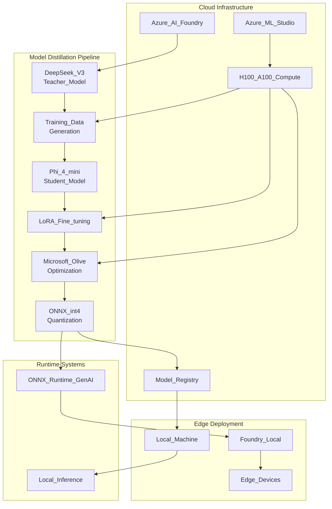
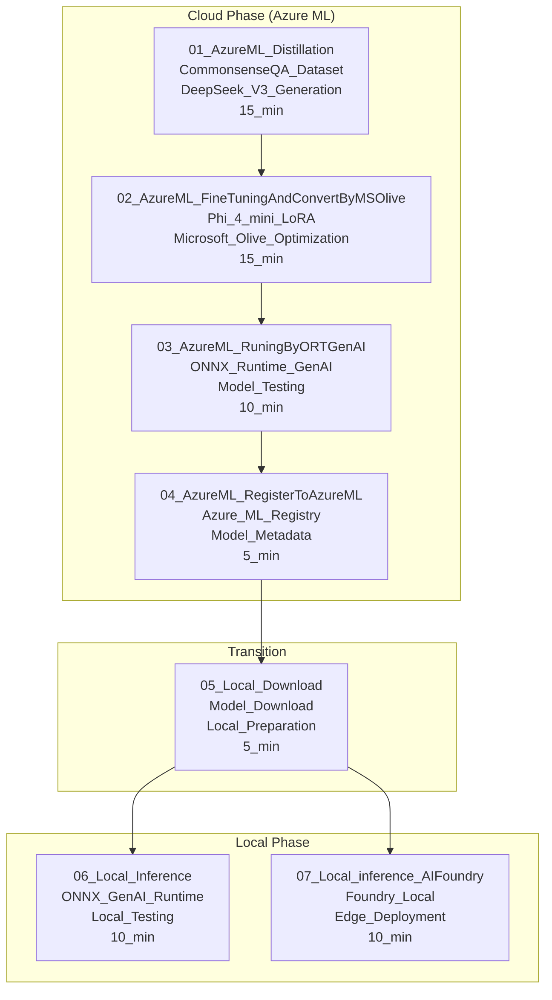
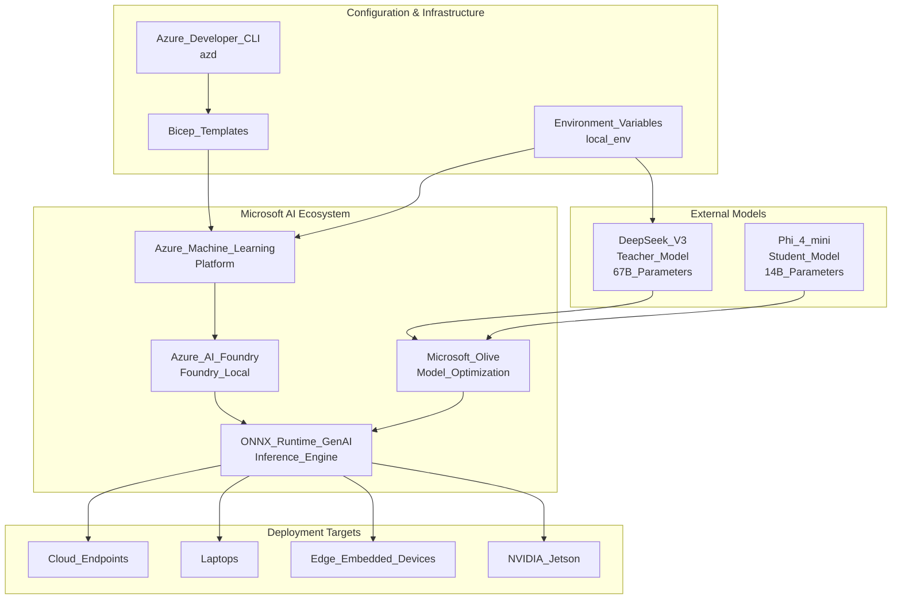
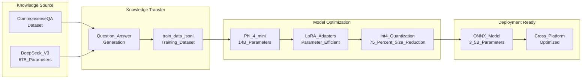

<!-- source: DeepWiki mcp.deepwiki.com · repo microsoft/Build25-LAB329 · page 1 Model Distillation Workshop Overview · fetched 2026-10-26 -->

# Model Distillation Workshop Overview

Relevant source files

The following files were used as context for generating this wiki page:

- [README.md](README.md)
- [lab_manual/Skillable_lab_manualintro.md](lab_manual/Skillable_lab_manualintro.md)
- [lab_manual/images/localenv.png](lab_manual/images/localenv.png)
- [lab_manual/readme.md](lab_manual/readme.md)

## Purpose and Scope

This document provides a comprehensive overview of the Build25-LAB329 model distillation workshop system. The workshop demonstrates an end-to-end workflow for extracting knowledge from Large Language Models (LLMs) and transferring it to Smaller Language Models (SLMs) while maintaining performance and enabling edge deployment.

The system implements a complete MLOps pipeline that transforms a 67B parameter DeepSeek-V3 teacher model into an optimized ~3.5B parameter ONNX model suitable for deployment on resource-constrained devices. For detailed setup instructions, see [Getting Started](#1.1). For specific technical component details, see [Technical Components](#1.3).

## System Architecture

The workshop implements a hybrid cloud-edge architecture with distinct phases for model processing and deployment.

### High-Level Architecture

**Sources:** [README.md:16-18](), [lab_manual/Skillable_lab_manualintro.md:12-34]()

### Sequential Workflow Pipeline

The workshop follows a strict seven-step sequential process implemented through Jupyter notebooks:

**Sources:** [README.md:31-59](), [lab_manual/Skillable_lab_manualintro.md:122-156]()

## Technology Stack Integration

The system leverages multiple Microsoft AI ecosystem components working in concert:

**Sources:** [README.md:8-14](), [lab_manual/readme.md:29-37]()

## Data Flow and Model Transformation

The knowledge distillation process transforms data and model representations through multiple stages:

**Sources:** [README.md:32-39](), [lab_manual/Skillable_lab_manualintro.md:24-30]()

## Infrastructure and Environment Setup

The system requires specific Azure cloud resources and local environment configuration:

| Component | Purpose | Configuration |
|-----------|---------|---------------|
| **Azure ML Workspace** | Primary compute and orchestration | H100/A100 compute instances |
| **Azure AI Foundry** | Teacher model hosting | DeepSeek-V3 endpoint |
| **Key Vault** | Secrets management | API keys and endpoints |
| **Storage Account** | Model and data storage | Training datasets and artifacts |
| **Cognitive Services** | Model inference | Teacher model API access |
| **Local Environment** | Edge deployment testing | ONNX Runtime GenAI |

**Sources:** [lab_manual/Skillable_lab_manualintro.md:49-105]()

## Workshop Execution Flow

The workshop is designed for hands-on execution with specific timing and resource requirements:

### Execution Timeline

| Phase | Duration | Activities | Location |
|-------|----------|------------|----------|
| **Setup** | 5 minutes | Environment configuration | Azure ML Studio |
| **Data Generation** | 15 minutes | `01.AzureML_Distillation.ipynb` | Azure ML |
| **Model Training** | 15 minutes | `02.AzureML_FineTuningAndConvertByMSOlive.ipynb` | Azure ML |
| **Model Testing** | 10 minutes | `03.AzureML_RuningByORTGenAI.ipynb` | Azure ML |
| **Model Registration** | 5 minutes | `04.AzureML_RegisterToAzureML.ipynb` | Azure ML |
| **Local Download** | 5 minutes | `05.Local_Download.ipynb` | Local Machine |
| **Local Inference** | 10 minutes | `06.Local_Inference.ipynb` | Local Machine |
| **Foundry Deployment** | 10 minutes | `07.Local_inference_AIFoundry.ipynb` | Local Machine |
| **Discussion** | 5 minutes | Results review | - |

**Sources:** [lab_manual/Skillable_lab_manualintro.md:5-11](), [lab_manual/readme.md:15-21]()

## Key System Characteristics

The workshop demonstrates several important MLOps and edge AI principles:

1. **Hybrid Cloud-Edge Architecture**: Models trained in Azure cloud, deployed locally for edge scenarios
2. **Sequential Processing Pipeline**: Seven distinct steps with clear dependencies and handoffs between notebooks
3. **Microsoft Technology Integration**: Comprehensive use of Microsoft AI tools (`Microsoft.Olive`, `Azure.AI.Foundry`, `ONNX.Runtime.GenAI`)
4. **Educational Focus**: Designed specifically for EdTech scenarios requiring offline AI capabilities
5. **Resource Efficiency**: Achieves 75% model size reduction while maintaining performance
6. **Multiple Deployment Options**: Supports cloud endpoints, local inference, and containerized edge deployment

The system effectively bridges the gap between large-scale cloud AI and practical edge deployment, making advanced language model capabilities accessible in resource-constrained environments.

**Sources:** [README.md:1-18](), [lab_manual/Skillable_lab_manualintro.md:36-44](), [lab_manual/readme.md:40-48]()

---

