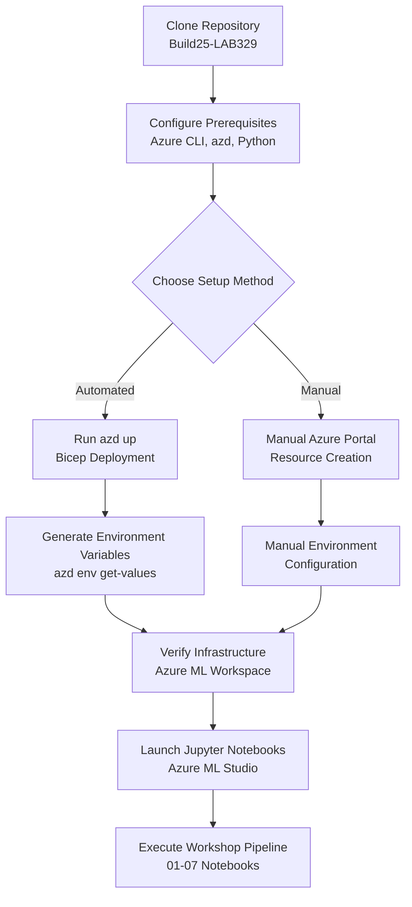
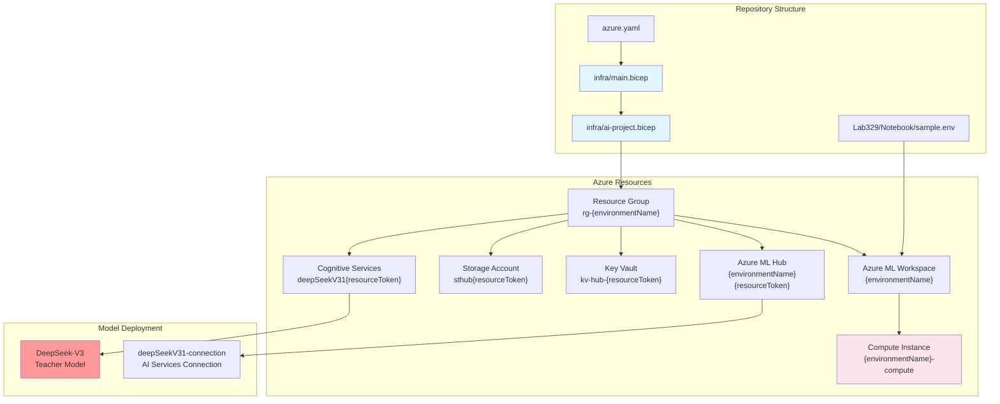
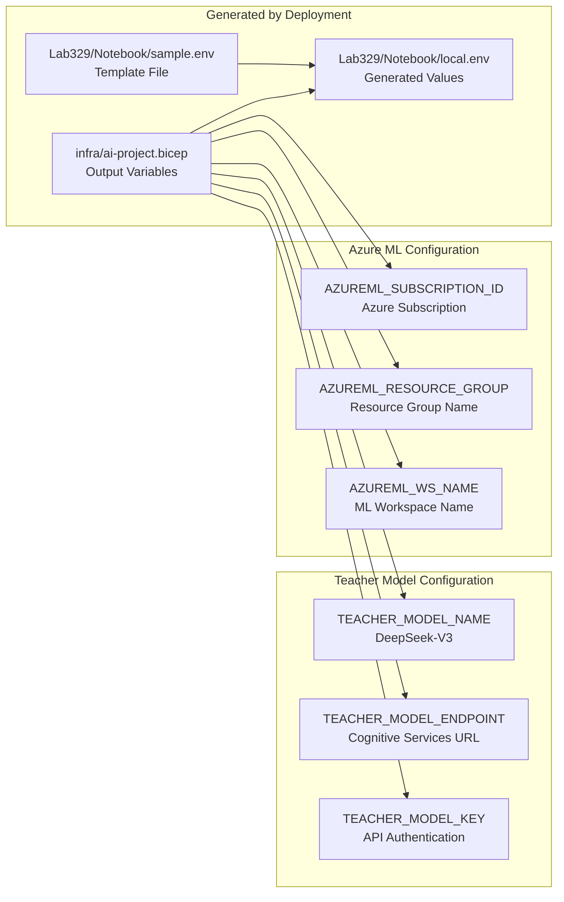

<!-- source: DeepWiki mcp.deepwiki.com · repo microsoft/Build25-LAB329 · page 1.1 Getting Started · fetched 2026-10-26 -->

# Getting Started

<details>
<summary>Relevant source files</summary>

The following files were used as context for generating this wiki page:

- [.gitignore](.gitignore)
- [Lab329/Notebook/sample.env](Lab329/Notebook/sample.env)
- [Lab329/README.md](Lab329/README.md)
- [azure.yaml](azure.yaml)
- [infra/ai-project.bicep](infra/ai-project.bicep)
- [infra/main.bicep](infra/main.bicep)
- [infra/main.parameters.json](infra/main.parameters.json)
- [lab_manual/setup_instructions.md](lab_manual/setup_instructions.md)

</details>


This guide provides the initial setup instructions for the Model Distillation Workshop, covering infrastructure provisioning, environment configuration, and prerequisites validation. The workshop demonstrates how to distill knowledge from large language models (LLMs) to smaller, edge-deployable models using Azure AI Foundry and Microsoft optimization tools.

For detailed Azure infrastructure provisioning steps, see [Azure Infrastructure Setup](#1.1.1). For environment variable configuration and development setup, see [Environment Configuration](#1.1.2). For the complete workshop workflow, see [Workshop Workflow](#1.2).

## Prerequisites

Before starting the workshop, ensure you have the following requirements:

| Requirement | Description | Verification Command |
|-------------|-------------|---------------------|
| **Azure Subscription** | Active subscription with Contributor permissions | `az account show` |
| **Azure CLI** | Latest version installed | `az --version` |
| **Azure Developer CLI** | azd CLI for infrastructure deployment | `azd version` |
| **Python 3.10+** | Required for local notebook execution | `python --version` |
| **Git** | Repository access and version control | `git --version` |
| **GPU Quota** | H100 or A100 GPU quota in supported regions | Check via Azure Portal |

### Supported Azure Regions

The workshop requires specific regions that support both H100/A100 compute and DeepSeek-V3 model deployment:

- `westus`
- `southcentralus` 
- `eastus`
- `westus3`
- `northcentralus`
- `eastus2`

Sources: [lab_manual/setup_instructions.md:30-39](), [infra/main.bicep:11-16]()

## Setup Flow Overview

**Setup Process Flow**



Sources: [lab_manual/setup_instructions.md:180-207](), [Lab329/README.md:79-88]()

## Quick Start Options

The workshop provides two setup approaches:

### Option 1: Automated Deployment (Recommended)

Use Azure Developer CLI for one-command infrastructure deployment:

```bash
# Clone repository
git clone https://github.com/microsoft/Build25-LAB329.git
cd Build25-LAB329

# Initialize and deploy
azd init
azd up

# Generate environment configuration
azd env get-values > Lab329/Notebook/local.env
```

### Option 2: Manual Setup

Follow detailed manual setup instructions for granular control over resource configuration. See [Azure Infrastructure Setup](#1.1.1) for step-by-step manual deployment.

Sources: [lab_manual/setup_instructions.md:180-207](), [lab_manual/setup_instructions.md:26-84]()

## Infrastructure Components

**Deployed Azure Resources and Configuration Files**



Sources: [infra/main.bicep:35-53](), [infra/ai-project.bicep:76-104](), [infra/ai-project.bicep:143-183]()

## Environment Configuration Overview

The workshop requires specific environment variables for connecting to Azure services and models:

**Required Environment Variables**



The automated deployment generates these variables automatically. For manual configuration, update the values in `Lab329/Notebook/sample.env` and rename to `local.env`.

Sources: [Lab329/Notebook/sample.env:1-12](), [infra/ai-project.bicep:211-215](), [infra/main.bicep:59-67]()

## Verification Steps

After completing the infrastructure setup, verify the deployment:

### 1. Check Azure Resources

```bash
# List deployed resources
azd env get-resources

# Verify environment variables
azd env get-values
```

### 2. Access Azure ML Studio

1. Navigate to [Azure ML Studio](https://ml.azure.com)
2. Select your workspace: `{environmentName}`
3. Verify compute instance: `{environmentName}-compute`
4. Check connection: `deepSeekV31-connection`

### 3. Test GPU Availability

In Azure ML Studio notebooks, run:

```python
import torch
print(f"CUDA available: {torch.cuda.is_available()}")
print(f"GPU Device: {torch.cuda.get_device_name(0)}")
```

Expected output shows H100 or A100 GPU detection.

Sources: [lab_manual/setup_instructions.md:102-110](), [lab_manual/setup_instructions.md:229-239]()

## Cost Management

The workshop uses premium GPU compute resources. Implement cost controls:

| Resource | Cost Factor | Mitigation |
|----------|-------------|------------|
| **H100/A100 Compute** | High hourly rate | Set minimum nodes to 0, enable auto-scale down |
| **DeepSeek-V3 Model** | Token-based pricing | Monitor API usage in notebooks |
| **Storage Account** | Data transfer and storage | Clean up intermediate files |

Configure budget alerts and monitor usage through the Azure Portal.

Sources: [lab_manual/setup_instructions.md:115-122](), [lab_manual/setup_instructions.md:366-371]()

## Next Steps

Once the infrastructure is ready and verified:

1. **Environment Configuration**: Complete detailed environment setup in [Environment Configuration](#1.1.2)
2. **Workshop Execution**: Begin the 7-step model distillation workflow in [Workshop Workflow](#1.2)
3. **First Notebook**: Start with `01.AzureML_Distillation.ipynb` for data generation

The workshop notebooks must be executed in Azure ML Studio with the correct compute instance and Python kernel environments as specified in [Lab329/README.md:82-84]().

Sources: [Lab329/README.md:33-67](), [Lab329/README.md:79-84]()

---

