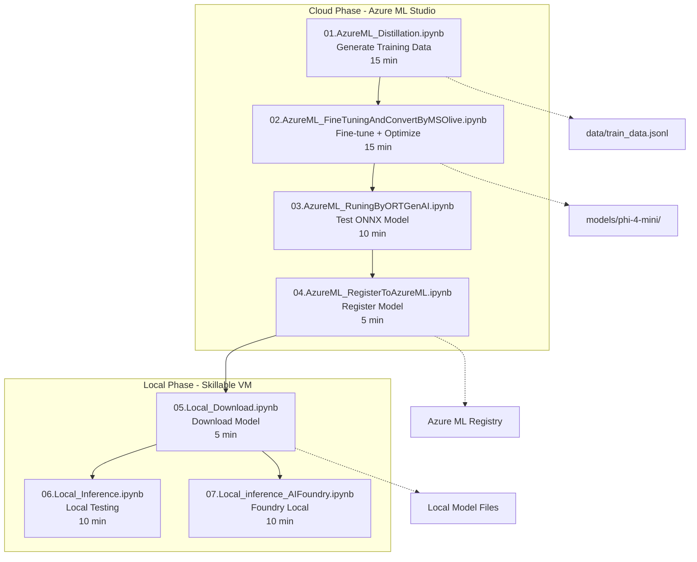
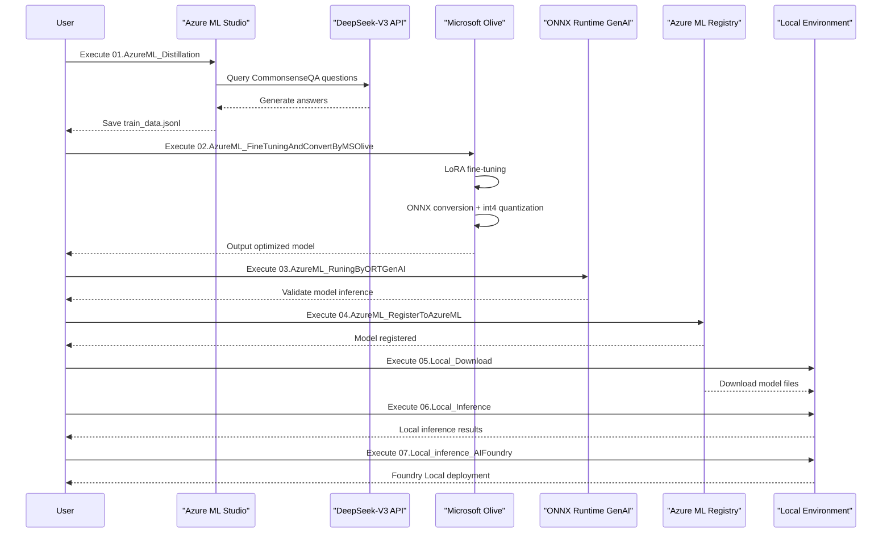

<!-- source: DeepWiki mcp.deepwiki.com · repo microsoft/Build25-LAB329 · page 1.2 Workshop Workflow · fetched 2026-10-26 -->

# Workshop Workflow

<details>
<summary>Relevant source files</summary>

The following files were used as context for generating this wiki page:

- [lab_manual/Skillable_lab_manualintro.md](lab_manual/Skillable_lab_manualintro.md)
- [lab_manual/distillation_lab_manual.md](lab_manual/distillation_lab_manual.md)
- [lab_manual/images/localenv.png](lab_manual/images/localenv.png)

</details>


This document provides a complete technical overview of the 7-step model distillation pipeline that transforms a large language model (DeepSeek-V3) into an optimized edge-deployable model (Phi-4-mini). The workflow encompasses cloud-based training and optimization followed by local deployment and inference.

For detailed instructions on each individual step, see the corresponding child pages [1.2.1](#1.2.1) through [1.2.7]. For initial setup requirements, see [Getting Started](#1.1). For technical component details, see [Technical Components](#1.3).

## Pipeline Overview

The workshop consists of seven sequential Jupyter notebooks that must be executed in order, with the first four running in Azure ML Studio and the final three executing locally. The entire process takes approximately 70 minutes and results in a quantized ONNX model that is 75% smaller than the original while maintaining performance.

## Workflow Architecture



Sources: [lab_manual/Skillable_lab_manualintro.md:117-156](), [lab_manual/distillation_lab_manual.md:105-119]()

## Execution Phases

The workflow is divided into two distinct phases based on execution environment:

### Cloud Phase (Azure ML Studio)
| Notebook | Purpose | Duration | Key Outputs |
|----------|---------|----------|-------------|
| `01.AzureML_Distillation` | Generate training data using DeepSeek-V3 teacher model | 15 min | `data/train_data.jsonl` |
| `02.AzureML_FineTuningAndConvertByMSOlive` | Fine-tune with LoRA and optimize with MS Olive | 15 min | `models/phi-4-mini/ft/adapter`, `models/phi-4-mini/onnx/model` |
| `03.AzureML_RuningByORTGenAI` | Test ONNX model with ORT GenAI | 10 min | Inference validation |
| `04.AzureML_RegisterToAzureML` | Register optimized model | 5 min | Azure ML registry entry |

### Local Phase (Skillable VM)
| Notebook | Purpose | Duration | Key Outputs |
|----------|---------|----------|-------------|
| `05.Local_Download` | Download registered model | 5 min | Local model files |
| `06.Local_Inference` | Local inference testing | 10 min | Performance validation |
| `07.Local_inference_AIFoundry` | Foundry Local deployment | 10 min | Containerized deployment |

Sources: [lab_manual/Skillable_lab_manualintro.md:122-156](), [lab_manual/distillation_lab_manual.md:111-119]()

## Data Flow and Model Transformation

```mermaid
flowchart LR
    subgraph "Input Data"
        CQA["CommonsenseQA<br/>Dataset"]
        TEACHER["DeepSeek-V3<br/>Teacher Model<br/>TEACHER_MODEL_ENDPOINT"]
    end
    
    subgraph "Generated Data"
        TRAINDATA["data/train_data.jsonl<br/>Q&A Pairs"]
    end
    
    subgraph "Student Model Pipeline"
        PHI["Phi-4-mini-instruct<br/>azureml://registries/azureml/models/"]
        LORA["LoRA Adapters<br/>models/phi-4-mini/ft/adapter"]
        ONNX["ONNX Model<br/>models/phi-4-mini/onnx/model"]
        ADAPTER["adapter_weights.onnx_adapter"]
    end
    
    subgraph "Deployment"
        AMLREG["Azure ML Registry<br/>fine-tuning-phi-4-mini-onnx-int4-cpu"]
        LOCALFILES["Local Model Files<br/>Downloaded Model"]
        INFERENCE["Local Inference<br/>onnxruntime_genai.Model"]
    end
    
    CQA --> TEACHER
    TEACHER --> TRAINDATA
    TRAINDATA --> PHI
    PHI --> LORA
    LORA --> ONNX
    ONNX --> ADAPTER
    ADAPTER --> AMLREG
    AMLREG --> LOCALFILES
    LOCALFILES --> INFERENCE
```



Sources: [lab_manual/distillation_lab_manual.md:244-442](), [lab_manual/Skillable_lab_manualintro.md:24-30]()

## Infrastructure Requirements

### Azure Resources
- **Azure ML Studio**: Primary execution environment for notebooks 1-4
- **H100/A100 Compute**: GPU compute for fine-tuning and optimization
- **DeepSeek-V3 Endpoint**: Teacher model accessed via `TEACHER_MODEL_ENDPOINT`
- **Azure ML Registry**: Model storage and versioning

### Local Environment  
- **Skillable VM**: Local execution environment for notebooks 5-7
- **ONNX Runtime GenAI**: Inference engine for optimized models
- **Azure Foundry Local**: Containerized deployment platform

### Environment Configuration
The workflow requires a `local.env` file with the following variables:
```
TEACHER_MODEL_NAME=DeepSeek-V3
TEACHER_MODEL_ENDPOINT=https://westus3.api.cognitive.microsoft.com/models
TEACHER_MODEL_KEY=your-api-key
AZUREML_SUBSCRIPTION_ID=your-subscription-id
AZUREML_RESOURCE_GROUP=your-resource-group
AZUREML_WS_NAME=your-workspace-name
```

Sources: [lab_manual/Skillable_lab_manualintro.md:87-105](), [lab_manual/distillation_lab_manual.md:85-103]()

## Key Technical Components

### Model Optimization Pipeline
The workflow leverages several Microsoft technologies:
- **Microsoft Olive**: Fine-tuning with `olive finetune` and optimization with `olive auto-opt`
- **ONNX Runtime GenAI**: Model loading via `onnxruntime_genai.Model()`
- **LoRA (Low-Rank Adaptation)**: Parameter-efficient fine-tuning targeting specific modules

### Model Artifacts
Each step produces specific artifacts that feed into subsequent steps:
1. **Training Data**: JSON Lines format with question-answer pairs
2. **LoRA Adapters**: Fine-tuned parameter deltas in `models/phi-4-mini/ft/adapter`
3. **ONNX Model**: Optimized model with int4 quantization
4. **Adapter Weights**: ONNX-compatible adapter file for inference

Sources: [lab_manual/distillation_lab_manual.md:444-506](), [lab_manual/distillation_lab_manual.md:508-564]()

## Execution Sequence

The notebooks must be executed sequentially due to data dependencies:



Sources: [lab_manual/Skillable_lab_manualintro.md:107-156](), [lab_manual/distillation_lab_manual.md:172-883]()

The complete workflow demonstrates knowledge distillation from a 67B parameter teacher model to a ~3.5B parameter student model while maintaining comparable performance on multiple-choice question answering tasks. The resulting model achieves a 75% reduction in size and can run efficiently on standard hardware without GPU requirements.

---

