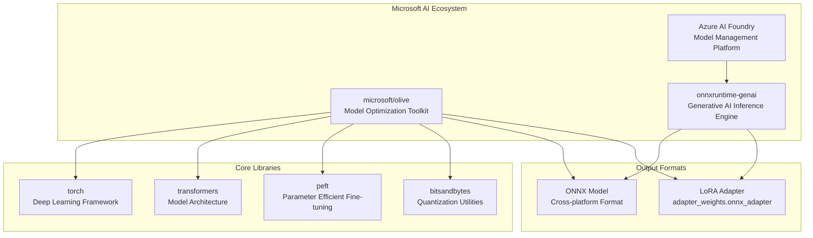
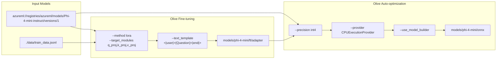
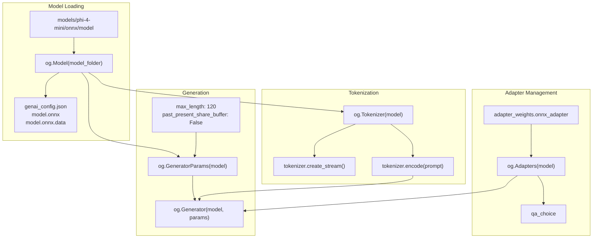
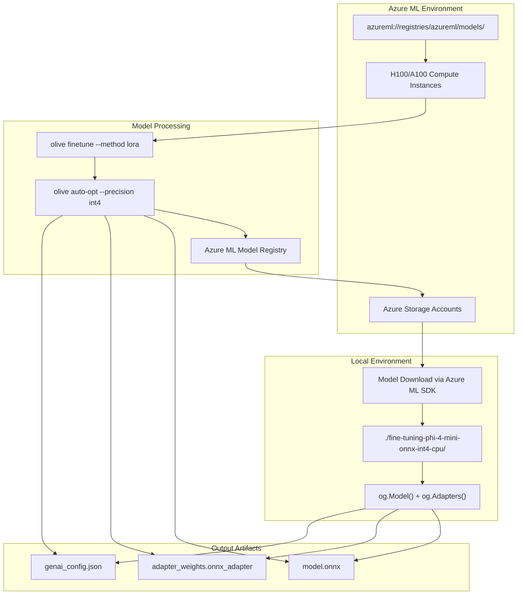

<!-- source: DeepWiki mcp.deepwiki.com · repo microsoft/Build25-LAB329 · page 1.3 Technical Components · fetched 2026-10-26 -->

# Technical Components

<details>
<summary>Relevant source files</summary>

The following files were used as context for generating this wiki page:

- [Lab329/Notebook/02.AzureML_FineTuningAndConvertByMSOlive.ipynb](Lab329/Notebook/02.AzureML_FineTuningAndConvertByMSOlive.ipynb)
- [Lab329/Notebook/03.AzureML_RuningByORTGenAI.ipynb](Lab329/Notebook/03.AzureML_RuningByORTGenAI.ipynb)
- [Lab329/Notebook/06.Local_Inference.ipynb](Lab329/Notebook/06.Local_Inference.ipynb)

</details>


This document provides a comprehensive overview of the technical frameworks and components used in the model distillation workshop. It covers the core technologies that enable the transformation of large teacher models into optimized, edge-deployable student models through fine-tuning, quantization, and format conversion.

For information about the step-by-step workflow process, see [Workshop Workflow](#1.2). For deployment scenarios and configurations, see [Deployment Scenarios](#1.4).

## Core Framework Stack

The model distillation workshop is built on three primary technical frameworks that work together to provide the complete pipeline from model training to deployment.



**Microsoft Olive Framework**

Microsoft Olive serves as the primary optimization toolkit for model fine-tuning and conversion. The framework provides command-line interfaces for both fine-tuning and auto-optimization workflows.

| Component | Purpose | CLI Command |
|-----------|---------|-------------|
| Fine-tuning | LoRA adaptation of base models | `olive finetune` |
| Auto-optimization | ONNX conversion and quantization | `olive auto-opt` |
| Model Builder | Optimized model construction | `--use_model_builder` flag |

**ONNX Runtime GenAI**

ONNX Runtime GenAI provides specialized inference capabilities for generative AI models with support for adapters and streaming generation.

| Class | Purpose | Key Methods |
|-------|---------|-------------|
| `og.Model` | Load ONNX models | Constructor takes model path |
| `og.Adapters` | Manage LoRA adapters | `load()`, adapter name management |
| `og.Generator` | Handle text generation | `generate_next_token()`, `is_done()` |
| `og.Tokenizer` | Text/token conversion | `encode()`, `create_stream()` |

Sources: [Lab329/Notebook/02.AzureML_FineTuningAndConvertByMSOlive.ipynb:112-133](), [Lab329/Notebook/03.AzureML_RuningByORTGenAI.ipynb:104-107]()

## Model Optimization Pipeline

The technical pipeline transforms models through multiple optimization stages using Microsoft Olive's modular architecture.



**Fine-tuning Configuration**

The fine-tuning process uses LoRA (Low-Rank Adaptation) to efficiently adapt the base model without modifying all parameters.

```bash
olive finetune \
    --method lora \
    --model_name_or_path azureml://registries/azureml/models/Phi-4-mini-instruct/versions/1 \
    --target_modules "q_proj","k_proj","v_proj","o_proj","gate_proj","up_proj","down_proj" \
    --max_steps 100 \
    --output_path models/phi-4-mini/ft
```

**Auto-optimization Configuration**

The auto-optimization stage converts the fine-tuned model to ONNX format with int4 quantization.

```bash
olive auto-opt \
    --model_name_or_path azureml://registries/azureml/models/Phi-4-mini-instruct/versions/1 \
    --adapter_path models/phi-4-mini/ft/adapter \
    --precision int4 \
    --use_model_builder \
    --output_path models/phi-4-mini/onnx
```

Sources: [Lab329/Notebook/02.AzureML_FineTuningAndConvertByMSOlive.ipynb:374-385](), [Lab329/Notebook/02.AzureML_FineTuningAndConvertByMSOlive.ipynb:472-481]()

## Inference Runtime Components

The inference system uses ONNX Runtime GenAI with a modular architecture that separates model loading, adapter management, and text generation.



**Generation Loop Implementation**

The text generation process uses a streaming approach that generates tokens iteratively.

| Method | Purpose | Return Type |
|--------|---------|-------------|
| `generator.is_done()` | Check completion status | `bool` |
| `generator.generate_next_token()` | Generate single token | `None` |
| `generator.get_next_tokens()[0]` | Retrieve latest token | `int` |
| `tokenizer_stream.decode(token)` | Convert token to text | `str` |

**Search Options Configuration**

| Parameter | Purpose | Default Value |
|-----------|---------|---------------|
| `max_length` | Maximum generation length | 120 |
| `past_present_share_buffer` | Memory optimization | False |
| `repeat_penalty` | Reduce repetition | 1.1 |
| `temperature` | Control randomness | 0.7 |

Sources: [Lab329/Notebook/03.AzureML_RuningByORTGenAI.ipynb:187-188](), [Lab329/Notebook/03.AzureML_RuningByORTGenAI.ipynb:218-220](), [Lab329/Notebook/06.Local_Inference.ipynb:286-298]()

## Integration Architecture

The technical components integrate across different deployment environments while maintaining consistent interfaces and data formats.



**Package Dependencies**

The workshop requires specific package versions for compatibility across the optimization and inference pipeline.

| Package | Version | Purpose |
|---------|---------|---------|
| `olive-ai[auto-opt]` | Latest | Model optimization framework |
| `onnxruntime-genai` | 0.7.1 | Generative AI inference engine |
| `onnxruntime` | 1.21.1 | Base ONNX runtime |
| `transformers` | 4.49.0 | Transformer model architectures |
| `torch` | Latest (CUDA 12.4) | Deep learning framework |
| `peft` | Latest | Parameter-efficient fine-tuning |

**Environment Configuration**

The system uses environment variables and configuration files to manage Azure authentication and model paths.

| Configuration | Source | Purpose |
|---------------|---------|---------|
| Azure credentials | `local.env` | Authentication for Azure ML |
| Model registry path | `azureml://registries/azureml/models/` | Remote model access |
| Local model path | `./fine-tuning-phi-4-mini-onnx-int4-cpu/` | Downloaded model location |
| Adapter path | `adapter_weights.onnx_adapter` | LoRA adapter file |

Sources: [Lab329/Notebook/02.AzureML_FineTuningAndConvertByMSOlive.ipynb:77-78](), [Lab329/Notebook/02.AzureML_FineTuningAndConvertByMSOlive.ipynb:187-189](), [Lab329/Notebook/06.Local_Inference.ipynb:126-137]()

---

