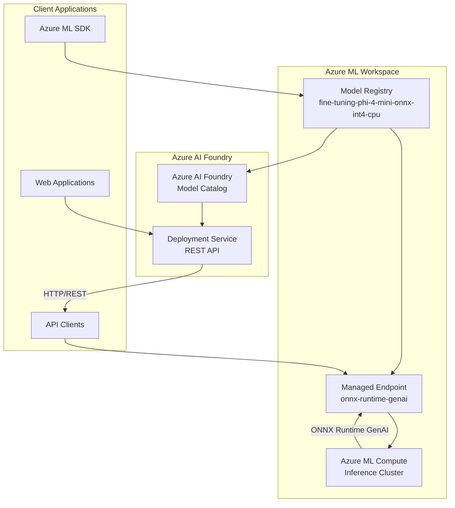
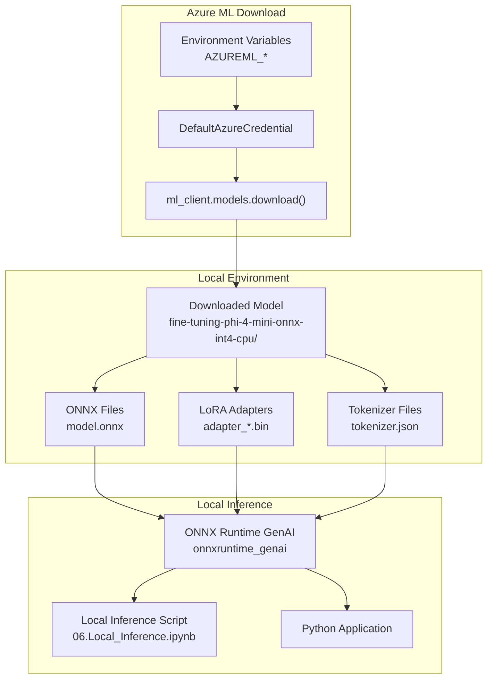
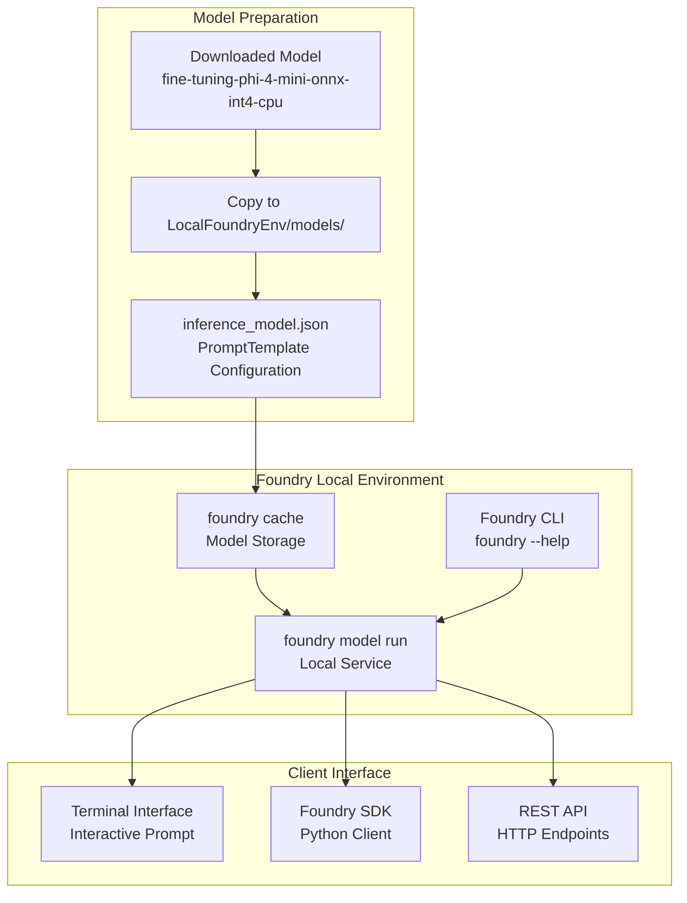
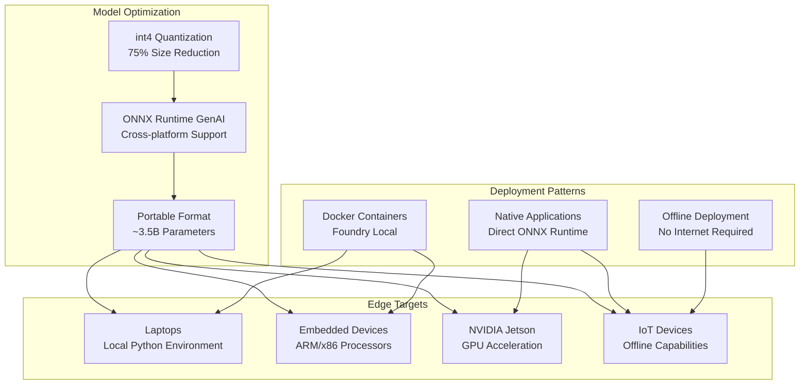

<!-- source: DeepWiki mcp.deepwiki.com · repo microsoft/Build25-LAB329 · page 1.4 Deployment Scenarios · fetched 2026-10-26 -->

# Deployment Scenarios

<details>
<summary>Relevant source files</summary>

The following files were used as context for generating this wiki page:

- [Lab329/Notebook/05.Local_Download.ipynb](Lab329/Notebook/05.Local_Download.ipynb)
- [Lab329/Notebook/07.Local_inference_AIFoundry.ipynb](Lab329/Notebook/07.Local_inference_AIFoundry.ipynb)

</details>


This document covers the different deployment options available for the distilled models created through the Model Distillation Workshop. It focuses on the practical aspects of deploying optimized ONNX models from cloud environments to edge devices, including configuration requirements, deployment patterns, and infrastructure considerations.

For information about the model optimization and conversion process, see [Technical Components](#1.3). For specific edge computing applications and configurations, see [Edge Computing Applications](#1.4.1).

## Deployment Overview

The Model Distillation Workshop supports multiple deployment scenarios, each optimized for different use cases, resource constraints, and operational requirements. The deployment pipeline follows a cloud-to-edge pattern where models are trained and optimized in Azure cloud infrastructure and then deployed to various target environments.

## Cloud Deployment Architecture

Cloud deployment leverages Azure ML infrastructure for serving optimized models through managed endpoints and services.



**Cloud Deployment Characteristics:**
- Scalable inference with Azure ML managed endpoints
- Integration with Azure AI Foundry for model serving
- Supports both synchronous and batch inference patterns
- Automatic scaling based on demand

Sources: [Lab329/Notebook/04.AzureML_RegisterToAzureML.ipynb](), System architecture diagrams

## Local Machine Deployment

Local deployment enables running the optimized models directly on development machines or local servers without cloud dependencies.



**Local Deployment Process:**
1. **Authentication**: Use `DefaultAzureCredential` for Azure ML access
2. **Model Download**: Execute `ml_client.models.download()` from [Lab329/Notebook/05.Local_Download.ipynb:482-498]()
3. **File Structure**: Organize model files in local directory structure
4. **Runtime Setup**: Configure ONNX Runtime GenAI for local inference

**Key Configuration Requirements:**
- Environment variables: `AZUREML_SUBSCRIPTION_ID`, `AZUREML_RESOURCE_GROUP`, `AZUREML_WS_NAME`
- Python 3.10+ with required packages: `azure-ai-ml`, `onnxruntime-genai`
- Sufficient local storage for model files (typically 500MB-2GB)

Sources: [Lab329/Notebook/05.Local_Download.ipynb:328-358](), [Lab329/Notebook/05.Local_Download.ipynb:482-523]()

## Foundry Local Containerized Deployment

Foundry Local provides a containerized deployment option that combines the benefits of local deployment with service-oriented architecture.



**Foundry Local Configuration:**
- Model configuration in `inference_model.json` with prompt templates
- CLI commands: `foundry cache cd models`, `foundry model run model --verbose`
- Support for interactive terminal-based inference
- Integration with Python SDK for programmatic access

**Example Configuration Structure:**
```json
{
    "Name": "phi-4-mini-reasoning-onnx",
    "PromptTemplate": {
        "assistant": "{Content}",
        "prompt": "<|user|>Explain the Pythagorean Theorem<|end|><|assistant|>"
    }
}
```

Sources: [Lab329/Notebook/07.Local_inference_AIFoundry.ipynb:42-61](), [Lab329/Notebook/07.Local_inference_AIFoundry.ipynb:84-95]()

## Edge Device Deployment

Edge deployment targets resource-constrained environments including embedded systems, IoT devices, and offline scenarios.



**Edge Deployment Characteristics:**
- Model size optimized through int4 quantization for memory-constrained environments
- Cross-platform ONNX Runtime GenAI support for various architectures
- Offline operation capability without cloud connectivity
- Educational and EdTech scenarios with resource limitations

**Target Hardware Specifications:**
- Minimum RAM: 4GB for Phi-4-mini int4 quantized model
- Storage: 1-2GB for complete model and runtime
- CPU: x86-64 or ARM64 architecture support
- Optional: GPU acceleration for NVIDIA Jetson devices

Sources: System architecture diagrams, [Lab329/Notebook/07.Local_inference_AIFoundry.ipynb:26-31]()

## Deployment Comparison Matrix

| Deployment Type | Scalability | Latency | Resource Requirements | Offline Support | Use Cases |
|----------------|-------------|---------|----------------------|----------------|-----------|
| Cloud (Azure ML) | High | Medium | Low (client-side) | No | Production APIs, web services |
| Local Machine | Low | Low | Medium | Yes | Development, testing |
| Foundry Local | Medium | Low | Medium | Yes | Containerized services, demos |
| Edge Device | Low | Very Low | Low | Yes | IoT, embedded, education |

## Infrastructure Requirements

**Development Environment:**
- Visual Studio Code with Python extension
- Azure CLI with authentication: `az login --use-device-code`
- Python 3.10+ with Azure ML SDK
- Environment configuration through `local.env` or Azure Developer CLI

**Runtime Dependencies:**
- ONNX Runtime GenAI for inference execution
- Azure SDK for Python for cloud integration
- Optional: Docker for containerized deployment
- Optional: Foundry Local CLI for service management

**Network and Security:**
- Azure subscription with ML workspace access
- Resource group permissions for model registry
- Optional: VPN or private endpoints for secure cloud access
- Local firewall configuration for Foundry Local services

Sources: [Lab329/Notebook/05.Local_Download.ipynb:31-34](), [Lab329/Notebook/05.Local_Download.ipynb:328-341](), [Lab329/Notebook/07.Local_inference_AIFoundry.ipynb:26-31]()

---

