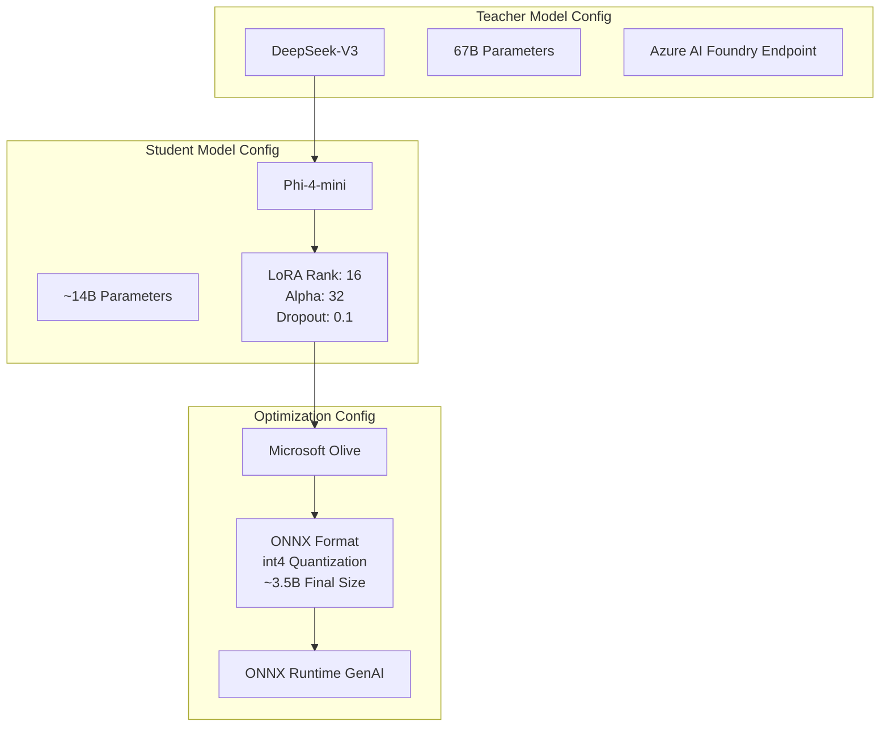
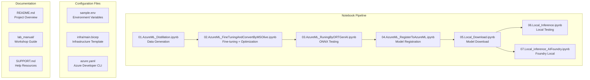
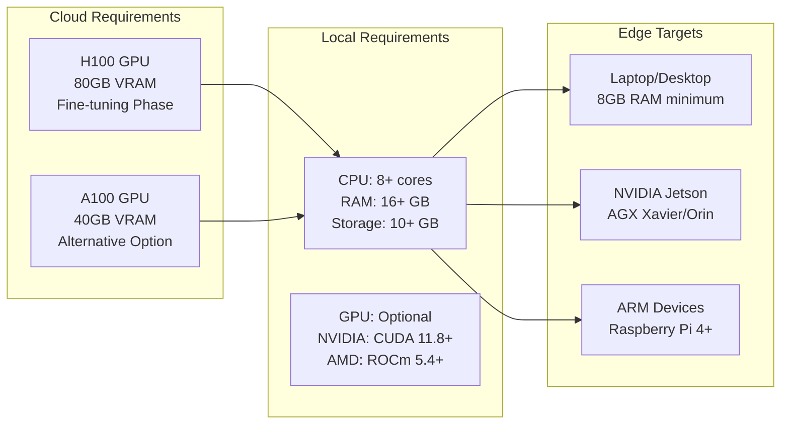
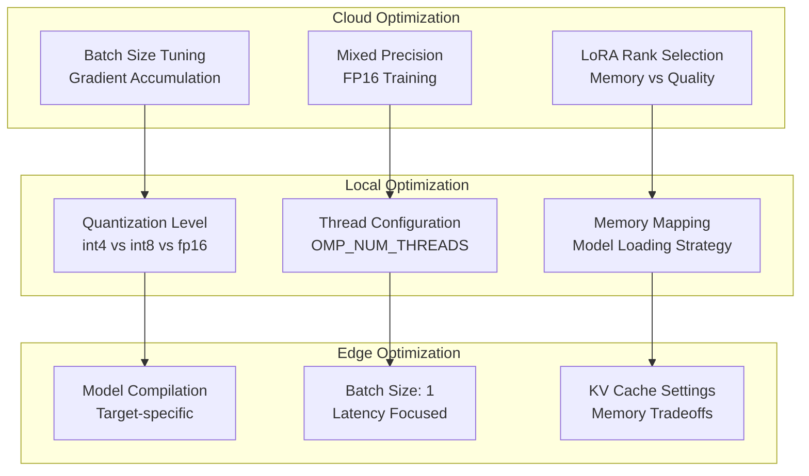
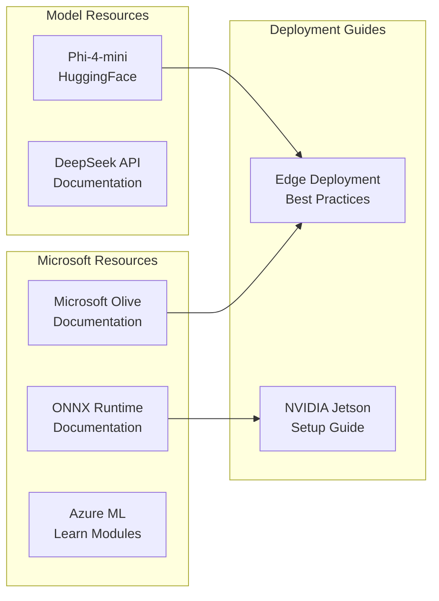

<!-- source: DeepWiki mcp.deepwiki.com · repo microsoft/Build25-LAB329 · page 1.5 Reference · fetched 2026-10-26 -->

# Reference

Relevant source files

The following files were used as context for generating this wiki page:

- [.github/ISSUE_TEMPLATE.md](.github/ISSUE_TEMPLATE.md)
- [.github/PULL_REQUEST_TEMPLATE.md](.github/PULL_REQUEST_TEMPLATE.md)
- [SUPPORT.md](SUPPORT.md)
- [lab_manual/Skillable_lab_manualconclusion.md](lab_manual/Skillable_lab_manualconclusion.md)
- [lab_manual/images/Skillable_Burger_Menu.png](lab_manual/images/Skillable_Burger_Menu.png)

This page provides comprehensive reference material for the Model Distillation Workshop, including configuration parameters, troubleshooting guidance, and additional resources. This reference covers technical specifications and operational procedures for the complete pipeline from teacher model deployment to edge inference.

For step-by-step workshop instructions, see [Workshop Workflow](#1.2). For detailed technical component explanations, see [Technical Components](#1.3).

## Configuration Parameters

### Environment Variables

The workshop relies on several environment variables that must be configured before running the notebooks:

| Variable | Purpose | Example Value | Required |
|----------|---------|---------------|----------|
| `AZURE_SUBSCRIPTION_ID` | Azure subscription identifier | `12345678-1234-1234-1234-123456789012` | Yes |
| `AZURE_RESOURCE_GROUP` | Resource group name | `rg-build25-lab329` | Yes |
| `AZURE_ML_WORKSPACE` | Azure ML workspace name | `mlw-build25-lab329` | Yes |
| `DEEPSEEK_ENDPOINT` | DeepSeek model endpoint URL | `https://your-endpoint.openai.azure.com/` | Yes |
| `DEEPSEEK_API_KEY` | Authentication key for DeepSeek | `sk-...` | Yes |
| `COMPUTE_INSTANCE_NAME` | Azure ML compute instance | `ci-build25-h100` | Yes |

### Model Configuration

**Model Configuration Parameters**

Sources: [lab_manual/Skillable_lab_manualconclusion.md:20-26]()

## File Structure Reference

### Key Directories and Files

**File Structure Components**

Sources: [lab_manual/Skillable_lab_manualconclusion.md:18-25]()

### Generated Artifacts

| Artifact | Location | Purpose | Size |
|----------|----------|---------|------|
| `train_data.jsonl` | Azure ML datastore | Training dataset from teacher model | ~500MB |
| `phi4_lora_adapters/` | Azure ML outputs | LoRA adapter weights | ~100MB |
| `phi4_onnx_model/` | Azure ML registry | Optimized ONNX model | ~3.5GB |
| `downloaded_model/` | Local filesystem | Local copy for inference | ~3.5GB |

## Technical Specifications

### Hardware Requirements

**Hardware Compatibility Matrix**

Sources: [lab_manual/Skillable_lab_manualconclusion.md:44-46]()

### Software Dependencies

| Component | Version | Purpose |
|-----------|---------|---------|
| `onnxruntime-genai` | >=0.4.0 | Model inference engine |
| `olive-ai` | >=0.7.0 | Model optimization framework |
| `azureml-sdk` | >=1.54.0 | Azure ML integration |
| `transformers` | >=4.36.0 | HuggingFace model loading |
| `torch` | >=2.1.0 | PyTorch framework |
| `numpy` | >=1.24.0 | Numerical computing |

## Troubleshooting Guide

### Common Issues and Solutions

#### Authentication Errors

**Issue**: `Authentication failed for Azure ML workspace`

**Solution**:
1. Verify `AZURE_SUBSCRIPTION_ID` is correct
2. Check Azure CLI authentication: `az account show`
3. Ensure proper permissions on resource group

#### Memory Issues

**Issue**: `CUDA out of memory during fine-tuning`

**Solution**:
1. Reduce batch size in notebook configuration
2. Enable gradient checkpointing
3. Use H100 compute instead of A100

#### Model Download Failures

**Issue**: `Failed to download model from registry`

**Solution**:
1. Verify model registration completed successfully
2. Check network connectivity from local environment
3. Ensure sufficient local storage space

### Performance Optimization

**Performance Tuning Parameters**

## Resource Management

### Cleanup Procedures

**Azure Resource Cleanup**:
1. Stop compute instances to avoid charges
2. Delete unused model registrations
3. Clean up storage account artifacts
4. Remove resource group if no longer needed

**Local Cleanup**:
1. Remove downloaded model files (`downloaded_model/`)
2. Clear cached datasets and intermediate files
3. Reset environment variables if switching projects

Sources: [lab_manual/Skillable_lab_manualconclusion.md:4-14]()

### Cost Optimization

| Resource | Cost Factor | Optimization Strategy |
|----------|-------------|----------------------|
| H100 Compute | High per hour | Use spot instances, schedule shutdown |
| Storage | Data volume | Compress datasets, delete intermediates |
| Cognitive Services | API calls | Batch requests, cache responses |
| Model Registry | Storage time | Version cleanup, automated retention |

## Support and Resources

### Getting Help

**Primary Support Channels**:
- GitHub Issues: Use provided templates for bug reports
- Documentation: Comprehensive guides in `lab_manual/`
- Community: Microsoft AI community forums

Sources: [SUPPORT.md:1-19](), [.github/ISSUE_TEMPLATE.md:1-36]()

### Additional Learning Resources

**Extended Learning Path**

Sources: [lab_manual/Skillable_lab_manualconclusion.md:50-54]()

### Repository Information

**GitHub Repository**: `https://github.com/microsoft/Build25-LAB329`

**Contributing Guidelines**: 
- Use pull request templates for changes
- Follow existing code style and documentation patterns
- Test changes across the complete pipeline

**Feedback and Improvements**:
- Star the repository for future reference
- Submit issues for bugs or feature requests
- Contribute improvements via pull requests

Sources: [lab_manual/Skillable_lab_manualconclusion.md:57-66](), [.github/PULL_REQUEST_TEMPLATE.md:1-34]()

---

