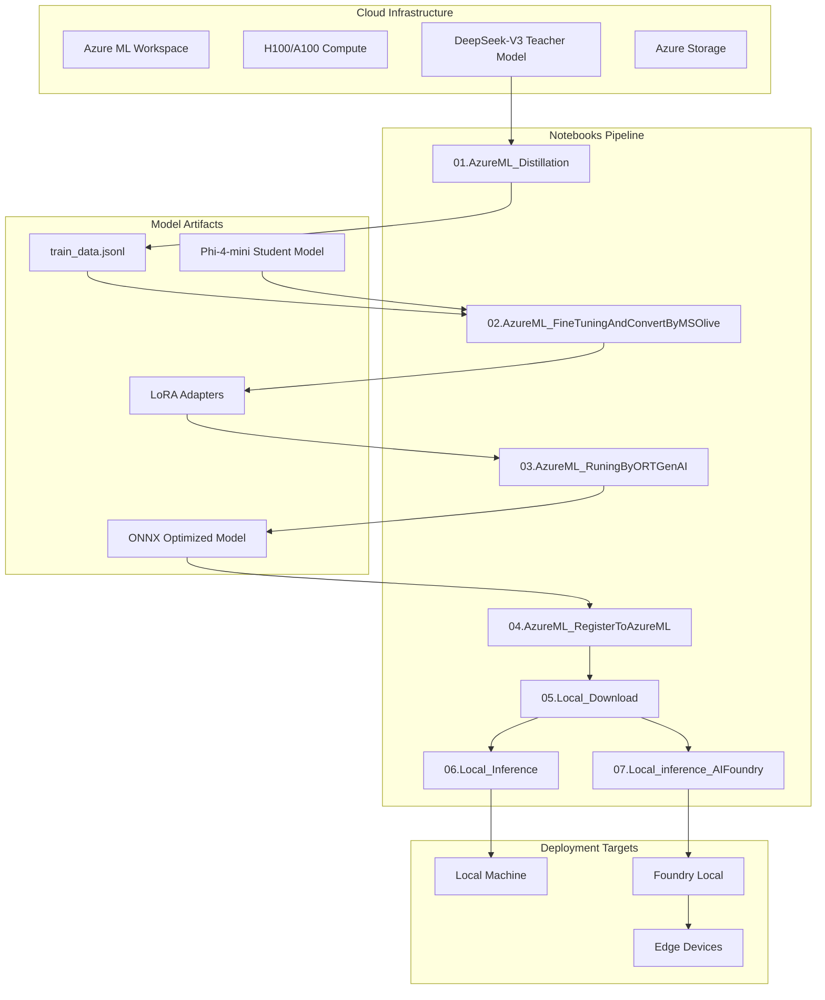
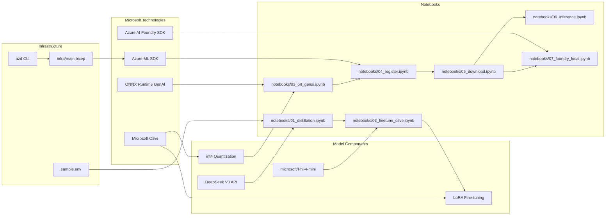
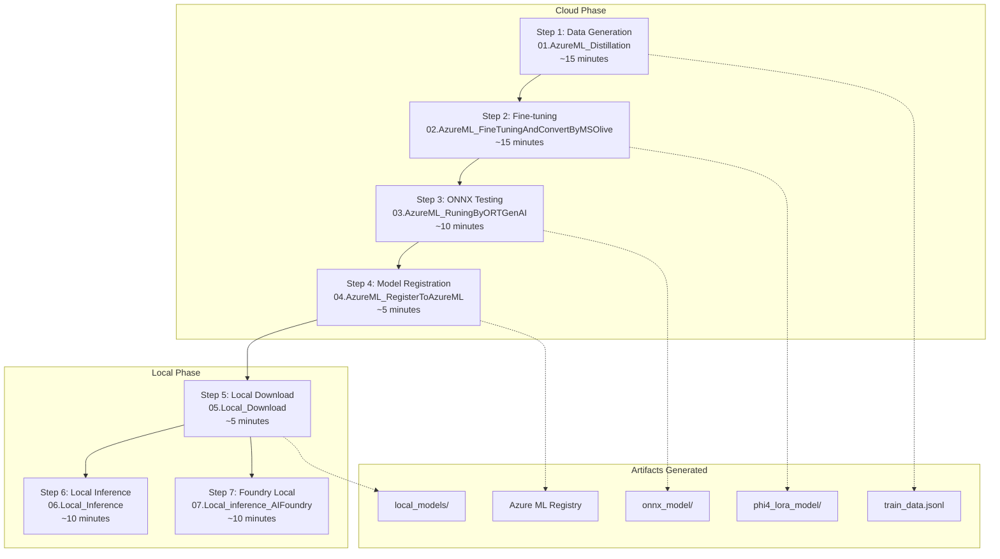
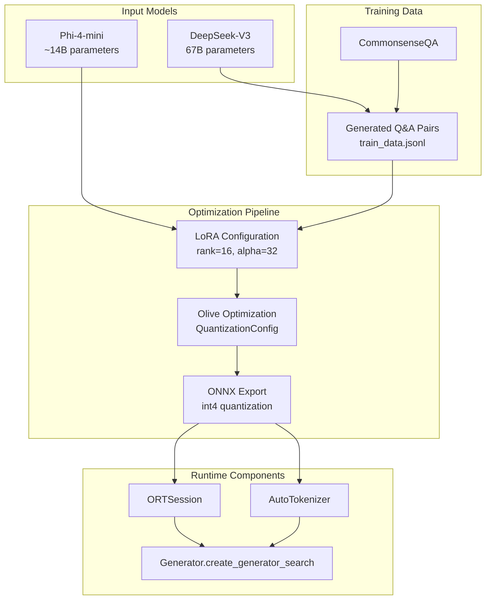
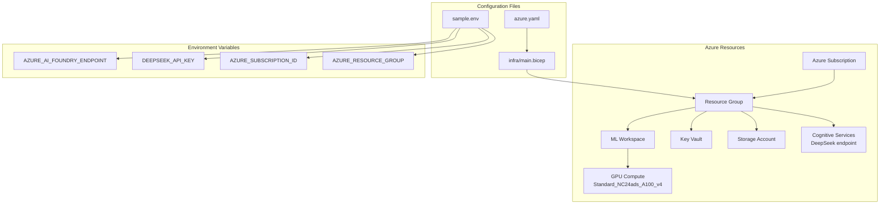
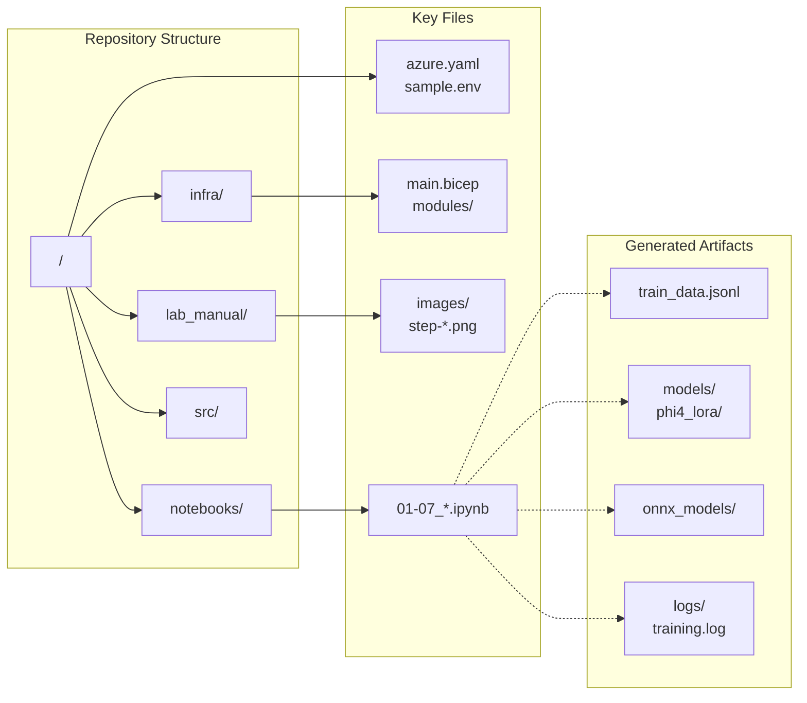
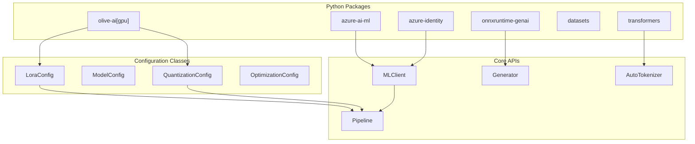

<!-- source: DeepWiki mcp.deepwiki.com · repo microsoft/Build25-LAB329 · page 1.6 Visual Resources · fetched 2026-10-26 -->

# Visual Resources

Relevant source files

The following files were used as context for generating this wiki page:

- [lab_manual/images/overview.png](lab_manual/images/overview.png)
- [lab_manual/images/step-2.png](lab_manual/images/step-2.png)
- [lab_manual/images/step-3.png](lab_manual/images/step-3.png)
- [lab_manual/images/step-4.png](lab_manual/images/step-4.png)
- [lab_manual/images/steps.png](lab_manual/images/steps.png)

This page provides screenshots, diagrams, and visual aids that illustrate the Model Distillation Workshop architecture and workflow. These visual materials complement the technical documentation by showing the system components, their relationships, and the user interface elements encountered during the workshop execution.

For detailed technical implementation information, see [Technical Components](#1.3). For step-by-step instructions, see [Workshop Workflow](#1.2).

## Architecture Overview

### High-Level System Architecture

The following diagram shows the complete model distillation pipeline from cloud-based training to edge deployment:

Sources: [lab_manual/images/overview.png]()

### Technology Stack Integration

This diagram maps the Microsoft AI ecosystem components to their roles in the distillation workflow:

Sources: [notebooks/](), [infra/main.bicep](), [sample.env]()

## Workshop Workflow Visualization

### Sequential Step Dependencies

Sources: [notebooks/01_distillation.ipynb](), [notebooks/02_finetune_olive.ipynb](), [notebooks/03_ort_genai.ipynb](), [notebooks/04_register.ipynb](), [notebooks/05_download.ipynb](), [notebooks/06_inference.ipynb](), [notebooks/07_foundry_local.ipynb]()

## Key Component Relationships

### Model Transformation Pipeline

Sources: [notebooks/01_distillation.ipynb](), [notebooks/02_finetune_olive.ipynb](), [notebooks/03_ort_genai.ipynb]()

### Azure Infrastructure Dependencies

Sources: [infra/main.bicep](), [azure.yaml](), [sample.env]()

## Step Screenshots

### Step 2: Fine-tuning and Optimization Interface

The following image shows the Microsoft Olive fine-tuning interface during the model optimization process:

This screenshot demonstrates:
- LoRA adapter configuration parameters
- Training progress monitoring
- ONNX conversion status
- Resource utilization metrics

Sources: [lab_manual/images/step-2.png]()

### Step 4: Model Registration Process

The model registration interface showing the Azure ML workspace integration:

Key elements visible:
- Model artifact upload progress
- Registry metadata configuration
- Version management interface
- Model validation status

Sources: [lab_manual/images/step-4.png]()

## File Structure Visualization

### Project Organization

Sources: [azure.yaml](), [infra/](), [notebooks/](), [lab_manual/images/]()

### Runtime Dependencies

Sources: [notebooks/01_distillation.ipynb:1-20](), [notebooks/02_finetune_olive.ipynb:1-30](), [notebooks/03_ort_genai.ipynb:1-25]()