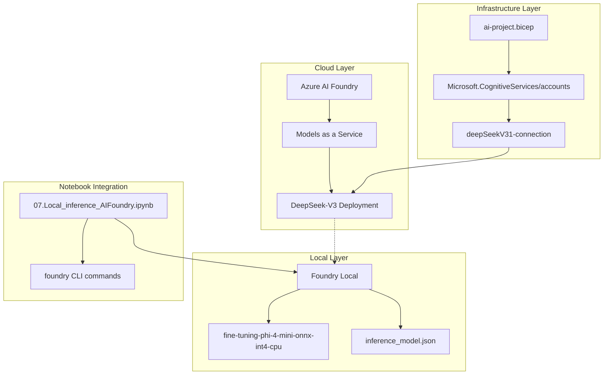
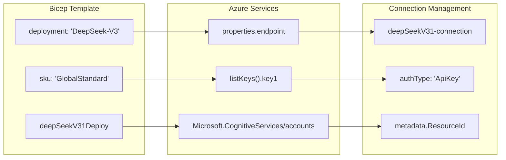
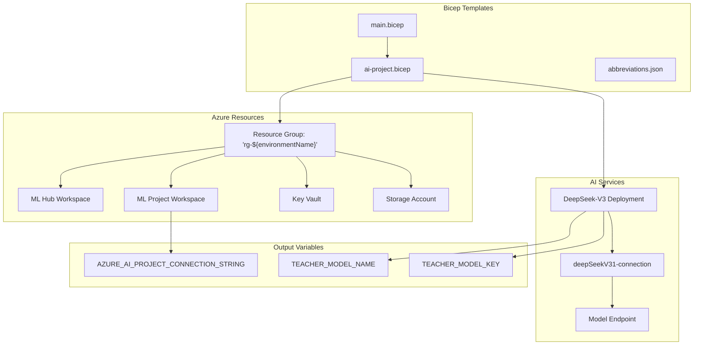
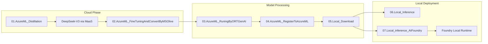

<!-- source: DeepWiki mcp.deepwiki.com · repo microsoft/Build25-LAB329 · extra page Azure AI Foundry · fetched 2026-10-26 -->

# Azure AI Foundry

<details>
<summary>Relevant source files</summary>

The following files were used as context for generating this wiki page:

- [Lab329/Notebook/07.Local_inference_AIFoundry.ipynb](Lab329/Notebook/07.Local_inference_AIFoundry.ipynb)
- [infra/ai-project.bicep](infra/ai-project.bicep)
- [infra/main.bicep](infra/main.bicep)
- [lab_manual/setup_instructions.md](lab_manual/setup_instructions.md)

</details>


## Purpose and Scope

This document covers Azure AI Foundry's role in the Build25-LAB329 model distillation workshop, including cloud-based model deployment through Models as a Service (MaaS) and edge deployment using Foundry Local. Azure AI Foundry serves as both the cloud platform for serving the DeepSeek-V3 teacher model and the local inference runtime for optimized student models.

For infrastructure provisioning details, see [Azure Infrastructure Setup](#1.1.1). For the complete workshop workflow, see [Workshop Workflow](#1.2).

## Azure AI Foundry Architecture in Model Distillation Pipeline

Azure AI Foundry operates in two distinct modes within the model distillation workflow: as a cloud service for teacher model deployment and as a local runtime for student model inference.

### Cloud and Edge Integration



Sources: [Lab329/Notebook/07.Local_inference_AIFoundry.ipynb:1-162](), [infra/ai-project.bicep:76-104](), [lab_manual/setup_instructions.md:306-442]()

## Models as a Service (MaaS) Deployment

Azure AI Foundry provides serverless model deployment through MaaS, eliminating the need for dedicated compute infrastructure. The DeepSeek-V3 teacher model is deployed using this approach.

### MaaS Infrastructure Components



The MaaS deployment configuration is defined in the Bicep template with specific model parameters:

| Component | Configuration | Purpose |
|-----------|---------------|---------|
| Model Name | `DeepSeek-V3` | Teacher model identifier |
| Format | `DeepSeek` | Model format specification |
| Version | `1` | Model version |
| SKU | `GlobalStandard` | Serverless deployment tier |
| Capacity | `1` | Initial capacity units |

Sources: [infra/ai-project.bicep:76-104](), [lab_manual/setup_instructions.md:306-442]()

## Foundry Local for Edge Deployment

Foundry Local provides containerized local inference capabilities for the optimized student models. It serves as the final deployment target in the model distillation pipeline.

### Local Deployment Architecture

```mermaid
graph TB
    subgraph "Model Preparation"
        ONNXMODEL["fine-tuning-phi-4-mini-onnx-int4-cpu/"]
        MODELDIR["LocalFoundryEnv/models/"]
        CONFIGFILE["inference_model.json"]
    end
    
    subgraph "Foundry Local CLI"
        CACHE["foundry cache cd models"]
        LIST["foundry cache list"]
        RUN["foundry model run model --verbose"]
    end
    
    subgraph "Configuration Schema"
        NAME['"Name": "phi-4-mini-reasoning-onnx"']
        PROMPT['"PromptTemplate"']
        ASSISTANT['"assistant": "{Content}"']
    end
    
    subgraph "Notebook Integration"
        NB07["07.Local_inference_AIFoundry.ipynb"]
        TERMINAL["VSCode Integrated Terminal"]
        TESTQUERY["CommonsenseQA Test Questions"]
    end
    
    ONNXMODEL --> MODELDIR
    CONFIGFILE --> MODELDIR
    MODELDIR --> CACHE
    CACHE --> LIST
    LIST --> RUN
    
    NAME --> CONFIGFILE
    PROMPT --> CONFIGFILE
    ASSISTANT --> CONFIGFILE
    
    NB07 --> TERMINAL
    TERMINAL --> CACHE
    RUN --> TESTQUERY
```

### Configuration Structure

The `inference_model.json` configuration file defines the model serving parameters:

```json
{
    "Name": "phi-4-mini-reasoning-onnx",
    "PromptTemplate": {
        "assistant": "{Content}",
        "prompt": "<|user|>Explain the Pythagorean Theorem<|end|><|assistant|>"
    }
}
```

Sources: [Lab329/Notebook/07.Local_inference_AIFoundry.ipynb:42-62](), [Lab329/Notebook/07.Local_inference_AIFoundry.ipynb:84-105]()

## Infrastructure Configuration

The Azure AI Foundry infrastructure is provisioned through Bicep templates that establish the complete cloud environment and local development setup.

### Resource Deployment Flow



### Environment Variable Mapping

The infrastructure deployment generates environment variables for notebook consumption:

| Output Variable | Source | Usage |
|----------------|--------|-------|
| `AZURE_AI_PROJECT_CONNECTION_STRING` | `project.properties.discoveryUrl` | Notebook authentication |
| `TEACHER_MODEL_NAME` | `'DeepSeek-V3'` | Model identification |
| `TEACHER_MODEL_ENDPOINT` | `deepSeekV31Deploy.properties.endpoint` | API endpoint |
| `TEACHER_MODEL_KEY` | `deepSeekV31Deploy.listKeys().key1` | Authentication key |

Sources: [infra/main.bicep:55-67](), [infra/ai-project.bicep:205-215]()

## Integration with Workshop Pipeline

Azure AI Foundry integrates at two critical points in the 7-step model distillation workflow, providing both the teacher model serving capability and the final deployment runtime.

### Pipeline Integration Points



### CLI Command Integration

The `foundry` CLI provides direct integration with the downloaded ONNX models:

```bash
# Navigate to model directory
foundry cache cd models

# List available models
foundry cache list  

# Run model inference
foundry model run model --verbose
```

### Test Query Processing

Foundry Local processes CommonsenseQA test queries using the optimized student model:

```text
Answer the following multiple-choice question by selecting the correct option.

Question: Sammy wanted to go to where the people were. Where might he go?
Answer Choices:
(A) race track
(B) populated areas  
(C) the desert
(D) apartment
(E) roadblock
```

Sources: [Lab329/Notebook/07.Local_inference_AIFoundry.ipynb:84-105](), [Lab329/Notebook/07.Local_inference_AIFoundry.ipynb:97-104]()

## Configuration Reference

### Required Directory Structure

```
LocalFoundryEnv/
├── models/
│   ├── fine-tuning-phi-4-mini-onnx-int4-cpu/
│   └── inference_model.json
└── [foundry CLI workspace]
```

### Environment Prerequisites

- Windows, macOS, or Linux
- Python 3.10+
- Visual Studio Code with integrated terminal
- Completed model download from Step 5 ([Local Model Download](#1.2.5))

### Foundry CLI Categories

| Category | Purpose | Example Commands |
|----------|---------|------------------|
| Model | Model management and execution | `foundry model run` |
| Service | AI Foundry Local service management | `foundry service start` |
| Cache | Local model cache operations | `foundry cache list` |

Sources: [Lab329/Notebook/07.Local_inference_AIFoundry.ipynb:112-119](), [Lab329/Notebook/07.Local_inference_AIFoundry.ipynb:26-34]()

---

