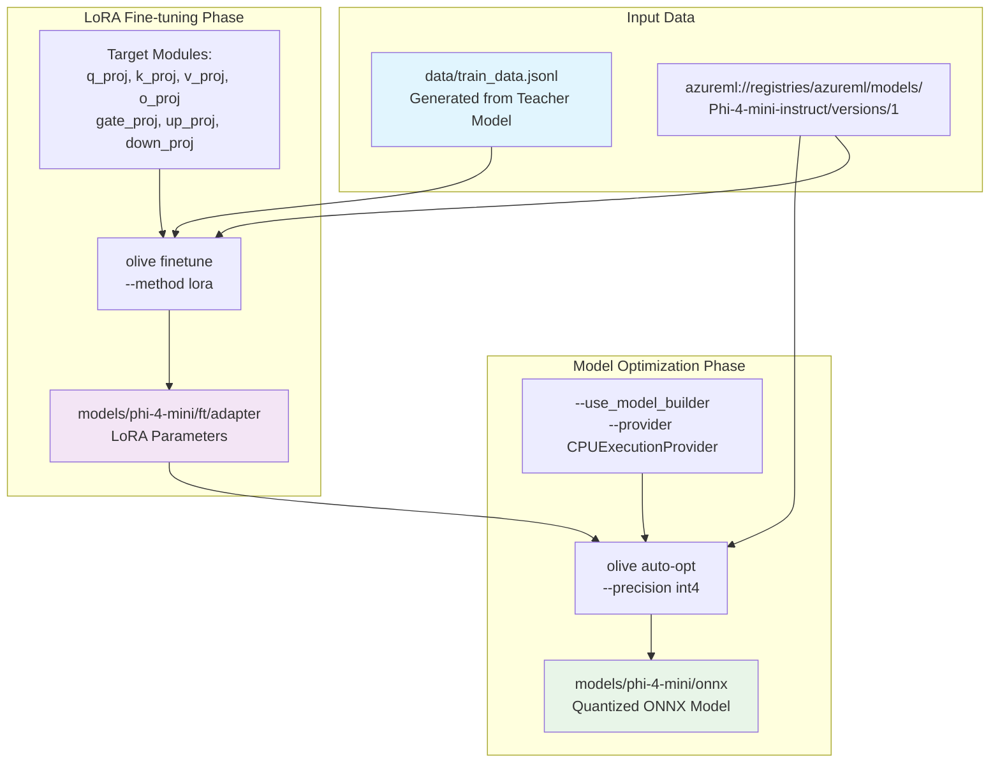
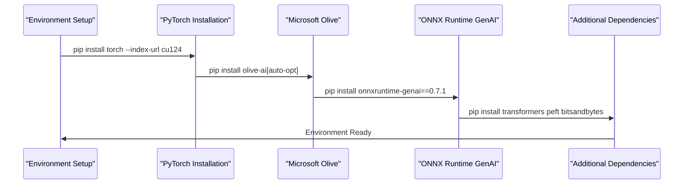
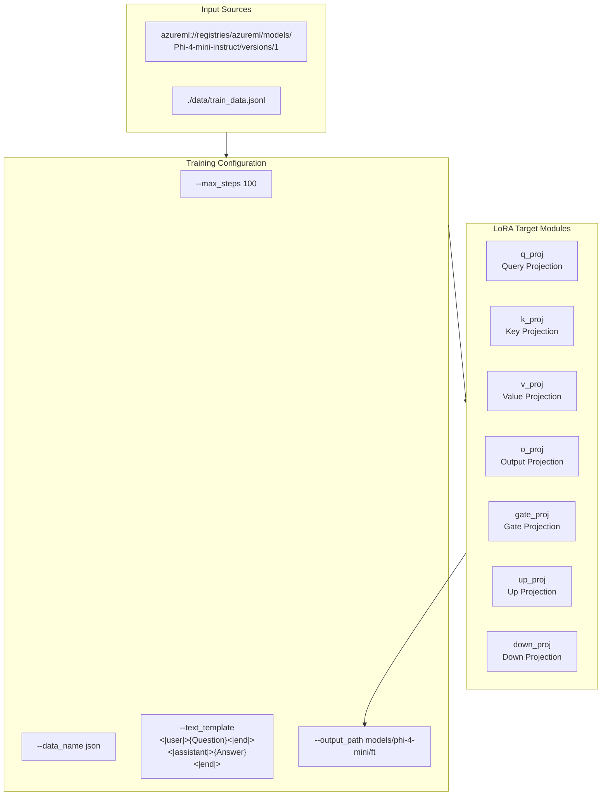
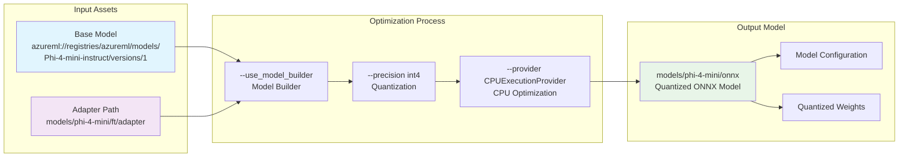
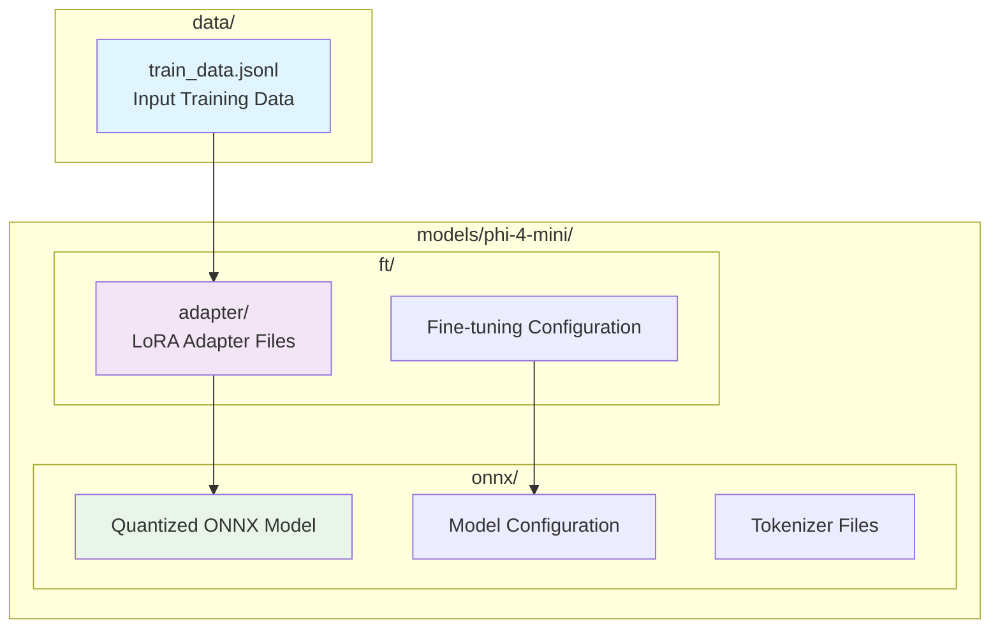

<!-- source: DeepWiki mcp.deepwiki.com · repo microsoft/Build25-LAB329 · extra page Step 2: Fine-tuning and Optimization · fetched 2026-10-26 -->

# Step 2: Fine-tuning and Optimization

Relevant source files

The following files were used as context for generating this wiki page:

- [Lab329/Notebook/02.AzureML_FineTuningAndConvertByMSOlive.ipynb](Lab329/Notebook/02.AzureML_FineTuningAndConvertByMSOlive.ipynb)
- [lab_manual/Skillable_lab_manual2.md](lab_manual/Skillable_lab_manual2.md)

## Purpose and Scope

This document covers the second step of the model distillation workflow, where the Phi-4-mini student model is fine-tuned using training data generated from the DeepSeek-V3 teacher model and then optimized for edge deployment. The process uses Microsoft Olive for both LoRA (Low-Rank Adaptation) fine-tuning and ONNX conversion with int4 quantization.

For the initial data generation process, see [Step 1: Data Generation with Teacher Model](#1.2.1). For testing the optimized model, see [Step 3: Model Testing with ONNX Runtime](#1.2.3).

## Fine-tuning and Optimization Workflow

The fine-tuning and optimization process transforms the base Phi-4-mini model into a specialized, quantized ONNX model suitable for edge deployment. This involves two main phases: LoRA fine-tuning and model optimization.

Sources: [Lab329/Notebook/02.AzureML_FineTuningAndConvertByMSOlive.ipynb:336-385](), [Lab329/Notebook/02.AzureML_FineTuningAndConvertByMSOlive.ipynb:432-482]()

## Environment Setup and Dependencies

The fine-tuning process requires specific package installations and environment configuration. The setup involves multiple PyTorch, ONNX, and Microsoft Olive components.

### Key Dependencies

| Package | Version | Purpose |
|---------|---------|---------|
| `torch` | CUDA 12.4 | Deep learning framework |
| `olive-ai[auto-opt]` | Latest | Microsoft Olive optimization toolkit |
| `onnxruntime-genai` | 0.7.1 | ONNX Runtime for generative AI |
| `transformers` | 4.49.0 | Hugging Face transformers library |
| `peft` | Latest | Parameter-efficient fine-tuning |
| `bitsandbytes` | Latest | Quantization support |

### Installation Sequence

Sources: [Lab329/Notebook/02.AzureML_FineTuningAndConvertByMSOlive.ipynb:77-329]()

## LoRA Fine-tuning Process

The fine-tuning process uses the `olive finetune` command with LoRA (Low-Rank Adaptation) to efficiently adapt the Phi-4-mini model using the generated training data.

### LoRA Configuration

The LoRA fine-tuning targets specific transformer layers and uses the following configuration:

### Fine-tuning Command Structure

The `olive finetune` command executes with the following parameters:

| Parameter | Value | Purpose |
|-----------|-------|---------|
| `--method` | `lora` | Use LoRA fine-tuning method |
| `--model_name_or_path` | `azureml://registries/azureml/models/Phi-4-mini-instruct/versions/1` | Base model location |
| `--data_files` | `./data/train_data.jsonl` | Training data file |
| `--text_template` | `<|user|>{Question}<|end|><|assistant|>{Answer}<|end|>` | Input/output formatting |
| `--max_steps` | `100` | Training duration |
| `--target_modules` | `q_proj,k_proj,v_proj,o_proj,gate_proj,up_proj,down_proj` | LoRA target layers |
| `--output_path` | `models/phi-4-mini/ft` | Output directory |

Sources: [Lab329/Notebook/02.AzureML_FineTuningAndConvertByMSOlive.ipynb:374-384]()

## Model Optimization and Quantization

The optimization phase uses the `olive auto-opt` command to convert the fine-tuned model to ONNX format with int4 quantization, reducing model size by approximately 75%.

### Optimization Pipeline

### Optimization Parameters

The `olive auto-opt` command configuration includes:

| Parameter | Value | Purpose |
|-----------|-------|---------|
| `--model_name_or_path` | `azureml://registries/azureml/models/Phi-4-mini-instruct/versions/1` | Base model reference |
| `--adapter_path` | `models/phi-4-mini/ft/adapter` | LoRA adapter location |
| `--device` | `cpu` | Target device type |
| `--provider` | `CPUExecutionProvider` | ONNX Runtime provider |
| `--use_model_builder` | flag | Enable model builder optimization |
| `--precision` | `int4` | Quantization precision |
| `--output_path` | `models/phi-4-mini/onnx` | Output directory |

Sources: [Lab329/Notebook/02.AzureML_FineTuningAndConvertByMSOlive.ipynb:472-480]()

## Output Artifacts and File Structure

The fine-tuning and optimization process generates a structured set of output files organized in the `models/phi-4-mini` directory.

### File Structure

### Model Artifacts

The optimization process produces the following key artifacts:

- **LoRA Adapter**: Parameter-efficient fine-tuning weights stored in `models/phi-4-mini/ft/adapter`
- **ONNX Model**: Quantized model optimized for CPU inference in `models/phi-4-mini/onnx`
- **Configuration Files**: Model and tokenizer configurations for deployment
- **Quantized Weights**: int4 quantized model weights for reduced memory footprint

Sources: [Lab329/Notebook/02.AzureML_FineTuningAndConvertByMSOlive.ipynb:382](), [Lab329/Notebook/02.AzureML_FineTuningAndConvertByMSOlive.ipynb:479]()

## Execution Environment

The fine-tuning and optimization process requires specific Azure ML compute resources and kernel configuration.

### Required Environment

- **Kernel**: Python 3.10 PyTorch and Tensorflow kernel
- **Compute**: Azure ML compute with GPU support for fine-tuning
- **Authentication**: Azure CLI authentication via `az login --use-device-code`
- **Environment File**: `local.env` with Azure credentials and configurations

### Process Duration

| Phase | Estimated Time | Primary Operations |
|-------|----------------|-------------------|
| Environment Setup | 5 minutes | Package installation and configuration |
| LoRA Fine-tuning | 8 minutes | Model adaptation with 100 steps |
| Model Optimization | 7 minutes | ONNX conversion and quantization |
| **Total** | **20 minutes** | Complete fine-tuning and optimization |

Sources: [Lab329/Notebook/02.AzureML_FineTuningAndConvertByMSOlive.ipynb:32-33](), [lab_manual/Skillable_lab_manual2.md:7]()

---

