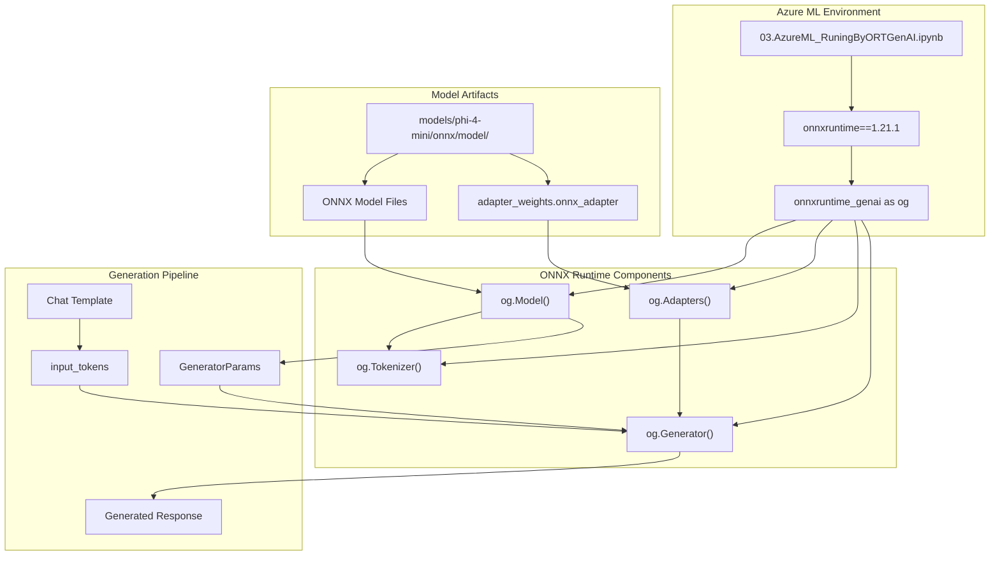
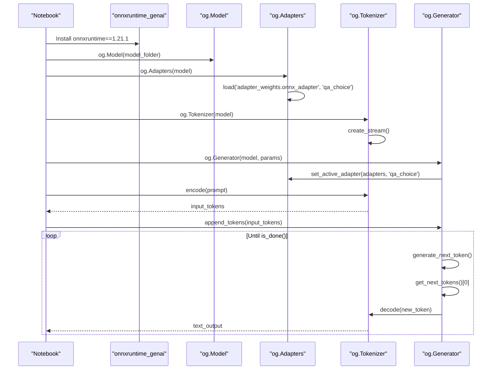
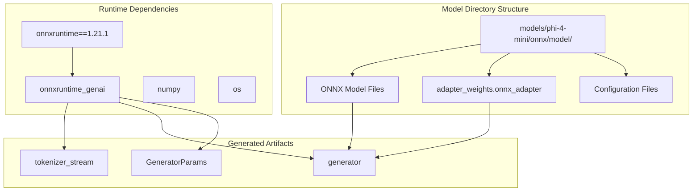
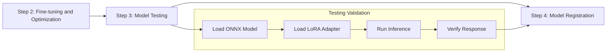

<!-- source: DeepWiki mcp.deepwiki.com · repo microsoft/Build25-LAB329 · extra page Step 3: Model Testing with ONNX Runtime · fetched 2026-10-26 -->

# Step 3: Model Testing with ONNX Runtime

<details>
<summary>Relevant source files</summary>

The following files were used as context for generating this wiki page:

- [Lab329/Notebook/03.AzureML_RuningByORTGenAI.ipynb](Lab329/Notebook/03.AzureML_RuningByORTGenAI.ipynb)
- [Lab329/Notebook/06.Local_Inference.ipynb](Lab329/Notebook/06.Local_Inference.ipynb)
- [lab_manual/Skillable_lab_manual3.md](lab_manual/Skillable_lab_manual3.md)

</details>


This document covers the model testing phase using ONNX Runtime GenAI to validate the optimized ONNX model created in the previous fine-tuning and optimization step. This step verifies that the model conversion was successful and the fine-tuned model performs correctly with the LoRA adapter before proceeding to registration.

This step focuses specifically on inference validation within the Azure ML environment. For information about local inference testing, see [Step 6: Local Inference](#1.2.6). For model registration procedures, see [Step 4: Model Registration](#1.2.4).

## Overview

The model testing workflow validates the ONNX-optimized Phi-4-mini model with its LoRA adapter using ONNX Runtime GenAI. This step ensures the optimized model maintains its fine-tuned capabilities and can generate appropriate responses to multiple-choice questions.

## Testing Architecture

The testing system integrates several key components to validate the optimized model:



Sources: [Lab329/Notebook/03.AzureML_RuningByORTGenAI.ipynb:1-562]()

## Inference Flow Process

The model testing follows a structured token-based generation process:



Sources: [Lab329/Notebook/03.AzureML_RuningByORTGenAI.ipynb:175-527]()

## Key Components

### Model Loading Components

| Component | Purpose | Implementation |
|-----------|---------|----------------|
| `og.Model` | Loads ONNX model from filesystem | [Lab329/Notebook/03.AzureML_RuningByORTGenAI.ipynb:187]() |
| `og.Adapters` | Manages LoRA adapter loading | [Lab329/Notebook/03.AzureML_RuningByORTGenAI.ipynb:218-219]() |
| `og.Tokenizer` | Handles text-to-token conversion | [Lab329/Notebook/03.AzureML_RuningByORTGenAI.ipynb:248-249]() |
| `og.Generator` | Orchestrates token generation | [Lab329/Notebook/03.AzureML_RuningByORTGenAI.ipynb:430-432]() |

### Configuration Parameters

The testing process uses specific generation parameters defined in `search_options`:

- `max_length`: 120 tokens maximum generation length
- `past_present_share_buffer`: False for separate memory buffers

Sources: [Lab329/Notebook/03.AzureML_RuningByORTGenAI.ipynb:279-281]()

### Chat Template Format

The model uses a structured chat template to ensure proper response formatting:

```
<|system|>You are a helpful assistant. Your output should only be one of the five choices: 'A', 'B', 'C', 'D', or 'E'.<|end|><|user|>{input}<|end|><|assistant|>
```

This template constrains the model to provide single-letter responses matching the multiple-choice format.

Sources: [Lab329/Notebook/03.AzureML_RuningByORTGenAI.ipynb:346]()

## File Structure and Dependencies

The testing process relies on specific file organization created in the previous optimization step:



Sources: [Lab329/Notebook/03.AzureML_RuningByORTGenAI.ipynb:156](), [Lab329/Notebook/03.AzureML_RuningByORTGenAI.ipynb:218-219]()

## Testing Workflow Steps

### Step 1: Environment Setup

Install the required ONNX Runtime version and import dependencies:

```python
! pip install onnxruntime==1.21.1 -U
import onnxruntime_genai as og
import numpy as np
import os
```

Sources: [Lab329/Notebook/03.AzureML_RuningByORTGenAI.ipynb:74](), [Lab329/Notebook/03.AzureML_RuningByORTGenAI.ipynb:104-106]()

### Step 2: Model and Adapter Loading

Load the ONNX model and LoRA adapter with error handling:

- Model loading from `model_folder` path
- Adapter loading with name `"qa_choice"`
- Tokenizer initialization with stream support

Sources: [Lab329/Notebook/03.AzureML_RuningByORTGenAI.ipynb:187](), [Lab329/Notebook/03.AzureML_RuningByORTGenAI.ipynb:218-219](), [Lab329/Notebook/03.AzureML_RuningByORTGenAI.ipynb:248-249]()

### Step 3: Generation Configuration

Configure the generation parameters and create the generator:

- Set `search_options` with generation constraints
- Create `GeneratorParams` object
- Initialize `Generator` with model and parameters
- Activate the LoRA adapter

Sources: [Lab329/Notebook/03.AzureML_RuningByORTGenAI.ipynb:279-281](), [Lab329/Notebook/03.AzureML_RuningByORTGenAI.ipynb:430-432](), [Lab329/Notebook/03.AzureML_RuningByORTGenAI.ipynb:460]()

### Step 4: Inference Execution

Execute the generation process with token-by-token output:

- Format input using chat template
- Tokenize the prompt
- Generate response iteratively
- Decode tokens back to text

Sources: [Lab329/Notebook/03.AzureML_RuningByORTGenAI.ipynb:372](), [Lab329/Notebook/03.AzureML_RuningByORTGenAI.ipynb:398](), [Lab329/Notebook/03.AzureML_RuningByORTGenAI.ipynb:486](), [Lab329/Notebook/03.AzureML_RuningByORTGenAI.ipynb:522-526]()

## Test Input Format

The notebook includes a sample multiple-choice question that follows the expected format:

```
Answer the following multiple-choice question by selecting the correct option.

Question: Sammy wanted to go to where the people were. Where might he go?
Answer Choices:
(A) race track
(B) populated areas
(C) the desert
(D) apartment
(E) roadblock
```

Sources: [Lab329/Notebook/03.AzureML_RuningByORTGenAI.ipynb:312]()

## Integration with Workflow Pipeline

This testing step validates the model before proceeding to registration and deployment:



The testing step ensures model integrity before proceeding to registration, preventing deployment of corrupted or non-functional models.

Sources: [Lab329/Notebook/03.AzureML_RuningByORTGenAI.ipynb:22-25](), [lab_manual/Skillable_lab_manual3.md:1-15]()

---

