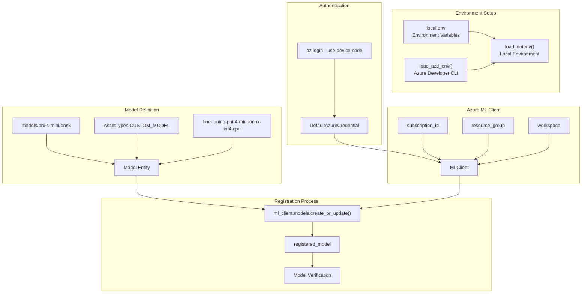
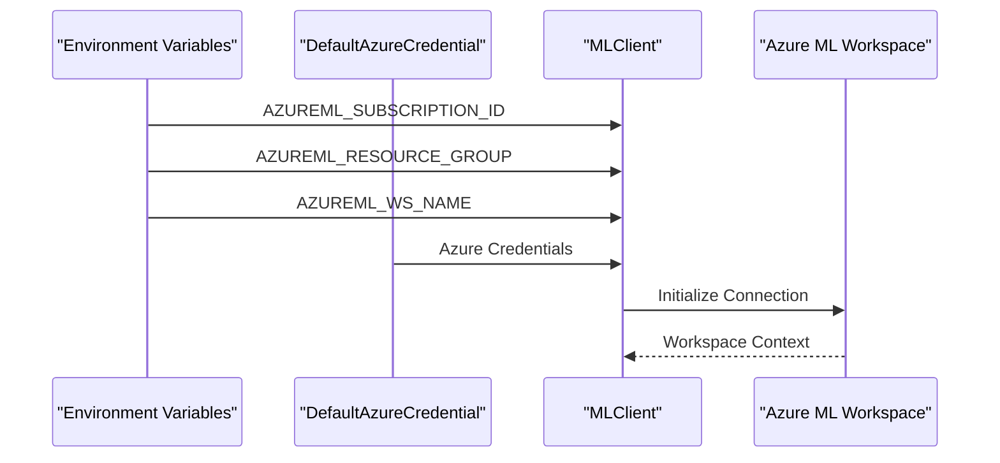
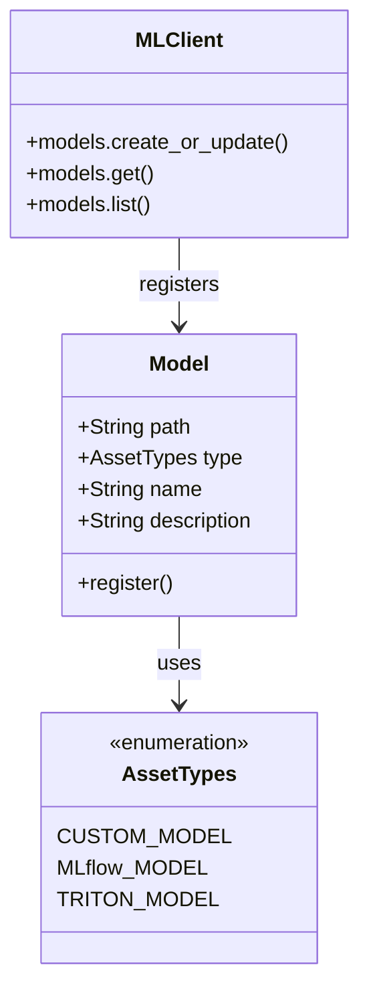
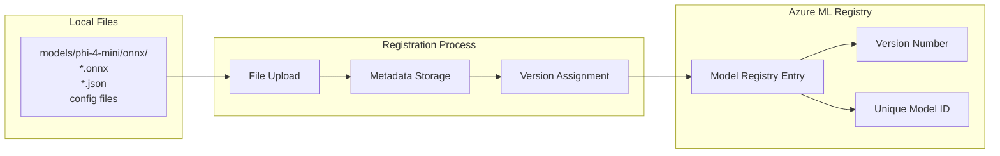
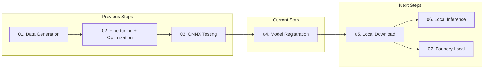

<!-- source: DeepWiki mcp.deepwiki.com · repo microsoft/Build25-LAB329 · extra page Step 4: Model Registration · fetched 2026-10-26 -->

# Step 4: Model Registration

Relevant source files

The following files were used as context for generating this wiki page:

- [Lab329/Notebook/04.AzureML_RegisterToAzureML.ipynb](Lab329/Notebook/04.AzureML_RegisterToAzureML.ipynb)
- [lab_manual/Skillable_lab_manual4.md](lab_manual/Skillable_lab_manual4.md)

This document covers the model registration process in the Azure Machine Learning workspace, which enables version tracking, sharing, and deployment management for the optimized ONNX model produced in previous steps. Model registration creates a centralized repository entry with metadata, versioning, and access controls.

For information about model optimization and ONNX conversion, see [Step 2: Fine-tuning and Optimization](#1.2.2). For information about downloading registered models for local deployment, see [Step 5: Local Model Download](#1.2.5).

## Overview

The model registration step takes the optimized ONNX model files from the `models/phi-4-mini/onnx/` directory and registers them as a versioned asset in Azure ML. This process creates a model registry entry with metadata, enables version tracking, and prepares the model for downstream deployment scenarios.

## Registration Workflow

The following diagram illustrates the model registration process and key system components:

Sources: [Lab329/Notebook/04.AzureML_RegisterToAzureML.ipynb:1-404]()

## Core Components

The registration process involves several key Azure ML SDK entities:

| Component | Purpose | Configuration |
|-----------|---------|---------------|
| `MLClient` | Primary interface for Azure ML operations | Initialized with subscription, resource group, workspace |
| `Model` | Defines model metadata and file location | Points to `models/phi-4-mini/onnx` directory |
| `AssetTypes.CUSTOM_MODEL` | Specifies model type for registration | Used for non-framework-specific models |
| `DefaultAzureCredential` | Handles Azure authentication | Uses Azure CLI credentials |

## Authentication and Client Setup

The registration process requires authenticated access to Azure ML workspace:

The authentication sequence uses environment variables loaded from `local.env` or Azure Developer CLI configuration [Lab329/Notebook/04.AzureML_RegisterToAzureML.ipynb:183-188](). The `MLClient` is initialized with workspace credentials [Lab329/Notebook/04.AzureML_RegisterToAzureML.ipynb:256]().

Sources: [Lab329/Notebook/04.AzureML_RegisterToAzureML.ipynb:245-256]()

## Model Definition and Registration

The model registration process involves creating a `Model` entity with specific attributes:

The model definition specifies:
- **path**: `"models/phi-4-mini/onnx"` - directory containing ONNX model files
- **type**: `AssetTypes.CUSTOM_MODEL` - indicates non-framework-specific model
- **name**: `"fine-tuning-phi-4-mini-onnx-int4-cpu"` - registry identifier
- **description**: `"Fine tuning by MSOlive"` - model metadata

Sources: [Lab329/Notebook/04.AzureML_RegisterToAzureML.ipynb:290-295]()

## Registration Execution

The actual registration is performed by the `create_or_update()` method:

The `ml_client.models.create_or_update(file_model)` method uploads model files and creates a registry entry [Lab329/Notebook/04.AzureML_RegisterToAzureML.ipynb:329](). If a model with the same name exists, a new version is created; otherwise, version 1 is assigned.

Sources: [Lab329/Notebook/04.AzureML_RegisterToAzureML.ipynb:329]()

## Model Verification

After registration, the system provides verification and inspection capabilities:

| Property | Description | Example Value |
|----------|-------------|---------------|
| `name` | Model registry name | `fine-tuning-phi-4-mini-onnx-int4-cpu` |
| `id` | Unique model identifier | Generated UUID |
| `version` | Version number | `1`, `2`, `3`, etc. |
| `description` | Model description | `Fine tuning by MSOlive` |
| `path` | Azure ML storage path | Azure ML datastore URI |

The verification process outputs all model properties through the `registered_model.__dict__` inspection [Lab329/Notebook/04.AzureML_RegisterToAzureML.ipynb:367-368]().

Sources: [Lab329/Notebook/04.AzureML_RegisterToAzureML.ipynb:361-368]()

## Prerequisites and Dependencies

The registration process requires completion of previous workflow steps:

- **Step 1**: Training data generation via `01.AzureML_Distillation.ipynb`
- **Step 2**: Model fine-tuning and optimization via `02.AzureML_FineTuningAndConvertByMSOlive.ipynb`  
- **Step 3**: ONNX model testing via `03.AzureML_RuningByORTGenAI.ipynb`

The optimized model files must exist in the `models/phi-4-mini/onnx/` directory before registration can proceed.

Environment setup requires:
- Azure CLI authentication via `az login --use-device-code`
- Python 3.10 AzureML kernel selection
- Environment variables: `AZUREML_SUBSCRIPTION_ID`, `AZUREML_RESOURCE_GROUP`, `AZUREML_WS_NAME`

Sources: [Lab329/Notebook/04.AzureML_RegisterToAzureML.ipynb:24-36](), [lab_manual/Skillable_lab_manual4.md:1-15]()

## Integration with Model Distillation Pipeline

The model registration step serves as a bridge between cloud-based optimization and local deployment phases:

The registered model becomes available for download in Step 5, enabling the transition from cloud-based development to local and edge deployment scenarios.

Sources: [Lab329/Notebook/04.AzureML_RegisterToAzureML.ipynb:24-27](), [lab_manual/Skillable_lab_manual4.md:1-15]()

---

