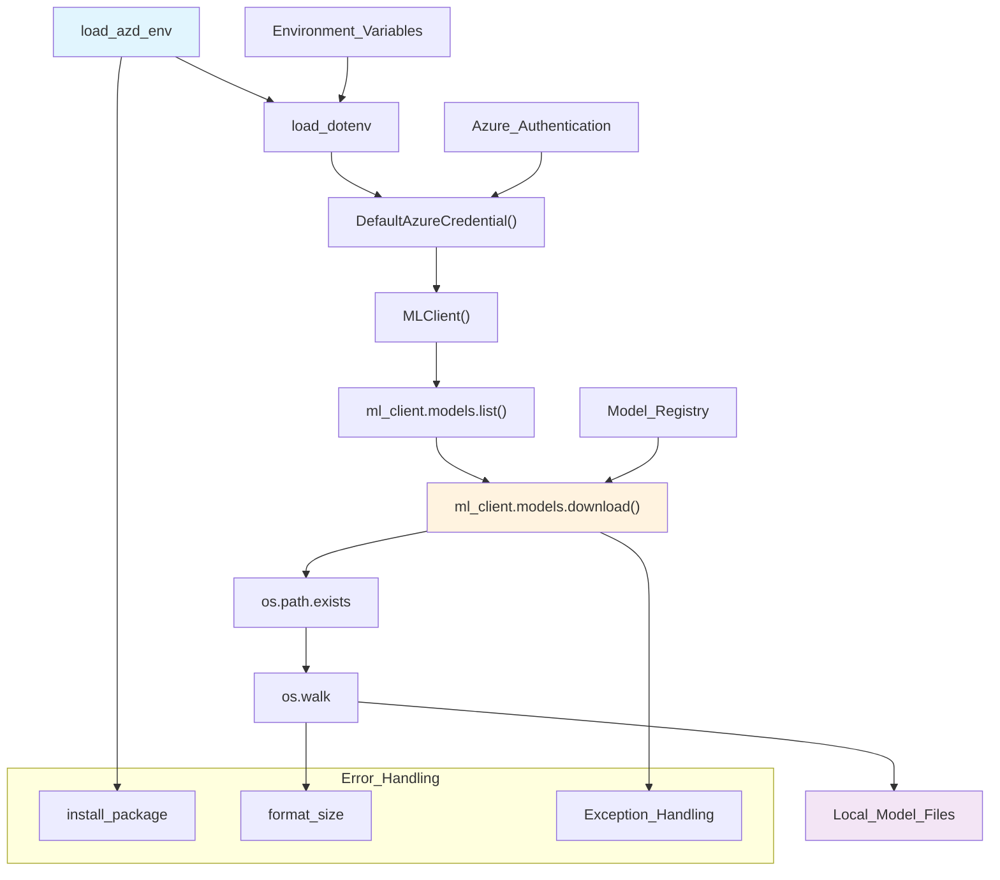
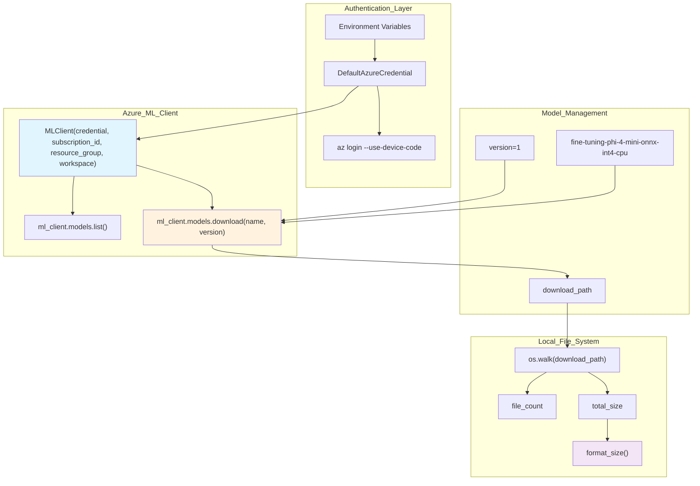

<!-- source: DeepWiki mcp.deepwiki.com · repo microsoft/Build25-LAB329 · extra page Step 5: Local Model Download · fetched 2026-10-26 -->

# Step 5: Local Model Download

<details>
<summary>Relevant source files</summary>

The following files were used as context for generating this wiki page:

- [Lab329/Notebook/05.Local_Download.ipynb](Lab329/Notebook/05.Local_Download.ipynb)
- [lab_manual/Skillable_lab_manual5.md](lab_manual/Skillable_lab_manual5.md)

</details>


This page covers the process of downloading the registered ONNX model from Azure ML to a local environment for edge deployment. This step transitions the model distillation workflow from cloud-based processing to local inference capabilities.

For information about model registration in Azure ML, see [Step 4: Model Registration](#1.2.4). For details on local inference execution, see [Step 6: Local Inference](#1.2.6).

## Purpose and Scope

Step 5 downloads the optimized `fine-tuning-phi-4-mini-onnx-int4-cpu` model from Azure ML Model Registry to the local Skillable VM environment. This enables offline inference and prepares the model for edge deployment scenarios. The download process includes authentication with Azure ML, model retrieval, and local file verification.

## Prerequisites

The following components must be completed before executing this step:

- Azure ML workspace with registered model from [Step 4: Model Registration](#1.2.4)
- Local environment with Python 3.10+ installed
- Azure CLI authentication (`az login --use-device-code`)
- Environment variables configured for Azure ML workspace connection

## Technical Architecture

### Download Process Flow



Sources: [Lab329/Notebook/05.Local_Download.ipynb:293-298](), [Lab329/Notebook/05.Local_Download.ipynb:354-358](), [Lab329/Notebook/05.Local_Download.ipynb:482-608]()

### Azure ML SDK Integration



Sources: [Lab329/Notebook/05.Local_Download.ipynb:260-264](), [Lab329/Notebook/05.Local_Download.ipynb:328-359](), [Lab329/Notebook/05.Local_Download.ipynb:482-484]()

## Key Components

### Environment Configuration

The notebook loads configuration from multiple sources using a layered approach:

| Component | Function | Environment Variable |
|----------|----------|---------------------|
| Azure Subscription | `load_azd_env()` | `AZUREML_SUBSCRIPTION_ID` |
| Resource Group | `load_dotenv()` | `AZUREML_RESOURCE_GROUP` |
| Workspace Name | Environment lookup | `AZUREML_WS_NAME` |

Sources: [Lab329/Notebook/05.Local_Download.ipynb:293-298](), [Lab329/Notebook/05.Local_Download.ipynb:328-341]()

### Package Management

The `install_package()` function provides conditional installation:

```python
def install_package(package_name):
    try:
        __import__(package_name)
        print(f"✓ {package_name} is already installed")
    except ImportError:
        print(f"Installing {package_name}...")
        subprocess.check_call([sys.executable, '-m', 'pip', 'install', package_name])
```

Required packages include:
- `azure-ai-ml`: Azure ML SDK for model operations
- `azure-identity`: Authentication with Azure services
- `python-dotenv`: Environment variable management
- `dotenv-azd`: Azure Developer CLI environment integration

Sources: [Lab329/Notebook/05.Local_Download.ipynb:135-142](), [Lab329/Notebook/05.Local_Download.ipynb:144-150]()

### Model Download Process

The download process implements multiple fallback strategies:

1. **Primary Method**: `ml_client.models.download(name=model_name, version=model_version)`
2. **Async Fallback**: `ml_client.models.download_async()` with progress monitoring
3. **Path Verification**: `os.path.exists()` validation and alternative location search

The model specifications are:
- **Model Name**: `fine-tuning-phi-4-mini-onnx-int4-cpu`
- **Version**: `1`
- **Format**: ONNX with int4 quantization optimized for CPU inference

Sources: [Lab329/Notebook/05.Local_Download.ipynb:482-484](), [Lab329/Notebook/05.Local_Download.ipynb:494-523]()

### File System Operations

Post-download verification uses `os.walk()` to calculate model statistics:

```python
for path, dirs, files in os.walk(download_path):
    for f in files:
        fp = os.path.join(path, f)
        file_size = os.path.getsize(fp)
        total_size += file_size
        file_count += 1
```

The `format_size()` function converts bytes to human-readable formats (bytes, KB, MB, GB).

Sources: [Lab329/Notebook/05.Local_Download.ipynb:528-533](), [Lab329/Notebook/05.Local_Download.ipynb:536-544]()

## Execution Environment

### Local vs. Cloud Execution

This notebook executes on the **Skillable VM** environment, not in Azure ML Studio. The local execution enables:

- Direct file system access for model storage
- Offline inference preparation
- Edge deployment scenarios
- Resource-constrained environment testing

The notebook requires **Python 3.10+** and proper kernel selection in Jupyter.

Sources: [lab_manual/Skillable_lab_manual5.md:11-18](), [Lab329/Notebook/05.Local_Download.ipynb:42-45]()

### Error Handling and Troubleshooting

The implementation includes comprehensive error handling for common scenarios:

| Error Type | Detection | Resolution |
|-----------|-----------|------------|
| Authentication | `credentials` in error message | Run `az login --use-device-code` |
| Model Not Found | `not found` in error message | Verify model name and version |
| Progress Display | `progress` in error message | Fallback to text-based indicators |
| Path Issues | `nonetype` in error message | Search default directories |

The notebook provides specific troubleshooting guidance based on error message content analysis.

Sources: [Lab329/Notebook/05.Local_Download.ipynb:591-607](), [Lab329/Notebook/05.Local_Download.ipynb:556-584]()

## Integration Points

This step serves as the critical transition point in the model distillation workflow:

- **Input**: Registered model from [Step 4: Model Registration](#1.2.4)
- **Output**: Local model files for [Step 6: Local Inference](#1.2.6) and [Step 7: Foundry Local Deployment](#1.2.7)
- **Dependencies**: Azure ML workspace, authentication, and network connectivity for download

The downloaded model files enable offline AI capabilities essential for edge computing and educational scenarios with limited cloud connectivity.

Sources: [Lab329/Notebook/05.Local_Download.ipynb:8-34](), [lab_manual/Skillable_lab_manual5.md:1-18]()

---

