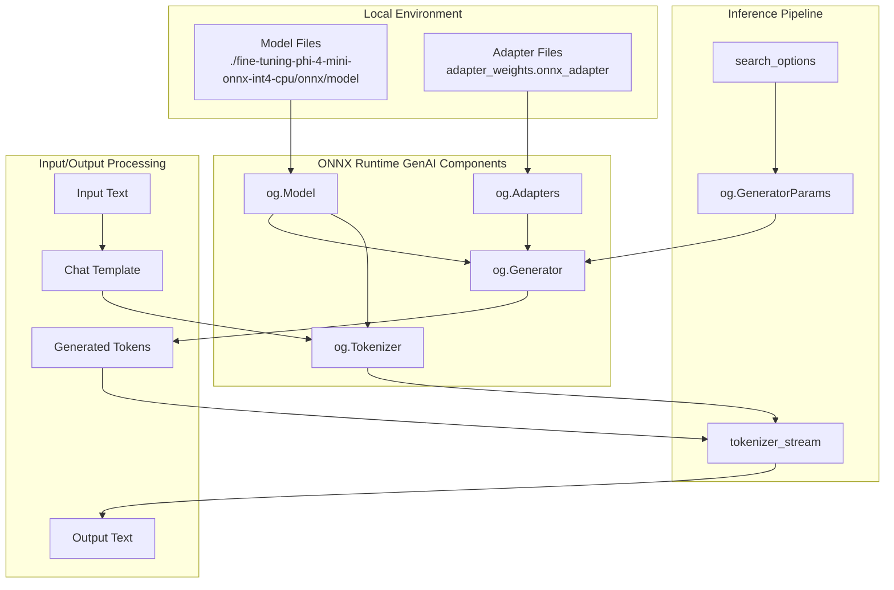
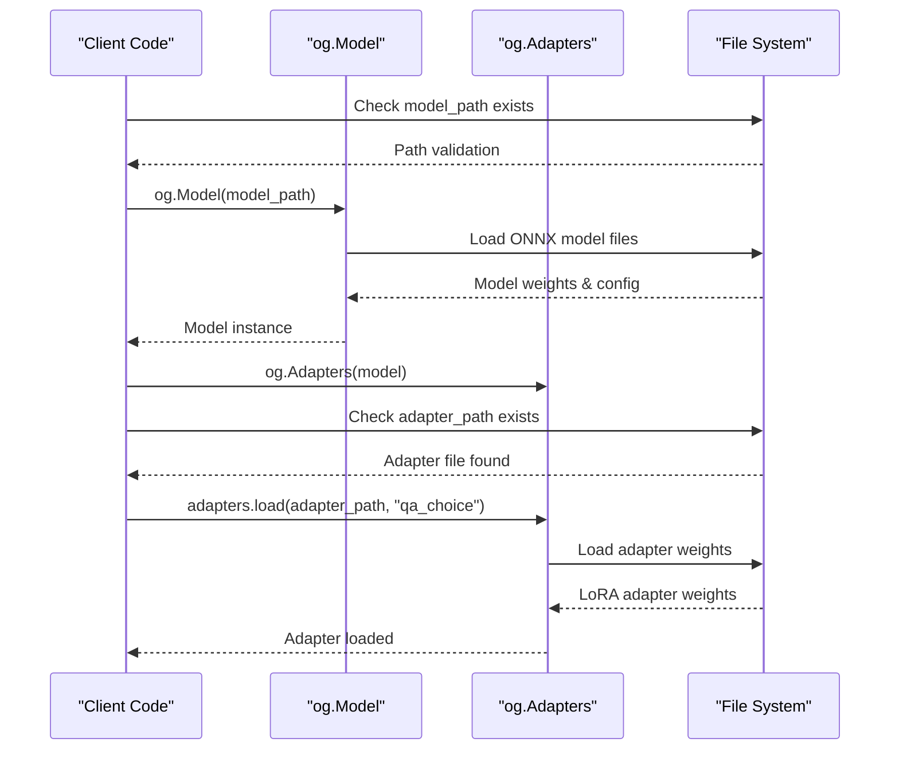
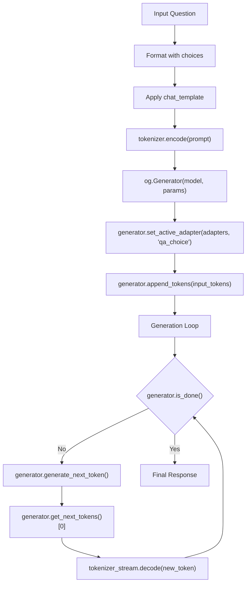

<!-- source: DeepWiki mcp.deepwiki.com · repo microsoft/Build25-LAB329 · extra page Step 6: Local Inference · fetched 2026-10-26 -->

# Step 6: Local Inference

<details>
<summary>Relevant source files</summary>

The following files were used as context for generating this wiki page:

- [Lab329/Notebook/03.AzureML_RuningByORTGenAI.ipynb](Lab329/Notebook/03.AzureML_RuningByORTGenAI.ipynb)
- [Lab329/Notebook/06.Local_Inference.ipynb](Lab329/Notebook/06.Local_Inference.ipynb)
- [lab_manual/Skillable_lab_manual6.md](lab_manual/Skillable_lab_manual6.md)

</details>


This step demonstrates how to run inference on the optimized ONNX model in a local environment after downloading it from Azure ML. The local inference capability enables edge deployment scenarios where models can operate without cloud connectivity.

For information about testing the model in Azure ML Studio before download, see [Step 3: Model Testing with ONNX Runtime](#1.2.3). For information about deploying the model using Foundry Local, see [Step 7: Foundry Local Deployment](#1.2.7).

## Prerequisites and Environment

Local inference requires the completion of all previous workflow steps, particularly [Step 5: Local Model Download](#1.2.5) which downloads the registered model files to the local machine. The local environment must have Python 3.10+ and sufficient memory to load the quantized model.

The notebook [Lab329/Notebook/06.Local_Inference.ipynb:33-51]() specifies the local environment requirements, including Python version compatibility and disk space considerations for model loading.

**Sources:** [Lab329/Notebook/06.Local_Inference.ipynb:20-36](), [lab_manual/Skillable_lab_manual6.md:10-18]()

## Local Inference Architecture

The local inference system uses ONNX Runtime GenAI to run the optimized int4-quantized Phi-4-mini model with LoRA adapters. The architecture isolates the inference pipeline from cloud dependencies while maintaining the model's specialized knowledge.



**Sources:** [Lab329/Notebook/06.Local_Inference.ipynb:118-137](), [Lab329/Notebook/06.Local_Inference.ipynb:160-193]()

## Model Loading Process

The model loading process initializes the ONNX model and its associated LoRA adapter for specialized question-answering capabilities. The `og.Model` class loads the optimized model files, while `og.Adapters` manages the fine-tuned adapter weights.



The model loading implementation checks for file existence and handles error cases when adapter files are not found at expected paths [Lab329/Notebook/06.Local_Inference.ipynb:166-192]().

**Sources:** [Lab329/Notebook/06.Local_Inference.ipynb:160-193](), [Lab329/Notebook/06.Local_Inference.ipynb:126-137]()

## Inference Pipeline Configuration

The inference pipeline consists of tokenization, generation parameters, and the generator itself. The `og.Tokenizer` handles text-to-token conversion, while `og.GeneratorParams` configures generation behavior through search options.

| Component | Purpose | Key Parameters |
|-----------|---------|----------------|
| `og.Tokenizer` | Text-to-token conversion | Model vocabulary |
| `tokenizer_stream` | Token-to-text decoding | Streaming decode |
| `search_options` | Generation control | `max_length`, `temperature`, `repeat_penalty` |
| `og.GeneratorParams` | Parameter container | Search options binding |
| `og.Generator` | Text generation engine | Model + parameters |

The search options configuration [Lab329/Notebook/06.Local_Inference.ipynb:232-238]() includes:

- `max_length`: Maximum tokens to generate (102)
- `past_present_share_buffer`: Memory management (False)
- `repeat_penalty`: Repetition control (1.1)
- `temperature`: Randomness control (0.7)

**Sources:** [Lab329/Notebook/06.Local_Inference.ipynb:220-243](), [Lab329/Notebook/06.Local_Inference.ipynb:232-238]()

## Text Generation Workflow

The text generation process follows a structured workflow from input formatting through token generation to output decoding. The system uses a chat template to format inputs and activates the LoRA adapter for specialized knowledge.



The chat template format [Lab329/Notebook/06.Local_Inference.ipynb:278]() follows the structure:
```
<|system|>You are a helpful assistant. Your output should only be one of the five choices: 'A', 'B', 'C', 'D', or 'E'.<|end|><|user|>{input}<|end|><|assistant|>
```

**Sources:** [Lab329/Notebook/06.Local_Inference.ipynb:262-338](), [Lab329/Notebook/06.Local_Inference.ipynb:309-318]()

## Response Generation Function

The `generate_response` function [Lab329/Notebook/06.Local_Inference.ipynb:262-338]() encapsulates the complete inference workflow. It formats multiple-choice questions, applies the chat template, and processes the model's response to extract answer choices.

The function handles the complete pipeline:

1. **Input Formatting**: Combines question text with formatted answer choices
2. **Template Application**: Applies the chat template with system instructions
3. **Tokenization**: Converts formatted prompt to input tokens
4. **Generator Setup**: Creates generator with search options and adapter activation
5. **Token Generation**: Iterative token generation with streaming decode
6. **Response Processing**: Extracts answer choice from generated text

The generation loop [Lab329/Notebook/06.Local_Inference.ipynb:309-318]() continues until `generator.is_done()` returns true or a termination condition is met (such as detecting a closing parenthesis character).

**Sources:** [Lab329/Notebook/06.Local_Inference.ipynb:262-338](), [Lab329/Notebook/06.Local_Inference.ipynb:309-318]()

## Testing and Validation

The notebook includes test questions [Lab329/Notebook/06.Local_Inference.ipynb:357-389]() covering different knowledge domains to validate the model's performance across varied question types. The testing framework measures response time and validates that outputs match expected answer choice formats.

Sample test questions include:
- Geography: "What is the capital of France?"
- Science: "Which planet is closest to the Sun?"
- Mathematics: "What is 7 × 8?"

The `ask_question` function [Lab329/Notebook/06.Local_Inference.ipynb:421-453]() provides an interface for custom question testing, demonstrating knowledge distillation concepts with a specialized multiple-choice question about the purpose of knowledge distillation itself.

**Sources:** [Lab329/Notebook/06.Local_Inference.ipynb:357-402](), [Lab329/Notebook/06.Local_Inference.ipynb:421-453]()

---

