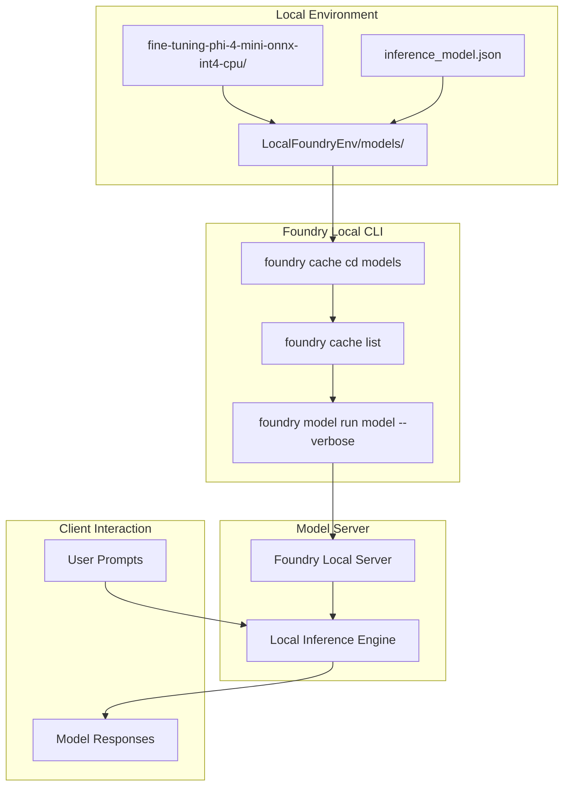
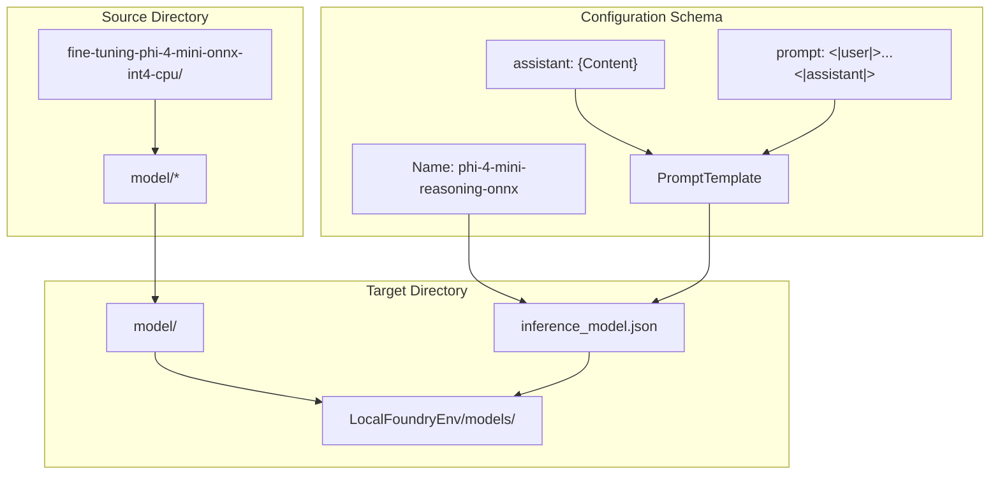
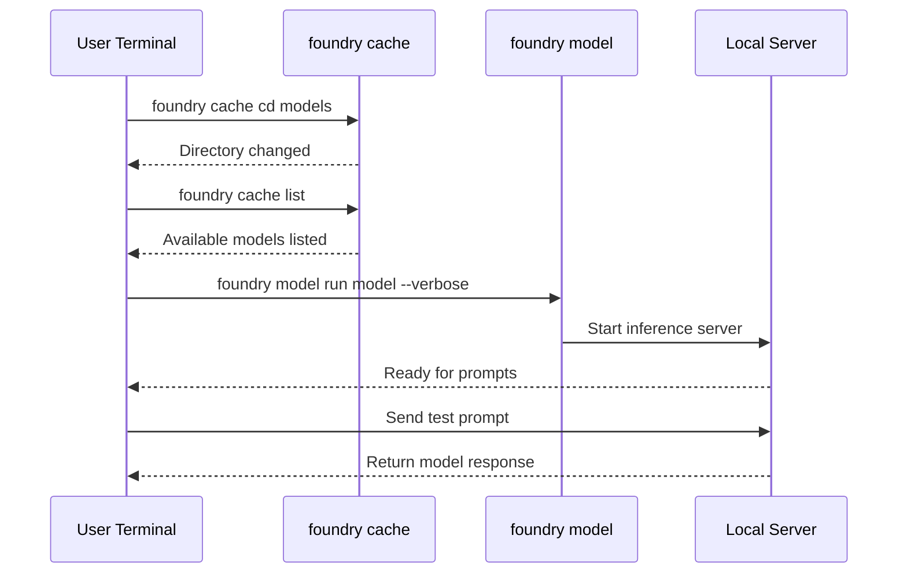
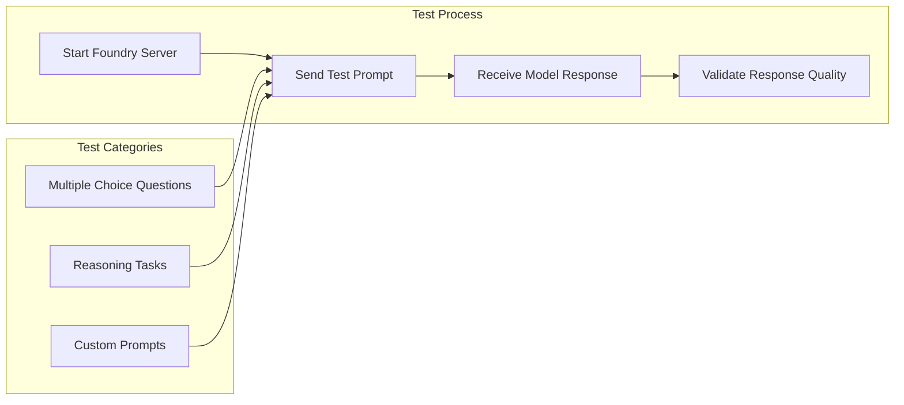

<!-- source: DeepWiki mcp.deepwiki.com · repo microsoft/Build25-LAB329 · extra page Step 7: Foundry Local Deployment · fetched 2026-10-26 -->

# Step 7: Foundry Local Deployment

<details>
<summary>Relevant source files</summary>

The following files were used as context for generating this wiki page:

- [Lab329/Notebook/07.Local_inference_AIFoundry.ipynb](Lab329/Notebook/07.Local_inference_AIFoundry.ipynb)
- [lab_manual/Skillable_lab_manual7.md](lab_manual/Skillable_lab_manual7.md)

</details>


## Purpose and Scope

This page covers the final step in the model distillation workshop pipeline: deploying your optimized ONNX model using Azure Foundry Local for containerized edge deployment. This step demonstrates how to serve and interact with your distilled model in a production-like, resource-constrained local environment.

Step 7 builds directly on the model downloaded in [Step 6: Local Inference](#1.2.6) and represents the transition from cloud-based model development to edge deployment scenarios. For information about the overall workshop workflow, see [Workshop Workflow](#1.2).

## Prerequisites and Dependencies

Step 7 requires successful completion of previous workshop steps, particularly:

- **Step 5**: Model download from Azure ML registry
- **Step 6**: Local inference setup and validation
- **Local Environment**: Model files available in `fine-tuning-phi-4-mini-onnx-int4-cpu` directory
- **Platform Requirements**: Windows, macOS, or Linux with Python 3.10+

The following components must be available locally:

| Component | Source Step | Required Files |
|-----------|-------------|----------------|
| ONNX Model | Step 5 | `fine-tuning-phi-4-mini-onnx-int4-cpu/` |
| Model Configuration | Step 7 | `inference_model.json` |
| Foundry Environment | Step 7 | `LocalFoundryEnv/models/` |

Sources: `Lab329/Notebook/07.Local_inference_AIFoundry.ipynb:26-34`, `lab_manual/Skillable_lab_manual7.md:9-20`

## Foundry Local Architecture

Azure Foundry Local provides a containerized inference server for locally deployed language models. The system enables edge deployment scenarios where models need to run disconnected from cloud services.

### Foundry Local Deployment Flow



Sources: `Lab329/Notebook/07.Local_inference_AIFoundry.ipynb:84-105`, `Lab329/Notebook/07.Local_inference_AIFoundry.ipynb:112-119`

## Model Preparation Workflow

The model preparation process involves copying ONNX model files and creating configuration files for Foundry Local.

### File Structure Setup



Sources: `Lab329/Notebook/07.Local_inference_AIFoundry.ipynb:42-62`

## Configuration Setup

### Model Configuration File

The `inference_model.json` file defines the model properties and prompt template for Foundry Local:

```json
{
  "Name": "phi-4-mini-reasoning-onnx",
  "PromptTemplate": {
    "assistant": "{Content}",
    "prompt": "<|user|>Explain the Pythagorean Theorem<|end|><|assistant|>"
  }
}
```

### Configuration Parameters

| Parameter | Purpose | Example Value |
|-----------|---------|---------------|
| `Name` | Model identifier for Foundry Local | `"phi-4-mini-reasoning-onnx"` |
| `PromptTemplate.assistant` | Response format template | `"{Content}"` |
| `PromptTemplate.prompt` | Input prompt structure | `"<|user|>...<|end|><|assistant|>"` |

Sources: `Lab329/Notebook/07.Local_inference_AIFoundry.ipynb:49-62`

## Foundry Local CLI Commands

### Core Command Sequence

The Foundry Local deployment follows a specific CLI command sequence:



### Command Reference

| Command | Purpose | Expected Output |
|---------|---------|-----------------|
| `foundry cache cd models` | Navigate to models directory | Directory change confirmation |
| `foundry cache list` | List available cached models | Model inventory display |
| `foundry model run model --verbose` | Start model inference server | Server startup logs |

### CLI Categories

The foundry CLI organizes commands into functional categories:

- **Model**: Commands for managing and running models (`foundry model run`)
- **Service**: Commands for managing Foundry Local service
- **Cache**: Commands for managing local model cache (`foundry cache cd`, `foundry cache list`)

Sources: `Lab329/Notebook/07.Local_inference_AIFoundry.ipynb:87-95`, `Lab329/Notebook/07.Local_inference_AIFoundry.ipynb:112-119`

## Testing and Validation

### Sample Test Prompt

The notebook provides a sample multiple-choice question for testing model inference:

```
Answer the following multiple-choice question by selecting the correct option.

Question: Sammy wanted to go to where the people were. Where might he go?
Answer Choices:
(A) race track
(B) populated areas
(C) the desert
(D) apartment
(E) roadblock
```

### Testing Workflow



Sources: `Lab329/Notebook/07.Local_inference_AIFoundry.ipynb:97-105`, `Lab329/Notebook/07.Local_inference_AIFoundry.ipynb:125-129`

## Environment Setup

### VSCode Integration

The workshop uses VSCode integrated terminal for Foundry Local operations:

1. Right-click on `LocalFoundryEnv` folder
2. Select "Open in Integrated Terminal"
3. Terminal opens at: `PS C:\Users\LabUser\Desktop\lab\Build25-LAB329\Lab329\LocalFoundryEnv>`

### Directory Structure

```
LocalFoundryEnv/
├── models/
│   ├── model/               # Copied from fine-tuning-phi-4-mini-onnx-int4-cpu
│   └── inference_model.json # Model configuration
└── [foundry local runtime files]
```

Sources: `Lab329/Notebook/07.Local_inference_AIFoundry.ipynb:69-76`

## Next Steps and Applications

### Advanced Use Cases

- **Prompt Engineering**: Explore advanced prompt templates and system instructions
- **Performance Benchmarking**: Measure model performance in local environment
- **Application Integration**: Integrate Foundry Local server into production applications
- **Edge Deployment**: Deploy to resource-constrained edge devices

### Integration Opportunities

| Deployment Target | Use Case | Configuration Notes |
|-------------------|----------|-------------------|
| IoT Devices | Offline AI capabilities | Optimize for memory constraints |
| Educational Systems | Local AI tutoring | Configure for educational prompts |
| Edge Computing | Real-time inference | Optimize for latency requirements |

Sources: `Lab329/Notebook/07.Local_inference_AIFoundry.ipynb:137-145`

## References

- [Foundry Local GitHub Repository](https://github.com/microsoft/foundry-local)
- [Foundry Local Documentation](https://github.com/microsoft/Foundry-Local/tree/main/docs)
- [Model Configuration Guide](https://github.com/microsoft/Foundry-Local/blob/main/docs/model-config.md)

Sources: `Lab329/Notebook/07.Local_inference_AIFoundry.ipynb:15-18`, `Lab329/Notebook/07.Local_inference_AIFoundry.ipynb:32-34`, `Lab329/Notebook/07.Local_inference_AIFoundry.ipynb:141-142`

---

