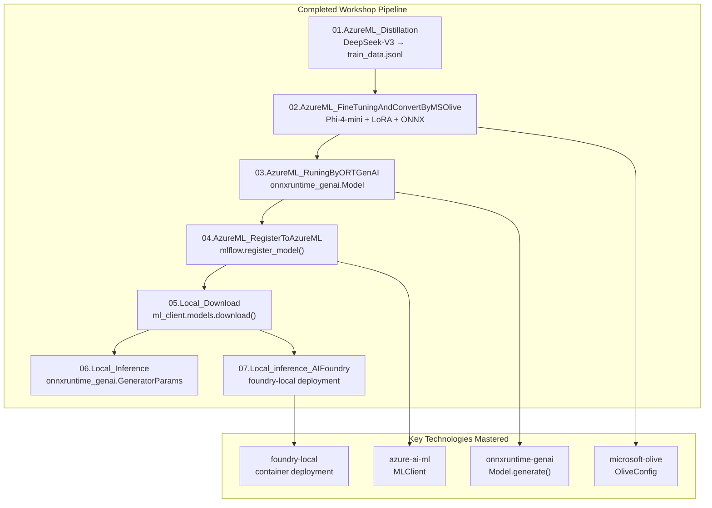
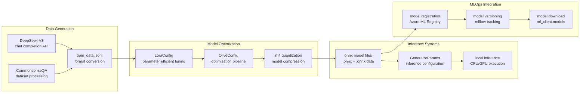
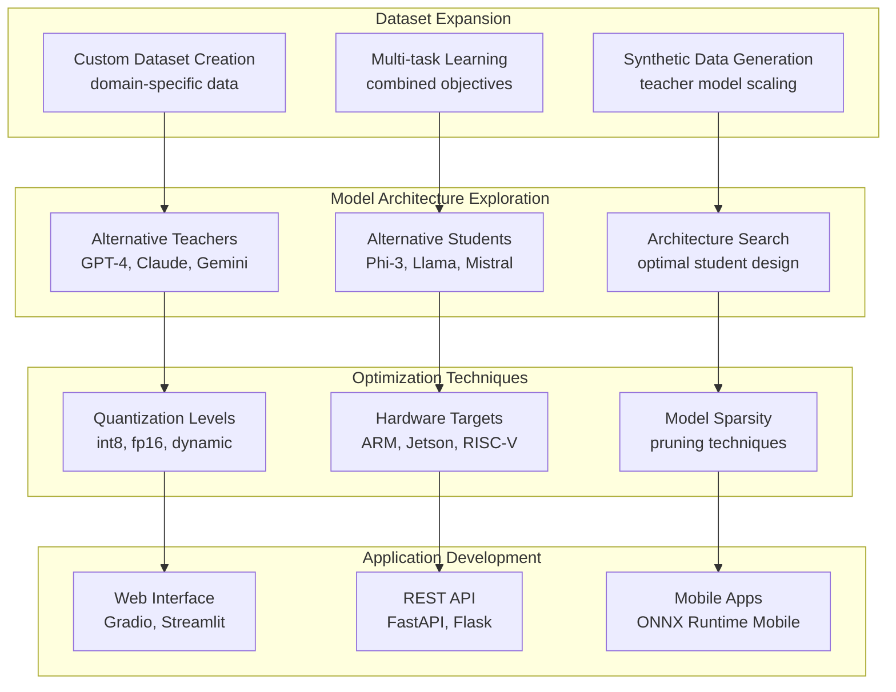

<!-- source: DeepWiki mcp.deepwiki.com · repo microsoft/Build25-LAB329 · extra page Workshop Conclusion and Next Steps · fetched 2026-10-26 -->

# Workshop Conclusion and Next Steps

Relevant source files

The following files were used as context for generating this wiki page:

- [lab_manual/Skillable_lab_manualconclusion.md](lab_manual/Skillable_lab_manualconclusion.md)
- [lab_manual/images/Skillable_Burger_Menu.png](lab_manual/images/Skillable_Burger_Menu.png)

This document provides closure for the Model Distillation Workshop, summarizing the technical achievements, outlining cleanup procedures, and recommending pathways for continued exploration of model distillation and edge deployment technologies.

For detailed configuration reference, see [Configuration Reference](#1.5.1). For contribution guidelines, see [Contributing and Support](#1.5.3).

## Workshop Completion Procedures

### Skillable Lab Cleanup

Participants using the Skillable lab environment must properly terminate their session to release allocated resources.

**Termination Steps:**
1. Select the Skillable burger menu in the top right corner
2. Select **End**  
3. Confirm by selecting **Yes, end my lab**

This stops the virtual machine and deallocates H100/A100 compute resources, preventing unnecessary charges to the Azure subscription.

Sources: [lab_manual/Skillable_lab_manualconclusion.md:4-13]()

## Technical Achievements Summary

### Complete Model Distillation Pipeline

Participants have successfully implemented a full model distillation workflow spanning cloud training to edge deployment.

### Model Transformation Metrics

| Metric | Teacher (DeepSeek-V3) | Student (Phi-4-mini) | Optimized ONNX |
|--------|----------------------|---------------------|----------------|
| Parameters | ~67B | ~14B | ~3.5B (int4) |
| Model Size | ~130GB | ~28GB | ~7GB |
| Deployment Target | H100/A100 | GPU/CPU | Edge Devices |
| Inference Speed | Slow | Medium | Fast |
| Memory Requirements | High | Medium | Low |

Sources: [lab_manual/Skillable_lab_manualconclusion.md:18-33]()

## Technical Skills Acquired

### Microsoft AI Ecosystem Proficiency

### Core Technical Competencies

**Knowledge Distillation:**
- Transfer learning from large teacher models to smaller student models
- Training data generation using teacher model completions
- LoRA (Low-Rank Adaptation) fine-tuning techniques

**Model Optimization:**
- Microsoft Olive optimization pipeline configuration
- ONNX model conversion and quantization
- int4 quantization for memory efficiency

**Inference Deployment:**
- ONNX Runtime GenAI for cross-platform inference
- Local model execution and parameter tuning
- Container-based deployment with Foundry Local

**MLOps Integration:**
- Azure ML model registration and versioning
- Model download and local deployment workflows
- End-to-end pipeline orchestration

Sources: [lab_manual/Skillable_lab_manualconclusion.md:27-33]()

## Future Exploration Pathways

### Advanced Model Distillation

### Technical Learning Resources

**Microsoft AI Technologies:**
- [Microsoft Olive](https://github.com/microsoft/Olive) - Model optimization framework
- [ONNX Runtime](https://onnxruntime.ai/) - Cross-platform inference engine
- [Azure Machine Learning](https://learn.microsoft.com/azure/machine-learning) - Cloud ML platform

**Advanced Topics:**
- Multi-teacher distillation for improved student performance
- Progressive distillation with intermediate model sizes
- Hardware-aware optimization for specific deployment targets
- Federated learning with distilled models

**Development Frameworks:**
- Gradio for rapid prototyping of model interfaces
- FastAPI for production-ready model serving
- Docker containerization for consistent deployments

Sources: [lab_manual/Skillable_lab_manualconclusion.md:34-54]()

## Community Engagement

### Repository Interaction

**GitHub Repository Starring:**
1. Navigate to [https://github.com/microsoft/Build25-LAB329](https://github.com/microsoft/Build25-LAB329)
2. Login to GitHub account
3. Click **Star** in the top right corner
4. Access starred repositories via profile menu → **Your stars**

**Contribution Opportunities:**
- Notebook improvements and bug fixes
- Additional model architecture examples
- Documentation enhancements
- Performance optimization techniques

### Feedback and Support

Participant feedback is valuable for improving future workshop iterations. Consider contributing:
- Issues with specific notebook execution steps
- Suggestions for additional model architectures
- Performance benchmark results from different hardware
- Use case examples and applications

Sources: [lab_manual/Skillable_lab_manualconclusion.md:55-66]()

## Next Session Preparation

For participants planning to continue model distillation work:

**Environment Preservation:**
- Export environment variables from `sample.env` configuration
- Document custom Azure ML compute configurations
- Save model registry connection strings
- Backup locally downloaded model files

**Resource Planning:**
- Estimate compute requirements for larger datasets
- Plan storage allocation for model artifacts
- Consider cost optimization for extended experimentation
- Evaluate hybrid cloud-edge deployment strategies

The completed workshop provides a solid foundation for advanced model distillation projects and production deployments in edge computing scenarios.

Sources: [lab_manual/Skillable_lab_manualconclusion.md:16-56]()

---

