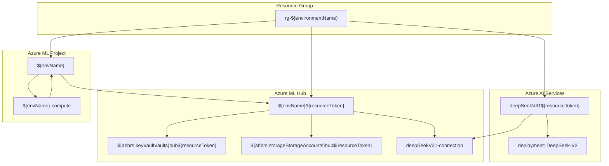
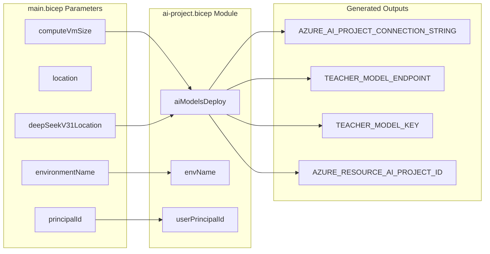
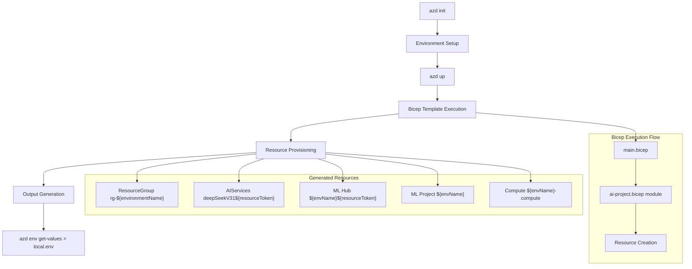
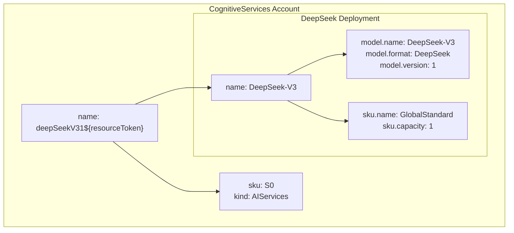
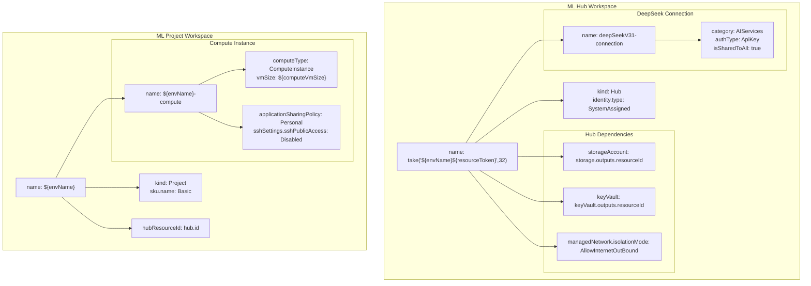
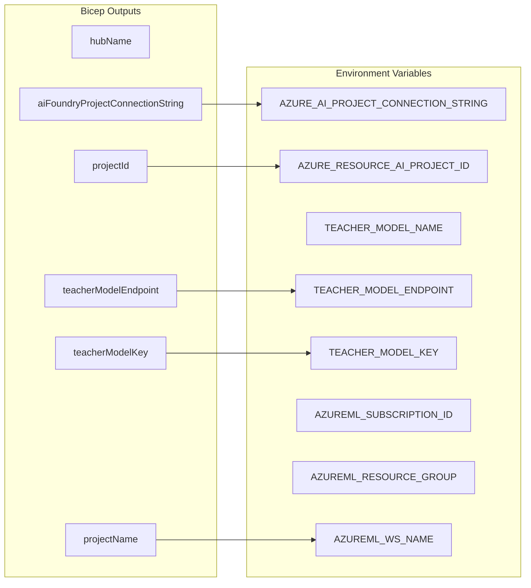

<!-- source: DeepWiki mcp.deepwiki.com · repo microsoft/Build25-LAB329 · extra page Azure Infrastructure Setup · fetched 2026-10-26 -->

# Azure Infrastructure Setup

<details>
<summary>Relevant source files</summary>

The following files were used as context for generating this wiki page:

- [infra/ai-project.bicep](infra/ai-project.bicep)
- [infra/main.bicep](infra/main.bicep)
- [lab_manual/setup_instructions.md](lab_manual/setup_instructions.md)

</details>


## Purpose and Scope

This document covers the automated and manual setup of Azure infrastructure required for the Model Distillation Workshop. The infrastructure deployment creates an Azure AI Foundry project with H100/A100 compute resources and deploys the DeepSeek-V3 teacher model for the knowledge distillation pipeline.

For information about configuring environment variables and development setup after infrastructure deployment, see [Environment Configuration](#1.1.2). For details about the complete workshop workflow, see [Workshop Workflow](#1.2).

## Infrastructure Architecture

The Azure infrastructure consists of multiple interconnected resources deployed through Bicep templates. The following diagram shows the core infrastructure components and their relationships as defined in the codebase:

### Core Infrastructure Components



Sources: [infra/ai-project.bicep:21-183](), [infra/main.bicep:36-53]()

### Deployment Parameter Flow



Sources: [infra/main.bicep:42-68](), [infra/ai-project.bicep:1-216]()

## Automated Deployment with Azure Developer CLI

### Prerequisites

The automated deployment requires specific tools and permissions as defined in the setup instructions:

| Requirement | Installation Command | Purpose |
|-------------|---------------------|---------|
| Azure CLI | `winget install -e --id Microsoft.AzureCLI` | Azure resource management |
| Azure Developer CLI | `winget install -e --id Microsoft.Azd` | Infrastructure as code deployment |
| Azure Subscription | - | Resource provisioning |
| Authentication | `az login` | Azure authentication |

Sources: [lab_manual/setup_instructions.md:161-178]()

### Deployment Process

The infrastructure deployment follows a standardized `azd` workflow:



Sources: [lab_manual/setup_instructions.md:182-208]()

#### Step-by-Step Deployment Commands

1. **Initialize Environment**
   ```bash
   azd init
   ```
   Creates environment configuration with user-specified `environmentName` parameter.

2. **Deploy Infrastructure**
   ```bash
   azd up
   ```
   Executes the `main.bicep` template with parameter prompts for:
   - Azure subscription selection
   - Deployment region (`location` parameter)
   - DeepSeek model region (`deepSeekV31Location` parameter)
   - Compute VM size (`computeVmSize` parameter, defaults to `STANDARD_NC40ADS_H100_V5`)

3. **Extract Environment Variables**
   ```bash
   azd env get-values > Lab329\Notebook\local.env
   ```
   Generates environment file from Bicep template outputs.

Sources: [lab_manual/setup_instructions.md:188-208]()

## Infrastructure Components Detail

### Azure AI Services Configuration

The `deepSeekV31Deploy` resource provisions the teacher model:



Sources: [infra/ai-project.bicep:76-104]()

### Azure ML Hub and Project Structure

The ML workspace hierarchy follows the hub-project pattern:



Sources: [infra/ai-project.bicep:106-183]()

### Compute Configuration Options

The infrastructure supports multiple GPU compute configurations via the `computeVmSize` parameter:

| VM Size | GPU Type | Default | Use Case |
|---------|----------|---------|----------|
| `STANDARD_NC40ADS_H100_V5` | H100 | ✓ | High-performance training |
| `Standard_ND96amsr_A100_v4` | A100 | - | Multi-GPU training |
| `Standard_NC24ads_A100_v4` | A100 | - | Single GPU training |

Sources: [infra/main.bicep:18-22](), [lab_manual/setup_instructions.md:18-24]()

## Output Variables and Environment Configuration

### Generated Environment Variables

The Bicep templates generate environment variables required by the notebook workflow:



Sources: [infra/main.bicep:55-68](), [infra/ai-project.bicep:205-216]()

### Connection String Format

The `aiFoundryProjectConnectionString` output combines multiple values:
```
${split(project.properties.discoveryUrl, '/')[2]};${subscription().subscriptionId};${resourceGroup().name};${project.name}
```

This format provides the necessary connection information for Azure AI Foundry integration.

Sources: [infra/ai-project.bicep:209]()

## Manual Setup Alternative

### Supported Regions and Prerequisites

Manual setup requires deployment in regions supporting both GPU compute and DeepSeek model deployment:

| Region | Code | GPU Support | MaaS Support |
|--------|------|-------------|--------------|
| West US | `westus` | ✓ | ✓ |
| South Central US | `southcentralus` | ✓ | ✓ |
| East US | `eastus` | ✓ | ✓ |
| West US 3 | `westus3` | ✓ | ✓ |
| North Central US | `northcentralus` | ✓ | ✓ |
| East US 2 | `eastus2` | ✓ | ✓ |

Sources: [lab_manual/setup_instructions.md:30-40]()

### Manual Resource Creation Process

For manual setup without Bicep templates, the process involves:

1. **Azure AI Foundry Project Creation** - Create project in supported region
2. **Compute Resource Provisioning** - Configure H100/A100 compute cluster  
3. **DeepSeek Model Deployment** - Deploy via Models as a Service (MaaS)
4. **Verification** - Test GPU availability and model connectivity

Detailed manual setup steps are provided for environments where automated deployment is not feasible.

Sources: [lab_manual/setup_instructions.md:41-156]()

## Infrastructure Verification

### Resource Validation Commands

After deployment, verify infrastructure status:

```bash
# List all deployed resources
azd env get-resources

# Check deployment logs for issues
azd env get-logs

# Verify environment variables
azd env get-values
```

Sources: [lab_manual/setup_instructions.md:229-239]()

### GPU Compute Verification

Test GPU availability in Azure ML notebooks:

```python
import torch

print(f"CUDA available: {torch.cuda.is_available()}")
if torch.cuda.is_available():
    print(f"Number of GPUs: {torch.cuda.device_count()}")
    print(f"GPU Device Name: {torch.cuda.get_device_name(0)}")
```

Expected output shows NVIDIA H100 or A100 GPU detection.

Sources: [lab_manual/setup_instructions.md:102-110]()

## Infrastructure Cleanup

### Resource Removal

Clean up all deployed resources:

```bash
# Remove all Azure resources
azd down

# Manual environment cleanup if needed
rm -rf ~/.azd/env/<EnvironmentName>
```

This removes all resources created by the Bicep templates to prevent ongoing charges.

Sources: [lab_manual/setup_instructions.md:263-295]()

---

