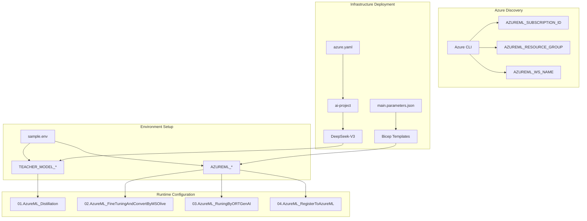
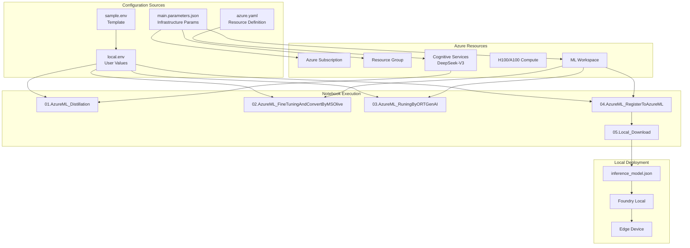

<!-- source: DeepWiki mcp.deepwiki.com · repo microsoft/Build25-LAB329 · extra page Configuration Reference · fetched 2026-10-26 -->

# Configuration Reference

<details>
<summary>Relevant source files</summary>

The following files were used as context for generating this wiki page:

- [.gitignore](.gitignore)
- [Lab329/Notebook/sample.env](Lab329/Notebook/sample.env)
- [Lab329/README.md](Lab329/README.md)
- [azure.yaml](azure.yaml)
- [infra/main.parameters.json](infra/main.parameters.json)

</details>


## Purpose and Scope

This document provides a comprehensive reference for all configuration parameters, environment variables, and system settings used in the Model Distillation Workshop. It covers the configuration required for the complete pipeline from Azure cloud infrastructure setup through local edge deployment.

This reference focuses on configuration values and their relationships. For setup procedures, see [Getting Started](#1.1) and [Azure Infrastructure Setup](#1.1.1). For deployment-specific configurations, see [Deployment Scenarios](#1.4).

## Environment Variables Configuration

The workshop uses environment variables to configure connections to Azure services and model endpoints. These are primarily defined in the `sample.env` file template.

### Teacher Model Configuration

| Variable | Purpose | Example Value | Required |
|----------|---------|---------------|----------|
| `TEACHER_MODEL_NAME` | Name of the teacher LLM | `DeepSeek-V3` | Yes |
| `TEACHER_MODEL_ENDPOINT` | API endpoint for teacher model | `https://westus3.api.cognitive.microsoft.com/models` | Yes |
| `TEACHER_MODEL_KEY` | Authentication key for teacher model | `your-api-key-here` | Yes |

### Azure ML Workspace Configuration

| Variable | Purpose | Example Value | Required |
|----------|---------|---------------|----------|
| `AZUREML_SUBSCRIPTION_ID` | Azure subscription identifier | `your-subscription-id` | Yes |
| `AZUREML_RESOURCE_GROUP` | Resource group containing ML workspace | `your-resource-group` | Yes |
| `AZUREML_WS_NAME` | Azure ML workspace name | `your-workspace-name` | Yes |

Sources: [Lab329/Notebook/sample.env:1-12]()

### Configuration Discovery Commands

The environment file includes CLI commands for discovering Azure configuration values:

```bash
# Get subscription ID
az account show --query id --output tsv

# List resource groups
az group list --query "[].name" --output tsv

# List ML workspaces
az ml workspace list --query "[].name" --output tsv
```

Sources: [Lab329/Notebook/sample.env:6-9]()

## Azure Infrastructure Configuration

### Azure Developer CLI Configuration

The `azure.yaml` file defines the project structure and resource requirements for automated deployment.

```yaml
name: build25-lab329-distill
resources:
  ai-project:
    type: ai.project
    models:
      - name: DeepSeek-V3
        version: "1"
        format: DeepSeek
        sku:
          name: GlobalStandard
          usageName: AIServices.GlobalStandard.MaaS
          capacity: 1
```

Sources: [azure.yaml:1-15]()

### Infrastructure Parameters

The Bicep deployment uses parameterized values for environment-specific configuration:

| Parameter | Source | Purpose |
|-----------|--------|---------|
| `environmentName` | `${AZURE_ENV_NAME}` | Environment identifier |
| `location` | `${AZURE_LOCATION}` | Azure region for resources |
| `principalId` | `${AZURE_PRINCIPAL_ID}` | Service principal for authentication |

Sources: [infra/main.parameters.json:1-15]()

## Configuration Flow and Dependencies

### Environment Configuration Flow



Sources: [Lab329/Notebook/sample.env:1-12](), [azure.yaml:1-15](), [infra/main.parameters.json:1-15]()

## Notebook Execution Environment Configuration

### Kernel Requirements by Notebook

The workshop requires specific Python environments for different notebooks:

| Notebook | Kernel Environment | Configuration Notes |
|----------|-------------------|---------------------|
| `01.AzureML_Distillation.ipynb` | Python 3.10 AzureML | Teacher model access |
| `02.AzureML_FineTuningAndConvertByMSOlive.ipynb` | Python 3.10 PyTorch and Tensorflow | GPU compute required |
| `03.AzureML_RuningByORTGenAI.ipynb` | Python 3.10 PyTorch and Tensorflow | ONNX Runtime GenAI |
| `04.AzureML_RegisterToAzureML.ipynb` | Python 3.10 AzureML | Model registry access |
| `05.Local_Download.ipynb` | Local Python 3.10+ | Edge device environment |

Sources: [Lab329/README.md:79-86]()

### Environment File Location

Environment variables must be configured in a `local.env` file within the Notebook folder:

```
Lab329/Notebook/local.env
```

Sources: [Lab329/README.md:87-88]()

## Model and Optimization Configuration

### Microsoft Olive Configuration

Microsoft Olive handles model optimization with these key configuration aspects:

- **Model Format**: ONNX conversion with int4 quantization
- **Hardware Target**: CPU optimization for edge deployment
- **Performance**: ~75% size reduction while maintaining accuracy

### Student Model Configuration

| Parameter | Value | Purpose |
|-----------|-------|---------|
| Model | `Phi-4-mini` | Student model for distillation |
| Fine-tuning | LoRA adapters | Parameter-efficient training |
| Quantization | int4 | Size optimization |
| Target Size | ~3.5B parameters | Edge deployment |

Sources: [Lab329/README.md:68-77]()

## Local Deployment Configuration

### Foundry Local Configuration

Local deployment requires additional configuration files:

1. **Model Configuration**: `LocalFoundryEnv/inference_model.json`
2. **Deployment Location**: Copy to download folder (e.g., `ft-phi-4-onnx-int4-cpu/onnx`)

### Foundry Local Commands

```bash
foundry cache cd model
foundry model run model
```

Sources: [Lab329/README.md:103-109]()

## Configuration Dependencies Diagram

### System Configuration Relationships



Sources: [Lab329/Notebook/sample.env:1-12](), [azure.yaml:1-15](), [Lab329/README.md:79-109]()

## Required Permissions and Access

### Azure Subscription Requirements

- Azure subscription with appropriate permissions for AzureML services
- Access to H100/A100 GPU compute for model training
- Cognitive Services access for DeepSeek-V3 model

### Local Environment Requirements

- Python 3.10+ installation on edge device
- Sufficient computing resources for model inference
- Foundry Local SDK installation

Sources: [Lab329/README.md:100-102]()

## Configuration Validation

### Environment Variable Validation

Before executing notebooks, verify all required environment variables are set:

1. **Teacher Model Variables**: `TEACHER_MODEL_NAME`, `TEACHER_MODEL_ENDPOINT`, `TEACHER_MODEL_KEY`
2. **Azure ML Variables**: `AZUREML_SUBSCRIPTION_ID`, `AZUREML_RESOURCE_GROUP`, `AZUREML_WS_NAME`

### Infrastructure Validation

Ensure Azure resources are properly provisioned:

1. Azure AI Foundry project with DeepSeek-V3 model
2. Azure ML workspace with GPU compute
3. Proper IAM permissions for service principal

Sources: [Lab329/README.md:87-98]()

---

