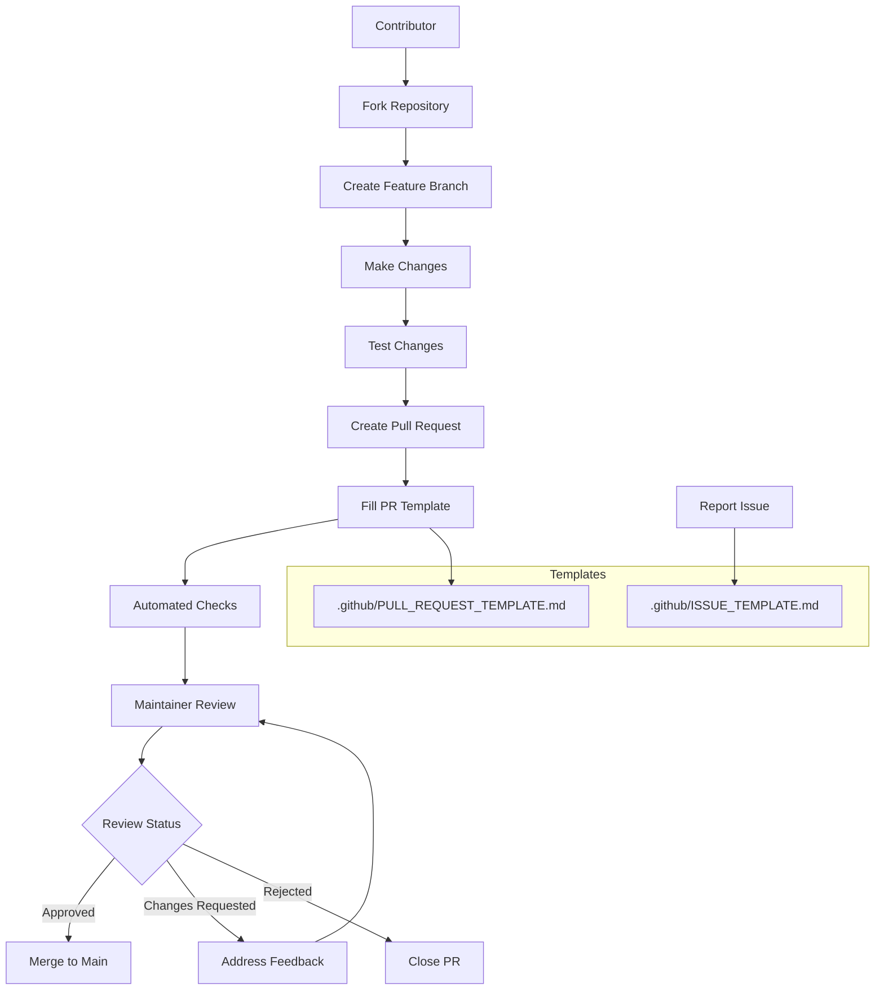
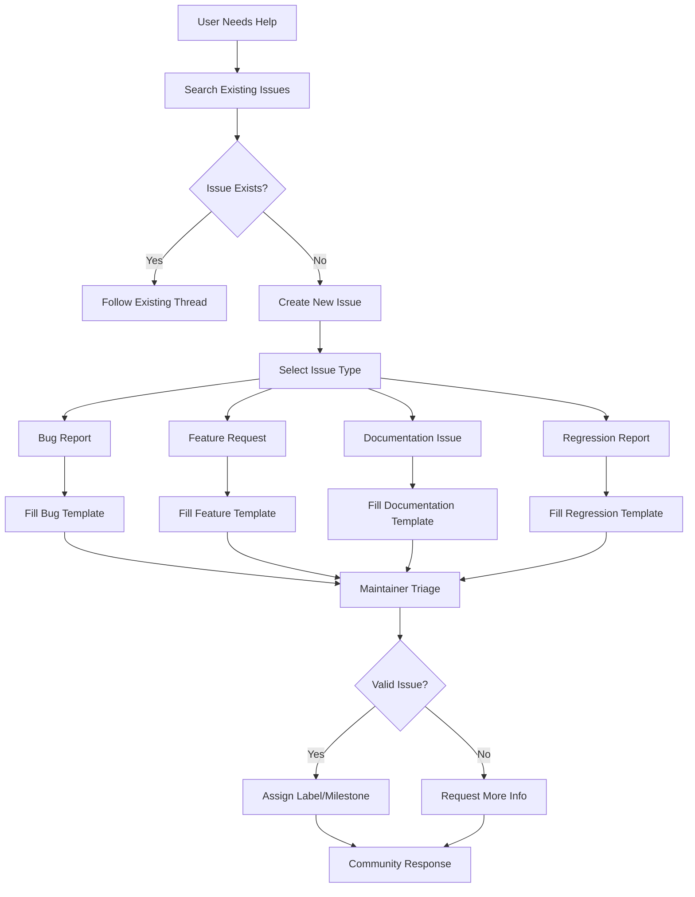
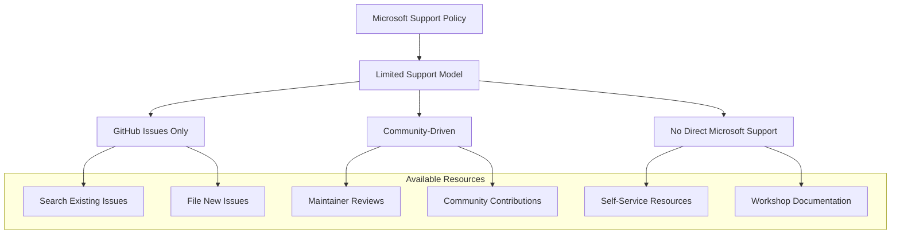

<!-- source: DeepWiki mcp.deepwiki.com · repo microsoft/Build25-LAB329 · extra page Contributing and Support · fetched 2026-10-26 -->

# Contributing and Support

Relevant source files

The following files were used as context for generating this wiki page:

- [.github/ISSUE_TEMPLATE.md](.github/ISSUE_TEMPLATE.md)
- [.github/PULL_REQUEST_TEMPLATE.md](.github/PULL_REQUEST_TEMPLATE.md)
- [SUPPORT.md](SUPPORT.md)

This document outlines the processes for contributing to the Build25-LAB329 Model Distillation Workshop repository and obtaining support for issues or questions. It covers the structured workflows for submitting pull requests, reporting bugs, requesting features, and engaging with the project maintainers.

For information about workshop completion and cleanup procedures, see [Workshop Conclusion and Next Steps](#1.5.2). For technical configuration details, see [Configuration Reference](#1.5.1).

## Contributing Process

The repository follows a standard GitHub-based contribution workflow with structured templates for pull requests and issues. All contributions must go through the established review process to maintain code quality and workshop integrity.

### Contribution Workflow

Sources: [.github/PULL_REQUEST_TEMPLATE.md:1-34](), [.github/ISSUE_TEMPLATE.md:1-36]()

### Pull Request Requirements

All pull requests must use the structured template defined in [.github/PULL_REQUEST_TEMPLATE.md:1-34](). The template ensures comprehensive information about proposed changes:

| Requirement | Description | Template Section |
|-------------|-------------|------------------|
| Purpose Description | Clear explanation of problem being solved | [.github/PULL_REQUEST_TEMPLATE.md:3-3]() |
| Breaking Change Assessment | Impact analysis on existing deployments | [.github/PULL_REQUEST_TEMPLATE.md:5-13]() |
| Documentation Updates | Required changes to learn.microsoft.com content | [.github/PULL_REQUEST_TEMPLATE.md:15-22]() |
| Change Classification | Type categorization (bugfix, feature, etc.) | [.github/PULL_REQUEST_TEMPLATE.md:24-33]() |

#### Breaking Change Evaluation

Contributors must assess whether changes will cause errors when developers merge from main and run `azd up` or `azd deploy` commands. This evaluation is critical for workshop stability across different environments.

Sources: [.github/PULL_REQUEST_TEMPLATE.md:5-13]()

## Support Channels

The project provides structured support through GitHub Issues with specific guidelines for different types of requests. Support is limited to community-driven assistance and maintainer availability.

### Support Process Flow

Sources: [SUPPORT.md:5-8](), [.github/ISSUE_TEMPLATE.md:7-13]()

### Issue Templates and Classification

The repository uses a comprehensive issue template system that requires specific information based on issue type:

#### Issue Type Classifications

The template in [.github/ISSUE_TEMPLATE.md:7-13]() defines four primary issue categories:

- **Bug Report**: Reproducible defects in workshop functionality
- **Feature Request**: New capabilities or enhancements
- **Documentation Issue**: Problems with instructional content
- **Regression**: Previously working functionality that broke

#### Required Information

All issues must include standardized information as defined in [.github/ISSUE_TEMPLATE.md:15-33]():

| Field | Purpose | Required For |
|-------|---------|--------------|
| Minimal Reproduction Steps | Enable maintainer debugging | Bug reports, regressions |
| Log Messages | Diagnostic information | All error-related issues |
| Expected Behavior | Clear success criteria | Bug reports, features |
| OS and Version | Environment compatibility | Technical issues |
| `azd version` Output | Deployment tool compatibility | Infrastructure issues |

Sources: [.github/ISSUE_TEMPLATE.md:15-33]()

## Microsoft Support Policy

The project operates under a limited support model as defined in [SUPPORT.md:18-19](). Support is primarily community-driven with the following constraints:

### Support Limitations

Sources: [SUPPORT.md:18-19]()

## Quality Assurance Requirements

Contributors must follow specific quality standards to maintain workshop integrity across different Azure environments and deployment scenarios.

### Pre-Submission Checklist

Before submitting pull requests, contributors should verify:

1. **Environment Testing**: Changes work across different Azure subscriptions and regions
2. **Azure Developer CLI Compatibility**: No breaking changes to `azd` commands
3. **Documentation Alignment**: Updates to learn.microsoft.com modules if required
4. **Notebook Functionality**: All workshop notebooks execute successfully
5. **Resource Cleanup**: Proper resource disposal in teardown procedures

### Testing Environments

Contributors should test changes against multiple scenarios:

- Fresh Azure subscriptions without existing resources
- Existing environments with partial workshop completion
- Different Azure regions with varying compute availability
- Multiple operating systems (Windows, macOS, Linux)

Sources: [.github/PULL_REQUEST_TEMPLATE.md:5-13]()

## Community Guidelines

The repository maintains professional standards for all interactions:

### Communication Standards

- Use clear, technical language in issue descriptions
- Provide complete reproduction steps for bugs
- Include relevant log outputs and error messages
- Reference specific notebook cells or configuration files when applicable
- Follow the established template structures for consistency

### Response Expectations

Community members and maintainers operate on a volunteer basis with no guaranteed response times. Issues are triaged based on:

- Impact on workshop completion
- Clarity of problem description
- Availability of reproduction steps
- Alignment with workshop objectives

Sources: [SUPPORT.md:5-19]()

---

