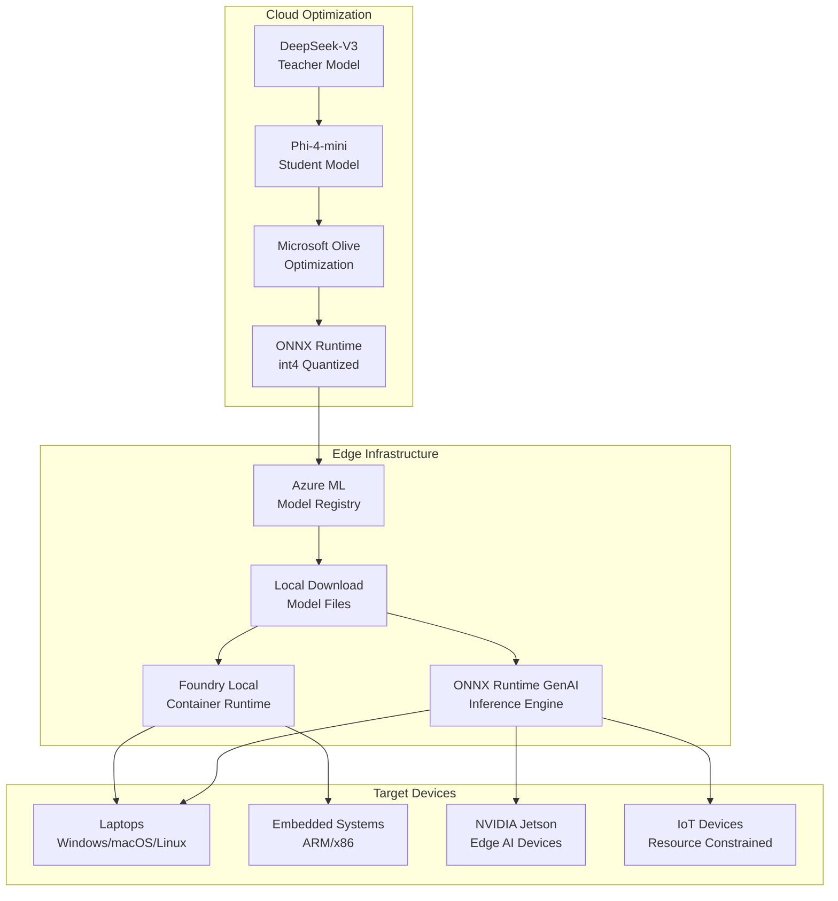
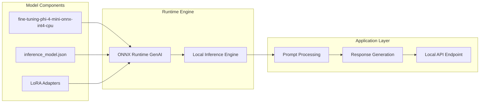
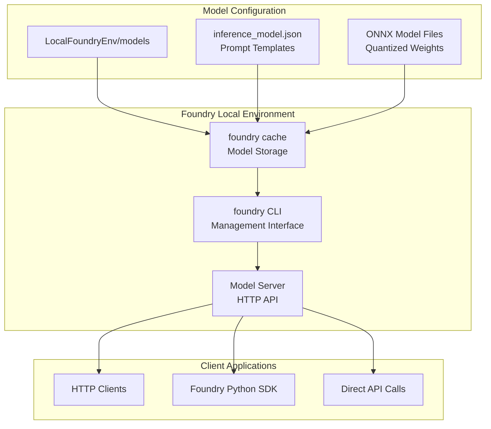
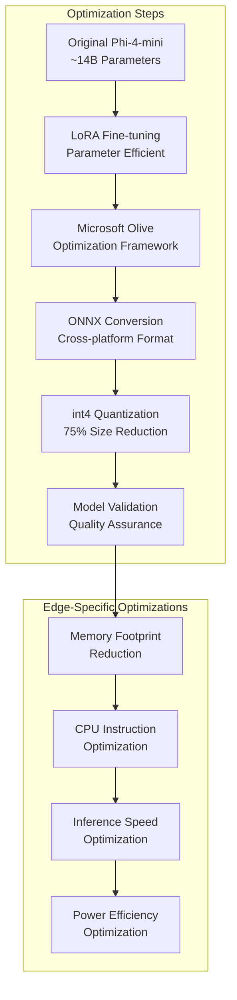

<!-- source: DeepWiki mcp.deepwiki.com · repo microsoft/Build25-LAB329 · extra page Edge Computing Applications · fetched 2026-10-26 -->

# Edge Computing Applications

<details>
<summary>Relevant source files</summary>

The following files were used as context for generating this wiki page:

- [Lab329/Notebook/07.Local_inference_AIFoundry.ipynb](Lab329/Notebook/07.Local_inference_AIFoundry.ipynb)
- [lab_manual/Skillable_lab_manualintro.md](lab_manual/Skillable_lab_manualintro.md)
- [lab_manual/images/localenv.png](lab_manual/images/localenv.png)

</details>


This document covers the deployment of distilled language models to edge computing environments, including resource-constrained devices, embedded systems, and offline scenarios. It focuses on the practical implementation of running optimized models locally using containerized solutions and direct inference engines.

For information about the model optimization process that prepares models for edge deployment, see [Technical Components](#1.3). For details about the overall distillation workflow, see [Workshop Workflow](#1.2).

## Purpose and Scope

Edge computing applications in this workshop enable AI capabilities on devices with limited computational resources, network connectivity, or privacy requirements. The primary scenario targets educational environments where AI-powered question-answering systems must operate on laptops or edge servers without constant cloud connectivity.

The optimized models achieve a 75% size reduction from the original teacher model while maintaining performance, making them suitable for deployment on standard hardware without specialized GPUs.

Sources: [lab_manual/Skillable_lab_manualintro.md:16-44]()

## Edge Deployment Architecture

The edge deployment architecture consists of multiple layers that enable seamless transition from cloud-optimized models to local inference systems.



Sources: [lab_manual/Skillable_lab_manualintro.md:36-44](), [Lab329/Notebook/07.Local_inference_AIFoundry.ipynb:26-34]()

## Local Inference Implementation

The edge deployment supports two primary inference methods: direct ONNX Runtime GenAI integration and containerized Foundry Local deployment.

### ONNX Runtime GenAI Integration

Direct integration with ONNX Runtime GenAI provides the most efficient path for resource-constrained environments. The optimized models use int4 quantization to reduce memory footprint while maintaining inference speed.



Sources: [Lab329/Notebook/07.Local_inference_AIFoundry.ipynb:44-46]()

### Foundry Local Containerized Deployment

Azure Foundry Local provides a containerized solution for deploying models across different edge environments with consistent behavior and management capabilities.



Sources: [Lab329/Notebook/07.Local_inference_AIFoundry.ipynb:69-119]()

## Hardware Compatibility Matrix

The optimized models support deployment across various hardware configurations with different performance characteristics.

| Hardware Type | CPU Architecture | Memory Requirements | Performance Level | Supported Runtime |
|---------------|------------------|-------------------|-------------------|-------------------|
| Standard Laptops | x86_64 | 8GB RAM | High | ONNX RT + Foundry Local |
| ARM Devices | ARM64 | 4GB RAM | Medium | ONNX Runtime GenAI |
| NVIDIA Jetson | ARM64 + GPU | 4GB RAM | High | ONNX RT + CUDA |
| IoT Devices | ARM32/64 | 2GB RAM | Low | ONNX Runtime GenAI |
| Embedded Systems | x86/ARM | 4GB RAM | Medium | ONNX Runtime GenAI |

Sources: [lab_manual/Skillable_lab_manualintro.md:40-44](), [Lab329/Notebook/07.Local_inference_AIFoundry.ipynb:27-30]()

## Model Optimization Pipeline for Edge

The edge deployment requires specific optimizations to ensure efficient operation on resource-constrained hardware.



Sources: [lab_manual/Skillable_lab_manualintro.md:26-30]()

## Deployment Scenarios

### Educational Environments

The primary use case targets educational institutions requiring offline AI capabilities for question-answering systems. Schools with limited internet connectivity or privacy requirements can deploy these models locally.

**Implementation Example:**
- Model deployment on school laptops or edge servers
- Offline operation during class sessions
- Privacy-compliant data processing
- CommonsenseQA-style question answering

### Industrial IoT Applications

Resource-constrained industrial devices can utilize the optimized models for:
- Equipment monitoring and diagnostics
- Automated decision-making systems
- Edge analytics without cloud dependency
- Real-time inference on embedded controllers

### Healthcare Edge Computing

Healthcare applications requiring data privacy and low-latency responses benefit from local model deployment:
- Patient data analysis on premises
- Medical imaging assistance
- Clinical decision support systems
- Regulatory compliance through local processing

Sources: [lab_manual/Skillable_lab_manualintro.md:16-34]()

## Performance Considerations

### Memory Usage Optimization

The int4 quantization reduces model size significantly while maintaining acceptable accuracy levels. Memory usage patterns show:

- Original model: ~28GB memory footprint
- Optimized model: ~7GB memory footprint
- Peak inference memory: Additional 2-4GB during processing

### Inference Latency

Edge deployment prioritizes consistent response times over peak performance:

- Cold start latency: 2-5 seconds for model loading
- Warm inference: 100-500ms per query depending on hardware
- Batch processing: Improved throughput for multiple queries

### Power Efficiency

Optimizations specifically target power-constrained environments:

- CPU-optimized inference paths
- Reduced memory bandwidth requirements
- Efficient instruction utilization
- Dynamic scaling based on workload

Sources: [lab_manual/Skillable_lab_manualintro.md:38-44]()

## Foundry Local CLI Operations

The `foundry` CLI provides comprehensive model management capabilities for edge deployments:

### Model Management Commands

```bash
# Navigate to model cache directory
foundry cache cd models

# List available models
foundry cache list

# Run model with verbose output
foundry model run model --verbose
```

### Service Management

The Foundry Local CLI includes service management commands for:
- **Model**: Commands for managing and running models
- **Service**: Commands for managing the AI Foundry Local service
- **Cache**: Commands for managing local model storage

Sources: [Lab329/Notebook/07.Local_inference_AIFoundry.ipynb:87-119]()

## Integration Examples

### Sample Question Processing

The deployed models handle multiple-choice questions in the CommonsenseQA format:

```
Question: Sammy wanted to go to where the people were. Where might he go?
Answer Choices:
(A) race track
(B) populated areas
(C) the desert
(D) apartment
(E) roadblock
```

This demonstrates the model's ability to perform reasoning tasks on edge devices without cloud connectivity.

Sources: [Lab329/Notebook/07.Local_inference_AIFoundry.ipynb:97-104]()

## Next Steps and Extensions

Edge computing applications can be extended to support:

- Advanced prompt engineering for domain-specific tasks
- Performance benchmarking across different hardware configurations
- Integration with existing application frameworks
- Monitoring and logging for production deployments

For detailed implementation guidance, see the Foundry Local documentation and explore advanced model optimization techniques through the Microsoft Olive framework.

Sources: [Lab329/Notebook/07.Local_inference_AIFoundry.ipynb:136-145]()

---

